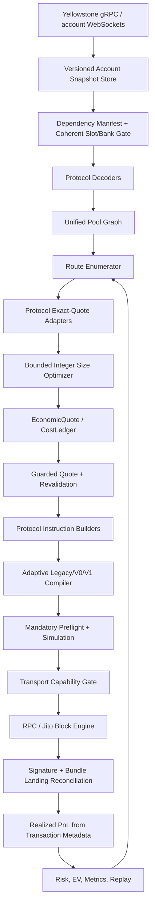

# Unified Solana Arbitrage Research & Integration Plan

**Research cut-off:** 2026-11-11  
**Input artifact:** `work_22new.zip`  
**Runtime posture:** SHADOW / LIVE DISABLED  
**Purpose:** connect market-data ingestion, protocol adapters, route construction, flash-loan economics, transaction compilation, Jito/RPC delivery, and realized-PnL reconciliation into one enforceable path.

> This document is an integration baseline, not a claim that the code is production-ready. The archive's own `docs/PHASE_STATUS.md` and `audit_reports/18_FINAL_AUDIT_VERDICT.md` remain authoritative for phase status. No source execution code was changed in this research pass.

---

## 1. Executive decision

The right target is **one route pipeline with protocol-specific quote/build adapters**, not separate arbitrage engines that each invent their own size, fee, slippage, and profitability logic.

The target flow is:

**Hard design rule:** a route is not executable merely because it can be quoted. It must carry the exact account dependencies, state slot/hash, protocol version, quote provenance, expected/minimum outputs, and complete economic ledger all the way into compilation and pre-dispatch validation.

---

## 2. Current archive: integration blockers verified from source

The following are source observations in this archive, not assumptions from old reports.

| Area | Evidence in archive | Required integration change |
|---|---|---|
| Live transaction size gate | `arb-bot/src/supervisor/dispatch.rs` still rejects `tx_bytes.len() > 1232` | Replace byte-only gate with compiler-produced `TransactionVersion + wire_size + transport capability`; retain 1232 for Legacy/V0 and allow V1 only when the selected transport is proven to support it |
| V1 implementation reachability | `arb-tx/src/adaptive.rs` contains V1 compiler types; `arb-execution` contains V1/preflight work, but `arb-bot/Cargo.toml` does not depend on `arb-execution` | Connect one canonical compiler/preflight API to the actual supervisor path; do not maintain duplicate compiler implementations |
| Preflight default | `arb-execution/src/preflight.rs` defaults to 1232 bytes and estimates a legacy-like layout | Make preflight consume the exact serialized transaction and selected compiler capability; do not re-estimate wire size from instructions |
| Economics at opportunity creation | `arb-engine/src/lib.rs::make_economic_opportunity` passes `final_out` as both expected and minimum output and supplies zero for several costs | Feed per-hop min-out propagation and quote fee provenance into one `EconomicQuote` |
| Supervisor accounting | `arb-bot/src/supervisor/run.rs` still calls `calculate_net_profit_raw` | Eliminate the parallel calculation; pass one signed `EconomicQuote` through risk, tip selection, dispatch, and settlement |
| Unbounded flash sizing | `run.rs` chooses `u64::MAX` as the flash-loan sizing ceiling | Use configured risk notional, lender liquidity, route capacity, token/account constraints, and checked upper bounds |
| Meteora Token-2022 fee application | `meteora_quote_engine.rs` calls `apply_transfer_fee_ceil` as though its return value were the fee; the helper returns the post-fee amount | Replace with explicit `TransferFee { fee, net_amount }` result; test fee caps, epoch schedule, input and output sides |
| DLMM state | `meteora_quote_engine.rs` sets `status: 0`; current pool state must carry and validate actual swap status | Decode status/activation/collect-fee mode from canonical pool state and refuse unsupported state |
| Guarded quote | `quote_route_guarded` and `revalidate_before_dispatch` exist but the supervisor still follows the direct quote/build path | Make guarded quote and dependency-hash revalidation mandatory before instruction building and immediately before send |
| Protocol compatibility | `docs/PROTOCOL_COMPATIBILITY.md` says Pump.fun/PumpSwap builders are disabled; Raydium/Orca/Meteora source paths lack full differential + fork acceptance | Keep protocol-specific enablement flags fail-closed; a common graph may discover all venues without authorizing every adapter to trade |
| Jito accounting / routing | Existing audit reports show one-transaction bundle design but gaps in bid cap/config and timeout reconciliation | Keep borrow→swaps→repay in one transaction; use a single idempotent send/landing state machine and reconcile late outcomes before updating tip EV |

### Critical correction to old roadmap documents

Some older roadmap material recommends bypassing risk gates, skipping RPC simulation, clearing kill-switch markers, and removing the explicit live gate. Those are **not accepted remediation steps**. They conflict with the current `PHASE_STATUS.md`, `TEST_EVIDENCE.md`, and final audit verdict. They must not be applied. The correct sequence is: fix correctness, prove simulation/reconciliation, shadow soak, explicit operator approval, then a capped canary.

---

## 3. Latest protocol and runtime research (2026-11-11)

### 3.1 Solana transaction formats: Legacy, V0, V1

The Solana Foundation's current upgrade documentation says Transaction V1 is active on mainnet after the September 15, 2026 activation. The format supports up to 4096 bytes, while Legacy/V0 remain at 1232 bytes. V0 supports Address Lookup Tables; V1 does not. V1 carries resource configuration in the message rather than Compute Budget instructions. Sources: [Solana Foundation — Larger Transaction Sizes](https://solana.com/upgrades/larger-transaction-sizes), [Solana Versioned Transactions](https://solana.com/docs/core/transactions/versioned-transactions), [SIMD-0385](https://github.com/solana-foundation/solana-improvement-documents/blob/main/proposals/0385-transaction-v1.md).

**V1 runtime requirements:**
- Use V1 only when the full path (compiler, signer, simulator, RPC reader, relay/leader, landing decoder) supports it.
- Set compute-unit limit and loaded-account-data limit explicitly; unset V1 resource limits default to zero and fail execution.
- Strip Compute Budget instructions from V1 messages: on V1 they are no-op instructions that still consume an instruction slot/CU; resource values belong in the V1 config.
- Priority fee in V1 is an absolute lamport amount in message config, not `CU price × CU limit`.
- V1 has no ALTs. Keep the current conservative 64-address limit unless the relevant feature extension is activated and verified.
- Every RPC transaction/block reader must advertise `maxSupportedTransactionVersion: 1`; Geyser/indexing decoders must recognize V1's distinct wire layout and config.
- The current Solana Foundation upgrade notes identify Jito-Solana v4.2.2+ and Agave RPC v4.2.2+ as the minimum release line for V1 handling. Jito's public release page now lists mainnet v4.4.0-jito (Oct 29, 2026). Do not infer that every third-party relay, hosted RPC, parser, or Block Engine ingress has V1 support merely from the validator release.

**Compiler policy:**
1. Build Legacy only for small, compatibility-sensitive transactions where it is useful.
2. Prefer V0 when ALTs reduce the wire size and the selected ALT is active, warm, correctly indexed, and verified.
3. Consider V1 when the actual signed wire transaction is >1232 and <=4096 bytes, inline accounts fit the V1 limits, and every downstream capability is explicitly confirmed.
4. If no supported compiler/transport combination can carry the route, reject it before signing. Never silently truncate, split, or send an oversized V0 as V1.
5. Keep a per-transport capability record: supported versions, max bytes, base64 support, RPC reader version, simulation version, and last successful conformance probe.

### 3.2 Fees and compute budget

Current Solana fee docs specify:
- Base fee: currently 5000 lamports per transaction signature.
- Legacy/V0 priority fee: `ceil(CU_price_micro_lamports × CU_limit / 1_000_000)`.
- Fees are charged even when execution fails.
- V1 priority fee: absolute lamports in the message config.
- Priority fee is based on requested CU limit, not actual CU consumption; oversized CU limits waste money.
- Runtime max compute is currently 1,400,000 CU per transaction.

Sources: [Solana Fees](https://solana.com/docs/core/fees), [Fee Structure](https://solana.com/docs/core/fees/fee-structure), [Compute Budget](https://solana.com/docs/core/fees/compute-budget).

**Implementation rule:** calculate fee once from the exact selected message version. Use simulation to measure CU, add a small explicit safety margin (Solana docs describe 10% as a baseline), and cap by runtime limits and route economics. Do not combine multiple independent CU-price elevators. For V1, use the message's absolute priority fee and do not also count a CU-price instruction.

### 3.3 Jito delivery

Jito's current public docs describe:
- Bundles contain up to five signed transactions.
- Bundle transactions execute sequentially and atomically (all-or-nothing) in one slot.
- A bundle needs a tip to one of the official tip accounts; Jito recommends random tip-account selection to reduce contention.
- The single-transaction `/api/v1/transactions` path forwards directly to the validator and supports `bundleOnly=true` for revert protection; the endpoint sets `skip_preflight=true`.
- A successful `sendBundle` response / bundle ID means accepted by the service, not landed; use `getBundleStatuses` and reconcile against chain status.
- Jito's auction runs at 50ms ticks and considers tip / requested-CU efficiency and account lock intersections.

Sources: [Jito Low Latency Transaction Send](https://docs.jito.wtf/lowlatencytxnsend/), [Jito Bundles](https://docs.jito.wtf/bundles/), [Jito-Solana releases](https://github.com/jito-foundation/jito-solana/releases).

**Atomic flash-loan policy:** keep `flash_borrow → DEX swaps → flash_repay` in the same Solana transaction. A one-transaction Jito bundle is acceptable as a delivery wrapper, but never split borrow and repay across separate bundle transactions. Put the tip transfer in that same transaction when possible so a non-landed/reverted transaction does not leak a separate tip. Model priority fee and Jito tip as distinct costs; use both only when the expected landing improvement justifies the total bid.

**V1/Jito caution:** Solana's validator upgrade note establishes the minimum Jito-Solana validator version for V1, but the public Block Engine API page does not provide an unambiguous per-ingress V1 max-size guarantee. Therefore the code must not assume `sendBundle` or every regional ingress accepts 4096-byte V1. Gate V1 per transport and require a signed >1232-byte canary on a supported non-value test path plus landed transaction decoding before enabling that transport.

### 3.4 Protocol SDK and quote practices

**Meteora DLMM**
- The current official Rust integration guide exposes account/IDL types, exact-in/exact-out quote helpers, BinArray PDA helpers, bitmap extension support, and Token-2022 fee / transfer-hook helpers.
- Quote requires current pair state, bin arrays, bitmap extension when outside the inline bitmap range, current clock, and mint accounts.
- The SDK's current changelog includes limit-order liquidity in quote paths and Token-2022 ScaledUiAmount support; the Rust SDK guide calls out swap status, activation, dynamic fee, bin traversal, bitmap extension, transfer fees, and transfer hooks.
- Use the official SDK/IDL as a differential oracle. Compare quote outputs, fee amounts, account metas/order, bin-array list, and instruction bytes for both directions.
Sources: [Meteora Rust DLMM guide](https://github.com/MeteoraAg/docs/blob/main/developer-guides/dlmm/rust-integration/library.mdx), [DLMM SDK changelog](https://github.com/MeteoraAg/dlmm-sdk/blob/main/CHANGELOG.md).

**Raydium**
- Raydium's current docs distinguish backend/bot Trade API use from full-control SDK use and on-chain CPI composition.
- Keep CPMM, CLMM, AMM V4, and LaunchLab as separate adapters; do not share an account schema or fee assumption between them.
- CLMM quote must traverse the exact tick arrays and decode live AmmConfig/fee state; CPMM must use the pool's actual config; AMM V4 account layout must be based on that pool's real account set.
Sources: [Raydium docs quick start](https://github.com/raydium-io/raydium-docs-v1/blob/main/quick-start/index.mdx), [Raydium SDK V2](https://github.com/raydium-io/raydium-sdk-V2).

**Orca Whirlpools**
- Orca maintains a Rust SDK (`orca_whirlpools`) plus client and core math/quote libraries.
- Derive direction from `mint_in == token_mint_a` and the decoded pool's mint ordering, never from WSOL identity.
- Quote against the actual tick arrays and current sqrt price; instruction account metas must be derived from the same dependency manifest used for the quote.
Source: [Orca Whirlpools repository and SDK overview](https://github.com/orca-so/whirlpools).

**Kamino Klend flash loan**
- Borrow and repay must be paired in the same transaction; repayment is validated through instruction introspection and includes the reserve's configured flash fee.
- Decode the current reserve fee parameter from the reserve account and use checked fixed-point arithmetic with ceiling rounding. Never substitute zero or a constant fee.
Source: [Kamino Klend program](https://github.com/Kamino-Finance/klend).

---

## 4. One shared data contract for every protocol

Every quote/build adapter must consume and return the same versioned data contract.

### 4.1 `PoolSnapshot`
Required fields:
- `pool_id`, `program_id`, `protocol`, `protocol_version`
- `mint_a`, `mint_b`, `token_program_a`, `token_program_b`, decimals
- protocol-specific state (CPMM reserves/config; CLMM sqrt price/tick/liquidity/tick arrays; DLMM active bin/fee params/bin arrays/bitmap extension; Pump curve state)
- every execution account required by the builder
- `context_slot`, `write_slot`, `account_hash`, `stream_generation`, `observed_at`
- `status`, activation state, pause/swap-disable flags

A pool must not enter the graph if its state is stale, incomplete, inconsistent, or has an unknown token extension that changes transfer behavior.

### 4.2 `RouteQuote`
Required fields:
- ordered `hops[]`, each with `pool_id`, `program_id`, `mint_in`, `mint_out`, `amount_in`, `expected_out`, `min_out`
- exact DEX fee and transfer fee separately, plus `fee_included_in_output` provenance
- exact execution account dependency set and hash
- source slot / bank context and quote engine version
- expected final amount and conservative final amount
- compute estimate, account count, instruction count, serialized size estimate
- explicit failure reason; quote errors must never be converted to output `0` without preserving the reason

### 4.3 `EconomicQuote` / `CostLedger`
One authoritative ledger, no second net-profit function in the supervisor.

For a WSOL-base flash loan:

\[
P_{expected} = O_{expected} - B - F_{flash} - F_{network} - F_{priority} - T_{Jito} - C_{account} - C_{other}
\]

\[
P_{minimum} = O_{minimum} - B - F_{flash} - F_{network} - F_{priority} - T_{Jito} - C_{account} - C_{other}
\]

DEX and transfer fees are subtracted only if the adapter's `expected_out` has not already netted them. The ledger must carry `MintId + decimals + unit + payer + quote_inclusion_provenance` for every cost. Do not compare token raw units from different mints.

For non-WSOL base assets, convert SOL-denominated costs through a fresh, slot-tagged rational conversion rate. If the rate is stale or unavailable, reject the trade. Do not use a hardcoded USD/SOL rate in the optimizer.

**Profit condition:** require `P_minimum >= configured_min_profit`. The final swap's on-chain `min_out` should be at least principal + flash fee + target profit (plus any same-asset costs that are paid from the output asset). Network fee paid separately in SOL remains an off-chain economic cost and must still be included in the profitability gate. If an enforceable arbitrary post-route token-balance guard is needed, use a dedicated on-chain executor; do not claim the DEX min-out alone proves every off-chain cost.

### 4.4 `ExecutionPlan`
One immutable plan passed from optimizer to builder:
- route quote and dependency hash
- borrow amount, lender reserve, fee parameter and computed repay amount
- min-out for every hop
- economic quote + min profit
- exact protocol instruction list and required accounts
- compute limit and priority fee for selected transaction version
- selected `Legacy | V0 | V1` compiler
- transport capabilities and tip policy
- expiry block height / blockhash context
- deterministic idempotency key

The builder must not recompute route amounts or silently replace accounts after the plan is accepted.

---

## 5. Route-unification strategy

### 5.1 Route discovery

Build one mint graph from all decoded pools. Enumerate cycles using distinct pools where required, but route candidates must carry a protocol adapter ID at each hop. Search both directions from mint equality, not token symbols or WSOL assumptions.

### 5.2 Route classes

| Route class | Adapter composition | Current policy |
|---|---|---|
| Meteora DLMM ↔ Meteora DLMM | Two distinct DLMM pools, same mint pair, both directions | **First target vertical slice**; do not enable until bitmap/bin-array, Token-2022, and instruction parity defects pass |
| Meteora DLMM ↔ Raydium CPMM | DLMM + CPMM, shared intermediate mint | Enable only after both quote adapters and account manifests pass differential/fork tests |
| Raydium CPMM ↔ Raydium CLMM | CPMM + CLMM | Separate adapter paths; CLMM tick traversal and real fee config must be verified |
| Orca Whirlpool ↔ any accepted venue | Whirlpool + accepted adapter | Block until direction derives from pool mint A/B and tick-array/account parity passes |
| Pump.fun / PumpSwap ↔ DEX | Bonding curve / PumpSwap + accepted adapter | Keep disabled until correct buy/sell discriminators, fee recipient/config, and account order are verified |
| Raydium AMM V4 | V4-only account resolver | Restrict to verified pool layouts; no hardcoded market/OpenBook accounts |

The graph may discover all configured venues, but only an explicit `accepted_for_execution` capability can make a route eligible. This preserves the user's all-venue search scope without allowing incomplete builders into live execution.

### 5.3 Sizing objective

Do not optimize gross spread. Optimize the same net objective used by the final risk gate:

\[
A^* = \operatorname*{arg\,max}_{A \in \mathcal{A}_{valid}} P_{minimum}(A)
\]

where each candidate is quoted with the exact protocol math, transfer-fee schedule, lender fee, compute estimate, transaction size, and bid-cost model.

Use:
- hard finite bounds from lender liquidity, per-token risk cap, pool/bin/tick capacity, and configured max notional;
- integer candidate sampling and local refinement for non-unimodal DLMM/CLMM curves;
- every detected local basin, not just the leftmost N;
- exact re-quote of the chosen candidate before building;
- best-observed candidate terminology unless exhaustive search or a proof establishes a global optimum;
- explicit `NoQuote`, `OutOfLiquidity`, `Overflow`, `StaleState`, `UnsupportedExtension`, and `NoPositiveNetProfit` outcomes.

CPMM closed forms may seed the search, but all candidates must still be checked through the exact integer quote engine. Never use `u64::MAX` as an economically meaningful size bound.

---

## 6. Transaction and dispatch unification

### 6.1 Single compiler API

The supervisor should call one API:

`compile_execution_plan(plan, transport_capabilities) -> CompiledExecution`

The result contains:
- exact `wire_bytes`
- `version`
- `wire_size`
- signature and message hashes
- resolved static/ALT account order
- config mask / compute settings
- fee estimate
- required RPC read version
- transport compatibility result

`arb-execution` currently contains preflight/V1-related work but is not a dependency of `arb-bot`; either make it the single owner and connect it, or move the required functionality into `arb-tx`. Do not keep two parallel implementations.

### 6.2 V0 ALT rules

- Signers and fee payer remain static; signers never come from ALTs.
- Resolve the exact original ALT address index, not the index in a filtered subset.
- Reject any address index that cannot be represented; do not silently inline or truncate without recalculating size and privileges.
- Validate table owner, activation/deactivation, warm-up slot, address contents, and writable/read-only ordering.
- Keep Jito tip account inline unless the selected transport and instruction/account semantics explicitly permit otherwise.
- Compile, deserialize, resolve lookups, and compare the full logical account list against the source plan in tests.

### 6.3 V1 rules

- Use canonical upstream Rust transaction/message crates at a V1-capable version for production serialization, or prove the custom serializer byte-for-byte against upstream golden vectors.
- V1 has no ALTs; inline account count, instruction count, signature count, and 4096-byte limit must be checked before signing.
- Convert CU limit, loaded-account-data limit, heap request, and absolute priority fee into the V1 message config.
- Remove Compute Budget instructions from the V1 instruction vector.
- Every V1 RPC read must use `maxSupportedTransactionVersion: 1`.
- Do not enable V1 on Jito bundles until the exact ingress path has passed a >1232-byte signed transaction test and landed/read-back verification. V1 on direct RPC and V1 through Jito are separate capabilities.

### 6.4 Preflight

Mandatory checks, no bypass flags:
1. snapshot slot/hash/generation is still valid;
2. all dependency accounts are present and unchanged;
3. route's protocol/account manifest matches builder output;
4. every hop min-out is valid and final minimum repays principal + fee + target profit;
5. flash borrow and repay are paired in the same transaction and use the same reserve/fee snapshot;
6. exact serialized wire size is within selected format and transport limits;
7. CU and loaded-account-data limits are valid for the chosen format;
8. simulation uses a bank/commitment compatible with the blockhash and account snapshot;
9. compute/priority/tip costs match the economic quote;
10. tip account is official and selected without deterministic hot-spot bias;
11. blockhash is fresh and expiry height is tracked;
12. no stale fallback or unknown capability can proceed.

### 6.5 Landing and reconciliation

Use durable states:

`Built → Signed → Simulated → Submitted → Accepted → Landed | Failed | Expired | Unknown`

- A Jito `bundle_id` or RPC signature returned by submission is not a landing confirmation.
- `Unknown` is not `Failed`; retry status reconciliation after ambiguous timeouts before updating the tip EV model.
- Use `getBundleStatuses` for Jito and `getSignatureStatuses` / `getTransaction` for chain confirmation.
- Record actual meta fee, pre/post token balances by mint, token-2022 fee effects, tip transfer, borrow and repay, slot, and error.
- Update realized PnL and auction posterior only after the outcome is terminal and reconciled.
- Keep simulation/canary PnL in a separate ledger from landed realized PnL.

---

## 7. Implementation roadmap — dependency order

### P0 — Containment and single source of truth
1. Keep `mode = shadow`; ensure all live/bypass environment shortcuts are ignored or rejected.
2. Add a single `ExecutionPlan` and `CompiledExecution` contract.
3. Connect mandatory guarded quote/revalidation to the supervisor; no direct unguarded builder route.
4. Make `EconomicQuote` the only profitability implementation from opportunity generation through settlement.
5. Replace Token-2022 transfer fee API with explicit gross/fee/net result; add mint identity to ledger entries.
6. Replace `u64::MAX` sizing with finite policy caps.
7. Fix route-specific confirmed blockers (Meteora bin arrays/bitmap/oracle; Orca mint direction; CLMM config/sqrt-price limit; PumpSwap discriminator; ATA token-program correctness).

**Acceptance:** unit/property tests for each math invariant; no unsupported protocol route can reach builder; stale/incomplete account state rejects.

### P1 — Protocol quote/build parity
1. Meteora DLMM two-pool vertical slice first: both directions, active status, fee mode, full bin-array traversal, bitmap extension, Token-2022 transfer fees/hooks policy, correct oracle and account order.
2. Differential tests against the current official Meteora Rust/TS SDK for exact-in/out and instruction metas.
3. Raydium CPMM then CLMM, Orca Whirlpool, AMM V4, PumpSwap/Pump.fun only after their own exact fixtures.
4. Share one dependency manifest between quote and builder so quote account set == instruction account set.

**Acceptance:** deterministic mainnet snapshot fixtures, SDK quote parity, account-meta byte/order parity, and fork/program-test execution.

### P2 — Optimizer and economics
1. Route candidate size bounds from actual reserve/lender/pool capacity.
2. Use discrete multi-basin integer search for DLMM/CLMM; CPMM analytic seed only.
3. Recompute all fees for every candidate; include flash fee, network fee, priority fee, Jito tip, rent/ATA costs, transfer fees.
4. Use min-output chaining with checked integer arithmetic and fee provenance.
5. Add brute-force comparison for small domains and adversarial multi-peak fixtures.

**Acceptance:** selected candidate equals brute-force optimum for bounded fixtures; larger search is explicitly best-observed; no overflow saturation.

### P3 — Compiler and delivery
1. Fix V0 ALT index and activation correctness; make V0 reachable in the real supervisor.
2. Use one canonical preflight on exact wire bytes.
3. Implement canonical V1 support using production-grade crates/golden vectors; keep it disabled until end-to-end transport verification.
4. Probe each transport capability separately (RPC, Jito direct transaction, Jito bundle, provider-specific QUIC).
5. Calibrate CU from simulation and fee from exact version; deduplicate CU-price and tip bidding logic.
6. Add durable idempotent submit/land/reconcile state.

**Acceptance:** Legacy/V0/V1 differential compile tests; >1232 V1 transport test; RPC reads with maxSupportedTransactionVersion 1; Jito acceptance + landed read-back; expiry/late-landing fault injection.

### P4 — Release proof
- `cargo fmt --all -- --check`
- `cargo check --workspace --all-targets --locked`
- `cargo clippy --workspace --all-targets --all-features --locked -- -D warnings`
- `cargo test --workspace --all-targets --no-fail-fast --locked`
- property/fuzz tests for math, serialization, account index remapping, fee rounding, and state versioning
- Linux Docker build and clean startup
- shadow soak with feed disconnect/reconnect and replay
- canary only with explicit persisted approval, hard notional/tip limits, and kill-switch drill

**Release gate:** no unresolved P0/P1 correctness defects; every enabled protocol has differential + fork acceptance; no unhandled transaction version in readers; exact PnL reconciliation; live remains disabled until signed operator approval.

---

## 8. Immediate work queue by file

| Priority | File(s) | Work |
|---|---|---|
| P0 | `arb-engine/src/meteora_quote_engine.rs` | Correct Token-2022 net-amount semantics; decode status; propagate transfer-fee metadata |
| P0 | `arb-engine/src/lib.rs` | Use conservative chained min-out; feed actual fee components/provenance into `EconomicQuote` |
| P0 | `arb-bot/src/supervisor/run.rs` | Remove `u64::MAX`; remove second profit formula; call guarded quote; produce immutable execution plan |
| P0 | `arb-bot/src/supervisor/dispatch.rs` | Replace hardcoded 1232 check with compiled version/transport capability; retain fail-closed simulation and landing checks |
| P0 | `arb-bot/Cargo.toml`, `arb-execution/*` | Choose one owner for preflight/compiler capability and connect it to supervisor; remove duplicate logic |
| P0 | `arb-tx/src/meteora_dlmm.rs`, `meteora_atomic_builder.rs`, `arb-ingest/src/registry.rs` | Align bin arrays, bitmap extension, oracle PDA, active state, quote/build account set |
| P0 | `arb-tx/src/lib.rs` | Correct protocol account resolvers; no hardcoded non-pool accounts or fake PDAs |
| P1 | `arb-tx/src/adaptive.rs`, `arb-execution/src/v1_fallback.rs` | Remove divergent custom V1 fallback or validate it against canonical implementation; repair tip-strip/remap issues before any reachability |
| P1 | `arb-math/src/economic.rs`, `economic_integration.rs`, `arb-types` | Mint-aware cost units, explicit fee provenance, one checked signed PnL model |
| P1 | `arb-land/src/lib.rs`, `arb-bot/src/jito_service.rs`, `supervisor/dispatch.rs` | Per-transport capabilities, bid caps, single-tip policy, durable timeout/late-landing reconciliation |
| P2 | `arb-sim/*`, CI | Fork fixtures, protocol differential tests, V1 golden vectors, fault injection |

---

## 9. Research references

1. Solana Foundation, Larger Transaction Sizes / V1 activation and operator version requirements: https://solana.com/upgrades/larger-transaction-sizes
2. Solana, Versioned Transactions: https://solana.com/docs/core/transactions/versioned-transactions
3. Solana, Fee Structure: https://solana.com/docs/core/fees/fee-structure
4. Solana, Compute Budget: https://solana.com/docs/core/fees/compute-budget
5. Solana, Transaction Landing: https://solana.com/docs/tools/transaction-landing
6. Solana, sendTransaction: https://solana.com/docs/rpc/http/sendtransaction
7. Jito, Low Latency Transaction Send: https://docs.jito.wtf/lowlatencytxnsend/
8. Jito, Bundles: https://docs.jito.wtf/bundles/
9. Jito-Solana releases: https://github.com/jito-foundation/jito-solana/releases
10. Meteora, DLMM Rust integration guide: https://github.com/MeteoraAg/docs/blob/main/developer-guides/dlmm/rust-integration/library.mdx
11. Meteora, DLMM SDK changelog: https://github.com/MeteoraAg/dlmm-sdk/blob/main/CHANGELOG.md
12. Raydium, SDK / quick-start docs: https://github.com/raydium-io/raydium-docs-v1/blob/main/quick-start/index.mdx
13. Orca, Whirlpools and Rust SDK: https://github.com/orca-so/whirlpools
14. Kamino, Klend program: https://github.com/Kamino-Finance/klend

---

## 10. Verification record for this research pass

- Archive opened and 516 ZIP entries inspected.
- 163 Rust source files found.
- Confirmed source references listed in §2 and §8.
- Online research performed against Solana Foundation / Solana docs, Jito docs/releases, Meteora docs/changelog, Raydium docs, Orca repository, and Kamino Klend repository.
- Rust toolchain is not installed in this execution environment (`cargo` and `rustc` unavailable); no Rust formatting, compilation, Clippy, tests, fuzzing, Docker build, RPC simulation, or live transaction was run.
- No runtime Rust source was modified in this pass. The only project edits are this research/integration document and a pointer from `docs/PHASE_STATUS.md`.
- The uploaded archive contains a root `.env`; it is excluded from the delivered ZIP. `.mcp.json` and runtime logs are also excluded from the delivered ZIP as a precaution. `.env.example` is retained only after checking it contains placeholders rather than live credentials.

**Verdict:** research and integration architecture complete; code integration remains P0 work. Keep live disabled.
