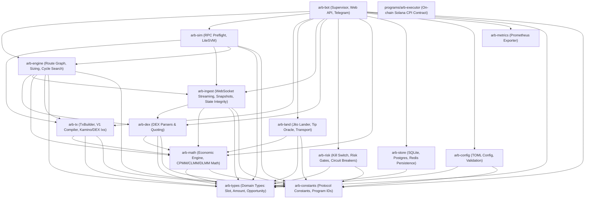
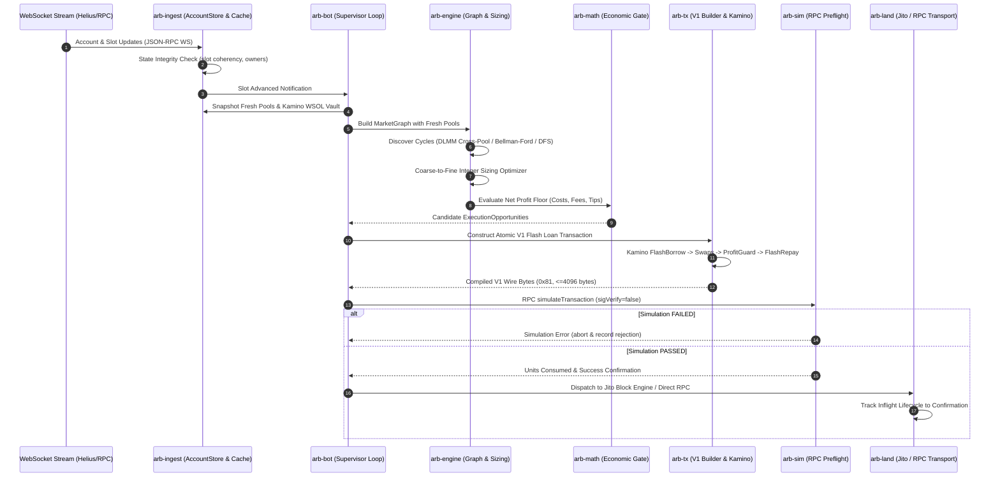

# Current System Architecture

**Baseline Commit**: `d090123` on `main`  
**Toolchain**: Rust 1.99.1, Edition 2024  
**Operating Environment**: Linux VPS (production target) / Windows development harness

---

## 1. Workspace Crate Topology

The repository is organized as a Cargo workspace with 14 specialized crates and 1 on-chain program. Dependencies strictly flow downwards; circular dependencies are prohibited.

### Crate Responsibility Matrix

| Crate | Responsibility | Key Modules / Types | Dependencies |
|---|---|---|---|
| `arb-constants` | Leaf crate: official Program IDs, account sizes, discriminators, and tip addresses. | `KAMINO_*`, `METEORA_*`, `RAYDIUM_*`, `ORCA_*`, `JITO_*` | `solana-pubkey` |
| `arb-types` | Leaf crate: core domain types, strong typing for financial amounts, opportunities, and lifecycle states. | `Slot`, `TokenAmount`, `Lamports`, `Bps`, `PoolState`, `ExecutionOpportunity`, `InflightStatus` | `arb-constants`, `ruint`, `solana-pubkey`, `serde` |
| `arb-math` | Canonical financial economics and pure protocol mathematics. | `economic.rs`, `cpmm.rs`, `clmm.rs`, `dlmm.rs` | `arb-constants`, `arb-types`, `ruint` |
| `arb-dex` | Protocol-specific account decoding, vault balance extraction, and state representation. | `raydium_cpmm`, `raydium_clmm`, `meteora_dlmm`, `meteora_damm_v2`, `orca_whirlpool`, `pumpswap` | `arb-constants`, `arb-math`, `arb-types` |
| `arb-config` | Configuration schema parsing, environment de-hardcoding, and freshness validation. | `load()`, `validate_live_freshness()` | `arb-types`, `arb-constants`, `toml`, `serde` |
| `arb-store` | Persistence for opportunities, trade execution logs, and signed transaction provenance. | SQLite (`rusqlite`), PostgreSQL (`tokio-postgres`), Redis | `arb-types`, `rusqlite`, `redis` |
| `arb-risk` | Kill switch, maximum loss circuit breakers, and candidate gating. | `RiskGate`, `KillSwitch` | `arb-types`, `arb-constants`, `parking_lot` |
| `arb-metrics` | Prometheus metrics collector and HTTP text exporter. | `MetricsServer`, `observe_*()`, `set_*()` | `prometheus`, `tokio` |
| `arb-ingest` | Real-time WebSocket streaming, account snapshot cache, slot tracking, and state integrity. | `HeliusWsClient`, `AccountStore`, `MarketStateCache`, `ProviderSupervisor` | `arb-types`, `arb-dex`, `arb-math`, `solami` |
| `arb-engine` | Market graph topology, cycle detection (2-pool DLMM, Bellman-Ford, multi-hop DFS), sizing optimizer. | `MarketGraph`, `DlmmCrossPoolStrategy`, `BellmanFordEngine` | `arb-types`, `arb-dex`, `arb-math`, `arb-ingest` |
| `arb-tx` | Instruction building, flash loan borrow/repay assembly, Solana V1 compiler, wire encoding. | `TxBuilder`, `AdaptiveTxCompiler`, `cross_dex_flash_arb` | `arb-types`, `arb-constants`, `arb-math` |
| `arb-sim` | Preflight simulation via Solana JSON-RPC `simulateTransaction` and optional LiteSVM. | `Simulator`, `simulate_async()`, `simulate_local()` | `arb-tx`, `arb-types`, `arb-constants` |
| `arb-land` | Bundle landing, Jito Block Engine transport, dynamic tip oracle, SWQoS submission. | `JitoLander`, `TipOracle`, `select_authoritative_transport()` | `arb-types`, `arb-constants`, `arb-math` |
| `arb-bot` | Main daemon binary, supervisor event loop, web management API, Telegram bot. | `main.rs`, `supervisor/` (`run`, `strategy`, `opportunity`, `dispatch`, `recovery`) | All workspace crates |
| `programs/arb-executor` | On-chain contract for atomic cross-DEX execution, flash loan borrow/repay introspection. | `entrypoint!`, `process_instruction` | Solana on-chain SDK crates |

---

## 2. Core Execution Pipeline & Dataflow

---

## 3. Concurrency & State Management Model

1. **Tokio Multi-Threaded Runtime**:
   - The primary trading loop turns in `Supervisor::run()`.
   - Ingestion streams (WebSocket client, slot notify) run as dedicated background tasks.
   - Observability sinks (Prometheus server, Telegram listener, web dashboard) run in isolated tasks with bounded queues to ensure zero blocking on the hot path.

2. **Synchronization Primitives**:
   - `parking_lot::RwLock` / `parking_lot::Mutex` for thread-safe caches (`MarketStateCache`, `AccountStore`).
   - `std::sync::atomic::{AtomicU8, AtomicU64}` for high-frequency monotonic counters (slot clock, heartbeat sequence, loop iteration counters).
   - Zero lock holding across `.await` points to prevent deadlocks and latency jitter.

3. **Memory Safety & Layout**:
   - Pure, safe Rust with zero-copy deserialization where applicable.
   - Stack-allocated instruction arrays in transaction compilation (`[Pubkey; 64]`, `[AccountMeta; 64]`).
   - Explicit overflow checks enabled in release profile (`overflow-checks = true`).

---

## 4. Solana Transaction Wire Architecture (V1 Standard)

- **Discriminator**: `0x81` (Solana Transaction Version 1 wire envelope).
- **Wire Ceiling**: Strictly enforced 4,096 bytes maximum payload.
- **Account Ceiling**: Up to 64 inline accounts without requiring Address Lookup Tables (ALTs).
- **Compute Budget**: Explicit `SetComputeUnitLimit` and `SetComputeUnitPrice` instructions at index 0 and 1.
- **Loaded Data Limit**: Explicit `SetLoadedAccountsDataSizeLimit` set to 16 MiB (`CROSS_DEX_V1_DEFAULT_LOADED_DATA_LIMIT`).
- **Atomicity Invariant**: Flash borrow, all intermediate swap hops, and flash repay must be contained within a single transaction. Splitting flash loans across multiple transactions or bundles is prohibited.
