# Master Engineering Roadmap — Current State to Production Readiness

**Repository**: `https://github.com/mohamedazooz/SOLANA_FLASHLOAN_ARBITUGE`  
**Authoritative Baseline**: Commit `d090123` on `main` (Rust 1.99.1, Edition 2024)  
**Status**: Authoritative Master Roadmap (Phases 0 through 19)

> **Operating Rule**: The repository’s current code and reproducible test evidence are the sole sources of truth. Documentation, previous reports, TODOs, and agent claims are not proof that a feature works.

---

## Roadmap Overview and Phase Governance

Phases are strictly sequential. A phase is marked closed **only** when its acceptance criteria are supported by verified code and test evidence. If an investigation proves that a component is unnecessary or unsupported, that decision is formally recorded in [`DECISIONS.md`](file:///c:/Users/azoozz/Downloads/my arbitrge/docs/active/DECISIONS.md) rather than implementing it merely because it appears in this roadmap.

```mermaid
flowchart TD
    P0["Phase 0: Baseline & Forensic Audit"] --> P1["Phase 1: Docs & Agent Reset"]
    P1 --> P2["Phase 2: Critical Correctness Defects"]
    P2 --> P3["Phase 3: WebSocket Ingestion & State Integrity"]
    P3 --> P4["Phase 4: Optional Yellowstone gRPC Client"]
    P4 --> P5["Phase 5: WS vs gRPC Latency Benchmark"]
    P5 --> P6["Phase 6: Multi-DEX Protocol Support Audit"]
    P6 --> P7["Phase 7: Exact Quote Math & Differential Tests"]
    P7 --> P8["Phase 8: Route Discovery & Joint Sizing Engine"]
    P8 --> P9["Phase 9: Canonical Economic Engine & Cost Floor"]
    P9 --> P10["Phase 10: Flash Loan Integration & Repayment Verification"]
    P10 --> P11["Phase 11: V1 Transaction Builder & Wire Constraints"]
    P11 --> P12["Phase 12: Preflight Simulation & Risk Gate Ladder"]
    P12 --> P13["Phase 13: Transport Dispatch & Settlement Lifecycle"]
    P13 --> P14["Phase 14: Realized PnL Reconciliation"]
    P14 --> P15["Phase 15: Bare-Metal HFT Optimization"]
    P15 --> P16["Phase 16: Property-Based Testing & Fuzzing"]
    P16 --> P17["Phase 17: Security Hardening & Secret Hygiene"]
    P17 --> P18["Phase 18: Shadow Mode / Soak Test (VPS >= 24h)"]
    P18 --> P19["Phase 19: Final Production Readiness Review"]
```

---

## Phase 0 — Repository Baseline and Forensic Audit

**Objective**: Establish the actual, verified baseline state of the repository at commit `d090123`.

- **Tasks**:
  1. Record Git default branch, latest commit (`d090123`), working tree status, open/merged PRs (PR #90 merged), and CI status (passing).
  2. Inspect the complete Cargo workspace: 14 crates in `crates/` and 1 on-chain program in `programs/arb-executor`.
  3. Map modules, public interfaces, runtime entry points (`crates/arb-bot/src/main.rs`), data flow, and critical call paths.
  4. Identify actual implementations versus mocks, stubs, dead code, and disconnected components.
  5. Trace the end-to-end flow from provider connection through account updates, state caching, pool decoding, quotes, routes, profit checks, transaction construction, simulation, dispatch, and reconciliation.
  6. Inventory all environment variables and classify each as required, optional, unused, obsolete, or secret.
  7. Run existing tests and builds without changing trading behavior.

- **Deliverables**:
  - [`BASELINE_AUDIT.md`](file:///c:/Users/azoozz/Downloads/my arbitrge/docs/active/BASELINE_AUDIT.md)
  - [`CURRENT_ARCHITECTURE.md`](file:///c:/Users/azoozz/Downloads/my arbitrge/docs/active/CURRENT_ARCHITECTURE.md)
  - [`COMPONENT_STATUS.md`](file:///c:/Users/azoozz/Downloads/my arbitrge/docs/active/COMPONENT_STATUS.md)
  - [`CALL_GRAPH.md`](file:///c:/Users/azoozz/Downloads/my arbitrge/docs/active/CALL_GRAPH.md)
  - [`OPEN_ISSUES.md`](file:///c:/Users/azoozz/Downloads/my arbitrge/docs/active/OPEN_ISSUES.md)

- **Exit Gate**: Every critical component has a verified status and a reproducible baseline. No unverified claim is marked as working.

---

## Phase 1 — Documentation and Agent Reset

**Objective**: Create a clean, active documentation area and structured agent operating system while preserving 100% of historical work.

- **Tasks**:
  1. Inventory every existing Markdown/documentation file across the repository.
  2. Classify each document as active, historical, duplicate, or unclear.
  3. Archive historical documents into `docs/archive/` (`legacy/`, `old_roadmaps/`, `old_audits/`, `old_reports/`, `old_architecture/`, `old_experiments/`, `historical_test_evidence/`) with standardized archive banners.
  4. Create the clean active documentation structure in `docs/active/`.
  5. Create root `AGENTS.md` directing every agent to the active documents and invariants.
  6. Create specialized agent instruction files in `docs/agents/` (Supervisor, Quant, Ingestion, Execution, Handoff Protocol).
  7. Create the master roadmap (`MASTER_ROADMAP.md`), task register (`MASTER_TASK_REGISTER.md`), current status (`CURRENT_STATUS.md`), and decision records (`DECISIONS.md`).
  8. Open the documentation-only PR.

- **Deliverables**:
  - `docs/active/*` complete suite
  - `docs/agents/*` role definitions & handoff protocol
  - `AGENTS.md` at repository root
  - `docs/archive/README.md` and organized subdirectories
  - `docs/active/DOCUMENTATION_INVENTORY.md`

- **Exit Gate**: A new agent can identify the current phase, authoritative instructions, open issues, and next task without relying on previous chat transcripts.

---

## Phase 2 — Critical Correctness Defects

**Objective**: Investigate, reproduce, and fix critical defects that can cause false opportunities, incorrect borrowing, incorrect repayment, loss-making trades, or unsafe transactions.

- **Tasks**:
  1. **Route Deduplication & Directionality**: Fix route deduplication in `crates/arb-bot/src/supervisor/strategy.rs` where sorting pool IDs alone discards hop sequence, mint order, and swap direction.
  2. **Borrow Sizing & Joint Evaluation**: Enforce joint evaluation of `Route × Borrow Size` without assuming monotonic profit; clamp strictly by decoded Kamino supply-vault liquidity.
  3. **Quote Freshness & State Consistency**: Ensure all pool snapshots and hop inputs in a candidate route are slot-coherent (slot delta $\le$ `max_state_age_slots`).
  4. **Simulation Result Classification**: Map simulation outcomes into explicit enum states: `PASSED`, `FAILED`, `UNAVAILABLE`, `TIMEOUT`, `STALE`, `UNSUPPORTED`. Never treat errors as success.
  5. **Slippage & 0x1773 Investigation**: Investigate reported slippage failures (e.g. 0x1773) from root causes rather than widening slippage tolerance blindly.
  6. **Token-2022 Transfer Fee Double Counting**: Verify whether transfer fees are deducted by the protocol quote or require explicit accounting.
  7. **Estimated vs Realized PnL**: Strictly decouple quote profit from post-landing balance delta reconciliation.

- **Exit Gate**: All critical P0 correctness defects are fixed with dedicated regression tests. No P0 defect is silently waived.

---

## Phase 3 — WebSocket Ingestion and State Integrity

**Objective**: Validate and harden the WebSocket real-time market data pipeline as the primary ingestion path.

- **Tasks**:
  1. Standardize provider adapters under `arb-ingest` with a normalized update interface.
  2. Verify account, program, and slot subscriptions (Helius WS, RPCFast, public nodes).
  3. Harden reconnection, backoff, and resubscription lifecycles without leaking memory or dropping updates.
  4. Implement/verify provider health monitoring and automatic failover in `ProviderSupervisor`.
  5. Audit in-process state integrity layer: detect duplicate updates, stale slots, missing required accounts, owner mismatch, and dead-fork invalidations (`SLOT_DEAD`).
  6. Prevent incomplete or unverified pool state from reaching the quote and execution engines.

- **Exit Gate**: Automated reconnection, missing-account, stale-state, duplicate-update, and provider-failure tests pass.

---

## Phase 4 — Optional Yellowstone gRPC Ingestion

**Objective**: Research and implement an optional, feature-gated Yellowstone gRPC client consuming managed Geyser streams.

- **Tasks**:
  1. Verify provider access, authentication, filter specifications, and quotas.
  2. Implement feature-gated Rust client (`arb-ingest/yellowstone`) without validator dependencies.
  3. Configure account, program, and slot filters required for targeted DEX pools.
  4. Handle TLS, bearer tokens, keep-alive, stream reconnects, and backpressure.
  5. Normalize gRPC updates into the same canonical `AccountStore` and `MarketStateCache` pipeline used by WebSocket.
  6. Keep gRPC strictly optional; WebSocket operation must remain fully functional.

- **Exit Gate**: gRPC client can be toggled via feature flag without impacting WebSocket path; stream decoding and normalization are verified with test fixtures.

---

## Phase 5 — WebSocket versus gRPC Latency Benchmark

**Objective**: Empirically benchmark WebSocket vs Yellowstone gRPC under identical network and VPS conditions.

- **Tasks**:
  1. Measure p50, p95, and p99 update-to-consumption latency across equivalent pool accounts.
  2. Measure throughput, dropped updates, and stream recovery time.
  3. Measure CPU, RAM, and network bandwidth utilization.
  4. Record quote availability latency following on-chain pool state changes.
  5. Record formal decision in `DECISIONS.md` on default data plane configuration.

- **Exit Gate**: Measured benchmark report published in `reports/benchmarks/`. No claim of gRPC superiority without verified empirical data.

---

## Phase 6 — Pool Discovery and Protocol Support Audit

**Objective**: Independently audit and verify support for candidate DEX protocols:
- Raydium CPMM & AMM v4
- Raydium CLMM
- Meteora DLMM & Dynamic AMM v2
- Orca Whirlpool
- Pump.fun & PumpSwap

- **Tasks**:
  1. For each protocol, audit:
     - Program ID and account discriminators
     - Pool discovery and catalog ingestion
     - Account zero-copy deserialization
     - State validation and reserve extraction
     - Quote calculation correctness
     - Instruction construction
     - Simulation compatibility
     - Mainnet execution proof
  2. Build a granular protocol support matrix documenting verified vs unverified capabilities.

- **Exit Gate**: Protocol support matrix published with reproducible test commands for each supported pool type.

---

## Phase 7 — Protocol Mathematics and Quote Correctness

**Objective**: Verify mathematical rigor and exact closed-form quote parity against official protocol SDKs and reference implementations.

- **Tasks**:
  1. Verify token orientation, decimal scaling, vault balances, and reserve representation.
  2. Verify fee tiers, creator fees, protocol fees, dynamic fees, and rounding directions (floor vs ceil).
  3. Validate CPMM ($x \cdot y = k$), CLMM tick traversal ($\sqrt{P}$ Q64.64), and DLMM bin array traversal.
  4. Enforce integer/fixed-point arithmetic with overflow prevention (`u128`, `ruint::Uint<256, 4>`). Zero `f64` in quote decisions.
  5. Implement differential test suite comparing `arb-math` against official golden fixtures.

- **Exit Gate**: Quote unit and differential tests cover standard cases, tick/bin crossing boundaries, zero liquidity, and malformed state within documented tolerances.

---

## Phase 8 — Route Discovery and Joint Sizing Engine

**Objective**: Build a deterministic market graph that evaluates route topology and optimal borrow size jointly.

- **Tasks**:
  1. Maintain strict route identity: ordered hops, pool IDs, mint pairs, swap direction, and protocol IDs.
  2. Implement joint evaluation: $\text{Route} \times \text{Borrow Size}$ across 2-pool DLMM, Bellman-Ford, and multi-hop DFS.
  3. Replace naive monotonic search with bounded coarse-to-fine integer search accounting for fee hurdles and liquidity cliffs.
  4. Cap combinatorial search depth and execution time via strict compute budgets.

- **Exit Gate**: Route selection is deterministic for identical snapshots, bounded in memory and runtime, and verified against multi-hop test topologies.

---

## Phase 9 — Canonical Economic Engine

**Objective**: Maintain a single authoritative source of truth for profitability (`arb-math/src/economic.rs`).

- **Tasks**:
  1. Strictly delineate: Gross Output $\rightarrow$ Estimated Net $\rightarrow$ Simulated Net $\rightarrow$ Realized Net.
  2. Deduct all applicable costs exactly once: DEX fees, flash loan fees, base network fee (5,000 lamports), priority fee, Jito tip, Token-2022 transfer fees, and ATA rent.
  3. Prevent double-deduction of fees already priced into DEX quotes.
  4. Enforce minimum net profit floor (`MIN_NET_PROFIT_USD` / `MIN_NET_PROFIT_LAMPORTS`) on net retained profit only.

- **Exit Gate**: Independent tests prove fee accounting accuracy and rounding compliance. Zero opportunities dispatched on gross profit alone.

---

## Phase 10 — Flash Loan Integration and Repayment Verification

**Objective**: Audit and harden Kamino Lend (and secondary flash swap) integration.

- **Tasks**:
  1. Verify live reserve and available liquidity decoded from supply vault token accounts.
  2. Compute exact flash fee using Kamino's canonical formula: $\max(\text{amount} \cdot \text{sf}, 2^{60})$ pre-rounding comparison.
  3. Build atomic flash loan borrow and repay instructions with Solana `Instructions` sysvar introspection.
  4. Enforce on-chain solvency floor: $\text{Final Balance} \ge \text{Principal} + \text{Fee} + \text{Min Net Profit}$.

- **Exit Gate**: Tests prove exact borrow/repay construction, atomicity, and fail-closed abortion when repayment liquidity cannot be verified.

---

## Phase 11 — Transaction Builder and Wire Serialization

**Objective**: Maintain one canonical transaction construction path strictly enforcing Solana V1 wire constraints.

- **Tasks**:
  1. Validate PDA derivations, account metas, writable flags, and signer constraints.
  2. Enforce instruction sequence: `ComputeBudget` $\rightarrow$ `FlashBorrow` $\rightarrow$ `SwapLeg_1` $\rightarrow \dots \rightarrow$ `SwapLeg_N` $\rightarrow$ `ProfitGuard` $\rightarrow$ `FlashRepay`.
  3. Enforce V1 envelope: 0x81 discriminator, 4,096-byte wire limit, 64 inline accounts, no ALTs.
  4. Handle blockhash caching, valid block height tracking, and expiration proof.

- **Exit Gate**: Deterministic builder tests, serialization tests, and size-limit validation pass without warnings.

---

## Phase 12 — Preflight Simulation and Risk Gate Ladder

**Objective**: Implement an exhaustive pre-flight simulation and risk gate ladder that fails closed on all anomalies.

- **Tasks**:
  1. Implement explicit simulation states (`PASSED`, `FAILED`, `UNAVAILABLE`, `TIMEOUT`, `STALE`, `UNSUPPORTED`).
  2. Execute RPC preflight simulation via `simulateTransaction` with `sigVerify: false` and `replaceRecentBlockhash: true`.
  3. Enforce circuit breakers: max daily loss, consecutive failure limit, max price impact, and stream generation checks (`GUARD-01`).
  4. Redact private keys and sensitive secrets from all simulation logs and error traces.

- **Exit Gate**: All transactions pass simulation and risk checks; failure paths are verified to fail closed.

---

## Phase 13 — Dispatch and Landing Lifecycle

**Objective**: Decouple transaction construction from transport and manage execution lifecycles with unambiguous reconciliation.

- **Tasks**:
  1. Support verified transports: Direct RPC submission, QUIC/TPU (where supported), SWQoS, and Jito Bundles.
  2. Track explicit lifecycle states: `Built` $\rightarrow$ `Simulated` $\rightarrow$ `Signed` $\rightarrow$ `Submitted` $\rightarrow$ `Processed` $\rightarrow$ `Confirmed` $\rightarrow$ `Finalized` $\rightarrow$ `Failed` $\rightarrow$ `Expired`.
  3. On send timeout, query signature status and blockhash progress before marking expired. Never re-sign or blindly resubmit.

- **Exit Gate**: Lifecycle and retry tests prove zero duplicate dispatches and accurate terminal state resolution.

---

## Phase 14 — Realized PnL Reconciliation

**Objective**: Reconcile post-trade balances against pre-trade baselines using on-chain transaction metadata.

- **Tasks**:
  1. Fetch post-execution account balances, network fee, priority fee, and realized Jito tip.
  2. Compute exact realized PnL in reference asset (WSOL/USDC).
  3. Reconcile expected quote profit vs simulated profit vs realized profit.
  4. Store immutable execution provenance records in SQLite/PostgreSQL.

- **Exit Gate**: Realized PnL is derived exclusively from confirmed on-chain evidence.

---

## Phase 15 — Bare-Metal HFT Optimization

**Objective**: Eliminate hot-path overhead without compromising safety or correctness.

- **Tasks**:
  1. Profile allocations, memory copies, and redundant deserializations.
  2. Optimize data structures: bounded channels, cache locality, and lock-free reads.
  3. Benchmark pipeline stages (ingest-to-quote, quote-to-tx, tx-to-sim, sim-to-dispatch).
  4. Offload Telegram alerts, database logging, and web API traffic outside the critical loop.

- **Exit Gate**: Measured before/after latency benchmarks show quantifiable performance gains without code regressions.

---

## Phase 16 — Testing and Fuzzing Suite

**Objective**: Build a comprehensive, multi-layered test harness.

- **Tasks**:
  1. Unit tests for every math, decoder, and builder function.
  2. Property-based tests (`proptest`) for invariant preservation and numerical stability.
  3. Fuzz tests (`cargo fuzz` / `arbitrary`) for raw account decoders and wire parsers.
  4. Mainnet non-broadcast simulation suite running against live pool states.

- **Exit Gate**: CI workflow runs all tests and linters (`cargo clippy --workspace --all-targets -- -D warnings`) with 0 warnings.

---

## Phase 17 — Security Hardening and Secret Hygiene

**Objective**: Forensic review of authentication, key security, and failure boundaries.

- **Tasks**:
  1. Audit private-key loading: strictly memory-resident, zero filesystem leaks, zero logging.
  2. Enforce fail-closed admin API: reject empty/placeholder `WEB_ADMIN_PASSWORD` tokens with constant-time comparison.
  3. Audit dependency vulnerabilities using `cargo audit`.
  4. Verify kill-switch responsiveness via local file and remote authenticated API.

- **Exit Gate**: Zero critical security vulnerabilities; live arming remains disabled by default.

---

## Phase 18 — Shadow Mode / Soak Test (VPS >= 24h)

**Objective**: Continuous, uninterrupted operation on a production-grade VPS in simulate/observe mode for at least 24 hours.

- **Tasks**:
  1. Deploy bot in shadow mode (`ARB_MODE=simulate`, `ARB_LIVE=0`).
  2. Monitor WebSocket stability, update latency, memory drift, and CPU utilization.
  3. Record candidate distribution, simulated PnL, rejection reasons, and RPC health.
  4. Verify zero crashes, zero memory leaks, and clean panic recovery.

- **Exit Gate**: 24+ hours of uninterrupted soak evidence recorded in `reports/production/` with all anomalies investigated.

---

## Phase 19 — Production Readiness Review

**Objective**: Final executive and technical sign-off before operational live-arming authorization.

- **Tasks**:
  1. Compile evidence from all previous phase gates.
  2. Verify all 19 phases meet their documented acceptance criteria.
  3. Produce executive audit report and runbook.
  4. Require explicit, manual operator authorization before any live capital arming.

- **Exit Gate**: Production readiness checklist fully satisfied and approved by operator.
