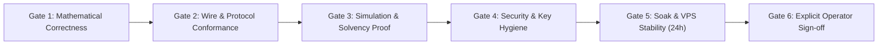

# Production Readiness Acceptance Matrix

This document defines the strict, non-negotiable exit criteria required before the arbitrage bot may be considered production-ready for live capital execution on Solana mainnet.

> **CRITICAL DIRECTIVE**: Achieving production readiness DOES NOT authorize autonomous agents to broadcast live transactions. Live arming strictly requires explicit, manual operator authorization and configuration of `ARB_LIVE=1`.

---

## 1. Readiness Acceptance Gates

---

## 2. Gate Verification Checklist

### Gate 1: Mathematical Correctness & Economic Safety
- [ ] Canonical economic engine (`arb-math/src/economic.rs`) verified by differential tests.
- [ ] Kamino Klend flash loan fee formula adheres to official U68F60 fixed-point math with pre-rounding comparison.
- [ ] Zero floating-point arithmetic used in routing, sizing, or profit assertion decisions.
- [ ] On-chain profit floor strictly enforced: $\text{Final Balance} \ge \text{Principal} + \text{Fee} + \text{Costs} + \text{Min Net Profit}$.
- [ ] Route deduplication preserves directed hop sequence and swap directions.

### Gate 2: Protocol Support & Wire Conformance
- [ ] Supported DEX pool account layouts verified against live mainnet on-chain bytes (Raydium CPMM, Meteora DLMM, Orca Whirlpool).
- [ ] Solana V1 transaction wire format verified: 0x81 discriminator, $\le 4,096$ bytes, $\le 64$ inline accounts.
- [ ] Loaded account data size limit set to 16 MiB (`CROSS_DEX_V1_DEFAULT_LOADED_DATA_LIMIT`).
- [ ] Compute budget limits explicitly declared on every transaction.
- [ ] Address Lookup Tables (ALTs) avoided on hot paths to eliminate lookup latency and table invalidation risk.

### Gate 3: Preflight Simulation & Solvency Verification
- [ ] Non-broadcast RPC simulation executes via `simulateTransaction` with `sigVerify: false`.
- [ ] Simulation outcomes mapped to explicit enum states (`PASSED`, `FAILED`, `UNAVAILABLE`, `TIMEOUT`, `STALE`, `UNSUPPORTED`).
- [ ] Zero silent conversion of simulation failures into success.
- [ ] Slippage error 0x1773 root cause forensically diagnosed and mitigated without widening slippage tolerance.

### Gate 4: Security Hardening & Key Hygiene
- [ ] Private key strictly loaded from environment or HSM into memory; never committed, logged, or printed.
- [ ] Web management API enforces fail-closed authentication: startup refused if `WEB_ADMIN_PASSWORD` is absent or a placeholder.
- [ ] Admin bearer token comparison uses constant-time byte equality (`constant_time_eq`).
- [ ] Cargo dependencies audited with `cargo audit` with zero unresolved critical vulnerabilities.
- [ ] Remote kill switch tested and operational via local file (`KILL_SWITCH`) and authenticated `/pause` endpoint.

### Gate 5: 24-Hour VPS Soak Stability
- [ ] Bot deployed in simulate mode on production VPS for $\ge 24$ continuous hours.
- [ ] Zero unhandled panics, zero unexpected process terminations.
- [ ] Constant memory utilization ($\text{RSS} \le 1.5 \text{ GiB}$) confirming zero memory leaks.
- [ ] Stable WebSocket connection with automatic backoff and reconnection on network blips.
- [ ] Verified heartbeat writer updating every 1 second.

### Gate 6: Operator Authorization & Live Arming Checklist
- [ ] All 19 phases of [`MASTER_ROADMAP.md`](file:///c:/Users/azoozz/Downloads/my arbitrge/docs/active/MASTER_ROADMAP.md) formally completed with evidence.
- [ ] Operator manually inspects wallet balance and sets conservative max loss limit (`MAX_DAILY_LOSS_USD`).
- [ ] Operator explicitly configures `ARB_MODE=live` and `ARB_LIVE=1`.
- [ ] Operator signs off on execution parameter configurations.
