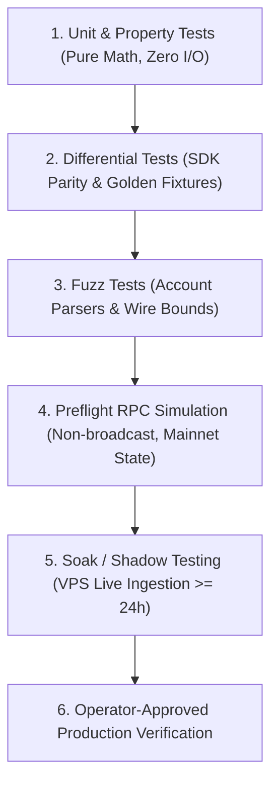

# Testing and Verification Strategy

This strategy outlines the testing methodology required to verify correctness, financial invariants, and bare-metal execution safety across the arbitrage bot.

---

## 1. Multi-Tiered Testing Pyramid



---

## 2. Test Suites & Verification Standards

### Level 1: Unit & Property Tests (Fast, In-Memory)
- **Scope**: Pure functions in `arb-math`, `arb-types`, `arb-constants`, `arb-dex`, `arb-tx`.
- **Requirements**:
  - Zero network calls; zero filesystem I/O.
  - Strict integer arithmetic verification.
  - Property-based tests using `proptest` to verify:
    - Constant product invariant: $k_{\text{new}} \ge k_{\text{old}}$.
    - Concentrated liquidity tick monotonic progression.
    - Kamino flash loan fee rounding and tie-breaking.
    - Zero division, overflow, and underflow rejection.

### Level 2: Differential Tests (SDK Parity)
- **Scope**: Protocol adapters in `arb-dex` and quoting functions in `arb-math`.
- **Requirements**:
  - Compare `arb-math` outputs directly against golden outputs generated by official protocol SDKs (Meteora DLMM SDK, Raydium SDK, Orca Whirlpool SDK).
  - Tolerances: 0 lamports difference for exact integer routes; within 1 unit for round-trip tick approximations.

### Level 3: Fuzz Testing (Adversarial Security)
- **Scope**: Account decoders (`arb-dex`), transaction deserializers, wire parsers (`arb-tx`).
- **Harness**: `cargo fuzz` or `proptest::arbitrary`.
- **Invariants**: No arbitrary byte stream may panic the process, cause out-of-bounds slicing, or allocate unbounded memory.

### Level 4: Preflight RPC Simulation (Live Network State)
- **Scope**: Real mainnet pool states evaluated without broadcasting.
- **Methodology**:
  - Construct complete Solana V1 transaction wire bytes.
  - Send to Solana JSON-RPC endpoint via `simulateTransaction` with `sigVerify: false` and `replaceRecentBlockhash: true`.
  - Verify compute unit consumption ($\text{CU} \le 1,400,000$), account data size ($\le 16 \text{ MiB}$), and return status `Ok`.
  - Capture raw execution logs and parse transaction return data.

### Level 5: Shadow Mode & Soak Testing (VPS Stability)
- **Scope**: Running full bot daemon in shadow mode (`ARB_MODE=simulate`, `ARB_LIVE=0`) on production-equivalent VPS.
- **Duration**: Minimum 24 continuous hours.
- **Acceptance Criteria**:
  - Zero unexpected crashes or panics.
  - Constant memory footprint (zero memory leaks in WebSocket client or cache).
  - Consistent tick pacing ($\le 50 \text{ ms}$ average latency).
  - Valid rejection accounting for all skipped candidates.

---

## 3. Standard Verification Commands

```bash
# 1. Format check
cargo fmt --all -- --check

# 2. Workspace linting (Zero Warnings Policy)
cargo clippy --workspace --all-targets -- -D warnings

# 3. Unit and integration tests
cargo test --workspace --all-targets

# 4. Mainnet non-broadcast simulation (requires active RPC)
cargo test -p arb-tx --test mainnet_non_broadcast_simulation -- --nocapture
```
