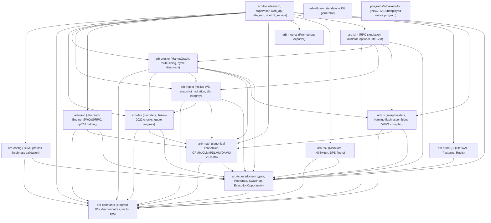

# Architecture Map — Verified Code Topology (`b9b516c`)

**Baseline**: `origin/main` @ `b9b516c`

---

## 1. Acyclic Crate Dependency DAG (Verified via `cargo tree --depth 1`)

---

## 2. Production Execution Path (Verified End-to-End)

1. **Market Data Ingestion (`arb-ingest`)**:
   - `HeliusWsClient` + `DualIngestShadow` stream account/slot updates, hydrated via `hydration.rs` and `pump_state.rs` into coherent `PoolState` snapshots with slot and owner verification.
2. **Route Discovery & Sizing (`arb-engine`)**:
   - `MarketGraph::find_cycles_with_stats` (`route_graph.rs`) and DLMM cross-pool/3-leg strategies (`adapters.rs`, `cross_pool_dlmm.rs`, `dlmm_3leg_flash_arb` support) build directed multi-hop cycles (`MAX_ROUTE_CANDIDATES_PER_TICK = 4096`) priced via `arb-dex` / `arb-math` integer math.
3. **Canonical Economics & Risk Gating (`arb-math`, `arb-risk`)**:
   - `arb-math::economic` is the single source of truth for Kamino flash loan fees (`fee_bits = max(amount * sf, 2^60)`, ties-away rounding) and net profit calculation after base fee, priority fee, and Jito tip.
   - `RiskGate` + `KillSwitch` enforce durable emergency-stop and minimum lamport / BPS profit hurdles.
4. **Transaction Assembly & Compilation (`arb-tx`)**:
   - `Supervisor` (`crates/arb-bot/src/supervisor/execution.rs`) routes opportunities ONLY to:
     - `cross_dex_flash_arb::assemble_cross_dex_opportunity`
     - `TxBuilder::assemble_flash_arbitrage`
     - Non-flash `TxBuilder::assemble_arbitrage`
   - `AdaptiveTxCompiler` compiles **SIMD-0385 Transaction V1** (`0x81`, inline accounts <= 64, wire <= 4,096 B, strips `ComputeBudget` instructions and rewrites Kamino `borrow_instruction_index`) or V0 ALT transactions without silent downgrade.
5. **Preflight Simulation & Dispatch Reconciliation (`arb-sim`, `arb-land`, `arb-store`, `arb-bot`)**:
   - `BotMode::Simulate` (default fail-safe) submits base64 wire to `simulateTransaction` with `maxSupportedTransactionVersion: 1` where V1 applies.
   - `DispatchIntentRecord` persists the extracted signature **before** send in `dispatch.rs`; `recovery.rs` reconciles ambiguous timeouts by on-chain signature status and `lastValidBlockHeight` progression.

---

## 3. Standalone & Inactive Components

- **Standalone**: `webhook-service/` (isolated `Cargo.toml`, listens for webhooks, HMAC validation) and `web/` (Vite React dashboard served/authenticated via `arb-bot/src/web_api.rs` and `control_service.rs`).
- **Inactive**: `programs/arb-executor` (not deployed on mainnet; placeholder `ArbExec1...` key; native CPI alternative not wired into `Supervisor`), `compile_3leg_meme_dlmm_arb`, `build_flash_funded_three_pool_transaction`.
