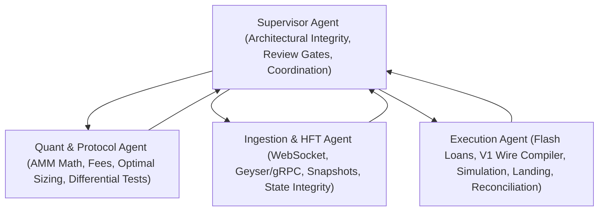

# Autonomous Agent Operating System

This directory specifies the specialized agent roles, immutable operating rules, and mandatory handoff protocols governing all autonomous AI agents (and human contributors) working on this codebase.

---

## 1. Multi-Agent Role Architecture

---

## 2. Directory Contents

| Role Document | Scope & Ownership |
|---|---|
| [`AGENT_RULES.md`](../../docs/agents/AGENT_RULES.md) | **Binding Operational Rules**: 100% honesty, integer arithmetic, zero hallucination, safety defaults. |
| [`SUPERVISOR.md`](../../docs/agents/SUPERVISOR.md) | **Supervisor Role**: Architecture consistency, integration gates, concurrent edit conflict resolution, evidence verification. |
| [`QUANT_AGENT.md`](../../docs/agents/QUANT_AGENT.md) | **Quant & Protocol Role**: Quoting engines, Kamino math, fee models, sizing optimization, differential tests. |
| [`INGESTION_AGENT.md`](../../docs/agents/INGESTION_AGENT.md) | **Ingestion & HFT Role**: WebSocket streaming, Yellowstone gRPC, account cache, provider failover, latency benchmarks. |
| [`EXECUTION_AGENT.md`](../../docs/agents/EXECUTION_AGENT.md) | **Execution Role**: Kamino flash loan assembly, V1 compiler, preflight simulation, Jito landing, settlement reconciliation. |
| [`HANDOFF_PROTOCOL.md`](../../docs/agents/HANDOFF_PROTOCOL.md) | **Handoff Schema**: Mandatory structured schema for all task handoffs and state persistence. |

---

## 3. Required Reading for All Agents

Every agent operating in this repository MUST read the following documents before performing any actions:
1. [`AGENTS.md`](../../AGENTS.md)
2. [`docs/agents/AGENT_RULES.md`](../../docs/agents/AGENT_RULES.md)
3. [`docs/active/README.md`](../../docs/active/README.md)
4. [`docs/active/MASTER_ROADMAP.md`](../../docs/active/MASTER_ROADMAP.md)
5. [`docs/active/CURRENT_STATUS.md`](../../docs/active/CURRENT_STATUS.md)
6. [`docs/active/OPEN_ISSUES.md`](../../docs/active/OPEN_ISSUES.md)
7. [`docs/active/DECISIONS.md`](../../docs/active/DECISIONS.md)
8. The specific task description and relevant test evidence.
