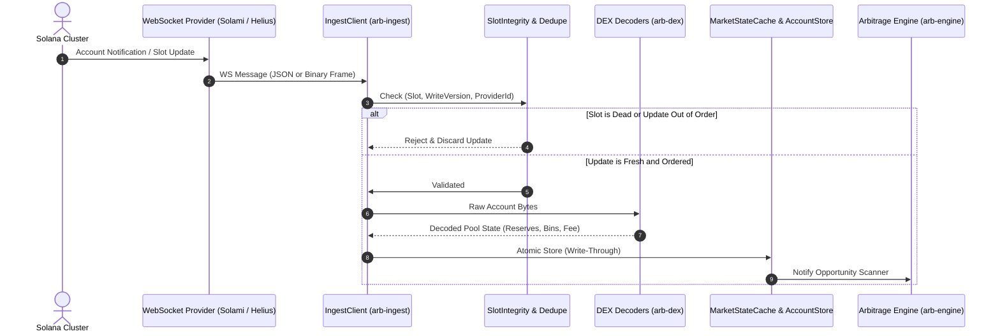

# ARCHITECTURE — DATA FLOW

## 1. End-to-End Market Data Pipeline

The data pipeline ingests on-chain account updates via WebSockets, verifies slot freshness and integrity, decodes pool structures, and updates the shared market cache:

## 2. Ingestion Stages & Guarantees

1. **Transport Layer:**
   - Dedicated WebSocket connections maintain active subscriptions (`accountSubscribe` / `slotSubscribe` or Solami streaming frames).
   - Automatic exponential backoff reconnection on socket disruption.
   - Pings/keep-alives prevent timeout from cloud load-balancers.

2. **Deduplication Buffer:**
   - `BoundedDedupeBuffer` maintains a rolling ring-buffer of recent message digests to detect and drop duplicated frames delivered across redundant socket feeds.

3. **Slot Integrity & Watermarking:**
   - Evaluates slot progression against current cluster slot.
   - Detects skipped slots (gaps) and forks.
   - Dead slots (`SLOT_DEAD`) immediately trigger eviction of cached state derived from that slot to prevent trading against unconfirmed or dropped forks.

4. **Zero-Copy Account Decoding:**
   - `arb-dex` deserializes binary bytes directly into typed Rust structs without heap allocations on the hot path.
   - Vault token balances and bin arrays are validated for mathematical self-consistency (e.g. reserve bounds, fee rate caps).

5. **Cache State Application:**
   - Validated updates are written to `AccountSnapshotStore` and `MarketStateCache` using lock-free read pointers (`ArcSwap` or partitioned read-write locks), allowing the evaluation engine to quote without blocking incoming network ingestion.
