# ARCHITECTURE — EXECUTION FLOW

## 1. Canonical 30-Stage Arbitrage Pipeline

The execution engine follows an explicit 30-stage pipeline from market-data event to post-trade profit retention:

```mermaid
flowchart TD
    subgraph Discovery_and_Evaluation [Stages 1 to 14: Discovery & Evaluation]
        S1[1. WS Provider Connection] --> S2[2. Account Subscription]
        S2 --> S3[3. Account Update Decoding]
        S3 --> S4[4. State Integrity Validation]
        S4 --> S5[5. Pool Discovery & Registration]
        S5 --> S6[6. Pool Account Validation]
        S6 --> S7[7. Protocol State Decoding]
        S7 --> S8[8. Market-State Snapshot]
        S8 --> S9[9. Opportunity Discovery]
        S9 --> S10[10. Route Graph Construction]
        S10 --> S11[11. Exact Route Quoting]
        S11 --> S12[12. Optimal Trade Sizing]
        S12 --> S13[13. Economic Evaluation]
        S13 --> S14[14. Pre-Trade Risk Approval]
    end

    subgraph Assembly_and_Simulation [Stages 15 to 22: Assembly & Pre-Flight]
        S14 --> S15[15. Flash-Loan Instruction Construction]
        S15 --> S16[16. Swap Instructions Construction]
        S16 --> S17[17. Repayment Instruction Construction]
        S17 --> S18[18. Atomic Transaction Assembly]
        S18 --> S19[19. Compute Unit Limit Estimation]
        S19 --> S20[20. Priority Fee & Jito Tip Calculation]
        S20 --> S21[21. Transaction Preflight Simulation]
        S21 --> S22[22. Final Pre-Submission Validation]
    end

    subgraph Landing_and_Settlement [Stages 23 to 30: Landing & Settlement]
        S22 --> S23[23. Keypair Signing]
        S23 --> S24[24. Dual/Jito Bundle Submission]
        S24 --> S25[25. Landing & Slot Tracking]
        S25 --> S26[26. Confirmation Verification]
        S26 --> S27[27. Flash-Loan Repayment Verification]
        S27 --> S28[28. Realized PnL Calculation]
        S28 --> S29[29. Settlement Reconciliation]
        S29 --> S30[30. Profit Retention & Reporting]
    end
```

## 2. Detailed Stage Specifications

| Stage | Name | Input | Output | Failure Policy |
|---|---|---|---|---|
| 1 | WS Provider Connect | Configured URLs, TLS | Active TCP/WSS stream | Exponential backoff retry |
| 2 | Account Subscription | Pool & vault Pubkeys | Server confirmation | Retry or failover provider |
| 3 | Account Decoding | Raw frame bytes | Raw payload buffer | Log and drop malformed frame |
| 4 | State Integrity Check | Slot, write version | Freshness token | Drop stale or out-of-order update |
| 5 | Pool Discovery | Mint pairs, DEX feeds | Registered pool list | Skip invalid pair |
| 6 | Pool Account Validation | Account ownership, size | Verified pool account | Reject spoofed or short accounts |
| 7 | Protocol Decoding | Account binary | Decoded PoolState | Fail closed on uninitialized pool |
| 8 | Snapshot Creation | Current state cache | Immutable cycle view | Abort if essential vault missing |
| 9 | Opportunity Discovery | Pool states, mint graph | Candidate cycle routes | Continue scan if no spread |
| 10 | Route Construction | Multi-pool hops (2, 3, 4) | Graph traversal route | Reject disconnected cycles |
| 11 | Exact Quoting | Route hops, formulas | Exact output per size | Reject negative gross edge |
| 12 | Optimal Sizing | Depth, fees, price impact | Sized trade ($x^*$) | Discard if $x^* \le 0$ |
| 13 | Economic Evaluation | Size, fees, tip, CU price | Net lamport profit | Reject if Net Profit < Hurdle |
| 14 | Risk Approval | Net profit, size, liquidity | Risk approval token | Reject with explicit reason code |
| 15 | Flash-loan Borrow | Amount, asset, reserve | Borrow instruction | Abort build |
| 16 | Swap Instructions | Route hops, min outs | Ordered swap instructions | Abort build |
| 17 | Flash-loan Repay | Repayment amount, fee | Repayment instruction | Abort build |
| 18 | Atomic Assembly | Borrow, Swaps, Repay | Raw transaction message | Verify byte limit (<1232 or V1) |
| 19 | CU Limit Estimation | Hop count, protocol types | CU instruction | Clamp to [100k, 1.4M] |
| 20 | Tip Calculation | Profit share, floor, oracle | Tip transfer instruction | Cap tip to max profit percentage |
| 21 | Preflight Simulation | Unsigned / Signed tx | Simulation result | Reject on any simulated error |
| 22 | Pre-Submission Gate | Blockhash freshness, killswitch | Cleared to sign | Abort if kill switch active |
| 23 | Transaction Signing | Wallet keypair | Signed wire transaction | Abort if signing fails |
| 24 | Bundle Submission | Wire bytes, Jito endpoints | Bundle ID / Tx signature | Multi-region parallel send |
| 25 | Landing Tracking | Tx signature, target slots | Landing status | Timeout after 2 blocks |
| 26 | Confirmation | On-chain status, commit level | Confirmed receipt | Log dropped bundle |
| 27 | Repay Verification | Post-tx account balances | Repayment confirmed | Immediate incident trigger if failed |
| 28 | Realized PnL | Pre- and post-balances | Realized net lamports | Compare with expected quote |
| 29 | Reconciliation | Expected vs Realized PnL | Reconciliation ledger entry | Flag execution slippage |
| 30 | Profit Retention | Verified PnL | Safe wallet accounting | Retain in trading reserve |
