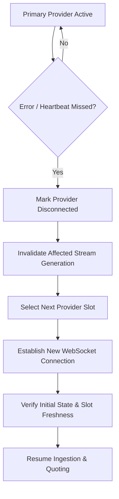

# ARCHITECTURE — PROVIDER ARCHITECTURE & FAILOVER

## 1. Provider Tiering & Constraints

In compliance with non-negotiable architectural constraints, the Sentinel bot operates without requiring paid Yellowstone gRPC infrastructure or a local Agave validator. It relies on a multi-provider failover pool:

| Provider | Transport Protocol | Role | Tier / Limitations |
|---|---|---|---|
| **Solami Mirage** | WebSocket (Binary Frames) | Real-time pool updates & state streaming | Free-tier / Configured key |
| **Solami Blur** | WebSocket (JSON Events) | Token launches, pool creations, swap events | Free-tier / Configured key |
| **Helius** | WebSocket (JSON-RPC) | Standard accountSubscribe & slotSubscribe | Free-tier (10 req/s RPC, 2 req/s DAS) |
| **Alchemy** | WebSocket + JSON-RPC | Secondary failover RPC & event subscription | Free-tier |
| **DRPC / Chainstack** | WebSocket + JSON-RPC | Configurable fallback slots | Free-tier compatible |
| **Jito Block Engine** | HTTP / JSON-RPC Bundle API | Flashloan bundle submission & MEV protection | Public MEV block engine |

## 2. Ingestion vs. Execution Separation

To ensure deterministic performance, read and write paths are strictly partitioned:

1. **Market Data Ingestion (Streaming Read Path):**
   - Strictly WebSocket-based.
   - Streaming clients push account and slot updates to the in-memory `AccountSnapshotStore`.
   - Polling is prohibited on the hot path.

2. **Execution & RPC Operations (Targeted Write/Fallback Path):**
   - HTTP JSON-RPC is used exclusively for:
     - Pre-submission simulation (`simulateTransaction`).
     - Fresh blockhash retrieval (`getLatestBlockhash`).
     - Transaction landing confirmation (`getSignatureStatuses`).
     - Priority fee estimation (`getPriorityFeeEstimate`).
     - Initial account hydration on startup.

## 3. Provider Failover Workflow

- **Failover Triggers:**
  - 3 consecutive failed WebSocket heartbeat pings.
  - Receipt of out-of-order slots exceeding threshold.
  - HTTP 429 (Too Many Requests) or upstream 5xx errors.
- **Failover Action:**
  - Mark current provider unhealthy in `ProviderSupervisor`.
  - Rotate active stream to next available provider in `RpcPool` / `ProviderRegistry`.
  - Re-seed subscriptions and increment `stream_generation`.
