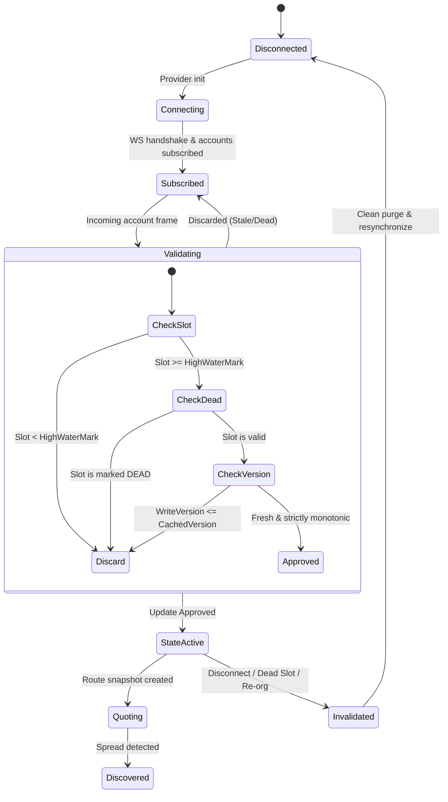

# ARCHITECTURE — STATE MANAGEMENT & STATE INTEGRITY

## 1. State Integrity Guarantees

The Sentinel system operates in adversarial market conditions where WebSocket connections can disconnect, reorder frames, or stream accounts from unconfirmed forks. The system enforces strict fail-closed state integrity rules through `SlotIntegrity`, `AccountSnapshotStore`, and `ProviderSupervisor`.

## 2. Core Integrity Mechanisms

### 2.1 Slot Watermarking & Monotonicity
- Every account snapshot is tagged with `(slot, write_version, provider_id, generation)`.
- Updates with `slot < current_slot` or `write_version <= current_write_version` for the same account are discarded.
- In-memory updates must be strictly monotonic.

### 2.2 Dead Slot Invalidation (`SLOT_DEAD`)
- If a cluster slot is invalidated (e.g. dropped validator fork, unrooted slot), all account states and pool caches created or updated during that slot are immediately evicted.
- No cached state from an invalidated slot is ever permitted to participate in an opportunity calculation.

### 2.3 Required-Account Completeness
- A multi-hop route requires complete state for every pool and vault in the cycle.
- If any intermediate account is missing or incomplete (e.g. DLMM active bin array missing, or Raydium quote vault balance uninitialized), the candidate route fails closed and is rejected.

### 2.4 Stream Generation Tracking
- When a WebSocket disconnects and reconnects, the `stream_generation` counter is incremented.
- Cached quotes or prepared opportunities bound to the prior stream generation are invalidated to prevent trading on stale pre-disconnect liquidity.

### 2.5 Zero-Stale Fallback Policy
- When an RPC or WebSocket provider disconnects or errors, the bot NEVER falls back to stale cached data to evaluate an opportunity.
- The system pauses opportunity evaluation for affected pools until fresh state is re-hydrated from a validated provider.
