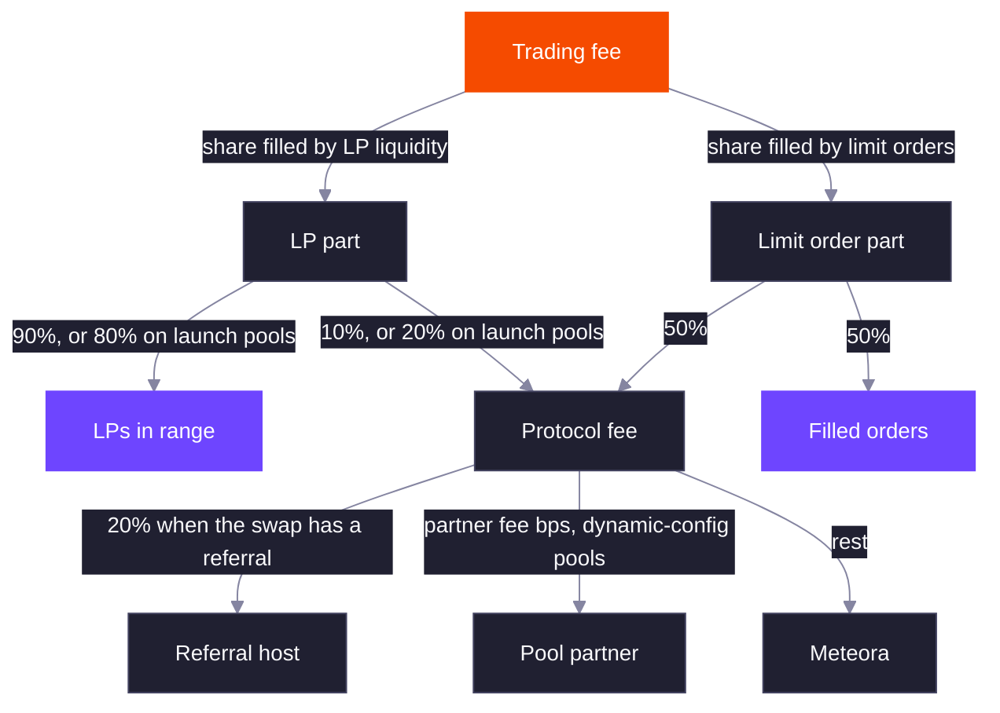
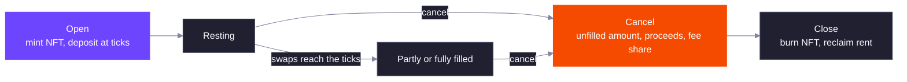
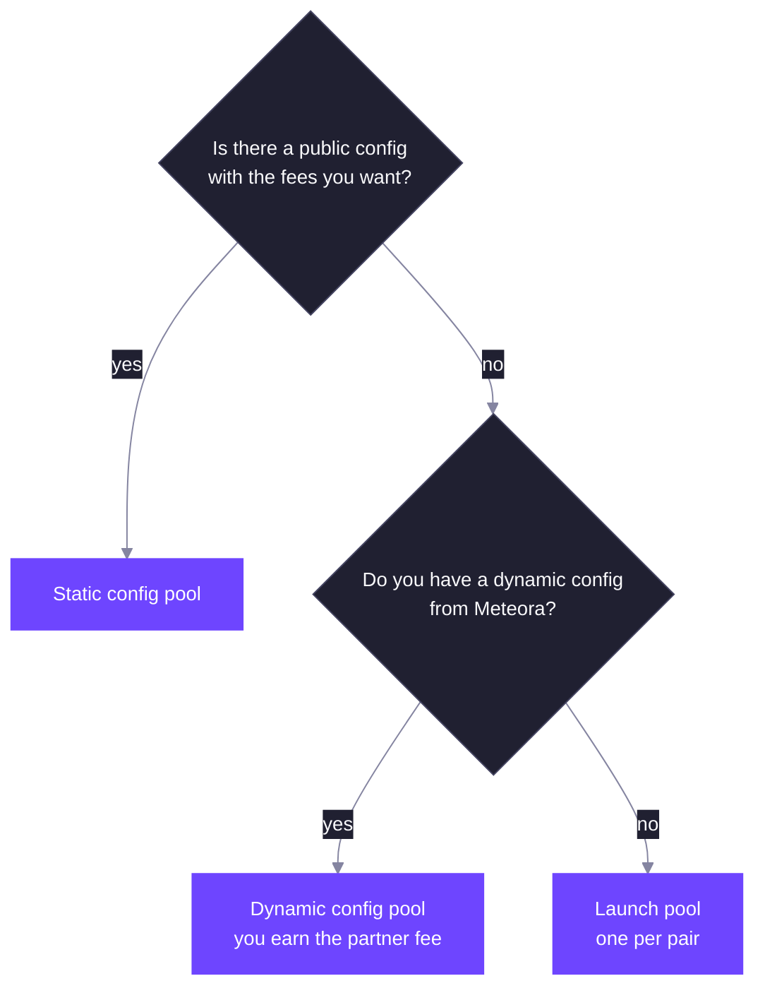
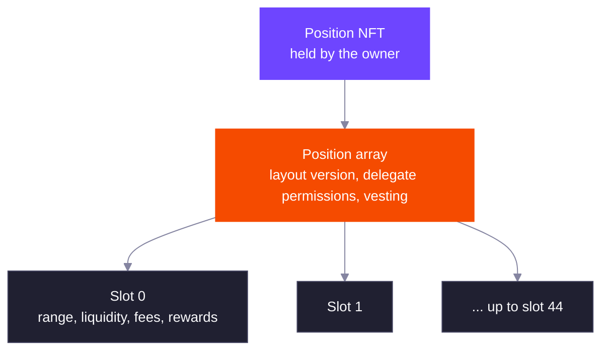
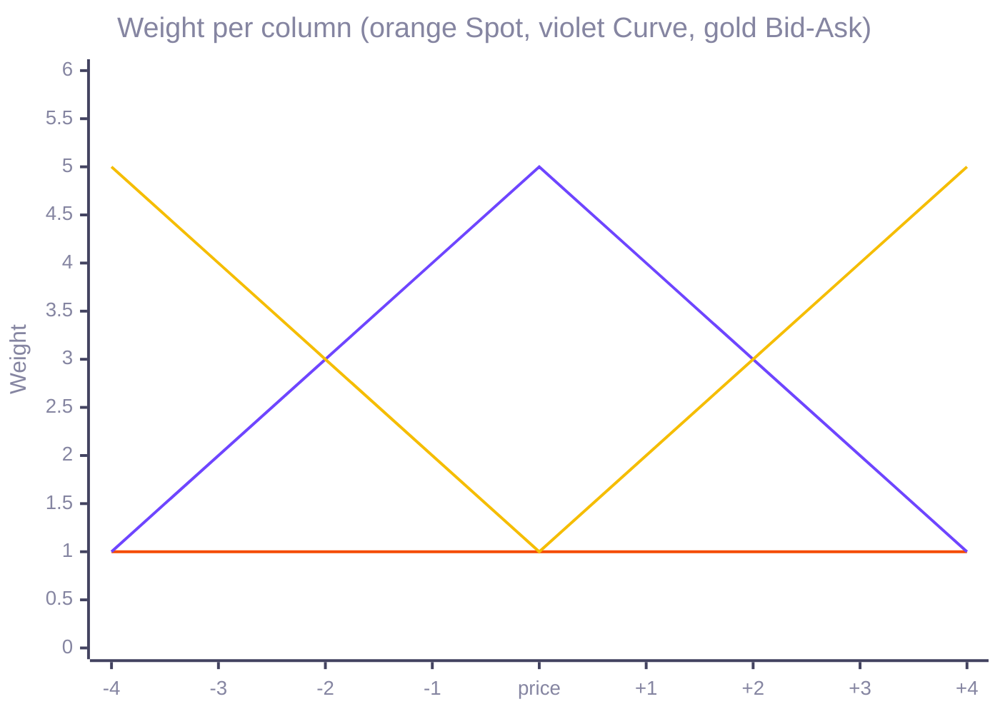
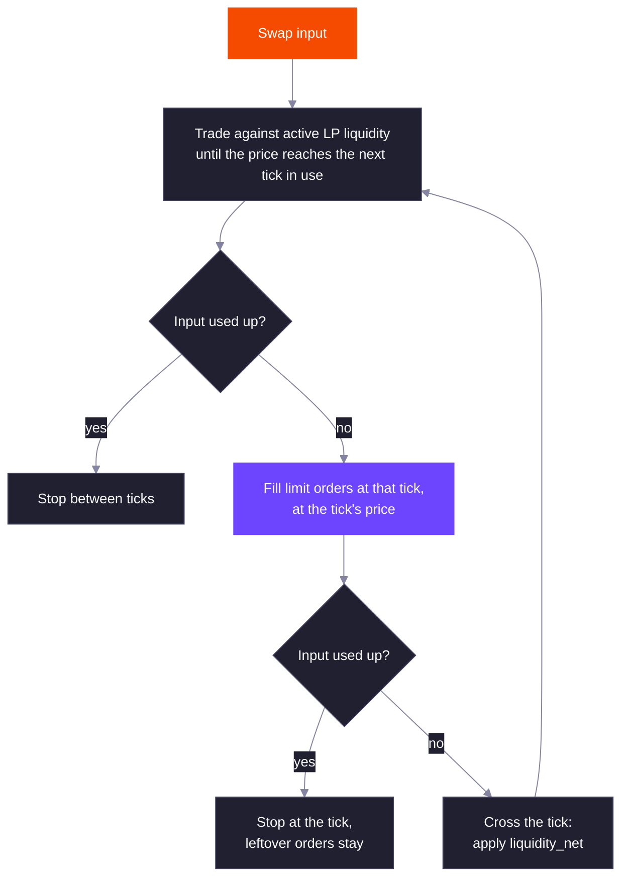
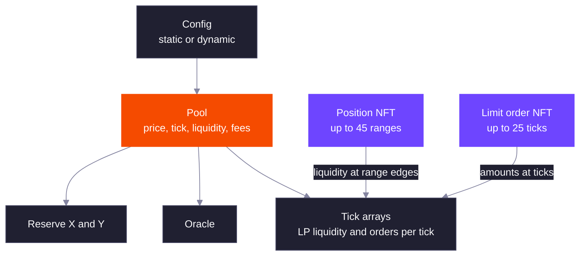

> [!NOTE]
> **ARCHIVED — HISTORICAL REFERENCE — NOT ACTIVE PROJECT INSTRUCTIONS**
> This document is preserved for historical auditing and forensic reference. It reflects past states and does NOT represent active project guidance or verified current status.
> For current, authoritative engineering instructions, architecture, and roadmaps, consult:
> - [docs/active/README.md](file:///c:/Users/azoozz/Downloads/my arbitrge/docs/active/README.md)
> - [docs/active/MASTER_ROADMAP.md](file:///c:/Users/azoozz/Downloads/my arbitrge/docs/active/MASTER_ROADMAP.md)
> - [docs/active/CURRENT_STATUS.md](file:///c:/Users/azoozz/Downloads/my arbitrge/docs/active/CURRENT_STATUS.md)

---

# llms.txt
Source: https://docs.meteora.ag/agents/llms-txt

Static documentation indexes and raw Markdown endpoints for LLMs and AI agents.

Meteora provides structured documentation files purpose-built for LLMs and AI agents, following the [llmstxt.org](https://llmstxt.org) standard.

> [!NOTE]
>
> Use `llms.txt` when your agent needs a compact map of the docs. Use [Documentation MCP](/agents/mcp) when your AI tool can call MCP tools and should search or read pages interactively.

## llms.txt

A plain Markdown file containing a structured index of Meteora documentation with titles and descriptions for each indexed page:

* **Site title** as an H1 heading
* **Sections** for major areas such as Get Started, User Guides, Core Products, Helper Products, Developer Guides, Invent, Agents, Protocol, and Resources
* **Links with descriptions** for product guides, SDK references, API references, and resources
* **OpenAPI spec links** where API reference specifications are indexed

> [card] [llms.txt](https://docs.meteora.ag/llms.txt)
>
> Open the llms.txt for Meteora docs

```mdx theme={"system"}
# Meteora Documentation

## Get Started

- [We Build Liquidity Pools](https://docs.meteora.ag/get-started.md): The Most Composable Liquidity Layer...
- [What is DLMM?](https://docs.meteora.ag/core-products/dlmm/what-is-dlmm.md): Learn how Meteora's DLMM organizes liquidity...
- [DAMM v2 Developer Guide](https://docs.meteora.ag/developer-guides/damm-v2/index.md): Learn how to build DAMM v2 integrations...
- [Dynamic Bonding Curve Developer Guide](https://docs.meteora.ag/developer-guides/dbc/index.md): Learn how to build Dynamic Bonding Curve integrations...

## OpenAPI Specs

- [openapi](https://docs.meteora.ag/api-reference/dlmm/openapi.json)
```

This is the best first fetch for agents that need to decide which Meteora product, guide, SDK reference, API reference, or raw Markdown page to read next.

## llms-full.txt

> [card] [llms-full.txt](https://docs.meteora.ag/llms-full.txt)
>
> Open the llms-full.txt for Meteora docs

While `llms.txt` provides a concise index, `llms-full.txt` contains the **entire documentation site** as context, including descriptions, code examples, guides, API references, and product explanations.

Use `llms-full.txt` when:

* Your AI tool needs **complete, granular context** for deep indexing
* You're building **custom RAG pipelines** over Meteora docs
* You want **every code example** available for reference

## Raw Markdown Pages

Any documentation page can be accessed as raw Markdown, making it easy for AI agents to consume individual pages programmatically.

**Method 1: Append `.md` to the URL**

```bash theme={"system"}
curl https://docs.meteora.ag/core-products/dlmm/what-is-dlmm.md
curl https://docs.meteora.ag/core-products/damm-v2/what-is-damm-v2.md
curl https://docs.meteora.ag/core-products/dbc/what-is-dbc.md
curl https://docs.meteora.ag/developer-guides/dlmm/typescript-sdk/getting-started.md
curl https://docs.meteora.ag/developer-guides/damm-v2/typescript-sdk/getting-started.md
curl https://docs.meteora.ag/developer-guides/dbc/typescript-sdk/getting-started.md
```

**Method 2: Use the `Accept` header**

```bash theme={"system"}
curl -H "Accept: text/markdown" https://docs.meteora.ag/developer-guides/damm-v2/typescript-sdk/getting-started
```

Both methods return the page content as `text/markdown`.

## How Agents Should Use These Files

| Need | Best entrypoint |
| :- | :- |
| Discover the docs structure | `https://docs.meteora.ag/llms.txt` |
| Ingest the full docs corpus | `https://docs.meteora.ag/llms-full.txt` |
| Read one exact page | Append `.md` to the page URL |
| Search and read from an MCP client | `https://docs.meteora.ag/mcp` |

> [!TIP]
>
> For most agent workflows, start with `llms.txt`, fetch only the relevant `.md` pages, and use `llms-full.txt` only when you intentionally want the full corpus in one document.


# Documentation MCP
Source: https://docs.meteora.ag/agents/mcp

Connect AI tools to Meteora docs through Mintlify's hosted Model Context Protocol server.

Meteora's documentation MCP is the live, tool-call version of these docs for AI agents. It is hosted by Mintlify at `https://docs.meteora.ag/mcp` and follows Mintlify's documentation MCP model: agents can search indexed documentation, then read exact page content from a read-only docs filesystem.

## What is MCP?

MCP is an open protocol that connects AI assistants to external data sources and tools. With Meteora's documentation MCP server, your AI tool can:

* **Search documentation**: find relevant product docs, developer guides, SDK references, and API references
* **Read exact pages**: retrieve full MDX/Markdown content through Mintlify's virtual docs filesystem
* **Inspect API reference content**: look up indexed endpoint docs, request/response schemas, parameters, and errors where available
* **Use docs without web-search noise**: answer from the current indexed Meteora documentation instead of generic search results

> [!NOTE]
>
> This is a read-only documentation server. It does not execute API calls, submit transactions, sign with a wallet, mutate documentation, or manage funds.

## Endpoint

Meteora's public documentation MCP server is available at:

```
https://docs.meteora.ag/mcp
```

> [card] [Meteora Docs MCP](https://docs.meteora.ag/mcp)
>
> Connect an MCP-compatible AI tool to Meteora documentation

This endpoint uses HTTP transport and exposes Meteora's indexed documentation through MCP.

## Documentation MCP vs Mintlify MCP

Mintlify offers two related MCP experiences:

| Server | Audience | What it can do |
| :- | :- | :- |
| **Documentation MCP** at `https://docs.meteora.ag/mcp` | Meteora builders and users | Search and read Meteora's published docs |
| **Mintlify MCP** at `https://mcp.mintlify.com` | Trusted documentation teams | Edit Mintlify content, update navigation, modify `docs.json`, and open pull requests |

Use Meteora's documentation MCP when an agent needs current Meteora context. Use Mintlify's authenticated MCP only if you are part of the docs team and want an agent to make documentation changes through Mintlify's branch and pull request workflow.

## What You Get

Once connected, your AI assistant can search and read:

| Resource | Description |
| :- | :- |
| **Documentation pages** | Product explanations, user guides, developer guides, and reference docs |
| **API references** | Indexed endpoint docs and OpenAPI-backed request/response details where available |
| **Program references** | Account, instruction, event, and error documentation for Meteora programs |
| **Skill resources** | `skill.md` resources, when available through the docs site |

> [!TIP]
>
> Combine MCP with [llms.txt](/agents/llms-txt): use MCP for in-editor queries and use `llms.txt`, `llms-full.txt`, or raw Markdown exports for batch processing and RAG pipelines.

## Setup

> [tab] Claude Code
>
> **How to enable Meteora Docs MCP in Claude Code:**
>
> 1. Open your terminal.
> 2. Add Meteora's MCP server by running:
>
> ```bash theme={"system"}
> claude mcp add --transport http meteora https://docs.meteora.ag/mcp
> ```
>
> 3. Launch Claude Code and start chatting with Meteora.
>
> **Or add to your project’s `.mcp.json`:**
>
> ```json theme={"system"}
> {
>   "mcpServers": {
>     "meteora": {
>       "url": "https://docs.meteora.ag/mcp"
>     }
>   }
> }
> ```
>
> **Verify with:**
>
> ```bash theme={"system"}
> claude mcp list
> ```

> [tab] Claude
>
> **Setup Meteora Docs MCP in Claude:**
>
> 1. Go to [**Connectors**](https://claude.ai/settings/connectors) in your Claude settings.
> 2. Select **Add custom connector**.
> 3. Set the name to **Meteora** and the URL to **[https://docs.meteora.ag/mcp](https://docs.meteora.ag/mcp)**.
> 4. When chatting, click the attachments button (plus icon) and select the Meteora connector.

> [tab] Cursor
>
> **Setup Meteora Docs MCP in Cursor:**
>
> 1. Open the command palette with `Cmd + Shift + P` (or `Ctrl + Shift + P` on Windows).
> 2. Search for **Open MCP settings**.
> 3. Add the following to your `mcp.json` file:
>
> ```json theme={"system"}
> {
>   "mcpServers": {
>     "meteora": {
>       "url": "https://docs.meteora.ag/mcp"
>     }
>   }
> }
> ```
>
> 4. Save and reload Cursor.

> [tab] VS Code
>
> **Setup Meteora Docs MCP in VS Code:**
>
> 1. Create or open `.vscode/mcp.json`.
> 2. Add the following server configuration:
>
> ```json theme={"system"}
> {
>   "servers": {
>     "meteora": {
>       "type": "http",
>       "url": "https://docs.meteora.ag/mcp"
>     }
>   }
> }
> ```
>
> 3. Save the file and reload your MCP-enabled VS Code environment.

> [tab] Windsurf
>
> **Using Meteora Docs MCP in Windsurf:**
>
> 1. Open the command palette with `Cmd + Shift + P` (or `Ctrl + Shift + P` on Windows).
> 2. Search for **Windsurf: Configure MCP Servers**.
> 3. Add the following to your `mcp_config.json` file:
>
> ```json theme={"system"}
> {
>   "mcpServers": {
>     "meteora": {
>       "serverUrl": "https://docs.meteora.ag/mcp"
>     }
>   }
> }
> ```
>
> 4. Save and restart Windsurf.

### Other MCP-Compatible Tools

Any tool that supports HTTP MCP servers can connect to `https://docs.meteora.ag/mcp`.

## Example Prompts

```text theme={"system"}
Use the Meteora Docs MCP to find the current DLMM TypeScript SDK swap flow, then summarize the files I should read before implementing it.
```

```text theme={"system"}
Search Meteora docs for DAMM v2 fee scheduler and rate limiter behavior. Cite the relevant docs pages before suggesting configuration values.
```

```text theme={"system"}
Read the DBC migration docs and program error reference, then help me design a defensive integration checklist.
```

> [!NOTE]
>
> For onchain execution, keep signing and transaction submission in your own scripts, wallet, SDK integration, or [Meteora Invent](/invent/actions). The documentation MCP supplies context; it does not perform the action.


# Agents
Source: https://docs.meteora.ag/agents/overview

Use AI agents with Meteora docs, APIs, SDKs, and launch tooling.

<video />

Meteora is built to be legible to AI agents: docs are available as MCP tools, static LLM indexes, raw Markdown, SDK guides, API references, and command-driven launch workflows. Use the docs layer for context, then execute through your own code, wallet, SDK integration, or Meteora Invent when an action is intentional.

## Agent Workflow

1. **Discover** the relevant product, guide, SDK, or API page with [llms.txt](/agents/llms-txt) or [Documentation MCP](/agents/mcp).
2. **Read exact context** from raw Markdown pages or MCP page retrieval before writing code.
3. **Implement** against Meteora SDKs, REST API references, and program docs.
4. **Execute deliberately** through scripts, wallets, SDK transactions, or [Meteora Invent](/invent/actions), with signing controlled by the user. For agents that support skills, install the [Meteora Agent Skill](/agents/skill) — it packages the full action playbook with built-in safety gates.

> [!NOTE]
>
> Meteora's documentation MCP is read-only. It helps agents understand Meteora; it does not sign transactions, manage private keys, execute swaps, create pools, or edit this documentation.

## Pick the Right Entry Point

> [card] [Ask questions in an AI editor or hosted chat](/agents/mcp)
>
> Use Documentation MCP when the agent supports MCP and should search or read current docs in context.

> [card] [Build a docs index or RAG pipeline](/agents/llms-txt)
>
> Use `llms.txt` when you need static, crawlable documentation context.

> [card] Fetch one page exactly
>
> Use a raw Markdown export when you already know the page URL and want clean Markdown.

> [card] [Write integration code](/developer-guides/dlmm)
>
> Use Developer Guides when you need SDK setup, account models, instructions, events, errors, and examples.

> [card] [Use indexed REST data](/developer-guides/dlmm/api-reference/overview)
>
> Use API Reference pages when you need endpoint schemas, parameters, response fields, and rate-limit context.

> [card] [Launch or test onchain workflows](/invent/actions)
>
> Use Meteora Invent when you need config-driven commands for pools, launches, or protocol actions.

> [card] [Give your agent the full playbook](/agents/skill)
>
> Install the Meteora Agent Skill when your agent runtime supports Agent Skills and should execute Meteora actions end to end with safety gates.

## Agent Surfaces

For agents that need to discover, reason, implement, or prepare actions with Meteora:

> [card] [Documentation MCP](/agents/mcp)
>
> Search and read Meteora docs from Claude, Claude Code, Cursor, VS Code, Windsurf, ChatGPT, and other MCP-compatible tools.

> [card] [llms.txt](/agents/llms-txt)
>
> Static LLM-optimized indexes and raw Markdown exports for agents, crawlers, and custom retrieval pipelines.

> [card] [Developer Guides](/developer-guides/dlmm)
>
> SDKs, program references, API references, and examples for building Meteora integrations.

> [card] [Meteora Invent](/invent/actions)
>
> Config-driven commands for launching pools and running supported onchain workflows with user-controlled signing.

## Local and Hosted Agents

> [card] Local coding agents
>
> For Claude Code, Cursor, Codex, VS Code, and Windsurf, connect Documentation MCP, read raw Markdown when needed, install SDKs locally, run tests, and execute scripts only with explicit wallet and network configuration.

> [card] Hosted agents
>
> For Claude.ai, ChatGPT, and other MCP clients, connect Documentation MCP for current docs context, use `llms.txt` links for fallback retrieval, and keep wallet signing or production execution outside the chat unless a trusted execution tool is explicitly configured.

## Safe Agentic Usage

* Ask the agent to cite the Meteora docs pages it used before implementing.
* Never paste seed phrases, private keys, or production wallet secrets into an agent chat.
* Use localnet or devnet before mainnet when testing generated scripts.
* Keep transaction review and signing under user control.
* Treat large automated changes or onchain actions as proposals until reviewed.

## Prompt Starters

```text theme={"system"}
Use the Meteora Docs MCP to find the current DAMM v2 TypeScript SDK guide, then draft the smallest safe integration plan for adding liquidity.
```

```text theme={"system"}
Start from Meteora llms.txt, identify the DBC pages needed for migration handling, then fetch only those Markdown pages before writing code.
```


# Meteora Agent Skill
Source: https://docs.meteora.ag/agents/skill

Install and use Meteora's Agent Skill for onchain actions and SDK development.

The Meteora Agent Skill is a portable set of instructions for AI coding agents. It helps an agent choose the right Meteora product, collect the required inputs, run supported studio commands, and write TypeScript against the SDK APIs the repository currently uses.

The skill lives at [`skills/meteora`](https://github.com/MeteoraAg/meteora-invent/tree/main/skills/meteora) in the `meteora-invent` repository and follows the open [Agent Skills format](https://agentskills.io). You can install the same folder in Claude Code, OpenClaw, Hermes, Cursor, or another compatible runtime.

> [!NOTE]
>
> An Agent Skill is an instruction pack, not a hosted transaction service or wallet. The agent still needs terminal and network access to run commands, and you remain in control of the wallet and signing environment.

## When to Use It

The skill separates requests into two paths:

| Path | Use it when | What the agent uses |
| :- | :- | :- |
| **ACT** | You want to launch, swap, create a pool, manage liquidity, claim fees, or run another supported action | The config-driven CLI in `meteora-invent/studio` |
| **BUILD** | You want a bot, backend, frontend, custom transaction flow, or an operation that the studio does not expose | Meteora's TypeScript SDKs and the skill's version-specific reference packs |

For current product concepts and API documentation, use the [Documentation MCP](/agents/mcp) or [llms.txt](/agents/llms-txt) alongside the skill. The skill provides the workflow and safety rules; the docs provide the broader protocol reference.

## What the Skill Covers

### Studio Actions

The ACT path documents 81 commands from the Meteora Invent studio. Each entry records the command, accepted selector flags, config block, important units, expected output, and approximate SOL requirement.

| Area | Commands | Common uses |
| :- | :- | :- |
| Setup | 2 | Convert a private key into the studio keypair file and request devnet or localnet SOL |
| DBC | 8 | Create configs and pools, swap, claim trading fees, inspect graduation status, transfer the pool creator, and migrate to DAMM v1 or DAMM v2 |
| DLMM | 10 | Create and seed pools, control pool status, place or cancel limit orders, swap, read positions, and claim fees and rewards |
| DAMM v2 | 10 | Create balanced or one-sided pools, add or remove liquidity, split or close positions, refresh vesting, swap, and read positions |
| DAMM v1 | 5 | Create legacy pools, lock LP, create Stake2Earn farms, lock LP into those farms, and swap |
| Alpha Vault | 7 | Create a vault, deposit, withdraw, claim, withdraw remaining quote, crank the fill, and read vault and escrow state |
| Presale Vault | 9 | Create a presale, deposit, withdraw, claim, sweep remaining quote, withdraw the raise, handle unsold supply, close an escrow, and read status |
| Met Lock | 5 | Create a vesting escrow, attach escrow metadata, claim vested tokens, and read one or all escrows for a wallet |
| Stake2Earn | 6 | Stake into a fee farm, claim fees, start or cancel an unstake, withdraw after the cooldown, and read farm and staker state |
| Pool Farms | 5 | Stake DAMM v1 LP, unstake, claim rewards from one farm or several, and read farm and user state |
| Dynamic Vault | 3 | Deposit into a lending vault, withdraw, and read supply, withdrawable amount, and virtual price |
| Fee Sharing | 8 | Create a fee vault, fund it directly or from DAMM v2 fees, rewards, or DBC fees, transfer a position to the vault, claim a share, and read the split |
| Zap | 3 | Enter a DAMM v2 or DLMM position with a single token and exit a position into one token |

The studio uses one fixed JSONC config file per protocol. Command-line flags select an account such as a mint, pool, or limit order; they do not select a different config file. For example:

```bash Terminal theme={"system"}
pnpm studio dbc-get-status --baseMint <MINT>
pnpm studio dlmm-swap --poolAddress <POOL>
pnpm studio damm-v2-get-positions --poolAddress <POOL>
```

Before a write, the agent edits the relevant file under `studio/config`, keeps `dryRun` set to `true`, and shows you the simulation result. It changes `dryRun` to `false` only after you confirm the real execution and the target network, then returns it to `true` after the action.

### SDK Development

The BUILD path contains focused references for the four main liquidity protocols:

| Product | Package and pinned version | Use it for |
| :- | :- | :- |
| DBC | `@meteora-ag/dynamic-bonding-curve-sdk@1.5.11` | Token launches, curve configuration, trading, fee claims, graduation, and migration |
| DAMM v2 | `@meteora-ag/cp-amm-sdk@1.4.5` | Constant-product pools, position NFTs, swaps, liquidity, locks, vesting, fees, and rewards |
| DLMM | `@meteora-ag/dlmm@1.9.14` | Bin-based liquidity, strategies, swaps, positions, fee claims, limit orders, and rebalancing |
| DAMM v1 | `@meteora-ag/dynamic-amm-sdk@1.4.1` | Existing v1 pools, LP tokens, lock escrows, Dynamic Vault integration, and Stake2Earn |

The root `SKILL.md` pins the SDK versions verified by the reference packs. It also records compatibility rules that are easy to miss when combining the SDKs:

* The covered SDKs use `@solana/web3.js` v1 transaction types.
* DBC, DAMM v2, and DLMM use Anchor 0.31, while DAMM v1 uses Anchor 0.29 and is best isolated when dependency types conflict.
* SDK amounts use `BN` values in base units. Studio configs normally use human token units, except where a config field explicitly says otherwise.
* Builders return unsigned transactions. Some operations return multiple transactions or additional keypairs that must also sign.
* Pool state should be refreshed before quoting or building a transaction.

Compact SDK notes are also included for the helper programs that sit on top of the liquidity protocols:

| Product | Package and pinned version |
| :- | :- |
| Alpha Vault | `@meteora-ag/alpha-vault@1.1.16` |
| Presale | `@meteora-ag/presale@0.1.1` |
| Met Lock | `@meteora-ag/met-lock-sdk@1.0.1` |
| Stake2Earn | `@meteora-ag/m3m3@1.0.10` |
| Pool Farms | `@meteora-ag/farming-sdk@1.0.18` |
| Dynamic Vault | `@meteora-ag/vault-sdk@2.3.1` |
| Dynamic Fee Sharing | `@meteora-ag/dynamic-fee-sharing-sdk@1.1.0` |
| Zap | `@meteora-ag/zap-sdk@1.3.2` |

Each of these products also has studio commands, so the ACT path covers the ordinary lifecycle. The notes exist for the surfaces the studio does not expose — account discovery, read helpers, and the individual gotchas worth knowing before you call these SDKs directly, such as which parameter names do not match the units they take. The versions above reflect the current skill; check `SKILL.md` before installing dependencies in case the packages have moved forward.

## What's in the Skill

```text theme={"system"}
skills/
├── evals/
│   └── trigger-set.md
└── meteora/
    ├── SKILL.md
    └── references/
        ├── studio-actions.md
        ├── studio-setup.md
        ├── dbc.md
        ├── damm-v2.md
        ├── dlmm.md
        ├── damm-v1.md
        ├── other-products.md
        ├── wallets-and-txs.md
        ├── data-and-apis.md
        ├── troubleshooting.md
        ├── scaffolds.md
        └── configs/
            ├── dbc_config.jsonc
            ├── damm_v2_config.jsonc
            ├── dlmm_config.jsonc
            ├── damm_v1_config.jsonc
            ├── alpha_vault_config.jsonc
            ├── presale_vault_config.jsonc
            ├── lock_config.jsonc
            ├── dynamic_vault_config.jsonc
            ├── fee_sharing_config.jsonc
            ├── farming_config.jsonc
            └── zap_config.jsonc
```

The files have distinct jobs:

| File | Purpose |
| :- | :- |
| `SKILL.md` | Defines when the skill should activate, selects ACT or BUILD, maps products to use cases, and applies intake and verification rules |
| `studio-actions.md` | Documents all studio commands, their flags, config blocks, outputs, and common prerequisites |
| `studio-setup.md` | Covers Node and pnpm requirements, installation, wallet import, RPC setup, devnet funding, and localnet |
| `dbc.md`, `damm-v2.md`, `dlmm.md`, `damm-v1.md` | Provide protocol mental models, SDK method maps, working flows, and version fences for outdated API patterns |
| `other-products.md` | Summarizes the SDK surfaces for Alpha Vault, Presale, Met Lock, Stake2Earn, Pool Farms, Dynamic Vault, Dynamic Fee Sharing, and Zap, including how to find their accounts onchain |
| `wallets-and-txs.md` | Covers key handling, RPC selection, priority fees, simulation, signing, multi-transaction results, and explorer verification |
| `data-and-apis.md` | Helps the agent choose REST APIs for discovery or SDK state fetchers for transaction-time accuracy |
| `troubleshooting.md` | Maps common studio, TypeScript, and onchain errors to likely causes and fixes |
| `scaffolds.md` | Explains when to start from the DBC-based `fun-launch` frontend rather than build a custom UI |
| `configs/*.jsonc` | Supplies commented config templates synchronized with `studio/config` |
| `evals/trigger-set.md` | Lists prompts that should and should not activate the skill, including near-miss requests for other Solana protocols |

Only the `skills/meteora` folder needs to be installed. The trigger eval is maintained beside it in the repository for testing skill discovery.

## Requirements

| Use case | Requirements |
| :- | :- |
| Studio CLI | Node.js 22.12 or newer, pnpm 10 or newer, a Solana RPC, and a funded keypair for writes |
| Standalone SDK code | Node.js 18 or newer, npm or another package manager, a Solana RPC, and the SDK version pinned by the skill |
| Onchain and data reads | An RPC or Meteora data API, depending on whether the request needs exact onchain state or indexed data |

## Install the Skill

Clone the repository, then copy the complete `meteora` folder into a skill directory supported by your agent runtime. Keep the folder name and its internal structure unchanged.

> [tab] Claude Code
>
> Install it for your user account:
>
> ```bash Terminal theme={"system"}
> git clone https://github.com/MeteoraAg/meteora-invent.git
> mkdir -p ~/.claude/skills/meteora
> cp -R meteora-invent/skills/meteora/. ~/.claude/skills/meteora/
> ```
>
> When you work inside a `meteora-invent` checkout, Claude Code can also discover the repository copy under `skills/`.

> [tab] Shared .agents path
>
> Use the cross-runtime convention when your agent supports it:
>
> ```bash Terminal theme={"system"}
> git clone https://github.com/MeteoraAg/meteora-invent.git
> mkdir -p ~/.agents/skills/meteora
> cp -R meteora-invent/skills/meteora/. ~/.agents/skills/meteora/
> ```

> [tab] OpenClaw or Hermes
>
> Install the folder in the runtime's skill directory:
>
> ```bash Terminal theme={"system"}
> # OpenClaw workspace
> mkdir -p <openclaw-workspace>/skills/meteora
> cp -R meteora-invent/skills/meteora/. <openclaw-workspace>/skills/meteora/
>
> # Hermes user-level DeFi skills
> mkdir -p ~/.hermes/skills/defi/meteora
> cp -R meteora-invent/skills/meteora/. ~/.hermes/skills/defi/meteora/
> ```

After installation, confirm that the runtime can see a file at `<skills-directory>/meteora/SKILL.md`. Restart or reload the agent if it only discovers skills at startup.

## Ask the Agent to Run an Action

You can make a plain-language request. Include the network, public addresses, amounts and units, and the outcome you want when you already know them. Do not include a private key or seed phrase.

```text theme={"system"}
Use the Meteora skill to create a DBC token launch on devnet. Use SOL as the quote token, target a 600 SOL migration market cap, and keep the first run in dry-run mode. Ask me only for the required launch details I have not provided.
```

```text theme={"system"}
Use the Meteora skill to show the DLMM positions owned by <WALLET> in <POOL>. If fees are claimable, prepare a dry run but do not submit a transaction.
```

For a write, the expected flow is:

1. The agent selects the protocol and ACT path.
2. It collects or confirms the network, RPC, wallet, funding, amounts and units, addresses, and protocol parameters.
3. It edits the relevant JSONC config and runs the action with `dryRun: true`.
4. It reports the simulation result and asks for explicit confirmation before changing to a real execution, with an additional check when the target is mainnet.
5. After execution, it confirms the signature and re-reads the affected onchain state.

## Ask the Agent to Build an Integration

For development work, name the product and the behavior you need. The agent should read the matching reference pack before it writes code.

```text theme={"system"}
Use the Meteora skill's BUILD path to write a TypeScript service that quotes a DLMM swap, checks the minimum output, and returns an unsigned transaction for the caller to sign. Use the SDK version pinned by the skill.
```

```text theme={"system"}
Use the Meteora skill to add DBC graduation handling to this launchpad. Detect migration, find the successor DAMM v2 pool, and switch the trading route without changing the wallet-signing boundary.
```

If your project already uses a newer SDK version, tell the agent to compare the installed package with the reference pack and the SDK changelog. The skill's version fences are there to prevent older method names and signatures from being reused without checking them.

## Safety Rules

The skill requires the agent to:

* Use devnet for a first run unless you explicitly choose another network.
* Simulate or quote every state-changing flow before sending it.
* Obtain explicit confirmation before changing from a dry run to a real transaction, and confirm the network again for mainnet.
* Keep private keys in `.env` or keypair files and refer to wallets by public address in chat.
* Confirm whether each amount is in human token units or base units before execution.
* Set explicit slippage and minimum-output protection for swaps.
* Verify a submitted transaction and re-read state before reporting success.

> [!WARNING]
>
> Review every transaction before signing, especially one assembled by an SDK or remote service. Check the program IDs, token mints, amounts, receivers, and fee payer against the action you approved.

> [card] [Browse the Meteora Agent Skill](https://github.com/MeteoraAg/meteora-invent/tree/main/skills/meteora)
>
> Read the router, protocol references, studio action guide, and config templates on GitHub


# Alpha Vault Configs
Source: https://docs.meteora.ag/api-reference/damm-v1/alpha-vault/alpha-vault-configs

/developer-guides/damm-v1/api-reference/openapi.json get /alpha-vault-configs

# Alpha Vaults
Source: https://docs.meteora.ag/api-reference/damm-v1/alpha-vault/alpha-vaults

/developer-guides/damm-v1/api-reference/openapi.json get /alpha-vault

# Fee Configs
Source: https://docs.meteora.ag/api-reference/damm-v1/fee-configs/fee-configs

/developer-guides/damm-v1/api-reference/openapi.json get /fee-config/{config_address}

# Pool Configs
Source: https://docs.meteora.ag/api-reference/damm-v1/pools/pool-configs

/developer-guides/damm-v1/api-reference/openapi.json get /pool-configs

# Pool Metrics
Source: https://docs.meteora.ag/api-reference/damm-v1/pools/pool-metrics

/developer-guides/damm-v1/api-reference/openapi.json get /pools-metrics

# Pool Search
Source: https://docs.meteora.ag/api-reference/damm-v1/pools/pool-search

/developer-guides/damm-v1/api-reference/openapi.json get /pools/search

# Pool Search Deprecated
Source: https://docs.meteora.ag/api-reference/damm-v1/pools/pool-search-deprecated

/developer-guides/damm-v1/api-reference/openapi.json get /pools/{version}

# Pools
Source: https://docs.meteora.ag/api-reference/damm-v1/pools/pools

/developer-guides/damm-v1/api-reference/openapi.json get /pools

# Pools By A Vault LP
Source: https://docs.meteora.ag/api-reference/damm-v1/pools/pools-by-a-vault-lp

/developer-guides/damm-v1/api-reference/openapi.json post /pools_by_a_vault_lp

# Pools With Farms
Source: https://docs.meteora.ag/api-reference/damm-v1/pools/pools-with-farms

/developer-guides/damm-v1/api-reference/openapi.json get /farms

# Group
Source: https://docs.meteora.ag/api-reference/damm-v2/pools/group

/developer-guides/damm-v2/api-reference/openapi.json get /pools/groups/{lexical_order_mints}
Returns a paginated list of pools that belong to a specific pool group

# Groups
Source: https://docs.meteora.ag/api-reference/damm-v2/pools/groups

/developer-guides/damm-v2/api-reference/openapi.json get /pools/groups
Returns a paginated list of pool groups

# Historical Volume
Source: https://docs.meteora.ag/api-reference/damm-v2/pools/historical-volume

/developer-guides/damm-v2/api-reference/openapi.json get /pools/{address}/volume/history
Returns historical volume for a pool aggregated into time buckets

**Notes**
- If both `start_time` and `end_time` are provided, the result covers the range `[start_time, end_time]`
- If only one of `start_time` or `end_time` is provided, the missing bound is inferred using the selected `timeframe`
- If neither is provided, a default range is used based on `timeframe`

# OHLCV
Source: https://docs.meteora.ag/api-reference/damm-v2/pools/ohlcv

/developer-guides/damm-v2/api-reference/openapi.json get /pools/{address}/ohlcv
Returns OHLCV candles for a single pool over a time range

**Notes**
- If both `start_time` and `end_time` are provided, candles are returned in the range `[start_time, end_time]`
- If only one of `start_time` or `end_time` is provided, the missing bound is inferred using the selected `timeframe`
- If neither is provided, a default range is used based on `timeframe`

# Pool
Source: https://docs.meteora.ag/api-reference/damm-v2/pools/pool

/developer-guides/damm-v2/api-reference/openapi.json get /pools/{address}
Returns metadata and current state for a single pool

# Pools
Source: https://docs.meteora.ag/api-reference/damm-v2/pools/pools

/developer-guides/damm-v2/api-reference/openapi.json get /pools
Returns a paginated list of pools

# Protocol Overview
Source: https://docs.meteora.ag/api-reference/damm-v2/stats/protocol-overview

/developer-guides/damm-v2/api-reference/openapi.json get /stats/protocol_metrics
Returns aggregated protocol-level metrics across all pools

# Get Bonus Claimed For Pool
Source: https://docs.meteora.ag/api-reference/dlmm/limit-orders/get-bonus-claimed-for-pool

/developer-guides/dlmm/api-reference/openapi.json get /wallets/{wallet}/limit_orders/pools/{pool_address}/bonus_claimed
Returns the total realized bonus a wallet has claimed on one DLMM pool,
aggregated across every cancel event the wallet has on the pool. Includes
cancels on orders that have not yet been closed (a cancel pays bonus
immediately; the on-chain account is closed separately via
`CloseLimitOrderIfEmpty`). USD/SOL values are derived using each cancel
row's stored cancel-time price ratios — not current spot.

# Get Closed Limit Order Pools
Source: https://docs.meteora.ag/api-reference/dlmm/limit-orders/get-closed-limit-order-pools

/developer-guides/dlmm/api-reference/openapi.json get /wallets/{wallet}/limit_orders/closed/pools
Paginated per-pool summary of the wallet's closed limit orders, sorted by
`last_closed_at` DESC. A limit order is closed iff it has a row in
`close_limit_orders` — cancel-only orders remain in `/open`.

# Get Closed Limit Orders For Pool
Source: https://docs.meteora.ag/api-reference/dlmm/limit-orders/get-closed-limit-orders-for-pool

/developer-guides/dlmm/api-reference/openapi.json get /wallets/{wallet}/limit_orders/closed/pools/{pool_address}
Paginated per-order lifecycle view for the wallet's closed limit orders in
one pool, sorted by `last_closed_at` DESC.

# Get Limit Order Summary
Source: https://docs.meteora.ag/api-reference/dlmm/limit-orders/get-limit-order-summary

/developer-guides/dlmm/api-reference/openapi.json get /wallets/{wallet}/limit_orders/summary
Returns aggregate totals for a user's limit orders across all pools:
open/closed order counts, total deposit value, and total bonus fees earned.
"Open" means placed with no `close_limit_orders` row. "Closed" means the
order has a `close_limit_orders` row (`CloseLimitOrderIfEmpty` was invoked).

# Get Open Limit Order Pools
Source: https://docs.meteora.ag/api-reference/dlmm/limit-orders/get-open-limit-order-pools

/developer-guides/dlmm/api-reference/openapi.json get /wallets/{wallet}/limit_orders/open/pools
Paginated per-pool summary of the wallet's live limit orders, sorted by
deposit USD DESC. A limit order is live until it has a `close_limit_orders`
row — cancels do not remove it from this view.

# Get Open Limit Orders For Pool
Source: https://docs.meteora.ag/api-reference/dlmm/limit-orders/get-open-limit-orders-for-pool

/developer-guides/dlmm/api-reference/openapi.json get /wallets/{wallet}/limit_orders/open/pools/{pool_address}
Paginated per-order detail for the wallet's live limit orders in one pool,
sorted by placement time DESC. "Live" = has no `close_limit_orders` row.

# Group
Source: https://docs.meteora.ag/api-reference/dlmm/pools/group

/developer-guides/dlmm/api-reference/openapi.json get /pools/groups/{lexical_order_mints}
 Returns a paginated list of pools that belong to a specific pool group

# Groups
Source: https://docs.meteora.ag/api-reference/dlmm/pools/groups

/developer-guides/dlmm/api-reference/openapi.json get /pools/groups
Returns a paginated list of pool groups

# Historical Volume
Source: https://docs.meteora.ag/api-reference/dlmm/pools/historical-volume

/developer-guides/dlmm/api-reference/openapi.json get /pools/{address}/volume/history
Returns historical volume for a pool aggregated into time buckets

**Notes**
- If both `start_time` and `end_time` are provided, the result covers the range `[start_time, end_time]`
- If only one of `start_time` or `end_time` is provided, the missing bound is inferred using the selected `timeframe`
- If neither is provided, a default range is used based on `timeframe`

# OHLCV
Source: https://docs.meteora.ag/api-reference/dlmm/pools/ohlcv

/developer-guides/dlmm/api-reference/openapi.json get /pools/{address}/ohlcv
Returns OHLCV candles for a single pool over a time range

**Notes**
- If both `start_time` and `end_time` are provided, candles are returned in the range `[start_time, end_time]`
- If only one of `start_time` or `end_time` is provided, the missing bound is inferred using the selected `timeframe`
- If neither is provided, a default range is used based on `timeframe`

# Pool
Source: https://docs.meteora.ag/api-reference/dlmm/pools/pool

/developer-guides/dlmm/api-reference/openapi.json get /pools/{address}
Returns metadata and current state for a single pool

# Pools
Source: https://docs.meteora.ag/api-reference/dlmm/pools/pools

/developer-guides/dlmm/api-reference/openapi.json get /pools
Returns a paginated list of pools

# Get total portfolio PnL across all pools
Source: https://docs.meteora.ag/api-reference/dlmm/portfolio/get-total-portfolio-pnl-across-all-pools

/developer-guides/dlmm/api-reference/openapi.json get /portfolio/total
Returns the all-time total PnL in USD and percentage change across all user's pools.
This aggregates data from all closed positions across the entire portfolio.

# Arguments

* `user` - The wallet address of the user

# Returns

* `200` - The user's total portfolio PnL
* `400` - Invalid user address or query parameters

# Get user portfolio with all pools containing closed positions
Source: https://docs.meteora.ag/api-reference/dlmm/portfolio/get-user-portfolio-with-all-pools-containing-closed-positions

/developer-guides/dlmm/api-reference/openapi.json get /portfolio
Returns a paginated list of pools where the user has closed positions,
sorted by most recent activity (last_closed_at DESC). The response includes:
- Pool metadata (address, token symbols, icons, fees)
- Aggregated PnL data (deposits, withdrawals, fees, total PnL)
- Per-token breakdowns (X and Y)

For detailed position history within each pool, call the /positions/{pool_address}/pnl endpoint.


# Arguments

* `user` - The wallet address of the user
* `page` - Page number for pagination (default: 1)
* `page_size` - Number of pools per page (default: 120, max: 365)
* `days_back` - Only include pools with positions closed within this many days (default: 90)

# Returns

* `200` - The user's portfolio with pool metadata and aggregated PnL
* `400` - Invalid user address or query parameters

# Get user portfolio with all pools containing open positions
Source: https://docs.meteora.ag/api-reference/dlmm/portfolio/get-user-portfolio-with-all-pools-containing-open-positions

/developer-guides/dlmm/api-reference/openapi.json get /portfolio/open
Returns a paginated list of pools where the user has open (active) positions.
The response includes:
- Pool metadata (address, bin step, base fee, token symbols, icons)
- Current balances and unclaimed fees in USD and SOL
- Pool metrics (TVL, 24h volume, fee/TVL ratio)
- List of open position addresses for each pool
- Aggregated total metrics across all pools (balances, unclaimed fees, PnL) in USD and SOL
- SOL price used for conversion (omitted if unavailable)

Results can be sorted by various metrics and support pagination.

# Arguments

* `user` - The wallet address of the user
* `page` - Page number for pagination (default: 1, minimum: 1)
* `page_size` - Number of pools per page (default: 20, maximum: 50)
* `sort_by` - Field to sort by: `current_balances`, `unclaimed_fee`, `pool_tvl`,
  `pool_volume_24h`, or `fee_per_tvl_24h` (default: `current_balances`)
* `sort_direction` - Sort direction: `asc` or `desc` (default: `desc`)

# Returns

* `200` - The user's open portfolio with pool metadata, balances, and total metrics
* `400` - Invalid user address or query parameters

# Get position PnL data (open and closed positions with on-the-fly calculation)
Source: https://docs.meteora.ag/api-reference/dlmm/positions/get-position-pnl-data-open-and-closed-positions-with-on-the-fly-calculation

/developer-guides/dlmm/api-reference/openapi.json get /positions/{pool_address}/pnl
Returns positions for a specific pool and user with calculated PnL values.
Includes SOL-denominated amounts when SOL price is available (omitted otherwise).
Results can be filtered by status (open/closed) and are paginated.

# Arguments

* `pool_address` - The address of the pool
* `user` - The user address
* `status` - Filter by status: "open", "closed", or omit for all (default: all)
* `page` - Page number starting from 1 (default: 1)

# Returns

* `200` - Paginated list of positions with PnL data in USD and SOL

# Get the historical events for a position
Source: https://docs.meteora.ag/api-reference/dlmm/positions/get-the-historical-events-for-a-position

/developer-guides/dlmm/api-reference/openapi.json get /positions/{address}/historical
This endpoint returns the historical actions for a position.

# Arguments

* `address` - The address of the position

# Returns

* `200` - The historical actions for the position

# Protocol Overview
Source: https://docs.meteora.ag/api-reference/dlmm/stats/protocol-overview

/developer-guides/dlmm/api-reference/openapi.json get /stats/protocol_metrics
Returns aggregated protocol-level metrics across all pools

# Get Wallet Pool Total Claims
Source: https://docs.meteora.ag/api-reference/dlmm/wallets/get-wallet-pool-total-claims

/developer-guides/dlmm/api-reference/openapi.json get /wallets/{wallet}/pools/{pool_address}/total_claims
Returns combined total claimed fees and rewards for a wallet in a specific pool

# get_apy_by_time_range
Source: https://docs.meteora.ag/api-reference/dynamic-vault/apy/get_apy_by_time_range

/developer-guides/dynamic-vault/api-reference/openapi.json get /apy_filter/{token_mint}/{start_timestamp}/{end_timestamp}
Returns APY information for a specific token mint within a given time range

# get_apy_state
Source: https://docs.meteora.ag/api-reference/dynamic-vault/apy/get_apy_state

/developer-guides/dynamic-vault/api-reference/openapi.json get /apy_state/{token_mint}
Returns APY (Annual Percentage Yield) information for strategies associated with a specific token mint

# get_vault_addresses
Source: https://docs.meteora.ag/api-reference/dynamic-vault/vaults/get_vault_addresses

/developer-guides/dynamic-vault/api-reference/openapi.json get /vault_addresses
Returns a list of vault addresses with their associated information

# get_vault_info
Source: https://docs.meteora.ag/api-reference/dynamic-vault/vaults/get_vault_info

/developer-guides/dynamic-vault/api-reference/openapi.json get /vault_info
Returns detailed information about all monitored vaults including their states, strategies, and performance metrics

# get_vault_state
Source: https://docs.meteora.ag/api-reference/dynamic-vault/vaults/get_vault_state

/developer-guides/dynamic-vault/api-reference/openapi.json get /vault_state/{token_mint}
Returns the current state of a specific vault identified by its token mint address

# get_virtual_price
Source: https://docs.meteora.ag/api-reference/dynamic-vault/virtual-price/get_virtual_price

/developer-guides/dynamic-vault/api-reference/openapi.json get /virtual_price/{token_mint}/{strategy}
Returns virtual price information for a specific strategy within a vault

# Get analyticsall
Source: https://docs.meteora.ag/api-reference/stake2earn/analytics/get-analyticsall

/developer-guides/stake2earn/api-reference/openapi.json get /analytics/all

# Get vault
Source: https://docs.meteora.ag/api-reference/stake2earn/vault/get-vault

/developer-guides/stake2earn/api-reference/openapi.json get /vault/{vault_address}

# Get vaultall
Source: https://docs.meteora.ag/api-reference/stake2earn/vault/get-vaultall

/developer-guides/stake2earn/api-reference/openapi.json get /vault/all

# Get vaultfilter
Source: https://docs.meteora.ag/api-reference/stake2earn/vault/get-vaultfilter

/developer-guides/stake2earn/api-reference/openapi.json get /vault/filter

# DAMM v2 Compounding Liquidity
Source: https://docs.meteora.ag/core-products/damm-v2/compounding-liquidity

Learn how DAMM v2 compounding liquidity reinvests a share of LP fees into full-range pool reserves.

DAMM v2 compounding liquidity is a pool mode where a share of LP fees is automatically reinvested back into the pool. Instead of every LP fee waiting to be claimed and manually compounded back, the pool can use part of those fees to grow reserves and deepen liquidity over time.

This is useful for long-term pools where LPs want liquidity growth, fewer manual fee actions, and a simpler full-range market design.

## How It Works

Compounding liquidity uses `Compounding` collect fee mode. In this mode:

* The pool behaves like a full-range constant-product AMM.
* Fees are collected in token B.
* A configurable share of the LP fee is added back into the pool's token B reserves.
* The remaining LP fee stays claimable by position owners.

```math theme={"system"}
\text{LP Fee} = \text{Compounding Fee} + \text{Claimable Fee}
```

The compounding share is controlled by `compounding_fee_bps`, in basis points.

| `compounding_fee_bps` | What happens to the LP fee |
| - | - |
| `0` | Nothing is added to reserves. The whole LP fee stays claimable in token B. |
| `2500` | 25% compounds, 75% stays claimable |
| `5000` | 50% compounds, 50% stays claimable |
| `10000` | 100% compounds. No LP fee stays claimable |

> [!NOTE]
>
> On a compounding pool, `compounding_fee_bps` is `0` to `10000`. `0` is the same fee split as `OnlyB`: the trading fee is collected in token B and none of it is compounded. The pool is still compounding mode, so it stays full-range and still keeps `DEAD_LIQUIDITY`. `BothToken` and `OnlyB` pools must set this field to `0`. `update_pool_fees` can change a compounding pool to `0`.

## Full-Range by Design

Compounding pools do not use custom concentrated price ranges. The program stores their range as `0` to `u128::MAX` and prices them from reserves:

```math theme={"system"}
\text{token A reserves} \times \text{token B reserves} = k
```

This makes the pool easier to reason about: reserves grow as compounded fees are added back, and LPs benefit proportionally through their position liquidity.

## Initial Liquidity

Compounding pools have one special initialization rule: the requested initial liquidity must be greater than `DEAD_LIQUIDITY`, which is `100 << 64`. DAMM v2 subtracts this dead liquidity from the first position's liquidity while keeping it in the pool's total liquidity.

> [!NOTE]
>
> The dead-liquidity rule prevents the pool from starting at a fragile zero-liquidity edge. It also means the first position receives slightly less liquidity than the raw initialization liquidity.

The initial token amounts are derived from the requested liquidity and initial square-root price:

```math theme={"system"}
\text{token A} = \left\lceil \frac{L}{\sqrt{P}} \right\rceil
```

```math theme={"system"}
\text{token B} = \left\lceil \frac{L \times \sqrt{P}}{2^{128}} \right\rceil
```

The initial square-root price still must be inside DAMM v2's global price limits, even though the compounding pool itself has no custom range.

## What LPs Experience

In a non-compounding pool, LP fees accumulate as claimable balances on the position. In a compounding pool, the LP fee is split after the protocol fee is removed:

* **Compounded portion**: added to pool reserves, increasing pool depth.
* **Claimable portion**: remains pending on the LP position and can be claimed later.

This lets a pool balance two goals: grow liquidity over time and still provide claimable fee income.

## Why Token B Matters

In compounding mode, fees are always handled in token B. For an A-to-B swap, the fee is taken from token B output. For a B-to-A swap, the fee is taken from token B input. Token B is commonly the quote token, such as SOL or USDC.

## Product Benefits

> [card] Automatic Reserve Growth
>
> A share of LP fees goes directly back into the pool, increasing liquidity without a separate reinvest action.

> [card] Simpler Full-Range Liquidity
>
> The pool follows the familiar constant-product model instead of a custom price range.

> [card] Flexible Fee Split
>
> Pool creators can choose how much LP fee compounds and how much remains claimable.

> [card] Long-Term LP Alignment
>
> LPs benefit from deeper pool reserves while still owning their position through an NFT.

## Best Use Cases

> [accordion] Mature Trading Pairs
>
> Established markets can use compounding liquidity to grow depth as trading activity generates fees.

> [accordion] Passive LP Strategies
>
> LPs who prefer fewer manual actions can let part of their fee income automatically support the pool.

> [accordion] Treasury or Protocol-Owned Liquidity
>
> Projects can use compounding to reinforce long-term liquidity depth while keeping fee behavior transparent on-chain.

## When Not to Use It

Use concentrated liquidity instead if the pool needs a custom minimum and maximum price range. Compounding liquidity is intentionally full-range, so it is not the right fit for a tightly targeted launch range.


# DAMM v2 Concentrated Liquidity
Source: https://docs.meteora.ag/core-products/damm-v2/concentrated-liquidity

Learn how DAMM v2 concentrated liquidity uses a fixed price range to focus pool liquidity.

DAMM v2 concentrated liquidity lets a pool focus liquidity inside a chosen price range. Instead of using an unbounded constant-product curve, the pool creator sets lower and upper price bounds when the pool is initialized.

This makes liquidity more efficient when a market has an expected trading area. More of the deposited capital can sit near the current price, giving traders better depth and giving LPs more fee exposure per dollar deployed.

## How It Works

A concentrated DAMM v2 pool has three important square-root price values:

* **Minimum price**: the lower bound of the pool's active range.
* **Maximum price**: the upper bound of the pool's active range.
* **Current price**: the live pool price between those bounds.

When the current price is inside the range, swaps can use the pool's liquidity. If an exact-in or exact-out swap would move price beyond the lower or upper boundary, the instruction returns a price-range violation. The partial-fill swap path can consume only the amount that moves the pool to the boundary and return the unused input amount.

> [!NOTE]
>
> Concentrated pools require `sqrt_min_price < sqrt_max_price`, both bounds inside DAMM v2's global price limits, and an initial square-root price inside the configured range.

## Why Concentrate Liquidity

In a full-range pool, liquidity is available across the entire price curve. That is simple, but a large part of the capital may sit far away from where trading actually happens.

Concentrated liquidity narrows the active range, so capital can work harder around the prices that matter.

> [card] Better Depth Near Target Price
>
> More liquidity can be placed around the expected trading range, improving execution for traders.

> [card] More Efficient LP Capital
>
> LPs can earn fees from a more focused liquidity range instead of spreading capital thinly.

> [card] Launch Price Control
>
> Token teams can design pool ranges around expected launch, migration, or listing prices.

> [card] Integrator Flexibility
>
> Launchpads and protocols can create pools with standardized or custom price-range behavior.

## Deposit Ratios

In a concentrated pool, the current price determines the token ratio needed to add liquidity. The program calculates token amounts from the current price and the fixed range:

```math theme={"system"}
\Delta A = L \times \frac{\sqrt{P_{\max}} - \sqrt{P}}{\sqrt{P_{\max}} \times \sqrt{P}}
```

```math theme={"system"}
\Delta B = L \times (\sqrt{P} - \sqrt{P_{\min}})
```

If the current price is closer to the lower side of the range, the pool needs more token A. If the current price is closer to the upper side of the range, the pool needs more token B.

This is not a UI quirk. It is how concentrated liquidity represents exposure across the selected price range.

> [!NOTE]
>
> When adding liquidity or making initial deposits, required token amounts are rounded up. Conversely, withdrawals and swap outputs are rounded down. This ensures the pool does not receive too little or pay out too much due to integer math.

## Range Selection

Choosing a range is a product decision:

| Range Choice | Product Effect |
| - | - |
| Narrower range | More capital efficiency near the target price, but less room for price movement |
| Wider range | More room for trading across price movement, but less concentrated depth |
| Full range | Broadest concentrated range, but not the same as compounding mode |

> [!WARNING]
>
> In concentrated liquidity mode, the price range is set when the pool is created. DAMM v2 positions do not choose independent per-position ranges.

## Best Use Cases

> [accordion] Launch Pools With Expected Price Bands
>
> A project can configure liquidity around a launch or migration price so early trading has stronger depth near the expected market.

> [accordion] Stable or Correlated Token Pairs
>
> Pairs that usually trade in a known band can use a tighter range to make liquidity more efficient.

> [accordion] Launchpad Pool Templates
>
> Launchpads can create repeatable configurations for markets that need the same range and fee behavior.

## Concentrated vs Compounding

Concentrated liquidity is best when the pool needs a specific price range. Compounding liquidity is best when the pool should behave as a full-range constant-product market where a share of LP fees can automatically grow reserves.

If you need a custom minimum and maximum price, use concentrated liquidity. If you need auto-compounding full-range reserves, use [DAMM v2 Compounding Liquidity](/core-products/damm-v2/compounding-liquidity).


# DAMM v2 Dynamic Fees
Source: https://docs.meteora.ag/core-products/damm-v2/fees/dynamic-fees

Learn how DAMM v2 dynamic fees add a volatility-responsive fee layer on top of the selected base fee mode.

DAMM v2 dynamic fees are an optional fee layer that responds to market volatility. When price movement is higher, the dynamic fee can increase. When the market calms down, the dynamic fee decays.

This gives pools a way to charge more during turbulent periods without permanently raising the base fee.

## How It Fits With Base Fees

Every DAMM v2 pool has one base fee mode. Dynamic fees sit on top of that base fee:

```math theme={"system"}
\text{Total Trading Fee} = \text{Base Fee} + \text{Dynamic Fee}
```

If dynamic fees are disabled, the dynamic fee is zero.

## How It Works

DAMM v2 tracks recent price movement through a volatility accumulator. The accumulator rises when price changes and can decay or reset over time.

Key settings include:

| Setting | Product Meaning |
| - | - |
| Bin step | Price sensitivity used by the volatility calculation; currently fixed to 1 bps |
| Filter period | Very short-term window that helps smooth noisy updates |
| Decay period | Time window after which volatility can decay or reset |
| Reduction factor | How much of the previous accumulator becomes the next volatility reference |
| Max volatility accumulator | Cap that prevents the volatility measure from growing without bound |
| Variable fee control | How strongly volatility affects the final dynamic fee numerator |

The dynamic fee numerator is:

```math theme={"system"}
\left\lceil
\frac{(\text{Volatility Accumulator} \times \text{Bin Step})^2 \times \text{Variable Fee Control}}{100{,}000{,}000{,}000}
\right\rceil
```

## Validation Limits

The current implementation enforces:

| Parameter | Constraint |
| - | - |
| `bin_step` | Must equal `1` |
| `bin_step_u128` | Must equal the default fixed-point value for 1 bps |
| `filter_period` and `decay_period` | `filter_period < decay_period` |
| `reduction_factor` | At most `10000` |
| `variable_fee_control` | At most `0xffffff` |
| `max_volatility_accumulator` | At most `0xffffff` |

Operators can enable or update dynamic fees with non-default dynamic fee parameters. Passing default dynamic fee parameters disables dynamic fees, but only if dynamic fees are already enabled.

## Why Use Dynamic Fees

> [card] Volatility Response
>
> Fees can increase when market movement becomes more intense.

> [card] LP Compensation
>
> LPs can earn higher fees during periods where price risk may be higher.

> [card] Temporary Protection
>
> The fee can decay as volatility settles instead of staying elevated forever.

> [card] Works With Base Modes
>
> Dynamic fees can be paired with DAMM v2 base fee modes for more adaptive fee design.

## Product Examples

> [accordion] Launch With Extra Volatility Protection
>
> A launch pool can use a time scheduler or market cap scheduler as the base fee, then add dynamic fees to react to sudden price movement.

> [accordion] Mature Pool With Adaptive LP Fees
>
> A long-term pool can keep a moderate base fee and let dynamic fees increase only when trading becomes volatile.

> [accordion] Integrator-Controlled Risk Settings
>
> Launchpads can create fee presets with different dynamic fee sensitivity for different token categories.

## Important Takeaway

Dynamic fees are not a replacement for the base fee. They are an adaptive layer. The base fee defines the pool's default fee behavior, while the dynamic fee responds to recent market movement.


# DAMM v2 Market Cap Scheduler
Source: https://docs.meteora.ag/core-products/damm-v2/fees/market-cap-scheduler

Learn how DAMM v2 market-cap scheduler fees decrease as pool price grows, using linear or exponential curves.

DAMM v2 market-cap scheduler fees reduce trading fees as the pool price grows. Unlike time scheduler fees, the fee does not drop just because time passes. It drops when the current square-root price moves through configured steps above the initial square-root price.

This is useful for launches where fee reductions should follow market growth instead of a countdown.

## How It Works

DAMM v2 compares the current pool square-root price against the initial square-root price. Each time the current square-root price increases by a configured `sqrt_price_step_bps`, the scheduler advances and lowers the fee.

Key settings include:

| Setting | Product Meaning |
| - | - |
| Cliff fee numerator | Starting fee when the pool opens |
| Number of periods | Maximum number of fee reductions |
| Sqrt price step bps | Square-root price movement needed to trigger each reduction |
| Scheduler expiration duration | Time after which the scheduler settles at its final fee |
| Reduction factor | How much the fee changes each step |

DAMM v2 supports two market cap scheduler curves: linear and exponential.

## Linear Market Cap Scheduler

The linear market-cap scheduler decreases the fee numerator by the same fixed amount each time the pool square-root price moves through a configured step.

```math theme={"system"}
\text{Fee Numerator} = \text{Cliff Fee Numerator} - (\text{Price Steps Passed} \times \text{Reduction Factor})
```

In product terms, the fee moves down in predictable price milestones. Each upward price step unlocks the next fee reduction.

Use linear market cap scheduling when you want each price milestone to reduce fees by the same amount.

## Exponential Market Cap Scheduler

The exponential market-cap scheduler reduces the fee by applying the reduction factor as price milestones are reached.

```math theme={"system"}
\text{Fee Numerator} = \text{Cliff Fee Numerator} \times \left(1 - \frac{\text{Reduction Factor}}{10{,}000}\right)^{\text{Price Steps Passed}}
```

In product terms, fees can drop faster in early price-growth stages, then slow as they approach the final fee.

Use exponential market cap scheduling when you want the launch curve to feel smoother than a fixed step-down schedule.

## Why Use Market Cap Scheduler Fees

> [card] Price-Based Fee Decay
>
> Fees decrease when price increases, not simply because time passes.

> [card] Launch Protection
>
> Fees can remain elevated until the market reaches real price milestones.

> [card] Market Growth Alignment
>
> The schedule rewards upward price discovery with lower trading fees.

> [card] Expiration Fallback
>
> The scheduler settles at its final-period fee after the configured expiration duration.

## Expiration and Validation

If the scheduler expires, or if a pre-activation alpha-vault buy is being processed, the program uses the final period. If the current square-root price is at or below the initial square-root price before expiration, the scheduler uses period `0`.

The program requires all of these values to be non-zero:

* `reduction_factor`
* `sqrt_price_step_bps`
* `scheduler_expiration_duration`
* `number_of_period`

## Linear vs Exponential

| Curve | Best For | Fee Behavior |
| - | - | - |
| Linear | Clear market-cap milestones | Fee numerator decreases by a fixed amount each step |
| Exponential | Smoother price-growth fee curve | Fee numerator decreases by a percentage-style factor each step |

## When To Choose It

Use a market cap scheduler when fees should stay elevated until the pool shows upward price movement. This can be useful for launch markets where the team wants protection to follow market behavior.

Use [Time Scheduler Fees](/core-products/damm-v2/fees/time-scheduler) instead when fees should decrease according to elapsed time.


# DAMM v2 Fees
Source: https://docs.meteora.ag/core-products/damm-v2/fees/overview

Understand DAMM v2 fee layers, collect fee modes, base fee modes, dynamic fees, protocol fees, referral fees, and update constraints.

DAMM v2 fees are configurable, but they are not arbitrary. The `cp-amm` program combines one base fee mode, an optional dynamic fee layer, a protocol fee split, an optional referral split, and a collect fee mode that determines which token pays the fee.

## Fee Layers

DAMM v2 first calculates the total fee numerator:

```math theme={"system"}
\text{Total Fee Numerator} = \min(\text{Base Fee Numerator} + \text{Dynamic Fee Numerator}, \text{Pool Fee Cap})
```

The denominator is `1,000,000,000`. A fee of 1 bps is `100,000` in numerator units.

After the trading fee is calculated, DAMM v2 splits it:

| Component | Program Behavior |
| - | - |
| Protocol fee | Defaults to `20%` of the trading fee |
| Referral fee | Defaults to `20%` of the protocol fee when a referral is present |
| LP fee | Trading fee after protocol fee |
| Compounding fee | In compounding mode only, a share of the LP fee added back to reserves |
| Claimable fee | LP fee remaining after the compounding share |

## Base Fee Modes

DAMM v2 has five on-chain base fee modes, where Time Scheduler and Market Cap Scheduler each have linear and exponential curves. Rate limiter mode is deprecated for new configs and new pools.

> [card] [Time Scheduler](/core-products/damm-v2/fees/time-scheduler)
>
> Fee is fixed or decays over time using a linear or exponential curve.

> [card] [Market Cap Scheduler](/core-products/damm-v2/fees/market-cap-scheduler)
>
> Fee decreases as the square-root price moves above the initial price, using a linear or exponential curve.

> [card] [Rate Limiter](/core-products/damm-v2/fees/rate-limiter)
>
> Deprecated for new configs. Existing pools can still use buy-size-sensitive fees during the limiter window.

## Dynamic Fees

> [card] [Dynamic Fees](/core-products/damm-v2/fees/dynamic-fees)
>
> Optional volatility-based fee layer on top of the selected base fee mode.

## Collect Fee Modes

Collect fee mode determines which token pays LP and protocol fees.

| Mode | A-to-B swap | B-to-A swap | Notes |
| - | - | - | - |
| `BothToken` | Fee taken from token B output | Fee taken from token A output | Fees can accrue in both tokens |
| `OnlyB` | Fee taken from token B output | Fee taken from token B input | Quote-token fee collection |
| `Compounding` | Fee taken from token B output | Fee taken from token B input | Token B fees. `compounding_fee_bps` (`0` to `10000`) is the share added back to reserves. `0` leaves the LP fee claimable. |

> [!NOTE]
>
> Rate limiter mode is valid only with `OnlyB`. A compounding pool uses `Compounding` collect fee mode. `compounding_fee_bps` on that pool is `0` to `10000`.

## Fee Caps and Updates

The current pool version supports total fee caps up to `99%`. Older version 0 pools are capped at `50%`. The minimum fee is 1 bps.

## Choosing a Fee Design

> [accordion] I want fees to decay over time after launch
>
> Use a time scheduler. Linear decay changes by a fixed amount each period; exponential decay changes by a percentage-style factor each period.

> [accordion] I want fees to decay only if price grows
>
> Use a market-cap scheduler. Fees stay elevated until the square-root price advances through configured steps, or until the scheduler expires.

> [accordion] I want large launch buys to pay more
>
> Rate limiter mode is deprecated for new configs. Use a high starting scheduler fee, or add dynamic fees, instead of creating a new rate-limiter config.

> [accordion] I want fees to react to volatility
>
> Add dynamic fees. They sit on top of the base fee and rise when recent price movement increases the volatility accumulator.


# DAMM v2 Rate Limiter
Source: https://docs.meteora.ag/core-products/damm-v2/fees/rate-limiter

Learn how DAMM v2 rate limiter fees increase with buy size during a bounded launch window.

The DAMM v2 rate limiter is a deprecated base fee mode that increases the effective fee as buy size increases.

> [!WARNING]
>
> Rate limiter mode is deprecated for new configs and new pools. `create_config`, `initialize_customizable_pool`, `initialize_pool_with_dynamic_config`, and `initialize_pool` reject `BaseFeeMode::RateLimiter`. Existing rate-limiter pools can still be quoted and swapped. Operators can still call `fix_pool_fee_params`, `fix_config_fee_params`, and `update_pool_fees` on those existing pools and configs.

It was designed for launch pools where oversized early buys can distort distribution or create a poor trading experience.

Instead of charging every buy the same fee, the rate limiter behaves like a fee slope.

## How It Works

The pool defines a reference amount. Buys up to that amount pay the cliff fee. As the token B input amount grows beyond the reference amount, DAMM v2 applies higher fee tiers until the configured maximum fee is reached.

In product terms, a small buy may pay the base fee, while a much larger buy pays a higher average fee.

## Key Settings

| Setting | Product Meaning |
| - | - |
| Cliff fee numerator | Starting fee for the first reference amount |
| Reference amount | Trade size unit used for the fee slope |
| Fee increment bps | How much the fee increases per step |
| Max fee bps | Highest fee the limiter can charge |
| Max limiter duration | How long the limiter is active after launch |

## Requirements

Rate limiter mode has specific product constraints:

* It applies only when the trade direction is B-to-A.
* It is valid only with `OnlyB` collect fee mode.
* It starts at the activation point and lasts only through the configured limiter duration.
* DAMM v2 validates that rate-limited swaps are not bundled as multiple swaps against the same pool in one transaction.
* The limiter duration is capped at 12 hours: `43,200` seconds for timestamp activation or `108,000` slots for slot activation.

> [!NOTE]
>
> If `reference_amount`, `max_limiter_duration`, `max_fee_bps`, and `fee_increment_bps` are all zero, the rate limiter acts as a fixed cliff-fee mode.

> [!WARNING]
>
> Rate limiter is mutually exclusive with the time scheduler and market cap scheduler base fee modes. A DAMM v2 pool chooses one base fee mode.

## Why Use It

> [card] Discourage Oversized Buys
>
> Larger launch buys can pay progressively higher fees.

> [card] Protect Early Distribution
>
> The fee slope helps reduce the advantage of very large first movers.

> [card] Quote Token Fee Capture
>
> Fees are aligned with quote-token collection, which is common for launches.

> [card] Short Launch Window
>
> The limiter is meant for early trading, not permanent pool behavior.

## When To Choose Rate Limiter

Use the rate limiter when the main risk is not just early timing, but early trade size. It is best for launches that want to allow public trading while making very large buys increasingly expensive during the first launch window.


# DAMM v2 Time Scheduler
Source: https://docs.meteora.ag/core-products/damm-v2/fees/time-scheduler

Learn how DAMM v2 time scheduler fees can stay fixed or decay over configured time periods using linear or exponential curves.

DAMM v2 time scheduler fees let a pool use a fixed base fee or start with a higher launch fee and reduce that fee over time. This is useful when a launch needs stronger early protection, but should gradually move toward normal trading conditions.

Time scheduler fees are based on a clock: after trading activates, DAMM v2 counts configured periods and adjusts the fee as each period passes.

## How It Works

A time scheduler uses four core settings:

| Setting | Product Meaning |
| - | - |
| Cliff fee numerator | Starting fee when the pool opens |
| Number of periods | How many fee reductions happen |
| Period frequency | How long each period lasts |
| Reduction factor | How much the fee changes each period |

DAMM v2 supports two time scheduler curves: linear and exponential.

## Linear Time Scheduler

The linear time scheduler decreases the fee numerator by the same fixed amount each period.

```math theme={"system"}
\text{Fee Numerator} = \text{Cliff Fee Numerator} - (\text{Passed Periods} \times \text{Reduction Factor})
```

In product terms, the fee walks down a staircase. Every step is the same size, so teams can explain exactly when the fee will drop and by how much.

Use linear time scheduling when you want a simple, predictable launch schedule such as "fees decrease by the same amount every few minutes until the launch window ends."

## Exponential Time Scheduler

The exponential time scheduler reduces the fee by applying the reduction factor each period.

```math theme={"system"}
\text{Fee Numerator} = \text{Cliff Fee Numerator} \times \left(1 - \frac{\text{Reduction Factor}}{10{,}000}\right)^{\text{Passed Periods}}
```

In product terms, the fee drops faster early, then slows as it approaches the final fee. The exact on-chain calculation uses integer math.

## Fixed Fee Configuration

A time scheduler can also behave as a fixed fee. If `period_frequency`, `number_of_period`, and `reduction_factor` are all zero, the program returns the cliff fee numerator for every swap.

> [!WARNING]
>
> If any of those three scheduler fields is non-zero, all three must be non-zero. Mixed zero/non-zero scheduler settings are invalid.

## Pre-Activation Behavior

If the current slot or timestamp is before the pool activation point, the time scheduler uses the final period. This path is used for pre-activation alpha-vault buying, not normal public trading.

## Why Use Time Scheduler Fees

> [card] Launch Protection
>
> Early trades can face higher fees when launch sniping risk is often highest.

> [card] Predictable Decay
>
> Fees move according to a configured time schedule rather than manual updates.

> [card] Flexible Curve Choice
>
> Linear decay is easier to communicate, while exponential decay drops faster at the start.

> [card] Launchpad Friendly
>
> Time schedulers work well for repeatable launch templates and public launch windows.

## Linear vs Exponential

| Curve | Best For | Fee Behavior |
| - | - | - |
| Linear | Simple, transparent schedules | Fee numerator decreases by a fixed amount each period |
| Exponential | Strong early protection with faster early relief | Fee numerator decreases by a percentage-style factor each period |

## When To Choose It

Use a time scheduler when the launch plan is time-based. If fees should come down after a fixed number of slots or seconds, time scheduling is the clearest choice.

Use [Market Cap Scheduler Fees](/core-products/damm-v2/fees/market-cap-scheduler) instead when fees should decrease only as the pool price grows.


# DAMM v2 Formulas
Source: https://docs.meteora.ag/core-products/damm-v2/formulas

Understand the product math behind DAMM v2 prices, liquidity, fees, compounding, and rewards.

DAMM v2 is designed around constant-product liquidity. The formulas below explain the product math and the implementation details users most often need to reason about. On-chain values use integer math, so rounding matters.

## Constant Product

The basic AMM idea is simple:

```math theme={"system"}
x \times y = k
```

`x` is the token A reserve, `y` is the token B reserve, and `k` is the pool's liquidity invariant. In compounding mode this is reserve-based. In concentrated mode, the same idea is bounded by the pool's configured square-root price range.

## Price and Square-Root Price

DAMM v2 stores price as a square-root price:

```math theme={"system"}
\sqrt{P} = \sqrt{\frac{\text{token B amount}}{\text{token A amount}}}
```

This format makes liquidity math more precise and efficient on-chain. Product users can still think of it as the pool price expressed in a form that is easier for the program to update during swaps and liquidity changes.

## Concentrated Liquidity

In concentrated liquidity mode, a DAMM v2 pool has a fixed lower and upper square-root price:

```math theme={"system"}
\sqrt{P_{\min}} \le \sqrt{P} \le \sqrt{P_{\max}}
```

For a liquidity amount `L`, the token amounts are:

```math theme={"system"}
\Delta A = L \times \left(\frac{1}{\sqrt{P}} - \frac{1}{\sqrt{P_{\max}}}\right)
```

```math theme={"system"}
\Delta B = L \times (\sqrt{P} - \sqrt{P_{\min}})
```

The program rounds required deposit amounts up and withdrawal or swap output amounts down. Token A calculations also guard against values larger than `u64::MAX`.

## Compounding Liquidity

In compounding mode, DAMM v2 uses full-range constant-product liquidity and prices the pool from reserves:

```math theme={"system"}
\text{token A reserve} \times \text{token B reserve} = k
```

```math theme={"system"}
P = \frac{\text{token B reserve}}{\text{token A reserve}}
```

At initialization, compounding mode derives reserves from liquidity and square-root price:

```math theme={"system"}
A_0 = \left\lceil \frac{L}{\sqrt{P}} \right\rceil
```

```math theme={"system"}
B_0 = \left\lceil \frac{L \times \sqrt{P}}{2^{128}} \right\rceil
```

The first position receives:

```math theme={"system"}
L_{\text{position}} = L - (100 \ll 64)
```

because `100 << 64` is kept as dead liquidity in the pool.

## Trading Fees

DAMM v2 fee rates are stored as numerators over `1,000,000,000`:

```math theme={"system"}
\text{Total Fee Numerator} = \min(\text{Base Fee Numerator} + \text{Dynamic Fee Numerator}, \text{Pool Fee Cap})
```

For fees taken from an amount that already includes the fee, the program rounds the fee up:

```math theme={"system"}
\text{Trading Fee} = \left\lceil \frac{\text{Included Amount} \times \text{Fee Numerator}}{1{,}000{,}000{,}000} \right\rceil
```

For fees added to an amount that excludes the fee:

```math theme={"system"}
\text{Included Amount} = \left\lceil \frac{\text{Excluded Amount} \times 1{,}000{,}000{,}000}{1{,}000{,}000{,}000 - \text{Fee Numerator}} \right\rceil
```

After the trading fee is calculated, DAMM v2 splits it:

```math theme={"system"}
\text{Protocol Fee} = \left\lfloor \text{Trading Fee} \times \frac{\text{Protocol Fee Percent}}{100} \right\rfloor
```

```math theme={"system"}
\text{LP Fee Before Compounding} = \text{Trading Fee} - \text{Protocol Fee}
```

If the pool uses compounding mode, the LP fee can be split again:

```math theme={"system"}
\text{Compounding Fee} = \left\lfloor \text{LP Fee Before Compounding} \times \frac{\text{Compounding Fee Bps}}{10{,}000} \right\rfloor
```

```math theme={"system"}
\text{Claimable Fee} = \text{LP Fee Before Compounding} - \text{Compounding Fee}
```

`compounding_fee_bps` of `0` makes the compounding fee `0`, so the claimable fee is the whole LP fee. The pool is still in compounding mode.

If a referral is present, the referral fee is taken from the protocol fee:

```math theme={"system"}
\text{Referral Fee} = \left\lfloor \text{Protocol Fee} \times \frac{\text{Referral Fee Percent}}{100} \right\rfloor
```

DAMM v2's default protocol fee percent is `20`, and the referral fee percent is `20` of the protocol fee when a referral account is used.

## Dynamic Fee

Dynamic fees use a volatility accumulator. When price changes quickly, the accumulator rises. When the market calms down, it decays.

```math theme={"system"}
\text{Dynamic Fee Numerator} =
\left\lceil
\frac{(\text{Volatility Accumulator} \times \text{Bin Step})^2 \times \text{Variable Fee Control}}{100{,}000{,}000{,}000}
\right\rceil
```

In the current implementation, dynamic fee `bin_step` must be `1` bps and `bin_step_u128` must match the default 1 bps fixed-point value. `filter_period` must be lower than `decay_period`, and both `variable_fee_control` and `max_volatility_accumulator` are capped at `0xffffff`.

## Liquidity Mining Rewards

DAMM v2 liquidity mining distributes reward tokens by position liquidity:

```math theme={"system"}
\text{Reward Per Liquidity} = \frac{\text{Elapsed Time} \times \text{Reward Rate}}{\text{Total Pool Liquidity}}
```

```math theme={"system"}
\text{Position Reward} = \text{Position Liquidity} \times \text{Reward Per Liquidity Since Last Checkpoint}
```

This means LPs earn rewards in proportion to their share of pool liquidity. Unlocked, vesting, and permanently locked liquidity can all count toward rewards because the position's total liquidity is used for reward accounting.

The reward rate is stored as a fixed-point value scaled by `2^64`. Reward-per-liquidity growth is a `U256` in `reward_per_token_stored`, scaled by `2^128`. That field wraps when a step does not fit. A position takes the wrapped difference and clamps a pending reward above `u64::MAX`. `fee_a_per_liquidity` and `fee_b_per_liquidity` wrap the same way, and a pending fee above `u64::MAX` is clamped. Integer division truncates the remainder.


# DAMM v2 Liquidity Mining
Source: https://docs.meteora.ag/core-products/damm-v2/liquidity-mining

Learn how DAMM v2 distributes built-in liquidity mining rewards directly to LP positions.

DAMM v2 has liquidity mining built into the pool program. Projects can fund reward campaigns directly on a pool, and LP positions earn those rewards automatically while they provide liquidity.

There is no separate farm contract, no LP token wrapping, and no extra staking step for LPs. If a position has eligible liquidity, it can accrue rewards.

## How It Works

Each DAMM v2 pool has up to two reward slots. Once a reward slot is initialized, it cannot return to the uninitialized state. A reward slot defines:

* The reward token mint.
* The reward vault that holds funded tokens.
* The funder that can add reward tokens.
* The reward duration.
* The reward rate over time.

As time passes, rewards accrue across the pool and are assigned to positions based on each position's share of total liquidity.

```math theme={"system"}
\text{Position Share} = \frac{\text{Position Liquidity}}{\text{Total Pool Liquidity}}
```

If a position owns 10% of the pool liquidity during a reward period, it earns roughly 10% of the emitted rewards for that period.

## What Counts as Liquidity

DAMM v2 uses total position liquidity for reward accounting. That can include:

* Unlocked liquidity.
* Vesting liquidity.
* Permanently locked liquidity.

This is important for launches and treasuries. A team can lock liquidity for commitment and still let that liquidity participate in the same reward campaign as other LP liquidity.

## Reward Campaign Lifecycle

**1. Initialize a reward slot**

The pool creator or an authorized operator sets up reward slot 0 or 1 with a reward mint, funder, and duration.

**2. Fund the reward vault**

The funder sends reward tokens into the vault. DAMM v2 calculates the reward rate over the active duration.

**3. LP positions accrue rewards**

Positions earn rewards over time based on their share of total liquidity.

**4. Position owners claim rewards**

Rewards remain pending on the position until the position owner claims them.

## Reward Limits

| Feature | DAMM v2 Behavior |
| - | - |
| Reward slots | Up to 2 per pool |
| Minimum reward duration | 1 day |
| Maximum reward duration | 1 year |
| Reward accounting | Pro-rata by position liquidity |
| Separate staking contract | Not required |
| Token 2022 reward tokens | Supported with the same permissionless extensions and token badge rules as pool mints |

> [!NOTE]
>
> Only the configured funder can fund a reward slot. Reward duration can be updated separately, but it must remain within the 1 day to 1 year limit.

## Why It Matters

Liquidity mining helps projects bootstrap deeper markets. Instead of asking LPs to provide liquidity only for trading fees, a project can add reward tokens that make participation more attractive during key market phases.

> [card] Launch Incentives
>
> Reward early LPs during the first days or weeks of a new pool.

> [card] Sticky Liquidity
>
> Encourage LPs to keep capital in the pool through important growth periods.

> [card] No Separate Farm
>
> Rewards accrue directly to DAMM v2 positions, reducing operational complexity.

> [card] Position-Aware Rewards
>
> Rewards are tied to NFT positions, making incentives easier to track and compose.

## Empty Liquidity Periods

If a reward campaign is active but the pool has no liquidity, DAMM v2 tracks the number of empty-liquidity seconds. On the next funding, the funder can carry that ineligible reward value forward into the new reward window. If they do not carry it forward, the ineligible reward must be withdrawn before funding again.

## Growth Past the Field Limit

`reward_per_token_stored` is a `U256`. Funding a reward while pool liquidity is very small can make one growth step larger than that field. The field wraps, and a position reads the difference with wrapping subtraction. If the position's new pending reward does not fit in a `u64`, the program stores `u64::MAX` and continues. The same wrap applies to `fee_a_per_liquidity` and `fee_b_per_liquidity`.

On a compounding pool, the funder can call `withdraw_dead_liquidity_reward` for the reward share of `DEAD_LIQUIDITY` (`100 << 64`). That share is not owned by any position. The checkpoint is the quotient wrapped to a `u64`. `claim_protocol_fee2` uses the same wrap for `dead_liquidity_fee_checkpoint`. Quote the reward with `getDeadLiquidityReward`.

## Product Takeaway

DAMM v2 liquidity mining is designed for simple, native LP incentives. Projects can fund reward campaigns, LPs can earn without staking elsewhere, and positions keep trading fees, locks, and rewards under one NFT-backed ownership model.


# DAMM v2 NFT Positions
Source: https://docs.meteora.ag/core-products/damm-v2/nft-positions

Learn how DAMM v2 uses NFT-backed positions to represent LP liquidity, pending fees, rewards, vesting locks, and permanent locks.

Every DAMM v2 LP position is represented by a unique position NFT. The NFT is the ownership handle for the liquidity position: whoever holds the position NFT controls the position.

This turns liquidity into a portable on-chain asset. A position can be transferred between wallets, separated into multiple positions, tracked by marketplaces or dashboards, and composed by other protocols.

## What a Position Represents

A DAMM v2 position tracks the liquidity and rewards tied to one position NFT.

> [card] Liquidity Ownership
>
> The position records how much liquidity belongs to the NFT holder.

> [card] Pending Fees
>
> Trading fees accrue to the position until the owner claims them.

> [card] Liquidity Mining Rewards
>
> Built-in reward campaigns accrue to each position based on total liquidity.

> [card] Locks and Vesting
>
> A position can contain unlocked, vesting, and permanently locked liquidity.

## Liquidity Buckets

DAMM v2 positions separate liquidity into three buckets:

| Bucket | Product Meaning |
| - | - |
| Unlocked liquidity | Liquidity that can be withdrawn by the position owner |
| Vesting liquidity | Liquidity that unlocks over time according to a schedule |
| Permanently locked liquidity | Liquidity that cannot be withdrawn, but still supports the pool |

Locked liquidity still earns. DAMM v2 uses total position liquidity when tracking trading fees and liquidity mining rewards, so vesting and permanently locked liquidity can continue participating while withdrawal is restricted.

## Position NFTs

Position NFTs are Token 2022 NFTs created by the DAMM v2 program. They are minted with zero decimals and supply `1`, use Token 2022 metadata, and are tied to a DAMM v2 position account.

For product users, the important behavior is simple:

* Holding the NFT gives control over the position.
* Transferring the NFT transfers control of the position.
* The NFT makes the position discoverable and composable.

> [!NOTE]
>
> DAMM v2 uses the pool as the freeze authority for position NFTs and the pool authority as mint/update authority. The default metadata name is `Meteora Position NFT` with symbol `MPN`.

## Fees and Rewards

Position fees are separate from liquidity removal. A position can hold pending token A fees, pending token B fees, and pending rewards from up to two liquidity mining reward slots.

The exact fee tokens depend on the pool's collect fee mode:

| Mode | What LPs Claim |
| - | - |
| BothToken | Fees can accrue in both token A and token B |
| OnlyB | Fees accrue in token B |
| Compounding | Fees accrue in token B, with a configurable share automatically reinvested into pool reserves |

## Splitting Positions

DAMM v2 positions can be split. This lets one position become two positions while dividing unlocked liquidity, permanent locked liquidity, pending token A fees, pending token B fees, pending rewards, and supported inner vesting state.

Split numerators use a denominator of `1,000,000,000`. Each split amount is rounded down, so tiny residual amounts can remain in the source position.

This is useful when you want to:

* Transfer only part of a position.
* Separate treasury, market maker, or community allocations.
* Split vesting tranches before distributing position ownership.
* Sell or custody part of an LP position without exiting the rest.

## Liquidity Locks

DAMM v2 supports two lock styles:

* **Vesting lock**: liquidity unlocks on a schedule, such as a cliff followed by periodic releases.
* **Permanent lock**: liquidity cannot be withdrawn, creating a durable liquidity commitment.

This gives token teams a way to show long-term alignment while keeping fee and reward participation active.

> [!NOTE]
>
> Inner vesting stores the vesting schedule inside the position itself. A position must not already have active inner vesting when a new inner vesting lock is applied.

## Delegates

The NFT holder can approve one Token-2022 delegate on the position NFT account. `Approve` must use amount `0`. A non-zero `delegated_amount` fails with `DelegatedAmountNonZero` (`6070`), because that amount would let the delegate transfer or burn the NFT.

`update_delegate_permission` writes `Position.delegate_permission`. The NFT holder signs it. `permission = 0` clears the bitmask. The SPL delegate stays until you revoke it with the Token-2022 program.

A delegate can call `add_liquidity`, `remove_liquidity`, `remove_all_liquidity`, `claim_position_fee`, `claim_reward`, `lock_position`, `lock_inner_position`, and `permanent_lock_position` when the matching bit is set. `close_position`, `split_position`, and `split_position2` stay with the NFT holder.

The `ToOwner` bits only allow the token destination to be the NFT holder's account. If both an unrestricted bit and its `ToOwner` bit are set, the unrestricted bit applies.

Transferring the NFT does not clear `delegate_permission`. The new holder sets a new SPL delegate, and that delegate receives the bitmask already stored on the position.

The instruction account is `signer`. `@meteora-ag/cp-amm-sdk` still names that parameter `owner`. `updateDelegatePermission` approves the delegate with amount `0` and writes the bitmask in one transaction. Pass the token account that currently holds the NFT.

## Closing a Position

A position can only be closed after it is empty. That means total liquidity is zero, pending token A and token B fees are zero, and pending rewards in both reward slots are zero.

When a position is closed, the program burns the position NFT, closes the NFT token account, closes the NFT mint, and closes the position account.

## Why NFT Positions Matter

NFT positions make DAMM v2 liquidity easier to reason about as a product:

* LP ownership is represented by a familiar token object.
* Transfers are simple because ownership follows the NFT.
* Positions can contain complex state without making the user manage separate farm or lock accounts.
* Integrators can build dashboards, custody flows, marketplaces, and collateral products around the NFT.


# DAMM v2 Token 2022 Support
Source: https://docs.meteora.ag/core-products/damm-v2/token-2022-support

Learn how DAMM v2 supports SPL Token and Token 2022 mints, transfer-fee tokens, metadata extensions, token badges, and reward tokens.

DAMM v2 supports both standard SPL Token mints and Token 2022 mints. This lets more Solana assets use DAMM v2 pools while preserving safety around extensions that can change token behavior.

Token 2022 support is split into two paths:

> [card] Permissionless Support
>
> If your mint only uses supported safe extensions, you can create and use a DAMM v2 pool without a token badge.

> [card] Token Badge Support
>
> If your mint uses extensions outside the permissionless allowlist, your team must apply for a token badge. Meteora reviews the request and initializes the badge so the mint can pass DAMM v2 validation.

## How DAMM v2 Detects Token Programs

When a pool is created, DAMM v2 checks whether each mint is owned by the standard SPL Token Program or the Token 2022 Program. The pool stores that information as token flags, so future swaps, liquidity changes, fee claims, and reward flows can use the correct token program.

The two pool mints must be different. If a Token 2022 mint is not permissionlessly supported, the initializer must provide a valid token badge account for that mint, unless the pool is created from a private config that has the `CreatePoolWithoutMintValidation` permission.

For users, the benefit is simple: DAMM v2 can handle pools where one or both tokens are Token 2022 mints, as long as their extensions are permissionlessly supported, the mint has a valid token badge, or the private config is allowed to skip mint validation.

## Permissionlessly Supported Extensions

If your Token 2022 mint uses only the following supported extensions, it can be used permissionlessly in DAMM v2:

* `TransferFeeConfig`
* `MetadataPointer`
* `TokenMetadata`
* `TransferHook`, only when both the hook program ID and hook authority are unset

SPL Token mints are always accepted. A Token 2022 mint with no extensions is also accepted permissionlessly.

> [card] Transfer Fee Config
>
> DAMM v2 accounts for transfer fees when tokens move into or out of pools, including deposits, withdrawals, swaps, and reward funding.

> [card] Metadata Pointer
>
> DAMM v2 supports mints that point to metadata through the Token 2022 metadata pointer extension.

> [card] Token Metadata
>
> DAMM v2 supports mints that use Token 2022 token metadata for display and integration context.

> [card] Revoked Transfer Hook
>
> Transfer Hook is permissionless only when both the hook program ID and authority are unset.

## Token Badge Review

Some Token 2022 extensions can materially change how a token behaves. These tokens require a **token badge** before they can be used in DAMM v2 pool creation or reward initialization.

Examples include extensions such as:

* Interest bearing configuration
* Permanent delegate
* Non-transferable tokens
* Default account state
* Pausable configuration
* Confidential transfer mint configuration
* Scaled UI amount configuration
* Transfer Hook when the hook program ID or authority is still set
* Other mint extensions that are not on the permissionless allowlist

At the program level, a valid token badge allows a Token 2022 mint to pass DAMM v2 mint validation even if it uses extensions outside the permissionless allowlist. The badge is created by a Meteora operator after review. You cannot create a badge for a mint that is already permissionlessly supported.

Token teams must apply for that badge. This application is a public requirement, and every team follows the same process. The request identifies the mint and extensions for review. It does not announce a launch.

Complete the [Token 2022 Whitelist Request Form](https://forms.gle/59n3zDiGS2C6qMfd7) with the token mint address, the extensions you need, a short project description, and contact details. After you submit the form, open a ticket in the [Meteora Discord](https://discord.gg/meteora) so the team can review the request.

> [!WARNING]
>
> Do not include the token launch date or time in the form or in the Discord ticket. The form does not ask for launch timing. Launch timing is not used in the review, and it is not shared. Including it can give someone outside your team advance notice of a confidential launch.

## Private Config Mint Validation Bypass

Private configs, meaning those with a `pool_creator_authority`, can store a `permission` bitmask. The only permission today is `CreatePoolWithoutMintValidation`.

When that bit is set, `initialize_pool` and `initialize_pool_with_dynamic_config` skip the permissionless-mint and token-badge checks for that config. This is the DAMM v2 path used by DBC-migrated Stock Tokens and other quote mints that were allowlisted in DBC but are not permissionless-supported in DAMM v2.

A DBC token badge is not a DAMM v2 token badge. DBC migration uses DAMM v2 configs that already have this permission, so the graduated pool can be created without a separate DAMM v2 badge.

| Path | Mint validation |
| - | - |
| Public static config | Permissionless allowlist or a DAMM v2 token badge. |
| Private config without permission | Permissionless allowlist or a DAMM v2 token badge. |
| Private config with `CreatePoolWithoutMintValidation` | Skips allowlist and badge checks. Token 2022 wrapped SOL is still rejected. |
| `initialize_customizable_pool` | Always uses the permissionless allowlist or a DAMM v2 token badge. Config permissions do not apply. |

> [!WARNING]
>
> The Token 2022 native mint is still rejected when `CreatePoolWithoutMintValidation` is set. Use the standard wrapped SOL mint.

> [accordion] I use standard metadata or transfer fees
>
> Your mint may be eligible for permissionless DAMM v2 support, as long as it only uses permissionless extensions.

> [accordion] I use transfer hooks
>
> Transfer Hook is permissionless only when both the hook program ID and authority are unset. If either remains set, request token badge review before creating the pool or initializing the mint as a reward token.

> [accordion] I use advanced or authority-based extensions
>
> Request a token badge before creating the pool. This gives Meteora a review point for extensions that can affect transfers, account state, authorities, pausing, confidentiality, non-transferability, scaled UI amounts, or other behavior that can materially affect swaps, deposits, withdrawals, and integrations.

## Reward Tokens

DAMM v2 liquidity mining rewards can also use Token 2022 mints, subject to the same extension support rules. If a reward mint is not permissionlessly supported, it needs a valid token badge before the reward slot can be initialized.

## Unsupported Cases

> [!WARNING]
>
> The Token 2022 native mint `So11111111111111111111111111111111111111112` is not supported in DAMM v2. A token badge and `CreatePoolWithoutMintValidation` cannot override this restriction. Use the standard wrapped SOL mint for SOL liquidity.

DAMM v2 does not provide a general transfer-hook remaining-account surface for swaps, liquidity, fees, or rewards. Even with a token badge, mints that still execute an active transfer-hook program can fail when tokens move, because DAMM v2 transfers do not forward transfer-hook extra accounts.

## Transfer Fee Accounting

For deposits and other flows that need a target post-fee vault amount, DAMM v2 calculates the transfer-fee-included amount the user must send. For withdrawals, swaps, reward funding, and similar flows that reason about received amounts, it calculates the post-fee amount after the current epoch transfer fee. The code also handles the Token 2022 edge case where the transfer fee is 100% by using the mint's maximum transfer fee.

## Why This Matters

Token 2022 expands what tokens can do, but not every extension is safe for a liquidity pool by default. DAMM v2 balances flexibility with pool safety:

* Simple, common extensions work permissionlessly.
* Sensitive extensions go through token badge review.
* Transfer-fee tokens can be supported without forcing users to manually reason about every transfer adjustment.
* Reward tokens follow the same safety model as pool tokens.


# What is DAMM v2?
Source: https://docs.meteora.ag/core-products/damm-v2/what-is-damm-v2

Learn more about Meteora's DAMM v2 configurable constant-product pools, concentrated or compounding liquidity, launch fee modes, NFT positions, rewards, locks, and Token 2022 support.

DAMM v2 is Meteora's configurable constant-product AMM for Solana markets. It is built for pools that need explicit launch settings, fee behavior, liquidity ownership, reward distribution, and token support in one on-chain program.

At its core, a DAMM v2 pool holds two token vaults, tracks a current square-root price, and lets traders swap against shared liquidity. The pool can use either a fixed concentrated price range or a full-range compounding model. LP ownership is represented by Token 2022 position NFTs, and the position account tracks liquidity, pending fees, rewards, vesting locks, and permanent locks.

> [!NOTE]
>
> DAMM v2 runs on the mainnet program `cpamdpZCGKUy5JxQXB4dcpGPiikHawvSWAd6mEn1sGG`.

## Why DAMM v2 Exists

Token markets need different liquidity behavior at different stages. A new launch may need scheduled fees, quote-token fee collection, activation timing, or an alpha-vault window. A mature pair may need full-range liquidity with compounding. A launchpad may need reusable pool configurations. A project treasury may need locked liquidity that still earns fees and rewards.

DAMM v2 is designed to support those different needs without forcing every pool into the same template.

> [card] Configurable Liquidity
>
> Choose a fixed price range for concentrated liquidity, or use compounding mode for full-range constant-product liquidity.

> [card] Launch-Ready Fees
>
> Use time schedulers, market-cap schedulers, and optional dynamic fees to shape trading fees. Rate limiter mode is deprecated for new configs.

> [card] NFT Positions
>
> Each LP position is represented by a Token 2022 NFT, making liquidity ownership transferable and easier to compose.

> [card] Built-In Liquidity Mining
>
> Pools can distribute up to two reward tokens directly to LP positions without a separate farm.

> [card] Liquidity Locks
>
> Positions can hold unlocked, vesting, and permanently locked liquidity, while locked liquidity continues earning.

> [card] Token 2022 Support
>
> DAMM v2 supports common Token 2022 extensions and a token badge review path for more sensitive token designs.

## How DAMM v2 Works

A DAMM v2 pool is created around two different token mints: token A and token B. Token B is commonly the quote asset, such as SOL or USDC, because `OnlyB` and `Compounding` fee modes collect fees in token B. The pool has an initial square-root price, initial liquidity, fee parameters, an activation type, and an activation point.

Pool creators can use static or dynamic configurations:

* **Static configurations** reuse operator-created settings. They can be public or restricted to a specific pool creator authority.
* **Dynamic configurations** let an authorized pool creator provide pool-specific parameters while still using a registered config account.
* **Customizable pools** are initialized directly with pool parameters and use a separate pool address seed.

For LPs, the experience is position-based. When you add liquidity, you hold a position NFT. That position tracks your liquidity, your pending fees, your pending liquidity mining rewards, and any liquidity that is locked or vesting.

## What makes DAMM v2 unique?

### Concentrated Liquidity

DAMM v2 can create pools with a fixed minimum and maximum square-root price. Liquidity inside that range is active for swaps; exact-in swaps that would move beyond the boundary fail unless the partial-fill swap path is used.

This is useful for launch teams that want tighter market depth around an expected price area, or for integrators that want predictable pool boundaries.

### Compounding Liquidity

DAMM v2 also supports a compounding mode where the pool behaves like a full-range constant-product AMM. `compounding_fee_bps` is the share of the LP fee added back into pool reserves. `0` leaves the whole LP fee claimable in token B. Any remainder stays claimable by positions.

This is useful for long-lived pools where LPs want passive liquidity growth and less operational overhead.

### Flexible Fees

DAMM v2 separates fee behavior into layers:

* A **base fee mode** defines the pool's primary trading fee behavior, powered by our anti-sniping mechanisms.
* An optional **dynamic fee** raises fees when volatility increases.
* In compounding mode, a share of the LP fee can be reinvested into pool reserves.

The current base fee modes for new pools are `time scheduler linear`, `time scheduler exponential`, `market-cap scheduler linear`, and `market-cap scheduler exponential`. `rate limiter` is deprecated for new configs and new pools. Existing rate-limiter pools can still trade. The total fee is capped by the pool fee version which is currently set to `99%` max fee.

### NFT Positions

Every DAMM v2 position is backed by a unique position NFT. The NFT is the ownership handle for the position, so transferring the NFT transfers control of the liquidity position.

Positions can also be split, which makes it easier to separate liquidity tranches, distribute ownership, or transfer part of a position without closing the whole thing.

### Liquidity Mining

DAMM v2 includes liquidity mining in the pool program itself. A pool can support up to two reward tokens, and rewards accrue to positions based on each position's share of total pool liquidity.

This gives projects a direct way to incentivize LPs without deploying and managing a separate staking contract.

## Who DAMM v2 Is For

> [accordion] Token Launch Teams
>
> DAMM v2 helps launch teams configure pool pricing, fee behavior, activation timing, fee collection, Token 2022 support, LP incentives, and liquidity locks in one place.

> [accordion] Launchpads and Integrators
>
> DAMM v2 gives launchpads reusable pool configurations, market-cap-based fee decay, activation controls, and a single program surface for pool creation.

> [accordion] Liquidity Providers
>
> LPs can hold transferable NFT positions, earn trading fees, earn liquidity mining rewards, and participate in either concentrated or compounding liquidity designs.

> [accordion] Traders and Aggregators
>
> DAMM v2 pools provide deep on-chain liquidity, clear fee behavior, and swap support across exact-in, partial-fill, and exact-out flows.

## Explore DAMM v2

> [card] [DAMM v2 Concentrated Liquidity](/core-products/damm-v2/concentrated-liquidity)
>
> Learn how fixed price ranges make liquidity more capital efficient.

> [card] [DAMM v2 Compounding Liquidity](/core-products/damm-v2/compounding-liquidity)
>
> See how auto-compounding grows full-range pool reserves over time.

> [card] [DAMM v2 Fees](/core-products/damm-v2/fees/overview)
>
> Compare base fee modes, dynamic fees, protocol fees, and fee collection behavior.

> [card] [DAMM v2 NFT Positions](/core-products/damm-v2/nft-positions)
>
> Learn how position NFTs represent liquidity, fee ownership, locks, and rewards.

> [card] [DAMM v2 Liquidity Mining](/core-products/damm-v2/liquidity-mining)
>
> Understand built-in reward campaigns for LP positions.

> [card] [DAMM v2 Token 2022 Support](/core-products/damm-v2/token-2022-support)
>
> Review supported Token 2022 extensions and token badge requirements.

> [card] [DAMM v2 Formulas](/core-products/damm-v2/formulas)
>
> Understand the product math behind prices, liquidity, fees, compounding, and rewards.


# DBC Accounts and Permissions
Source: https://docs.meteora.ag/core-products/dbc/accounts-and-permissions

Review the main DBC on-chain accounts, lifecycle flags, permissions, transfer-hook accounts, limits, and claim gates.

This page summarizes the DBC implementation details that are useful when reading pool state, building integrations, or checking whether a claim or migration action is allowed.

## Main Accounts

| Account | What It Stores |
| - | - |
| `PoolConfig` | Reusable launch template: quote mint, fee claimer, leftover receiver, bonding curve, fees, migration target, token settings, liquidity distribution, migration fee settings, and migrated-pool fee settings. |
| `ConfigWithTransferHook` | Transfer-hook launch template: a `PoolConfig` plus the executable transfer-hook program configured by the partner. |
| `VirtualPool` | Live launch state: creator, base and quote vaults, reserves, current square-root price, activation point, fee balances, migration progress, surplus and claim flags, and protocol migration fee balances. |
| `TransferHookPool` | Transfer-hook pool state. It stores the same `PoolState` fields as `VirtualPool` with a separate discriminator. |
| `PartnerMetadata` | Optional partner metadata used by launchpad partners. |
| `VirtualPoolMetadata` | Optional metadata account for a launched virtual pool, created by the pool creator. |
| `TokenBadge` | Operator-created allowlist account for a Token 2022 quote mint that is not permissionless-supported. |
| `Operator` | Admin-created permission account used for protocol pool creation fee claims and token badge management. |

SDK state readers normalize standard and transfer-hook account variants. Raw account readers and indexers should still distinguish `PoolConfig` from `ConfigWithTransferHook`, and `VirtualPool` from `TransferHookPool`.

## Lifecycle State

The shared `PoolState` inside `VirtualPool` and `TransferHookPool` tracks migration progress with four states.

| State | Meaning |
| - | - |
| `PreBondingCurve` | The pool is still trading on the DBC curve. |
| `PostBondingCurve` | The curve is complete and a locker step is still needed. This is used when locked vesting is configured. |
| `LockedVesting` | The pool is ready for DAMM pool creation, or vesting/locker setup has been completed. |
| `CreatedPool` | The migrated DAMM pool has been created. |

When the quote reserve reaches `migration_quote_threshold`, normal curve trading stops. If locked vesting is configured, the pool moves to `PostBondingCurve`; otherwise it moves directly to `LockedVesting`.

## Core Limits

| Setting | Program Constraint |
| - | - |
| Active curve points | `1` to `16` points. The account stores 20 slots for compatibility and future capacity. |
| Token decimals | `6` to `9`. |
| Bonding-curve minimum base fee | `0.25%`, stored as `2_500_000` over `1_000_000_000`. |
| Bonding-curve maximum total fee | `99%`, stored as `990_000_000` over `1_000_000_000`. |
| Rate limiter duration | Existing rate-limiter pools use up to `43,200` seconds for timestamp activation or `108,000` slots for slot activation. New configs cannot select this mode. |
| Migration fee percentage | Up to `99%`. If the migration fee is `0`, the creator migration fee percentage must also be `0`. |
| Pool creation fee | If non-zero, from `0.001 SOL` to `100 SOL`, paid in lamports. |
| Migrated pool fee | `0.1%` to `10%` when custom DAMM v2 migrated-pool fees are configured. |
| Day-one locked liquidity | At least `10%` of migrated liquidity must still be locked after one day. |
| DAMM v2 vesting lock duration | At most `2` years. |
| Transfer hook program | Must be executable and cannot be DBC, SPL Token, Token 2022, or the default pubkey. |

## Permissions

| Action | Required Authority |
| - | - |
| Create config | Any payer can create a config account, but the config fixes the `fee_claimer` and `leftover_receiver`. |
| Create transfer-hook config | Any payer can create it, but the config must be Token 2022 and stores an executable transfer-hook program. |
| Initialize virtual pool | Creator signs and launches from an existing config. |
| Initialize transfer-hook pool | Creator signs and launches from an existing transfer-hook config. |
| Create virtual pool metadata | Current pool creator. |
| Transfer pool creator | Current pool creator. |
| Claim partner trading fee | Config `fee_claimer`. Transfer-hook pools use the transfer-hook-aware claim path. |
| Claim creator trading fee | Current pool creator. Transfer-hook pools use the transfer-hook-aware claim path. |
| Partner withdraw surplus | Config `fee_claimer`. |
| Creator withdraw surplus | Current pool creator. |
| Withdraw partner migration fee | Config `fee_claimer`. |
| Withdraw creator migration fee | Current pool creator. |
| Withdraw leftover | Funds can only go to the config `leftover_receiver` after migration. The instruction is permissionless when the transfer fee on the leftover is zero. When that fee is non-zero, `leftover_receiver` must sign. |
| Claim protocol trading or migration fees | `claim_protocol_fee2` uses the fixed `protocol_fee_authority` signer. The older `claim_protocol_fee` and `zap_protocol_fee` instructions are removed. |
| Claim protocol pool creation fee | Operator with `ClaimProtocolFee` permission. |
| Create or close a quote-mint token badge | Operator with `CreateTokenBadge` or `CloseTokenBadge` permission. |

Several claim paths also use one-time flags on the pool state, so a valid signer cannot claim the same surplus, migration fee, pool creation fee, or leftover more than once.

## Claims by Lifecycle Stage

| Lifecycle Stage | Claim Paths |
| - | - |
| After virtual pool creation | Partner and protocol pool creation fees can be claimed once, when configured. |
| During bonding curve trading | Partner, creator, and protocol trading fees can be claimed as fees accrue. |
| After curve completion | Surplus and partner or creator migration fees become available. |
| After migrated pool creation | Fixed-supply leftover withdrawal, DAMM v1 LP-token claims, and DAMM v2 migrated position ownership are finalized. |

## Token Support

DBC can launch SPL Token or Token 2022 base mints. New configs must migrate to DAMM v2. Existing DAMM v1 pools can still graduate.

Transfer-hook launches are Token 2022 only. They use `ConfigWithTransferHook`, `TransferHookPool`, `swap2_with_transfer_hook`, and transfer-hook-aware trading fee claims. The base mint's transfer hook is revoked when the curve completes.

Quote mints can be SPL Token mints. A Token 2022 quote mint is permissionless when its extensions are limited to `MetadataPointer`, `TokenMetadata`, and a `TransferFeeConfig` whose current fee is zero and whose transfer fee config authority is revoked. Other extensions, a non-zero transfer fee, or a live transfer fee config authority need a `TokenBadge`. A non-zero fee or a live authority is accepted only by `create_config2`. The Token 2022 native mint is rejected as a quote mint.

Token teams apply for that badge with the [Token 2022 Whitelist Request Form](https://forms.gle/59n3zDiGS2C6qMfd7). Do not include the token launch date or time. An operator with `CreateTokenBadge` calls `create_token_badge` after review. See [Quote mint token badges](/core-products/dbc/token-2022-support#quote-mint-token-badges).

## Config Validation Highlights

DBC validates the launch template before it can be used:

* The quote mint must be permissionless, or a valid token badge must be supplied at remaining account index `0`. A missing badge returns `InvalidQuoteMint`. A badge that does not match the mint returns `InvalidTokenBadge`.
* A quote mint with a non-zero transfer fee or a live transfer fee config authority is accepted only by `create_config2`.
* A base transfer fee, or that quote-mint case, requires constant token supply, no locked vesting, `MigrationFeeOption::Customizable`, and `MigratedCollectFeeMode::Compounding`.
* The collect fee mode must be `QuoteToken` or `OutputToken`.
* The migration target must be DAMM v2. `MeteoraDamm` is rejected for new configs and new pools.
* `BaseFeeMode::RateLimiter` is rejected for new configs and new pools.
* Transfer-hook configs must use Token 2022 and a valid executable transfer-hook program.
* Mint-authority token authority options are only valid for transfer-hook configs.
* Liquidity percentages across partner, creator, permanent locks, and vesting must add to `100%`.
* Curve prices must strictly increase and every active curve point must have positive liquidity.
* Fixed-supply configs must set a non-default leftover receiver and must provide enough supply for the curve, migration liquidity, locked vesting, and the 25% swap buffer.


# DBC Dynamic Fees
Source: https://docs.meteora.ag/core-products/dbc/fees/dynamic-fees

Learn how DBC dynamic fees add a volatility-responsive fee layer on top of the selected base fee mode.

DBC dynamic fees are an optional fee layer that responds to recent price movement.

When the launch becomes more volatile, the dynamic fee can increase. When activity calms down, the dynamic fee decays. This lets a launch price volatility without permanently raising the base fee.

## How Dynamic Fees Fit With Base Fees

Every DBC pool has a base fee mode. Dynamic fees sit on top of that base fee.

```math theme={"system"}
\text{Total Trading Fee} = \text{Base Fee} + \text{Dynamic Fee}
```

If dynamic fees are disabled, the dynamic fee is zero.

## How It Works

DBC tracks recent price movement with a volatility accumulator.

When swaps move price, the accumulator can increase. As time passes, the volatility reference can decay. The final dynamic fee is calculated from that volatility measurement and the dynamic fee settings.

| Setting | Product Meaning |
| - | - |
| Bin step | Price sensitivity used to measure movement. |
| Filter period | A short window that smooths very high-frequency updates. |
| Decay period | The time window after which volatility can decay or reset. |
| Reduction factor | Controls how much the volatility reference decays. |
| Max volatility accumulator | Caps the volatility measurement. |
| Variable fee control | Controls how strongly volatility affects the fee. |

## Dynamic Fee Formula

```math theme={"system"}
\text{Dynamic Fee} =
\left\lceil
\frac{(\text{Volatility Accumulator} \times \text{Bin Step})^2 \times \text{Variable Fee Control}}{100000000000}
\right\rceil
```

In product terms:

* More recent price movement can increase the fee.
* The fee is capped by configuration so it does not grow without bound.
* The fee can cool down as volatility decays.
* The total trading fee is still capped at `99%` after the base fee and dynamic fee are added.

## Why Use Dynamic Fees

> [card] Volatility Response
>
> Fees can increase when price movement becomes more intense.

> [card] Launch Protection
>
> Dynamic fees can add extra cost during sudden demand spikes.

> [card] LP Compensation
>
> Fee capture can increase during moments when the pool is taking more price risk.

> [card] Works With Base Modes
>
> Dynamic fees can be paired with fixed fees or schedulers. Rate limiter mode is deprecated for new configs.

## Product Examples

> [accordion] Fixed Fee + Dynamic Fee
>
> The launch keeps a simple default fee, but the fee can rise during volatile bursts.

> [accordion] Time Scheduler + Dynamic Fee
>
> The launch starts with high time-based fees and adds volatility response on top.

> [accordion] Existing Rate Limiter + Dynamic Fee
>
> Existing rate-limiter pools can still add volatility response on top of buy-size-sensitive fees. New configs cannot select rate limiter mode.

## SDK Helper Behavior

When using DBC SDK curve-building helpers with dynamic fees enabled, the helper-generated dynamic fee is designed around a maximum dynamic fee of up to 20% of the base fee.

Example:

| Fee Layer | Example |
| - | - |
| Base fee | 1.00% |
| Max dynamic fee from helper | Up to 0.20% |
| Total fee | Up to 1.20% |

This is a helper-level product convention for common launch configurations. Custom configurations still need to respect the program's dynamic fee validation rules, including the default 1 bps bin step, filter period below decay period, reduction factor at most `10000`, and volatility parameter caps.


# DBC Fee Scheduler
Source: https://docs.meteora.ag/core-products/dbc/fees/fee-scheduler

Learn how DBC fee schedulers support fixed, linear, and exponential fee behavior during the bonding curve phase.

The DBC fee scheduler controls how the base fee changes after a pool opens.

It can be used in three product ways:

| Scheduler Style | Product Behavior | Best Fit |
| - | - | - |
| Fixed | Fee stays constant. | Simple launches with predictable fee messaging. |
| Linear | Fee decreases by the same amount each period. | Launches that want a clear anti-sniper schedule. |
| Exponential | Fee decreases by a percentage of the current fee each period. | Launches that want stronger early protection and faster early relief. |

## How Scheduler Settings Work

A scheduler uses four core settings.

| Setting | Product Meaning |
| - | - |
| Cliff fee | The starting fee when trading opens. |
| Number of periods | How many fee reductions can happen. |
| Period frequency | How long each period lasts. |
| Reduction factor | How much the fee decreases each period. |

The schedule is measured from the pool's activation point. Activation can be based on slot or timestamp, depending on the config.

## Fixed-Fee Behavior

Fixed-fee behavior is the simplest scheduler setup.

```math theme={"system"}
\text{Fee} = \text{Cliff Fee}
```

In product terms, every trade pays the same base fee unless dynamic fees are enabled. This is useful for launchpads that want broad, easy-to-explain presets.

> [!NOTE]
>
> Fixed fee is not a separate on-chain scheduler curve. It is scheduler behavior where `period_frequency`, `number_of_period`, and `reduction_factor` are all zero, so the program returns the cliff fee for every swap.

## Linear Scheduling

Linear scheduling reduces the fee by the same amount each period.

```math theme={"system"}
\text{Fee} = \text{Cliff Fee} - (\text{Passed Periods} \times \text{Reduction Factor})
```

Think of it like a staircase.

```text theme={"system"}
High fee
   |
   |____
        |____
             |____
                  |____ Final fee
```

Linear scheduling is easy to publish because every step is predictable.

## Exponential Scheduling

Exponential scheduling reduces the fee by a percentage-style factor each period.

```math theme={"system"}
\text{Fee} =
\text{Cliff Fee} \times (1 - \text{Reduction Factor})^\text{Passed Periods}
```

This usually drops faster early, then tapers.

```text theme={"system"}
High fee
   |\
   | \
   |  \__
   |     \____ Final fee
```

Exponential scheduling is useful when the launch wants the strongest protection near opening, but does not want to keep fees elevated for too long.

## Fee Bounds

Scheduler fees must stay within DBC bonding phase fee bounds.

| Bound | Product Meaning |
| - | - |
| Minimum base fee | 0.25% minimum base fee for bonding phase configurations. |
| Maximum total fee | 99% maximum fee cap to avoid invalid launch configurations. |

If any scheduler field is non-zero, all three schedule fields must be non-zero. Mixed zero and non-zero scheduler settings are invalid.

## Choosing a Scheduler

> [accordion] I want the simplest possible fee
>
> Use fixed-fee behavior. It is easiest for traders to understand and works well when anti-sniper fee decay is not needed.

> [accordion] I want a public fee countdown
>
> Use linear scheduling. It is the easiest decaying-fee model to communicate because each reduction is the same size.

> [accordion] I want high protection only at the beginning
>
> Use exponential scheduling. It front-loads fee protection while making the launch more accessible as early trading settles.


# DBC Fees
Source: https://docs.meteora.ag/core-products/dbc/fees/overview

Understand DBC fee layers, base fee modes, fixed-fee behavior, dynamic fees, collect fee modes, protocol fees, referral fees, and partner or creator fee sharing.

DBC fees are built for launches. A pool can start with simple fixed-fee behavior, high anti-sniper fees that decay over time, and optional dynamic fees that respond to volatility.

This gives launchpads and creators a way to shape early trading behavior while still allowing the token to graduate into a long-term DAMM market.

## Fee Layers

Every DBC swap starts with a trading fee.

```math theme={"system"}
\text{Trading Fee} = \text{Base Fee} + \text{Dynamic Fee}
```

The base fee is required. The dynamic fee is optional.

A Token 2022 transfer fee is a mint fee, charged by the token program on transfer. It is separate from the DBC trading fee. Base and quote transfer fees, and the config rules that come with them, are documented in [DBC Token 2022 Support](/core-products/dbc/token-2022-support).

Fee rates are stored as numerators over `1,000,000,000`. A `0.25%` fee is `2,500,000`, and the total trading fee is capped at `990,000,000`, or `99%`.

## Base Fee Modes

DBC has three on-chain base fee modes: `linear scheduler`, `exponential scheduler`, and deprecated `rate limiter`. New configs should use a scheduler. Fixed-fee behavior is also available for teams who want a simple non-decaying fee.

> [card] [Fee Scheduler](/core-products/dbc/fees/fee-scheduler)
>
> Use fixed, linear, or exponential scheduler behavior for predictable fee paths.

> [card] [Rate Limiter](/core-products/dbc/fees/rate-limiter)
>
> Deprecated for new configs. Existing pools can still use buy-size-sensitive fees during the limiter window.

> [!NOTE]
>
> Fixed-fee behavior is a product pattern. On-chain, it is represented by a scheduler-style configuration that keeps the base fee constant instead of a separate fixed-fee mode.

## Fixed-Fee Behavior

A fixed-fee launch charges one predictable base fee during the bonding curve phase unless optional dynamic fees are enabled.

```math theme={"system"}
\text{Base Fee} = \text{Configured Fee}
```

If dynamic fees are enabled:

```math theme={"system"}
\text{Total Trading Fee} = \text{Configured Fee} + \text{Dynamic Fee}
```

This is the simplest design to communicate. It works best when the launch values clarity over aggressive launch protection.

## Dynamic Fee

> [card] [Dynamic Fees](/core-products/dbc/fees/dynamic-fees)
>
> Optional volatility-responsive fees can sit on top of the selected base fee mode.

Dynamic fees are useful when a launch wants fees to increase during volatile periods without permanently raising the base fee.

## Collect Fee Modes

DBC has two bonding-phase collect fee modes.

| Mode | Product Behavior | Best Fit |
| - | - | - |
| Quote Token | Fees are collected in the quote token. For buys, fees are taken from the quote input. For sells, fees are taken from the quote output. | Launches that want fee accounting in SOL, USDC, or another quote token. |
| Output Token | Fees are collected from the token received by the trader. Buys pay fees in base token, sells pay fees in quote token. | Launches that want fee collection to follow trade direction. |

## Fee Bounds

DBC bonding phase trading fees use a 0.25% minimum base fee and a 99% maximum total fee cap. These bounds help keep launch configurations valid while still supporting high early fees for anti-sniper designs.

## Fee Distribution

DBC splits fees into protocol, referral, partner, and creator portions.

| Fee Recipient | Product Meaning |
| - | - |
| Protocol | Receives 20% of the total trading fee. |
| Referral | When present, receives 20% of the protocol fee. |
| Partner | Receives the partner share of the non-protocol trading fee. |
| Creator | Receives the configured creator share of the non-protocol trading fee. |

The referral share is paid out of the protocol fee, not in addition to it. The creator share is controlled by `creator_trading_fee_percentage`. If it is set to 0%, the partner receives the full partner and creator fee allocation. If it is set to 20%, the creator receives 20% of that allocation and the partner receives the remaining 80%.

Trading fee balances are tracked on the virtual pool as swaps happen. Partner, creator, and protocol trading fees can be claimed as they accrue; they do not need to wait for migration.

## Pool Creation Fees

Partners can configure a pool creation fee that is paid when the virtual pool is created. This fee is split between protocol and partner.

Pool creation fee claims are separate from trading fees and migration. They can be claimed once after the virtual pool exists, subject to the program's claim flags.

## Migration Fees

DBC also supports a migration fee, which is separate from regular trading fees. This fee is taken from the migration quote amount when the pool graduates.

The migration fee can be split between partner and creator.

Partner and creator migration-fee withdrawals become available after the bonding curve is complete. They do not require the migrated DAMM pool to be fully created first.

> [!NOTE]
>
> DBC also applies a fixed 0.2% protocol liquidity migration fee during migration. The program tracks this as protocol migration base and quote fees, so it reduces the amount of liquidity that goes into the migrated pool by 20 bps.

## Post-Migration Fees

When a DBC pool graduates, the migrated DAMM pool has its own fee behavior.

For DAMM v2 migration, the config can define the migrated pool collect fee mode, base fee, dynamic fee option, market-cap scheduler settings, and compounding fee behavior. These settings affect the DAMM v2 pool after graduation, not the DBC virtual pool during the bonding phase.

## Choosing a Fee Design

> [accordion] I want a simple, predictable fee
>
> Use a fixed base fee. It is easiest to explain and works well when the launch does not need extra launch protection.

> [accordion] I want high early fees that decay by time
>
> Use a linear or exponential fee scheduler. Linear is easier to communicate. Exponential drops faster early and slows as it approaches the final fee.

> [accordion] I want large launch buys to pay more
>
> Rate limiter mode is deprecated for new configs. Use a high starting scheduler fee, or add dynamic fees, instead of creating a new rate-limiter config.

> [accordion] I want fees to react to volatility
>
> Add dynamic fees on top of the selected base fee mode.


# DBC Rate Limiter
Source: https://docs.meteora.ag/core-products/dbc/fees/rate-limiter

Learn how DBC rate limiter fees increase with buy size and single-swap validation to help protect launches from oversized early buys.

The DBC rate limiter is a deprecated base fee mode that increases the fee as buy size increases.

> [!WARNING]
>
> Rate limiter mode is deprecated for new configs and new pools. `create_config` and pool initialization reject `BaseFeeMode::RateLimiter`. Existing rate-limiter pools can still be quoted and swapped. Use a linear or exponential scheduler, or fixed-fee behavior, for new launches.

It was designed for launches where the main risk is not only who buys first, but how much they buy. Small buys can pay the starting fee, while larger buys pay a higher average fee during the limiter window.

## How It Works

The rate limiter uses four core settings.

| Setting | Product Meaning |
| - | - |
| Cliff fee | The starting fee for buys up to the reference amount. |
| Reference amount | The trade size unit used to calculate fee tiers. |
| Fee increment bps | How much the fee increases for each additional reference amount. |
| Max limiter duration | How long the limiter stays active after launch. |

In product terms, the rate limiter behaves like fee brackets.

```text theme={"system"}
Small buy  -> base fee
Medium buy -> higher average fee
Large buy  -> even higher average fee
```

## Example

Assume:

* Reference amount: 1 SOL.
* Cliff fee: 1%.
* Fee increment: 1%.

Then:

| Buy Size | Product Behavior |
| - | - |
| 1 SOL | Pays the starting fee. |
| 2 SOL | Pays a higher average fee. |
| 3 SOL | Pays a higher average fee again. |

This does not block large buys. It makes large buys more expensive during the configured launch window.

It also helps protect the fee design at the transaction level. When the limiter is active, the program validates single-swap behavior for the pool so traders cannot easily split one large buy into multiple swaps inside the same transaction.

For exact-in swaps, the limiter derives the fee from the included input amount. For exact-out swaps, it derives the fee from the excluded amount and performs a conservative reverse calculation, so different swap modes can produce slightly different effective limiter behavior.

## Requirements

Rate limiter mode has important constraints.

| Requirement | Product Meaning |
| - | - |
| Quote Token collect fee mode | Rate limiter is designed for quote-token fee collection. |
| Buy-side behavior | It applies to quote-to-base buys, not regular sell-side behavior. |
| One base fee mode | It is mutually exclusive with the fee scheduler modes. |
| Max duration | The limiter duration is capped at 12 hours. |
| Fee bounds | The starting fee must stay within DBC's bonding phase fee bounds. |
| Single-swap validation | Active rate limiter trades are checked so a transaction cannot bundle multiple swaps for the same pool to bypass the limiter. |

The 12-hour cap is represented as `43,200` seconds for timestamp activation or `108,000` slots for slot activation. If `reference_amount`, `max_limiter_duration`, and `fee_increment_bps` are all zero, rate limiter mode behaves like a fixed cliff-fee mode.

> [!WARNING]
>
> Rate limiter should be used when the launch specifically wants buy-size-sensitive fees. If the launch only needs time-based fee decay, use a linear or exponential scheduler instead.

## Why Use Rate Limiter

> [card] Discourage Oversized Buys
>
> Very large launch buys can become progressively more expensive.

> [card] Protect Early Distribution
>
> The fee slope can reduce the advantage of a single large first mover.

> [card] Preserve Small Buyer Access
>
> Smaller buys can still use the starting fee while larger buys move into higher tiers.

> [card] Short Launch Window
>
> The limiter is meant for early launch protection, not permanent pool behavior.

## When To Choose It

Choose rate limiter when:

* The launch expects aggressive large buys.
* The goal is to make large buys less attractive without fully preventing them.
* The launch wants fee protection based on size rather than time.
* Fees should return to the base level after the limiter window ends.


# DBC Formulas
Source: https://docs.meteora.ag/core-products/dbc/formulas

Understand the product math behind DBC price movement, universal curve segments, migration thresholds, trading fees, surplus, protocol migration fees, and leftover tokens.

DBC uses concentrated-liquidity style math to create a customizable bonding curve. You do not need to understand every implementation detail to use the product, but the formulas below explain the main economic levers behind a launch.

On-chain fee numerators use a denominator of `1,000,000,000`. For example, `2,500,000` is `0.25%`, and `990,000,000` is `99%`.

## Curve Segment Formula

Each DBC curve segment behaves like a constant-product price range.

```math theme={"system"}
x \times y = k
```

In DBC product terms:

* `x` represents the base token side of the curve.
* `y` represents the quote token side of the curve.
* `L` represents virtual liquidity.
* `sqrt_price` represents the square root of the token price.

The curve is built from one or more price ranges. Each range has a lower price, an upper price, and a liquidity value.

## Base Tokens Sold Through a Segment

The amount of base token available across a curve segment is:

```math theme={"system"}
\text{Base Amount} = L \times \left(\frac{1}{\sqrt{P_\text{lower}}} - \frac{1}{\sqrt{P_\text{upper}}}\right)
```

In product terms, this tells you how much launched token can be sold while the price moves through that segment.

If a segment has more liquidity, more quote tokens are needed to move price through the segment. If it has less liquidity, price moves faster.

## Quote Tokens Collected Through a Segment

The amount of quote token needed to move through a segment is:

```math theme={"system"}
\text{Quote Amount} = L \times (\sqrt{P_\text{upper}} - \sqrt{P_\text{lower}})
```

In product terms, this tells you how much buying demand is needed to move from one curve price to the next.

## Migration Quote Threshold

The migration quote threshold is the amount of quote reserve needed before the launch can graduate.

For a multi-segment curve, the total quote amount is the sum of the quote amount across each segment up to the migration price:

```math theme={"system"}
\text{Migration Quote Threshold} =
\sum_i L_i \times (\sqrt{P_i} - \sqrt{P_{i-1}})
```

The pool becomes migration-ready when:

```math theme={"system"}
\text{Quote Reserve} \ge \text{Migration Quote Threshold}
```

## Migration Price

The migration price is the price reached when the quote reserve hits the migration threshold. DBC derives this price from the curve and uses it to initialize the migrated DAMM pool.

```math theme={"system"}
\text{Migration Price} = \left(\sqrt{P_\text{migration}}\right)^2
```

This matters because the post-migration DAMM pool should open around the price discovered by the bonding curve, not an unrelated price chosen after the fact.

## Total Trading Fee

DBC trading fees have two layers:

```math theme={"system"}
\text{Total Trading Fee} = \text{Base Fee} + \text{Dynamic Fee}
```

The base fee is always present. The dynamic fee is optional and becomes zero when disabled.

The total fee numerator is capped at `990,000,000`, or `99%`.

## Base Fee

The base fee is the default trading fee behavior. DBC supports fee scheduler and rate limiter behavior:

| Base Fee Mode | Product Meaning |
| - | - |
| Fee scheduler | Fee can stay fixed, decrease linearly, or decrease exponentially by schedule. |
| Rate limiter | Fee increases with buy size during the configured launch window. |

A fixed-fee launch can be represented as a scheduler that does not decay.

## Dynamic Fee

The dynamic fee responds to volatility.

```math theme={"system"}
\text{Dynamic Fee} =
\left\lceil
\frac{(\text{Volatility Accumulator} \times \text{Bin Step})^2 \times \text{Variable Fee Control}}{100000000000}
\right\rceil
```

In product terms, the dynamic fee rises when price movement becomes more intense and decays when trading calms down.

## Fee Split

DBC first splits the total trading fee into protocol and non-protocol portions.

```math theme={"system"}
\text{Protocol Fee} = \text{Trading Fee} \times 20\%
```

If a referral is included, the referral receives a share of the protocol fee.

```math theme={"system"}
\text{Referral Fee} = \text{Protocol Fee} \times 20\%
```

The remaining trading fee is shared between partner and creator according to the config.

```math theme={"system"}
\text{Creator Fee} = \text{LP Fee} \times \text{Creator Trading Fee Percentage}
```

```math theme={"system"}
\text{Partner Fee} = \text{LP Fee} - \text{Creator Fee}
```

## Migration Fee

DBC can take a configured migration fee from the quote reserve at graduation.

That fee can be split between partner and creator.

```math theme={"system"}
\text{Creator Migration Fee} =
\text{Migration Fee} \times \text{Creator Migration Fee Percentage}
```

```math theme={"system"}
\text{Partner Migration Fee} =
\text{Migration Fee} - \text{Creator Migration Fee}
```

Partner and creator migration-fee withdrawals are available after the curve is complete because the program can then confirm the launch reached its migration quote threshold.

The quote amount used for migration is calculated by removing the configured migration fee from the migration threshold, rounded up:

```math theme={"system"}
\text{Migration Quote Amount} =
\left\lceil
\text{Migration Quote Threshold} \times \frac{100 - \text{Migration Fee Percentage}}{100}
\right\rceil
```

```math theme={"system"}
\text{Migration Fee} =
\text{Migration Quote Threshold} - \text{Migration Quote Amount}
```

> [!NOTE]
>
> A fixed 0.2% protocol liquidity migration fee also applies during migration. It is separate from the configurable partner and creator migration fee, and it reduces the base and quote liquidity deposited into the migrated pool.

## Pool Creation Fee

Partners can configure a pool creation fee that is paid when a creator launches from the config.

```math theme={"system"}
\text{Protocol Pool Creation Fee} = \text{Pool Creation Fee} \times 10\%
```

```math theme={"system"}
\text{Partner Pool Creation Fee} = \text{Pool Creation Fee} - \text{Protocol Pool Creation Fee}
```

Pool creation fee claims are tied to virtual pool creation, not to curve completion or migration.

If configured, the pool creation fee must be between `0.001 SOL` and `100 SOL`, denominated in lamports.

## Surplus

Surplus is extra quote reserve above the migration threshold.

```math theme={"system"}
\text{Total Surplus} = \text{Quote Reserve} - \text{Migration Quote Threshold}
```

DBC allocates 80% of surplus to partner and creator, then splits that share using the creator trading fee percentage. The remaining 20% is protocol surplus.

```math theme={"system"}
\text{Partner and Creator Surplus} = \left\lfloor\text{Total Surplus} \times 80\%\right\rfloor
```

```math theme={"system"}
\text{Protocol Surplus} = \text{Total Surplus} - \left\lfloor\text{Total Surplus} \times 80\%\right\rfloor
```

## Leftover

Leftover applies to fixed-supply launches.

```math theme={"system"}
\text{Leftover} =
\text{Remaining Base Vault Amount}
- \text{Protocol and Trading Base Fees}
- \text{Protocol Migration Base Fee}
```

In product terms, leftover is the unused base token supply that remains after the migrated pool is created and claimable base-token fee balances are excluded.

## Transfer Fees

A Token 2022 transfer fee is charged by the token program on the transfer. The curve and the DBC trading-fee numerator use the post-fee amount.

On an exact-in swap, the curve input is the amount left after the input mint's transfer fee. The amount the user receives is the curve output after the output mint's transfer fee. On an exact-out swap, the curve output is grossed up so the user still receives the requested amount after the output mint's fee, and the input is grossed up by the input mint's fee.

```math theme={"system"}
\text{Curve Input} = \text{Amount In} - \text{Input Transfer Fee}
```

```math theme={"system"}
\text{Amount Received} = \text{Curve Output} - \text{Output Transfer Fee}
```

A fee is zero when its basis points are `0` or its maximum fee is `0`. The base mint fee is the config's `transfer_fee_basis_points` with a maximum fee of `u64::MAX`. The quote mint fee is the `TransferFeeConfig` epoch fee.

At migration, version `1` configs on the transfer-fee path deposit the transfer-fee-excluded amount of each mint. The side whose fee takes the larger fraction of its budget is deposited at that post-fee amount. The other side is scaled by the same ratio. Scaled base rounds up. Scaled quote rounds down. The liquidity that reaches DAMM v2 is lower by the larger of the two fees. The part of the scaled side that is not deposited is added to the protocol migration fee.


# DBC Launch Configuration
Source: https://docs.meteora.ag/core-products/dbc/launch-configurations

Review the DBC configuration fields that sit around the curve, including token settings, transfer hooks, fees, migration, supply, liquidity locks, and claim addresses.

DBC configs are reusable launch templates. The curve defines price discovery; the surrounding config defines which token can launch, how fees behave, how migration works, and who can claim each economic bucket.

Use this page as a checklist. For implementation limits and permissions, see [DBC Accounts and Permissions](/core-products/dbc/accounts-and-permissions).

## Core Fields

| Field | Program Behavior |
| - | - |
| Quote mint | SPL Token quote mints are permissionless. A Token 2022 quote mint is permissionless with metadata extensions, or with a `TransferFeeConfig` whose current fee is zero and whose transfer fee config authority is revoked. Anything else needs a token badge at remaining account index `0`. Token teams apply with the [Token 2022 Whitelist Request Form](https://forms.gle/59n3zDiGS2C6qMfd7). A non-zero fee or a live transfer fee config authority is accepted only by `create_config2`. |
| Activation type | Slot-based or timestamp-based. Fee schedules use the same activation type. |
| Token decimals | Must be from `6` to `9`. |
| Token type | SPL Token or Token 2022. Token 2022 launches must use DAMM v2 migration. |
| Token authority option | Controls whether creator, partner, or no one receives update authority, and whether creator or partner receives mint authority. |
| Transfer hook program | Optional Token 2022 transfer-hook path. Use a `ConfigWithTransferHook`; the program must be executable and cannot be DBC, SPL Token, Token 2022, or the default pubkey. |
| Collect fee mode | `QuoteToken` or `OutputToken` for bonding-curve trading. |

> [!NOTE]
>
> Mint-authority token authority options are only valid for transfer-hook configs. Standard configs reject `CreatorUpdateAndMintAuthority` and `PartnerUpdateAndMintAuthority`.

> [!NOTE]
>
> A Meteora operator creates a quote-mint token badge after review. Apply with the [Token 2022 Whitelist Request Form](https://forms.gle/59n3zDiGS2C6qMfd7), then open a ticket in the [Meteora Discord](https://discord.gg/meteora). Do not include the token launch date or time. See [Quote mint token badges](/core-products/dbc/token-2022-support#quote-mint-token-badges).

## Supply

DBC supports dynamic supply and fixed supply.

| Supply Model | Program Behavior |
| - | - |
| Dynamic supply | Initial base supply is calculated from the curve swap amount with a 25% buffer, migration base threshold, and locked-vesting amount. |
| Fixed supply | Config provides pre-migration and post-migration supply. The leftover receiver must be non-default, and pre-migration supply must cover the buffered requirement. |

Fixed-supply cleanup is covered in [DBC Surplus and Leftover](/core-products/dbc/surplus-and-leftover).

## Migration

| Setting | Program Behavior |
| - | - |
| Migration target | DAMM v2 for new configs and new pools. DAMM v1 is deprecated and rejected for new configs and new pools. Existing DAMM v1 pools can still migrate. |
| Migration fee option | Fixed DAMM fee options or `Customizable` for custom DAMM v2 migrated-pool fee settings. |
| Migration fee percentage | Up to `99%`. If it is `0`, creator migration fee percentage must also be `0`. |
| DAMM v2 migrated pool fee | Must be `0.1%` to `10%` when custom migrated-pool fees are configured. |
| DAMM v2 compounding fee bps | Valid only when the migrated collect fee mode is compounding. `0` is allowed. |
| DAMM v2 market-cap scheduler params | Apply after migration; they do not affect the DBC bonding-curve fee. |

For the migration flow and liquidity ownership, see [DBC Migration and Liquidity](/core-products/dbc/migration-and-liquidity).

## Transfer Fees

Create new configs with `create_config2`. `create_config` does not take a base transfer fee, and it rejects a quote mint with a non-zero transfer fee or a live transfer fee config authority.

`transfer_fee_parameters` is optional. Pass it to put a transfer fee on the base mint. The base mint must be Token 2022, and the fee is at most `10%`. Omit it when the base mint has no transfer fee. `0` basis points still creates a `TransferFeeConfig`.

A base transfer fee, or a quote mint with a non-zero transfer fee or a live transfer fee config authority, requires:

* Fixed token supply, with `pre_migration_token_supply` equal to `post_migration_token_supply`.
* No locked vesting.
* `migration_fee_option` of `Customizable`.
* Migrated collect fee mode `Compounding`.

A partner transfer-fee authority needs a non-default `fee_claimer`. The same rule applies to a Token 2022 partner token-update authority.

Field values and the transfer-fee authority options are in [DBC Token 2022 Support](/core-products/dbc/token-2022-support).

Transfer-hook launches use DAMM v2. The hook is revoked from the base mint when the DBC curve completes, before migrated DAMM v2 liquidity is created.

## Liquidity Distribution

The migrated liquidity distribution must add to `100%` across:

* Partner unlocked liquidity.
* Partner permanent locked liquidity.
* Partner vesting liquidity.
* Creator unlocked liquidity.
* Creator permanent locked liquidity.
* Creator vesting liquidity.

At least `10%` of migrated liquidity must still be locked after one day. DAMM v2 vesting lock duration is capped at two years.

## Fees and Claim Addresses

| Setting | Program Behavior |
| - | - |
| Pool creation fee | Optional. If non-zero, must be between `0.001 SOL` and `100 SOL`; split 10% protocol and 90% partner. |
| Creator trading fee percentage | Splits the non-protocol trading fee between creator and partner. |
| Fee claimer | Authorizes partner-side claims such as trading fees, pool creation fees, migration fees, and surplus. |
| Leftover receiver | Receives fixed-supply leftover after the migrated pool reaches `CreatedPool`. |
| First swap with minimum fee | Optional narrow path for an initialize-pool transaction that includes the first swap, targets that new pool, and has no referral account. |

Bonding-curve fee modes are covered in [DBC Fees](/core-products/dbc/fees/overview).

Transfer-hook launch behavior is covered in [DBC Transfer Hook Pools](/core-products/dbc/transfer-hook-pools).


# DBC Migration and Liquidity
Source: https://docs.meteora.ag/core-products/dbc/migration-and-liquidity

Learn how DBC graduates a completed bonding curve into DAMM v2 liquidity, including deprecated DAMM v1 migration, transfer-hook completion, liquidity ownership, locks, vesting, and protocol migration fees.

DBC migration is the handoff from launch trading to long-term Meteora liquidity.

During the bonding curve phase, traders buy and sell against a DBC virtual pool. When the quote reserve reaches the configured migration threshold, normal curve trading stops and the pool becomes eligible to create a DAMM pool.

```text theme={"system"}
Virtual pool trading -> Curve complete -> Migration steps -> DAMM pool live
```

For Token 2022 transfer-hook pools, curve completion also revokes the base mint's transfer-hook program id and transfer-hook authority. DBC does this before DAMM v2 migration so the graduated mint can use DAMM v2 without relying on transfer-hook remaining accounts.

## Migration Progress

The program tracks migration as a sequence of states.

| State | Product Meaning |
| - | - |
| PreBondingCurve | The pool is still trading on the DBC curve. |
| PostBondingCurve | The curve is complete, and migration can continue. |
| LockedVesting | Required vesting or locker setup has been completed, and the DAMM pool can be created. |
| CreatedPool | The migrated DAMM pool has been created. |

Some launches move from curve completion directly into the migration-ready state. Others need the locker step first, especially when base-token locked vesting is configured.

## Migration Targets

New DBC configs and new pools must use DAMM v2. DAMM v1 remains available only for existing pools that were already configured with that target.

| Migration Target | Product Behavior |
| - | - |
| DAMM v2 | Creates a configurable migrated pool with position NFTs, advanced fee settings, compounding options, and vesting support. This is the required target for new launches. |
| DAMM v1 | Existing pools can still create a simpler constant-product DAMM pool and use LP tokens to represent migrated liquidity. New configs and new pools cannot select this target. |

DAMM v2 is the path for Token 2022 launches, transfer-hook launches, and quote mints that needed a DBC token badge.

Transfer-hook launches use DAMM v2. The hook is active only during the DBC bonding-curve phase and is revoked when the curve completes.

A DBC token badge is valid only inside DBC. DAMM v2 configs used by DBC include the `CreatePoolWithoutMintValidation` permission so a quote mint that is not permissionless-supported by DAMM v2 can still migrate.

> [!WARNING]
>
> DAMM v1 migration is deprecated for new configs and new pools. Existing DAMM v1 pools can still graduate. Token 2022 launches must use DAMM v2.

## Transfer Fee Migration

`migration_damm_v2` uses a separate deposit path when `PoolConfig.version` is `1` and either of these is true:

* The config has a base transfer fee (`transfer_fee_flag` is `1`).
* The quote mint has a non-zero transfer fee or a live transfer fee config authority.

That path always migrates in compounding mode. It deposits the transfer-fee-excluded amount of each mint. The side whose fee takes the larger fraction of its budget is deposited at that post-fee amount. The other side is scaled by the same ratio: base rounds up, quote rounds down, so the deposited price stays at or below the ratio of the two post-fee budgets. The liquidity that reaches DAMM v2 is lower by the larger of the two fees.

The part of the scaled side that is not deposited stays in the DBC vault and is added to `protocol_migration_base_fee_amount` or `protocol_migration_quote_fee_amount`. Claim it with `claim_protocol_fee2`.

Each mint is transferred once. The full migrated liquidity is deposited into the first DAMM v2 position. The second position is taken from the first with `split_position2`, which moves liquidity without another token transfer. Each mint therefore pays its transfer fee once.

Config creation checks that the sqrt price from those fee-excluded amounts is within 1% of `migration_sqrt_price`: `abs(migration_sqrt_price - derived_sqrt_price) * 100 <= max(migration_sqrt_price, derived_sqrt_price)`. A miss returns `InvalidCurve`. The quote fee in that check is the current epoch. `migration_damm_v2` does not run it again.

A higher quote fee at migration deposits less, can move the price outside that 1% band, and adds more of the undeposited side to the protocol migration fee. A scaled amount of zero returns `AmountIsZero`. The badge does not record the fee. A `TransferFeeConfig` added later, including through the mint close authority, sends migration down this path, which then requires the transfer-fee config restrictions.

A legacy config (`version` `0`) uses the original migration path, which does not account for transfer fees. `migration_damm_v2` rejects it when the quote mint's current transfer fee is non-zero (`QuoteMintHasNonZeroTransferFee`).

## What Migrates

At migration, DBC uses:

* The configured quote threshold from the bonding phase.
* The base token amount allocated for the migrated pool.
* The migration price discovered by the curve.
* The configured partner and creator liquidity distribution.

On the standard migration path, the pool is opened at `migration_sqrt_price`. The transfer-fee path can open below that price when one side loses a larger fraction of its budget to its fee.

## Liquidity Ownership

DBC can split migrated liquidity between partner and creator buckets.

Each bucket can include:

| Liquidity Type | Product Meaning |
| - | - |
| Unlocked liquidity | The recipient can manage it according to the migrated pool rules. |
| Permanently locked liquidity | Liquidity remains locked while still supporting the pool. |
| Vesting liquidity | Liquidity unlocks over time according to the configured schedule. |

The full distribution across partner unlocked liquidity, partner permanent locked liquidity, partner vesting liquidity, creator unlocked liquidity, creator permanent locked liquidity, and creator vesting liquidity must add up to 100%.

> [!WARNING]
>
> DBC requires at least 10% of liquidity to remain locked at day 1 after migration. Vesting lock durations are capped at 2 years.

## DAMM v1 Liquidity

For DAMM v1 migration, liquidity is represented through LP tokens.

After the DAMM v1 pool is created, partner and creator LP-token claims can become available according to the configured distribution. If LP tokens need to be locked, the lock step happens after the migrated pool exists.

This path is simpler, but it is also less configurable than DAMM v2.

## DAMM v2 Liquidity

For DAMM v2 migration, DBC creates position NFTs for the migrated liquidity.

The migration flow:

1. Creates the DAMM v2 pool.
2. Creates migrated liquidity positions.
3. Applies configured permanent locks or vesting locks.
4. Transfers position ownership to the partner or creator owner.

This means DAMM v2 migration is not just a pool creation step. It also finalizes who controls the migrated positions and how much of that liquidity is locked.

## Protocol Liquidity Migration Fee

DBC applies a fixed 0.2% protocol liquidity migration fee during migration.

This fee is tracked as protocol migration base and quote amounts. In product terms, it reduces the amount of base and quote liquidity that enters the migrated pool and becomes part of protocol-claimable balances.

> [!NOTE]
>
> This protocol liquidity migration fee is separate from the configurable partner and creator migration fee.

## Leftover After Migration

For fixed-supply launches, some base tokens may remain in the virtual pool after migration accounting. Those unused tokens are called leftover and can be withdrawn to the configured leftover receiver after the migrated pool reaches the created state.

Leftover is covered in more detail in [DBC Surplus and Leftover](/core-products/dbc/surplus-and-leftover).

## Mainnet Migration Keeper

Meteora operates one migration keeper on mainnet to help eligible DBC pools graduate automatically.

| Keeper |
| - |
| [9rpVELNUXLoMjAcc19UCVLJ73xjXNoYKENvRMHcci2V2](https://solscan.io/account/9rpVELNUXLoMjAcc19UCVLJ73xjXNoYKENvRMHcci2V2) |

The keeper migrates eligible pools when the bonding curve is complete and the quote-side threshold matches one of these quote mints:

| Quote token | Mint | Threshold |
| - | - | - |
| Wrapped SOL (SOL) | `So11111111111111111111111111111111111111112` | 10 SOL |
| USD Coin (USDC) | `EPjFWdd5AufqSSqeM2qN1xzybapC8G4wEGGkZwyTDt1v` | 750 USDC |
| OFFICIAL TRUMP (TRUMP) | `6p6xgHyF7AeE6TZkSmFsko444wqoP15icUSqi2jfGiPN` | 100 TRUMP |
| Jupiter (JUP) | `JUPyiwrYJFskUPiHa7hkeR8VUtAeFoSYbKedZNsDvCN` | 1500 JUP |
| World Liberty Financial USD (USD1) | `USD1ttGY1N17NEEHLmELoaybftRBUSErhqYiQzvEmuB` | 750 USD1 |
| Meteora (MET) | `METvsvVRapdj9cFLzq4Tr43xK4tAjQfwX76z3n6mWQL` | 1500 MET |
| Jupiter USD (JupUSD) | `JuprjznTrTSp2UFa3ZBUFgwdAmtZCq4MQCwysN55USD` | 750 JupUSD |
| Virtual Protocol (VIRTUAL) | `3iQL8BFS2vE7mww4ehAqQHAsbmRNCrPxizWAT2Zfyr9y` | 42000 VIRTUAL |

The keeper also migrates Stock Token quote pairs when the threshold is at least 750 USD equivalent in the quote token.

The keeper also migrates a completed pool when the quote token is Jupiter Verified, has a Jupiter Organic Score greater than 50, and the token's notional value is greater than 750 USD.

> [!NOTE]
>
> The migration keeper runs on mainnet. For testing or manual flows, use the [manual migrator](https://migrator.meteora.ag/), which supports mainnet and devnet.


# DBC Surplus and Leftover
Source: https://docs.meteora.ag/core-products/dbc/surplus-and-leftover

Learn how DBC handles surplus quote tokens and leftover base tokens after a bonding curve completes or migrates.

DBC surplus and leftover are the two cleanup amounts that can remain in a virtual pool after a launch reaches the end of its bonding-curve flow.

| Amount | Token Side | When It Can Exist | Receiver Path |
| - | - | - | - |
| Surplus | Quote token | The final swap leaves quote reserve above the migration threshold. | Protocol, partner, and creator surplus claims. |
| Leftover | Base token | A fixed-supply launch has unused base tokens after migration accounting. | Configured `leftover_receiver`. |

## Surplus

Surplus is the extra quote token amount collected above the migration threshold.

The migration threshold defines how much quote reserve is needed to complete the curve. In active markets, the swap that completes the curve may push the quote reserve above that threshold. The extra amount is surplus.

```math theme={"system"}
\text{Total Surplus} =
\text{Quote Reserve} - \text{Migration Quote Threshold}
```

Surplus exists only when the quote reserve is greater than the migration threshold.

## Surplus Split

DBC splits surplus into protocol surplus and partner or creator surplus.

```math theme={"system"}
\text{Partner and Creator Surplus} = \left\lfloor\text{Total Surplus} \times 80\%\right\rfloor
```

```math theme={"system"}
\text{Protocol Surplus} = \text{Total Surplus} - \text{Partner and Creator Surplus}
```

The partner and creator share is then split using the same creator trading fee percentage configured for the launch.

```math theme={"system"}
\text{Creator Surplus} =
\text{Partner and Creator Surplus} \times \text{Creator Trading Fee Percentage}
```

```math theme={"system"}
\text{Partner Surplus} =
\text{Partner and Creator Surplus} - \text{Creator Surplus}
```

For example, if the migration quote threshold is 100 SOL and the final quote reserve is 105 SOL, the total surplus is 5 SOL. With a 25% creator trading fee percentage, the split is:

| Recipient | Amount |
| - | - |
| Partner and creator surplus share | 4 SOL |
| Protocol surplus share | 1 SOL |
| Creator surplus | 1 SOL |
| Partner surplus | 3 SOL |

## Claiming Surplus

Surplus can be claimed after the curve is complete. It is not a post-migration-only claim. The virtual pool tracks whether each surplus recipient has already withdrawn, so each claim can happen only once.

| Claimant | Program Behavior |
| - | - |
| Partner | Claims the partner share of the partner and creator surplus allocation. |
| Creator | Claims the creator share of the partner and creator surplus allocation. |
| Protocol | Claims the protocol surplus share through protocol fee claiming. |

> [!NOTE]
>
> Surplus is different from trading fees and migration fees. It comes from extra quote reserve above the migration threshold.

Surplus, trading-fee, and migration-fee claims transfer the recorded quote amount. If the quote mint charges a transfer fee, the destination token account receives less than that amount. The claim event reports the amount transferred from the vault.

## Leftover

Leftover is the unused base token amount from a fixed-supply launch after the token has migrated.

It exists because fixed-supply launches predefine the total token amount before trading begins. Not every token in that initial supply is necessarily sold through the bonding curve or needed for the migrated DAMM pool. The unused amount is called leftover.

| Supply Model | Leftover Behavior |
| - | - |
| Dynamic supply | Usually no leftover. The launch mints the supply needed for the curve and migration flow. |
| Fixed supply | Leftover may exist because the launch starts from a predefined supply. |

For fixed-supply launches, the config includes:

* `pre_migration_token_supply`: the fixed supply available before migration.
* `post_migration_token_supply`: the supply expected after migration.
* `leftover_receiver`: the address that receives unused base tokens.

## Leftover Formula

```math theme={"system"}
\text{Leftover} =
\text{Remaining Base Vault Amount}
- \text{Protocol and Trading Base Fees}
- \text{Protocol Migration Base Fee}
```

In product terms, leftover is the part of the fixed launch supply that remains in the virtual pool after migration accounting and after base-token fee balances are reserved.

This is more precise than simply subtracting tokens sold from the initial supply. The program withdraws leftover from the base vault only after excluding claimable base fees and protocol migration base fees.

## Withdrawing Leftover

Leftover can be withdrawn only after the DBC pool has migrated and the graduated pool has been created. In program terms, the virtual pool migration progress must be `CreatedPool`.

This matters because the program must first know how many base tokens were sold, how many were needed for migration, and how many remain in the virtual pool after fee and migration accounting.

Leftover can only be withdrawn once, and it is sent to the configured `leftover_receiver`.

`withdraw_leftover` is permissionless when the transfer fee on the leftover is zero. When the base mint charges a non-zero transfer fee on that withdrawal, `leftover_receiver` must sign. The SDK's `withdrawLeftover` adds that signer in the same case. The receiver's token account gets the amount after the transfer fee.

## Example

Imagine a fixed-supply launch sets aside 1 billion tokens for the DBC flow.

* 650 million tokens are sold through the bonding curve.
* 300 million tokens are needed for the migrated pool and post-migration allocations.
* 50 million tokens remain unused.

The 50 million unused tokens are leftover and can be withdrawn to the configured leftover receiver after migration.

> [!NOTE]
>
> For dynamic-supply launches, teams usually focus on the curve supply and migrated pool supply rather than leftover recovery.


# DBC Token 2022 Support
Source: https://docs.meteora.ag/core-products/dbc/token-2022-support

See how DBC handles SPL Token and Token 2022 launches, base-mint transfer fees, quote-mint transfer fees, token badges, transfer-hook pools, and DAMM v2 migration.

DBC can launch an SPL Token or Token 2022 base mint. Program `0.2.2` also supports a Token 2022 transfer fee on the base mint, and a Token 2022 transfer fee on the quote mint.

> [!NOTE]
>
> On a Token 2022 base mint, DBC initializes metadata. `transfer_fee_parameters` adds `TransferFeeConfig`. The transfer-hook config path adds a transfer hook. Those are the base-mint extensions this program sets up.

## SPL Token vs Token 2022

| Token type | What DBC does |
| - | - |
| SPL Token | Standard base mint. New configs migrate to DAMM v2. Existing DAMM v1 pools can still graduate. |
| Token 2022 | Base mint with metadata pointer and token metadata. New configs migrate to DAMM v2. This is the only base token type that can carry a transfer fee. |
| Token 2022 with transfer hook | Separate config and pool. The hook is active during bonding-curve trading and is revoked when the curve completes. |

## Token 2022 Base Tokens

Pool initialization creates the Token 2022 mint and:

* Sets decimals from the config.
* Initializes the metadata pointer and token metadata with name, symbol, and URI.
* Sets metadata update authority from `token_update_authority`.
* Mints the initial base supply into the pool vault.
* Sets or revokes mint authority from `token_update_authority`.
* Initializes `TransferFeeConfig` when the config was created with `transfer_fee_parameters`.

## Base Mint Transfer Fee

A base-mint transfer fee is set on the config, not on each pool. Use `create_config2` and pass `transfer_fee_parameters`. Pass none when the base mint should not have a transfer fee.

Passing parameters always initializes `TransferFeeConfig` on the base mint, including when `transfer_fee_basis_points` is `0`. The base token type must be Token 2022. SPL Token configs are rejected with `InvalidTokenType`.

| Field | Rule |
| - | - |
| `transfer_fee_basis_points` | `0` to `1000` (10%). The on-chain maximum fee is `u64::MAX` and is not a config field. |
| `withheld_authority` | `0` Partner, the config `fee_claimer`. `1` Creator, the pool creator. Set when the pool is initialized. That address withdraws withheld tokens through the Token 2022 program. |
| `migrated_transfer_fee_authority_option` | Who can change the fee after `migration_damm_v2`. |

| `migrated_transfer_fee_authority_option` | During the curve | At `migration_damm_v2` |
| - | - | - |
| `0` Immutable | The mint is created with no transfer fee config authority. The fee stays at `transfer_fee_basis_points`. | Unchanged. |
| `1` RevokeZeroFee | Pool authority holds the config authority. The configured fee applies. | Schedules the fee to `0` and revokes the authority. The new fee takes two epochs. |
| `2` Creator | Pool authority holds the config authority. | Authority moves to the pool creator. Revoked when that address is the default pubkey. |
| `3` Partner | Pool authority holds the config authority. | Authority moves to `fee_claimer`. |

`0` basis points with `Immutable` or `RevokeZeroFee` is rejected with `InvalidTransferFeeParameters`. A partner withheld authority or a partner migrated authority requires a non-default `fee_claimer`.

The config stores the choice in `transfer_fee_flag` (`1` when a base transfer fee was configured), `transfer_fee_basis_points`, `transfer_fee_withheld_authority`, and `migrated_transfer_fee_authority_option`.

TypeScript:

```typescript theme={"system"}
import {
  MigratedTransferFeeAuthorityOption,
  TransferFeeWithheldAuthority,
} from "@meteora-ag/dynamic-bonding-curve-sdk";

const transferFeeParameters = {
  transferFeeBasisPoints: 100, // 1%
  withheldAuthority: TransferFeeWithheldAuthority.Creator,
  migratedTransferFeeAuthorityOption: MigratedTransferFeeAuthorityOption.Creator,
};
```

Pass `transferFeeParameters` on `client.partner.createConfig2`. The other arguments are the config account, `feeClaimer`, `leftoverReceiver`, `quoteMint`, `payer`, and the `buildCurve*` result.

Omit `transferFeeParameters`, or pass `null`, when there is no base transfer fee. `createConfigAndPool` and `createConfigAndPoolWithFirstBuy` call `createConfig2`. Omitting the field is the same as `null`.

## Supported Quote Tokens

SPL Token quote mints are permissionless.

A Token 2022 quote mint is permissionless when every extension is one of:

* `MetadataPointer`
* `TokenMetadata`
* `TransferFeeConfig`, only when the current fee is zero and `transfer_fee_config_authority` is revoked

A Token 2022 quote mint with no extensions is permissionless, except the Token 2022 native mint.

If the newer transfer fee is scheduled and not yet active, both the older and newer fees must be zero. Once the newer fee is active, only that fee is checked. An expired `older_transfer_fee` is ignored. A transfer fee is zero when its basis points are `0` or its maximum fee is `0`.

> [!WARNING]
>
> The Token 2022 native mint `9pan9bMn5HatX4EJdBwg9VgCa7Uz5HL8N1m5D3NdXejP` is rejected as a quote mint. Use the SPL Token wrapped SOL mint `So11111111111111111111111111111111111111112`.

DBC stores the quote token program in `quote_token_flag`. Transfers use `transfer_checked`. Pass the token program that owns each mint.

## Quote Mint Token Badges

A Token 2022 quote mint that is not permissionless needs a `TokenBadge` before a config or pool can use it. That includes mints with other extensions, such as Permanent Delegate, and mints whose `TransferFeeConfig` has a non-zero fee or a live transfer fee config authority. The badge is for the quote mint. DBC still creates the base mint.

Token teams must apply for that badge. This application is a public requirement, and every team follows the same process. The request identifies the quote mint and its extensions. It does not announce a launch. A Meteora operator with `CreateTokenBadge` permission creates the badge after review by calling `create_token_badge`. That instruction accepts a mint that is not already permissionless, including a non-zero transfer fee. A permissionless mint returns `CannotCreateTokenBadgeOnSupportedMint`.

Complete the [Token 2022 Whitelist Request Form](https://forms.gle/59n3zDiGS2C6qMfd7) with the quote mint address, the extensions on that mint, a short project description, and contact details. On DBC, a non-zero transfer fee or a live transfer fee config authority still needs a badge. DLMM and DAMM v2 can accept `TransferFeeConfig` permissionlessly, so include that fee or authority in the form when the quote mint uses it. After you submit, open a ticket in the [Meteora Discord](https://discord.gg/meteora) so the team can review the request.

> [!WARNING]
>
> Do not include the token launch date or time in the form or in the Discord ticket. The form does not ask for launch timing. Launch timing is not used in the review, and it is not shared. Including it can give someone outside your team advance notice of a confidential launch.

After the badge exists, pass it as remaining account index `0` on config and pool creation. Set `tokenBadge` and the SDK adds that account. `deriveTokenBadgeAddress(quoteMint)` returns the PDA `["token_badge", quote_mint]`. `client.state.getTokenBadge(quoteMint)` reads the account.

Closing a badge blocks new configs and pools for that mint. Pools that already use the mint keep trading.

A DBC badge is not a DAMM v2 badge. DAMM v2 configs used by DBC migration have `CreatePoolWithoutMintValidation`, so a badged quote mint can still graduate.

The badge stores the mint address. It does not store the fee. `migration_damm_v2` reads the quote mint's fee for the current epoch.

At config creation, compounding mode checks that the sqrt price implied by the transfer-fee-excluded deposit amounts is within 1% of `migration_sqrt_price`. The check is `abs(migration_sqrt_price - derived_sqrt_price) * 100 <= max(migration_sqrt_price, derived_sqrt_price)`. A miss returns `InvalidCurve`. Migration does not run that check again.

A higher quote fee at migration can deposit less liquidity, add the undeposited side to the protocol migration fee, and move the migration price outside that 1% band. If a scaled side rounds to zero, migration returns `AmountIsZero`.

A quote mint can also gain a `TransferFeeConfig` after the config exists, including through the mint close authority. `migration_damm_v2` then takes the transfer-fee path and runs `validate_transfer_fee_restrictions`. A config that is not constant supply, has locked vesting, is not `Customizable`, or is not `Compounding` fails that check.

## Quote Mint Transfer Fee

`create_config` and `create_config_with_transfer_hook` reject a quote mint with a non-zero transfer fee or a live transfer fee config authority, even when a badge is supplied. The error is `InvalidQuoteMint`. Use `create_config2`.

A missing badge for a mint that is not permissionless is also `InvalidQuoteMint`. `InvalidTokenBadge` is returned only when the supplied badge account does not match the quote mint.

The same quote mints are rejected on pool initialization for a legacy config (`PoolConfig.version` `0`) and on every transfer-hook pool initialization. A badged quote mint can still be used with a legacy config when the fee is zero and the transfer fee config authority is revoked.

## Config Restrictions

`create_config2` applies extra checks when the config has a base transfer fee, or the quote mint has a non-zero transfer fee or a live transfer fee config authority:

| Requirement | Value |
| - | - |
| Token supply | Fixed supply, and `pre_migration_token_supply` equals `post_migration_token_supply` |
| Locked vesting | None |
| `migration_fee_option` | `Customizable` |
| `migrated_collect_fee_mode` | `Compounding` |
| `compounding_fee_bps` | `0` to `10_000`. `0` is valid |

Configs created by program `0.2.2` have `version` `1`. `version` `0` is a legacy config. Legacy configs were not checked against these restrictions, so they stay off this path.

A Token 2022 config whose `token_update_authority` is `PartnerUpdateAuthority` or `PartnerUpdateAndMintAuthority` also needs a non-default `fee_claimer`. Token 2022 rejects the default pubkey as an authority.

A base transfer hook cannot be combined with a quote mint that has a non-zero transfer fee or a live transfer fee config authority. See [DBC Transfer Hook Pools](/core-products/dbc/transfer-hook-pools).

## Swaps

The curve uses the amount the pool receives after the input mint's transfer fee. `minimum_amount_out` is checked against the amount the user receives after the output mint's transfer fee. `maximum_amount_in` is checked against the amount the user pays before the input mint's transfer fee.

`EvtSwap3` and `EvtSwap3WithTransferHook` report `included_transfer_fee_amount_in` and `excluded_transfer_fee_amount_out`.

`client.pool.swapQuote` and `client.pool.swapQuote2` return `includedTransferFeeAmountIn` and `excludedTransferFeeAmountOut`.

For a Token 2022 quote mint, pass `quoteMint` and `currentEpoch`. Without them the SDK throws `quoteMint and currentEpoch are required for a Token-2022 quote mint, use getSwapQuoteTransferFees`. That helper loads the quote mint when `quoteTokenFlag` is Token 2022, the base mint when you pass `baseMint`, and the current epoch.

An existing-pool quote reads the base fee from `transferFeeFlag` and `transferFeeBasisPoints` unless you pass `baseMint` or `baseTransferFeeBasisPoints`. `baseMint` reads the mint account. The flag reads the fee stored on the config.

## Migration And Leftover

Version `1` configs that have a base transfer fee, or a quote mint with a non-zero transfer fee or a live transfer fee config authority, migrate on the transfer-fee path. The details are in [DBC Migration and Liquidity](/core-products/dbc/migration-and-liquidity).

`migration_damm_v2` still rejects a non-zero quote transfer fee for a legacy config (`QuoteMintHasNonZeroTransferFee`).

`withdraw_leftover` is permissionless when the transfer fee on the leftover is zero. When that fee is non-zero, `leftover_receiver` must sign. See [DBC Surplus and Leftover](/core-products/dbc/surplus-and-leftover).

## Token Authority

`token_update_authority` chooses who can update metadata, and, for transfer-hook configs only, who receives mint authority.

| Option | Standard pool | Transfer-hook pool |
| - | - | - |
| Creator or partner update authority | Allowed. Mint authority is revoked at initialization. | Allowed. |
| Immutable | Allowed. Mint authority is revoked at initialization. | Allowed. |
| Creator or partner update and mint authority | Rejected. | Allowed. Mint authority is assigned to that party. |

## Fixed And Dynamic Supply

| Supply | Behavior |
| - | - |
| Dynamic | DBC mints the base supply required by the curve, the migration allocation, and locked vesting. |
| Fixed | The config sets `pre_migration_token_supply` and `post_migration_token_supply`. Unused base can be withdrawn to `leftover_receiver` after migration. |

A transfer-fee config cannot use dynamic supply. It must be fixed supply with equal pre-migration and post-migration amounts, and it cannot use locked vesting.


# DBC Transfer Hook Pools
Source: https://docs.meteora.ag/core-products/dbc/transfer-hook-pools

Learn how DBC supports Token 2022 transfer-hook launches during the bonding-curve phase and how those pools graduate to DAMM v2.

Transfer-hook pools are Token 2022 DBC launches where the base mint has an active transfer hook during bonding-curve trading.

Use this path when a launch needs token-transfer logic during the DBC phase, such as allowlist checks or transfer accounting that lives in a separate transfer-hook program. The hook is a pre-migration feature. When the curve completes, DBC revokes the transfer-hook program and transfer-hook authority from the base mint so the token can graduate to DAMM v2 liquidity.

## Account Model

Transfer-hook launches use separate account discriminators while keeping the same core config and pool fields.

| Account | What It Stores |
| - | - |
| `ConfigWithTransferHook` | A `PoolConfig` plus the executable `transfer_hook_program` configured by the partner. |
| `TransferHookPool` | A `PoolState` for the launched pool. It has the same fields as a standard `VirtualPool`, but a different discriminator. |

The TypeScript SDK's state service fetches both account families. `client.state.getPoolConfig`, `getPoolConfigs`, `getPool`, and pool list helpers return normalized config and pool shapes for both standard and transfer-hook accounts.

## Launch Rules

| Rule | Behavior |
| - | - |
| Base token type | Transfer-hook configs must use `Token2022`. |
| Migration target | Use DAMM v2. DAMM v1 does not support Token 2022 launches. |
| Transfer hook program | Must be executable and cannot be the DBC program, SPL Token program, Token 2022 program, or the default pubkey. |
| Config instruction | Use `create_config_with_transfer_hook`, or the SDK's `client.partner.createConfigWithTransferHook`. |
| Pool instruction | Use `initialize_virtual_pool_with_token2022_transfer_hook`, or the SDK's `client.creator.createPoolWithTransferHook`. |
| Transfer hook authority | DBC initializes the base mint with the pool authority as transfer-hook authority. |
| Mint authority options | `CreatorUpdateAndMintAuthority` and `PartnerUpdateAndMintAuthority` are only valid for transfer-hook configs. Standard configs reject those options. |
| Quote mint transfer fee | A transfer-hook config cannot use a quote mint with a non-zero transfer fee or a live transfer fee config authority. `create_config_with_transfer_hook` rejects that mint. `create_config2` can accept it, and that instruction does not take a transfer hook program. Pool initialization on the transfer-hook path rejects the mint at any config version. |

## Trading

Transfer-hook pools must use the transfer-hook swap path.

| Pool Type | Swap Path |
| - | - |
| Standard `VirtualPool` | `swap` or `swap2`; SDK: `client.pool.swap` or `client.pool.swap2`. |
| `TransferHookPool` | `swap2_with_transfer_hook`; SDK: `client.pool.swap2WithTransferHook`. |

`swap2_with_transfer_hook` supports the same swap modes as `swap2`: exact in, partial fill, and exact out. It also accepts `TransferHookAccountsInfo`, which describes how the remaining accounts are sliced for the transfer-hook CPI.

| Remaining Account Slice | Use |
| - | - |
| `TransferHookBase` | Extra accounts for base-token transfers between the user and the pool. |
| `TransferHookBaseReferral` | Extra accounts for referral transfers when referral fees are paid in the base token. |

If a transfer-hook pool is sent through a standard swap instruction, the program returns `PoolTypeMismatch`. If transfer-hook remaining accounts are missing, malformed, duplicated, or use the wrong slice type, the transfer fails before token movement.

## Fee Claims

Transfer-hook pools also use transfer-hook-aware trading fee claim paths.

| Claim Type | Program Instruction | SDK Method |
| - | - | - |
| Partner trading fees | `claim_trading_fee2` | `client.partner.claimPartnerTradingFee2` |
| Creator trading fees | `claim_creator_trading_fee2` | `client.creator.claimCreatorTradingFee2` |

For standard pools, use `claim_trading_fee` / `claim_creator_trading_fee`, or the SDK's `claimPartnerTradingFee`, `claimPartnerTradingFeeToReceiver`, `claimCreatorTradingFee`, and `claimCreatorTradingFeeToReceiver` methods.

## Completion And Migration

Transfer hooks are active only while the pool is trading on the bonding curve.

When a transfer-hook pool reaches the configured migration quote threshold, DBC:

1. Marks the curve complete.
2. Moves the pool to `PostBondingCurve` when locked vesting is configured, or `LockedVesting` otherwise.
3. Revokes the transfer-hook program id and transfer-hook authority from the base mint.
4. Emits `EvtCurveCompleteWithTransferHook`.

After that, the pool follows the normal DAMM v2 migration flow. The migrated DAMM v2 pool receives a Token 2022 mint without an active transfer hook.

## Events

Indexers should handle the transfer-hook-specific event variants.

| Event | Use |
| - | - |
| `EvtCreateConfigV2WithTransferHook` | Index transfer-hook configs and their `transfer_hook_program`. |
| `EvtInitializePoolWithTransferHook` | Index transfer-hook pool creation. |
| `EvtSwap2WithTransferHook` | Track transfer-hook swaps, quote progress, fees, and partial fills. |
| `EvtSwap3WithTransferHook` | Read `included_transfer_fee_amount_in` and `excluded_transfer_fee_amount_out` for the same swap. |
| `EvtCurveCompleteWithTransferHook` | Mark transfer-hook pool completion and hook revocation. |

See [DBC Program Events](/developer-guides/dbc/program/events) for the full event table.


# DBC Universal Curve
Source: https://docs.meteora.ag/core-products/dbc/universal-curve

Learn how DBC's universal curve lets launch teams design single-segment or multi-segment bonding curves for flexible on-chain price discovery.

The DBC Universal Curve is the pricing engine behind a DBC launch. It lets a launch team decide how price should move as traders buy the token, from the first trade through migration.

The same product can support a simple curve for a straightforward launch or a more deliberate multi-segment curve for teams that want finer control over distribution and price movement.

## What the Curve Controls

The curve answers three product questions:

* What price should the token start at?
* How quickly should price move as buyers enter?
* At what price and quote reserve should the token graduate?

DBC represents the curve as a starting price plus up to 16 curve points. Each point defines an upper price boundary and the virtual liquidity for that segment.

```text theme={"system"}
Start price -> Segment 1 -> Segment 2 -> ... -> Migration price
```

> [!NOTE]
>
> Each curve segment is a constant-product price range, with a lower and upper price, and a liquidity value.

## Single-Segment Curves

A single-segment curve uses one liquidity setting from the starting price to the migration price.

This is the simplest launch design. It is easier to explain, easier to model, and useful when the team wants one consistent price behavior from start to finish.

> [card] Best For
>
> Simple launches, easy public communication, fast launchpad templates, and teams that do not need multiple pricing phases.

> [card] Tradeoff
>
> A single segment has less room to shape different launch phases, such as early discovery, wider distribution, and final migration.

## Multi-Segment Curves

A multi-segment curve uses different liquidity settings across different price ranges.

This lets a launch team design distinct phases:

* An early discovery phase.
* A broader distribution phase.
* A steep final migration phase.

Each segment can feel different to traders because each segment can require a different amount of quote token to move price.

```text theme={"system"}
Lower liquidity segment  = price moves faster
Higher liquidity segment = price moves slower
```

## How Liquidity Shapes Price Movement

Virtual liquidity is the main curve-shaping lever.

| Segment Liquidity | Product Effect |
| - | - |
| Lower liquidity | Price moves faster for each unit of quote demand. |
| Higher liquidity | Price moves slower and requires more quote demand to move through the range. |

This does not mean one is always better than the other. A launch may intentionally use low liquidity early for faster price discovery, then higher liquidity later for a more measured path into migration.

## Example Curve Shapes

> [accordion] Simple Fair Launch Curve
>
> A single segment or evenly weighted segments can create a straightforward curve. This is useful when the launch wants easy messaging and fewer moving parts.

> [accordion] Early Discovery, Later Depth
>
> A curve can start with lower liquidity so early demand moves price faster, then move into higher liquidity to create a more stable path toward migration.

> [accordion] Gentler Distribution Curve
>
> A launch can use higher liquidity earlier so price moves more gradually while more buyers participate before migration.

> [accordion] Aggressive Launch Curve
>
> A curve with lower liquidity across multiple segments moves price quickly. This can create strong upside movement but may be less friendly for broad distribution.

## Migration Price

The migration price is not manually chosen after the launch. It is derived from the curve and the migration quote threshold.

As quote tokens enter the virtual pool, the price moves through the curve. When the quote reserve reaches the threshold, the current curve price becomes the migration price used to initialize the graduated pool.

**This is one of DBC's most important product properties: the DAMM pool starts from the price discovered during the bonding phase.**

## Curve Constraints

| Constraint | Product Meaning |
| - | - |
| Up to 16 curve points | The launch can use one segment or multiple segments, up to 16 segments. |
| Prices must increase | Each curve point must be above the previous price. |
| Liquidity must be positive | Every segment needs liquidity so trades can move through it. |
| Migration threshold must be reachable | The curve needs enough liquidity to reach the configured migration quote threshold. |
| Start price bounds | The start square-root price must be at least `4295048016` and below `79226673521066979257578248091`. |
| Migration price bounds | The derived migration square-root price must stay below `79226673521066979257578248091`. |

During config creation, the program derives the migration square-root price from `migration_quote_threshold`, `sqrt_start_price`, and the active curve points. It also calculates `swap_base_amount`, the amount of base token available for buys until migration, from that derived migration price.

## Choosing a Curve

Use the simplest curve that matches the launch strategy.

> [card] Use a Single Segment
>
> Choose this when simplicity, speed, and clear user communication matter most.

> [card] Use Multiple Segments
>
> Choose this when the launch has distinct phases and needs more control over how price moves.

> [!WARNING]
>
> A more complex curve is not automatically a better curve. The best curve is one that matches the launch goal and can be clearly communicated to traders and creators.


# What is DBC?
Source: https://docs.meteora.ag/core-products/dbc/what-is-dbc

Learn how Meteora's Dynamic Bonding Curve helps teams launch tokens with configurable price discovery, launch fees, trader controls, DAMM v2 migration, surplus handling, Token 2022 support, quote-mint token badges, and transfer-hook pools.

DBC stands for **Dynamic Bonding Curve**. It is Meteora's permissionless token launch product for teams that want a token to discover its price on-chain before graduating into a live Meteora DAMM liquidity pool.

Instead of asking a creator or launchpad to seed a traditional AMM pool on day one, DBC starts with a **virtual pool**. Traders buy and sell against a configurable bonding curve. Every buy adds quote tokens, such as SOL or USDC, into the pool and moves the token along the curve. When the configured quote threshold is reached, the launch graduates into DAMM v2 liquidity. Existing DAMM v1 pools can still graduate.

> [!NOTE]
>
> DBC runs on the mainnet program `dbcij3LWUppWqq96dh6gJWwBifmcGfLSB5D4DuSMaqN`.

## Why DBC Exists

Token launches need price discovery, distribution, launch protection, and long-term liquidity. Many launches try to solve those problems with separate tools: one system for the sale, another for anti-sniper fees, another for migration, another for LP locks, and another for post-launch trading.

DBC brings those launch steps into one configurable flow. A launchpad can create repeatable templates, a creator can launch a token from that template, traders can participate immediately, and the token can automatically graduate into Meteora liquidity once the market has contributed enough quote assets.

> [card] On-Chain Price Discovery
>
> The token price follows a configured curve from launch to migration instead of relying on a manually seeded AMM pool.

> [card] Universal Curve Design
>
> A launch can use a single curve segment or up to 16 segments to shape how price moves as demand grows.

> [card] Automatic Graduation
>
> Once the quote reserve reaches the migration threshold, liquidity can move into a DAMM v2 pool. Existing DAMM v1 pools can still graduate.

> [card] Launch-Ready Fees
>
> Use fixed fees, time schedulers, and optional dynamic fees to shape early trading behavior. Rate limiter mode is deprecated for new configs.

> [card] Partner and Creator Economics
>
> Trading fees, migration fees, surplus, pool creation fees, and liquidity allocations can be split between launchpad partners and creators at different lifecycle stages.

> [card] Token 2022 Support
>
> DBC can launch SPL tokens, Token 2022 tokens, and Token 2022 transfer-hook pools. Token 2022 base and quote mints can charge a transfer fee. Some quote mints need a token badge.

## How DBC Works

A DBC launch has two main phases.

During the **bonding curve phase**, the token trades inside the DBC virtual pool. The pool tracks the current price, base reserve, quote reserve, fees, and migration progress. The curve decides how many tokens are available at each price area and how much quote liquidity is needed to move through that area.

During the **graduated pool phase**, the launch becomes a DAMM pool. The quote assets accumulated during the bonding phase and the configured base token amount form the initial liquidity for the migrated pool. From that point on, traders interact with the DAMM v2 pool rather than the DBC virtual pool. Existing DAMM v1 pools keep that older graduation path.

| Stage | What Happens |
| - | - |
| Create config | A launchpad or partner defines the quote mint, curve, fees, token type, migration target, and liquidity distribution. |
| Create virtual pool | The creator launches the base mint and virtual pool from that config. |
| Trade on curve | Traders buy or sell against the virtual pool until the quote reserve reaches the migration threshold. |
| Curve complete | Normal DBC swaps stop. Surplus and configured migration-fee claims can become available. |
| Migrate to DAMM | The accumulated quote reserve and configured base amount seed the DAMM v2 pool. Existing DAMM v1 pools still use the DAMM v1 path. |
| Finalize cleanup | Leftover, LP-token claims, DAMM v2 positions, and one-time claim flags settle according to the migration path. |

## Product Building Blocks

> [card] [DBC Universal Curve](/core-products/dbc/universal-curve)
>
> Learn how single-segment and multi-segment curves shape launch price discovery.

> [card] [DBC Launch Configuration](/core-products/dbc/launch-configurations)
>
> Review the config fields around token setup, supply, migration, liquidity locks, and claim addresses.

> [card] [DBC Fees](/core-products/dbc/fees/overview)
>
> Compare base fee modes, dynamic fees, fee collection, and fee sharing.

> [card] [DBC Migration and Liquidity](/core-products/dbc/migration-and-liquidity)
>
> See how completed curves graduate into DAMM pools, liquidity ownership, locks, and vesting.

> [card] [DBC Surplus and Leftover](/core-products/dbc/surplus-and-leftover)
>
> Learn how extra quote tokens and unused fixed-supply base tokens are handled after curve completion and migration.

> [card] [DBC Token 2022 Support](/core-products/dbc/token-2022-support)
>
> Token 2022 base and quote mints, transfer fees, and quote-mint token badges.

> [card] [DBC Transfer Hook Pools](/core-products/dbc/transfer-hook-pools)
>
> Learn how Token 2022 transfer-hook pools trade during the bonding phase and graduate to DAMM v2.

> [card] [DBC Accounts and Permissions](/core-products/dbc/accounts-and-permissions)
>
> Review the main state accounts, lifecycle flags, permission gates, and implementation limits.

> [card] [DBC Formulas](/core-products/dbc/formulas)
>
> Understand the core product math behind price movement, curve reserves, migration, fees, and surplus.

## Who DBC Is For

> [accordion] Launchpads
>
> DBC is built for launchpads that want repeatable token launch templates. A partner can define the curve, fees, migration target, LP distribution, and creator economics once, then let many creators launch from that configuration.

> [accordion] Token Creators
>
> DBC helps creators launch with built-in price discovery, migration, Token 2022 support, and configurable post-migration liquidity instead of assembling those pieces separately.

> [accordion] Traders
>
> Traders get a transparent on-chain curve during the launch phase and a familiar Meteora DAMM pool after graduation.

> [accordion] Ecosystem Integrators
>
> Aggregators, trading terminals, bots, and dashboards can track a clear launch lifecycle: virtual pool trading first, DAMM pool trading after migration.

> [!WARNING]
>
> DBC is highly configurable. Launch teams should choose curve shape, fee behavior, migration target, and liquidity distribution carefully because these settings define the economics of the launch.


# Fees
Source: https://docs.meteora.ag/core-products/dlmm-pro/fees

How a DLMM Pro pool sets its trading fee from a base fee mode and an optional dynamic fee, which token it collects the fee in, and who receives each part.

Every DLMM Pro swap pays one trading fee. The fee rate is the pool's base fee plus its dynamic fee, if enabled, and never exceeds 99%.

```text theme={"system"}
trading fee rate = min(base fee + dynamic fee, 99%)
```

The rate is set at the start of each swap and applies to the whole swap. The fee schedule is fixed when the pool is created, from its static config or from the parameters of a dynamic-config or launch pool.

## Base Fee

The base fee follows one of five modes. Fee numerators are over `1,000,000,000`, so a numerator of `1,000,000` is 0.1%. Every fee a schedule can reach must be between 0.01% and 99%.

| Mode | Behavior |
| - | - |
| `Fixed` | One fee for the life of the pool. |
| `TimeSchedulerLinear` | Starts at the cliff fee at activation and drops by a fixed amount each period until it settles. |
| `TimeSchedulerExponential` | Starts at the cliff fee and drops by a fixed percentage each period. |
| `MarketCapSchedulerLinear` | Starts at the cliff fee and drops by a fixed amount each time the square-root price rises another step above its initial value. |
| `MarketCapSchedulerExponential` | Same as linear, but each step drops the fee by a percentage. |

Schedulers exist for launches. A new pool can open with a high fee that taxes the first buyers and snipers, then falls to a normal fee as time passes or as the price climbs.

* A **time scheduler** counts periods (in slots or seconds, per the pool's activation type) from the activation point. After the last period the fee stays at its settled value.
* A **market cap scheduler** counts how many steps the square-root price has risen above its initial value, so the fee only falls if buyers push the price up. The step count is recomputed from the current price on every swap, so the fee rises again if the price falls back. It also has an expiration, in slots or seconds per the activation type: after that much time from activation, the fee settles regardless of price.

Before the activation point, schedulers charge their settled fee. See the [formulas](/core-products/dlmm-pro/formulas#base-fee-schedules) for the exact curves.

### Base Fee Parameters and Limits

All numerators are over `1,000,000,000`, so 1 bp is `100,000`. Every mode needs its highest fee at or below `990,000,000` (99%) and its lowest fee at or above `100,000` (0.01%), or creating the config or pool fails with `InvalidParameters`.

| Mode | Parameters | Limits |
| - | - | - |
| `Fixed` | `cliff_fee_numerator` | `100,000` to `990,000,000` |
| `TimeSchedulerLinear`, `TimeSchedulerExponential` | `cliff_fee_numerator`, `period_frequency` in slots or seconds, `reduction_factor`, `number_of_period` | `period_frequency`, `reduction_factor` and `number_of_period` above zero. `number_of_period` fits 16 bits. The fee after the last period is at least `100,000`. |
| `MarketCapSchedulerLinear`, `MarketCapSchedulerExponential` | `cliff_fee_numerator`, `reduction_factor`, `sqrt_price_step_bps`, `scheduler_expiration_duration` in slots or seconds, `number_of_period` | `reduction_factor`, `sqrt_price_step_bps`, `scheduler_expiration_duration` and `number_of_period` above zero. The step and the duration fit 32 bits. The fee after the last period is at least `100,000`. |

For a linear mode `reduction_factor` is a fee numerator taken off each period, and the cliff fee must be large enough that `cliff_fee_numerator - reduction_factor × number_of_period` stays at or above `100,000`. For an exponential mode it is in basis points, and each period multiplies the fee by `1 - reduction_factor / 10,000`. A factor of 10,000 or more fails with `MathOverflow`.

### Worked Schedules

A time scheduler that starts at 20% and ends at 1% over 10 periods of 60 seconds, activated at time 1000. The SDK's `baseFeeParameters` with `startingBaseFeeBps` 2000, `endingBaseFeeBps` 100, `numberOfPeriod` 10 and `totalDuration` 600 gives a cliff of `200,000,000`, a period frequency of 60, and a linear reduction of `19,000,000` or an exponential reduction of `2,588` bps:

| Time | Periods passed | Linear fee | Exponential fee |
| - | - | - | - |
| Before activation | Settled | 1.0000% | 1.0009% |
| 1000 to 1059 | 0 | 20.0000% | 20.0000% |
| 1060 | 1 | 18.1000% | 14.8240% |
| 1300 | 5 | 10.5000% | 4.4741% |
| 1599 | 9 | 2.9000% | 1.3504% |
| 1600 or later | 10 | 1.0000% | 1.0009% |

The exponential fee by period is `200,000,000`, `148,240,000`, `109,875,487`, `81,439,711`, `60,363,114`, `44,741,140`, `33,162,133`, `24,579,773`, `18,218,527`, `13,503,572` and `10,008,848`. The last is above 1% because the SDK picks the largest factor whose settled fee does not fall below the ending fee.

A market cap scheduler with the same fees, `priceMultiple` 4 and `schedulerExpirationDuration` 86,400 seconds. The SDK gives `sqrt_price_step_bps` of `⌊(√4 - 1) × 10,000 / 10⌋ = 1,000`, so one period passes for every 10% the square-root price rises above its initial value. The linear reduction is `19,000,000` per period and the exponential reduction is `2,588` bps:

| Square-root price against the initial value | Periods | Linear fee | Exponential fee |
| - | - | - | - |
| Before activation | Settled | 1.0000% | 1.0009% |
| At or below 1.00 | 0 | 20.0000% | 20.0000% |
| 1.05 | 0 | 20.0000% | 20.0000% |
| 1.15 | 1 | 18.1000% | 14.8240% |
| 1.414 (price 2x) | 4 | 12.4000% | 6.0363% |
| 1.5 | 5 | 10.5000% | 4.4741% |
| 2.0 (price 4x) or more | 10 | 1.0000% | 1.0009% |
| Any price, after expiration | Settled | 1.0000% | 1.0009% |

The expiration check is strict. At exactly activation time plus 86,400 the fee still follows the price, and one unit later it settles.

## Dynamic Fee

The dynamic fee adds a surcharge that rises when the price moves and decays when it stops. It measures how far the price has moved from a reference price, in 1 bp ticks, and charges more the further it has gone.

* Swaps close together in time (within the **filter period**) keep the same reference, so a burst of trades in one direction keeps raising the fee.
* After a quieter gap (between the filter and **decay period**), the reference moves to the current price and part of the accumulated volatility carries over, set by the **reduction factor**.
* After the decay period with no significant swap, the volatility resets to zero.

A swap counts as significant when it moves the price by at least the pool's minimum tick change. The surcharge grows with the square of the measured volatility, up to a cap.

The filter and decay periods are in seconds on every pool, including pools whose activation type is slot. The filter period must be shorter than the decay period, the decay period can be at most one hour, and the reduction factor is between 1 and 10,000 bps.

The TypeScript SDK's `getDynamicFeeParams` builds these settings from a base fee: the surcharge is capped at 20% of the base fee, reached at a 15% price move, with a 10 second filter period, 120 second decay period and 50% reduction factor.

### Dynamic Fee Parameters

| Parameter | Unit | Rule |
| - | - | - |
| `max_volatility_accumulator` | Volatility units, 1 tick is 10,000 | At most `16,777,215` |
| `variable_fee_control` | Fee scale | At most `16,777,215` |
| `filter_period` | Seconds | Above zero and below `decay_period` |
| `decay_period` | Seconds | At most 3,600 |
| `reduction_factor` | Basis points | 1 to 10,000 |
| `min_delta_tick_for_significant_swap` | 1 bp ticks | Above zero |

The surcharge at the cap, `⌈variable_fee_control × max_volatility_accumulator² / 10^11⌉`, must be at most `990,000,000`. Any failed rule fails with `InvalidParameters`. The dynamic fee is optional and is set only when the pool or its config is created.

The fee is `⌈variable_fee_control × volatility_accumulator² / 10^11⌉`, with the accumulator equal to the tick distance from the reference price times 10,000, plus the carried volatility, capped at the maximum. A swap pays the fee for the volatility at the price when it starts, so the swap that moves the price is not charged for its own move. On a new pool the stored reference time is zero, so the first swap resets the reference to the current price.

With a 0.25% base fee, `getDynamicFeeParams(25, 10)` gives `max_volatility_accumulator` 14,470,000, `variable_fee_control` 238, filter 10, decay 120 and reduction 5,000. The surcharge by price move from the reference:

| Price move | Distance in ticks | Accumulator | Surcharge | Total fee |
| - | - | - | - | - |
| 0.1% | 9 | 90,000 | 20 | 0.2500% |
| 1% | 99 | 990,000 | 2,333 | 0.2502% |
| 5% | 493 | 4,930,000 | 57,846 | 0.2558% |
| 10% | 976 | 9,760,000 | 226,714 | 0.2727% |
| 15% | 1,447 | 14,470,000 | 498,327 | 0.2998% |
| 25% | 2,360 | 14,470,000, capped | 498,327 | 0.2998% |

Walk-through with those parameters, a 0.25% base fee, the reference set at time 1000 at the pool's price, and the square-root price after each swap at 1.004, 1.012, 1.030, 1.035 and 1.036 times the starting value. Square-root prices are stored as integers and round down, so each of the first three moves measures one tick less than the exact ratio (79, 239 and 599 ticks):

| Time | Seconds since the later of the reference and the last significant swap | Regime | Accumulator at fee time | Total fee numerator | Accumulator after the swap |
| - | - | - | - | - | - |
| 1000 | 0 | Same reference | 0 | 2,500,000 | 790,000 |
| 1003 | 3 | Same reference | 790,000 | 2,501,486 | 2,390,000 |
| 1006 | 3 | Same reference | 2,390,000 | 2,513,595 | 5,990,000 |
| 1030 | 24 | Reference moves to the current price, volatility carries 50% | 2,995,000 | 2,521,349 | 3,965,000 |
| 1200 | 170 | Reference moves and volatility resets | 0 | 2,500,000 | 190,000 |

Every swap here moves the price by at least 10 ticks, so each counts as significant and restarts the timer. At time 1030 the 24 seconds fall between the filter and decay periods, so the reference moves to the current price and `5,990,000 × 5,000 / 10,000 = 2,995,000` carries over, and the fee is `⌈238 × 2,995,000² / 10^11⌉ = 21,349` on top of the base. At time 1200 the 170 seconds pass the decay period, so nothing carries over. The SDK's `quoteExactIn` reproduces the fee numerators of the swaps at times 1003, 1006, 1030 and 1200.

## Fee Token

The collect fee mode decides which token the fee is taken in.

| Mode | Selling X for Y | Buying X with Y |
| - | - | - |
| `OutputToken` | Fee in Y, taken from the output | Fee in X, taken from the output |
| `OnlyY` | Fee in Y, taken from the output | Fee in Y, taken from the input |

`OnlyY` means LPs and the protocol only ever earn token Y. Pools that use it must have SOL, USDC or a token with a token badge as token Y.

A pool with the `OnlyY` mode that is created with a token Y that is not SOL, USDC or badged fails with `InvalidTokenBadge`.

With a 0.30% fee, a pool holding `1,000,000,000,000` liquidity at price 1 and a swap of `1,000,000,000` atoms:

| Mode | Swap | Fee token | Fee | Taken from | The swapper receives |
| - | - | - | - | - | - |
| `OutputToken` | Buy X with Y | X | 2,997,003 | Output of 999,000,999 X | 996,003,996 X |
| `OutputToken` | Sell X for Y | Y | 2,997,003 | Output of 999,000,999 Y | 996,003,996 Y |
| `OnlyY` | Buy X with Y | Y | 3,000,000 | Input of 1,000,000,000 Y | 996,006,981 X |
| `OnlyY` | Sell X for Y | Y | 2,997,003 | Output of 999,000,999 Y | 996,003,996 Y |

The fee in each row is split 90% to LPs and 10% to the protocol, for example 2,697,303 and 299,700 in the first row. In the `OnlyY` buy row, the fee comes off the input first, so only `997,000,000` Y trades. The fee is always rounded up, so the swapper pays the extra atom.

## Where the Fee Goes



In each step of a swap, the fee is first split between LP liquidity and limit orders in proportion to how much of that step each one filled.

| Recipient | Share | How it is paid |
| - | - | - |
| LPs | 90% of the LP part (80% on launch pools) | Accrues to ranges that were in range during the swap; claimed per position |
| Limit order makers | 50% of the limit-order part | Paid when the order is canceled |
| Referral host | 20% of the protocol fee | Sent in the swap to the referral token account the swapper passes |
| Pool partner | The pool's partner fee bps of what remains, up to 50% | Accrues on the pool; the partner claims it |
| Protocol | The rest | Claimed by Meteora |

Notes on the split:

* **Referral host.** Any token account that holds the fee token can be passed as the referral, including the swapper's own. For the limit-order part, the host's 20% is worked out as if the protocol took the LP rate, not 50%.
* **Partner.** Only pools created from a dynamic config have a partner: the config's pool creator authority. The partner fee bps comes from the config, and an operator can change it on a pool later.
* **Rounding.** Shares are rounded so the pool never pays out more than it collected.

Passing a referral does not change what the swapper receives, only who gets paid: a quote with or without a referral returns the same output.

Every share of the fee is rounded so the pool never pays out more than it collected:

* The total fee is rounded up, and the swapper pays the difference.
* The LP part of the fee is rounded up and the limit-order part is the remainder.
* The protocol's cut of the LP part and of the limit-order part is rounded down, and LPs or makers keep the remainder.
* The host fee and the partner fee are rounded down, and the protocol keeps the remainder.
* Each position's fee, each maker's fee share and each reward is rounded down when it is credited.

Two edge cases: when a step fills nothing on the side the fee is taken from, the protocol takes the whole step fee, and when a limit-order fill rounds down to zero output, the protocol takes that step's limit-order fee.

The swap from [Worked Swap](/core-products/dlmm-pro/ticks-and-liquidity#worked-swap), a 0.30% fee, 5,200,000,000 Y in, an ask for 5,000,000 X filled in step 1, split for a normal pool and a launch pool. The swapper receives 5,157,598,797 X and the fees total 15,519,356 X in every row. A partner fee bps of 2,000 is 20% and 5,000 is 50%:

| Pool | Referral | Partner fee bps | LPs | Makers | Host | Partner | Protocol |
| - | - | - | - | - | - | - | - |
| Normal | No | None | 13,953,922 | 7,500 | 0 | 0 | 1,557,934 |
| Normal | Yes | None | 13,953,922 | 7,500 | 310,386 | 0 | 1,247,548 |
| Normal | No | 2,000 | 13,953,922 | 7,500 | 0 | 311,586 | 1,246,348 |
| Normal | Yes | 2,000 | 13,953,922 | 7,500 | 310,386 | 249,509 | 998,039 |
| Launch | No | None | 12,403,486 | 7,500 | 0 | 0 | 3,108,370 |
| Launch | Yes | None | 12,403,486 | 7,500 | 620,774 | 0 | 2,487,596 |
| Normal | Yes | 5,000 | 13,953,922 | 7,500 | 310,386 | 623,774 | 623,774 |

Rows with a partner fee apply to dynamic-config pools, the only pools that have a partner. A launch pool never has one.

The protocol's gross share in the first normal row is `1,496,181 + 54,253` from the two LP parts and `7,500` from the order. With a referral, the host's 20% applies to `1,496,181 + 54,253 + 1,500`, where 1,500 is 10% of the 15,000 limit-order fee, not the 7,500 the protocol actually took. That gives `⌊1,551,934 × 0.2⌋ = 310,386`. The partner's share then applies to what is left after the host: `⌊1,247,548 × 0.2⌋ = 249,509`.

Who collects each part: LPs with `claim_fee` on their position, makers when the order is canceled, the host in the swap itself, the pool partner with `claim_partner_fee` and Meteora with its protocol fee claim. `claim_partner_fee` takes `max_amount_x` and `max_amount_y`, caps on the accrued fee before any transfer fee, and `min_amount_x` and `min_amount_y`, minimums after it that fail with `ExceededSlippage`. It sends nothing and returns when both amounts are zero. An operator can set the partner fee bps to any value from 0 to 5,000 on a pool that has a partner.

## Related

> [card] [Pool Creation and Activation](/core-products/dlmm-pro/pool-creation-and-activation)
>
> Which configs fix the fee schedule, and when schedulers start counting.

> [card] [Formulas](/core-products/dlmm-pro/formulas)
>
> Fee schedules, the dynamic fee and the fee split as equations.


# DLMM Pro Formulas
Source: https://docs.meteora.ag/core-products/dlmm-pro/formulas

The math DLMM Pro uses for tick prices, liquidity and token amounts, fees, fee schedules, the dynamic fee, the fee split, limit order proceeds and rewards.

On-chain values are integers. Prices are stored as Q64.64 fixed-point square roots, fee numerators are over `1,000,000,000`, and shares in basis points are over `10,000`. Where rounding matters, the program rounds against the user: deposits round up, withdrawals and outputs round down.

## Prices

Tick `i` has price, in atoms of token Y per atom of token X:

```math theme={"system"}
P(i) = 1.0001^{i}
```

The pool stores the square root as a Q64.64 number:

```math theme={"system"}
\text{sqrt\_price} = \sqrt{P} \times 2^{64}
```

To convert to whole tokens:

```math theme={"system"}
P_{\text{UI}} = P \times 10^{\,\text{decimals}_X - \text{decimals}_Y}
```

The current tick is the largest `i` with `P(i) ≤ P`, except that at a tick a swap has just crossed downward (or a swap buying X stopped on with asks left), the pool records the tick below. Usable ticks are multiples of the tick spacing `s`, so neighbouring usable ticks differ in price by a factor of `1.0001^s`.

### Price Derivation and Example

Each tick multiplies the price by `1.0001`, so it multiplies the square-root price by `1.0001^(1/2)`, about `1.00005`. Swap and liquidity math is linear in the square-root price, which is why the pool stores it. The program builds the square-root price of a tick with integer arithmetic and truncates it to Q64.64. Going back, `tickIdFromSqrtPrice` returns the tick `T` with `√P(T) ≤ √P < √P(T + 1)`.

| Tick | Square-root price, Q64.64 | Price |
| - | - | - |
| -100 | `18354745142194483561` | 0.99005033 |
| -1 | `18445821805675392311` | 0.99990001 |
| 0 | `18446744073709551616` | 1 |
| 1 | `18447666387855959850` | 1.0001 |
| 100 | `18539204128674405812` | 1.01004966 |
| 105 | `18543839277322445255` | 1.01055479 |
| 110 | `18548475584844557193` | 1.01106017 |

Tick 0 is exactly `2^64`. The lowest tick, `-443636`, has the square-root price `4295048016` and the highest, `443636`, has `79226673515401279992447579055`.

## Liquidity and Token Amounts

For a range `[P_l, P_u)` holding liquidity `L`, with the pool at price `P`:

| Pool price | Token X | Token Y |
| - | - | - |
| Below the range | `L × (√P_u − √P_l) / (√P_l × √P_u)` | 0 |
| Inside the range | `L × (√P_u − √P) / (√P × √P_u)` | `L × (√P − √P_l)` |
| At or above the upper edge | 0 | `L × (√P_u − √P_l)` |

Deposits round these amounts up and withdrawals round them down.

Going the other way, the most liquidity two budgets can fund inside the range is:

```math theme={"system"}
L = \min\left( \frac{x \times \sqrt{P}\sqrt{P_u}}{\sqrt{P_u} - \sqrt{P}},\; \frac{y}{\sqrt{P} - \sqrt{P_l}} \right)
```

Below the range only the X term applies, with `√P_l` in place of `√P`. Above it only the Y term applies, with `√P_u` in place of `√P`. `L` rounds down. A by-weight deposit gives each range `L = multiplier × weight`.

### Amount Derivation and Example

Inside a range the pool behaves like a constant-product pool with virtual reserves `L / √P` of token X and `L × √P` of token Y. Moving the price from `√P` up to `√P_u` sells `L × (1/√P - 1/√P_u)` of X, which is the table's X formula. Moving it down to `√P_l` sells `L × (√P - √P_l)` of Y. Outside the range only one token is held, so the other term is zero and the formula uses the range's own edges.

With `L = 1,000,000,000,000`, the range `[100, 110)` and the price on tick 105, using the square-root prices from the table above:

| | Exact | Deposit, rounded up | Withdraw, rounded down |
| - | - | - | - |
| Token X | `L × (√P_u - √P) / (√P × √P_u)` | 248,647,491 | 248,647,490 |
| Token Y | `L × (√P - √P_l)` | 251,271,912 | 251,271,911 |

Going the other way, with the price on tick 5 and the range `[0, 10)`, a budget of `1,000,000` X funds `L_x = ⌊1,000,000 × √P √P_u / (√P_u - √P)⌋ = 4,001,700,267` and a budget of `1,000,000` Y funds `L_y = ⌊1,000,000 / (√P - √P_l)⌋ = 3,999,700,017`. The deposit uses the smaller, `3,999,700,017`, and needs 999,501 X and 1,000,000 Y.

### Imbalanced Deposit

For a deposit into one range, each token with a cap gives a budget equal to the smaller of its cap and the wallet balance, taken after the transfer fee. The liquidity from that budget uses the range from the larger of `√P_l` and `√P` up to the larger of `√P_u` and `√P` for X, and from the smaller of `√P_l` and `√P` up to the smaller of `√P_u` and `√P` for Y. The deposit takes the smaller of the two liquidities, or the one liquidity if only one cap is given:

```math theme={"system"}
L = \min(L_x, L_y)
```

With the price on tick 5, the range `[0, 10)` and a wallet of 1,000,000 X and 5,000,000 Y, `L_x = 4,001,700,267` is the smaller, so the deposit takes 1,000,000 X and 1,000,501 Y and leaves 3,999,499 Y in the wallet. For the range `[20, 30)`, entirely above the price, 1,000,000 X alone gives `L = 2,002,601,540`.

### By-Weight Multiplier

A by-weight deposit sets the liquidity of range `i` to `L_i = m × w_i`, with `w_i` from 1 to 255 and `m` a 128-bit integer, and fails if any product passes `2^127 - 1`. The program does not choose `m`. The SDK's `multiplierFromAmounts` finds the largest `m` whose exact, rounded-up deposit, transfer fee included, fits both budgets, by bisection, because the deposit grows with `m` but rounds per range. For the five stacked ranges of weight 1 from the horizontal Curve in [Positions](/core-products/dlmm-pro/positions#liquidity-shapes), and budgets of 1,000,000,000 X and 1,000,000,000 Y, `m = 160,099,998,960`. Each range gets that liquidity, and the deposit is 999,500,150 X and 1,000,000,000 Y, so Y limits it.

## Trading Fee

The fee rate is the base fee plus the dynamic fee, capped at 99%:

```math theme={"system"}
f = \min(f_{\text{base}} + f_{\text{dynamic}},\; 990{,}000{,}000)
```

When the fee is taken from a whole amount `a` (the input, or the output, depending on the collect fee mode), the fee is rounded up:

```math theme={"system"}
\text{fee} = \left\lceil \frac{a \times f}{10^{9}} \right\rceil
```

When a step uses only part of the input, the program works back from the net amount `a_net` that the step fills: the gross input is `⌈a_net × 10^9 / (10^9 − f)⌉`, and the fee is the difference.

With `f = 3,000,000` (0.30%), a gross amount of `1,000,001` has a fee of `⌈1,000,001 × 3,000,000 / 10^9⌉ = ⌈3,000.003⌉ = 3,001` and a net of `997,000`. Going back from a net of `997,000`, the gross is `⌈997,000 × 10^9 / 997,000,000⌉ = 1,000,000` and the fee is `3,000`. A gross of `1,000,000,000` has a fee of exactly `3,000,000`. The fee always rounds up, so the payer never pays less than the exact fee.

The cap applies to the sum. With a base fee of 98.9% (`989,000,000`) and a dynamic fee of `5,000,000`, the sum is `994,000,000`, so the rate is `990,000,000`.

## Base Fee Schedules

Let `c` be the cliff fee, `r` the reduction factor and `N` the number of periods. After `n` periods (with `n` capped at `N`):

| Curve | Fee after `n` periods |
| - | - |
| Linear | `c − r × n` |
| Exponential | `c × (1 − r / 10,000)^n` |

For the linear curve `r` is a fee numerator; for the exponential curve it is in basis points.

**Time scheduler.** With period length `T` and activation point `t_0`:

```math theme={"system"}
n = \min\left( \left\lfloor \frac{t - t_0}{T} \right\rfloor,\; N \right)
```

Before `t_0`, `n = N`, so the settled fee applies.

**Market cap scheduler.** With initial square-root price `√P_0` and step size `step` in basis points:

```math theme={"system"}
n = \min\left( \left\lfloor \frac{(\sqrt{P} - \sqrt{P_0}) \times 10{,}000}{\sqrt{P_0} \times \text{step}} \right\rfloor,\; N \right)
```

Before activation and after `t_0 + expiration`, `n = N`. At or below the initial price, `n = 0` while the schedule is running.

Examples with a cliff `c = 200,000,000` (20%) and `N = 10` periods:

| Curve | Parameters | Period | Fee |
| - | - | - | - |
| Linear time scheduler | `r = 19,000,000`, `T = 60` seconds | 300 seconds after `t_0`, `n = 5` | `200,000,000 - 5 × 19,000,000 = 105,000,000`, 10.5% |
| Linear time scheduler | The same | 600 seconds or more, `n = 10` | `200,000,000 - 10 × 19,000,000 = 10,000,000`, 1% |
| Exponential time scheduler | `r = 2,588` bps | `n = 3` | `81,439,711` |
| Exponential time scheduler | The same | `n = 10` | `10,008,848` |
| Linear market cap scheduler | `r = 19,000,000`, `step = 1,000` bps | `√P = 1.414 × √P_0`, so `n = ⌊0.414 × 10,000 / 1,000⌋ = 4` | `200,000,000 - 4 × 19,000,000 = 124,000,000`, 12.4% |
| Exponential market cap scheduler | `r = 2,588` bps, `step = 1,000` bps | The same `n = 4` | `60,363,114` |

The exponential fee is `c × (1 - r / 10,000)^n`, computed as a Q64.64 power by repeated squaring and then truncated. The exact values are `81,439,711.7` for `n = 3` and `10,008,848.19` for `n = 10`, so in these examples the program's result is the exact value rounded down. The period counts floor in every case. With `r = 2,588` the settled fee `10,008,848` stays above the 1% ending fee of `10,000,000`, because the SDK picks the largest `r` whose settled fee does not fall below it.

## Dynamic Fee

The program measures price movement in 1 bp ticks. For two square-root prices with `√P_a ≥ √P_b`:

```math theme={"system"}
\Delta\text{tick} \approx \frac{20{,}000 \times \sqrt{P_a}}{\sqrt{P_b}} - 20{,}000
```

The volatility accumulator compares the current price with a reference price `P_ref`:

```math theme={"system"}
v_a = \min\left( \Delta\text{tick}(P, P_{\text{ref}}) \times 10{,}000 + v_r,\; v_{\max} \right)
```

and the dynamic fee numerator is:

```math theme={"system"}
f_{\text{dynamic}} = \left\lceil \frac{\text{variable\_fee\_control} \times v_a^2}{10^{11}} \right\rceil
```

Before each swap, with `elapsed` the time since the later of the last reference update and the last significant swap:

| Elapsed | Reference price | Volatility reference `v_r` |
| - | - | - |
| Below the filter period | Unchanged | Unchanged |
| Between the filter and decay periods | Current price | `v_a × reduction_factor / 10,000` |
| At or above the decay period | Current price | 0 |

The reference also resets if it is more than an hour old. After each swap, `v_a` is recomputed at the new price, and the swap counts as significant if it moved the price by at least `min_delta_tick_for_significant_swap`.

The tick distance comes from `√(P_a / P_b) = 1.0001^(Δtick / 2)`, which is about `1 + Δtick / 20,000` for small moves. Solving for `Δtick` gives the formula above, and integer division floors it. The approximation is close for small moves and overstates large ones:

| Price move | Exact ticks | Formula |
| - | - | - |
| 1% | 99.51 | 99 |
| 10% | 953.15 | 976 |
| 50% | 4,054.85 | 4,494 |

With `variable_fee_control = 238`, a price 1% above the reference gives `v_a = 99 × 10,000 = 990,000` and a surcharge of `⌈238 × 990,000² / 10^11⌉ = ⌈2,332.6⌉ = 2,333`. With 97 ticks of movement and `v_r = 2,995,000` carried over, `v_a = 97 × 10,000 + 2,995,000 = 3,965,000` and the surcharge is `⌈238 × 3,965,000² / 10^11⌉ = 37,417`. A `reduction_factor` of 5,000 halves the stored accumulator when the reference moves, so `5,990,000` becomes `v_r = 2,995,000`.

## Fee Split

In each swap step, with `a_LP` the part of the step filled by LP liquidity and `a_LO` the part filled by limit orders (measured on the side the fee is taken from):

```math theme={"system"}
\text{fee}_{LP} = \left\lceil \text{fee} \times \frac{a_{LP}}{a_{LP} + a_{LO}} \right\rceil, \qquad \text{fee}_{LO} = \text{fee} - \text{fee}_{LP}
```

| Part | Protocol takes | Rest goes to |
| - | - | - |
| `fee_LP` | `⌊fee_LP × p / 10,000⌋`, with `p` = 1,000 (2,000 on launch pools) | LPs in range |
| `fee_LO` | `⌊fee_LO × 5,000 / 10,000⌋` | Filled limit orders |

Two edge cases: if a step's limit-order fill rounds down to zero output, the protocol takes that step's whole `fee_LO`; if nothing is filled on the side the fee is taken from, the protocol takes the whole step fee.

Over the whole swap, with `fee_LO`, `π_LP` and `π_LO` summed across steps:

```math theme={"system"}
\text{host} = \left\lfloor \left( \pi_{LP} + \min\left(\pi_{LO}, \left\lfloor \frac{\text{fee}_{LO} \times p}{10{,}000} \right\rfloor\right) \right) \times \frac{2{,}000}{10{,}000} \right\rfloor
```

when the swap passes a referral account, and 0 otherwise. Then:

```math theme={"system"}
\text{partner} = \left\lfloor (\pi_{LP} + \pi_{LO} - \text{host}) \times \frac{\text{partner\_fee\_bps}}{10{,}000} \right\rfloor
```

and the protocol keeps `π_LP + π_LO − host − partner`.

Worked example for step 1 of the swap in [Worked Swap](/core-products/dlmm-pro/ticks-and-liquidity#worked-swap), with a fee of 0.30% on the output. LP liquidity fills `a_LP = 4,987,272,070` X and the ask fills `a_LO = 5,000,000` X:

| Quantity | Calculation | Result |
| - | - | - |
| Step fee | `⌈4,992,272,070 × 3,000,000 / 10^9⌉` | 14,976,817 |
| `fee_LP` | `⌈14,976,817 × 4,987,272,070 / 4,992,272,070⌉` | 14,961,817 |
| `fee_LO` | `14,976,817 - 14,961,817` | 15,000 |
| Protocol, LP part | `⌊14,961,817 × 1,000 / 10,000⌋` | 1,496,181 |
| LPs | `14,961,817 - 1,496,181` | 13,465,636 |
| Protocol, order part | `⌊15,000 × 5,000 / 10,000⌋` | 7,500 |
| Makers | `15,000 - 7,500` | 7,500 |

Step 2 adds an LP-only fee of 542,539, of which the protocol takes 54,253. So `π_LP = 1,496,181 + 54,253 = 1,550,434` and `π_LO = 7,500`. With a referral on a normal pool, the order part of the host base is `min(7,500, ⌊15,000 × 1,000 / 10,000⌋) = 1,500`, so `host = ⌊(1,550,434 + 1,500) × 2,000 / 10,000⌋ = 310,386`. With a partner fee of 2,000 bps, `partner = ⌊(1,557,934 - 310,386) × 2,000 / 10,000⌋ = 249,509`, and the protocol keeps `1,557,934 - 310,386 - 249,509 = 998,039`.

## LP Fees and Rewards per Position

The pool keeps a running total, `g_global`, of the LP fees earned per unit of liquidity, stored as a Q64.64 number. Each swap step adds to it the fee that LPs keep from that step, which is `fee_LP` minus the protocol's share from [Fee Split](#fee-split), divided by the liquidity `L` that was active during the step:

```math theme={"system"}
g_{\text{global}} \mathrel{+}= \frac{\left(\text{fee}_{LP} - \left\lfloor \frac{\text{fee}_{LP} \times p}{10{,}000} \right\rfloor\right) \times 2^{64}}{L}
```

Each tick stores the growth on its far side, so the growth inside a range is `g_global − g_below(lower) − g_above(upper)`. A slot earns:

```math theme={"system"}
\text{fees} = \frac{L_{\text{slot}} \times (g_{\text{inside}} - g_{\text{checkpoint}})}{2^{64}}
```

where `L_slot` counts unlocked, permanently locked and vesting liquidity. Rewards use the same scheme with:

```math theme={"system"}
g_{\text{reward}} \mathrel{+}= \frac{\Delta t \times \text{emission\_per\_second}}{L}
```

`emission_per_second` is Q64.64. Seconds when `L = 0` are counted instead and become withdrawable as ineligible reward.

A swap step that gives LPs a fee of `5,000,000` while `L = 1,000,000,000,000` is active raises `g_global` by `⌊5,000,000 × 2^64 / 10^12⌋ = 92,233,720,368,547`. A slot holding that liquidity, whose growth inside rose by the same amount, is credited `⌊10^12 × 92,233,720,368,547 / 2^64⌋ = 4,999,999`, one atom less than the fee. A reward at 1,000 atoms per second over 6 hours with `L = 10^12` raises the reward growth by `⌊21,600 × 1,000 × 2^64 / 10^12⌋ = 398,449,671,992,126`, which credits a slot of that liquidity `21,599,999` atoms. Fee credits add into 64-bit counters and fail on overflow. A reward credit that would exceed `2^64 - 1` is held at that value.

## Rewards Funding

Funding an emission from `t_open` to `t_end` transfers, before the mint's transfer fee:

```math theme={"system"}
\text{amount} = \left\lceil \frac{(t_{\text{end}} - t_{\text{open}}) \times \text{emission\_per\_second}}{2^{64}} \right\rceil
```

An emission of `1,000,000,000` atoms over 604,800 seconds uses `emission_per_second = ⌊10^9 × 2^64 / 604,800⌋ = 30,500,568,904,943,041,693,121`. The product `604,800 × 30,500,568,904,943,041,693,121` is just under `10^9 × 2^64`, so the amount is `⌈...⌉ = 1,000,000,000` while rounding down would give `999,999,999`. Withdrawing ineligible reward rounds down, as does every position credit, so funding is never less than what is paid out. In the example in [Liquidity Mining](/core-products/dlmm-pro/liquidity-mining#how-rewards-accrue), 10,800 empty seconds at 1,000 atoms per second give `⌊10,800 × 1,000 × 2^64 / 2^64⌋ = 10,800,000` atoms of ineligible reward.

## Limit Order Proceeds

An order filled for amount `a` at a tick with price `P` receives, rounded down:

| Side | Deposited | Receives |
| - | - | - |
| Ask | `a` of token X | `⌊a × P⌋` of token Y |
| Bid | `a` of token Y | `⌊a / P⌋` of token X |

Within a batch, each order's filled amount rounds down: `filled = amount − ⌈amount × batch remaining / batch total⌉`.

An ask of `5,000,000` X filled at tick 100, where `P = 1.0100496620928765688`, pays the maker `⌊5,000,000 × P⌋ = 5,050,248` Y, while the swapper pays `⌈5,000,000 × P⌉ = 5,050,249` Y. A bid that was filled for `5,050,249` Y pays `⌊5,050,249 / P⌋ = 5,000,000` X. Swappers round up, makers round down, and the pool keeps the remainder.

For the batch rule, an order of `1,000,000` in a batch with `1,500,000` of `4,000,000` unfilled has `⌈1,000,000 × 1,500,000 / 4,000,000⌉ = 375,000` unfilled and `625,000` filled. For an order of `1,000,003`, the unfilled amount is `⌈375,001.125⌉ = 375,002` and the filled amount is `625,001`, so the canceller's unfilled share rounds up.

### Maker Fee Share

The maker fee collected on one side of a tick, `F`, is shared when each order is canceled. With `f_o` the filled amount of the canceling order and `f_total` the total filled amount at the tick that has not been canceled yet:

```math theme={"system"}
\text{share} = \left\lfloor \frac{F \times f_o}{f_{\text{total}}} \right\rfloor, \qquad F \mathrel{-}= \text{share}, \quad f_{\text{total}} \mathrel{-}= f_o
```

With `F = 6,750`, `f_total = 4,500,000`, and orders filled by `1,000,000`, `3,000,000` and `500,000` canceling in that order, the shares are `⌊6,750 × 1,000,000 / 4,500,000⌋ = 1,500`, then `⌊5,250 × 3,000,000 / 3,500,000⌋ = 4,500`, then `⌊750 × 500,000 / 500,000⌋ = 750`. A referral gets `⌊share × 2,000 / 10,000⌋`, so 900 of the 4,500 share, and the owner gets 3,600.

## Vesting

A vesting schedule with cliff point `t_c`, cliff share `b_c`, per-period share `b_p` and period length `T` (with `b_c + N × b_p = 10,000`) has released, at time `t ≥ t_c`:

```math theme={"system"}
\text{released share} = \min\left( b_c + \left\lfloor \frac{t - t_c}{T} \right\rfloor \times b_p,\; 10{,}000 \right) \text{ bps}
```

and nothing before `t_c`.

With `b_c = 2,000`, `b_p = 2,000`, `N = 4`, `T = 604,800` seconds and a slot whose vesting plus released liquidity is `1,000,000,007`, the released liquidity is `⌊2,000 × 1,000,000,007 / 10,000⌋ = 200,000,001` at the cliff, `⌊4,000 × 1,000,000,007 / 10,000⌋ = 400,000,002` after one period, `600,000,004` after two, `800,000,005` after three and all `1,000,000,007` after four. The share is taken of the sum of the vesting and released liquidity, which stays fixed after the lock, and what is already released is subtracted, so each release is a difference of two rounded-down totals.

## Tick Array Index and Bitmap Position

A tick `i` with spacing `s` lives in tick array:

```math theme={"system"}
\text{index} = \left\lfloor \frac{\lfloor i / s \rfloor}{128} \right\rfloor
```

Both divisions round toward negative infinity. For tick `-516` with `s = 4`, `⌊-516 / 4⌋ = -129` and `⌊-129 / 128⌋ = -2`. For tick `1000`, `⌊1000 / 4⌋ = 250` and `⌊250 / 128⌋ = 1`. Array `n` covers ticks `n × 128 × s` to `(n × 128 + 127) × s`.

The inline bitmap bit of an index from `-512` to `511` is `index + 512`. Outside it, a positive index uses chunk `⌊index / 512⌋ - 1` and bit `index mod 512`, and a negative index with `m = -(index + 1)` uses chunk `⌊m / 512⌋ - 1` and bit `m mod 512`. Index `-1025` gives `m = 1024`, chunk `1`, bit `0`.

## Time-Weighted Average Tick

Every swap adds the tick before the swap, weighted by the seconds since the latest observation was last updated:

```math theme={"system"}
c_{\text{new}} = c_{\text{old}} + (t - t_{\text{last}}) \times \text{tick}_{\text{before}}
```

The average tick between two observations and the geometric mean price are:

```math theme={"system"}
\bar{\imath} = \frac{c_2 - c_1}{t_2 - t_1}, \qquad \bar{P} = 1.0001^{\bar{\imath}}
```

With `c_1 = 700` at `t_1 = 1007` and `c_2 = 3930` at `t_2 = 1031`, `ī = 3,230 / 24 = 134.58` and `P̄ = 1.0001^134.58 = 1.01355`. To average up to time 1036 with the current tick at 145, extend the latest observation first: `c = 3,930 + 5 × 145 = 4,655`, so `ī = (4,655 - 700) / (1036 - 1007) = 136.38` and `P̄ = 1.01373`.


# Limit Orders
Source: https://docs.meteora.ag/core-products/dlmm-pro/limit-orders

How DLMM Pro limit orders rest at single ticks inside the pool, fill at the tick price, earn a share of the trading fee, and are canceled and closed.

A DLMM Pro limit order is an amount of one token placed at one or more ticks inside the pool. When a swap moves the price to one of those ticks, it fills the order at that tick's exact price. Limit orders work on every DLMM Pro pool, alongside LP liquidity.

Each order is a Token 2022 NFT plus a limit order account derived from the NFT's mint. Whoever holds the NFT can cancel the order and collect what it holds.

## Asks and Bids

An order holds up to 25 ticks, all on the same side.

| Side | Deposits | Ticks | Fills when |
| - | - | - | - |
| Ask | Token X | Strictly above the current tick | The price rises to the tick. You receive token Y. |
| Bid | Token Y | At or below the current tick | The price falls to the tick. You receive token X. |

Ticks must be usable ticks of the pool's tick spacing, listed in ascending order, each with a non-zero amount. A tick can hold orders on only one side at a time.

Each order tick charges the payer one tick's worth of rent, refunded when the order is closed.

### Placement Rules

`open_limit_order` fails with `InvalidParameters` unless all of these hold:

* The order has 1 to 25 ticks, each with an amount above zero, listed in strictly ascending tick order.
* Every tick is a usable tick of the pool's tick spacing.
* For an ask, the lowest tick is strictly above the current tick. For a bid, the highest tick is at or below the current tick.
* Any tick that still holds an unfilled order of the other side is not used. A tick can switch side once none of its orders is waiting to be filled.

The pool must accept deposits from the owner, or the order fails with `InvalidActivationAccess`. `max_amount` caps the total deposit, transfer fee included, and a larger total fails with `ExceededSlippage`. An ask deposits token X and a bid deposits token Y, from the owner's token account. The payer of rent and the owner who signs and pays the tokens can be different accounts. The order can name a referral wallet, fixed for the life of the order.

With tick spacing 10, which ticks are accepted:

| Current tick | Order | Result |
| - | - | - |
| 105 | Ask at 110 | Accepted |
| 105 | Ask at 100 | Rejected, not above the current tick |
| 105 | Bid at 100 | Accepted |
| 105 | Bid at 110 | Rejected, above the current tick |
| 100 | Ask at 100 | Rejected, an ask must be strictly above |
| 100 | Bid at 100 | Accepted, a bid can sit on the current tick |
| 100 | Ask at 110 | Accepted |

An order costs the rent of its account, which is 144 bytes plus 24 bytes per tick, plus one tick's rent per tick, any tick array that does not exist yet, and the NFT mint and token account:

| Ticks | Order account size | Order account rent in lamports |
| - | - | - |
| 1 | 168 bytes | 2,060,160 |
| 5 | 264 bytes | 2,728,320 |
| 25 | 744 bytes | 6,069,120 |

A 5 tick order on a pool without `LiquidityMining`, where the tick arrays exist, needs `2,728,320 + 5 × 1,113,600 = 8,296,320` lamports of rent, plus the NFT accounts. Lamport figures are at the current rent rate of 6,960 lamports per byte plus 128 bytes of account overhead. See [Tick Array Rent](/core-products/dlmm-pro/ticks-and-liquidity#tick-array-rent) for the tick figures.

### Relative Ticks

The price can move between building a transaction and landing it, and an ask that ends up at or below the price is rejected. Relative orders avoid this. With a relative order, each tick is an offset, in units of tick spacing, from the current tick rounded down to the spacing when the transaction executes. You also give a band for that rounded tick, and the program rejects the order with `ExceededSlippage` if the price has moved outside it.

The offsets must still be in strictly ascending order, and the resulting ticks must pass the placement rules. The band edges must be multiples of the tick spacing with the minimum at or below the maximum, or the order fails with `InvalidParameters`. An offset of 0 on an ask lands on the rounded tick, which is never above the current tick, so it fails with `InvalidParameters`.

A relative bid ladder with offsets `-3, -2, -1, 0` and a band of `[90, 110]` at tick spacing 10:

| Current tick when the order runs | Rounded tick | Ticks used | Result |
| - | - | - | - |
| 99 | 90 | 60, 70, 80, 90 | Accepted |
| 105 | 100 | 70, 80, 90, 100 | Accepted |
| 112 | 110 | 80, 90, 100, 110 | Accepted |
| 121 | 120 | None | `ExceededSlippage` |
| 85 | 80 | None | `ExceededSlippage` |

An ask ladder with offsets `1, 2, 3` and the same band uses 110, 120, 130 at current tick 105 and 100, 110, 120 at current tick 99.

## How Orders Fill

A swap trades against LP liquidity until the price reaches a tick, then fills the orders resting there before it crosses. An order fills at the tick's price, with no price impact. See [How a Swap Moves](/core-products/dlmm-pro/ticks-and-liquidity#how-a-swap-moves).

Orders at the same tick fill in batches:

1. When a swap starts filling a tick's orders, every order waiting at that tick joins one batch.
2. The batch fills pro rata: each order in it is filled by the same fraction.
3. Orders placed at the tick after the batch started wait for the next batch, which starts only once the current one is fully filled.

If you cancel while your batch is partly filled, you receive your share of what has been filled so far and the rest of your order back.

Each tick keeps the amount still open, the amount of the current batch, how much of that batch is unfilled, a batch counter, the total filled and not yet canceled, and the fee collected for makers. A swap fills the current batch first and only then starts the next one.

Example at a tick with price exactly 1.0 (tick 0), tick spacing 10, a 0.30% fee, no LP liquidity there, and three ask orders:

| Step | Open | Current batch | Batch unfilled | Result |
| - | - | - | - | - |
| Orders A (1,000,000 X) and B (3,000,000 X) placed | 4,000,000 | 0 | 0 | Both wait in the open amount |
| Swap 1 pays 2,500,000 Y | 0 | 4,000,000 | 1,500,000 | Starts a batch of A and B and fills 2,500,000 X. The swapper receives 2,492,500 X. |
| Order C (2,000,000 X) placed | 2,000,000 | 4,000,000 | 1,500,000 | C waits for the next batch. |
| Swap 2 pays 2,000,000 Y | 0 | 2,000,000 | 1,500,000 | Finishes the batch of A and B with 1,500,000 X, then starts a batch of C and fills 500,000 X. The swapper receives 1,994,000 X. |

If A cancels right after swap 1, its batch is 1,500,000 of 4,000,000 unfilled. It gets back `⌈1,000,000 × 1,500,000 / 4,000,000⌉ = 375,000` X, which rounds up, and 625,000 filled. After swap 2, A and B are fully filled and C has `⌈2,000,000 × 1,500,000 / 2,000,000⌉ = 1,500,000` X unfilled and 500,000 filled. The swaps in this example, with the same fee and tick state, reproduce in the SDK's `quoteExactIn`.

## Maker Fees

Limit orders earn a share of the trading fee on the volume they fill. In each step of a swap, the fee is split between LP liquidity and limit orders in proportion to how much of the step each one filled. Of the limit-order share:

* 50% goes to the protocol.
* 50% goes to makers. It is pooled per tick and side, and a canceled order takes a share in proportion to its filled amount among the filled orders at that tick that are not canceled yet. A newer order can therefore share in fees from fills that happened before it was placed.

An order can name a referral wallet when it is opened. When the order is canceled, 20% of its fee share goes to the referral, but only if the canceller passes a token account owned by the referral and the referral is not the order's owner. Otherwise the owner keeps the whole fee share. The fee share is paid in the token the fee was taken in: token X for asks and token Y for bids on `OutputToken` pools, and token Y for both on `OnlyY` pools. The referral's token account must be for that token. See [Fees](/core-products/dlmm-pro/fees#where-the-fee-goes) for the full split.

When an order is canceled, it takes `⌊fee pool × order filled / total filled⌋`, and both the fee pool and the total filled shrink by what it took. In the example above, the two swaps added 3,750 X and 3,000 X to the makers' fee pool, so the pool holds 6,750 X against 4,500,000 X filled. Each order filled by 1,000,000 (A), 3,000,000 (B) and 500,000 (C) takes in order:

| Cancel order | Order filled | Fee pool before | Total filled before | Share |
| - | - | - | - | - |
| A | 1,000,000 | 6,750 | 4,500,000 | 1,500 |
| B | 3,000,000 | 5,250 | 3,500,000 | 4,500 |
| C | 500,000 | 750 | 500,000 | 750 |

If A cancels after swap 1 instead, its 625,000 filled out of 2,500,000 takes `⌊3,750 × 625,000 / 2,500,000⌋ = 937`.

The referral's 20% rounds down. With B's 4,500 X share, the referral gets `⌊4,500 × 2,000 / 10,000⌋ = 900` X and the owner 3,600 X. If any of the referral conditions above fails, the owner keeps all 4,500. The referral transfer can still fail after the checks pass, for example when the fee mint has a transfer hook and its accounts are missing, and then the whole cancel fails.

## Lifecycle



Filled proceeds are not sent automatically. Canceling is how you collect: you can cancel some ticks or all of them, and each canceled tick pays out its unfilled amount, its filled proceeds and its fee share. Once every tick is canceled, close the order to burn the NFT and get its rent back.

Opening an order counts as a deposit and canceling one counts as a withdrawal. On a pool with [activation rules](/core-products/dlmm-pro/pool-creation-and-activation#activation-rules), an order can be opened only once deposits are open and canceled only once withdrawals are open, unless the order's owner is the whitelisted wallet for that action. A pause on deposits also blocks new orders. Cancels are never paused.

### Cancel and Close Details

`cancel_limit_order` takes `tick_ids` in strictly ascending order with at least one entry, or it fails with `InvalidParameters`. A tick the order does not hold fails with `CannotFindLimitOrderByTickId`, and a tick already canceled fails with `CancelNonEmptyLimitOrder`. Its `min_amount_x` and `min_amount_y` are measured on what the owner receives after any transfer fee, and fail with `ExceededSlippage`. A side with nothing to send does not need a token account.

Each canceled tick pays:

| Order state | Unfilled amount back | Proceeds |
| - | - | - |
| Still in the open amount | The whole amount | None |
| In a partly filled batch | `⌈amount × batch unfilled / batch total⌉`, so an earlier canceller gets slightly more back | `⌊filled × price⌋` Y for an ask, `⌊filled / price⌋` X for a bid |
| In a finished batch | None | The same, for the whole amount |

Swappers pay proceeds rounded up and cancels pay them rounded down, so any remainder of less than one atom per order stays in the pool. The maker fee share is added to the owner's amount in the token the fee was taken in. In the batch example, once both swaps have run at price 1.0, canceling A pays 1,000,000 Y and a fee share of 1,500 X. B pays 3,000,000 Y and 4,500 X. C pays 500,000 Y, gets its unfilled 1,500,000 X back and takes 750 X of fee share.

After the ticks are canceled their rent stays in the tick arrays until the order is closed. `close_limit_order` needs every tick canceled, or it fails with `LimitOrderIsNotEmpty`. Only the owner can close. It burns the NFT, closes the NFT token account, the NFT mint and the order account, and refunds the order account rent and each tick's rent to the account you name as the rent receiver. The tick arrays are not closed.

### Pause and Activation Effects

* A pause on swaps stops fills, so orders stay as they are. A pause on deposits blocks new orders, including from the whitelisted wallet. Neither pause stops a cancel.
* With the `ActivationAccess` extension, a new order needs deposits to be open and a cancel needs withdrawals to be open, unless the order's owner is the whitelisted wallet for that action. Otherwise the call fails with `InvalidActivationAccess`.
* Swaps can fill orders before withdrawals open, for example under a `BondingCurve` or `TimeBased` rule. The proceeds wait in the pool until withdrawals open and the order is canceled.

## Delegates

The owner can approve a wallet on the NFT account (a Token 2022 `approve` of amount 0) and grant it the `CancelLimitOrder` permission. A delegate can cancel ticks, and everything it collects goes to the owner's associated token accounts. Only the owner can close the order.

The permission is a number where `CancelLimitOrder` is 1. Only the owner sets it with `update_limit_order_delegate_permission`, and a value above 1 fails with `InvalidPermission`. A delegate with the bit can cancel ticks and nothing else, and its payouts must go to the owner's associated token accounts, or the cancel fails with `IncorrectATA`. A wallet that is neither the owner nor the approved delegate fails with `InvalidAuthority`, and the delegate approval must have an amount of zero, or the call fails with `DelegatedAmountNonZero`. As with positions, the permission is stored on the order, so the next delegate approved on a transferred NFT inherits it.

## Related

> [card] [Fees](/core-products/dlmm-pro/fees)
>
> How a trading fee is split between LPs, makers, the protocol, referrals and partners.

> [card] [TypeScript SDK Examples](/developer-guides/dlmm-pro/typescript-sdk/examples)
>
> Place a relative bid ladder from a liquidity shape, then cancel and close it.


# Liquidity Mining
Source: https://docs.meteora.ag/core-products/dlmm-pro/liquidity-mining

How DLMM Pro pools stream reward tokens to in-range liquidity, who can set up each reward slot, how emissions are funded, and what happens to rewards emitted while no liquidity is in range.

A DLMM Pro pool created with the `LiquidityMining` extension can stream up to two reward tokens to its LPs, on top of trading fees. Rewards go to liquidity that is in range, in proportion to how much each range holds, so a campaign pays for depth near the price rather than for idle liquidity far from it.

The extension is chosen when the pool is created and cannot be added later. Limit orders work the same with or without it.

## Reward Slots

Each pool has two reward slots. Each slot has one reward mint, a vault, and a reward authority that funds it.

| Slot | Set up by |
| - | - |
| 0 | The pool creator, who picks the reward mint and the reward authority, and can later hand the authority to another wallet |
| 0 or 1 | A Meteora operator, for campaigns run with the protocol |

Once a slot has a mint, the mint cannot be changed.

The pool creator is the `creator` account recorded when the pool was created, which need not be the wallet that paid for it. Only the creator (for slot 0) or a Meteora operator can change a slot's reward authority; the authority cannot hand itself over. The tokens for an emission can come from a separate funder wallet that signs alongside the authority.

### Slot Lifecycle

1. **Initialize.** `initialize_reward` is signed by the pool creator for slot 0, or by an operator with the `InitializeReward` permission for either slot, and by a payer. It names the reward mint, an optional token badge and the reward authority, which can be any account and does not sign. The program creates the reward vault, a token account for the mint owned by the pool authority, and the payer covers its rent. It fails with `InvalidPoolType` if the pool has no `LiquidityMining` extension, `InvalidRewardIndex` for an index above 1, `InvalidRewardState` if the slot already has a mint, and `InvalidPermission` if the signer is neither.
2. **Fund.** `set_reward_emission` is signed by the reward authority and by a funder. The funder's token account pays the whole emission into the vault. See [Funding an Emission](#funding-an-emission).
3. **Accrue.** For every second between open time and end time, the reward is shared among the liquidity in range. Positions credit it on refresh and claim it with `claim_reward`.
4. **Collect the unused part.** After the end time, the authority signs `withdraw_ineligible_rewards`. See [Ineligible Rewards](#ineligible-rewards).
5. **Refund or hand over.** The authority funds the slot again, or the creator or an operator with `UpdateRewardAuthority` signs `update_reward_authority` with a new authority that differs from the current one. A slot without a mint fails with `RewardUninitialized`, and the same authority fails with `InvalidParameters`.

A wrong reward mint or vault account fails with `InvalidRewardMint` or `InvalidRewardVault`, and a signer who is not the slot's authority fails with `InvalidPermission`. A wrong slot index fails with `InvalidRewardIndex`.

## Funding an Emission

The reward authority starts an emission with a start time, an end time and a rate in reward atoms per second. The whole emission is paid into the vault upfront, so the authority passes a cap on what it is willing to pay, transfer fee included.

| Rule | Limit |
| - | - |
| Start | Now, or up to 30 days ahead |
| Duration | 1 day to 1 year |
| Rate | Reward atoms per second, as a Q64.64 number |

Reward times are always Unix timestamps, even on pools whose activation type is slot.

A slot can be funded again once its previous emission has ended and any ineligible reward has been withdrawn.

`set_reward_emission` first requires the pool to have the extension (`InvalidPoolType`) and the slot to have a mint (`RewardUninitialized`). It then checks the emission, each check failing with `InvalidParameters` unless noted:

* `emission_per_second` is above zero.
* `open_time` is not in the past. Leave it unset to start now. A time that has already passed by the time the transaction runs is rejected, so give a little margin when you set it.
* `open_time` is at most 30 days ahead, so at most `2,592,000` seconds.
* `end_time` minus `open_time` is from `86,400` to `31,536,000` seconds. An `end_time` before `open_time` fails with `MathOverflow`.
* The amount to pay, `⌈(end_time - open_time) × emission_per_second / 2^64⌉`, is above zero.
* The funder's transfer, with any transfer fee, is at most `max_amount`, or the call fails with `ExceededSlippage`.
* The previous emission is finished and its ineligible reward withdrawn, or the call fails with `InvalidRewardState`.

A slot that has never been funded counts as finished. The program has no way to shorten or cancel an emission once it is set.

Example with a reward token of 6 decimals: 1,000 tokens, which is `1,000,000,000` atoms, over 7 days, which is `604,800` seconds. The rate is `⌊1,000,000,000 × 2^64 / 604,800⌋ = 30,500,568,904,943,041,693,121`, about 1,653.44 atoms per second. The amount to pay is `⌈604,800 × 30,500,568,904,943,041,693,121 / 2^64⌉ = 1,000,000,000`, which rounds up. Funding rounds up and every credit rounds down, so the vault always holds at least what is owed. If the mint charges a 1% transfer fee, the vault must receive `1,000,000,000`, so the funder sends `1,010,101,011`, of which `10,101,011` is the fee, and `max_amount` must be at least `1,010,101,011`.

## How Rewards Accrue

Every second of an emission, the reward emitted that second is shared among the liquidity in range at the pool's current price. The pool tracks this as reward growth per unit of liquidity, and each tick records the growth on its far side, so every range earns only for the time the price spent inside it.

A position's rewards are credited to its slots when they are refreshed or their liquidity changes. A claim pays out what is credited, and the SDK's claim builder refreshes the slots you select first. Permanently locked and vesting liquidity earn rewards like unlocked liquidity. A delegate with the `ClaimReward` permission can claim on the owner's behalf; the reward always goes to the owner's associated token account.

The pool's reward growth goes up by `⌊elapsed seconds × emission_per_second / active liquidity⌋` each time the pool is updated, which happens on every swap, deposit, withdrawal and refresh, and when an emission is set or ineligible reward is withdrawn. The elapsed time is measured from the last update, capped at the end time, and uses the liquidity the pool held at the start of that interval. A position's credit is `⌊slot liquidity × growth inside change / 2^64⌋`, and it stops at the 64-bit limit instead of failing.

Example with a rate of 1,000 atoms per second over 86,400 seconds, funded as `86,400,000` atoms. Position P1 holds `1,000,000,000,000` liquidity from the start. Position P2 holds `3,000,000,000,000` and joins after 6 hours. The price leaves both ranges after 12 hours and returns after 15 hours:

| Interval | Seconds | Active liquidity | Emitted | P1 earns | P2 earns | Ineligible |
| - | - | - | - | - | - | - |
| 0 to 6 hours | 21,600 | `1,000,000,000,000` | 21,600,000 | 21,599,999 | 0 | 0 |
| 6 to 12 hours | 21,600 | `4,000,000,000,000` | 21,600,000 | 5,399,999 | 16,199,999 | 0 |
| 12 to 15 hours | 10,800 | 0 | 10,800,000 | 0 | 0 | 10,800,000 |
| 15 to 24 hours | 32,400 | `4,000,000,000,000` | 32,400,000 | 8,099,999 | 24,299,999 | 0 |

Refreshed at the end of each interval, as in the table, P1 is credited `35,099,997` and P2 `40,499,998`, and `10,800,000` is withdrawable as ineligible reward. The three add up to `86,399,995`, so 5 atoms remain in the vault from rounding down. A position refreshed only once, at hour 24, is credited `35,099,999` (P1) or `40,499,999` (P2), because each credit rounds down once.

`claim_reward` takes the reward `index` and a `min_amount` measured after any transfer fee, which fails with `ExceededSlippage`. It adds up the pending reward for that reward index across every range slot of the position and zeroes it. If the total is zero, nothing is sent. The pool needs the `LiquidityMining` extension, or the call fails with `InvalidPoolType`.

## Ineligible Rewards

If no liquidity is in range, the reward emitted during that time has nobody to go to. The pool counts those seconds instead of losing the tokens. After the emission ends, the reward authority withdraws that amount with `withdraw_ineligible_rewards`, which also leaves the slot ready to be funded again.

The amount is `⌊empty seconds × emission_per_second / 2^64⌋`. The call refreshes the pool's rewards first, so seconds since the last update are counted. It fails with `InvalidRewardState` unless an emission was set and has ended, and with `InvalidPermission` if the signer is not the reward authority. The receiver can be any token account of the reward mint, and `min_amount` is measured after any transfer fee. Seconds are reset to zero even when the amount rounds to zero.

Funding again works like the first time. Rewards that positions have earned but not claimed stay in the vault and the pool's reward growth carries on from where it was, so earlier earnings are not lost. Nothing is emitted before the open time, so a slot funded for a future open time pays nothing until then.

## Reward Mints

A reward mint goes through the same checks as a pool mint (see [Token 2022 Support](/core-products/dlmm-pro/token-2022-support)), with one difference for slots set up by the pool creator: the mint must not have a freeze authority unless it has a token badge. SOL and USDC are always accepted. Operator-managed slots may use mints with a freeze authority.

A slot's cost to the payer is the reward vault, 2,039,280 lamports at the current rent rate for a plain SPL Token account and more for a Token 2022 mint with extensions, and each tick and position on the pool is larger. See [Tick Array Rent](/core-products/dlmm-pro/ticks-and-liquidity#tick-array-rent) and [Opening and Expanding](/core-products/dlmm-pro/positions#opening-and-expanding). A pool with the extension is 352 bytes bigger, 176 bytes per slot.

## Related

> [card] [Positions](/core-products/dlmm-pro/positions)
>
> Slots, refreshes and claiming.

> [card] [Formulas](/core-products/dlmm-pro/formulas#rewards-funding)
>
> Funding amounts and reward growth.


# Pool Creation and Activation
Source: https://docs.meteora.ag/core-products/dlmm-pro/pool-creation-and-activation

The three ways to create a DLMM Pro pool, what each one fixes, and how activation rules and whitelists control when swaps, deposits and withdrawals open.

A DLMM Pro pool is created one of three ways. All three set the same things: the token pair, the initial price, the tick spacing, the fee schedule, the fee token, the activation type and the extensions. What differs is who chooses those settings and who can use them.

## Three Ways to Create a Pool

| | Static config | Dynamic config | Launch pool |
| - | - | - | - |
| Settings come from | The config, created by Meteora | The pool creator, at creation | The pool creator, at creation |
| Who can create | Anyone for a public config; only the config's authority otherwise | Only the config's authority | Anyone holding both tokens |
| Pools per pair | One per config | One per config | One |
| ActivationAccess extension | Not available | Available | Available |
| Pool partner | None | The config's authority | None |
| Protocol share of LP fees | 10% | 10% | 20% |



### Static Configs

A static config fixes the tick spacing, fee schedule, fee token, activation type and extensions. Meteora creates static configs; a config whose pool creator authority is the default key is public, and anyone can create a pool from it. Otherwise only that authority can.

The pool address is derived from the config and the two mints, so each config allows one pool per pair. Two pools for the same pair with different fees use two different configs.

The published static configs, how they are numbered and their addresses are listed in [Pool Fee Configs](/developer-guides/dlmm-pro/pool-fee-configs).

Steps to create a pool from a static config:

1. Pick a config whose tick spacing, fees, fee token, activation type and extensions you want. A config's `pool_creator_authority` must sign if it is not the default key.
2. Choose which mint is token X and which is token Y, and the initial square-root price.
3. Pass the token badge for any mint that needs one, and the tick array bitmap extension account if the initial tick array index is outside `-512` to `511`.
4. Send `initialize_pool_with_static_config`. The payer covers all rent. The `creator` account you pass is recorded on the pool and can be any account.

The activation point is the moment of creation, and the pool is open for every action. A pool for the same two mints and the same config can be created only once, whichever mint is X, because the address does not depend on the order of the two mints. The mint order you pass fixes which one is token X for the life of the pool.

An operator with the right permission creates a static config with an index, and can close it. Closing a config does not change pools already created from it, because each pool keeps its own copy of the settings. A static config cannot enable the `ActivationAccess` extension.

### Dynamic Configs

A dynamic config belongs to one pool creator authority, typically a launchpad or partner. That authority signs every pool created from it and chooses the pool's settings at creation, including activation rules. In return it becomes the pool's partner and earns the config's partner share of the protocol fee, up to 50%. See [Fees](/core-products/dlmm-pro/fees#where-the-fee-goes).

A dynamic config can also carry the `CreatePoolWithoutMintValidation` permission, which skips the token badge and Token 2022 extension checks for its pools. Token Y on an `OnlyY` pool still needs to be SOL, USDC or a badged token.

A dynamic config is created by an operator for one `pool_creator_authority`, which cannot be the default key. It holds a permission number, where `CreatePoolWithoutMintValidation` is 1 and nothing else exists, and a `partner_fee_bps` from 0 to 5,000. The native mint of Token 2022 is rejected even with the permission.

Steps to create a pool from a dynamic config: the authority signs, passes the full set of settings from [Creation Parameters and Validation](#creation-parameters-and-validation), and sends `initialize_pool_with_dynamic_config`. The pool copies `partner_fee_bps` from the config, and records the authority as its partner, even when the bps is 0, because an operator can raise it later. A pool for the same mints and the same config can be created only once.

### Launch Pools

A launch pool needs no config. The pool address comes from the mint pair alone, so there is exactly one launch pool per pair. The creator chooses the same settings as for a dynamic config. To create one, the payer passes a token account for each token with a non-zero balance; nothing is transferred, the program only checks the balances.

Launch pools take 20% of the LP fee as protocol fee instead of 10%, and have no partner.

Steps to create a launch pool: the payer holds a non-zero balance of both mints in token accounts it owns, and passes those accounts as proof. The program only reads the balances and moves nothing, and fails with `InvalidTokenOwnerProof` if either is zero. Both mints are always checked with the normal rules, so a mint that needs a badge needs one here, and nothing can skip the check. The payer then sends `initialize_launch_pool` with the same settings as a dynamic config pool. The address comes from the two mints alone, so the first creator for a pair takes the only launch pool.

## Initial Price and Activation Type

The creator sets the initial price as a square-root price (see [Ticks and Liquidity](/core-products/dlmm-pro/ticks-and-liquidity#tick-price)). If the initial tick is outside the range the pool's inline bitmap covers, pass the tick array bitmap extension account at creation; the program initializes it with the pool.

The price is token Y per token X. `BondingCurve` targets and market cap fee schedulers react to that price rising, so make the launched token X and the quote token Y. With the mints the other way round, the target is reached and the fee falls as the launched token's price drops.

The activation type, slot or timestamp, sets the unit for the activation point, fee scheduler periods, vesting schedules and activation rules.

### Creation Parameters and Validation

A dynamic-config or launch pool takes these settings. A static config pool takes only the initial price, because the config holds the rest. Anything that fails a rule below fails with `InvalidParameters` unless another error is named.

| Parameter | Meaning | Rule |
| - | - | - |
| `pool_fees` | Base fee and optional dynamic fee | See [Fees](/core-products/dlmm-pro/fees#base-fee-parameters-and-limits) |
| `tick_spacing` | Ticks between usable ticks | 1 to 256 |
| `collect_fee_mode` | 0 `OutputToken` or 1 `OnlyY` | `OnlyY` needs token Y to be SOL, USDC or badged, or `InvalidTokenBadge`. Any other value fails with `TypeCastFailed` |
| `initial_sqrt_price` | Q64.64 square root of token Y per token X | From `4295048016` to `79226673515401279992447579055` |
| `activation_type` | 0 slot or 1 timestamp | Any other value fails with `InvalidActivationType` |
| `activation_point` | When fee schedulers start counting | Unset unless the pool has `ActivationAccess` |
| `extensions` | Bitmask, 1 `LiquidityMining` and 2 `ActivationAccess` | At most 3 |
| `pool_activation` | Whitelists and two activation slots | Required with `ActivationAccess`, otherwise unset |

Mints must differ, or creation fails with the Anchor error `ConstraintRaw`. Each mint is checked as described in [Token 2022 Support](/core-products/dlmm-pro/token-2022-support), and a dynamic config with `CreatePoolWithoutMintValidation` skips that check. The initial tick is the highest tick at or below the initial price. The activation point defaults to the current slot or time, and without `ActivationAccess` it must be unset.

### Accounts Created with a Pool

The payer funds these accounts at creation:

| Account | Size | Rent in lamports |
| - | - | - |
| Pool | 648 bytes | 5,400,960 |
| Pool with `LiquidityMining` | 1,000 bytes | 7,850,880 |
| Pool with `ActivationAccess` | 776 bytes | 6,291,840 |
| Pool with both | 1,128 bytes | 8,741,760 |
| Oracle | 72 bytes | 1,392,000 |
| Reserve for token X and for token Y | A token account for each mint, owned by the pool authority | 2,039,280 each for a plain SPL Token account |
| Tick array bitmap extension, when passed | 808 bytes | 6,514,560 |

The pool holds the price, tick, liquidity, fee state, protocol and partner fee balances and the inline tick array bitmap. The oracle starts with one observation. Each reserve holds the pool's tokens of one mint, and only the program can move them. Token accounts for Token 2022 mints can be larger and cost more. A pool of two plain SPL Token mints with no extensions and no bitmap extension needs `5,400,960 + 1,392,000 + 2 × 2,039,280 = 10,871,520` lamports. Tick arrays, positions and orders are created later by whoever uses the pool. Lamport figures are at the current rent rate of 6,960 lamports per byte plus 128 bytes of account overhead.

## Extensions

| Extension | Adds |
| - | - |
| `LiquidityMining` | Two reward slots. Ticks and positions on these pools store reward growth. See [Liquidity Mining](/core-products/dlmm-pro/liquidity-mining). |
| `ActivationAccess` | Activation rules and whitelists, described below. Not available on static configs. |

Extensions are chosen at creation and cannot be added later. Limit orders need no extension.

The pool stores one reward block with two slots for `LiquidityMining`, and one block with three wallets and two activation slots for `ActivationAccess`.

## Activation Rules

Without the `ActivationAccess` extension, a pool is open for swaps, deposits and withdrawals as soon as it is created, and its activation point is the moment of creation.

With it, the pool stores two activation slots and three whitelisted wallets: one for swaps, one for deposits and one for withdrawals. An action is allowed only when both activation slots allow it. The whitelisted wallet for an action skips the activation slots for that action, so a team can seed liquidity or make the first trade before the public can.

Opening a position or a limit order counts as a deposit, and canceling a limit order counts as a withdrawal. The swap whitelist is matched against the wallet that signs the swap. The deposit and withdrawal whitelists are matched against the owner of the position or order, so a delegate acting for a whitelisted owner is allowed.

Each activation slot uses one mode:

| Mode | Swaps | Deposits and withdrawals |
| - | - | - |
| `Open` | Open | Open |
| `BondingCurve` | Open | Open once a swap takes the square-root price to a target, set in basis points of the initial square-root price and above 10,000. 20,000 doubles the square-root price, which is 4x the price; a 2x price target is about 14,142. Stay open after that. |
| `TimeBased` | Open at the swap point | Deposits open at their own point, withdrawals at theirs |

The two slots must be, in this order, `[Open, Open]`, `[Open, BondingCurve]`, `[Open, TimeBased]` or `[BondingCurve, TimeBased]`.

* With a `TimeBased` slot, the swap point must equal the pool's activation point. Every point must be at or after the slot or time at which the pool is created, and at most 30 days ahead (2,592,000 seconds, or 10,368,000 slots on slot pools), so leave a margin for the transaction to land. Fee schedulers count from the activation point.
* With a `BondingCurve` slot, the deposit whitelist cannot be the default key, because nobody else can add liquidity before the target is reached.
* Without a `TimeBased` slot, the pool activates at creation. Leave the activation point unset, because an explicit one must equal the on-chain clock exactly.

Combining `BondingCurve` and `TimeBased` gives a launch that opens trading at a set time and only lets the public add or remove liquidity after the price has risen to the target.

### Activation Rules in Detail

Each activation slot is 16 bytes: a mode byte and 15 bytes of data. The data for `Open` must be all zeros. For `BondingCurve` it is a reached flag that must be 0 at creation, six zero bytes and the 64-bit target in basis points. For `TimeBased` it is three 40-bit points, so each is at most `1,099,511,627,775`. The SDK builds them with `openActivationParameters`, `bondingCurveActivationParameters` and `timeBasedActivationParameters`.

Rules checked at creation:

* An unknown mode fails with `InvalidActivationAccess`. Any other failure below fails with `InvalidParameters`.
* `BondingCurve`: the target is above 10,000 bps and the target square-root price is at most the square-root price of the highest usable tick. The deposit whitelist is not the default key.
* `TimeBased`: the swap point equals the activation point. No point is earlier than the current slot or time. No point is more than 30 days ahead.
* The slots form one of the four allowed pairs, and a pair without `TimeBased` needs the activation point to be unset or equal to now.

A `BondingCurve` target stays reached for good. After any swap that takes the square-root price to `initial square-root price × target / 10,000` or higher, the target counts as reached and deposits and withdrawals stay open even if the price later falls back.

With `[Open, TimeBased]` on a timestamp pool created at time `1,000,000`, a swap point of `1,003,600`, an add liquidity point of `1,001,800` and a remove liquidity point of `1,007,200`, with a swap wallet `S` and a deposit and withdrawal wallet `T`:

| Time | Public swaps | Public deposits | Public withdrawals | Whitelisted wallets |
| - | - | - | - | - |
| Before `1,001,800` | Closed | Closed | Closed | `S` can swap, `T` can deposit and withdraw |
| `1,001,800` to `1,003,599` | Closed | Open | Closed | The same |
| `1,003,600` to `1,007,199` | Open | Open | Closed | The same |
| `1,007,200` or later | Open | Open | Open | Not needed |

The fee scheduler counts from `1,003,600`. With `[BondingCurve, TimeBased]`, a target of 20,000 bps, a swap, add and remove point of `1,003,600`, and the initial square-root price `S0`:

| Condition | Public swaps | Public deposits and withdrawals |
| - | - | - |
| Before `1,003,600` | Closed | Closed |
| After `1,003,600`, square-root price below `2 × S0` | Open | Closed |
| After a swap takes the square-root price to `2 × S0` or higher | Open | Open |

The deposit wallet can add liquidity at any time in both cases, subject to pool status.

Which actions each whitelist covers:

| Whitelist | Matched against | Covers |
| - | - | - |
| Swap | The wallet that signs the swap | `swap` |
| Add liquidity | The owner of the position or order | `open_position`, `expand_position`, `add_liquidity`, `add_liquidity_by_weight`, `add_liquidity_imbalance`, `open_limit_order` |
| Remove liquidity | The owner of the position or order | `remove_liquidity`, `remove_liquidity_by_bps`, `remove_position`, `cancel_limit_order` |

Claims, locks, closing positions and orders, delegate changes, refreshes and reward actions never check the activation rules. A failed check fails with `InvalidActivationAccess`.

## Pool Status

Meteora operators can pause swaps, deposits or both on a pool. A pause on deposits also stops new positions, new range slots and new limit orders, including for whitelisted wallets. Withdrawals and claims are never paused by pool status, so LPs can always exit (subject to the pool's activation rules).

The status is a number from 0 to 3. Bit 0 set disables swaps and bit 1 set disables adding liquidity, so 1 pauses swaps, 2 pauses deposits and 3 pauses both. The operator needs the `SetPoolStatus` permission, and setting the value the pool already has fails with `InvalidParameters`. A disabled action fails with `InvalidActivationAccess`, including for whitelisted wallets.

### Who Can Change What

| Setting | Who changes it |
| - | - |
| Pool status | An operator with `SetPoolStatus` |
| Partner fee bps, from 0 to 5,000 | An operator with `UpdatePartnerFee`, on a pool with a partner |
| Reward slot 0: set the mint once, change the authority | The pool creator, or an operator with `InitializeReward` to set the mint and `UpdateRewardAuthority` to change the authority |
| Reward slot 1: set the mint once, change the authority | An operator with `InitializeReward` to set the mint and `UpdateRewardAuthority` to change the authority |
| Reward emissions | The slot's reward authority |
| Oracle length, tick arrays, tick array bitmap extension | Anyone, paying the rent |

Nothing can change these after creation: the two mints and their order, tick spacing, base fee and dynamic fee settings, fee token, activation type and activation point, extensions, whitelists, activation slots, pool type, the partner address and the initial price. To get different settings, create a new pool.

## Related

> [card] [Fees](/core-products/dlmm-pro/fees)
>
> Base fee modes, fee schedules and the partner fee.

> [card] [Token 2022 Support](/core-products/dlmm-pro/token-2022-support)
>
> Which mints a pool accepts and when a token badge is needed.


# Positions
Source: https://docs.meteora.ag/core-products/dlmm-pro/positions

How DLMM Pro positions hold up to 45 price ranges in one NFT, how liquidity shapes map onto those ranges, and how fees, locks and delegates work.

A DLMM Pro position is a Token 2022 NFT plus a position array account derived from the NFT's mint. Whoever holds the NFT owns the position, so transferring the NFT transfers the liquidity, unclaimed fees and unclaimed rewards with it.

## Ranges in One Position

A position array holds up to 45 slots. Each slot is one range `[tick_lower, tick_upper)` with its own liquidity, fees and rewards. Ranges can sit side by side, leave gaps, or overlap.



Instructions that act on some slots take a bitmap of slot indexes and the ranges of those slots, so one transaction can touch many ranges. Adding slots (`expand_position`) and removing slots (`remove_position`) each raise the position's layout version, which starts at 0. Removing a slot also moves every slot after it down one index. Pass the layout version you read as `expected_layout_version` and the program rejects the instruction if someone else changed the layout in the meantime.

### Opening and Expanding

`open_position` takes 1 to 45 ranges, each with usable edges and a lower edge below the upper edge, or it fails with `InvalidParameters`. The owner who receives the NFT and the payer who covers rent can be different accounts. The pool must accept deposits from the owner, or the instruction fails with `InvalidActivationAccess`. The payer covers:

* The NFT mint and the owner's NFT token account.
* The position array account, which is 144 bytes plus 128 bytes per slot, or 192 bytes per slot on pools with the `LiquidityMining` extension.
* One tick's rent for each range edge, and any tick array that does not exist yet. See [Tick Array Rent](/core-products/dlmm-pro/ticks-and-liquidity#tick-array-rent).

| Slots | Position array size | Rent in lamports at the current rent rate | With `LiquidityMining` |
| - | - | - | - |
| 1 | 272 bytes | 2,784,000 | 336 bytes, 3,229,440 |
| 9 | 1,296 bytes | 9,911,040 | 1,872 bytes, 13,920,000 |
| 45 | 5,904 bytes | 41,982,720 | 8,784 bytes, 62,027,520 |

`expand_position` appends new ranges after the existing slots, so they take the next free indexes. The total cannot pass 45, or it fails with `InvalidParameters`. The payer covers the extra slots, 890,880 lamports per slot (1,336,320 with `LiquidityMining`) at the current rent rate, plus the edges. See [Tick Array Rent](/core-products/dlmm-pro/ticks-and-liquidity#tick-array-rent) for the rate. Both instructions need deposits to be open.

A bitmap selects slots, one bit per slot index with bit 0 for slot 0. A bitmap of `0b10110` selects slots 1, 2 and 4, and the matching `liquidities` list holds three entries in ascending slot order. The bitmap must select at least one slot and none past the end of the position.

Layout version example: a position opened with 3 slots has layout version 0. Expanding it by 2 ranges makes it version 1 with slots 0 to 4. Removing slot 1 makes it version 2, and slots 2, 3 and 4 become slots 1, 2 and 3. An instruction that carries `expected_layout_version` of 0 or 1 now fails with `InvalidLayoutVersion`. Leave it unset to skip the check. The counter is 16 bits and wraps from 65,535 to 0.

Each slot splits its liquidity into three parts, and all three earn fees and rewards.

| Liquidity | Meaning |
| - | - |
| Unlocked | Can be withdrawn at any time |
| Permanently locked | Can never be withdrawn |
| Vesting | Locked under the position's vesting schedule, and moved back to unlocked as it vests |

The slot also records how much vesting liquidity it has released so far, which the program uses to work out the next release.

A slot's total liquidity is the sum of the three parts. The vesting part plus the released part stays constant after the lock, and the schedule works from that sum. See [Vesting Schedule](#vesting-schedule).

## Adding Liquidity

You open a position with its first ranges, then deposit. Each range edge charges the payer one tick's worth of rent, refunded when the slot is removed or the position is closed.

| Method | What it does |
| - | - |
| Explicit liquidity | You choose the liquidity for each selected slot. Use it when you already computed the amounts. |
| By weight | Each selected slot gets `multiplier × weight` liquidity, with weights from 1 to 255. This is how shaped deposits work. |
| Imbalanced | Deposits into one slot from your wallet balances, capped per token, and takes the largest liquidity both tokens can fund at the current price. Useful for depositing whatever you hold, including fees you just claimed. |

Every deposit sets a cap on each token, transfer fee included, and fails rather than take more.

### Deposit Arguments and Rules

| Instruction | Arguments | Rules |
| - | - | - |
| `add_liquidity` | `max_amount_x`, `max_amount_y`, `expected_layout_version`, `bitmap`, `liquidities` | One liquidity per selected slot. Zero fails with `LiquidityIsZero`. A count that does not match the bitmap fails with `InvalidParameters`. |
| `add_liquidity_by_weight` | The same, with `multiplier` and `liquidities` as weights | Each selected slot gets `multiplier × weight`. Weights are 1 to 255, so zero fails with `LiquidityIsZero`. A product above `2^127 - 1` fails with `LiquidityIsTooHigh`, and one that does not fit in 128 bits fails with `MathOverflow`. |
| `add_liquidity_imbalance` | `max_amount_x`, `max_amount_y` (either can be unset), `slippage`, `expected_layout_version`, `index` | One slot. At least one cap is required, and a cap of zero fails with `AmountIsZero`. |

The program works out the amounts from the liquidity at the price when the transaction runs, rounds them up, adds any Token 2022 transfer fee and compares the result with the cap. If either token needs more than its cap, the deposit fails with `ExceededSlippage`. A cap that is unset or zero for a token the range needs fails the same way, except that `add_liquidity_imbalance` rejects a zero cap with `AmountIsZero`. Tokens are pulled from the signer's token accounts, so a delegate pays from accounts it can spend from. The pool must accept deposits from the position's owner, otherwise the deposit fails with `InvalidActivationAccess`.

An imbalanced deposit finds the liquidity each token can fund at the current price, from the smaller of its cap and the wallet balance after any transfer fee, and deposits the smaller of the two. Its `slippage` argument has two parts, and each can be left unset. `sqrt_price_slippage` gives a minimum and maximum square-root price, and the deposit fails with `ExceededSlippage` if the price is outside it. `min_liquidity` fails with `ExceededSlippage` if less liquidity would be minted.

With tick spacing 10, the price on tick 5 and the range `[0, 10)`:

| Wallet budget | Token that limits | Liquidity | Deposit X | Deposit Y |
| - | - | - | - | - |
| 1,000,000 X and 1,000,000 Y | Y | 3,999,700,017 | 999,501 | 1,000,000 |
| 1,000,000 X and 5,000,000 Y | X | 4,001,700,267 | 1,000,000 | 1,000,501 |
| 5,000,000 X and 1,000,000 Y | Y | 3,999,700,017 | 999,501 | 1,000,000 |

In the second row 3,999,499 Y stays in the wallet. For a range entirely above the price, such as `[20, 30)`, give only a cap for X: 1,000,000 X funds liquidity 2,002,601,540 and needs no Y.

## Liquidity Shapes

A shape splits the price range into columns one tick spacing wide and gives each column a weight. The SDK turns the weights into ranges, and a by-weight deposit funds them in one transaction.

| Strategy | Weights |
| - | - |
| Spot | Equal in every column |
| Curve | Heaviest at the column holding the price, falling off away from it |
| Bid-Ask | Lightest at the price, rising toward the edges |
| Custom | Any weight per column, including zero for a gap |

The weights the SDK builds for nine columns around the current price:



Columns below the price hold token Y, columns above it hold token X, and the column holding the price takes both.

The layout decides how columns become ranges, and both give every column the same total weight:

* **Vertical** merges neighbouring columns of equal weight into side-by-side ranges. The Curve above needs 9 ranges.
* **Horizontal** stacks overlapping ranges, one per weight level. The same Curve needs 5 ranges, which leaves more of the 45 slots free.

When a shape needs more ranges than you allow, the SDK coarsens the weights until it fits.

For nine columns of spacing 10 from tick `-40` to `50`, with the price on tick 5, the SDK builds these ranges:

| Strategy | Vertical | Horizontal |
| - | - | - |
| Spot | 1 range, `[-40, 50)` | 1 range, `[-40, 50)` |
| Curve, weights 1 2 3 4 5 4 3 2 1 | 9 ranges | 5 ranges, `[-40, 50)`, `[-30, 40)`, `[-20, 30)`, `[-10, 20)`, `[0, 10)` |
| Bid-Ask, weights 5 4 3 2 1 2 3 4 5 | 9 ranges | 9 ranges |

For the Curve, with a multiplier of `1,000,000,000`, the liquidity of each range is the multiplier times its weight:

| Layout | Range | Weight | Liquidity | Deposit X | Deposit Y |
| - | - | - | - | - | - |
| Vertical | `[-40, -30)` | 1 | 1,000,000,000 | 0 | 499,101 |
| Vertical | `[-30, -20)` | 2 | 2,000,000,000 | 0 | 998,701 |
| Vertical | `[-20, -10)` | 3 | 3,000,000,000 | 0 | 1,498,801 |
| Vertical | `[-10, 0)` | 4 | 4,000,000,000 | 0 | 1,999,401 |
| Vertical | `[0, 10)` | 5 | 5,000,000,000 | 1,249,469 | 1,250,094 |
| Vertical | `[10, 20)` | 4 | 4,000,000,000 | 1,998,401 | 0 |
| Vertical | `[20, 30)` | 3 | 3,000,000,000 | 1,498,052 | 0 |
| Vertical | `[30, 40)` | 2 | 2,000,000,000 | 998,202 | 0 |
| Vertical | `[40, 50)` | 1 | 1,000,000,000 | 498,852 | 0 |
| Horizontal | `[-40, 50)` | 1 | 1,000,000,000 | 2,246,797 | 2,247,921 |
| Horizontal | `[-30, 40)` | 1 | 1,000,000,000 | 1,747,946 | 1,748,820 |
| Horizontal | `[-20, 30)` | 1 | 1,000,000,000 | 1,248,845 | 1,249,469 |
| Horizontal | `[-10, 20)` | 1 | 1,000,000,000 | 749,494 | 749,869 |
| Horizontal | `[0, 10)` | 1 | 1,000,000,000 | 249,894 | 250,019 |

Both layouts deposit 6,242,976 X and 6,246,098 Y in total. The horizontal layout uses 5 slots instead of 9, and pays the rent of 10 edges instead of 18.

To fund the horizontal Curve from a budget of 1,000,000,000 X and 1,000,000,000 Y, the SDK's `multiplierFromAmounts` returns a multiplier of `160,099,998,960`. The deposit then needs 999,500,150 X and 1,000,000,000 Y. The by-weight arguments are `bitmap` 31 (slots 0 to 4) and weights `1,1,1,1,1`.

A Curve over 101 columns needs 101 vertical ranges, or 51 horizontal ones, and the SDK rejects both because a position holds 45. With `maxRanges` of 45 it scales the weights down until the ranges fit. The 101-column vertical Curve then needs 45 ranges and a top weight of 23.

## Fees and Rewards

Fees and rewards are credited to a slot when it is refreshed or when its liquidity changes. The claim instructions pay out what is already credited across every slot. The SDK's claim builders refresh the slots you select first, so select every slot whose latest earnings you want included. A refresh on its own is also available, and any delegate the owner approved can run it.

The SDK can also compound: one transaction claims fees and deposits them back into a chosen slot as an imbalanced deposit.

### How Fees Accrue

Each swap step adds the fee that LPs keep to a running total per unit of liquidity. It adds `⌊lp_fee × 2^64 / active_liquidity⌋`, where `active_liquidity` is the liquidity in range during that step. Each tick keeps the total from the far side of its price, so the pool can work out the growth inside any range. A slot's pending fee grows by `⌊slot_liquidity × growth_inside_change / 2^64⌋`, where `slot_liquidity` is the unlocked, permanently locked and vesting parts together. Both divisions round down, so the pool never owes more than it collected.

Example with a slot `S0` of `[-100, 100)` holding `1,000,000,000,000` liquidity, and a slot `S1` of `[100, 200)` holding `3,000,000,000,000`:

| Event | Active liquidity | LP fee in X | Growth added | Slot that earns |
| - | - | - | - | - |
| Swap 1, price inside `S0` | 1,000,000,000,000 | 5,000,000 | 92,233,720,368,547 | `S0` |
| Swap 2, price inside `S0` | 1,000,000,000,000 | 2,500,000 | 46,116,860,184,273 | `S0` |
| Swap 3, price moved into `S1` | 3,000,000,000,000 | 6,000,000 | 36,893,488,147,419 | `S1` |

A refresh of `S0` after swaps 1 and 2 credits `⌊1,000,000,000,000 × (92,233,720,368,547 + 46,116,860,184,273) / 2^64⌋ = 7,499,999`, one atom below the 7,500,000 collected. A refresh of `S1` credits `5,999,999`. `S0` earns nothing from swap 3 because the price is outside its range. A slot whose total liquidity is `2,000,000,000,000` earns `999,999` from a step that adds `9,223,372,036,854` of growth, whatever mix of unlocked, locked and vesting liquidity it holds.

### Refresh Semantics

`refresh_fees_and_rewards` takes a bitmap of slots and the tick arrays holding their edges. For each selected slot with liquidity it credits fees and rewards earned since the last checkpoint and releases any vested liquidity that is due. It skips slots with no liquidity, and fails with `InvalidParameters` if the bitmap is empty or selects a slot past the end. The owner or any wallet approved on the NFT can run it, with no permission bit needed.

Claims do not refresh, so they only pay what is already credited. A slot is also credited when you add or remove liquidity in it, using the old liquidity first. Pending fees are stored as 64-bit amounts. A fee total that would pass the 64-bit limit makes the instruction fail, and a reward total stops at the limit instead.

`claim_fee` adds up the pending fees of every slot, zeroes them, and sends them to your token accounts. Its `min_amount_x` and `min_amount_y` are measured after any transfer fee, and fail with `ExceededSlippage`. A token with nothing pending is not transferred, so its token account does not need to exist.

## Withdrawing and Closing

You withdraw unlocked liquidity either as an explicit liquidity per slot or as a share (in basis points) of each selected slot. A share withdrawal first releases any vested liquidity.

To shrink a position, remove empty slots; at least one slot must stay. A slot is empty when it has no liquidity, no unclaimed fees and no unclaimed rewards. To finish, withdraw everything, claim, and close the position: the program burns the NFT and returns the rent. Only the owner can close a position.

Permanently locked liquidity counts as liquidity, so a slot that holds any can never be removed, and its position can never be closed.

### Withdrawal Arguments and Rules

| Instruction | Arguments | Rules |
| - | - | - |
| `remove_liquidity` | `min_amount_x`, `min_amount_y`, `expected_layout_version`, `bitmap`, `liquidities` | One liquidity per selected slot, above zero. A slot, tick or pool that holds less than you ask for fails with `MathOverflow`. |
| `remove_liquidity_by_bps` | `min_amount_x`, `min_amount_y`, `expected_layout_version`, `bps`, optional `bitmap` | `bps` is 1 to 10,000, or it fails with `InvalidParameters`. Without a bitmap it covers every slot with liquidity. |

Both round the token amounts down and measure the minimums after any transfer fee, failing with `ExceededSlippage`. The program works out the share per slot as `⌊unlocked × bps / 10,000⌋` after releasing any vested liquidity. A slot whose share is zero is skipped, and if every slot rounds to zero the call fails with `InvalidParameters`. For example, 2,500 bps of `1,000,003` unlocked liquidity is `250,000`. Any liquidity change releases vested liquidity first, so a withdrawal can use liquidity that vested since the last refresh.

A withdrawal needs the pool's withdrawals to be open for the owner, or it fails with `InvalidActivationAccess`. A pool pause never blocks it. Tokens go to your token accounts. A delegate's tokens must go to the owner's associated token accounts, or the call fails with `IncorrectATA`. A token with nothing to send does not need a token account.

### Closing a Position

1. Withdraw all unlocked liquidity, for example with `remove_liquidity_by_bps` at 10,000. Vesting liquidity that has not released yet cannot be withdrawn, and permanently locked liquidity never can.
2. Claim fees. Withdrawing credits the slot's pending fees, so claim after you withdraw.
3. On a `LiquidityMining` pool, claim each reward slot.
4. Optionally call `remove_position` on empty slots to shrink the position, keeping at least one slot.
5. Call `close_position` as the owner. It fails with `PositionIsNotEmpty` unless every slot is empty.

Closing burns the NFT, closes the NFT token account and mint, closes the position array and refunds every edge's tick rent. The rent goes to the account you name as the rent receiver. `remove_position` refunds the slot's rent (128 bytes, or 192 on `LiquidityMining` pools) and its edges, and a delegate must name the owner as the receiver, or it fails with `InvalidPermission`.

## Locks

| Lock | Behavior |
| - | - |
| Permanent | Moves a share of unlocked liquidity, in basis points, into permanently locked liquidity. It cannot be withdrawn but keeps earning. |
| Vesting | Moves a share of unlocked liquidity into a schedule: a share released at the cliff, then an equal share each period. The shares must add up to 100%. |

Both locks apply their share to every slot of the position. To lock only some ranges, keep them in a separate position.

Vesting schedules start at a cliff point in the future (or now) and follow the pool's activation type, so periods are in slots or seconds. From the lock to the last release, a schedule can span at most 10 years, counted as 1,261,440,000 slots on slot pools. A position can have one vesting schedule in its lifetime: a second lock fails with `PositionAlreadyHadVesting`, even after the first has fully released. Only the owner can lock.

### Permanent Lock Details

`bps` is 1 to 10,000. The program first releases any vesting that is due, then moves `⌊unlocked × bps / 10,000⌋` of each slot from unlocked to permanently locked. At least one slot must move some liquidity, or it fails with `LiquidityIsZero`. Locking 2,500 bps of `1,000,003` unlocked liquidity moves `250,000` and leaves `750,003` unlocked.

### Vesting Schedule

The schedule has a cliff point, `cliff_unlock_bps` released at the cliff, `bps_per_period` released every `period_frequency` after it, and `number_of_period` periods. A separate `bps` says how much of each slot's unlocked liquidity enters the schedule, 1 to 10,000. The rules:

* `cliff_unlock_bps + bps_per_period × number_of_period` must equal 10,000.
* Either `cliff_unlock_bps` is above zero, or all three period values are above zero. If any period value is set, all three must be.
* The cliff point is now or later. Leave it unset to start now. The time until the cliff plus `period_frequency × number_of_period` can be at most 10 years, which is 315,360,000 seconds or 1,261,440,000 slots.
* A failed check fails with `InvalidParameters`, except that a `bps_per_period × number_of_period` too large for 16 bits fails with `MathOverflow`. A second schedule fails with `PositionAlreadyHadVesting`. A lock that moves nothing fails with `LiquidityIsZero`.

Released liquidity at a time `t` is `⌊(cliff_unlock_bps + completed_periods × bps_per_period) × total / 10,000⌋`, where `total` is the slot's vesting plus released liquidity and `completed_periods` is capped at `number_of_period`. Nothing is released before the cliff. It moves from vesting to unlocked when the slot is refreshed, deposited into, withdrawn from, or locked permanently, and during a withdrawal by bps. It is not released on its own.

A slot with `1,000,000,007` liquidity locked at 10,000 bps, with a 20% cliff, 20% each week for 4 weeks:

| Time since the cliff | Released | Still vesting |
| - | - | - |
| Before the cliff | 0 | 1,000,000,007 |
| At the cliff | 200,000,001 | 800,000,006 |
| 6 days | 200,000,001 | 800,000,006 |
| 1 week | 400,000,002 | 600,000,005 |
| 10 days | 400,000,002 | 600,000,005 |
| 2 weeks | 600,000,004 | 400,000,003 |
| 3 weeks | 800,000,005 | 200,000,002 |
| 4 weeks or more | 1,000,000,007 | 0 |

With `1,000,000,000` instead the releases are exactly `200,000,000` per step.

## Delegates

The owner can let another wallet manage the position without handing over the NFT. The owner approves the wallet on the NFT account (a Token 2022 `approve` of amount 0), then grants permissions:

| Permission | Allows |
| - | - |
| `AddLiquidity` | Deposits, paid from token accounts the delegate can spend from: its own, or the owner's once the owner approves the delegate on them |
| `RemoveLiquidity` | Withdrawals |
| `ClaimFee` | Fee claims |
| `ClaimReward` | Reward claims |
| `UpdatePositionRange` | Adding and removing slots |

Anything a delegate withdraws or claims must go to the owner's associated token account. Revoking the Token 2022 approval removes the delegate.

Permissions are stored on the position, not on the delegate. They survive a revoke and a transfer of the NFT, and the next wallet approved on the NFT account inherits them. Set them to 0 when you revoke a delegate, and check them on a position you receive before approving anyone.

### Delegate Permission Matrix

Permissions are bits in a number up to 31: `AddLiquidity` is 1, `RemoveLiquidity` is 2, `ClaimFee` is 4, `ClaimReward` is 8 and `UpdatePositionRange` is 16. A larger value fails with `InvalidPermission`. Only the owner sets them with `update_position_delegate_permission`.

| Instruction | Owner | Delegate |
| - | - | - |
| `add_liquidity`, `add_liquidity_by_weight`, `add_liquidity_imbalance` | Yes | `AddLiquidity` |
| `remove_liquidity`, `remove_liquidity_by_bps` | Yes | `RemoveLiquidity`, tokens to the owner's associated token accounts |
| `claim_fee` | Yes | `ClaimFee`, tokens to the owner's associated token accounts |
| `claim_reward` | Yes | `ClaimReward`, tokens to the owner's associated token account |
| `expand_position` | Yes | `UpdatePositionRange` |
| `remove_position` | Yes | `UpdatePositionRange`, rent to the owner |
| `refresh_fees_and_rewards` | Yes | Any approved delegate |
| `lock_permanent_position`, `lock_vesting_position`, `close_position`, `update_position_delegate_permission` | Yes | Never |

A wallet that is neither the owner nor the approved delegate fails with `InvalidAuthority`, and a delegate without the bit fails with `InvalidPermission`. The delegate approval must have an amount of zero, or the call fails with `DelegatedAmountNonZero`. An NFT account has one delegate at a time.

## Related

> [card] [Ticks and Liquidity](/core-products/dlmm-pro/ticks-and-liquidity)
>
> Tick spacing, ranges and which token a range holds.

> [card] [TypeScript SDK Examples](/developer-guides/dlmm-pro/typescript-sdk/examples)
>
> Open a position, deposit a shape, claim and compound fees.


# Ticks and Liquidity
Source: https://docs.meteora.ag/core-products/dlmm-pro/ticks-and-liquidity

How DLMM Pro prices a pool with ticks, how tick spacing and ranges work, where tick data is stored, and how a swap moves through it.

DLMM Pro measures price in ticks. A pool's state is a price, the tick that price falls in, and the LP liquidity that is active at that tick. Everything else, from ranges to limit orders to fee schedules, is expressed in ticks.

## Tick Price

Tick `i` has price `1.0001^i`, so each tick is a 0.01% (1 bp) step. Prices are in atoms of token Y per atom of token X, before adjusting for decimals. The program stores the square root of the price as a Q64.64 fixed-point number, and the current tick is the highest tick whose price is at or below the pool price. When the price sits exactly on a tick that a swap has just crossed downward, or a swap buying X stops on a tick that still has asks, the pool records the tick below.

Ticks run from `-443636` to `443636`, which covers prices from about `2^-64` to `2^64`.

To show a price in whole tokens, multiply by `10^(decimals_x - decimals_y)`. For SOL (9 decimals) against USDC (6 decimals), tick `-50000` is `1.0001^-50000 × 10^3`, about 6.74 USDC per SOL. The TypeScript SDK does this with `tickUiPrice`.

### Converting Between Price and Tick

To turn a price you read on a screen into a tick:

1. Multiply the price by `10^(decimals_y - decimals_x)` to get atoms of token Y per atom of token X.
2. Take the square root and scale it by `2^64` to get the Q64.64 square-root price.
3. Find the tick with `tickIdFromSqrtPrice`, which returns the highest tick whose price is at or below the input.
4. To place a range edge or an order, round that tick down to a multiple of the pool's tick spacing.

The pool's price can be any square-root price from `MIN_SQRT_PRICE` (`4295048016`) to `MAX_SQRT_PRICE` (`79226673515401279992447579055`). These are the square-root prices of the lowest and highest tick. The current tick can be any integer in the tick range, not only a multiple of the tick spacing.

Both directions with SOL (9 decimals) and USDC (6 decimals), at a price of 150 USDC per SOL:

| | SOL is X, USDC is Y | USDC is X, SOL is Y |
| - | - | - |
| Price in atoms | `150 × 10^(6 - 9) = 0.15` | `(1 / 150) × 10^(9 - 6) = 6.6667` |
| Tick at or below the price | `-18973` | `18972` |
| Price of that tick in whole tokens | 149.987 USDC per SOL | 0.00666657 SOL per USDC |
| Usable tick at spacing 4, rounded down | `-18976`, 149.942 USDC per SOL | `18972`, 0.00666657 SOL per USDC |
| Next usable tick up at spacing 4 | `-18972`, 150.002 USDC per SOL | `18976`, 0.00666923 SOL per USDC |

Swapping which token is X negates the exact tick. Because the result is rounded down, the two ticks differ by one: `-18973` and `18972`, not `-18973` and `18973`.

## Tick Spacing

A pool only uses ticks that are multiples of its tick spacing. Range edges and limit orders must sit on these usable ticks. The spacing is fixed when the pool is created and can be 1 to 256.

| Tick spacing | Price step between usable ticks | Typical pairs |
| - | - | - |
| 1 | 0.01% | Stablecoins, LSTs against SOL |
| 4 | 0.04% | Major pairs such as SOL-USDC |
| 10 | 0.10% | Large caps |
| 20 | 0.20% | Established tokens |
| 80 | 0.80% | Volatile tokens |
| 100 | 1.005% | Memecoins |
| 256 | 2.59% | The widest allowed spacing |

A smaller spacing lets LPs and makers place liquidity closer to the price. A larger spacing means fewer ticks to cross, so swaps that move the price far cost less compute.

### Usable Ticks

A tick is usable when it is a multiple of the tick spacing and inside `-443636` to `443636`. Anything else is rejected with `InvalidParameters`. The highest usable tick is `⌊443636 / spacing⌋ × spacing`, and the lowest is its negative.

| Tick spacing | Highest usable tick | Usable ticks in the pool |
| - | - | - |
| 1 | 443636 | 887,273 |
| 4 | 443636 | 221,819 |
| 10 | 443630 | 88,727 |
| 20 | 443620 | 44,363 |
| 80 | 443600 | 11,091 |
| 100 | 443600 | 8,873 |
| 256 | 443392 | 3,465 |

The usable tick count also sets a cap on liquidity. The total liquidity of all range edges on one tick cannot exceed `2^128 - 1` divided by the usable tick count, for example `383514844834609487117690504987493` at spacing 1. A deposit that would pass the cap fails with `LiquidityIsTooHigh`.

## Ranges

LP liquidity is placed in ranges `[tick_lower, tick_upper)`. Both edges are usable ticks and the lower edge is below the upper edge. A range is active, and earns fees, while the current tick is inside it.

What a range holds depends on where it sits relative to the current tick:

| Range position | Holds |
| - | - |
| Starts above the current tick | Token X only. It sells X as the price rises into it. |
| Contains the current tick | Both tokens |
| Ends at or below the current tick | Token Y only. It buys X as the price falls into it. |

This is why you can deposit a single token: a range entirely above the price needs only token X, and a range entirely below it needs only token Y. Inside a range the pool behaves like a constant-product curve, so the price moves continuously as a swap trades against it. The [formulas page](/core-products/dlmm-pro/formulas#liquidity-and-token-amounts) gives the amounts for a given liquidity.

### Range Rules and Example

* Both edges must be usable ticks and the lower edge must be below the upper edge, or the instruction fails with `InvalidParameters`.
* A range has no maximum width, and ranges of one position can overlap. A position holds 1 to 45 ranges.
* Liquidity in a range is a positive integer. Zero fails with `LiquidityIsZero`, and a value above `2^127 - 1` fails with `LiquidityIsTooHigh`.
* The pool's active liquidity changes only when the current tick is inside the range, from the lower edge up to but not including the upper edge.

With tick spacing 10 and the pool price exactly on tick 105, three ranges that each hold liquidity `1,000,000,000,000` need these amounts:

| Range | Position relative to tick 105 | Deposit X | Deposit Y | Withdraw X | Withdraw Y |
| - | - | - | - | - | - |
| `[90, 100)` | Ends below | 0 | 502,355,419 | 0 | 502,355,418 |
| `[100, 110)` | Contains it | 248,647,491 | 251,271,912 | 248,647,490 | 251,271,911 |
| `[110, 120)` | Starts above | 497,108,543 | 0 | 497,108,542 | 0 |

A deposit rounds each amount up and a withdrawal rounds down, so the pool keeps the difference.

## Ticks and Tick Arrays

A tick only exists on-chain once a range edge or a limit order uses it. Each tick records:

* `liquidity_net`: the LP liquidity added when the price crosses the tick upward (and removed when it crosses downward).
* Fee growth and, on liquidity mining pools, reward growth on the far side of the tick, used to work out what each range earned.
* The limit orders resting at the tick, all on one side (asks or bids), and what has been filled.

Ticks are stored in tick arrays. Tick array `n` covers the 128 usable ticks starting at tick `n × 128 × tick_spacing`, and a tick array account only stores the ticks in use. Each range edge and each order tick charges the payer one tick's worth of rent, whether or not the tick already exists, and creates the tick (and its tick array) if needed. Removing a slot, closing a position or closing an order refunds that rent to the instruction's rent receiver, and a tick is dropped once nothing references it. Whoever creates a tick array also pays the rent of its empty account, which is not refunded because tick arrays are never closed.

The pool keeps a bitmap of which tick arrays hold liquidity or orders. The bitmap inside the pool account covers tick array indexes `-512` to `511`. A pool with liquidity outside that window needs the tick array bitmap extension account; when the initial price is already outside the window, the creator passes it at pool creation and the program initializes it with the pool. Anyone can create it later.

Each tick also stores its own square-root price, its `liquidity_gross` (the sum of the liquidity of every range edge sitting on it) and a count of the range edges and order ticks that reference it. A range `[a, b)` with liquidity `L` adds `L` to `liquidity_gross` at both edges, adds `+L` to `liquidity_net` at `a` and `-L` at `b`. A tick is dropped when its reference count reaches zero. A tick is 160 bytes, or 192 bytes on pools with the `LiquidityMining` extension.

### Tick Array Index

The array that holds a tick is `⌊tick_id / tick_spacing⌋` divided by 128, rounded toward negative infinity. Array `n` covers tick ids `n × 128 × tick_spacing` to `(n × 128 + 127) × tick_spacing`. Array `-1` always holds the 128 usable ticks just below zero.

| Tick | Spacing | Array index | Array covers |
| - | - | - | - |
| 1000 | 4 | 1 | 512 to 1020 |
| 0 | 4 | 0 | 0 to 508 |
| -4 | 4 | -1 | -512 to -4 |
| -516 | 4 | -2 | -1024 to -516 |
| 127 | 1 | 0 | 0 to 127 |
| 128 | 1 | 1 | 128 to 255 |
| -128 | 1 | -1 | -128 to -1 |
| -129 | 1 | -2 | -256 to -129 |
| 443636 | 1 | 3465 | 443520 to 443647 |
| -443636 | 1 | -3466 | -443648 to -443521 |

The array account lives at the address derived from the pool and the index. Anyone can create an empty array with `initialize_tick_array`, and the index must cover at least one tick inside the tick range. The position and limit order instructions create the arrays they need and the payer covers the rent. If the array already exists, creating it again does nothing.

### Tick Array Bitmap Arithmetic

The bitmap has one bit per tick array index. A bit is set while any tick in the array has liquidity or a resting order, and cleared when the array holds neither.

The inline bitmap in the pool account has 1,024 bits for indexes `-512` to `511`. The bit for an index is `index + 512`:

| Index | Inline bit |
| - | - |
| -512 | 0 |
| -1 | 511 |
| 0 | 512 |
| 511 | 1023 |

In tick ids the inline window is `-65536 × spacing` to `65535 × spacing`. At spacing 1 that is `-65536` to `65535`. At spacing 7 and above it is `-458752` to `458745` or wider, which covers every possible tick, so those pools never need the extension to hold liquidity. If someone has created it anyway, swaps that search past the inline bitmap still have to pass it.

The extension account adds six chunks of 512 bits on each side, covering indexes `512` to `3583` and `-513` to `-3584`. Every pool can hold any tick with it, because spacing 1 needs indexes `-3466` to `3465`. The chunk and bit for an index outside the inline window:

* For a positive index, the chunk is `⌊index / 512⌋ - 1` and the bit is `index mod 512`.
* For a negative index, let `m = -(index + 1)`. The chunk is `⌊m / 512⌋ - 1` and the bit is `m mod 512`.

| Index | Side | Chunk | Bit |
| - | - | - | - |
| 512 | Positive | 0 | 0 |
| 1000 | Positive | 0 | 488 |
| 1024 | Positive | 1 | 0 |
| 3583 | Positive | 5 | 511 |
| -513 | Negative | 0 | 0 |
| -1025 | Negative | 1 | 0 |
| -3584 | Negative | 5 | 511 |

To find the next array to swap through, the program scans the bitmap from the current array index in the swap direction for the nearest set bit, starting in the bitmap that holds the current array index and continuing into the other one, with the extension used only if it is initialized. A swap that has to look outside the inline window, on a pool whose extension is initialized, fails with `BitmapExtensionAccountIsNotProvided` when the account is not passed. A deposit, order or cancel that has to flip a bit outside the window without it fails with `TickArrayBitmapExtensionAccountIsNotProvided`. Anyone can create the extension with `initialize_tick_bitmap_extension`, and creating it again does nothing.

### Tick Array Rent

Rent figures use the current Solana rent-exempt rate of 6,960 lamports per byte, charged on the account size plus 128 bytes of account overhead. The rate is a cluster setting, so the lamport amounts change if it does. The byte sizes do not.

| Account or item | Size | Rent in lamports | Who pays |
| - | - | - | - |
| Empty tick array | 64 bytes | 1,336,320 | Whoever creates it. Never refunded. |
| One tick, per range edge or order tick | 160 bytes | 1,113,600 | The payer of the instruction. Refunded to the rent receiver. |
| One tick on a `LiquidityMining` pool | 192 bytes | 1,336,320 | Same |
| One range (two edges) | 320 bytes | 2,227,200 | Same |
| One range on a `LiquidityMining` pool | 384 bytes | 2,672,640 | Same |
| Full array of 128 ticks | 20,544 bytes | 143,877,120 | 1,336,320 from whoever created the array, never refunded, plus 142,540,800 of refundable tick rent |
| Tick array bitmap extension | 808 bytes | 6,514,560 | Whoever creates it |

Each edge pays the rent of one tick even when the tick already exists, and gets it back when that edge is removed. A single instruction can grow a tick array by at most 10,240 bytes. That is 64 new ticks, or 53 on `LiquidityMining` pools. When the same instruction also creates the array on a pool without `LiquidityMining`, the limit is 63, because the new account's 64 bytes count too. More fails with `ReallocExceedMaxLengthPerInstruction`.

## How a Swap Moves

Swaps are exact-in. A swap fills against the pool step by step until the input is used up. The fee rate is set at the start of the swap, and each step takes its fee from that step's output, or from its input when an `OnlyY` pool is buying X (see [Fee Token](/core-products/dlmm-pro/fees#fee-token)).



Only orders on the opposite side of the trade fill. A swap selling X for Y fills bids (buy orders for X) at ticks at or below the current tick; a swap buying X fills asks at ticks above the current tick.

The transaction lists the tick arrays the swap may touch. If those arrays run out of liquidity before the input is used, the swap fails with `NotConsumingFullAmountIn`. The SDK's quote returns the tick arrays to pass, and reports the input it could not fill as `amountLeft`.

The swap fails in these cases:

| Error | When |
| - | - |
| `AmountIsZero` | The input is zero. |
| `LiquidityIsZero` | The bitmap has no array with liquidity or orders in the swap direction. |
| `NotConsumingFullAmountIn` | The tick arrays passed run out before the input is used up. |
| `ExceededSlippage` | The output after any Token 2022 transfer fee is below `minimum_output_amount`. |

Pass the tick arrays in the order the swap visits them: descending index when selling X for Y, ascending when buying X. Every account passed must be a tick array. The program skips arrays that are not the next one it expects.

### Worked Swap

Pool with tick spacing 10, price exactly on tick 0, a fixed fee of 0.30% (`3,000,000` over `1,000,000,000`), the `OutputToken` fee mode, no referral and no partner. LPs hold liquidity `1,000,000,000,000` in `[-100, 100)` and `2,000,000,000,000` in `[100, 200)`. A maker has an ask of 5,000,000 X at tick 100. A swapper buys X with 5,200,000,000 Y.

| Step | What happens | Y paid | X out before fee | Fee in X | LPs | Makers | Protocol |
| - | - | - | - | - | - | - | - |
| 1 | LP liquidity from tick 0 up to tick 100 | 5,012,269,624 | 4,987,272,070 | 14,961,817 | 13,465,636 | 0 | 1,496,181 |
| 1 | The ask at tick 100, at the tick price | 5,050,249 | 5,000,000 | 15,000 | 0 | 7,500 | 7,500 |
| 1 | Cross tick 100, liquidity goes from `1,000,000,000,000` to `2,000,000,000,000` | 0 | 0 | 0 | 0 | 0 | 0 |
| 2 | LP liquidity in `[100, 200)` until the input runs out | 182,680,127 | 180,846,083 | 542,539 | 488,286 | 0 | 54,253 |

The fee on step 1 is `⌈4,992,272,070 × 0.003⌉ = 14,976,817`. It is split by output, so LP liquidity gets `⌈14,976,817 × 4,987,272,070 / 4,992,272,070⌉ = 14,961,817` and the ask gets the remaining 15,000. The protocol takes 10% of the LP part and 50% of the order part, both rounded down.

Totals: the swapper pays 5,200,000,000 Y and receives 5,157,598,797 X. The pool ends at square-root price `18540889055449466691`, tick 101, with liquidity `2,000,000,000,000`. The SDK's `quoteExactIn` returns the same figures. When the maker cancels, the ask pays out `⌊5,000,000 × 1.0001^100⌋ = 5,050,248` Y plus a fee share of 7,500 X. The swapper paid one Y more than the maker receives, and that remainder stays in the pool.

## Oracle

Each pool has an oracle account that accumulates the pool's tick over time. Every swap adds `tick × seconds elapsed` to the latest observation, using the tick before the swap, and starts a new observation when at least 15 seconds have passed since the previous one was created.

To get a time-weighted average price, read two observations and divide the change in `tick_cumulative` by the change in timestamp. The result is an average tick; `1.0001^average_tick` is the geometric mean price over that window. The oracle only moves on swaps, so to average up to the present, extend the latest observation yourself by adding `current tick × seconds since its last_updated_timestamp`.

An oracle starts with one observation. Anyone can extend it, up to 500 observations, with `increase_oracle_length`, paying the extra rent. Integrators that need history should store observations off-chain rather than rely on the ring buffer.

### Oracle Walk-Through

The oracle account holds a ring buffer of observations, each a pair of `last_updated_timestamp` and `tick_cumulative`. Until the first swap it holds one empty observation with timestamp 0. The first swap stamps it with the swap time and a cumulative of 0, so there is no history from before the first swap. After that, every swap works out the seconds since the latest observation was last updated, multiplies by the tick before the swap, and adds the result to the cumulative. If at least 15 seconds have passed since the latest observation was created, the result is written to the next slot of the ring. Otherwise it overwrites the latest observation.

With a ring of 3 observations:

| Time | Tick before swap | Cumulative added | Write | Observations after |
| - | - | - | - | - |
| 1000 | 100 | 0, first swap | Stamp slot 0 | `[0: (1000, 0)]` |
| 1007 | 100 | `7 × 100 = 700` | 7 seconds since creation, update slot 0 | `[0: (1007, 700)]` |
| 1020 | 130 | `13 × 130 = 1,690` | 20 seconds since creation, new slot 1 | `[0: (1007, 700), 1: (1020, 2390)]` |
| 1031 | 140 | `11 × 140 = 1,540` | 11 seconds since creation, update slot 1 | `[0: (1007, 700), 1: (1031, 3930)]` |
| 1040 | 150 | `9 × 150 = 1,350` | 20 seconds since creation, new slot 2 | `[0: (1007, 700), 1: (1031, 3930), 2: (1040, 5280)]` |

The next new observation wraps around and overwrites slot 0.

To read an average between slot 0 and slot 1 after the swap at time 1031, divide the change in cumulative by the change in time: `(3930 - 700) / (1031 - 1007) = 134.58`. The geometric mean price over that window is `1.0001^134.58 = 1.01355`. To average up to time 1036 with the current tick at 145, extend slot 1 yourself: `3930 + 5 × 145 = 4655`, then `(4655 - 700) / (1036 - 1007) = 136.38`, a mean price of `1.0001^136.38 = 1.01373`.

Extending the oracle costs 16 bytes per observation, 111,360 lamports each at the current rent rate, and the new account size is topped up to the rent-exempt minimum from the payer. The oracle starts at 72 bytes (1,392,000 lamports). At the 500 observation maximum it is 8,056 bytes and 56,960,640 lamports, so growing it from 1 to 500 costs 55,568,640. Adding zero observations, or growing past 500, fails with `InvalidParameters`. If the ring has already wrapped around when it is extended, the program first rotates it so the newest observation is last and the new empty slots follow it, which keeps existing observations.

## Related

> [card] [Positions](/core-products/dlmm-pro/positions)
>
> How ranges are grouped into one NFT position and shaped with weights.

> [card] [Formulas](/core-products/dlmm-pro/formulas)
>
> Price, liquidity and swap math in full.


# Token 2022 Support
Source: https://docs.meteora.ag/core-products/dlmm-pro/token-2022-support

Which Token 2022 mints DLMM Pro accepts without review, when a token badge is needed, and how transfer fees, transfer hooks and memos are handled.

DLMM Pro pools accept SPL Token mints and Token 2022 mints. Most Token 2022 mints work without review; mints with extensions that change how transfers behave need a token badge first.

## Mints That Work Without Review

| Mint | Accepted |
| - | - |
| SPL Token | Yes |
| Token 2022 with only `TransferFeeConfig`, `MetadataPointer` or `TokenMetadata` | Yes |
| Token 2022 with a `TransferHook` extension whose program and authority are both unset | Yes |
| Token 2022 with any other extension, or an active transfer hook | Needs a token badge |
| The Token 2022 native mint | Never |

Pool mints can keep a freeze authority. Reward mints set up by a pool creator cannot, unless they have a badge (see [Liquidity Mining](/core-products/dlmm-pro/liquidity-mining#reward-mints)).

Creating a pool or a reward slot with a mint that needs a badge fails with `UnsupportedMint` if no badge is passed.

### How Each Extension Is Treated

| Extension | Without a badge | What the program does |
| - | - | - |
| None, a legacy SPL Token mint | Accepted | Plain transfers, no fee, no hook, no memo |
| `TransferFeeConfig` | Accepted | Reads the fee for the current epoch and accounts for it on every transfer. See [Transfer Fees](#transfer-fees). |
| `MetadataPointer`, `TokenMetadata` | Accepted | Ignored |
| `TransferHook` with no program and no authority | Accepted | No hook runs |
| `TransferHook` with a program or an authority | Needs a badge | Runs the hook on every transfer when a hook program is set, with the accounts you pass. With only an authority set, no hook runs until the authority sets a program. See [Transfer Hooks](#transfer-hooks). |
| Any other extension, for example `PermanentDelegate`, `ConfidentialTransferMint`, `DefaultAccountState`, `NonTransferable`, `MintCloseAuthority` or `InterestBearingConfig` | Needs a badge | The program does not inspect or handle it. The badge records that Meteora reviewed the token. |
| The native mint of Token 2022 | Never | Always fails with `UnsupportNativeMintToken2022`, even with a badge or a permissive config |

When you pass a badge, the program checks only that it is for that mint, and then accepts the mint without looking at its extensions or its freeze authority. Passing a badge for a mint that did not need one is fine. SOL (`So11111111111111111111111111111111111111112`) and USDC (`EPjFWdd5AufqSSqeM2qN1xzybapC8G4wEGGkZwyTDt1v`) skip the extension and freeze authority checks.

### Badge Rules by Path

| Path | Mint checks | Freeze authority |
| - | - | - |
| Static config pool | Both mints checked as above. A badge is optional per mint. | Allowed |
| Dynamic config pool | The same, unless the config has `CreatePoolWithoutMintValidation`, which skips everything except the native mint rule. | Allowed |
| Launch pool | Both mints always checked. Nothing skips it. | Allowed |
| Reward slot set up by a pool creator | The same checks | Rejected with `UnsupportedMint` unless the mint is SOL or USDC, or a badge is passed |
| Reward slot set up by an operator | The same checks | Allowed |

An `OnlyY` pool adds one rule to every path: token Y must be SOL, USDC or have a badge for that exact mint, or creation fails with `InvalidTokenBadge`.

## Token Badges

A token badge is an account in Meteora's access registry program (`regUFehW9oycnaV2auYyfqyYjKG1W1uLNT7rtUeemQr`), derived from the seeds `"token_badge"` and the mint. Meteora creates badges after reviewing a token. Pass the badge account when creating a pool or reward slot with that mint; a badge for a different mint fails with `InvalidTokenBadge`.

To request a badge, complete the [Token 2022 Whitelist Request Form](https://forms.gle/59n3zDiGS2C6qMfd7) with the mint address, the extensions you need and that the pool is on DLMM Pro, then open a ticket in the [Meteora Discord](https://discord.gg/meteora).

> [!WARNING]
>
> Do not include your launch date or time in the form or the ticket. Launch timing is not part of the review.

## Fee Token Rule

A pool with the `OnlyY` collect fee mode earns every fee in token Y, so token Y must be SOL, USDC, or a mint with a token badge. This applies even to dynamic configs that skip the other mint checks.

## Transfer Fees

When a mint charges a transfer fee, the amount that leaves a wallet and the amount that arrives differ. DLMM Pro instructions are consistent about which side each amount is on:

* **Caps** on what you pay (deposit maximums, the limit order `max_amount`, the reward funding `max_amount`) include the transfer fee. Per-tick order amounts are what the pool receives.
* **Minimums** on what you receive (swap output, withdrawals, claims) are measured after the transfer fee.

Swap quotes from the SDK and the Rust crate account for the transfer fee on both the input and the output.

The program reads the mint's fee for the current epoch. Token 2022 mints record an older and a newer fee, and the newer one applies from the epoch it names. A fee is rounded up and capped at the mint's maximum fee. To work out what a sender must send for the pool to receive an amount, the program inverts the fee, and the SDK's `calculateTransferFeeIncludedAmount` and `calculateTransferFeeExcludedAmount` do the same.

Examples with a mint that charges 1% (100 bps):

| Action | Amounts |
| - | - |
| Deposit that must reach the pool as `1,000,000` | The sender pays `1,010,102`, of which `10,102` is the fee. `max_amount_x` must be at least `1,010,102`. With a maximum fee of 5,000 the sender pays `1,005,000`. |
| Limit order with ticks of `1,000,000` and `2,000,000` | The pool must receive `3,000,000`, so the sender pays `3,030,304`. `max_amount` must cover it. |
| Swap selling `1,000,000,000` of the fee token | The fee is `10,000,000`, the pool trades `990,000,000`, and the pool's own fee and price impact apply to that. The swapper receives `986,053,806` of token Y in a pool with `1,000,000,000,000` liquidity at price 1 and a 0.30% fee. |
| Swap whose output token charges the fee, `996,003,996` before the transfer fee | The transfer fee is `9,960,040`, the swapper receives `986,043,956`, and `minimum_output_amount` is compared with that figure. |
| Claim of `5,000,000` | The receiver gets `4,950,000`, and `min_amount_x` is compared with that. With a maximum fee of 5,000, a claim of `1,000,000` pays out `995,000`. |
| Reward emission worth `1,000,000,000` | The funder sends `1,010,101,011`, and the vault receives `1,000,000,000`. |
| One atom sent | The fee rounds up to 1, so the receiver gets 0. |

The pool pays the full amount out of its reserve in every payout, so fees on swap output, host fees, partner fee claims, maker payouts and reward claims all come off the receiver's side. LP liquidity and fee accounting always use the amount the pool received, never the amount sent.

## Transfer Hooks

For a mint with a badged transfer hook, every transfer runs the hook program, which needs extra accounts. These go first in the instruction's remaining accounts, ahead of any tick arrays, as one slice per token role (token X, token Y, referral, reward). Pass a slice only for a mint that has a hook program. See [Remaining Accounts](/developer-guides/dlmm-pro/program/instructions#remaining-accounts). The TypeScript SDK resolves them for you when you leave them out. It resolves them as if the transfer amount were zero, so a hook whose accounts depend on the amount needs them passed explicitly.

The remaining accounts start with the hook account slices, in the order given by `remaining_accounts_info`, followed by tick arrays. Each slice has an account type and a length of up to 255. The types are token X, token Y, referral and reward, and each can appear once. The type names the token, not the direction, so in a swap that sells X the input hook is the token X slice. The referral slice is for the token the host fee is paid in. Which types an instruction accepts:

| Instruction | Slice types it accepts |
| - | - |
| `swap`, `cancel_limit_order` | X, Y and referral |
| `add_liquidity`, `add_liquidity_by_weight`, `add_liquidity_imbalance`, `remove_liquidity`, `remove_liquidity_by_bps`, `claim_fee`, `claim_partner_fee` | X and Y |
| `open_limit_order` | X for an ask, Y for a bid |
| `claim_reward`, `set_reward_emission`, `withdraw_ineligible_rewards` | Reward |

A slice type the instruction does not accept fails with `InvalidRemainingAccountSlice`. Fewer accounts than the slice lengths add up to fails with `InsufficientRemainingAccounts`. A repeated type fails with `DuplicatedRemainingAccountTypes`. A mint with a hook program and no slice fails with `MissingRemainingAccountForTransferHook`, and a slice for a mint without a hook program fails with `NoTransferHookProgram`.

Each slice holds everything a Token 2022 transfer of that mint needs after its source, mint, destination and authority: the extra accounts listed in the hook's validation account, the hook program and the validation account. The SDK's `getExtraAccountMetasForTransferHook` returns that list. The program adds the source, mint, destination and authority of the transfer itself. A swap with a referral that has a hook on the fee token fails if the referral slice is wrong, and you can leave the referral out to avoid it.

## Memos

When the program sends tokens to an account that requires memos on incoming transfers, it adds the memo itself. Swaps, withdrawals, fee and reward claims, limit order cancels and partner fee claims all do this.

The memo is added only when the destination token account is a Token 2022 account with required incoming memos switched on. It is added before the transfer and comes from the memo program, which payout instructions take as an account. Every payout to a user, referral or partner can carry one: the swap output, the host fee, withdrawals, fee claims, reward claims, ineligible reward withdrawals, cancels and partner fee claims. The protocol fee claim adds none. Deposits and funding come from you and carry none.

## Position and Order NFTs

Positions and limit orders are Token 2022 NFTs regardless of the pool's mints. The NFT lives in its owner's associated token account under the Token 2022 program.

The NFT mint has 0 decimals and a supply of 1. It carries the `MetadataPointer`, `TokenMetadata` and `MintCloseAuthority` extensions. The token metadata name is `Meteora Pool: ` followed by the pool address, and the symbol is `MP` for positions and `ML` for limit orders. The pool authority holds the mint authority and the close authority, so the program can close the mint when the position or order closes. The pool account is the freeze authority, which makes every NFT of a pool easy to find. The NFT can be transferred or delegated like any token, and wallets need Token 2022 support to show it. The payer covers the mint and token account rent, and closing the position or order refunds it to the rent receiver.

## Related

> [card] [Pool Creation and Activation](/core-products/dlmm-pro/pool-creation-and-activation)
>
> Where badges are passed when creating a pool.

> [card] [TypeScript SDK Reference](/developer-guides/dlmm-pro/typescript-sdk/reference)
>
> Transfer fee helpers and transfer hook resolution.


# What is DLMM Pro?
Source: https://docs.meteora.ag/core-products/dlmm-pro/what-is-dlmm-pro

DLMM Pro is Meteora's tick-based concentrated liquidity AMM, with multi-range NFT positions, on-chain limit orders, scheduled and dynamic fees, and launch controls.

> [!WARNING]
>
> DLMM Pro is in beta and is subject to breaking changes.

DLMM Pro is Meteora's concentrated liquidity AMM built on ticks. LPs place liquidity in price ranges, makers place limit orders at single prices, and both live in the same tick state, so one swap fills LP liquidity and limit orders together.

A pool's tick spacing, fee schedule, fee token and optional extensions are fixed when it is created, either by a static config or by the creator of a dynamic-config or launch pool. Positions and limit orders are Token 2022 NFTs, so they can be transferred, delegated and tracked like any other token.

> [!NOTE]
>
> DLMM Pro runs on the program `dPro1D5wiqnGMH8vMDG23jh35btTHoWdyqXjqkqxe8n` on mainnet and devnet.

> [card] Ticks, Not Bins
>
> Every tick is a 0.01% price step. A pool's tick spacing (1 to 256) sets how far apart LP range edges and orders can be.

> [card] Multi-Range Positions
>
> One position NFT holds up to 45 ranges, each with its own liquidity, fees and rewards. Spot, Curve and Bid-Ask shapes are built from these ranges.

> [card] Limit Orders in the Pool
>
> Orders of up to 25 ticks sit beside LP liquidity, fill at the exact tick price and earn a share of the trading fee.

> [card] Scheduled and Dynamic Fees
>
> Fixed, time-scheduled or market-cap-scheduled base fees, plus an optional fee that rises with volatility. Fees range from 0.01% to 99%.

> [card] Launch Controls
>
> Activation rules open swaps at a set time, and deposits and withdrawals at a set time or once the price reaches a target, with a whitelisted wallet for each action.

> [card] Liquidity Mining
>
> Pools with the liquidity mining extension stream up to two reward tokens to in-range liquidity.

## How DLMM Pro Works

A pool stores the current price as a square-root price and the tick it falls in. Liquidity is recorded at ticks: each tick holds the change in LP liquidity at that price (`liquidity_net`) and the limit orders resting there. Ticks live in tick arrays, and the pool keeps a bitmap of which tick arrays hold anything, so swaps skip empty stretches of the price curve.



A swap starts at the current price and walks toward the next tick that holds liquidity. Between ticks it trades against LP liquidity, and the price moves along the curve. When it reaches a tick with resting limit orders on the other side of the trade, it fills those orders at that tick's price, then crosses the tick, applies its liquidity change and keeps going. A swap is always exact-in: it consumes the whole input or fails.

The pool account stores the two token mints and their reserve accounts, the creator, the fee settings and the dynamic fee state, the partner and protocol fee balances, the active liquidity, the initial and current square-root price, the current tick, the fee growth per unit of liquidity for each token, the inline tick array bitmap, the activation point, the pool status and the extension data. Everything else sits in separate accounts:

| Account | Holds | Created by |
| - | - | - |
| Config | Settings a static or dynamic config pool copies at creation | An operator |
| Pool | The state above | The payer of the pool creation transaction |
| Reserve X and Reserve Y | The pool's tokens, one account per mint | The payer of the pool creation transaction |
| Oracle | The tick-cumulative observations | The payer of the pool creation transaction |
| Tick array | Up to 128 usable ticks, grown and shrunk as ticks come and go | Whoever first needs it |
| Tick array bitmap extension | Bitmap bits beyond the inline window | At pool creation if needed, or by anyone later |
| Position array and NFT | Up to 45 ranges and their liquidity, fees and rewards | The position owner or payer |
| Limit order and NFT | Up to 25 order ticks | The order owner or payer |

A typical life of a pool:

1. A pool is created with a token pair, an initial price, a tick spacing, a fee schedule, a fee token and an activation type. Nothing about these can be changed afterwards.
2. LPs open positions and deposit. Each range edge creates or updates a tick, and the pool's active liquidity changes if the range contains the current tick.
3. Makers open limit orders. Each order tick stores the deposited amount on the tick.
4. A swap works out one fee rate from the pool's fee settings, then walks ticks in the direction of the trade. At each tick it fills LP liquidity, then orders, takes the fee on the step and splits it, then crosses the tick and moves on until the input is used up.
5. LPs and makers collect: LPs claim fees and rewards from a position, makers cancel an order to get their proceeds, referrals are paid inside the swap or cancel, and partners and Meteora claim their balances from the pool.
6. Positions and orders are closed, which burns the NFT and returns the rent.

A swap also needs the tick arrays it will pass through in its transaction. If they run out before the input is used up, it fails with `NotConsumingFullAmountIn`. The caller sets a minimum output, and the swap fails with `ExceededSlippage` if the output after any transfer fee is lower.

Read [Ticks and Liquidity](/core-products/dlmm-pro/ticks-and-liquidity) for the price grid and [Limit Orders](/core-products/dlmm-pro/limit-orders) for how orders at one tick are filled.

## DLMM Pro and DLMM

DLMM Pro is a separate program from [DLMM](/core-products/dlmm/what-is-dlmm), and pools on one cannot be used from the other. The main differences:

| | DLMM | DLMM Pro |
| - | - | - |
| Price grid | Bins, spaced by the pool's bin step | Ticks of 0.01%, with usable ticks set by the tick spacing |
| Liquidity inside a step | Constant sum: one price per bin | Concentrated constant product between ticks; limit orders fill at the tick price |
| Position | One account, one contiguous bin range | One NFT, up to 45 ranges that can overlap |
| Limit orders | Only on pools in limit-order mode | On every pool |
| Liquidity mining | Only on pools in liquidity-mining mode | Optional extension; limit orders still work |
| Base fee | Bin step and base factor | Fixed, time scheduler or market cap scheduler |
| Fee token | `InputOnly` or `OnlyY` | `OutputToken` or `OnlyY` |
| Price step | Set per pool, with a bin step of up to 400 basis points | Fixed at 0.01% per tick, with the tick spacing choosing how many ticks apart usable ticks are |
| Storage unit | Bin arrays of 70 bins | Tick arrays of 128 usable ticks that grow and shrink |
| Position size | A 70 bin default layout, and up to 1,400 bins with a dynamic position | 1 to 45 ranges of any width |

The DLMM column comes from the [DLMM overview](/core-products/dlmm/what-is-dlmm) and its [collect fee mode](/core-products/dlmm/collect-fee-mode) page. Limit orders on DLMM Pro are not a pool mode, so they work together with liquidity mining, and a position can overlap its own ranges to build a shape with fewer slots.

### Limits at a Glance

| Item | Value |
| - | - |
| Tick range | `-443636` to `443636`, prices from about `2^-64` to `2^64` |
| Tick spacing | 1 to 256 |
| Tick array | 128 usable ticks |
| Inline tick array bitmap | Indexes `-512` to `511`, with the extension to `-3584` and `3583` |
| Ranges per position | 1 to 45 |
| Liquidity weight in a shaped deposit | 1 to 255 |
| Ticks per limit order | 1 to 25, all on one side |
| Trading fee | 0.01% to 99% |
| Protocol share of the LP fee | 10%, or 20% on launch pools |
| Protocol share of the limit-order fee | 50% |
| Host fee, as a share of the protocol fee | 20% |
| Limit order referral, as a share of the maker's fee | 20% |
| Partner fee, as a share of the protocol fee after the host fee | 0% to 50% |
| Oracle observations | 1 to 500, one new sample every 15 seconds at most |
| Dynamic fee periods | Filter below decay, decay at most 1 hour |
| Reward slots | 2, each emission from 1 day to 1 year, starting at most 30 days ahead |
| Vesting schedule | At most 10 years from the lock |
| Activation points | At most 30 days ahead of creation |

## Who DLMM Pro Is For

> [accordion] Liquidity providers
>
> Build a position from several ranges instead of one, shape it with Spot, Curve or Bid-Ask weights, and adjust it without closing it. Locked and vesting liquidity keeps earning fees and rewards.

> [accordion] Traders and market makers
>
> Place bids and asks at exact prices inside the pool. Filled orders earn half of the fee charged on the volume they fill, and relative orders protect you if the price moves before the transaction lands.

> [accordion] Token teams and launchpads
>
> Start a pool with a high fee that falls over time or as the price rises, open trading at a set time, keep deposits and withdrawals closed to the public until a set time or a price milestone, and run a reward campaign from the pool itself.

> [accordion] Aggregators and integrators
>
> The TypeScript SDK and the Rust commons crate quote exact-in swaps with the same math as the program, including limit-order fills and Token 2022 transfer fees.

## Explore DLMM Pro

> [card] [Ticks and Liquidity](/core-products/dlmm-pro/ticks-and-liquidity)
>
> Tick prices, tick spacing, ranges, tick arrays and how a swap moves through them.

> [card] [Positions](/core-products/dlmm-pro/positions)
>
> Multi-range NFT positions, liquidity shapes, fees, locks and delegates.

> [card] [Limit Orders](/core-products/dlmm-pro/limit-orders)
>
> Asks and bids at single ticks, fill order, maker fees and the order lifecycle.

> [card] [Fees](/core-products/dlmm-pro/fees)
>
> Base fee modes, the dynamic fee, the fee token, and where each part of a fee goes.

> [card] [Pool Creation and Activation](/core-products/dlmm-pro/pool-creation-and-activation)
>
> Static configs, dynamic configs, launch pools and activation rules.

> [card] [Liquidity Mining](/core-products/dlmm-pro/liquidity-mining)
>
> Reward slots, emission schedules and rewards emitted while no liquidity is in range.

> [card] [Token 2022 Support](/core-products/dlmm-pro/token-2022-support)
>
> Which mints work without review, token badges, transfer fees and transfer hooks.

> [card] [Formulas](/core-products/dlmm-pro/formulas)
>
> The math behind prices, liquidity amounts, fees, fee schedules and rewards.

> [!WARNING]
>
> Concentrated liquidity earns fees only while the price is inside your ranges. If the price leaves every range of a position, that position stops earning trading fees until the price returns or you move the liquidity.


# DLMM Collect Fee Mode
Source: https://docs.meteora.ag/core-products/dlmm/collect-fee-mode

Compare DLMM's InputOnly and OnlyY fee collection modes and how each affects LP fees, limit orders, quote-token economics, and launch design.

DLMM Collect Fee Mode determines which token is used to collect trading fees during swaps. It is a pool-level setting that shapes how fees accrue to LPs and limit-order participants.

This matters because fee currency is part of the product design of a pool. Some pools should let LPs earn fees in whichever token traders bring into the swap. Other pools, especially launch or quote-driven markets, may prefer fees to accumulate in a single quote-style token.

## Modes

DLMM currently supports two collect fee modes:

| Mode | Value | What It Means | Best Fit |
| - | -: | - | - |
| `InputOnly` | `0` | Fees are collected from the token entering the swap. | General-purpose pools where LPs are comfortable earning fees in both sides depending on swap direction. |
| `OnlyY` | `1` | Fees are collected in token Y, even when token Y is the output token. | Pools that want a more predictable fee token, often when token Y is the quote asset. |

> [!NOTE]
>
> Existing pools have their own configured mode. Pool creators should choose the mode that best matches the pool's economic design before launch.

## InputOnly

`InputOnly` collects fees from the input token of the swap.

If a trader swaps token X for token Y, the fee is collected in token X. If a trader swaps token Y for token X, the fee is collected in token Y.

> [card] Balanced Fee Exposure
>
> LPs can earn fees in both assets over time, depending on market flow.

> [card] General Pool Design
>
> Useful for pools where both assets are meaningful to LPs and neither side needs to be the exclusive fee token.

## OnlyY

`OnlyY` collects fees in token Y.

If token Y is SOL, USDC, or another quote asset, this mode can make fee accrual easier to understand because fees are concentrated in the quote side of the pair.

When a trader swaps token Y for token X, the fee is taken from the input token because token Y is entering the pool. When a trader swaps token X for token Y, the fee is still denominated in token Y, so it is accounted from the output side of that bin-level swap.

> [card] Predictable Fee Token
>
> LPs and order participants can reason about fees accumulating in token Y rather than both assets.

> [card] Launch-Friendly
>
> Useful when a new token is paired against a familiar quote token and the pool wants fee collection to emphasize that quote side.

## How Fees Flow During A Swap

```text theme={"system"}
Trader swap
  -> DLMM calculates base fee + variable fee
  -> Collect Fee Mode decides the fee token
  -> Fees are distributed to eligible liquidity in crossed bins
  -> Protocol and other configured shares are accounted for
```

DLMM calculates fees per bin, which means the bins that participate in the swap are the bins that earn fees. Collect Fee Mode then determines the token denomination for those fees.

## Why Pool Creators Should Care

Choosing a collect fee mode is a product decision, not just a configuration detail.

> [accordion] I want a general trading pool
>
> `InputOnly` is often the more balanced default because fees follow trade direction and can accrue in both assets over time.

> [accordion] I want fees in the quote asset
>
> `OnlyY` can be a better fit when token Y is the quote asset and LPs or token teams want fees to accumulate there.

> [accordion] I am launching a new token
>
> Consider whether fee predictability matters more than balanced token exposure. Launch pools often care about simple accounting and quote-token fee capture.

## Interaction With Limit Orders

Limit orders can also participate in fee flow when swap activity fills order liquidity, but only on pools whose function mode supports limit orders. Collect Fee Mode affects which token those fees are tracked in.

For `InputOnly`, limit-order fees follow the token entering the swap. For `OnlyY`, fees are collected in token Y. This can be important for users who place limit orders to DCA into or out of a token and want to understand which token their fee earnings may use.

> [!WARNING]
>
> Collect Fee Mode does not remove market risk. LPs and limit-order users can still end up with a different token composition after swaps move through their bins.


# DLMM Dynamic Positions
Source: https://docs.meteora.ag/core-products/dlmm/dynamic-positions

Learn how DLMM Dynamic Positions track LP ownership, bin ranges, liquidity shares, fees, rewards, operators, and resizable ranges up to 1,400 bins.

DLMM Dynamic Positions are the accounts that track a liquidity provider's ownership in a DLMM pool. When you add liquidity, you are not receiving a fungible LP token or a position NFT. You are creating or updating a dedicated position account that records where your liquidity sits, how much of each bin you own, and what fees or rewards are available to claim.

At the program level, this is represented by `PositionV2`. `PositionV2` starts with the default 70-bin layout and can allocate additional per-bin data when the position grows. The maximum supported position length is **1,400 bins**.

## What A Dynamic Position Stores

A Dynamic Position belongs to one pool and one owner. It stores the range of bins covered by the position, plus accounting for liquidity, fees, and liquidity mining rewards inside that range.

> [card] Pool and Owner
>
> The position records the DLMM pool it belongs to and the wallet that owns it.

> [card] Bin Range
>
> Lower and upper bin IDs define where the position can place liquidity.

> [card] Liquidity Shares
>
> Per-bin shares determine the LP's proportional claim on fees and eligible rewards.

> [card] Fees and Rewards
>
> The position tracks pending fees, liquidity mining rewards, and cumulative claimed totals.

## Position Range

Every Dynamic Position covers a continuous bin range.

```text theme={"system"}
lower bin ID                       upper bin ID
     [ bin ][ bin ][ bin ][ bin ][ bin ]
                 active bin
```

When the active bin is inside your position range and your liquidity is in bins used by swaps, the position can earn trading fees. If liquidity mining is enabled for the pool, eligible active liquidity can also earn rewards.

When price moves outside your range, the position remains open, but that position is no longer contributing active liquidity until price returns or you rebalance.

## Fees, Rewards, and Claims

Trading fees accrue to positions based on the bins where the position has liquidity and where swaps happen. A position tracks pending fees for both token X and token Y.

Liquidity mining rewards accrue through the position on reward-enabled pools when its liquidity is active, and v2 swap processing can allocate elapsed rewards across crossed bins with liquidity. Fees and rewards do not auto-compound into liquidity; they remain claimable until you claim them.

> [!NOTE]
>
> DLMM Collect Fee Mode affects which token fees are collected in at the pool level. See [DLMM Collect Fee Mode](/core-products/dlmm/collect-fee-mode) for the fee-token behavior.

## Ownership and Operators

The position owner controls the position. The program also supports an **operator** field, which can allow another address to manage position actions such as modifying liquidity.

Some positions can have a separate **fee owner**, which controls where claimed fees should be sent. DLMM also includes permission bits that can allow specific operations, such as fee claiming, to become permissionless for a position.

> [!WARNING]
>
> Only delegate operator permissions to addresses you trust. Operators can perform position-management actions authorized by the program.

## Adding, Removing, and Closing

Adding liquidity increases the position's liquidity shares in selected bins. Removing liquidity reduces those shares and returns the corresponding token amounts from the pool.

Before liquidity is changed, the program updates fee and reward accounting so the position's claimable amounts remain accurate.

Positions can also include a `lock_release_point`. If liquidity is still locked, the program prevents liquidity removal until the lock has released. A position can only be closed once all liquidity, fees, and rewards have been cleared.

## Why Dynamic Positions Matter

> [card] Wider Strategy Ranges
>
> LPs can cover more price bins in a single position, which is useful for volatile markets or long-running strategies.

> [card] Dynamic Account Space
>
> The program allocates extra position data only when the position needs to grow beyond the default range.

> [card] Range Resizing
>
> A position can expand or shrink its bin range instead of always closing and recreating a new account.

> [card] Rebalance Support
>
> Rebalance flows can combine range updates with liquidity changes for more efficient position management.

## Resizing The Range

Dynamic Positions can be resized without closing the position first. This is useful when the market moves, volatility changes, or an LP wants to refine the position around a new price range.

| Action | Product Meaning |
| - | - |
| Increase length | Add bins to the lower side or upper side of the range. New allocation beyond the default 70-bin layout is capped at `91` added bins per resize instruction. |
| Decrease length | Remove empty bins from the lower side or upper side of the range. |
| Rebalance liquidity | Combine claim, remove, resize, and add-liquidity actions into a single position-management flow. |

> [!NOTE]
>
> In practice, this helps LPs move from a narrow high-efficiency strategy to a wider defensive range, or from a wide range back into a tighter strategy when the market stabilizes.

## Shrink Modes

Rebalance flows can choose how aggressively to shrink the existing range.

| Shrink Mode | Product Meaning |
| - | - |
| `ShrinkBoth` | Remove empty bins from both sides when possible. |
| `NoShrinkLeft` | Keep the lower side and shrink only from the upper side. |
| `NoShrinkRight` | Keep the upper side and shrink only from the lower side. |
| `NoShrinkBoth` | Keep both sides and avoid shrinking. |

## When To Use Dynamic Positions

> [accordion] Stable pair LP
>
> Start with a tight range around the peg for high capital efficiency. If the pair begins moving outside the expected band, expand the position range to keep liquidity active across more bins.

> [accordion] Volatile pair LP
>
> Use a wider position from the beginning so the position can stay relevant through larger price swings. Resize later if volatility cools down.

> [accordion] Launch liquidity
>
> Cover a broader launch range while concentrating meaningful liquidity near the expected trading zone. As price discovery settles, rebalance around the new market level.

> [accordion] DCA strategy
>
> Use a wider set of bins to gradually buy or sell through price movement, then shrink empty bins once part of the strategy is complete.

## Dynamic Positions vs Default Position Range

| Feature | Default Range | Dynamic Position Range |
| - | - | - |
| Bin coverage | 70 bins | Up to 1,400 bins |
| Account data | Default position size | Extra per-bin data allocated as needed |
| Resize allocation | No extra allocation needed | Additional allocation is limited to 91 new bins per resize instruction |
| Best fit | Tight active strategies | Wide, evolving, or launch-oriented strategies |
| Management style | Simpler range | More flexible range updates |

## What LPs Should Watch

Dynamic Positions give LPs more range flexibility, but they do not make a strategy automatically better. A wider range can keep liquidity relevant across more prices, but capital spread over many bins may earn less per bin than a tighter range.

> [!WARNING]
>
> Dynamic Positions increase flexibility, not guaranteed returns. LPs should still monitor price movement, token composition, and impermanent loss risk.


# DLMM Formulas
Source: https://docs.meteora.ag/core-products/dlmm/formulas

Understand the math behind DLMM bin prices, swap amounts, liquidity shares, dynamic fees, protocol fees, composition fees, and liquidity mining rewards.

DLMM's math is built around a simple product idea: each pool is a ladder of price bins, and each bin behaves like its own tiny market at a fixed price.

> [!NOTE]
>
> The program performs integer arithmetic with fixed-point values and explicit rounding. This page shows the conceptual formula first, then calls out the important rounding or unit behavior where it matters.

## Units

DLMM uses a few important units:

| Value | Program Meaning |
| - | - |
| `bin step` | Basis points between neighboring bins. `10,000` basis points = `100%`. |
| `P` | Bin price in Q64.64 fixed-point form. |
| `fee rate` | Stored in `1e9` precision. For example, `10,000,000` means `1%`. |
| `FEE_DENOMINATOR` | `1,000,000,000`. |
| `MAX_FEE_RATE` | `100,000,000`, or `10%`. |
| `protocol share` | Basis points of the trading fee retained by the protocol. Max `2,500`, or `25%`. |

## Bin Price

Every DLMM pool has a **bin step**, measured in basis points. The bin step defines the percentage difference between one bin and the next.

```math theme={"system"}
P_i = \left(1 + \frac{\text{bin step}}{10{,}000}\right)^i
```

Where:

* `P_i` is the price of bin `i`
* `i` is the bin ID
* `bin step` is the pool's configured step size

The program computes this as `get_price_from_id(bin_id, bin_step)` and returns the result in Q64.64 fixed-point form.

**Example:** if the bin step is `25` basis points, each neighboring bin is approximately `0.25%` apart. Moving from bin `0` to bin `1` multiplies the price by `1.0025`.

## Bin Liquidity


Inside a bin, DLMM uses a constant-sum style liquidity value:

```math theme={"system"}
L = P \cdot x + y
```

Where:

* `L` is the bin liquidity value
* `P` is the bin price
* `x` is the amount of token X
* `y` is the amount of token Y

This fixed-price bin design is what creates zero price impact inside a single bin. Price changes when the available output liquidity in the active bin is consumed and the swap moves to another bin.

## Swap Amounts

For a swap from token X to token Y, the output amount is:

```math theme={"system"}
\text{amount out}_Y = \left\lfloor \text{amount in}_X \cdot P \right\rfloor
```

For a swap from token Y to token X, the output amount is:

```math theme={"system"}
\text{amount out}_X = \left\lfloor \frac{\text{amount in}_Y}{P} \right\rfloor
```

The inverse formulas are used when the program needs to know the required input for a desired output:

```math theme={"system"}
\text{amount in}_X = \left\lceil \frac{\text{amount out}_Y}{P} \right\rceil
```

```math theme={"system"}
\text{amount in}_Y = \left\lceil \text{amount out}_X \cdot P \right\rceil
```

The program rounds output amounts down and rounds required input amounts according to the swap path. This protects the pool from giving out more token than the bin can support.

## Total Trading Fee

DLMM trading fees have a base fee and an optional variable fee:

```math theme={"system"}
\text{total fee rate} = \min(\text{base fee rate} + \text{variable fee rate}, \text{MAX\_FEE\_RATE})
```

`MAX_FEE_RATE` is `100,000,000` in `1e9` precision, or `10%`.

## Base Fee

The base fee is configured through pool fee parameters:

```math theme={"system"}
\text{base fee rate} =
\text{base factor}
\times
\text{bin step}
\times
10
\times
10^{\text{base fee power factor}}
```

This value is stored in `1e9` precision.

**Product intuition:** a larger bin step often pairs with a larger base fee because each bin represents a larger price movement. A smaller bin step is usually used for tighter markets where LPs expect smaller price changes.

## Variable Fee

The variable fee is DLMM's volatility-aware fee. In the program, it is calculated as:

```math theme={"system"}
\text{variable fee rate}
=
\left\lceil
\frac{
\text{variable fee control}
\times
(\text{volatility accumulator} \times \text{bin step})^2
}{
100{,}000{,}000{,}000
}
\right\rceil
```

If `variable fee control` is `0`, the variable fee is `0`.

The volatility accumulator updates from bin movement:

```math theme={"system"}
\text{volatility accumulator}
=
\min(
\text{volatility reference} + |\text{index reference} - \text{active id}| \times 10{,}000,
\text{max volatility accumulator}
)
```

The volatility reference decays based on elapsed time:

| Time Since Last Update | Program Behavior |
| - | - |
| Less than `filter_period` | Keep the existing reference. |
| Between `filter_period` and `decay_period` | `volatility reference = volatility accumulator × reduction factor / 10,000` |
| Greater than or equal to `decay_period` | `volatility reference = 0` |

This lets fees increase when swaps move across bins and cool down after quieter periods.

## Fee Amounts

The program supports two common fee calculations.

When the fee is part of the amount already provided by the trader:

```math theme={"system"}
\text{fee amount}
=
\left\lceil
\frac{\text{amount with fee} \times \text{total fee rate}}{1{,}000{,}000{,}000}
\right\rceil
```

```math theme={"system"}
\text{amount excluding fee}
=
\text{amount with fee} - \text{fee amount}
```

When the fee must be added on top of an amount that does not include fees:

```math theme={"system"}
\text{fee amount}
=
\left\lceil
\frac{
\text{amount excluding fee} \times \text{total fee rate}
}{
1{,}000{,}000{,}000 - \text{total fee rate}
}
\right\rceil
```

```math theme={"system"}
\text{amount including fee}
=
\text{amount excluding fee} + \text{fee amount}
```

Which form is used depends on the swap direction and the pool's [Collect Fee Mode](/core-products/dlmm/collect-fee-mode).

## Fee Split

How a bin's **trading fee** is distributed depends on the pool's [function mode](/core-products/dlmm/what-is-dlmm#pool-function-modes):

| Pool mode | Liquidity sources | Limit-order fee path |
| - | - | - |
| Liquidity mining | MM positions only | No |
| Limit order | MM positions and/or limit orders | Yes |

Both modes use the same `protocol share` for MM liquidity and the same referral **host fee** rule. Limit-order pools add an extra split when limit-order liquidity contributes to the fill.

> [!NOTE]
>
> These rates apply to how the **trading fee** is shared among recipients. They are separate from the pool's base fee, variable fee, and total fee cap.

### MM protocol and LP shares

For any fill that comes from MM positions, the MM slice of the trading fee is split by the pool's `protocol share`:

| Pool type | Protocol | LP |
| - | - | - |
| Standard pool | `10%` (`protocol share` = `1,000` bps) | `90%` |
| Launch Pool | `20%` (`ILM_PROTOCOL_SHARE` = `2,000` bps) | `80%` |

```math theme={"system"}
\text{protocol fee}
=
\left\lfloor
\frac{\text{trading fee} \times \text{protocol share}}{10{,}000}
\right\rfloor
```

```math theme={"system"}
\text{LP fee}
=
\text{trading fee} - \text{protocol fee}
```

On limit-order pools, replace `trading fee` with `total MM fee` when the fill also includes limit-order liquidity (see below).

### Referral host fee

When a swap passes a **referral account**, the host receives `20%` of the applicable protocol fee (`HOST_FEE_BPS` = `2,000` bps). The rest stays as protocol treasury fee.

```math theme={"system"}
\text{host fee}
=
\left\lfloor
\frac{\text{protocol fee} \times 2{,}000}{10{,}000}
\right\rfloor
```

```math theme={"system"}
\text{protocol fee remainder}
=
\text{protocol fee} - \text{host fee}
```

Without a referral account, `host fee = 0` and `protocol fee remainder = protocol fee`.

On limit-order pools with mixed fills, host fee can also include a capped share from the limit-order protocol slice (see below).

### Liquidity mining pools

Liquidity mining pools do not support limit orders. Every swap fill is MM liquidity, so the entire trading fee uses the MM formulas above with no liquidity-source split.

```math theme={"system"}
\text{trading fee}
=
\text{LP fee}
+
\text{protocol fee remainder}
+
\text{host fee}
```

### Limit-order pools

Limit-order pools can fill from MM positions, limit orders, or both in the same bin. The program first assigns the trading fee by **liquidity source**, then applies the recipient splits above.

**By liquidity source** (rounding favors MM):

```math theme={"system"}
\text{total MM fee}
=
\left\lceil
\text{trading fee}
\times
\frac{\text{MM amount in}}{\text{total amount in}}
\right\rceil
```

```math theme={"system"}
\text{total limit order fee}
=
\text{trading fee} - \text{total MM fee}
```

**MM slice** — split with `protocol share` as in the table above:

```math theme={"system"}
\text{MM protocol fee}
=
\left\lfloor
\frac{\text{total MM fee} \times \text{protocol share}}{10{,}000}
\right\rfloor
```

```math theme={"system"}
\text{MM LP fee}
=
\text{total MM fee} - \text{MM protocol fee}
```

**Limit-order slice** — always `50%` / `50%` via `LIMIT_ORDER_FEE_SHARE` (`5,000` bps), independent of pool type:

```math theme={"system"}
\text{limit order participant fee}
=
\left\lfloor
\frac{\text{total limit order fee} \times 5{,}000}{10{,}000}
\right\rfloor
```

```math theme={"system"}
\text{limit order protocol fee}
=
\text{total limit order fee} - \text{limit order participant fee}
```

**Referral host fee** — `20%` of `MM protocol fee`, plus a capped share from the limit-order protocol slice:

```math theme={"system"}
\text{host fee on limit order}
=
\min
\left(
\left\lfloor
\frac{
\left\lfloor
\frac{\text{total limit order fee} \times \text{protocol share}}{10{,}000}
\right\rfloor
\times 2{,}000
}{
10{,}000
}
\right\rfloor,
\text{limit order protocol fee}
\right)
```

```math theme={"system"}
\text{host fee}
=
\left\lfloor
\frac{\text{MM protocol fee} \times 2{,}000}{10{,}000}
\right\rfloor
+
\text{host fee on limit order}
```

```math theme={"system"}
\text{protocol fee remainder}
=
\text{MM protocol fee}
+
\text{limit order protocol fee}
-
\text{host fee}
```

When a swap fills only MM liquidity, `total limit order fee = 0` and the limit-order paths above are zero — the result matches a liquidity mining pool.

```math theme={"system"}
\text{trading fee}
=
\text{MM LP fee}
+
\text{limit order participant fee}
+
\text{protocol fee remainder}
+
\text{host fee}
```

## Liquidity Shares

When a user deposits into a bin, the program first computes the liquidity value of the deposit:

```math theme={"system"}
L_\text{in} = P \cdot x_\text{in} + y_\text{in}
```

If the bin has no existing liquidity supply, the new liquidity share equals the deposit liquidity:

```math theme={"system"}
\text{liquidity share} = L_\text{in}
```

If the bin already has liquidity, the new share is:

```math theme={"system"}
\text{liquidity share}
=
\left\lfloor
\frac{
L_\text{in} \times \text{existing liquidity supply}
}{
L_\text{bin}
}
\right\rfloor
```

Where:

* `L_in` is the liquidity value of the user's deposit
* `L_bin` is the existing liquidity value of the bin before the deposit
* `existing liquidity supply` is the bin's current share supply

Those shares determine the position's proportional claim on bin liquidity, fees, and eligible rewards.

## Withdrawal Amounts

When liquidity is removed from a bin, token amounts are returned pro rata:

```math theme={"system"}
\text{amount out}_X
=
\left\lfloor
\frac{
\text{liquidity share removed} \times \text{bin amount}_X
}{
\text{bin liquidity supply}
}
\right\rfloor
```

```math theme={"system"}
\text{amount out}_Y
=
\left\lfloor
\frac{
\text{liquidity share removed} \times \text{bin amount}_Y
}{
\text{bin liquidity supply}
}
\right\rfloor
```

## Composition Fee

When adding liquidity to the active bin of a bin that already has liquidity, the program may charge a **composition fee** if the deposit changes the bin composition in a way that resembles a swap.

The composition fee is based on the token delta and the current total fee rate:

```math theme={"system"}
\text{composition fee}
=
\left\lfloor
\frac{
\Delta \text{amount}
\times
\text{total fee rate}
\times
(1{,}000{,}000{,}000 + \text{total fee rate})
}{
1{,}000{,}000{,}000^2
}
\right\rfloor
```

The protocol share is then taken from the composition fee using the same protocol-fee formula:

```math theme={"system"}
\text{composition protocol fee}
=
\left\lfloor
\frac{\text{composition fee} \times \text{protocol share}}{10{,}000}
\right\rfloor
```

No composition fee is charged when depositing into an empty bin or a non-active bin.

## Liquidity Mining Rewards

For reward-enabled pools, rewards are tracked per token of liquidity for eligible bins.

The reward emission rate is funded over a reward duration. If a reward is funded while a previous reward period is still active, the program includes the remaining unvested reward amount in the new rate calculation:

```math theme={"system"}
\text{reward rate}
=
\frac{\text{new funded amount} + \text{remaining reward amount}}{\text{reward duration}}
```

If the funder chooses to carry forward ineligible rewards from empty-liquidity time, that carry-forward amount is also included in the new funded amount. In the program, `reward_rate` is stored in fixed-point precision. On active-bin reward updates, the per-token reward increment is:

```math theme={"system"}
\Delta \text{reward per token}
=
\left\lfloor
\frac{
\text{seconds elapsed} \times \text{reward rate}
}{
\text{active bin liquidity supply}
}
\right\rfloor
```

If the active bin has no liquidity, the program records the elapsed empty-liquidity time instead of assigning rewards to LPs. During v2 swaps, accumulated rewards can also be split across crossed bins with liquidity, up to the program's reward-bin split limit.

## Price Impact Guard

Some swap flows can include a maximum price impact limit. The program computes a guard price from the active bin price:

For X to Y swaps:

```math theme={"system"}
\text{minimum price}
=
P_\text{active}
\times
\frac{10{,}000 - \text{max price impact bps}}{10{,}000}
```

For Y to X swaps:

```math theme={"system"}
\text{maximum effective price}
=
P_\text{active}
\times
\frac{10{,}000}{10{,}000 - \text{max price impact bps}}
```

This protects users from swaps that would move too far from their expected active-bin price.


# DLMM Limit Order
Source: https://docs.meteora.ag/core-products/dlmm/limit-order

Learn how DLMM Limit Orders place liquidity at selected price bins to create on-chain buy and sell strategies inside limit-order-enabled DLMM pools.

DLMM Limit Order lets users place liquidity at specific bins so their position behaves like a buy or sell order at a chosen price. It brings a familiar orderbook-style experience into DLMM's on-chain bin model.

Limit orders are available only on DLMM pools whose function mode supports limit orders. In the `lb_clmm` program, a pool supports either liquidity mining or limit-order behavior; it does not run both modes at the same time.

Instead of submitting a market swap immediately, a user can place an order at a target bin. When swaps move through that bin, the order can be filled by normal pool activity. This creates a more flexible trading and liquidity experience: users can express a price view, while the pool still benefits from deeper liquidity at those prices.

## Why Limit Orders Matter

> [card] Price-Targeted Liquidity
>
> Users can place liquidity where they want to buy or sell, instead of manually watching the market and swapping at the right moment.

> [card] More Useful Pool Depth
>
> Limit orders add liquidity to specific bins, strengthening depth around the prices where traders expect activity.

> [card] DCA Strategies
>
> Users can place orders across multiple bins to gradually enter or exit a position as price moves.

> [card] Native DLMM Execution
>
> Orders are filled through DLMM swap flow, so they can participate in the same bin-based market structure as other liquidity.

## How It Works

A DLMM pool is a ladder of bins. A limit order chooses one or more bins and places a token amount there. One limit-order account can cover up to `50` bins.

```text theme={"system"}
Lower prices                Target bin                 Higher prices
[ bin ][ bin ][ bin ]  ->  [ limit order ]  ->  [ bin ][ bin ][ bin ]
```

If the market reaches the selected bin and swaps consume the order's liquidity, the order is filled. If the market never reaches that bin, the order remains open until the user cancels it.

DLMM supports both sides:

* **Bid side:** place token Y at bins at or below the active bin to buy token X when price reaches those bins.
* **Ask side:** place token X at bins at or above the active bin to sell token X for token Y when price reaches those bins.

Orders can be placed by absolute bin ID or by relative bin offset from an observed active bin. Relative placement includes a max active-bin slippage check so the order is not created if the live active bin has moved too far from the user's expected active bin.

> [!NOTE]
>
> A limit order is not a separate centralized orderbook. It is an on-chain DLMM account that places order liquidity into selected bins.

## Limit Orders vs LP Positions

Both LP positions and limit orders use DLMM bins, but they are designed for different goals.

| Feature | LP Position | Limit Order |
| - | - | - |
| Primary goal | Earn fees by providing liquidity across a range | Buy or sell at selected prices |
| Price coverage | Usually multiple bins across a strategy range | Specific target bins |
| Active management | Rebalance to stay near market activity | Cancel if the order no longer matches your view |
| Outcome | Position composition changes as price moves | Order fills when swaps cross the selected bin |

## Fee Sharing

When a swap fills both market-maker liquidity and limit-order liquidity, the trading fee is split between the relevant participants according to the pool's fee logic. DLMM allocates a share of the applicable fee to limit-order liquidity when it contributes to the fill.

This means limit orders are not just passive instructions waiting on a matching engine. They are part of the liquidity surface that traders route through.

At the program level, filled limit-order liquidity and market-maker liquidity are accounted separately. Limit-order fee accounting is tracked per bin for ask-side and bid-side orders, and the current program constant allocates `50%` of the limit-order portion of fees to limit-order participants, with the remaining portion treated as protocol-side fee according to the fee split logic.

## Product Use Cases

> [accordion] Buy the dip
>
> Place bid-side orders below the current price. If the market moves down into those bins, your order can buy token X with token Y.

> [accordion] Take profit
>
> Place ask-side orders above the current price. If demand pushes the market upward, your order can sell token X into token Y.

> [accordion] DCA into a token
>
> Split orders across several lower bins. This creates a gradual entry strategy instead of one large market buy.

> [accordion] DCA out of a token
>
> Split ask orders across several higher bins. This creates a gradual exit strategy as price rises.

## Important Considerations

Limit orders are still exposed to on-chain execution realities. A target bin may never be reached, may be partially filled, or may fill during a volatile market move. Users should monitor open orders and cancel orders that no longer match their strategy.

> [!WARNING]
>
> A DLMM Limit Order is not guaranteed execution. It only fills if swap flow reaches the selected bin and consumes the order's available liquidity.


# DLMM Liquidity Mining
Source: https://docs.meteora.ag/core-products/dlmm/liquidity-mining

Learn how DLMM Liquidity Mining incentivizes active liquidity, how reward-enabled pools distribute rewards, and how LPs claim eligible rewards.

DLMM Liquidity Mining is the token reward mechanism for LPs who provide useful, active liquidity in a DLMM pool. In the `lb_clmm` program, this feature is represented by the `LiquidityMining` function type and liquidity mining support checks.

Liquidity mining is a pool function mode. A reward-enabled DLMM pool supports liquidity mining and does not support limit-order placement at the same time. Each pool can track up to `2` reward tokens.

Rewards are designed to flow to liquidity where trading is actually happening, not liquidity that sits far away from the market price.

Rewards accrue through your [DLMM Dynamic Position](/core-products/dlmm/dynamic-positions) when your liquidity is in the active bin or, during swap processing, in eligible bins crossed by swaps.

## Why Liquidity Mining Matters

> [card] Incentivize Useful Liquidity
>
> Rewards flow to bins that support active trading, helping pools deepen liquidity where traders need it most.

> [card] Boost LP Returns
>
> LPs can earn liquidity mining rewards in addition to trading fees when their position is active and eligible.

> [card] Support Launch Growth
>
> Token teams can use rewards to attract liquidity during important launch or growth periods.

> [card] Align With DLMM Design
>
> Rewards follow DLMM's bin model, so incentive distribution stays tied to the same liquidity that powers swaps.

## Who Earns Rewards

Rewards are distributed to positions with liquidity in the **active bin** during normal reward updates. If a swap moves the active price across multiple bins, the v2 swap flow can also distribute elapsed rewards across bins with liquidity that were crossed during that swap, up to the program's `15` bin reward-split limit.

Your reward share depends on your share of liquidity in the eligible bin or bins.

```text theme={"system"}
Your reward share = your liquidity in eligible bins / total liquidity in eligible bins
```

If your position is out of range, it does not earn liquidity mining rewards because it is not supporting active trading. If a bin has no liquidity, no LP receives rewards from that bin.

> [!NOTE]
>
> In DLMM, the same idea applies to fees and rewards: active liquidity matters. A position that is not in range does not earn trading fees or liquidity mining rewards until price returns or the LP rebalances.

## How Rewards Are Distributed

Liquidity mining rewards are emitted at a fixed rate over the reward period. For example, a pool could distribute 50,000 USDC over four weeks. That budget is streamed over time and allocated to eligible bins.

When the active bin stays in one place, rewards go to liquidity in that active bin. When a v2 swap crosses multiple bins with liquidity, rewards accumulated since the last update can be split across crossed bins and then distributed proportionally to LPs in each bin.

```text theme={"system"}
Reward budget over time
  -> active bin or crossed bins
  -> LPs in those bins, based on liquidity share
```

## Example

Suppose a pool distributes `50,000 USDC` over four weeks, equal to about `1,785.71 USDC` per day.

| Moment | What Happens | Who Earns |
| - | - | - |
| Position A deposits in bin 0 | Bin 0 is the active bin | Position A earns rewards from bin 0 |
| Position B joins bin 0 | Bin 0 is still active | Positions A and B share rewards based on liquidity share |
| Position C adds liquidity in bin 1 | Bin 1 is not active yet | Position C does not earn until bin 1 becomes active or is crossed |
| A swap moves price from bin 0 to bin 1 | Both bins are crossed | Rewards are allocated across bin 0 and bin 1, then shared by LPs in each bin |

This example shows the core principle: liquidity mining rewards follow active market participation.

## Claiming Rewards

DLMM liquidity mining rewards do not auto-compound. They accrue to eligible positions and must be claimed manually.

> [card] Claimable
>
> Rewards accumulate for eligible positions and can be claimed when available.

> [card] Not Auto-Compounded
>
> Rewards are not automatically added back into your DLMM liquidity position.

## What Happens When There Is No Active Liquidity

If there is no liquidity in the active bin, rewards are not distributed to LPs for that period.

The program tracks `cumulative_seconds_with_empty_liquidity_reward` for reward time that passed while the active bin had no liquidity. Operators can withdraw ineligible rewards through the program flow designed for that case.

This is important for LPs and token teams. If incentives are meant to attract market depth, the best outcome is not just more liquidity overall, but liquidity placed close enough to support trading.

## Product Takeaways

> [accordion] For LPs
>
> Liquidity mining rewards can improve returns, but only when your liquidity is active. Choose ranges that match your market view and rebalance when price moves away.

> [accordion] For token teams
>
> Liquidity mining can help bootstrap liquidity and keep LPs engaged, but reward design should encourage depth around the prices where trading is expected.

> [accordion] For traders
>
> Liquidity mining can help attract deeper active liquidity, which may improve trading depth and routing quality for the pool.


# DLMM Strategies and Use Cases
Source: https://docs.meteora.ag/core-products/dlmm/strategies-and-use-cases

Choose DLMM liquidity shapes for stable pairs, volatile assets, DCA strategies, launch liquidity, and different capital-efficiency goals.

DLMM gives LPs control over **where** liquidity is placed and **how** it is distributed across price bins. This turns liquidity provision into a strategy decision: you can optimize for capital efficiency, wider market coverage, volatility capture, or gradual buying and selling.

At the program level, DLMM supports the `Spot`, `Curve`, and `BidAsk` strategy families in one-sided, balanced, and imbalanced variants. The named examples below, such as Spot-Concentrated or Spot-Wide, are product and UI presets built from those underlying strategy families and bin ranges.

The right strategy depends on your market view. A narrow position can earn more when price stays in range, but it can also go inactive faster. A wider position can survive more price movement, but each dollar of liquidity is spread across more bins.

> [!WARNING]
>
> DLMM strategies can improve capital efficiency, but they do not remove impermanent loss or out-of-range risk. Monitor positions and rebalance when market conditions change.

## Liquidity Shapes

> [card] Spot
>
> A uniform distribution across your selected bins. It is the most straightforward shape and works well when you want balanced exposure across a range.

> [card] Curve
>
> A concentrated distribution around the middle of your range. It is designed for higher fee capture when price stays near the current market.

> [card] Bid-Ask
>
> An inverse Curve distribution with more liquidity near the edges. It is useful for volatile markets and DCA-style entry or exit strategies.

## Strategy Comparison

<table>
  <thead>
    <tr>
      <th>Strategy</th>
      <th>Best For</th>
      <th>Strength</th>
      <th>Watch Out For</th>
    </tr>
  </thead>

  <tbody>
    <tr>
      <td>
        Curve

        
      </td>

      <td>Stable pairs, pegged assets, and calm markets where price is expected to stay near the current range.</td>
      <td>High capital efficiency because more liquidity sits near the active price.</td>
      <td>Higher out-of-range risk if price moves away from the center. Rebalance more often when volatility rises.</td>
    </tr>

    <tr>
      <td>
        Bid-Ask

        
      </td>

      <td>Volatile markets, DCA entries, DCA exits, and strategies that expect price to move away from the current level.</td>
      <td>Places liquidity where larger price swings may happen, helping users buy lower or sell higher across bins.</td>
      <td>More advanced than Spot. It may sit away from the active price until the market moves into the edge bins.</td>
    </tr>

    <tr>
      <td>
        Spot-ConcentratedLiquidity equally deposited between 1-3 bins

        
      </td>

      <td>Very tight stablecoin or pegged-pair strategies.</td>
      <td>Maximum capital concentration around the active price.</td>
      <td>Highest out-of-range risk. This strategy needs close monitoring, especially on volatile pairs.</td>
    </tr>

    <tr>
      <td>
        Spot-SpreadLiquidity equally deposited between 20-30 bins

        
      </td>

      <td>Markets with moderate daily movement where you still want meaningful capital efficiency.</td>
      <td>Balances fee capture with more breathing room than a very tight range.</td>
      <td>Can still go out of range during strong trends. Review the position frequently.</td>
    </tr>

    <tr>
      <td>
        Spot-WideLiquidity equally deposited across around 50 bins

        
      </td>

      <td>LPs who want a more resilient range and do not want to rebalance as often.</td>
      <td>More durable coverage across price movement.</td>
      <td>Lower fee capture per dollar than tighter strategies because liquidity is spread across more bins.</td>
    </tr>
  </tbody>
</table>

## Choosing Your Bin Step

Each bin represents a single price point, and the difference between two neighboring bins is the **bin step**. You can think of bin step like tick size: a smaller bin step creates tighter price intervals, while a larger bin step creates wider jumps between bins.

For example, if SOL is $20 and the bin step is 25 basis points, the next bins would be approximately $20.05, then \$20.10, and so on.

> [card] Smaller Bin Step
>
> Creates a tighter price ladder and can capture more continuous trading activity. This is generally better suited for stable pairs and highly liquid markets.

> [card] Larger Bin Step
>
> Lets a position cover a wider market range with fewer bins. This is often better suited for volatile pairs where price can move quickly.

> [!NOTE]
>
> For wider range design, see [DLMM Dynamic Positions](/core-products/dlmm/dynamic-positions).

## How Bin Step Affects Fees

The base fee is the minimum trading fee charged by a pool. In DLMM, the bin step is one of the inputs used to determine that base fee.

* Lower base fees may attract more volume.
* Higher base fees earn more per unit of volume.
* Smaller bin steps are usually paired with tighter, more active markets.
* Larger bin steps are usually paired with wider, more volatile markets.

DLMM also supports dynamic fees, so the total fee can increase when volatility rises. This means LPs and pool creators should think about both the baseline fee and the expected volatility profile of the pair.

## Common Use Cases

> [accordion] Stable pairs
>
> Use a smaller bin step and a Curve or Spot-Concentrated strategy when you expect price to stay close to the peg. This maximizes capital efficiency but needs monitoring if the peg weakens.

> [accordion] Volatile pairs
>
> Use a larger bin step or wider Spot range to reduce the chance of going out of range immediately. Bid-Ask can be useful if you want to capture movement toward the edges.

> [accordion] DCA into a token
>
> Deposit quote token single-sided and use Bid-Ask or selected bins below the current price. As price moves down, your quote token can gradually convert into the base token.

> [accordion] DCA out of a token
>
> Deposit base token single-sided and place liquidity above the current price. As price moves up, your base token can gradually convert into quote token.

> [accordion] Token launches
>
> Use DLMM to bootstrap liquidity with a shape that matches expected launch volatility. Wider ranges can support price discovery, while dynamic fees help capture more value when trading demand is high.


# DLMM Token 2022 Support
Source: https://docs.meteora.ag/core-products/dlmm/token-2022-support

See how DLMM supports SPL Token 2022 assets, permissionless extensions, token badge review, and launch considerations for advanced token designs.

DLMM supports SPL Token 2022 assets so teams can create pools for tokens with newer Solana token features. This helps token creators use richer token designs while still accessing Meteora's concentrated liquidity, dynamic fees, pool function modes, and aggregator-ready pool infrastructure.

Token 2022 support is split into two paths:

> [card] Permissionless Support
>
> If your mint only uses supported safe extensions, you can create and use a DLMM pool without additional approval from Meteora.

> [card] Token Badge Support
>
> If your mint uses more sensitive extensions, your team must apply for a token badge. Meteora reviews the request and initializes the badge so the token can be used in DLMM.

## Permissionless Extensions

If your Token 2022 mint uses only the following supported extensions, it can be used permissionlessly in DLMM:

* `TransferFeeConfig`
* `MetadataPointer`
* `TokenMetadata`
* `TransferHook`, only when both the hook program and hook authority are revoked

DLMM also handles `MemoTransfer` as an account-level extension for token accounts.

> [!NOTE]
>
> `MemoTransfer` is not a mint extension. It is applied to individual token accounts rather than the token mint itself.

## Token Badge Extensions

Some Token 2022 extensions can affect transfers, account states, authority behavior, or user expectations. If your token uses one of these extensions, your team must apply for a **token badge** before the token can be used in DLMM.

This application is a public requirement. Every token team with a mint outside the permissionless allowlist applies the same way. The request tells Meteora which mint and extensions to review. It does not announce a launch.

Complete the [Token 2022 Whitelist Request Form](https://forms.gle/59n3zDiGS2C6qMfd7) with the token mint address, the extensions you need, a short project description, and contact details. After you submit the form, open a ticket in the [Meteora Discord](https://discord.gg/meteora) so the team can review the request.

> [!WARNING]
>
> Do not include the token launch date or time in the form or in the Discord ticket. The form does not ask for launch timing. Launch timing is not used in the review, and it is not shared. Including it can give someone outside your team advance notice of a confidential launch.

At the program level, a valid token badge allows a Token 2022 mint to pass DLMM mint validation even if it uses extensions that are not on the permissionless allowlist. This review path is intended for extensions that can affect transfers, account state, authorities, pausing, hooks, confidentiality, non-transferability, scaled UI amounts, or other behavior that can materially affect swaps, deposits, withdrawals, and integrations.

> [!WARNING]
>
> Token 2022 mints with a freeze authority require additional review. DLMM does not permissionlessly accept mints that can freeze accounts.

> [!WARNING]
>
> DLMM rejects the native Token 2022 mint to avoid fragmented SOL liquidity. Use the standard wrapped SOL mint for SOL liquidity.

## What This Means For Pool Creators

Token 2022 support gives token teams more flexibility, but each extension changes the user and integration surface of a pool. Before launching a DLMM pool, confirm that wallets, aggregators, trading bots, and analytics tools used by your community can properly display and transfer your token.

> [accordion] I use standard metadata or transfer fees
>
> Your mint may be eligible for permissionless DLMM support, as long as it only uses permissionless extensions and does not include unsupported authority controls.

> [accordion] I use transfer hooks
>
> Transfer hooks are supported permissionlessly only when both the hook program and hook authority are revoked. If the hook can still execute custom transfer logic, request token badge review.

> [accordion] I use advanced or authority-based extensions
>
> Request a token badge before creating the pool. This gives Meteora a review point for extensions that can affect swaps, LP deposits, withdrawals, or downstream integrations.

## Why Token 2022 Support Matters

> [card] More Launch Flexibility
>
> Teams can launch assets with Token 2022 features while still using DLMM's liquidity shapes, dynamic fees, and launch pool infrastructure.

> [card] Better Token UX
>
> Metadata extensions help wallets and interfaces display richer token information.

> [card] Fee-Aware Tokens
>
> Transfer-fee tokens can be supported, enabling assets with built-in transfer economics to access DLMM liquidity.

> [card] Controlled Risk
>
> The token badge path lets Meteora review extensions that could materially affect pool behavior or user safety.


# What is DLMM?
Source: https://docs.meteora.ag/core-products/dlmm/what-is-dlmm

Learn how Meteora's DLMM uses price bins, concentrated liquidity, dynamic fees, position accounts, pool function modes, and launch-ready pool design to power efficient Solana markets.

## Overview

DLMM stands for **Dynamic Liquidity Market Maker**. It is Meteora's high-performance concentrated liquidity product for teams and LPs who want more control over where liquidity sits, how fees are captured, and how a pool reacts when the market gets volatile.

Instead of spreading liquidity across every possible price like a traditional AMM, DLMM organizes liquidity into **discrete price bins**. Each bin represents one price point for a token pair. When traders swap inside the active bin, they trade at that bin's fixed price, which creates a smooth zero-slippage experience within the bin. When demand consumes the liquidity in one bin, the market moves to the next bin.

The result is a liquidity engine that can feel simple to traders while giving LPs and token teams a sharper set of tools: concentrated liquidity, single-sided deposits, dynamic fees, resizable positions, Token 2022 support, and pool modes for either liquidity mining or limit-order liquidity.

> [card] Capital Efficiency
>
> Concentrate liquidity around the prices where trading is most likely to happen, so each dollar of liquidity can support more volume than a full-range pool.

> [card] Zero-Slippage Bins
>
> Trades inside a bin execute at that bin's fixed price. Price only moves when liquidity in the active bin is consumed and the pool shifts to the next bin.

> [card] Dynamic Fees
>
> Fees can rise when volatility increases and cool down when markets are calmer, helping LPs price risk more intelligently.

> [card] Flexible Liquidity Shapes
>
> LPs can choose Spot, Curve, and Bid-Ask shapes to match their market view, from stable pairs to volatile launches.

> [card] Pool Function Modes
>
> DLMM pools can be configured for liquidity mining rewards or for limit-order liquidity. The program treats these as distinct pool-level modes.

> [card] Launch Pool Ready
>
> DLMM can be used for launch markets where teams need configurable liquidity ranges, activation controls, and volatility-aware fees.

> [!NOTE]
>
> Unlike DAMM pools, DLMM liquidity is not connected to Meteora's Dynamic Vaults for lending yield. DLMM liquidity is used for trading, fee capture, and pool-level incentives where available.

> [!NOTE]
>
> DLMM runs on the mainnet program `LBUZKhRxPF3XUpBCjp4YzTKgLccjZhTSDM9YuVaPwxo`.

## Why DLMM Exists

Liquidity is most valuable where trades actually happen. In many AMMs, a large amount of liquidity sits far away from the current price and rarely earns fees. DLMM solves this by letting LPs place liquidity across specific price bins instead of passively covering the entire curve.

For LPs, this means a position can be designed around a thesis: tight and efficient for stable pairs, wider for volatile assets, or one-sided for gradually entering or exiting a token. For token teams, this means liquidity can be designed around expected price discovery, fee capture, and market depth.

## How DLMM Works

The `lb_clmm` program represents each DLMM market as an `LbPair`. The pair stores the token mints, vaults, active bin ID, bin step, fee parameters, reward information, oracle account, pool status, pool creator, and Token Program flags.

The market itself is built from many bins placed side by side.


There is only one **active bin** at a time. That active bin is where the current market price sits and where swaps are happening now. Bins below the active bin hold one side of the pair, and bins above it hold the other side. As swaps consume one token from the active bin, the pool moves left or right through the bin ladder.

Each pool also has a **bin step**, which defines the price gap between neighboring bins. The program supports bin steps up to `400` basis points. Smaller bin steps create tighter price movement and are often useful for stable or highly liquid pairs. Larger bin steps create wider jumps and can be useful for volatile assets where price can move quickly.

Bins are grouped into bin arrays of `70` bins. Positions also start from a `70` bin default layout, while dynamic `PositionV2` accounts can allocate additional per-bin data up to `1,400` bins when a strategy needs a wider range.

## Liquidity Shapes

When LPs add liquidity, they choose how that liquidity is distributed across bins. This is one of DLMM's biggest product advantages because the same pool can support different strategies at the same time.

> [card] Spot
>
> A balanced distribution across the selected range. It is straightforward, flexible, and useful when you want broad exposure without over-concentrating in one area.

> [card] Curve
>
> A concentrated distribution around the middle of the range. It is designed for higher efficiency when you expect trading to stay near the current price.

> [card] Bid-Ask
>
> A distribution that places more liquidity near the edges of the range. It is useful for capturing volatility or creating DCA-style buy and sell strategies.

## Dynamic Fees

DLMM fees are designed to adapt to market conditions. Every swap pays a base fee, and pools can also charge a variable fee that responds to volatility.

When swaps cross more bins or happen in quick succession, DLMM treats the market as more volatile. The variable fee can increase during those periods, which helps LPs capture more value when they are taking more risk. When activity slows down, the volatility measurement decays and fees can normalize.

This is especially important during launches, where demand and volatility are often highest. When a pool's variable fee parameters are configured, DLMM can raise fees during volatile periods and cool them down as activity stabilizes.

## Pool Function Modes

DLMM currently exposes two higher-level function modes:

| Mode | What It Enables | Program Behavior |
| - | - | - |
| Liquidity Mining | Pools can initialize reward mints, fund rewards, and distribute rewards to eligible active liquidity. | The pool supports reward accounting and does not support limit-order placement. |
| Limit Order | Users can place bid-side or ask-side order liquidity into selected bins. | The pool supports limit-order liquidity and does not support liquidity mining rewards. |

For older or undetermined pool configurations, the program decides whether liquidity mining is active by checking whether reward information has been initialized. If liquidity mining is not active, the pool supports limit-order behavior.

## Who DLMM Is For

> [accordion] Liquidity providers
>
> DLMM is for LPs who want more control over capital placement, fee capture, and strategy design. You can concentrate liquidity, provide single-sided liquidity, rebalance as the market moves, and claim fees from the bins where your liquidity is active.

> [accordion] Token teams
>
> DLMM is for teams launching or growing token markets. It gives you a flexible liquidity layer for bootstrapping depth, supporting aggregator routing, and capturing fees during high-volume market periods.

> [accordion] Traders and aggregators
>
> DLMM is for traders who need deep liquidity and efficient routing. Bins can deliver zero-slippage execution at a fixed price until the active bin is consumed, while the full market is composed from many bins.

## What To Read Next

> [card] [DLMM Dynamic Positions](/core-products/dlmm/dynamic-positions)
>
> Learn how position accounts track ownership, bin ranges, liquidity shares, fees, rewards, and resizable ranges.

> [card] [DLMM Limit Order](/core-products/dlmm/limit-order)
>
> Learn how limit-order mode lets selected bins behave like on-chain buy or sell orders.

> [card] [DLMM Collect Fee Mode](/core-products/dlmm/collect-fee-mode)
>
> See how pools choose whether fees are collected from the input token or in token Y.

> [card] [DLMM Liquidity Mining](/core-products/dlmm/liquidity-mining)
>
> Learn how reward-enabled pools distribute incentives to active liquidity.

> [card] [DLMM Token 2022 Support](/core-products/dlmm/token-2022-support)
>
> Review which Token 2022 extensions work permissionlessly and which require a token badge.

> [card] [Strategies and Use Cases](/core-products/dlmm/strategies-and-use-cases)
>
> Explore common LP strategies such as Curve, Bid-Ask, Spot-Concentrated, and Spot-Wide.

> [card] [DLMM Formulas](/core-products/dlmm/formulas)
>
> Understand the product math behind bin prices, liquidity, and dynamic fees without going deep into code.

> [!WARNING]
>
> DLMM can be more capital-efficient than traditional AMMs, but it also requires more active position management. If the active price moves outside your selected range, that position stops earning trading fees until the price returns or you rebalance.


# Alpha Vault Changelog
Source: https://docs.meteora.ag/developer-guides/alpha-vault/changelog

Track Alpha Vault program and TypeScript SDK versions, source-backed integration notes, and known documentation gaps.

> [!TIP]
>
> Track Alpha Vault releases here.

**alpha-vault 0.4.1**

Merkle Proof Metadata

## Release summary

| Component | Version | PR |
| - | - | - |
| Program | `0.4.1` | [alpha-vault #76](https://github.com/MeteoraAg/alpha-vault/pull/76) |
| TypeScript SDK | `1.1.14` | [alpha-vault-sdk #16](https://github.com/MeteoraAg/alpha-vault-sdk/pull/16) |

## What We Shipped

* Merkle Proof Metadata
* User able to withdraw extra quote token in prorata vault

## What To Do

<table>
  <thead>
    <tr>
      <th>Integrators</th>
      <th>What Changed</th>
      <th>What To Do</th>
    </tr>
  </thead>

  <tbody>
    <tr>
      <td>**Partners**</td>

      <td>
        <ul>
          <li>Merkle Proof Metadata</li>
        </ul>
      </td>

      <td>
        <ul>
          <li>Bump your SDK version to `@meteora-ag/alpha-vault@1.1.14` to start testing.</li>
        </ul>
      </td>
    </tr>
  </tbody>
</table>

## Program: `alpha-vault` `0.4.1`

Program ID (mainnet and devnet): `vaU6kP7iNEGkbmPkLmZfGwiGxd4Mob24QQCie5R9kd2`

[Program PR #76](https://github.com/MeteoraAg/alpha-vault/pull/76)

### Changed

* Allow user to withdraw overflowed deposit (extra token required to fill vault) using `withdraw` endpoint right after deposit close.

### Added

* New endpoints `create_merkle_proof_metadata` and `close_merkle_proof_metadata`, that allows `vault_authority (creator)` to add an url to proof, easier to integrations to get proof

## TypeScript SDK: `@meteora-ag/alpha-vault` `1.1.14`

[SDK PR #16](https://github.com/MeteoraAg/alpha-vault-sdk/pull/16)

### Added

* `createMerkleProofMetadata` function. Allow vault creator to submit merkle proof API endpoint.
* `closeMerkleProofMetadata` function. Allow vault creator to close merkle proof metadata account.
* `getMerkleProofUrl` function. Get merkle proof API endpoint from merkle proof metadata account. If not available, it default back to meteora API endpoint
* `deriveMerkleProofMetadata` function. Derive merkle proof metadata account PDA.
* `getMerkleProofForDeposit` function. Get merkle proof required for deposit based on merkle proof API stored in `MerkleProofMetadata`.

### Changed

* `withdrawRemainingQuote` can only be invoked after vault fill stage, which the condition is `current_point > last_buying_point`.
* `withdraw` have 2 stages now. The first stage is to withdraw from escrow and the second stage is to withdraw excessive quote token from the vault. The second stage (new stage) is only applicable when the vault is in prorata mode. The second stage is triggered when the `current_point >= last_join_point && current_point <= last_buying_point`. The second stage is being represented as `canWithdrawDepositOverflow` in `InteractionState` object, and the amount can be withdrawn in that stage is `availableDepositOverflow` in `InteractionState` object.


# Alpha Vault Developer Guide
Source: https://docs.meteora.ag/developer-guides/alpha-vault/index

Learn how to build Alpha Vault integrations with the Anchor program, TypeScript SDK, Rust CPI notes, account reference, events, errors, and release notes.

Alpha Vault is Meteora's pre-launch allocation program for DLMM, DAMM v1, and DAMM v2 Launch Pools. Users deposit the pool quote token into a vault before public trading starts; the vault buys the launch token from the connected pool during the protected pre-activation window, then users claim bought tokens and withdraw unused quote according to the vault configuration.

For product and economic concepts, you can read the following documentations.

> [card] [Learn more about Alpha Vault](/helper-products/alpha-vault/what-is-alpha-vault)
>
> Overview of the Alpha Vault lifecycle, pool linkage, deposit window, purchase window, and claim flow.

> [card] [Alpha Vault Formulas](/helper-products/alpha-vault/formulas)
>
> Formulas and definitions for allocation, refund, vesting, and rounding.

## Integration

> [card] [Program Accounts](/developer-guides/alpha-vault/program/accounts)
>
> Account model for vaults, escrows, configs, Merkle roots, Merkle proof metadata, crank fee whitelists, PDAs, enums, and constants.

> [card] [Program Instructions](/developer-guides/alpha-vault/program/instructions)
>
> Instruction families for vault creation, escrow creation, deposits, withdrawals, claims, fills, metadata, authority, and admin config.

> [card] [Program Events](/developer-guides/alpha-vault/program/events)
>
> Event payloads emitted by vault creation, escrow actions, fills, claims, refunds, Merkle metadata, and crank fee whitelist changes.

> [card] [Program Errors](/developer-guides/alpha-vault/program/errors)
>
> Anchor custom error codes, enum names, messages, and common integration causes.

> [card] [TypeScript SDK](/developer-guides/alpha-vault/typescript-sdk/getting-started)
>
> TypeScript SDK for reading vault state, creating vaults and escrows, deposits, withdrawals, claims, fills, and Merkle helpers.

> [card] [Rust Integration](/developer-guides/alpha-vault/rust-integration/cpi)
>
> Rust integration notes for the Anchor crate, `cpi` feature, account types, and CPI call patterns.

## Program IDs

The public Alpha Vault program ID is the same on mainnet and devnet:

| Network | Program ID |
| - | - |
| Mainnet Beta | `vaU6kP7iNEGkbmPkLmZfGwiGxd4Mob24QQCie5R9kd2` |
| Devnet | `vaU6kP7iNEGkbmPkLmZfGwiGxd4Mob24QQCie5R9kd2` |
| Localnet feature | `SNPmGgnywBvvrAKMLundzG6StojyHTHDLu7T4sdhP4k` |

The program treasury used for escrow fees and crank fees is:

| Account | Address |
| - | - |
| Alpha Vault treasury | `BJQbRiRWhJCyTYZcAuAL3ngDCx3AyFQGKDq8zhiZAKUw` |

> [card] [Alpha Vault IDL](https://github.com/MeteoraAg/alpha-vault-sdk/blob/main/ts-client/src/alpha-vault/alpha_vault.json)
>
> Anchor IDL used by the TypeScript SDK.

> [card] [TypeScript SDK](https://github.com/MeteoraAg/alpha-vault-sdk)
>
> Public SDK for transactions, PDA derivation, account wrappers, Merkle helpers, and examples in tests.

> [!NOTE]
>
> Alpha Vault must be connected to a launch pool whose state points back to the vault address. The vault does not price swaps itself; fills call into the connected DLMM, DAMM v1, or DAMM v2 pool.

## Commands

| Task | Command |
| - | - |
| Install TypeScript SDK dependencies | `cd alpha-vault-sdk/ts-client && npm install` |
| Build TypeScript SDK | `cd alpha-vault-sdk/ts-client && npm run build` |
| Run TypeScript SDK tests | `cd alpha-vault-sdk/ts-client && npm test` |
| Build `alpha_vault` program | `cd alpha-vault && anchor build` |
| Run Anchor program tests | `cd alpha-vault && anchor test` |

## Stay Updated

> [card] [Alpha Vault Changelog](/developer-guides/alpha-vault/changelog)
>
> Program, SDK, event, and integration notes for release planning.


# Alpha Vault Program Accounts
Source: https://docs.meteora.ag/developer-guides/alpha-vault/program/accounts

Understand Alpha Vault accounts, PDA seeds, enums, constants, vaults, escrows, configs, Merkle roots, and crank fee whitelists.

> [!NOTE]
>
> This page summarizes the `alpha_vault` account model from the local Anchor source and SDK IDL. For exact generated TypeScript layouts, use the account types exported by `@meteora-ag/alpha-vault`.

## Address Map

| Address | How it is chosen | Use |
| - | - | - |
| `Vault` | PDA from `vault`, `base`, and pool | Main state for one Alpha Vault. The `base` seed is either a direct base signer or a reusable config account. |
| Quote token vault | Associated token account for the `Vault` PDA and quote mint | Holds user quote deposits until fills, withdrawals, or remaining-quote refunds. |
| Base token vault | Associated token account for the `Vault` PDA and base mint | Holds tokens bought from the connected launch pool for vesting claims. |
| `Escrow` | PDA from `escrow`, `Vault`, and owner | User state for deposits, claims, refunds, caps, and close eligibility. |
| `ProrataVaultConfig` | PDA from `prorata_config` and config index | Admin-created reusable Pro Rata timing and cap template. |
| `FcfsVaultConfig` | PDA from `fcfs_config` and config index | Admin-created reusable FCFS timing and cap template. |
| `MerkleRootConfig` | PDA from `merkle_root`, `Vault`, and version | Merkle root for permissioned Merkle-proof escrow creation. |
| `MerkleProofMetadata` | PDA from `merkle_proof_metadata` and `Vault` | Optional proof URL used by clients to fetch wallet cap proofs. |
| `CrankFeeWhitelist` | PDA from `crank_fee_whitelist` and cranker | Lets a cranker fill a vault without paying the crank fee. |
| Event authority | Anchor event-CPI PDA | Required by event-emitting instructions as generated by Anchor clients. |

## PDA Seeds

| SDK helper | Seeds | Use |
| - | - | - |
| `deriveAlphaVault(base, pool, programId)` | `["vault", base, pool]` | Main vault account. |
| `deriveEscrow(alphaVault, owner, programId)` | `["escrow", alphaVault, owner]` | User escrow account. |
| `deriveMerkleRootConfig(alphaVault, version, programId)` | `["merkle_root", alphaVault, version]` | Merkle root account for one version. |
| `deriveMerkleProofMetadata(alphaVault, programId)` | `["merkle_proof_metadata", alphaVault]` | Optional proof URL metadata account. |
| `deriveCrankFeeWhitelist(cranker, programId)` | `["crank_fee_whitelist", cranker]` | Crank fee whitelist account. |
| Direct Pro Rata or FCFS vault | `["vault", base signer, pool]` | Used by direct customizable vault initialization. |
| Config-based vault | `["vault", config, pool]` | Used by `initialize_vault_with_prorata_config` and `initialize_vault_with_fcfs_config`. |

## Constants

| Constant | Value | Meaning |
| - | - | - |
| `PROGRAM_ID.mainnet-beta` | `vaU6kP7iNEGkbmPkLmZfGwiGxd4Mob24QQCie5R9kd2` | Public Alpha Vault program ID. |
| `PROGRAM_ID.devnet` | `vaU6kP7iNEGkbmPkLmZfGwiGxd4Mob24QQCie5R9kd2` | Devnet Alpha Vault program ID. |
| `PROGRAM_ID.localhost` | `SNPmGgnywBvvrAKMLundzG6StojyHTHDLu7T4sdhP4k` | Localnet program ID with the `localnet` feature. |
| `ALPHA_VAULT_TREASURY_ID` | `BJQbRiRWhJCyTYZcAuAL3ngDCx3AyFQGKDq8zhiZAKUw` | Treasury for escrow fees and crank fees. |
| `SLOT_BUFFER` | `3000` slots | Minimum slot-based deposit duration on non-localnet builds. |
| `TIME_BUFFER` | `1200` seconds | Minimum timestamp-based deposit duration on non-localnet builds. |
| `MAX_ESCROW_FEE_IN_LAMPORT` | `10_000_000` lamports | Maximum permissionless escrow creation fee. |
| `CRANK_FEE` | `100_000` lamports | Fee paid by non-whitelisted crankers during fill instructions. |
| Max lock duration | One year | Enforced separately for slot and timestamp activation on non-localnet builds. |
| Max vesting duration | One year | Enforced separately for slot and timestamp activation on non-localnet builds. |

## Enums

| Enum | Values |
| - | - |
| `PoolType` | `0` DLMM, `1` Dynamic AMM / DAMM v1, `2` DAMM v2. The SDK names these `DLMM`, `DAMM`, and `DAMMV2`. |
| `VaultMode` | `0` Pro Rata, `1` FCFS. |
| `WhitelistMode` | `0` permissionless, `1` permission with Merkle proof, `2` permission with authority. |
| `ActivationType` | `0` slot, `1` timestamp. The vault inherits the activation type from the connected pool. |
| `VaultState` | `PREPARING`, `DEPOSITING`, `PURCHASING`, `LOCKING`, `VESTING`, `ENDED` in the TypeScript SDK. |
| `AccountsType` | DLMM remaining-account slices for transfer-hook X, transfer-hook Y, and transfer-hook reward accounts. |

## Vault

`Vault` is the primary zero-copy state account. Padding and deprecated fields are omitted from this table.

| Field | Type | Use |
| - | - | - |
| `pool` | `Pubkey` | Connected DLMM, Dynamic AMM, or DAMM v2 launch pool. |
| `token_vault` | `Pubkey` | Quote token vault controlled by the `Vault` PDA. |
| `token_out_vault` | `Pubkey` | Base token vault controlled by the `Vault` PDA. |
| `quote_mint` | `Pubkey` | Pool quote token accepted for deposits. Must match the pool token Y or token B mint. |
| `base_mint` | `Pubkey` | Pool launch token bought by the vault. Must match the pool token X or token A mint. |
| `base` | `Pubkey` | Direct base signer or reusable config account used in the vault PDA. |
| `max_buying_cap` | `u64` | Maximum quote amount a Pro Rata vault can swap. |
| `max_depositing_cap` | `u64` | Maximum total quote amount an FCFS vault can accept. |
| `individual_depositing_cap` | `u64` | Per-user cap for FCFS permissionless deposits. Permissioned escrows use their own `max_cap`. |
| `depositing_point` | `u64` | First slot or timestamp when escrow creation and deposits are allowed. |
| `start_vesting_point` | `u64` | First slot or timestamp when bought tokens become claimable. |
| `end_vesting_point` | `u64` | Slot or timestamp when linear vesting ends. |
| `total_deposit` | `u64` | Total quote deposited across escrows, excluding quote transfer fees. |
| `total_escrow` | `u64` | Number of open escrow accounts. |
| `swapped_amount` | `u64` | Quote amount already used by fill instructions. |
| `bought_token` | `u64` | Base token amount received from fills. |
| `total_refund` | `u64` | Quote refunded through overflow or remaining-quote withdrawals. |
| `total_claimed_token` | `u64` | Base token claimed across all escrows. |
| `escrow_fee` | `u64` | Flat lamport fee charged when a permissionless escrow is opened. Must be zero for permissioned vaults. |
| `total_escrow_fee` | `u64` | Aggregate escrow fees collected. |
| `pool_type` | `u8` | `PoolType` enum value. |
| `vault_mode` | `u8` | `VaultMode` enum value. |
| `whitelist_mode` | `u8` | `WhitelistMode` enum value. |
| `activation_type` | `u8` | `ActivationType` enum value inherited from the pool. |
| `vault_authority` | `Pubkey` | Creator authority that can transfer authority and manage Merkle proof metadata/root configs. |
| `bump` | `u8` | Vault PDA bump. |

## Escrow

An `Escrow` belongs to one owner and one vault.

| Field | Type | Use |
| - | - | - |
| `vault` | `Pubkey` | Parent `Vault`. |
| `owner` | `Pubkey` | User that owns the escrow and signs user actions. |
| `total_deposit` | `u64` | User quote amount currently attributed to this escrow. |
| `claimed_token` | `u64` | Base token already claimed. |
| `last_claimed_point` | `u64` | Last slot or timestamp used by claim accounting. |
| `refunded` | `u8` | Boolean-like flag set after `withdraw_remaining_quote`. |
| `max_cap` | `u64` | Permissioned wallet cap. Permissionless escrows store `0`. |
| `withdrawn_deposit_overflow` | `u64` | Pro Rata overflow quote already withdrawn before the buy window ends. |

## Config Accounts

Reusable config accounts are admin-created templates. Config-based vault initialization multiplies quote-denominated caps by the quote mint decimals and derives absolute vesting points from the connected pool activation point.

| Account | Fields | Use |
| - | - | - |
| `ProrataVaultConfig` | `max_buying_cap`, `start_vesting_duration`, `end_vesting_duration`, `escrow_fee`, `activation_type` | Reusable Pro Rata config. |
| `FcfsVaultConfig` | `max_depositing_cap`, `start_vesting_duration`, `end_vesting_duration`, `depositing_duration_until_last_join_point`, `individual_depositing_cap`, `escrow_fee`, `activation_type` | Reusable FCFS config. |

## Permission Accounts

| Account | Fields | Use |
| - | - | - |
| `MerkleRootConfig` | `root`, `vault`, `version` | Stores one Merkle root for wallet caps. The Merkle leaf is derived from wallet address and `max_cap`. |
| `MerkleProofMetadata` | `vault`, `proof_url` | Optional URL used by the SDK to fetch Merkle proof data for deposits. |
| `CrankFeeWhitelist` | `owner` | Stores the cranker public key that can skip the crank fee. |

## Timing Windows

| Window | Source | Program behavior |
| - | - | - |
| Deposit window | `depositing_point` through pool `last_join_point` | Escrow creation and deposits are allowed. Pro Rata withdrawals are allowed. |
| Buy window | Pool `pre_activation_start_point` through `last_buying_point` | Fill instructions can swap quote into base through the connected pool. |
| Lock window | After buy window and before `start_vesting_point` | Users cannot claim yet, but can withdraw remaining quote after the buying window. |
| Vesting window | `start_vesting_point` through `end_vesting_point` | Bought base tokens vest linearly and can be claimed. |

## Token 2022 Support

Alpha Vault uses checked transfers through the token program associated with the connected pool and mint.

| Extension or behavior | Support |
| - | - |
| Transfer Fee | Supported. Deposits calculate transfer-fee excluded amounts; withdrawals and claims emit excluded output amounts. |
| Transfer Memo | Supported for outgoing vault-to-user transfers when the destination Token 2022 account requires incoming memos. Pass the memo program as the first remaining account. |
| DLMM transfer hooks | Supported through `fill_dlmm` `RemainingAccountsInfo` and remaining accounts. |
| SPL Token | Supported. |
| Dynamic AMM / DAMM v1 Token 2022 | Not used by the program utility; Dynamic AMM pool info resolves SPL Token programs. |


# Alpha Vault Program Errors
Source: https://docs.meteora.ag/developer-guides/alpha-vault/program/errors

Understand Alpha Vault custom errors, codes, messages, and common causes for integration debugging.

This page lists the Anchor custom errors returned by the Alpha Vault `alpha-vault` program.

> [!TIP]
>
> Anchor error codes start at `6000`. When a transaction log contains custom program error: `0x1771`,
> convert the hex value to decimal to find the matching code. For example, `0x1771` is `6001`,
> which maps to `IncorrectTokenMint`.

## Error Codes

| Code | Name | Message | Common cause |
| - | - | - | - |
| `6000` | `TimePointNotInFuture` | Time point is not in future | Initialization or update references a pool join point that has already passed. |
| `6001` | `IncorrectTokenMint` | Token mint is incorrect | Vault base or quote mint does not match the connected pool token order. |
| `6002` | `IncorrectPairType` | Pair is not permissioned | Legacy pair validation path failed. |
| `6003` | `PoolHasStarted` | Pool has started | Attempted an action that must happen before launch pool activation. |
| `6004` | `NotPermitThisActionInThisTimePoint` | This action is not permitted in this time point | Action is outside its deposit, buy, refund, or vesting window. |
| `6005` | `TheSaleIsOngoing` | The sale is on going, cannot withdraw | Legacy sale-window guard. |
| `6006` | `EscrowIsNotClosable` | Escrow is not closable | Escrow still has deposit, claim, overflow, or remaining quote work outstanding. |
| `6007` | `TimePointOrdersAreIncorrect` | Time point orders are incorrect | Activation, vesting, or deposit points are not ordered correctly. |
| `6008` | `EscrowHasRefunded` | Escrow has refunded | `withdraw_remaining_quote` was called more than once for the same escrow. |
| `6009` | `MathOverflow` | Math operation overflow | Checked arithmetic failed. |
| `6010` | `MaxBuyingCapIsZero` | Max buying cap is zero | Pro Rata max buying cap is zero. |
| `6011` | `MaxAmountIsTooSmall` | Max amount is too small | Legacy maximum amount guard. |
| `6012` | `PoolTypeIsNotSupported` | Pool type is not supported | Unsupported pool type, or fill instruction does not match the vault's pool type. |
| `6013` | `InvalidAdmin` | Invalid admin | Signer is not a configured program admin and is not allowed by the instruction. |
| `6014` | `VaultModeIsIncorrect` | Vault mode is incorrect | Mode-specific instruction was used on the wrong vault mode. |
| `6015` | `MaxDepositingCapIsInValid` | Max depositing cap is invalid | FCFS cap is zero, invalid, or below current total deposits during update. |
| `6016` | `VestingDurationIsInValid` | Vesting duration is invalid | Vesting duration is zero, reversed, or exceeds the configured maximum. |
| `6017` | `DepositAmountIsZero` | Deposit amount is zero | Deposit amount became zero after transfer fee, vault cap, or escrow quota clipping. |
| `6018` | `PoolOwnerIsMismatched` | Pool owner is mismatched | Dynamic AMM pool account is not owned by the expected program. |
| `6019` | `WithdrawAmountIsZero` | Withdraw amount is zero | Withdrawal or overflow refund amount resolves to zero. |
| `6020` | `DepositingDurationIsInvalid` | Depositing duration is invalid | FCFS config deposit duration is shorter than the required buffer. |
| `6021` | `DepositingTimePointIsInvalid` | Depositing time point is invalid | Deposit start plus buffer is after the pool last join point. |
| `6022` | `IndividualDepositingCapIsZero` | Individual depositing cap is zero | FCFS individual cap is zero. |
| `6023` | `InvalidFeeReceiverAccount` | Invalid fee receiver account | Escrow fee or crank fee receiver is missing or not the Alpha Vault treasury. |
| `6024` | `NotPermissionedVault` | Not permissioned vault | Legacy permissioned vault guard. |
| `6025` | `NotPermitToDoThisAction` | Not permit to do this action | Instruction is not allowed for the vault's whitelist mode. |
| `6026` | `InvalidProof` | Invalid Merkle proof | Wallet and `max_cap` proof does not verify against the Merkle root config. |
| `6027` | `InvalidActivationType` | Invalid activation type | Activation type is not `0` slot or `1` timestamp. |
| `6028` | `ActivationTypeIsMismatched` | Activation type is mismatched | Config activation type does not match the connected pool activation type. |
| `6029` | `InvalidPool` | Pool is not connected to the alpha vault | Pool state does not point to the derived Alpha Vault address. |
| `6030` | `InvalidCreator` | Invalid creator | Authority-created escrow payer is not the vault authority. |
| `6031` | `PermissionedVaultCannotChargeEscrowFee` | Permissioned vault cannot charge escrow fee | Merkle-proof or authority vault was initialized with a nonzero escrow fee. |
| `6032` | `EscrowFeeTooHigh` | Escrow fee too high | Escrow fee exceeds `10_000_000` lamports. |
| `6033` | `LockDurationInvalid` | Lock duration is invalid | Lock duration exceeds the maximum allowed duration. |
| `6034` | `MaxBuyingCapIsTooSmall` | Max buying cap is too small | Legacy Pro Rata cap guard. |
| `6035` | `MaxDepositingCapIsTooSmall` | Max depositing cap is too small | Authority-created escrow cap is zero. |
| `6036` | `InvalidWhitelistWalletMode` | Invalid whitelist wallet mode | Whitelist mode is unsupported or incompatible with the instruction. |
| `6037` | `InvalidCrankFeeWhitelist` | Invalid crank fee whitelist | Whitelist PDA exists but does not belong to the cranker signer. |
| `6038` | `MissingFeeReceiver` | Missing fee receiver | Fee receiver account was required but not supplied. |
| `6039` | `DiscriminatorIsMismatched` | Discriminator is mismatched | Account discriminator does not match the expected layout. |


# Alpha Vault Program Events
Source: https://docs.meteora.ag/developer-guides/alpha-vault/program/events

Track Alpha Vault event payloads for vault creation, escrow changes, deposits, fills, withdrawals, claims, Merkle metadata, and crank fee whitelists.

The `alpha-vault` program emits Anchor events through event CPI. Indexers should decode the event payloads from the `alpha_vault` program logs and join them with `Vault` and `Escrow` account reads when current aggregate state is needed.

## Vault Events

| Event | Fields | Emitted by | Use |
| - | - | - | - |
| `ProrataVaultCreated` | `base_mint`, `quote_mint`, `start_vesting_point`, `end_vesting_point`, `max_buying_cap`, `pool`, `pool_type`, `escrow_fee`, `activation_type` | `initialize_prorata_vault`, `initialize_vault_with_prorata_config` | Index new Pro Rata vaults and their initial cap/timing settings. |
| `FcfsVaultCreated` | `base_mint`, `quote_mint`, `start_vesting_point`, `end_vesting_point`, `max_depositing_cap`, `pool`, `pool_type`, `depositing_point`, `individual_depositing_cap`, `escrow_fee`, `activation_type` | `initialize_fcfs_vault`, `initialize_vault_with_fcfs_config` | Index new FCFS vaults and their initial cap/timing settings. |
| `ProrataVaultParametersUpdated` | `vault`, `max_buying_cap`, `start_vesting_point`, `end_vesting_point` | `update_prorata_vault_parameters` | Track admin updates to Pro Rata cap and vesting points. |
| `FcfsVaultParametersUpdated` | `vault`, `max_depositing_cap`, `start_vesting_point`, `end_vesting_point`, `depositing_point`, `individual_depositing_cap` | `update_fcfs_vault_parameters` | Track admin updates to FCFS caps and timing. |

## Escrow Events

| Event | Fields | Emitted by | Use |
| - | - | - | - |
| `EscrowCreated` | `vault`, `escrow`, `owner`, `vault_total_escrow`, `escrow_fee` | `create_new_escrow`, `create_permissioned_escrow`, `create_permissioned_escrow_with_authority` | Track new user escrows and aggregate escrow count. |
| `EscrowDeposit` | `vault`, `escrow`, `owner`, `amount`, `vault_total_deposit` | `deposit` | Track accepted quote deposits. `amount` is the transfer-fee excluded amount credited by the program. |
| `EscrowWithdraw` | `vault`, `escrow`, `owner`, `amount`, `vault_total_deposit` | `withdraw` | Track Pro Rata deposit withdrawals or deposit-overflow withdrawals. |
| `EscrowRemainingWithdraw` | `vault`, `escrow`, `owner`, `amount`, `vault_remaining_deposit` | `withdraw_remaining_quote` | Track post-buy unused quote refunds. |
| `EscrowClaimToken` | `vault`, `escrow`, `owner`, `amount`, `vault_total_claimed_token` | `claim_token` | Track vested base token claims. `amount` is the transfer-fee excluded amount sent to the user. |
| `EscrowClosed` | `vault`, `escrow`, `owner`, `vault_total_escrow` | `close_escrow` | Track closed escrows and aggregate escrow count after close. |

## Fill Events

| Event | Fields | Emitted by | Use |
| - | - | - | - |
| `SwapFill` | `vault`, `pair`, `fill_amount`, `purchased_amount`, `unfilled_amount` | `fill_dlmm`, `fill_dynamic_amm`, `fill_damm_v2` | Track vault purchases from the connected pool. `pair` is the connected pool, `fill_amount` is quote consumed, and `purchased_amount` is base received. |

## Merkle And Metadata Events

| Event | Fields | Emitted by | Use |
| - | - | - | - |
| `MerkleRootConfigCreated` | `admin`, `config`, `vault`, `version`, `root` | `create_merkle_root_config` | Track root versions for Merkle-proof vaults. |
| `MerkleProofMetadataCreated` | `vault`, `proof_url` | `create_merkle_proof_metadata` | Track the proof URL clients should use for wallet cap proofs. |

## Crank Fee Events

| Event | Fields | Emitted by | Use |
| - | - | - | - |
| `CrankFeeWhitelistCreated` | `cranker` | `create_crank_fee_whitelist` | Track crankers exempt from the crank fee. |
| `CrankFeeWhitelistClosed` | `cranker` | `close_crank_fee_whitelist` | Track removed crank fee exemptions. |

## Indexing Notes

| Topic | Note |
| - | - |
| Event CPI accounts | Generated Anchor clients add `event_authority` and `program` accounts for event-emitting instructions. |
| Amount precision | Amounts are raw token units. Apply mint decimals off-chain for display. |
| Transfer fees | Deposit, withdrawal, and claim events report the credited or received amount after Token 2022 transfer-fee handling. |
| Current state | Events are append-only. Read `Vault` and `Escrow` accounts for current counters, refund flags, claim totals, and close eligibility. |


# Alpha Vault Program Instructions
Source: https://docs.meteora.ag/developer-guides/alpha-vault/program/instructions

Explore Alpha Vault instructions for initialization, escrow creation, deposits, withdrawals, claims, fills, configs, metadata, and admin flows.

The `alpha-vault` IDL exposes the instructions below. Integrators should use the TypeScript SDK for transaction construction or build through CPI.

## Vault Initialization

| Instruction | Parameters | Main signers and accounts | Behavior |
| - | - | - | - |
| `initialize_prorata_vault` | `pool_type`, `quote_mint`, `base_mint`, `depositing_point`, `start_vesting_point`, `end_vesting_point`, `max_buying_cap`, `escrow_fee`, `whitelist_mode` | `funder`, `base` signer, `vault`, `pool`, `system_program` | Creates a direct Pro Rata vault PDA from `base` and `pool`. Validates pool linkage, mints, timing, cap, escrow fee, and whitelist mode. |
| `initialize_fcfs_vault` | `pool_type`, `quote_mint`, `base_mint`, `depositing_point`, `start_vesting_point`, `end_vesting_point`, `max_depositing_cap`, `individual_depositing_cap`, `escrow_fee`, `whitelist_mode` | `funder`, `base` signer, `vault`, `pool`, `system_program` | Creates a direct FCFS vault PDA from `base` and `pool`. Validates pool linkage, mints, timing, caps, escrow fee, and whitelist mode. |
| `initialize_vault_with_prorata_config` | `pool_type`, `quote_mint`, `base_mint`, `whitelist_mode` | `funder`, `vault`, `pool`, `quote_mint`, `config`, `system_program` | Creates a Pro Rata vault PDA from a reusable config and pool. Computes vesting points from pool activation plus config durations. |
| `initialize_vault_with_fcfs_config` | `pool_type`, `quote_mint`, `base_mint`, `whitelist_mode` | `funder`, `vault`, `pool`, `quote_mint`, `config`, `system_program` | Creates an FCFS vault PDA from a reusable config and pool. Computes deposit start from pool `last_join_point` minus config deposit duration. |
| `transfer_vault_authority` | `new_authority` | Current `vault_authority`, `vault` | Updates the vault authority. |

## Config Management

| Instruction | Parameters | Authority | Behavior |
| - | - | - | - |
| `create_prorata_config` | `max_buying_cap`, `start_vesting_duration`, `end_vesting_duration`, `escrow_fee`, `activation_type`, `index` | Program admin | Creates a reusable Pro Rata config PDA from `index`. |
| `close_prorata_config` | None | Program admin | Closes a Pro Rata config and sends rent to `rent_receiver`. |
| `create_fcfs_config` | `max_depositing_cap`, `start_vesting_duration`, `end_vesting_duration`, `depositing_duration_until_last_join_point`, `individual_depositing_cap`, `escrow_fee`, `activation_type`, `index` | Program admin | Creates a reusable FCFS config PDA from `index`. |
| `close_fcfs_config` | None | Program admin | Closes an FCFS config and sends rent to `rent_receiver`. |
| `update_prorata_vault_parameters` | `max_buying_cap`, `start_vesting_point`, `end_vesting_point` | Program admin | Updates Pro Rata vault cap and vesting points before pool timing constraints expire. |
| `update_fcfs_vault_parameters` | `max_depositing_cap`, `depositing_point`, `individual_depositing_cap`, `start_vesting_point`, `end_vesting_point` | Program admin | Updates FCFS vault caps and timing. `max_depositing_cap` cannot be below current `total_deposit`. |

## Escrow Creation

| Instruction | Parameters | Main accounts | Behavior |
| - | - | - | - |
| `create_new_escrow` | None | `vault`, `pool`, `escrow`, `owner`, `payer`, optional `escrow_fee_receiver`, `system_program` | Creates a permissionless escrow during the deposit window. Transfers `escrow_fee` to the treasury when the vault charges one. |
| `create_permissioned_escrow` | `max_cap`, `proof` | `vault`, `pool`, `escrow`, `owner`, `merkle_root_config`, `payer`, optional `escrow_fee_receiver`, `system_program` | Creates a Merkle-proof escrow after verifying that the owner and `max_cap` leaf belongs to the root. |
| `create_permissioned_escrow_with_authority` | `max_cap` | `vault`, `pool`, `escrow`, `owner`, `payer`, `system_program` | Creates an authority-permissioned escrow. The payer must equal `vault_authority`, and `max_cap` must be greater than zero. |
| `close_escrow` | None | `vault`, `escrow`, `owner`, `rent_receiver` | Closes an escrow when it is empty or when all required claims and quote refunds are complete. |

## User Token Actions

| Instruction | Parameters | Main accounts | Behavior |
| - | - | - | - |
| `deposit` | `max_amount` | `vault`, `pool`, `escrow`, `source_token`, `token_vault`, `token_mint`, `token_program`, `owner` | Deposits quote during the deposit window. FCFS deposits are clipped to remaining vault capacity; all modes are clipped to escrow quota. |
| `withdraw` | `amount` | `vault`, `pool`, `escrow`, `destination_token`, `token_vault`, `token_mint`, `token_program`, `owner` | Pro Rata only. During the deposit window, withdraws deposited quote. After the join window and before the buying window ends, withdraws deposit overflow. |
| `withdraw_remaining_quote` | None | `vault`, `pool`, `escrow`, `token_vault`, `destination_token`, `token_mint`, `token_program`, `owner` | After the buying window, withdraws the escrow's unused quote share once. |
| `claim_token` | None | `vault`, `escrow`, `token_out_vault`, `destination_token`, `token_mint`, `token_program`, `owner` | Claims vested bought base tokens after `start_vesting_point`. |

## Fill Instructions

Fill instructions can run during the connected pool's pre-activation buy window. They swap from the vault quote token account into the vault base token account.

| Instruction | Parameters | Pool accounts | Behavior |
| - | - | - | - |
| `fill_dlmm` | `max_amount`, `remaining_accounts_info` | DLMM pair, reserves, bin array bitmap extension, oracle, token mint programs, DLMM event authority, memo program, optional Token 2022 transfer-hook remaining accounts | Calls DLMM `swap2`. The SDK estimates a partial quote, passes transfer-hook remaining accounts, and returns `null` when a partial DLMM fill has insufficient liquidity. |
| `fill_dynamic_amm` | `max_amount` | Dynamic AMM pool, vault A/B accounts, LP mints, LP vaults, admin token fee, Dynamic Vault program | Calls DAMM v1 / Dynamic AMM `swap`. |
| `fill_damm_v2` | `max_amount` | DAMM v2 pool authority, pool, token A/B vaults, token A/B mints and programs, DAMM v2 event authority | Calls DAMM v2 `swap`. |

Each fill validates the expected `PoolType`, caps the amount by remaining swappable quote, updates `swapped_amount` and `bought_token`, emits `SwapFill`, and charges the crank fee unless a valid `CrankFeeWhitelist` is supplied.

## Merkle Proof Metadata

| Instruction | Parameters | Authority | Behavior |
| - | - | - | - |
| `create_merkle_root_config` | `root`, `version` | Program admin or `vault_authority` | Creates a Merkle root config for `PermissionWithMerkleProof` vaults. |
| `create_merkle_proof_metadata` | `proof_url` | Program admin or `vault_authority` | Stores an optional proof URL for SDK clients. |
| `close_merkle_proof_metadata` | None | Program admin or `vault_authority` | Closes Merkle proof metadata and returns rent. |

## Crank Fee Whitelist

| Instruction | Parameters | Authority | Behavior |
| - | - | - | - |
| `create_crank_fee_whitelist` | None | Program admin | Creates a whitelist PDA for a cranker public key. |
| `close_crank_fee_whitelist` | None | Program admin | Closes the whitelist PDA and emits the removed cranker. |

## Validation

| Area | Rule |
| - | - |
| Pool linkage | The connected pool must store the derived Alpha Vault address before initialization succeeds. |
| Mint order | `quote_mint` must match pool token Y or token B; `base_mint` must match pool token X or token A. |
| Permissioned fees | Merkle-proof and authority-permissioned vaults must set `escrow_fee` to zero. |
| Deposit window | Escrow creation and deposits require current slot or timestamp between `depositing_point` and pool `last_join_point`. |
| Fill window | Fills require current slot or timestamp between pool `pre_activation_start_point` and `last_buying_point`. |
| Claims | Claims require current slot or timestamp at or after `start_vesting_point`. |
| Remaining quote | `withdraw_remaining_quote` requires current slot or timestamp after `last_buying_point` and can only run once per escrow. |


# Alpha Vault CPI Integration
Source: https://docs.meteora.ag/developer-guides/alpha-vault/rust-integration/cpi

Learn how to call Alpha Vault instructions through Rust CPI, pass required accounts, handle event-CPI accounts, and apply integration best practices.

Enable the `cpi` feature to call Alpha Vault from another Anchor program:

```toml theme={"system"}
[dependencies]
alpha-vault = { path = "../alpha-vault/programs/alpha-vault", features = ["cpi"] }
```

## CPI Pattern

Anchor generates a CPI module for the program instructions. Account structs use the same names as the instruction contexts in the Alpha Vault source.

```rust theme={"system"}
use alpha_vault::cpi;
use alpha_vault::cpi::accounts::DepositCtx;
use alpha_vault::program::AlphaVault;
use anchor_lang::prelude::*;

pub fn deposit_into_alpha_vault<'info>(
    ctx: Context<'_, '_, '_, 'info, YourDepositCtx<'info>>,
    max_amount: u64,
) -> Result<()> {
    let cpi_program = ctx.accounts.alpha_vault_program.to_account_info();
    let cpi_accounts = DepositCtx {
        vault: ctx.accounts.vault.to_account_info(),
        pool: ctx.accounts.pool.to_account_info(),
        escrow: ctx.accounts.escrow.to_account_info(),
        source_token: ctx.accounts.source_token.to_account_info(),
        token_vault: ctx.accounts.token_vault.to_account_info(),
        token_mint: ctx.accounts.token_mint.to_account_info(),
        token_program: ctx.accounts.token_program.to_account_info(),
        owner: ctx.accounts.owner.to_account_info(),
    };

    cpi::deposit(CpiContext::new(cpi_program, cpi_accounts), max_amount)
}
```

> [!NOTE]
>
> Instructions marked with `#[event_cpi]` require the event-CPI accounts generated by Anchor. If you construct CPI calls manually, include the generated event authority and program accounts expected by the IDL.

## Common CPI Calls

| CPI call | Account context | Parameters | Notes |
| - | - | - | - |
| `cpi::create_new_escrow` | `CreateNewEscrowCtx` | None | Permissionless only. Runs during the deposit window. |
| `cpi::create_permissioned_escrow` | `CreatePermissionedEscrowWithMerkleProofCtx` | `max_cap`, `proof` | Verifies wallet cap proof against `MerkleRootConfig`. |
| `cpi::create_permissioned_escrow_with_authority` | `CreatePermissionedEscrowWithAuthorityCtx` | `max_cap` | Payer must equal `vault_authority`. |
| `cpi::deposit` | `DepositCtx` | `max_amount` | Owner signer transfers quote into the vault token account. |
| `cpi::withdraw` | `WithdrawCtx` | `amount` | Pro Rata only. Can withdraw deposits or overflow depending on current time point. |
| `cpi::withdraw_remaining_quote` | `WithdrawRemainingQuoteCtx` | None | Runs after the buying window and marks the escrow refunded. |
| `cpi::claim_token` | `ClaimTokenCtx` | None | Runs after `start_vesting_point`. |
| `cpi::close_escrow` | `CloseEscrowCtx` | None | Requires the escrow to be closable. |
| `cpi::fill_dlmm` | `FillDlmmCtx` | `max_amount`, `remaining_accounts_info` | Requires DLMM bin array and transfer-hook remaining accounts when applicable. |
| `cpi::fill_dynamic_amm` | `FillDynamicAmmCtx` | `max_amount` | Calls Dynamic AMM / DAMM v1. |
| `cpi::fill_damm_v2` | `FillDammV2Ctx` | `max_amount` | Calls DAMM v2. |

## Account Requirements

| Flow | Required signer | Important accounts |
| - | - | - |
| Escrow creation, permissionless | `payer` | `vault`, `pool`, escrow PDA, owner, optional treasury fee receiver. |
| Escrow creation, Merkle proof | `payer` | `vault`, `pool`, escrow PDA, owner, `merkle_root_config`, optional treasury fee receiver. |
| Escrow creation, authority | `payer` equal to `vault_authority` | `vault`, `pool`, escrow PDA, owner. |
| User deposit | `owner` | Owner quote token source, vault quote token ATA, quote mint, token program. |
| User withdraw or refund | `owner` | User quote destination, vault quote token ATA, quote mint, token program. |
| User claim | `owner` | User base destination, vault base token ATA, base mint, token program. |
| Fill | `cranker` | Vault quote and base token accounts, connected pool-specific accounts, optional crank whitelist, optional treasury fee receiver. |

## Remaining Accounts

| Situation | Remaining accounts |
| - | - |
| Destination account requires Token 2022 memo transfer | Pass the memo program first for `withdraw`, `withdraw_remaining_quote`, or `claim_token`. |
| DLMM fill with Token 2022 transfer hooks | Pass the transfer-hook accounts described by `RemainingAccountsInfo`, followed by writable bin array accounts. |
| Dynamic AMM fill | No Alpha Vault-specific remaining accounts are read by the handler. |
| DAMM v2 fill | No Alpha Vault-specific remaining accounts are read by the handler. |

## Common CPI Failures

| Error area | CPI-side fix |
| - | - |
| Pool type mismatch | Call the fill instruction matching `vault.pool_type`. |
| Time window mismatch | Read the connected pool timing and vault timing before sending CPI. |
| Missing treasury | Pass the treasury as `crank_fee_receiver` or `escrow_fee_receiver` when no valid whitelist removes the fee path. |
| Permission mode mismatch | Use the escrow creation instruction that matches `vault.whitelist_mode`. |
| Token 2022 transfer fee | Pass max amounts in raw token units and expect credited amounts to be transfer-fee excluded. |

## Best Practices

| Check | Detail |
| - | - |
| Prefer generated bindings | Use the local Anchor crate with the `cpi` feature or generated IDL bindings. Avoid hand-typing account order from memory. |
| Compare with the SDK | Build the same flow with `@meteora-ag/alpha-vault` and compare account metas, signers, writable flags, and optional accounts. |
| Read vault state first | Load `Vault` before deciding the flow. Validate `vault_mode`, `whitelist_mode`, `pool_type`, token vaults, mints, and authority from account state. |
| Respect pool timing | Read the connected pool timing before deposits, fills, refunds, and claims. Alpha Vault actions are gated by both vault points and pool pre-activation points. |
| Keep pool type explicit | Route fills by `vault.pool_type`: DLMM, Dynamic AMM / DAMM v1, or DAMM v2. Each path has a different account set. |
| Treat Merkle caps as state | For Merkle-proof vaults, verify the proof off-chain before sending CPI and use the same `max_cap` passed to the program. |
| Plan fee accounts | Permissionless escrow creation and non-whitelisted fills can require the Alpha Vault treasury. Permissioned vaults must not charge escrow fees. |
| Handle once-only actions | `withdraw_remaining_quote` marks the escrow refunded. Escrow close also depends on claims, refunds, and overflow withdrawals being complete. |
| Simulate Token 2022 paths | Transfer-fee mints change credited amounts, and memo-required destination accounts need the memo program in remaining accounts. DLMM transfer hooks need matching remaining-account slices. |
| Test every mode you support | Pro Rata and FCFS differ in deposits, withdrawals, caps, overflow behavior, and swappable amounts. Permissionless, Merkle, and authority access also differ. |

## Testing

Use the local Alpha Vault test suite as a reference for account metas and edge cases:

```bash theme={"system"}
cd alpha-vault
anchor build
anchor test
```

Add CPI caller tests that cover at least one successful path and one expected failure path for each vault mode, whitelist mode, and pool type your integration supports.


# Alpha Vault TS SDK Examples
Source: https://docs.meteora.ag/developer-guides/alpha-vault/typescript-sdk/examples

Explore Alpha Vault TypeScript examples for reading vault state, deposits, withdrawals, claims, fills, Merkle proofs, and authority escrows.

These examples use the SDK methods exported by `@meteora-ag/alpha-vault`. The SDK returns unsigned `Transaction` objects or instructions; sign and send them with your wallet adapter, backend signer, or test keypair.

## Load A Vault

```typescript theme={"system"}
import AlphaVault from "@meteora-ag/alpha-vault";
import { Connection, PublicKey } from "@solana/web3.js";

const connection = new Connection(process.env.RPC_URL!, "confirmed");
const vaultAddress = new PublicKey("ALPHA_VAULT_ADDRESS");

const alphaVault = await AlphaVault.create(connection, vaultAddress, {
  cluster: "mainnet-beta",
});

console.log(alphaVault.vaultState);
console.log(alphaVault.vaultPoint);
```

## Read User State

```typescript theme={"system"}
import AlphaVault from "@meteora-ag/alpha-vault";
import { PublicKey } from "@solana/web3.js";

const owner = new PublicKey("OWNER_ADDRESS");
const escrow = await alphaVault.getEscrow(owner);
const merkleProof = await alphaVault.getMerkleProofForDeposit(owner);
const state = await alphaVault.interactionState(escrow, merkleProof);

console.log({
  canDeposit: state.canDeposit,
  canClaim: state.canClaim,
  availableQuota: state.availableQuota.toString(),
  totalClaimable: state.claimInfo.totalClaimable.toString(),
});
```

## Deposit

`deposit(maxAmount, owner, merkleProof?)` creates the escrow first when needed for permissionless and Merkle-proof vaults. For `PermissionWithAuthority`, the vault authority must create the escrow before the user can deposit.

```typescript theme={"system"}
import { BN } from "@coral-xyz/anchor";
import { PublicKey } from "@solana/web3.js";

const owner = new PublicKey("OWNER_ADDRESS");
const maxAmount = new BN(1_000_000);
const merkleProof = await alphaVault.getMerkleProofForDeposit(owner);

const tx = await alphaVault.deposit(maxAmount, owner, merkleProof ?? undefined);
tx.feePayer = owner;
```

## Authority-Created Escrows

Use this flow for `WhitelistMode.PermissionWithAuthority`. The vault authority pays rent and creates an escrow with a wallet-specific cap.

```typescript theme={"system"}
import { BN } from "@coral-xyz/anchor";
import { PublicKey } from "@solana/web3.js";

const owner = new PublicKey("USER_ADDRESS");
const vaultAuthority = new PublicKey("VAULT_AUTHORITY");
const maxCap = new BN(1_000_000);

const tx = await alphaVault.createStakeEscrowByAuthority(
  maxCap,
  owner,
  vaultAuthority,
);
```

For batches, build instructions and place them in your own transaction:

```typescript theme={"system"}
const instructions = await alphaVault.createMultipleStakeEscrowByAuthorityInstructions(
  [
    { address: new PublicKey("USER_1"), maxAmount: new BN(1_000_000) },
    { address: new PublicKey("USER_2"), maxAmount: new BN(2_000_000) },
  ],
  vaultAuthority,
);
```

## Withdraw During Deposit Window

`withdraw` is only available for Pro Rata vaults. During the deposit window it withdraws a user's deposit share. After the join window and before the buying window ends, it can withdraw Pro Rata deposit overflow.

```typescript theme={"system"}
import { BN } from "@coral-xyz/anchor";
import { PublicKey } from "@solana/web3.js";

const owner = new PublicKey("OWNER_ADDRESS");
const maxAmount = new BN(500_000);

const tx = await alphaVault.withdraw(maxAmount, owner);
```

## Withdraw Remaining Quote

After the buying window ends, users can withdraw unused quote once from their escrow.

```typescript theme={"system"}
import { PublicKey } from "@solana/web3.js";

const owner = new PublicKey("OWNER_ADDRESS");
const tx = await alphaVault.withdrawRemainingQuote(owner);
```

## Claim Bought Token

Users can claim bought base tokens after the vault's `startVestingPoint`. Claims vest linearly until `endVestingPoint`.

```typescript theme={"system"}
import { PublicKey } from "@solana/web3.js";

const owner = new PublicKey("OWNER_ADDRESS");
const tx = await alphaVault.claimToken(owner);
```

## Fill The Vault

`fillVault(payer)` chooses the correct pool-specific fill helper from `vault.poolType`. It returns `null` when no fill transaction should be sent, such as a fully filled vault or a DLMM quote with insufficient liquidity for a partial fill.

```typescript theme={"system"}
import { PublicKey } from "@solana/web3.js";

const payer = new PublicKey("CRANKER_ADDRESS");
const tx = await alphaVault.fillVault(payer);

if (tx) {
  tx.feePayer = payer;
}
```

> [!NOTE]
>
> Fill instructions can charge the Alpha Vault crank fee unless the cranker has a `CrankFeeWhitelist` PDA.

## Merkle Proof Metadata

For `PermissionWithMerkleProof`, the vault authority or admin can create an on-chain Merkle root config and optional proof URL metadata. The SDK falls back to Meteora's default proof API when metadata is missing.

```typescript theme={"system"}
import { BN } from "@coral-xyz/anchor";
import { PublicKey } from "@solana/web3.js";

const vaultCreator = new PublicKey("VAULT_AUTHORITY");
const version = new BN(0);
const root = Buffer.from("MERKLE_ROOT_HEX", "hex");

const rootTx = await alphaVault.createMerkleRootConfig(
  root,
  version,
  vaultCreator,
);

const metadataTx = await alphaVault.createMerkleProofMetadata(
  vaultCreator,
  "https://example.com/alpha-vault-proofs",
);
```

## Build A Merkle Tree Locally

The SDK exports `BalanceTree` for creating Merkle roots and proofs from wallet caps.

```typescript theme={"system"}
import { BN } from "@coral-xyz/anchor";
import { BalanceTree } from "@meteora-ag/alpha-vault";
import { PublicKey } from "@solana/web3.js";

const entries = [
  { account: new PublicKey("USER_1"), maxCap: new BN(1_000_000) },
  { account: new PublicKey("USER_2"), maxCap: new BN(2_000_000) },
];

const tree = new BalanceTree(entries);
const root = tree.getRoot();
const proof = tree.getProof(entries[0].account, entries[0].maxCap);
```


# Alpha Vault TS SDK Getting Started
Source: https://docs.meteora.ag/developer-guides/alpha-vault/typescript-sdk/getting-started

Learn how to install @meteora-ag/alpha-vault, initialize an AlphaVault client, read vault state, and test the SDK.

This guide shows how to install and initialize the official Alpha Vault TypeScript SDK, `@meteora-ag/alpha-vault`.

Before you begin, here are the main resources:

> [card] [TypeScript SDK](https://github.com/MeteoraAg/alpha-vault-sdk/tree/main/ts-client)
>
> SDK source, IDL, transaction helpers, PDA helpers, Merkle tree helpers, and package metadata.

> [card] [NPM Package](https://www.npmjs.com/package/@meteora-ag/alpha-vault)
>
> Published package for Alpha Vault TypeScript integrations.

## Installation

Install the SDK and Solana dependencies:

> [tab] npm
>
> ```bash theme={"system"}
> npm install @meteora-ag/alpha-vault @solana/web3.js @solana/spl-token @coral-xyz/anchor bn.js
> ```

> [tab] pnpm
>
> ```bash theme={"system"}
> pnpm install @meteora-ag/alpha-vault @solana/web3.js @solana/spl-token @coral-xyz/anchor bn.js
> ```

> [tab] yarn
>
> ```bash theme={"system"}
> yarn add @meteora-ag/alpha-vault @solana/web3.js @solana/spl-token @coral-xyz/anchor bn.js
> ```

> [tab] bun
>
> ```bash theme={"system"}
> bun add @meteora-ag/alpha-vault @solana/web3.js @solana/spl-token @coral-xyz/anchor bn.js
> ```

## Initialization

Load an existing Alpha Vault from its vault address:

```typescript theme={"system"}
import AlphaVault, { VaultState } from "@meteora-ag/alpha-vault";
import { Connection, PublicKey } from "@solana/web3.js";

const connection = new Connection(process.env.RPC_URL!, "confirmed");
const vaultAddress = new PublicKey("ALPHA_VAULT_ADDRESS");

const alphaVault = await AlphaVault.create(connection, vaultAddress, {
  cluster: "mainnet-beta",
});

console.log(alphaVault.vaultState === VaultState.DEPOSITING);
console.log(alphaVault.vaultPoint);
```

The package default export is the `AlphaVault` client class. Named exports include enums, types, PDA helpers, Merkle tree helpers, fill helpers, constants, and the IDL.

## Program ID

The SDK maps clusters to these Alpha Vault program IDs:

| Cluster | Program ID |
| - | - |
| `mainnet-beta` | `vaU6kP7iNEGkbmPkLmZfGwiGxd4Mob24QQCie5R9kd2` |
| `devnet` | `vaU6kP7iNEGkbmPkLmZfGwiGxd4Mob24QQCie5R9kd2` |
| `localhost` | `SNPmGgnywBvvrAKMLundzG6StojyHTHDLu7T4sdhP4k` |

## First Reads

Use these methods and getters before building transactions:

| API | Use |
| - | - |
| `AlphaVault.create(connection, vaultAddress, opt?)` | Fetches vault, clock, mints, and connected pool timing into an `AlphaVault` instance. |
| `alphaVault.vault` | Decoded on-chain `Vault` account. |
| `alphaVault.mode` | SDK `VaultMode` value derived from `vault.vaultMode`. |
| `alphaVault.vaultPoint` | First join, last join, last buying, start vesting, and end vesting points. |
| `alphaVault.vaultState` | Current lifecycle state from the clock and vault timing. |
| `alphaVault.getEscrow(owner)` | Fetches the owner escrow PDA or returns `null`. |
| `alphaVault.interactionState(escrow, merkleProof?)` | Computes UI-ready deposit, claim, withdrawal, and whitelist booleans. |

## Reference

> [card] [SDK Examples](/developer-guides/alpha-vault/typescript-sdk/examples)
>
> Explore transaction flows for deposits, claims, fills, Merkle proofs, and authority-created escrows.

> [card] [SDK Reference](/developer-guides/alpha-vault/typescript-sdk/reference)
>
> Access the SDK method map, PDA helpers, constants, enums, and exported types.

## Testing The SDK

The local SDK package uses `tsup` for builds and Jest for tests.

```bash theme={"system"}
cd alpha-vault-sdk/ts-client
npm install
npm run build
npm test
```

Some tests require local validator fixtures and launch-pool artifacts. For application integrations, simulate transactions and test the exact vault and pool configuration before mainnet use.

## Faucets

> [card] [Devnet Faucet](https://faucet.solana.com/)
>
> Request test SOL for devnet integration testing.


# Alpha Vault TS SDK Reference
Source: https://docs.meteora.ag/developer-guides/alpha-vault/typescript-sdk/reference

Explore Alpha Vault TypeScript SDK exports, client methods, PDA helpers, constants, enums, fill helpers, Merkle helpers, and types.

The TypeScript SDK package is `@meteora-ag/alpha-vault`. The package default export is the `AlphaVault` client class. Named exports include types, enums, constants, PDA helpers, fill helpers, Merkle tree helpers, and the IDL.

```typescript theme={"system"}
import AlphaVault, {
  BalanceTree,
  PoolType,
  VaultMode,
  WhitelistMode,
  deriveAlphaVault,
  deriveEscrow,
} from "@meteora-ag/alpha-vault";
```

## Client Construction

| API | Signature | Use |
| - | - | - |
| `AlphaVault.create` | `(connection, vaultAddress, opt?) => Promise<AlphaVault>` | Loads a vault, sysvar clock, mint accounts, and connected pool timing. |
| `createProgram` | `(connection, opt?) => Program` | Creates an Anchor program client for Alpha Vault. |
| `createDlmmProgram` | `(connection, opt?) => Program` | Creates a DLMM Anchor program client used for pool reads. |
| `createDammProgram` | `(connection, opt?) => Program` | Creates a Dynamic AMM / DAMM v1 program client used for pool reads. |
| `createCpAmmProgram` | `(connection, opt?) => Program` | Creates a DAMM v2 program client used for pool reads. |

`opt.cluster` supports `mainnet-beta`, `devnet`, and `localhost`.

## Static Vault APIs

| API | Use |
| - | - |
| `AlphaVault.createCustomizableProrataVault(connection, params, owner, opt?)` | Builds a direct Pro Rata vault initialization transaction. |
| `AlphaVault.createCustomizableFcfsVault(connection, params, owner, opt?)` | Builds a direct FCFS vault initialization transaction. |
| `AlphaVault.createPermissionlessVault(connection, vaultParam, owner, opt?)` | Builds a config-based permissionless vault initialization transaction. |
| `AlphaVault.createPermissionedVaultWithMerkleProof(connection, vaultParam, owner, opt?)` | Builds a config-based vault initialization transaction using Merkle-proof escrow creation. |
| `AlphaVault.createPermissionedVaultWithAuthorityFund(connection, vaultParam, owner, opt?)` | Builds a config-based vault initialization transaction using authority-created escrows. |
| `AlphaVault.getFcfsConfigs(connection, opt?)` | Fetches all FCFS vault config accounts. |
| `AlphaVault.getProrataConfigs(connection, opt?)` | Fetches all Pro Rata vault config accounts. |
| `AlphaVault.getEscrowByOwner(connection, owner, opt?)` | Fetches all escrow accounts with the owner at account-data offset `40`. |

## Instance Read APIs

| API | Use |
| - | - |
| `alphaVault.mode` | Returns `VaultMode.PRORATA` or `VaultMode.FCFS`. |
| `alphaVault.vaultPoint` | Returns first join, last join, last buying, start vesting, and end vesting points. |
| `alphaVault.vaultState` | Returns `PREPARING`, `DEPOSITING`, `PURCHASING`, `LOCKING`, `VESTING`, or `ENDED`. |
| `refreshState(clock?)` | Refetches the vault and clock state, or uses a provided clock. |
| `getEscrow(owner)` | Fetches the owner's escrow or returns `null`. |
| `getClaimInfo(escrow)` | Calculates total allocated, claimed, and currently claimable base token. |
| `getDepositInfo(escrow)` | Calculates total deposit, total filled, and total returned quote. |
| `getAvailableDepositQuota(escrow, merkleProof?)` | Calculates current available deposit quota in raw quote units. |
| `interactionState(escrow, merkleProof?, clock?)` | Returns UI-ready booleans and amounts for deposit, withdraw, refund, and claim actions. |

## Instance Transaction APIs

| API | Use |
| - | - |
| `deposit(maxAmount, owner, merkleProof?)` | Builds a deposit transaction. Creates permissionless or Merkle-proof escrow first when needed. |
| `withdraw(amount, owner)` | Builds a Pro Rata withdraw transaction. |
| `withdrawRemainingQuote(owner)` | Builds a post-buy remaining quote withdrawal transaction. |
| `claimToken(owner)` | Builds a vested base token claim transaction. |
| `closeEscrow(owner)` | Builds an escrow close transaction. |
| `fillVault(payer)` | Builds the correct DLMM, Dynamic AMM, or DAMM v2 fill transaction, or returns `null` when no fill should be sent. |
| `createStakeEscrowByAuthority(maxAmount, owner, vaultAuthority)` | Builds one authority-created escrow transaction. |
| `createMultipleStakeEscrowByAuthorityInstructions(walletDepositCap, vaultAuthority)` | Builds multiple authority-created escrow instructions. |
| `createMerkleRootConfig(root, version, vaultCreator)` | Builds a Merkle root config creation transaction. |
| `createMerkleProofMetadata(vaultCreator, proofUrl)` | Builds a Merkle proof metadata creation transaction. |
| `closeMerkleProofMetadata(vaultCreator)` | Builds a Merkle proof metadata close transaction. |
| `getMerkleProofUrl()` | Reads on-chain proof metadata or falls back to the SDK default proof API. |
| `getMerkleProofForDeposit(owner)` | Fetches proof data from `{baseUrl}/{vault}/{owner}` and returns `DepositWithProofParams` or `null`. |

## PDA Helpers

| Helper | Seeds | Returns |
| - | - | - |
| `deriveAlphaVault(base, pool, programId)` | `vault`, base, pool | `[PublicKey, bump]` |
| `deriveEscrow(alphaVault, owner, programId)` | `escrow`, vault, owner | `[PublicKey, bump]` |
| `deriveMerkleRootConfig(alphaVault, version, programId)` | `merkle_root`, vault, version | `[PublicKey, bump]` |
| `deriveMerkleProofMetadata(alphaVault, programId)` | `merkle_proof_metadata`, vault | `[PublicKey, bump]` |
| `deriveCrankFeeWhitelist(cranker, programId)` | `crank_fee_whitelist`, cranker | `[PublicKey, bump]` |

## Transaction Helpers

| Helper | Use |
| - | - |
| `getOrCreateATAInstruction(connection, tokenMint, owner, payer, tokenProgram, allowOwnerOffCurve?)` | Returns an ATA and an optional create instruction. |
| `wrapSOLInstruction(from, to, amount)` | Builds native SOL wrap instructions for the owner's WSOL ATA. |
| `unwrapSOLInstruction(owner)` | Builds a close-account instruction for the owner's WSOL ATA. |
| `fillDlmmTransaction(program, vaultKey, vault, payer, opt?)` | Builds a DLMM fill transaction with bin arrays and transfer-hook remaining accounts. |
| `fillDammTransaction(program, vaultKey, vault, payer, opt?)` | Builds a Dynamic AMM / DAMM v1 fill transaction. |
| `fillDammV2Transaction(program, vaultKey, vault, payer)` | Builds a DAMM v2 fill transaction. |
| `estimateSlotDate(enableSlot, slotAverageTime, currentSlot)` | Estimates a wall-clock date for a future slot. |

## Merkle Helpers

| Export | Use |
| - | - |
| `BalanceTree` | Builds Merkle roots and proofs for wallet `maxCap` entries. |
| `BalanceTree.toNode(account, maxCap)` | Builds the leaf used by the program: wallet address plus `maxCap`, hashed with the leaf prefix. |
| `BalanceTree.verifyProof(account, maxCap, proof, root)` | Verifies a local proof against a root. |
| `MerkleTree` | Lower-level sorted, de-duplicated Merkle tree helper. |

## Constants

| Export | Value or use |
| - | - |
| `PROGRAM_ID` | Cluster map for mainnet, devnet, and localhost Alpha Vault program IDs. |
| `SEED` | Seed strings for `vault`, `escrow`, `merkle_root`, `crank_fee_whitelist`, and `merkle_proof_metadata`. |
| `ALPHA_VAULT_TREASURY_ID` | Treasury account used for escrow fees and crank fees. |
| `VAULT_PROGRAM_ID` | Dynamic Vault program used by Dynamic AMM fill helpers. |
| `DYNAMIC_AMM_PROGRAM_ID` | Dynamic AMM / DAMM v1 program ID used by fill helpers. |
| `DLMM_PROGRAM_ID` | DLMM program ID used by fill helpers. |
| `MERKLE_PROOF_API` | Default devnet and mainnet proof URL base used when on-chain metadata is absent. |

## Enums And Types

| Export | Values or fields |
| - | - |
| `WhitelistMode` | `Permissionless`, `PermissionWithMerkleProof`, `PermissionWithAuthority`. |
| `VaultMode` | `PRORATA`, `FCFS`. |
| `PoolType` | `DLMM`, `DAMM`, `DAMMV2`. `DAMM` maps to Dynamic AMM / DAMM v1. |
| `ActivationType` | `SLOT`, `TIMESTAMP`. |
| `VaultState` | `PREPARING`, `DEPOSITING`, `PURCHASING`, `LOCKING`, `VESTING`, `ENDED`. |
| `VaultParam` | `quoteMint`, `baseMint`, `poolAddress`, `poolType`, `vaultMode`, `config`. |
| `CustomizableProrataVaultParams` | Direct Pro Rata vault creation fields, including absolute deposit and vesting points. |
| `CustomizableFcfsVaultParams` | Direct FCFS vault creation fields, including absolute deposit and vesting points. |
| `DepositWithProofParams` | `merkleRootConfig`, `maxCap`, `proof`. |
| `InteractionState` | Claim, deposit, quota, whitelist, withdrawal, and refund booleans and amounts. |
| `Vault`, `Escrow`, `FCFSConfig`, `ProrataConfig` | Generated account types from the IDL. |


# DAMM v1 Data API Overview
Source: https://docs.meteora.ag/developer-guides/damm-v1/api-reference/overview

Learn how the DAMM v1 Data API exposes indexed pools, pool metrics, pool configs, fee configs, alpha vaults, and farm-backed pool data.

> [!TIP]
>
> **All DAMM v1 APIs have a rate limit of 10 requests per second (10 RPS).** Explore the production spec at the [Prod Swagger UI](https://damm-api.meteora.ag/swagger-ui/).

## Base URLs

| Environment | Base URL | Swagger UI |
| - | - | - |
| Production | `https://damm-api.meteora.ag` | [Open](https://damm-api.meteora.ag/swagger-ui/) |
| Devnet | `https://damm-api.devnet.meteora.ag` | Use the checked-in OpenAPI server dropdown when available. |

The checked-in OpenAPI file is refreshed from the production Swagger source at `https://damm-api.meteora.ag/api-docs/openapi.json` and includes both production and devnet servers for docs usage.

## Pools

> [card] [Pools](/api-reference/damm-v1/pools/pools)
>
> Returns indexed DAMM v1 pools using `GET` `/pools`

> [card] [Pool Search](/api-reference/damm-v1/pools/pool-search)
>
> Returns paginated pool search results with filters using `GET` `/pools/search`

> [card] [Pool Metrics](/api-reference/damm-v1/pools/pool-metrics)
>
> Returns aggregate DAMM v1 pool metrics using `GET` `/pools-metrics`

> [card] [Pool Configs](/api-reference/damm-v1/pools/pool-configs)
>
> Returns published pool config accounts using `GET` `/pool-configs`

> [card] [Pools With Farms](/api-reference/damm-v1/pools/pools-with-farms)
>
> Returns DAMM v1 pools with farms using `GET` `/farms`

> [card] [Pools By A Vault LP](/api-reference/damm-v1/pools/pools-by-a-vault-lp)
>
> Returns pools by token A vault LP address using `POST` `/pools_by_a_vault_lp`

## Alpha Vault

> [card] [Alpha Vaults](/api-reference/damm-v1/alpha-vault/alpha-vaults)
>
> Returns DAMM v1 alpha vaults using `GET` `/alpha-vault`

> [card] [Alpha Vault Configs](/api-reference/damm-v1/alpha-vault/alpha-vault-configs)
>
> Returns alpha vault configs using `GET` `/alpha-vault-configs`

## Fee Configs

> [card] [Fee Configs](/api-reference/damm-v1/fee-configs/fee-configs)
>
> Returns fee configs associated with a config address using `GET` `/fee-config/{config_address}`

## Query Parameters

| Endpoint | Parameters |
| - | - |
| `GET /pools` | `address`, `unknown`, `pool_type`, `is_monitoring`, `hide_low_tvl`, `hide_low_apr`, `launchpad`. |
| `GET /pools/search` | `page`, `size`, `filter`, `sort_key`, `order_by`, `pools_to_top`, `unknown`, `pool_type`, `is_monitoring`, `hide_low_tvl`, `hide_low_apr`, `include_token_mints`, `include_pool_token_pairs`, `launchpad`. |
| `GET /alpha-vault` | `vault_address`, `pool_address`, `base_mint`. |
| `GET /fee-config/{config_address}` | `config_address` path parameter. |
| `POST /pools_by_a_vault_lp` | JSON body with `address` array. |

`pool_type` supports `dynamic`, `multitoken`, `lst`, and `farms`. `sort_key` for pool search supports `tvl`, `volume`, `fee_tvl_ratio`, and `l_m`; `order_by` supports `asc` and `desc`.

## When To Use The API

| Use the Data API for | Read on-chain accounts for |
| - | - |
| Pool discovery, filtering, and search. | Transaction construction and slippage-sensitive quotes. |
| Aggregate metrics, TVL, volume, APY, and farm metadata. | Current pool, Dynamic Vault, lock escrow, and protocol fee balances. |
| Config and alpha-vault discovery. | CPI account validation and exact pool state reconciliation. |

For swaps, deposits, withdrawals, and lock claims, quote from fresh on-chain pool and Dynamic Vault accounts before building transactions.


# DAMM v1 Changelog
Source: https://docs.meteora.ag/developer-guides/damm-v1/changelog

Track DAMM v1 release notes, compatibility changes, and upgrade guidance for the dynamic AMM program, TypeScript SDK, Rust helpers, and API integrations.

> [!TIP]
>
> Track DAMM v1 releases here.

**meteora-dynamic-amm 0.5.7**

Tracked vault LP supply

> [!NOTE]
>
> Program `0.5.7` is live on mainnet. Use `@meteora-ag/dynamic-amm-sdk@2.0.0` or later. That package also includes the program `0.5.6` pool LP supply quotes.

## Release summary

| Component | Version | PR |
| - | - | - |
| TypeScript SDK | `2.0.0` | [damm-v1-sdk #229](https://github.com/MeteoraAg/damm-v1-sdk/pull/229) |
| Rust quote | `0.0.6` | [damm-v1-sdk #229](https://github.com/MeteoraAg/damm-v1-sdk/pull/229) |

## What We Shipped

* Version 1 vaults price LP shares with `vault.total_lp_supply`
* SDK 2.0.0 quotes pool LP with `pool.lpMintSupply` (program 0.5.6) and vault LP with `vault.totalLpSupply` (program 0.5.7)

## Program: `meteora-dynamic-amm` `0.5.7`

Program ID (mainnet and devnet): `Eo7WjKq67rjJQSZxS6z3YkapzY3eMj6Xy8X5EQVn5UaB`

### Fixed

* Version 1 vaults price LP shares with `vault.total_lp_supply`. The pool reads `vault.total_lp_supply` for version 1 vaults and `lp_mint.supply` for legacy (version 0) vaults.

### Changed

* `libs/mercurial-vault` uses the new vault layout: the last strategy slot (`MAX_STRATEGY` 30 → 29) now holds `version`, `total_lp_supply` and `_padding0`. Account size and the offsets of later fields are unchanged.
* `swap`, `add_balance_liquidity`, `add_imbalance_liquidity`, `remove_liquidity_single_side`, `lock`, `claim_fee`, `bootstrap_liquidity`, `get_pool_info` and permissionless pool initialization read the vault LP supply with `VaultUtils::get_vault_lp_supply` instead of `*_vault_lp_mint.supply`.

### Added

* New error `InvalidVaultLpSupplyAccounting`, returned when a version 1 vault has `total_lp_supply` lower than its LP mint supply.

## TypeScript SDK: `@meteora-ag/dynamic-amm-sdk` `2.0.0`

[SDK PR #229](https://github.com/MeteoraAg/damm-v1-sdk/pull/229)

This SDK release includes program 0.5.6 and program 0.5.7 changes.

> [!TIP]
>
> Production: [`@meteora-ag/dynamic-amm-sdk@2.0.0`](https://www.npmjs.com/package/@meteora-ag/dynamic-amm-sdk/v/2.0.0).

### Added

* `getVaultLpSupply` to get the vault LP supply used for share pricing

### Changed

* Sync IDL with DAMM v1 program 0.5.7
* Bump `@coral-xyz/anchor` and `@coral-xyz/borsh` to 0.31.1
* Quotes price pool LP with `pool.lpMintSupply` (program 0.5.6) and vault LP with `vault.totalLpSupply` for version 1 vaults (program 0.5.7)
* `getLpSupply` and `poolState.lpSupply` return `pool.lpMintSupply` (program 0.5.6)

### Removed

* `moveLockedLP`, the program has no `move_locked_lp` endpoint

### Fixed

* Stable pool single side `withdraw` passes the requested out amount as `minimum_out_amount` instead of 0
* Swap quotes charge a minimum trading and protocol fee of 1 token, as the program does
* Balanced deposit quotes round token amounts up, as the program does

### Breaking Changes

* `AmmIdl` is the Anchor 0.30+ IDL JSON and `Amm` is its type. Load it with `@coral-xyz/anchor` 0.30 or later: `new Program({ ...AmmIdl, address }, provider)`
* `calculateSwapQuote` and `calculatePoolInfo` callers must pass `vaultALpSupply` and `vaultBLpSupply` from `getVaultLpSupply`
* `calculatePoolInfo`, `StableSwap.computeImbalanceDeposit`, and `StableSwap.computeWithdrawOne` take pool `lpSupply` from `pool.lpMintSupply` (`getLpSupply` / `poolState.lpSupply`)

## Rust quote: `dynamic-amm-quote` `0.0.6`

[SDK PR #229](https://github.com/MeteoraAg/damm-v1-sdk/pull/229)

### Changed

* `compute_quote` prices vault LP with `Vault::get_lp_supply` (program 0.5.7)
* `Vault` state uses the 0.5.7 layout with `version` and `total_lp_supply`, `Pool` state adds `lp_mint_supply`
* `rust-client` deposit and pool info use the same LP supplies as the program
* `PoolError` includes the program errors up to `InvalidVaultLpSupplyAccounting` (6065)

**meteora-dynamic-amm 0.5.6**

Tracked pool LP supply

## Release summary

| Component | Version | PR |
| - | - | - |
| TypeScript SDK | `2.0.0` | [damm-v1-sdk #229](https://github.com/MeteoraAg/damm-v1-sdk/pull/229) |
| Rust quote | `0.0.6` | [damm-v1-sdk #229](https://github.com/MeteoraAg/damm-v1-sdk/pull/229) |

## What We Shipped

* Pools price LP shares with `pool.lp_mint_supply`
* Withdrawals reject LP accounts that the user does not own

## What To Do

<table>
  <thead>
    <tr>
      <th>Integrators</th>
      <th>What Changed</th>
      <th>What To Do</th>
    </tr>
  </thead>

  <tbody>
    <tr>
      <td>**Trading Terminals**</td>

      <td>
        <ul>
          <li>LP value, add, and remove liquidity quotes use `pool.lp_mint_supply`.</li>
          <li>Withdrawals must be initiated by the LP account owner. Delegates are not accepted; only the owner signature is valid.</li>
        </ul>
      </td>

      <td>
        <ul>
          <li>Update all quoting and display logic to source the LP supply from `pool.lp_mint_supply`.</li>
          <li>Require the LP token account owner to sign for any withdrawal transactions; remove any flows relying on delegate authorities for LP burn.</li>
          <li>Upgrade to `@meteora-ag/dynamic-amm-sdk@2.0.0` (see SDK changelog under program 0.5.7 for further details).</li>
        </ul>
      </td>
    </tr>

    <tr>
      <td>**Swap Routers**</td>

      <td>
        <ul>
          <li>Must quote add/remove liquidity and pool shares using `pool.lp_mint_supply` instead of SPL Token mint supply.</li>
          <li>Cannot use delegate for LP withdrawals—only the true owner is authorized.</li>
        </ul>
      </td>

      <td>
        <ul>
          <li>Pull LP supply from `pool.lp_mint_supply` in every calculation and quote surfaced to routing engines.</li>
          <li>Enforce and verify that the user initiating a withdraw is the LP token account owner.</li>
        </ul>
      </td>
    </tr>

    <tr>
      <td>**Partners**</td>

      <td>
        <ul>
          <li>`pool.lp_mint_supply` changes when the program mints or burns LP.</li>
          <li>`remove_balance_liquidity` and `remove_liquidity_single_side` require the LP token account owner to sign. LP in an account owned by the System Program or the incinerator can no longer be withdrawn.</li>
          <li>Add, remove, `lock`, `claim_fee`, and `get_pool_info` return `LpMintSupplyAccountingNotPatched` when `pool.lp_mint_supply` is below `lp_mint.supply`. The program has no instruction that raises the tracked supply to the mint supply.</li>
        </ul>
      </td>

      <td>
        <ul>
          <li>Read `pool.lp_mint_supply` for LP value and liquidity quotes.</li>
          <li>Prepare for stricter signer requirements for all withdrawals and liquidity removals; update any automation or user flow dependent on delegate signatures.</li>
        </ul>
      </td>
    </tr>
  </tbody>
</table>

## Program: `meteora-dynamic-amm` `0.5.6`

Program ID (mainnet and devnet): `Eo7WjKq67rjJQSZxS6z3YkapzY3eMj6Xy8X5EQVn5UaB`

### Fixed

* LP shares are priced with `pool.lp_mint_supply`, which changes only when the program mints or burns LP.
* `remove_balance_liquidity` and `remove_liquidity_single_side` require `user_pool_lp.owner == user` before burning LP.

### Changed

* `add_balance_liquidity`, `add_imbalance_liquidity`, `remove_balance_liquidity`, `remove_liquidity_single_side`, `lock`, `claim_fee` and `get_pool_info` use `pool.lp_mint_supply` instead of `lp_mint.supply`.
* Pool initialization, `bootstrap_liquidity`, add liquidity, remove liquidity and `claim_fee` update `pool.lp_mint_supply` by the amount of LP minted or burned.
* `bootstrap_liquidity` additionally requires `pool.lp_mint_supply == 0`, so a pool whose LP was burned to zero outside the program can not be re-bootstrapped.

### Added

* New error `LpMintSupplyAccountingNotPatched`, returned when `pool.lp_mint_supply` is lower than `lp_mint.supply`.
* New error `InvalidLpOwner`, returned when `user_pool_lp` is not owned by `user` in `remove_balance_liquidity` or `remove_liquidity_single_side`.

### Breaking Changes

* Every existing pool must have `pool.lp_mint_supply` set before this version is deployed. Liquidity operations on a pool where `pool.lp_mint_supply < lp_mint.supply` fail with `LpMintSupplyAccountingNotPatched`.
* `remove_balance_liquidity` and `remove_liquidity_single_side` no longer accept an LP account that `user` only controls as a delegate; the LP account owner must sign as `user`.
* Off-chain integrations that compute LP value or quote add/remove liquidity must read `pool.lp_mint_supply` instead of the LP mint supply.

**meteora-dynamic-amm 0.5.3**

Zap Protocol Fee Support

> [!NOTE]
>
> Mainnet deployment for Release 0.5.3 is planned for February 10, 2026, at 11:00 AM UTC+8 (Tuesday).

## Release summary

| Component | Version | PR |
| - | - | - |
| TypeScript SDK | N/A | No update required for SDK |

## What We Shipped

* Zap Protocol Fee Support

## Program: `meteora-dynamic-amm` `0.5.3`

Program ID (mainnet and devnet): `Eo7WjKq67rjJQSZxS6z3YkapzY3eMj6Xy8X5EQVn5UaB`

### Changed

* Upgrade to anchor 0.31.1
* Add new endpoint `create_operator_account` and `close_operator_account` that allows admin to manage different operator accounts
* Add new account `Operator`, that would stores `whitelisted_address` as well as their operational permissions
* Add new endpoint `zap_protocol_fee` that allow operator to claim protocol fees and zap out to SOL/USDC or other token in pool and send to treasury address

### Breaking Changes

* `withdraw_protocol_fees` can only be performed by an operator. The endpoint now requires `max_amount_a` and `max_amount_b` as arguments. The accounts passed in have also been changed.

### Fixed

* Fixed initialization of stable swap error with `AmountNotPeg` due to the precision loss of the underlying vault exchange rate.


# DAMM v1 Farming Changelog
Source: https://docs.meteora.ag/developer-guides/damm-v1/farming-sdk/changelog

Track DAMM v1 farming release notes, breaking changes, and upgrade guidance for the farming program and TypeScript SDK.

> [!TIP]
>
> Track DAMM v1 farming releases here.

**farming 0.2.2**

Program deprecation

> [!NOTE]
>
> The farming crate stays at `0.2.2`. The deprecation is in [reward-pool-internal #3](https://github.com/MeteoraAg/reward-pool-internal/pull/3), which is open. `@meteora-ag/farming-sdk@1.1.0` is the version in that pull request. npm still publishes [`@meteora-ag/farming-sdk@1.0.18`](https://www.npmjs.com/package/@meteora-ag/farming-sdk).

> [!WARNING]
>
> **Breaking release.** `initialize_pool`, `create_user`, `deposit`, `fund`, `authorize_funder`, `deauthorize_funder`, `toggle_permission`, `unpause`, and `migrate_farming_rate` fail with `Deprecated` (6012). Stakers exit with `withdraw`, `claim`, and `close_user`.

## Release summary

| Component | Version | PR |
| - | - | - |
| Program | `0.2.2` | [reward-pool-internal #3](https://github.com/MeteoraAg/reward-pool-internal/pull/3) |
| TypeScript SDK | `1.1.0` | [reward-pool-internal #3](https://github.com/MeteoraAg/reward-pool-internal/pull/3) |

The SDK package in this pull request is `@meteora-ag/farming-sdk`.

## What We Shipped

* Deprecated new farms, new user accounts, new stakes, and reward funding
* Left `withdraw`, `claim`, and `close_user` as the staker exit
* Left `pause`, `withdraw_extra_token`, and `close_pool` for the pool authority after the reward period
* Added `closeUser` to the TypeScript SDK

## What To Do

<table>
  <thead>
    <tr>
      <th>Integrators</th>
      <th>What Changed</th>
      <th>What To Do</th>
    </tr>
  </thead>

  <tbody>
    <tr>
      <td>**Partners**</td>

      <td>
        <ul>
          <li>`initialize_pool`, `fund`, `authorize_funder`, `deauthorize_funder`, `toggle_permission`, `unpause`, and `migrate_farming_rate` fail with `Deprecated` (6012).</li>
          <li>`pause` still runs after `reward_duration_end`. `unpause` fails, so a pause stays in place.</li>
          <li>`close_pool` requires the pool to be paused, the reward period to have ended, `user_stake_count == 0`, and `staking_vault.amount == 0`.</li>
        </ul>
      </td>

      <td>
        <ul>
          <li>Stop creating farms and stop funding rewards.</li>
          <li>Leave funded rewards in place until `reward_duration_end`. Stakers claim through that time.</li>
          <li>After the reward period, `pause` the pool, `withdraw_extra_token` for any stake tokens above `total_staked`, wait until every user account is closed, then `close_pool`.</li>
          <li>Skip `migrate_farming_rate`. `get_reward_a_rate` and `get_reward_b_rate` read the u128 rate, and read the legacy u64 rate when the u128 rate is zero.</li>
        </ul>
      </td>
    </tr>
  </tbody>
</table>

## Program: `farming` `0.2.2`

Program ID (mainnet and devnet): `FarmuwXPWXvefWUeqFAa5w6rifLkq5X6E8bimYvrhCB1`

[Program PR #3](https://github.com/MeteoraAg/reward-pool-internal/pull/3)

### Changed

* Upgrade to Anchor 1.2.1. The program is built for SBPF v3. Single-reward pools still pass one token account for reward A and reward B. Those accounts are marked `dup` so Anchor 1.2 accepts the duplicate mutable account.
* Funded pools keep distributing rewards until `reward_duration_end`. `fund` no longer extends that time.
* `withdraw`, `claim`, `close_user`, `pause`, `withdraw_extra_token`, and `close_pool` keep working. `pause` still requires `reward_duration_end > 0` and a current time after `reward_duration_end`.
* `close_user` still requires `balance_staked == 0`, `reward_a_per_token_pending == 0`, and `reward_b_per_token_pending == 0`. It decreases `user_stake_count` by 1 and returns the rent to the owner.
* `close_pool` still requires `paused`, `reward_duration_end > 0`, a current time after `reward_duration_end`, `user_stake_count == 0`, and an empty staking vault. The authority signs. Remaining reward vault balances go to the refundee token accounts, and the vaults and pool account are closed.

### Deprecated

* `initialize_pool`, `create_user`, `deposit`, `fund`, `authorize_funder`, `deauthorize_funder`, `toggle_permission`, `unpause`, and `migrate_farming_rate` always fail with `Deprecated` (6012). Their accounts and instruction data are unchanged.
* `migrate_farming_rate` is unused. `Pool::get_reward_a_rate` and `Pool::get_reward_b_rate` return `reward_*_rate_u128`, or `_reward_*_rate` when the u128 rate is zero.

> [!WARNING]
>
> Stop creating farms. Do not fund a farming pool, and do not stake LP into one.

## TypeScript SDK: `@meteora-ag/farming-sdk` `1.1.0`

[SDK PR #3](https://github.com/MeteoraAg/reward-pool-internal/pull/3)

> [!TIP]
>
> `@meteora-ag/farming-sdk@1.1.0` is the version in PR #3. It is not on npm yet. npm still publishes [`@meteora-ag/farming-sdk@1.0.18`](https://www.npmjs.com/package/@meteora-ag/farming-sdk).

### Added

* `closeUser`. Closes the user account and returns its rent to the owner. The program allows it once nothing is staked and no reward is pending.
* Re-exports the farming IDL and constants from the package entrypoint.

### Deprecated

* `deposit`. The method still builds a transaction. The program rejects `deposit`, and `create_user` when the user account is missing, with `Deprecated` (6012). Exit with `withdraw`, `claim`, and `closeUser`.

### Changed

* The exit is one transaction: `withdraw` the full balance when it is above zero, then `claim` when there is a reward or a stake was withdrawn, then `closeUser`. When the staking mint is also a reward mint, `withdraw` and `claim` can both create that token account. Keep one of those create instructions.
* `getUserBalance` throws when the wallet has no user account in the farm.


# DAMM v1 Developer Guide
Source: https://docs.meteora.ag/developer-guides/damm-v1/index

Learn how to build DAMM v1 integrations with the dynamic AMM program, TypeScript SDK, Rust quote helpers, CPI patterns, Data API, and release notes.

DAMM v1 is Meteora's legacy dynamic AMM on Solana. It supports constant-product pools, stable pools, LST/depeg pools, Dynamic Vault yield routing, launch-pool activation, LP locks, and farm integrations. To learn the product model before integrating, read the DAMM v1 product docs.

> [card] [Learn more about DAMM v1](/legacy-products/damm-v1/what-is-damm-v1)
>
> Overview of DAMM v1 pool types, vault yield, locks, farms, fees, and legacy integration limits.

> [card] [DAMM v1 Formulas](/legacy-products/damm-v1/damm-v1-formulas)
>
> Formulas for pool reserves, virtual price, LP share, swaps, deposits, withdrawals, fees, and vault accounting.

## Integration

> [card] [Program Accounts](/developer-guides/damm-v1/program/accounts)
>
> Account model for pools, configs, locks, operators, vault relationships, PDA seeds, constants, and enums.

> [card] [Program Instructions](/developer-guides/damm-v1/program/instructions)
>
> Instruction families for pool creation, swaps, liquidity, locks, configs, fees, activation, and operator flows.

> [card] [Program Events](/developer-guides/damm-v1/program/events)
>
> Anchor events for pool creation, liquidity, swaps, configs, locks, fees, activation, and admin flows.

> [card] [Program Errors](/developer-guides/damm-v1/program/errors)
>
> Anchor custom error codes, messages, and common integration causes for DAMM v1 transactions.

> [card] [TypeScript SDK](/developer-guides/damm-v1/typescript-sdk/getting-started)
>
> Official SDK for pool reads, quotes, swaps, deposits, withdrawals, pool creation, configs, and LP locks.

> [card] [Rust Integration](/developer-guides/damm-v1/rust-integration/library)
>
> Rust quote helpers, PDA helpers, account builders, CLI examples, and CPI planning notes.

> [card] [DAMM v1 APIs](/developer-guides/damm-v1/api-reference/overview)
>
> Indexed read-only pool discovery, pool metrics, pool configs, fee configs, alpha vaults, and farm-backed pool data.

## Program IDs

The `amm` program ID is the same on mainnet and devnet:

| Network | Program ID |
| - | - |
| Mainnet Beta | `Eo7WjKq67rjJQSZxS6z3YkapzY3eMj6Xy8X5EQVn5UaB` |
| Devnet | `Eo7WjKq67rjJQSZxS6z3YkapzY3eMj6Xy8X5EQVn5UaB` |

DAMM v1 pools route token inventory through Dynamic Vault:

| Program | ID |
| - | - |
| Dynamic Vault | `24Uqj9JCLxUeoC3hGfh5W3s9FM9uCHDS2SG3LYwBpyTi` |
| Farming | `FarmuwXPWXvefWUeqFAa5w6rifLkq5X6E8bimYvrhCB1` |

> [card] [DAMM v1 SDK](https://github.com/MeteoraAg/damm-v1-sdk)
>
> Public TypeScript SDK, Rust quote crate, Rust common helpers, CLI, and examples.

> [card] [DAMM v1 IDL](https://github.com/MeteoraAg/damm-v1-sdk/blob/main/ts-client/src/amm/idl.ts)
>
> Bundled Anchor IDL used by the TypeScript SDK.

> [card] [Pool Fee Configs](/developer-guides/damm-v1/pool-fee-configs)
>
> Published config keys used by config-based DAMM v1 launch pools.

> [!NOTE]
>
> DAMM v1 is a legacy product. For new AMM launches, compare your requirements with DAMM v2 and DBC before choosing DAMM v1.

## Commands

| Task | Command |
| - | - |
| Build TypeScript SDK | `cd damm-v1-sdk/ts-client && pnpm install && pnpm run build` |
| Run TypeScript SDK tests | `cd damm-v1-sdk/ts-client && pnpm test` |
| Run Rust quote tests | `cd damm-v1-sdk && cargo t -p dynamic-amm-quote test_quote` |
| Build Rust CLI | `cd damm-v1-sdk && cargo build -p cli` |
| Build AMM program | `cd meteora-dynamic-amm && anchor build -p amm` |
| Run AMM program tests | `cd meteora-dynamic-amm && cargo test -p amm` |

Some SDK and program tests depend on local validator fixtures, deployed vault programs, or account snapshots. For production integrations, simulate transactions and test on devnet before submitting mainnet transactions.

## Stay Updated

> [card] [DAMM v1 Changelog](/developer-guides/damm-v1/changelog)
>
> Program, SDK, quote, API, lock, and compatibility changes for integration planning.

> [card] [DAMM v1 Farming Changelog](/developer-guides/damm-v1/farming-sdk/changelog)
>
> Farming program deprecation, staker exit, and farming SDK changes.


# DAMM v1 Pool Fee Configs
Source: https://docs.meteora.ag/developer-guides/damm-v1/pool-fee-configs

Explore DAMM v1 pool fee configs, including config-derived pool addresses, public and private config behavior, activation fields, and published mainnet/devnet config keys.

> [!NOTE]
>
> DAMM v1 pool addresses are derived differently depending on the pool type. Only some pools require a config key; others use token mints and curve information.
>
> * **Permissionless pools w/o config**: `curveType` + `tokenAMint` + `tokenBMint`
> * **Permissionless pools w/ config**: `tokenAMint` + `tokenBMint` + `config`
> * **Permissioned pools**: Use arbitrary addresses (not PDAs)
> * **Customizable pools**: `"pool"` + `tokenAMint` + `tokenBMint`

Configs define the fee parameters, activation behavior, optional alpha-vault configuration, and optional creator authority for config-based DAMM v1 pools.

If `pool_creator_authority` is `11111111111111111111111111111111`, the config is public and any signer can use it to create a DAMM v1 pool.

> [!NOTE]
>
> If you would like a private config, such that the `pool_creator_authority` is your specific public address, you can reach out to the team on [discord](https://discord.gg/meteora) to create a private config.

> [accordion] List of config keys (Mainnet)
>
> ```json theme={"system"}
> [
>   {
>     config_address: "FiENCCbPi3rFh5pW2AJ59HC53yM32eLaCjMKxRqanKFJ",
>     trade_fee_bps: 1500,
>     protocol_fee_bps: 2000,
>     activation_duration: 0,
>     vault_config_key: "11111111111111111111111111111111",
>     pool_creator_authority: "11111111111111111111111111111111",
>     activation_type: 0,
>   },
>   {
>     config_address: "7cADCeqcUsNvYdGFGcPbvghFUwcELovYmHNSauhu2PSh",
>     trade_fee_bps: 9900,
>     protocol_fee_bps: 2000,
>     activation_duration: 2678400,
>     vault_config_key: "11111111111111111111111111111111",
>     pool_creator_authority: "24bvHXAxxVT2HxuoBptyG9guhE4vUKUTzFWPVBmHRCzw",
>     activation_type: 1,
>   },
>   {
>     config_address: "8aPHoLN8ke6PhWeYA7ELi19fppptVYUCQvqKWR5yP1sn",
>     trade_fee_bps: 150,
>     protocol_fee_bps: 2000,
>     activation_duration: 1512000,
>     vault_config_key: "7ixojP8Zuu4csfTycHi8ywQymHm9zxAhu1TjnFuJaq2R",
>     pool_creator_authority: "5unTfT2kssBuNvHPY6LbJfJpLqEcdMxGYLWHwShaeTLi",
>     activation_type: 0,
>   },
>   {
>     config_address: "6GEE5m3fYnYD9TgwmPAoeNr3mNaDAhwYjUg2tgmttJYa",
>     trade_fee_bps: 1500,
>     protocol_fee_bps: 2000,
>     activation_duration: 2592000,
>     vault_config_key: "G9xwsDRa3KUW3JJr9Z38szTVschFCbrCq8NySVXxRGL1",
>     pool_creator_authority: "anovRrVgxBMyFBZkfcQqVi1AaaJTZEmJ2hVY5V3yCdu",
>     activation_type: 0,
>   },
>   {
>     config_address: "8NWep2us5HrSPXvf2VGJSHJG9pVr1J3UehVBhE2q9mHU",
>     trade_fee_bps: 1500,
>     protocol_fee_bps: 2000,
>     activation_duration: 1512000,
>     vault_config_key: "HHVfAboWxsCsWtdHbyL3BNCvxfAdAcV3QPe8s8NtZxRX",
>     pool_creator_authority: "ChSAh3XXTxpp5n2EmgSCm6vVvVPoD1L9VrK3mcQkYz7m",
>     activation_type: 0,
>   },
>   {
>     config_address: "DHuQ3sg5WactGD27KFPebFMUj8B8RZt8KG9NNoCchaKD",
>     trade_fee_bps: 1500,
>     protocol_fee_bps: 2000,
>     activation_duration: 1512000,
>     vault_config_key: "DEpRg7voUQcKZapijVKiGPJN2iTGxjQswDoooanrmSHT",
>     pool_creator_authority: "5unTfT2kssBuNvHPY6LbJfJpLqEcdMxGYLWHwShaeTLi",
>     activation_type: 0,
>   },
>   {
>     config_address: "3Uc2fi7sKEDP1aKUYqc2xGvyD5uNcfoLyMDXa1tBamNt",
>     trade_fee_bps: 1500,
>     protocol_fee_bps: 2000,
>     activation_duration: 1512000,
>     vault_config_key: "DEpRg7voUQcKZapijVKiGPJN2iTGxjQswDoooanrmSHT",
>     pool_creator_authority: "5unTfT2kssBuNvHPY6LbJfJpLqEcdMxGYLWHwShaeTLi",
>     activation_type: 0,
>   },
>   {
>     config_address: "38cy1kpruGc3Xbni4fUF2W1dyh4EbJ4LzccdpnPZxhJk",
>     trade_fee_bps: 1500,
>     protocol_fee_bps: 2000,
>     activation_duration: 0,
>     vault_config_key: "11111111111111111111111111111111",
>     pool_creator_authority: "FXBXnxEEfwZJA1xnyJzKEhhJXmussKXKRdq5cAh19dbC",
>     activation_type: 0,
>   },
>   {
>     config_address: "485RajDpU3b39KsQBn4cjnHbkvuodyK6XPpyeTAHnsRC",
>     trade_fee_bps: 1500,
>     protocol_fee_bps: 2000,
>     activation_duration: 604800,
>     vault_config_key: "E8WUpiScTWhsdgMaBBGJ8rdUoQuq9P6c7PBcWtrzm6U6",
>     pool_creator_authority: "11111111111111111111111111111111",
>     activation_type: 1,
>   },
>   {
>     config_address: "4v3NV94mEL4Y3DMVHziPxUe78gmvp74Ez6dLXNQQBwa5",
>     trade_fee_bps: 1500,
>     protocol_fee_bps: 2000,
>     activation_duration: 604800,
>     vault_config_key: "11111111111111111111111111111111",
>     pool_creator_authority: "11111111111111111111111111111111",
>     activation_type: 1,
>   },
>   {
>     config_address: "3ewpimT1McmuHM7CZkehEi3ZHVYg1QiASVxR91GK7Z1L",
>     trade_fee_bps: 1500,
>     protocol_fee_bps: 2000,
>     activation_duration: 604800,
>     vault_config_key: "5R3JS7mfW8BCRiQvv4532qaicSc92Hk8JrfBArF4t6Ax",
>     pool_creator_authority: "11111111111111111111111111111111",
>     activation_type: 1,
>   },
>   {
>     config_address: "BdfD7rrTZEWmf8UbEBPVpvM3wUqyrR8swjAy5SNT8gJ2",
>     trade_fee_bps: 1500,
>     protocol_fee_bps: 2000,
>     activation_duration: 1512000,
>     vault_config_key: "2sxe5NvHunqQo485dC7akSKfs2cgq7vaeBe1mRehewP3",
>     pool_creator_authority: "5unTfT2kssBuNvHPY6LbJfJpLqEcdMxGYLWHwShaeTLi",
>     activation_type: 0,
>   },
>   {
>     config_address: "DxzwNxJTS9VVizrZTnPZe7UAHHkMiN4tbShVitjt3euG",
>     trade_fee_bps: 25,
>     protocol_fee_bps: 2000,
>     activation_duration: 1512000,
>     vault_config_key: "Hhf8R5ebqy4iGPutXmgkJEoioYRy4HJ2mWBhj8tR9KV5",
>     pool_creator_authority: "anojxBnCMwxvfTrinN6LHbfgYc6yCAdHuvBsFi2Fdjq",
>     activation_type: 0,
>   },
>   {
>     config_address: "A2md47Zy7pMZuDgSZ7X5HVxrJ32zGrTojdx1WMHjuCuB",
>     trade_fee_bps: 700,
>     protocol_fee_bps: 2000,
>     activation_duration: 0,
>     vault_config_key: "11111111111111111111111111111111",
>     pool_creator_authority: "45HL2k1QSWczLoqkuAqGfaj5tdHhNDqXL2qeSesN5Gif",
>     activation_type: 1,
>   },
>   {
>     config_address: "35ZKxwm4K2RTGYoxR3hm3AaL9LFC7zjvxQLyeYBHwrcR",
>     trade_fee_bps: 25,
>     protocol_fee_bps: 2000,
>     activation_duration: 16216,
>     vault_config_key: "DtMkmYxhLCe2mUtkAJjhmBBwGgkdr3e8DuPfWzs5WDf",
>     pool_creator_authority: "5unTfT2kssBuNvHPY6LbJfJpLqEcdMxGYLWHwShaeTLi",
>     activation_type: 0,
>   },
>   {
>     config_address: "69dxLrPXj1avncD31xiadpHba5b7NEw1ghL8rHCUro76",
>     trade_fee_bps: 25,
>     protocol_fee_bps: 2000,
>     activation_duration: 192855,
>     vault_config_key: "6ocT1Ar8rrsR5MDov9wkmRnv57MYQz4QXnGu1Tn49Pbi",
>     pool_creator_authority: "5unTfT2kssBuNvHPY6LbJfJpLqEcdMxGYLWHwShaeTLi",
>     activation_type: 0,
>   },
>   {
>     config_address: "4D813BWmm5xSPv7Dda3GNXj14m3cup1crZbZVAZ4iCG6",
>     trade_fee_bps: 1500,
>     protocol_fee_bps: 2000,
>     activation_duration: 0,
>     vault_config_key: "11111111111111111111111111111111",
>     pool_creator_authority: "Bd7gSYbgi1sxBZi6rjHs18vnk5zBP71miHgK2Y5w5k1",
>     activation_type: 0,
>   },
>   {
>     config_address: "GBpFbo2mggDxLW4WzEpus5XEP6DCUBcRXvnA1DVwApP6",
>     trade_fee_bps: 25,
>     protocol_fee_bps: 2000,
>     activation_duration: 32653,
>     vault_config_key: "83ado8rmkVtEvPuwkchDGS3JzhQqRbKqc6bKY2k8ZC7r",
>     pool_creator_authority: "5unTfT2kssBuNvHPY6LbJfJpLqEcdMxGYLWHwShaeTLi",
>     activation_type: 0,
>   },
>   {
>     config_address: "Du4XRRCirGLBgEotrVbAZnZ3eLdo7gUPwC9ce4zzDgFi",
>     trade_fee_bps: 25,
>     protocol_fee_bps: 2000,
>     activation_duration: 2592000,
>     vault_config_key: "11111111111111111111111111111111",
>     pool_creator_authority: "5unTfT2kssBuNvHPY6LbJfJpLqEcdMxGYLWHwShaeTLi",
>     activation_type: 1,
>   },
>   {
>     config_address: "AC1hTVdvqiaDtnE3fX2Pf5DmVXLhikgEYBYxjWqY3iZh",
>     trade_fee_bps: 1500,
>     protocol_fee_bps: 2000,
>     activation_duration: 2678400,
>     vault_config_key: "6Awx9h9cvvPQyu6Eiov6F3Z4j3q9M3Gr2Fz1CaLsgdiv",
>     pool_creator_authority: "11111111111111111111111111111111",
>     activation_type: 1,
>   },
>   {
>     config_address: "GnfMQ8oPzq84oK4PxTjhC1aUEMrLLasDfF9LsmW46U7j",
>     trade_fee_bps: 1500,
>     protocol_fee_bps: 2000,
>     activation_duration: 0,
>     vault_config_key: "11111111111111111111111111111111",
>     pool_creator_authority: "11111111111111111111111111111111",
>     activation_type: 1,
>   },
>   {
>     config_address: "Fp6CXYfHwJQtrLt2iUbj8TPBAfC82sKGwsjfuWGoMKyR",
>     trade_fee_bps: 1000,
>     protocol_fee_bps: 2000,
>     activation_duration: 0,
>     vault_config_key: "11111111111111111111111111111111",
>     pool_creator_authority: "DNUT6Fzn9Q9Fyatjtrigazn2N8eoKzFkjWvNvrxHN7bX",
>     activation_type: 0,
>   },
>   {
>     config_address: "ABfKwZb2jtM64MmATmuevT9xXV6AqshfGLumAjH2gikG",
>     trade_fee_bps: 400,
>     protocol_fee_bps: 2000,
>     activation_duration: 0,
>     vault_config_key: "11111111111111111111111111111111",
>     pool_creator_authority: "11111111111111111111111111111111",
>     activation_type: 1,
>   },
>   {
>     config_address: "FunNTdfawkoBfjJbdsQwo8ZBSKTRHFkpoFUiJQqMepef",
>     trade_fee_bps: 1500,
>     protocol_fee_bps: 2000,
>     activation_duration: 2592000,
>     vault_config_key: "EGY9HAUcYvbkQcKUARyKXt8qSRayG8Y8694kcUcyKQo4",
>     pool_creator_authority: "5unTfT2kssBuNvHPY6LbJfJpLqEcdMxGYLWHwShaeTLi",
>     activation_type: 1,
>   },
>   {
>     config_address: "4wvNjCvuoqUEomJqvvoSH7oCDsUqcbeV8DUUs3S3cXms",
>     trade_fee_bps: 1500,
>     protocol_fee_bps: 2000,
>     activation_duration: 2592000,
>     vault_config_key: "48ZoRd8WFe3bKJeYHnamkkCEXY6kUSqydNg4vYa9Vjmh",
>     pool_creator_authority: "anoushVdsZq6xLX2pBZ3LWEDPNaHEEY42tKb16xZb9q",
>     activation_type: 1,
>   },
>   {
>     config_address: "DL1F76GaYj7z6sPHnwQj6dyHtDTHE3CyxG8pVUHynS52",
>     trade_fee_bps: 1500,
>     protocol_fee_bps: 2000,
>     activation_duration: 2592000,
>     vault_config_key: "34vg8kLiGUQrhUckmKdrirYRmsurcs9m9dtM63JvwSEe",
>     pool_creator_authority: "anosuzWaGV7Fi1452Cf27MnodcUbszjbYPwDEmDVse7",
>     activation_type: 1,
>   },
>   {
>     config_address: "5Yv9kVumEY3NAX1tjmPvjfTb8Sb2voopyxdAf2UFeWf",
>     trade_fee_bps: 1500,
>     protocol_fee_bps: 2000,
>     activation_duration: 0,
>     vault_config_key: "11111111111111111111111111111111",
>     pool_creator_authority: "5voS8cf3KSumjN23VBnu1N3hCj9Hbyo8aSpSQVQiEQt3",
>     activation_type: 0,
>   },
>   {
>     config_address: "QdCFZZbjsKN2wp6kbGCov5r9CjAB9chWHLwq8nSHfY3",
>     trade_fee_bps: 1000,
>     protocol_fee_bps: 2000,
>     activation_duration: 2592000,
>     vault_config_key: "5833XAhnaeQ8pStDVA31m8ZgkzxY7RvgnAPRWwtn68b3",
>     pool_creator_authority: "trcjA29PVgBUM8BbxSVK2mbSc7igZyDQKfQut3W8mWZ",
>     activation_type: 1,
>   },
>   {
>     config_address: "F75cbaYrHRThofUQLEqHWNpADu9fJNuLrLLDaDSsCvFR",
>     trade_fee_bps: 1500,
>     protocol_fee_bps: 2000,
>     activation_duration: 0,
>     vault_config_key: "11111111111111111111111111111111",
>     pool_creator_authority: "HhFWLvAbLs4GZU7v5iGEi1FQKSYmqCqZ3ApBBrhvh6uE",
>     activation_type: 0,
>   },
>   {
>     config_address: "EgHWiMBpy4mpdTbyaUQ399frFh8iBCsGk8uYnRnPPDdk",
>     trade_fee_bps: 700,
>     protocol_fee_bps: 2000,
>     activation_duration: 0,
>     vault_config_key: "11111111111111111111111111111111",
>     pool_creator_authority: "GugKgxKf8Y8RYzxsHBwJKcAEWmDiCaQ1wiZF3gmq62sU",
>     activation_type: 1,
>   },
>   {
>     config_address: "87umT3FP4ezojp6p1e5ALXGSJWmn3h7pusmuk6t3o3Jg",
>     trade_fee_bps: 100,
>     protocol_fee_bps: 2000,
>     activation_duration: 0,
>     vault_config_key: "11111111111111111111111111111111",
>     pool_creator_authority: "11111111111111111111111111111111",
>     activation_type: 1,
>   },
>   {
>     config_address: "HT4XxpmNukMsLtjJFbmN4WQKSx4UxmvqboKZtPw5rkXF",
>     trade_fee_bps: 1500,
>     protocol_fee_bps: 2000,
>     activation_duration: 1512000,
>     vault_config_key: "9hi8rMnE5QA2KsQSvUNgsc5kqznPRL43JsNHhFgZvRDA",
>     pool_creator_authority: "DHLXnJdACTY83yKwnUkeoDjqi4QBbsYGa1v8tJL76ViX",
>     activation_type: 0,
>   },
>   {
>     config_address: "3LyWzCpB29o4Gi5to4AE8jQEXqnm1av3QhKo5gbSHJWm",
>     trade_fee_bps: 400,
>     protocol_fee_bps: 2000,
>     activation_duration: 2678400,
>     vault_config_key: "11111111111111111111111111111111",
>     pool_creator_authority: "11111111111111111111111111111111",
>     activation_type: 1,
>   },
>   {
>     config_address: "7kXYNBXZ4wQH87Da4NLqneoEq4oCopLgSqGQZCy1s28w",
>     trade_fee_bps: 30,
>     protocol_fee_bps: 2000,
>     activation_duration: 2678400,
>     vault_config_key: "11111111111111111111111111111111",
>     pool_creator_authority: "11111111111111111111111111111111",
>     activation_type: 1,
>   },
>   {
>     config_address: "DzE3A8Yjuqk61Z4gQ71f2Jx8MgcX7RpxwWzYU3mKCvyh",
>     trade_fee_bps: 30,
>     protocol_fee_bps: 2000,
>     activation_duration: 0,
>     vault_config_key: "11111111111111111111111111111111",
>     pool_creator_authority: "11111111111111111111111111111111",
>     activation_type: 1,
>   },
>   {
>     config_address: "2XVW9ZzocjYoahYJj4nQb6cCNu42mAFKtEuufnEJjCM3",
>     trade_fee_bps: 1500,
>     protocol_fee_bps: 2000,
>     activation_duration: 0,
>     vault_config_key: "11111111111111111111111111111111",
>     pool_creator_authority: "4ZK7qyjRs6KLKFG8m49fLqmLUruunCo4uNLXguFiP1F7",
>     activation_type: 0,
>   },
>   {
>     config_address: "3H1DdJxJppT8vq9Cv8xva354gkFAfB6x1t71B9KGrfzt",
>     trade_fee_bps: 250,
>     protocol_fee_bps: 2000,
>     activation_duration: 0,
>     vault_config_key: "11111111111111111111111111111111",
>     pool_creator_authority: "DzG1zpeUVFoEXSq2WHtvx6pAX4DjqnXnUi8AYK6TRLXr",
>     activation_type: 1,
>   },
>   {
>     config_address: "9NshK22ZKzZHBZtNbvTh1TGV9PZSgdpnKudoGrNzjum2",
>     trade_fee_bps: 1500,
>     protocol_fee_bps: 2000,
>     activation_duration: 0,
>     vault_config_key: "11111111111111111111111111111111",
>     pool_creator_authority: "11111111111111111111111111111111",
>     activation_type: 1,
>   },
>   {
>     config_address: "79q4DhyeFTGPxY4vbxaHz8D6cCCwCLH99t3wtiHb8icC",
>     trade_fee_bps: 1500,
>     protocol_fee_bps: 2000,
>     activation_duration: 0,
>     vault_config_key: "11111111111111111111111111111111",
>     pool_creator_authority: "11111111111111111111111111111111",
>     activation_type: 1,
>   },
>   {
>     config_address: "85t6rsA3Dm8kTW1rSVjVPNJs4DQtZv7uCMjpaRTH9hQA",
>     trade_fee_bps: 200,
>     protocol_fee_bps: 2000,
>     activation_duration: 0,
>     vault_config_key: "11111111111111111111111111111111",
>     pool_creator_authority: "11111111111111111111111111111111",
>     activation_type: 1,
>   },
>   {
>     config_address: "2rk6ph7H23zMMtoPJw2v6nqq3sGETewvFSiDMt2pB2Sp",
>     trade_fee_bps: 200,
>     protocol_fee_bps: 2000,
>     activation_duration: 2592000,
>     vault_config_key: "36oTYeP9K1qEpF3UVRokvjJYrcbA5PZeinYMnd1TgRz1",
>     pool_creator_authority: "LaiYARKctGpkYLhUxCBsnhxnwwP9swpu4Wcfzvs4bzo",
>     activation_type: 1,
>   },
>   {
>     config_address: "GQRTZNmE5w1ViwfS72anN2kQejtYRp5fqcXRUsUoXEVt",
>     trade_fee_bps: 200,
>     protocol_fee_bps: 2000,
>     activation_duration: 2592000,
>     vault_config_key: "GKuKzmj3bHqd3MVag37rrtVGxP37PzM7pJYF6AYk7Vwq",
>     pool_creator_authority: "5unTfT2kssBuNvHPY6LbJfJpLqEcdMxGYLWHwShaeTLi",
>     activation_type: 1,
>   },
>   {
>     config_address: "AdopETzHcuDbXR2YqtX8UFGesRJ53wumDyfvrbSrvGcV",
>     trade_fee_bps: 25,
>     protocol_fee_bps: 2000,
>     activation_duration: 0,
>     vault_config_key: "11111111111111111111111111111111",
>     pool_creator_authority: "11111111111111111111111111111111",
>     activation_type: 1,
>   },
>   {
>     config_address: "3nwnr3PqGpU7XNaqbyHm7HfrEESkFZaoYu2if8z3kvGr",
>     trade_fee_bps: 600,
>     protocol_fee_bps: 2000,
>     activation_duration: 0,
>     vault_config_key: "11111111111111111111111111111111",
>     pool_creator_authority: "11111111111111111111111111111111",
>     activation_type: 1,
>   },
>   {
>     config_address: "E144z18vbrojT8w9qv6TVatBMnH8SxTk3PX8JpSLsXGk",
>     trade_fee_bps: 200,
>     protocol_fee_bps: 2000,
>     activation_duration: 2592000,
>     vault_config_key: "GKuKzmj3bHqd3MVag37rrtVGxP37PzM7pJYF6AYk7Vwq",
>     pool_creator_authority: "LaiYARKctGpkYLhUxCBsnhxnwwP9swpu4Wcfzvs4bzo",
>     activation_type: 1,
>   },
>   {
>     config_address: "BXBjS1um9TA5s2eYt7bsPmJsxpEEMjmudAUgkPnz5D2n",
>     trade_fee_bps: 100,
>     protocol_fee_bps: 2000,
>     activation_duration: 2678400,
>     vault_config_key: "11111111111111111111111111111111",
>     pool_creator_authority: "11111111111111111111111111111111",
>     activation_type: 1,
>   },
>   {
>     config_address: "5hB9XMUWdMwA3sDhW7msjPiu3UeFbHyEAurmJC2XrQ93",
>     trade_fee_bps: 200,
>     protocol_fee_bps: 2000,
>     activation_duration: 2678400,
>     vault_config_key: "11111111111111111111111111111111",
>     pool_creator_authority: "11111111111111111111111111111111",
>     activation_type: 1,
>   },
>   {
>     config_address: "4Q1wpjoQqm9wiwUBinWD1QJjBAqBWXv9PRctRGV6SyMi",
>     trade_fee_bps: 25,
>     protocol_fee_bps: 2000,
>     activation_duration: 2678400,
>     vault_config_key: "11111111111111111111111111111111",
>     pool_creator_authority: "11111111111111111111111111111111",
>     activation_type: 1,
>   },
>   {
>     config_address: "2kw9BzuMa3S7ETeDUwQ4ihCi8z5EA1Y55kTQLK42UUs1",
>     trade_fee_bps: 600,
>     protocol_fee_bps: 2000,
>     activation_duration: 2678400,
>     vault_config_key: "11111111111111111111111111111111",
>     pool_creator_authority: "11111111111111111111111111111111",
>     activation_type: 1,
>   },
>   {
>     config_address: "GJeDrVC2gt4rZtYsEws6i97nwqmEYSPsKxPu7HqQNJc",
>     trade_fee_bps: 1500,
>     protocol_fee_bps: 2000,
>     activation_duration: 0,
>     vault_config_key: "11111111111111111111111111111111",
>     pool_creator_authority: "xcombpd6QNcPgGDox13Gzs6AThBkpBynRAPwoGv5qEh",
>     activation_type: 1,
>   },
>   {
>     config_address: "FjpxYsPxRdoATF196DaQSRb678HZse9vDUHGPgmNvQhz",
>     trade_fee_bps: 1500,
>     protocol_fee_bps: 2000,
>     activation_duration: 0,
>     vault_config_key: "11111111111111111111111111111111",
>     pool_creator_authority: "vpayTUGQn1tfgz3pRXsiHyLED7REYtdxN5ZJmVwu6dx",
>     activation_type: 1,
>   },
>   {
>     config_address: "3bc9EutYtZtiaBknKYS3kNMLE6zQ2GsyxrmEZWMwsmvU",
>     trade_fee_bps: 100,
>     protocol_fee_bps: 2000,
>     activation_duration: 0,
>     vault_config_key: "11111111111111111111111111111111",
>     pool_creator_authority: "4bHoVqLH2cK9t5Mz6ENuULXdv6N7CP33kqSVfVCFArhw",
>     activation_type: 1,
>   },
>   {
>     config_address: "Ax8R8UL4ZKFm5f4MxUUnFd43ZJiuNuxDCj3siBXPvu4i",
>     trade_fee_bps: 100,
>     protocol_fee_bps: 2000,
>     activation_duration: 2678400,
>     vault_config_key: "11111111111111111111111111111111",
>     pool_creator_authority: "CtgkceNT71em6gztgda2PoTpewTubY6WiVpZA5SZrbna",
>     activation_type: 1,
>   },
>   {
>     config_address: "G8SbKnvHwmrnYTKrL9f5fzzTodzrJuWC8BSabMZX6ggL",
>     trade_fee_bps: 100,
>     protocol_fee_bps: 2000,
>     activation_duration: 2678400,
>     vault_config_key: "11111111111111111111111111111111",
>     pool_creator_authority: "8SXKreuYDfwNzxrK5ETALMHTMohZYvzCRWyhVEJpoxmS",
>     activation_type: 1,
>   },
>   {
>     config_address: "B6FT4AHhQJ7BttrC1i223km5bYRUA2nVwBR7k5TVwLtx",
>     trade_fee_bps: 100,
>     protocol_fee_bps: 2000,
>     activation_duration: 0,
>     vault_config_key: "11111111111111111111111111111111",
>     pool_creator_authority: "67zLsVD39roVXCtoqs9W1Fzh9Bnz6iCwmF7sY1GEvic6",
>     activation_type: 1,
>   },
>   {
>     config_address: "Cqq1zjgSj78BZv5e3HGYkspnVuFgCzuuykckonmT3wmp",
>     trade_fee_bps: 500,
>     protocol_fee_bps: 2000,
>     activation_duration: 2678400,
>     vault_config_key: "11111111111111111111111111111111",
>     pool_creator_authority: "CtgkceNT71em6gztgda2PoTpewTubY6WiVpZA5SZrbna",
>     activation_type: 1,
>   },
>   {
>     config_address: "AwByp1HCpy1EWhBVJFy8SXWHNPTmRcYxuRGXKBNZN22P",
>     trade_fee_bps: 50,
>     protocol_fee_bps: 2000,
>     activation_duration: 0,
>     vault_config_key: "11111111111111111111111111111111",
>     pool_creator_authority: "D97BFQdyppBEPxE9pc4t1ojRzE7ya5ktqUYQeBdr7fhm",
>     activation_type: 0,
>   },
>   {
>     config_address: "EhNrnrrZsLZ1Q3nFX6BWgBa6AztjrQkUJjrQEM5KJoua",
>     trade_fee_bps: 50,
>     protocol_fee_bps: 2000,
>     activation_duration: 0,
>     vault_config_key: "11111111111111111111111111111111",
>     pool_creator_authority: "2wqYZThKrjdzyDCwuSKa9QYxYfukT1UFfYJd5Tt4NiKz",
>     activation_type: 0,
>   },
>   {
>     config_address: "DqqQ2kta9GAkCHzGrNAwJGDn4XDZp9SDYUBFz4z7rKRN",
>     trade_fee_bps: 25,
>     protocol_fee_bps: 2000,
>     activation_duration: 0,
>     vault_config_key: "11111111111111111111111111111111",
>     pool_creator_authority: "EvZRp56QkDXxBE25DitmEBnRBtgzRc5oQohv6eYHUSyP",
>     activation_type: 1,
>   },
>   {
>     config_address: "9NvCMmU23J6jajinr7snjuYAv5hWbsBXoBTTLAunNL5j",
>     trade_fee_bps: 50,
>     protocol_fee_bps: 2000,
>     activation_duration: 0,
>     vault_config_key: "11111111111111111111111111111111",
>     pool_creator_authority: "KaHqWi9jE5bC9TNWfcESW3BPs3sqZkPys2HacJ4Schu",
>     activation_type: 1,
>   },
>   {
>     config_address: "MxnhNaNkt4kS5byYRPU7SbFbN2pixk1XePEEdTLE98s",
>     trade_fee_bps: 1500,
>     protocol_fee_bps: 2000,
>     activation_duration: 0,
>     vault_config_key: "11111111111111111111111111111111",
>     pool_creator_authority: "11111111111111111111111111111111",
>     activation_type: 1,
>   },
>   {
>     config_address: "F7RtuspF6svK3q11gwumdYDfVz7GDvXEs86RMegkCS5c",
>     trade_fee_bps: 100,
>     protocol_fee_bps: 2000,
>     activation_duration: 0,
>     vault_config_key: "11111111111111111111111111111111",
>     pool_creator_authority: "2dWpb3GMTKsExWiEaLdthx8eTZyEmsbENsbrGadd3obA",
>     activation_type: 1,
>   },
>   {
>     config_address: "AmHTt1YgaVAMo3Ztb87RrwFXWrak7ACNM51fSrCxNPsA",
>     trade_fee_bps: 100,
>     protocol_fee_bps: 2000,
>     activation_duration: 0,
>     vault_config_key: "11111111111111111111111111111111",
>     pool_creator_authority: "2jFFmkuS7xDgCZezogc1nhL491KT6ivvyL1CKnyuLNgj",
>     activation_type: 1,
>   },
>   {
>     config_address: "6wcDesYCyem9PS1JkrHS8sRk1CvXhFt3MkPYZyK2g34A",
>     trade_fee_bps: 100,
>     protocol_fee_bps: 2000,
>     activation_duration: 0,
>     vault_config_key: "11111111111111111111111111111111",
>     pool_creator_authority: "CmikaQRrP82CsQxyoQmgC1sZxWbG89FDaio2L4t4RYJH",
>     activation_type: 1,
>   },
>   {
>     config_address: "4eaVQQpBJn1xkiTnJsdLKtcmRhbLmevA4fza5wU9Y3pY",
>     trade_fee_bps: 100,
>     protocol_fee_bps: 2000,
>     activation_duration: 0,
>     vault_config_key: "11111111111111111111111111111111",
>     pool_creator_authority: "FkhLsJc5BvwdnZvGzRCyYPUffaFqMQ58z8cbJxa45Cbn",
>     activation_type: 1,
>   },
>   {
>     config_address: "F3xuaKzaQja4CKSqhjvQyQiNa9YfixS9QYLTeEQMWivP",
>     trade_fee_bps: 100,
>     protocol_fee_bps: 2000,
>     activation_duration: 0,
>     vault_config_key: "11111111111111111111111111111111",
>     pool_creator_authority: "6J3fiYDbNd2SfqFdc5JUf1Jsrt6ckKF4XkiSBVCEQuJ8",
>     activation_type: 1,
>   },
>   {
>     config_address: "9gYBdabTKGtd8mQxJ4UgaRFR71f7SnB5e8MrvPCwRgVz",
>     trade_fee_bps: 100,
>     protocol_fee_bps: 2000,
>     activation_duration: 0,
>     vault_config_key: "11111111111111111111111111111111",
>     pool_creator_authority: "5VnZiCLgzvb83uAYGEnKuyV4AiPMKJR8TidentThDWLa",
>     activation_type: 1,
>   },
>   {
>     config_address: "33r7QuiGoRsvxuM3TTzPhuAiXiK3CJSahFz8o1cqX4Sj",
>     trade_fee_bps: 1500,
>     protocol_fee_bps: 2000,
>     activation_duration: 0,
>     vault_config_key: "11111111111111111111111111111111",
>     pool_creator_authority: "PawsUuwP1YGsSgJGepigiDCRpPJtfJFMqjNGSueSqhf",
>     activation_type: 1,
>   },
>   {
>     config_address: "BG9eoMRXUCYZqLB2xyQxDqErXMcqc3JzaEVTJGKpiNH9",
>     trade_fee_bps: 100,
>     protocol_fee_bps: 2000,
>     activation_duration: 0,
>     vault_config_key: "11111111111111111111111111111111",
>     pool_creator_authority: "FDWrKWnAmrmJTGjaS5ztxNT6STuFYaYhgRUZd3MewQeY",
>     activation_type: 0,
>   },
>   {
>     config_address: "EtwbXRxV8b46Vkho5EhMshi9qEU7xv6sMQnPHK3fX8WR",
>     trade_fee_bps: 25,
>     protocol_fee_bps: 2000,
>     activation_duration: 0,
>     vault_config_key: "11111111111111111111111111111111",
>     pool_creator_authority: "FDWrKWnAmrmJTGjaS5ztxNT6STuFYaYhgRUZd3MewQeY",
>     activation_type: 0,
>   },
>   {
>     config_address: "VEtZapzJXreco3cbzUT8ZszawsRvRRQzGN5GBaCMwWh",
>     trade_fee_bps: 30,
>     protocol_fee_bps: 2000,
>     activation_duration: 0,
>     vault_config_key: "11111111111111111111111111111111",
>     pool_creator_authority: "FDWrKWnAmrmJTGjaS5ztxNT6STuFYaYhgRUZd3MewQeY",
>     activation_type: 0,
>   },
>   {
>     config_address: "8z2tYtwiAkby1tMSdf1hG2Ni8MFBk43o9tYey5zegNDh",
>     trade_fee_bps: 100,
>     protocol_fee_bps: 2000,
>     activation_duration: 0,
>     vault_config_key: "11111111111111111111111111111111",
>     pool_creator_authority: "FDWrKWnAmrmJTGjaS5ztxNT6STuFYaYhgRUZd3MewQeY",
>     activation_type: 0,
>   },
>   {
>     config_address: "3BuQgW3g75azhKeE3yzaqeWkmwezuDGwF6FT5py3mFrt",
>     trade_fee_bps: 200,
>     protocol_fee_bps: 2000,
>     activation_duration: 0,
>     vault_config_key: "11111111111111111111111111111111",
>     pool_creator_authority: "FDWrKWnAmrmJTGjaS5ztxNT6STuFYaYhgRUZd3MewQeY",
>     activation_type: 0,
>   },
>   {
>     config_address: "EkvP7d5yKxovj884d2DwmBQbrHUWRLGK6bympzrkXGja",
>     trade_fee_bps: 200,
>     protocol_fee_bps: 2000,
>     activation_duration: 0,
>     vault_config_key: "11111111111111111111111111111111",
>     pool_creator_authority: "FhVo3mqL8PW5pH5U2CN4XE33DokiyZnUwuGpH2hmHLuM",
>     activation_type: 0,
>   },
>   {
>     config_address: "E4H8USswQ8h8vg2V4TESSefCjKbHSJW3eo4DtPQYfPfP",
>     trade_fee_bps: 200,
>     protocol_fee_bps: 2000,
>     activation_duration: 0,
>     vault_config_key: "11111111111111111111111111111111",
>     pool_creator_authority: "BC1KA2Rvrea8NqjXBggFga2YnFikWfqtqoTfkjaAN2QH",
>     activation_type: 1,
>   },
>   {
>     config_address: "6Vhwg9wY65rbMep2wLJatigaF3KXyJUiYgCDynudwK8p",
>     trade_fee_bps: 500,
>     protocol_fee_bps: 2000,
>     activation_duration: 0,
>     vault_config_key: "11111111111111111111111111111111",
>     pool_creator_authority: "HeXJcGfU4qrqGpKAf8bxdYynBgFgTeCphV7YPx9rTMig",
>     activation_type: 1,
>   },
>   {
>     config_address: "7v5vBdUQHTNeqk1HnduiXcgbvCyVEZ612HLmYkQoAkik",
>     trade_fee_bps: 100,
>     protocol_fee_bps: 2000,
>     activation_duration: 0,
>     vault_config_key: "11111111111111111111111111111111",
>     pool_creator_authority: "FhVo3mqL8PW5pH5U2CN4XE33DokiyZnUwuGpH2hmHLuM",
>     activation_type: 0,
>   },
>   {
>     config_address: "8f848CEy8eY6PhJ3VcemtBDzPPSD4Vq7aJczLZ3o8MmX",
>     trade_fee_bps: 25,
>     protocol_fee_bps: 2000,
>     activation_duration: 0,
>     vault_config_key: "11111111111111111111111111111111",
>     pool_creator_authority: "FhVo3mqL8PW5pH5U2CN4XE33DokiyZnUwuGpH2hmHLuM",
>     activation_type: 0,
>   },
>   {
>     config_address: "HBxB8Lf14Yj8pqeJ8C4qDb5ryHL7xwpuykz31BLNYr7S",
>     trade_fee_bps: 30,
>     protocol_fee_bps: 2000,
>     activation_duration: 0,
>     vault_config_key: "11111111111111111111111111111111",
>     pool_creator_authority: "FhVo3mqL8PW5pH5U2CN4XE33DokiyZnUwuGpH2hmHLuM",
>     activation_type: 0,
>   },
>   {
>     config_address: "9EZYAJrcqNWNQzP2trzZesP7XKMHA1jEomHzbRsdX8R2",
>     trade_fee_bps: 400,
>     protocol_fee_bps: 2000,
>     activation_duration: 0,
>     vault_config_key: "11111111111111111111111111111111",
>     pool_creator_authority: "FhVo3mqL8PW5pH5U2CN4XE33DokiyZnUwuGpH2hmHLuM",
>     activation_type: 0,
>   },
>   {
>     config_address: "8cdKo87jZU2R12KY1BUjjRPwyjgdNjLGqSGQyrDshhud",
>     trade_fee_bps: 600,
>     protocol_fee_bps: 2000,
>     activation_duration: 0,
>     vault_config_key: "11111111111111111111111111111111",
>     pool_creator_authority: "FhVo3mqL8PW5pH5U2CN4XE33DokiyZnUwuGpH2hmHLuM",
>     activation_type: 0,
>   },
>   {
>     config_address: "DHLo9myvBGbdAL4wn2hkVwphUvFndtzU6zxDqA11m8x6",
>     trade_fee_bps: 9900,
>     protocol_fee_bps: 2000,
>     activation_duration: 0,
>     vault_config_key: "11111111111111111111111111111111",
>     pool_creator_authority: "GL6VhXKBV9Had23RqU4zm3XDoguuiixN8foqaXSLskDt",
>     activation_type: 1,
>   },
>   {
>     config_address: "4ZJdHvduu88ZUiJ5ryqUbTDP3dLZjYT5Cfeb8MPqJh9G",
>     trade_fee_bps: 1500,
>     protocol_fee_bps: 2000,
>     activation_duration: 0,
>     vault_config_key: "11111111111111111111111111111111",
>     pool_creator_authority: "HeXJcGfU4qrqGpKAf8bxdYynBgFgTeCphV7YPx9rTMig",
>     activation_type: 1,
>   },
>   {
>     config_address: "9hPtZgNhanLvReByrwyqr9uxhW8TMUg9S4My32nZLGDo",
>     trade_fee_bps: 25,
>     protocol_fee_bps: 2000,
>     activation_duration: 0,
>     vault_config_key: "11111111111111111111111111111111",
>     pool_creator_authority: "HeXJcGfU4qrqGpKAf8bxdYynBgFgTeCphV7YPx9rTMig",
>     activation_type: 1,
>   },
>   {
>     config_address: "7WrjmZfwqLLfPxBXKM6EJ3fQcYe6x5rwQuPe1BuupBYF",
>     trade_fee_bps: 100,
>     protocol_fee_bps: 2000,
>     activation_duration: 0,
>     vault_config_key: "11111111111111111111111111111111",
>     pool_creator_authority: "DzG1zpeUVFoEXSq2WHtvx6pAX4DjqnXnUi8AYK6TRLXr",
>     activation_type: 1,
>   },
>   {
>     config_address: "HFXUgLuJ9hY6tSeqvGUT9J4dJHyZkuP3rogiZR2NgXaT",
>     trade_fee_bps: 30,
>     protocol_fee_bps: 2000,
>     activation_duration: 0,
>     vault_config_key: "11111111111111111111111111111111",
>     pool_creator_authority: "DzG1zpeUVFoEXSq2WHtvx6pAX4DjqnXnUi8AYK6TRLXr",
>     activation_type: 1,
>   },
>   {
>     config_address: "2puU1kzQVM5ATDsxCRGixQM9dadmVGd7sTqNJQFBvnKg",
>     trade_fee_bps: 500,
>     protocol_fee_bps: 2000,
>     activation_duration: 0,
>     vault_config_key: "11111111111111111111111111111111",
>     pool_creator_authority: "H4tyRJRzBeppnYCXKpPWsanqf2147QhriJdG4yaBmigr",
>     activation_type: 1,
>   },
>   {
>     config_address: "Cau4rq22bZEEscAe9TL7CEKnAJjss8csRtKXqjQHmfuj",
>     trade_fee_bps: 25,
>     protocol_fee_bps: 2000,
>     activation_duration: 0,
>     vault_config_key: "11111111111111111111111111111111",
>     pool_creator_authority: "H4tyRJRzBeppnYCXKpPWsanqf2147QhriJdG4yaBmigr",
>     activation_type: 1,
>   },
>   {
>     config_address: "5vd4r737pWhmuvrq6E5vea66PYD2WfqGTwsyrV2YEodG",
>     trade_fee_bps: 1500,
>     protocol_fee_bps: 2000,
>     activation_duration: 0,
>     vault_config_key: "11111111111111111111111111111111",
>     pool_creator_authority: "H4tyRJRzBeppnYCXKpPWsanqf2147QhriJdG4yaBmigr",
>     activation_type: 1,
>   },
>   {
>     config_address: "21PjsfQVgrn56jSypUT5qXwwSjwKWvuoBCKbVZrgTLz4",
>     trade_fee_bps: 1500,
>     protocol_fee_bps: 2000,
>     activation_duration: 0,
>     vault_config_key: "11111111111111111111111111111111",
>     pool_creator_authority: "CGsqR7CTqTwbmAUTPnfg9Bj9GLJgkrUD9rhjh3vHEYvh",
>     activation_type: 0,
>   },
> ]
> ```

> [!NOTE]
>
> The list of config key addresses on devnet can be found [here](/api-reference/damm-v1/pools/pool-configs).

If you want to create an Alpha Vault along with your DAMM v1 pool, you will need to find a `pool_config_key` that is mapped to a `vault_config_key` that meets your requirements.

> [accordion] List of vault config keys (Mainnet)
>
> ```json theme={"system"}
> {
>   "prorata_configs": [
>     {
>       "address": "5R3JS7mfW8BCRiQvv4532qaicSc92Hk8JrfBArF4t6Ax",
>       "max_buying_cap": 1000,
>       "start_vesting_duration": 3600,
>       "end_vesting_duration": 7200,
>       "escrow_fee": 0,
>       "activation_type": 1
>     },
>     {
>       "address": "DxFmi5KH9eqykWAeQ4E7Xughf2TT3nuSpS3zbFYZGGbW",
>       "max_buying_cap": 10,
>       "start_vesting_duration": 1,
>       "end_vesting_duration": 36000,
>       "escrow_fee": 0,
>       "activation_type": 0
>     },
>     {
>       "address": "DtMkmYxhLCe2mUtkAJjhmBBwGgkdr3e8DuPfWzs5WDf",
>       "max_buying_cap": 10000,
>       "start_vesting_duration": 1,
>       "end_vesting_duration": 18000,
>       "escrow_fee": 0,
>       "activation_type": 0
>     },
>     {
>       "address": "6ocT1Ar8rrsR5MDov9wkmRnv57MYQz4QXnGu1Tn49Pbi",
>       "max_buying_cap": 10000,
>       "start_vesting_duration": 1,
>       "end_vesting_duration": 192857,
>       "escrow_fee": 0,
>       "activation_type": 0
>     },
>     {
>       "address": "83ado8rmkVtEvPuwkchDGS3JzhQqRbKqc6bKY2k8ZC7r",
>       "max_buying_cap": 1000000,
>       "start_vesting_duration": 1,
>       "end_vesting_duration": 32653,
>       "escrow_fee": 0,
>       "activation_type": 0
>     },
>     {
>       "address": "6Awx9h9cvvPQyu6Eiov6F3Z4j3q9M3Gr2Fz1CaLsgdiv",
>       "max_buying_cap": 18446744073,
>       "start_vesting_duration": 1,
>       "end_vesting_duration": 1,
>       "escrow_fee": 0,
>       "activation_type": 1
>     },
>     {
>       "address": "G9xwsDRa3KUW3JJr9Z38szTVschFCbrCq8NySVXxRGL1",
>       "max_buying_cap": 350,
>       "start_vesting_duration": 1,
>       "end_vesting_duration": 1365237,
>       "escrow_fee": 0,
>       "activation_type": 0
>     },
>     {
>       "address": "GKuKzmj3bHqd3MVag37rrtVGxP37PzM7pJYF6AYk7Vwq",
>       "max_buying_cap": 200,
>       "start_vesting_duration": 86400,
>       "end_vesting_duration": 259200,
>       "escrow_fee": 0,
>       "activation_type": 1
>     },
>     {
>       "address": "36oTYeP9K1qEpF3UVRokvjJYrcbA5PZeinYMnd1TgRz1",
>       "max_buying_cap": 200,
>       "start_vesting_duration": 86400,
>       "end_vesting_duration": 259200,
>       "escrow_fee": 0,
>       "activation_type": 1
>     }
>   ],
>   "fcfs_configs": [
>     {
>       "address": "HHVfAboWxsCsWtdHbyL3BNCvxfAdAcV3QPe8s8NtZxRX",
>       "max_depositing_cap": 1177,
>       "start_vesting_duration": 1,
>       "end_vesting_duration": 36853081,
>       "depositing_duration_until_last_join_point": 9000,
>       "individual_depositing_cap": 1000000,
>       "escrow_fee": 0,
>       "activation_type": 0
>     },
>     {
>       "address": "DEpRg7voUQcKZapijVKiGPJN2iTGxjQswDoooanrmSHT",
>       "max_depositing_cap": 1177,
>       "start_vesting_duration": 1,
>       "end_vesting_duration": 36940618,
>       "depositing_duration_until_last_join_point": 8551,
>       "individual_depositing_cap": 1,
>       "escrow_fee": 0,
>       "activation_type": 0
>     },
>     {
>       "address": "FgWCWqAwUpYpwLa22F6emXN5c9gQMvDkyfYfKzffzuoX",
>       "max_depositing_cap": 1,
>       "start_vesting_duration": 4500,
>       "end_vesting_duration": 31500,
>       "depositing_duration_until_last_join_point": 36000,
>       "individual_depositing_cap": 1,
>       "escrow_fee": 0,
>       "activation_type": 0
>     },
>     {
>       "address": "2sxe5NvHunqQo485dC7akSKfs2cgq7vaeBe1mRehewP3",
>       "max_depositing_cap": 125,
>       "start_vesting_duration": 1,
>       "end_vesting_duration": 1,
>       "depositing_duration_until_last_join_point": 41959,
>       "individual_depositing_cap": 1,
>       "escrow_fee": 0,
>       "activation_type": 0
>     },
>     {
>       "address": "7ixojP8Zuu4csfTycHi8ywQymHm9zxAhu1TjnFuJaq2R",
>       "max_depositing_cap": 10,
>       "start_vesting_duration": 1,
>       "end_vesting_duration": 24107,
>       "depositing_duration_until_last_join_point": 24107,
>       "individual_depositing_cap": 1,
>       "escrow_fee": 0,
>       "activation_type": 0
>     },
>     {
>       "address": "Hhf8R5ebqy4iGPutXmgkJEoioYRy4HJ2mWBhj8tR9KV5",
>       "max_depositing_cap": 125,
>       "start_vesting_duration": 1,
>       "end_vesting_duration": 1,
>       "depositing_duration_until_last_join_point": 33098,
>       "individual_depositing_cap": 1,
>       "escrow_fee": 0,
>       "activation_type": 0
>     },
>     {
>       "address": "9hi8rMnE5QA2KsQSvUNgsc5kqznPRL43JsNHhFgZvRDA",
>       "max_depositing_cap": 10,
>       "start_vesting_duration": 1,
>       "end_vesting_duration": 24713,
>       "depositing_duration_until_last_join_point": 33103,
>       "individual_depositing_cap": 1,
>       "escrow_fee": 0,
>       "activation_type": 0
>     },
>     {
>       "address": "3QmGDNGSnwwBYNAgokmVkcT6dM7PZGJLziV7VfC4f5er",
>       "max_depositing_cap": 1,
>       "start_vesting_duration": 57142,
>       "end_vesting_duration": 73469,
>       "depositing_duration_until_last_join_point": 57142,
>       "individual_depositing_cap": 1,
>       "escrow_fee": 0,
>       "activation_type": 0
>     },
>     {
>       "address": "E8WUpiScTWhsdgMaBBGJ8rdUoQuq9P6c7PBcWtrzm6U6",
>       "max_depositing_cap": 1000,
>       "start_vesting_duration": 9000,
>       "end_vesting_duration": 18000,
>       "depositing_duration_until_last_join_point": 9000,
>       "individual_depositing_cap": 100,
>       "escrow_fee": 0,
>       "activation_type": 1
>     },
>     {
>       "address": "EGY9HAUcYvbkQcKUARyKXt8qSRayG8Y8694kcUcyKQo4",
>       "max_depositing_cap": 50,
>       "start_vesting_duration": 1,
>       "end_vesting_duration": 1,
>       "depositing_duration_until_last_join_point": 7200,
>       "individual_depositing_cap": 50,
>       "escrow_fee": 0,
>       "activation_type": 1
>     },
>     {
>       "address": "48ZoRd8WFe3bKJeYHnamkkCEXY6kUSqydNg4vYa9Vjmh",
>       "max_depositing_cap": 50,
>       "start_vesting_duration": 1,
>       "end_vesting_duration": 1,
>       "depositing_duration_until_last_join_point": 14100,
>       "individual_depositing_cap": 50,
>       "escrow_fee": 0,
>       "activation_type": 1
>     },
>     {
>       "address": "34vg8kLiGUQrhUckmKdrirYRmsurcs9m9dtM63JvwSEe",
>       "max_depositing_cap": 143,
>       "start_vesting_duration": 86400,
>       "end_vesting_duration": 86400,
>       "depositing_duration_until_last_join_point": 7200,
>       "individual_depositing_cap": 143,
>       "escrow_fee": 0,
>       "activation_type": 1
>     },
>     {
>       "address": "5833XAhnaeQ8pStDVA31m8ZgkzxY7RvgnAPRWwtn68b3",
>       "max_depositing_cap": 135,
>       "start_vesting_duration": 1,
>       "end_vesting_duration": 1,
>       "depositing_duration_until_last_join_point": 10500,
>       "individual_depositing_cap": 135,
>       "escrow_fee": 0,
>       "activation_type": 1
>     }
>   ]
> }
> ```

> [!NOTE]
>
> The list of vault config keys on devnet can be found [here](/api-reference/damm-v1/alpha-vault/alpha-vault-configs).

> [!NOTE]
>
> If there is no existing config in the list that fits your project's requirement, you can reach out to the team on [discord](https://discord.gg/meteora) to create a new config.

# Adding a Fee Scheduler to a Config

For DAMM v1, the anti-snipe Fee Scheduler is applied offchain. Our team at Meteora can assist in applying a custom fee scheduler for your pools where we will create a dedicated config key for your team with `pool_creator_authority` linked to your signer wallet for pool creation.

> [!WARNING]
>
> Because the fee scheduler is applied offchain, Meteora would need to customize the fee curve/schedule for you. You can't do it on your own.

You can use the following API endpoint to check the associated fee scheduler configuration of a config key.

> [card] [Fee Scheduler Configuration API](/api-reference/damm-v1/fee-configs/fee-configs)
>
> Get the associated fee scheduler configurations for each existing pool config.

# Understanding Pool Config Fields

| Field | Description |
| - | - |
| `config_address` | Config key address |
| `trade_fee_bps` | Pool trading fee |
| `protocol_fee_bps` | Protocol fee charged from the total trading fee (fixed at 2000 = 20% for constant product pools; 0 for stable swap pools) |
| `activation_duration` | Used to determine when exactly the pool will start trading |
| `vault_config_key` | Alpha vault config key. Address of the vault config key. If it is `11111111111111111111111111111111`, means no alpha vault. |
| `pool_creator_authority` | Address which can use the pool config key to create a pool. If it is `11111111111111111111111111111111`, it's public and available for everyone to use |
| `activation_type` | Pool activation type. `0` = slot, `1` = time |

**Pool Activation Time Calculation (depending on the `activation_type`)**

* `current_time + activation_duration`
* `current_slot + activation_duration`

# Pool Config Example

```json theme={"system"}
{
  "config_address": "FiENCCbPi3rFh5pW2AJ59HC53yM32eLaCjMKxRqanKFJ",
  "trade_fee_bps": 1500,
  "protocol_fee_bps": 2000,
  "activation_duration": 0,
  "vault_config_key": "11111111111111111111111111111111",
  "pool_creator_authority": "11111111111111111111111111111111",
  "activation_type": 0
}
```

# User Flow Example

A pool config may or may not have an associated vault config. There's no vault config associated when the `vault_config_key` is `11111111111111111111111111111111`.

When the pool config has a vault config, user can create the pool + Alpha Vault that is binded (auto-whitelisted) by the pool. The Alpha Vault created will inherit the parameters (Pro Rata / FCFS + buying_cap, vesting duration, etc.) from the vault config.

## Creating Pool ABC/SOL with an Alpha Vault

Let's say a user wants to create the pool ABC/SOL with an Alpha Vault, the user will need to:

1. **Check for pool config** that have `vault_config_key` not = `1111...`, and `pool_creator_authority` is the user or `1111...` (accessible by the public)

2. **Based on the vault requirement** the user wants, the user will need to:
   * a) Check all the pool configs from step 1, which are each mapped to a `vault_config_key`, as well as
   * b) Check for vault config and look for one that fits the requirement

3. **If the user finds a requirement** that suits their needs, they can use that `pool_config_key` to create the pool, then use the pool config-mapped `vault_config_key` to create the vault. As long as `vault_config_key` is used, the vault is automatically whitelisted upon pool creation.

All the settings are already predefined by `pool_config` + its mapped `vault_config_key`.

> [!NOTE]
>
> The permutations for pool config + Alpha Vault are created by Meteora. Please reach out to us on [discord](https://discord.gg/meteora) if you need a specific configuration.

### Pool Config Example

```json theme={"system"}
{
  "config_address": "8aPHoLN8ke6PhWeYA7ELi19fppptVYUCQvqKWR5yP1sn",
  "trade_fee_bps": 150,
  "protocol_fee_bps": 2000,
  "activation_duration": 1512000,
  "vault_config_key": "7ixojP8Zuu4csfTycHi8ywQymHm9zxAhu1TjnFuJaq2R",
  "pool_creator_authority": "5unTfT2kssBuNvHPY6LbJfJpLqEcdMxGYLWHwShaeTLi",
  "activation_type": 0
}
```

### Alpha Vault Config Example

```json theme={"system"}
{
  "address": "7ixojP8Zuu4csfTycHi8ywQymHm9zxAhu1TjnFuJaq2R",
  "max_depositing_cap": 10,
  "start_vesting_duration": 1,
  "end_vesting_duration": 24107,
  "depositing_duration_until_last_join_point": 24107,
  "individual_depositing_cap": 1,
  "escrow_fee": 0,
  "activation_type": 0
}
```

In this example above, only the `pool_creator_authority` => `5unTfT2kssBuNvHPY6LbJfJpLqEcdMxGYLWHwShaeTLi` can use the pool config `8aPHoLN8ke6PhWeYA7ELi19fppptVYUCQvqKWR5yP1sn` to create a pool with the below settings:

* **1.5% fee**
* **20% protocol fee** and **80%** LP fee (fixed Meteora fee for constant product pools)
* Pool starts trading after **1512000 slot** upon creation
* **Slot based activation**

You can also create a binded Alpha Vault with **FCFS config** as shown below:

* Max deposit cap = **10 token**
* Vested over **24106 slot** after pool activate
* Deposit opens at **24107 slot** before vault crank
* Every escrow maximum can only deposit **1 token**


# DAMM v1 Program Accounts
Source: https://docs.meteora.ag/developer-guides/damm-v1/program/accounts

Understand DAMM v1 dynamic AMM accounts, including pools, configs, lock escrows, operators, vault relationships, constants, enums, and PDA seeds.

> [!NOTE]
>
> This page summarizes the `amm` program and the `damm-v1-sdk` account helpers. For exact generated layouts, use the bundled IDL and TypeScript types exported by `@meteora-ag/dynamic-amm-sdk`.

## PDA Map

DAMM v1 sorts token mint public keys lexicographically for permissionless pool PDAs. The helpers call the larger key `first` and the smaller key `second`.

| Account | SDK or Rust helper | Seeds |
| - | - | - |
| Permissionless pool | `derivePoolAddress(...)`, `derive_permissionless_pool_key` | curve type byte, sorted mints |
| Permissionless pool with fee tier | `derivePoolAddress(...)`, `derive_permissionless_pool_key_with_fee_tier` | curve type byte, sorted mints, optional little-endian trade-fee bps |
| Config-based constant-product pool | `derivePoolAddressWithConfig(...)`, `derive_permissionless_constant_product_pool_with_config_key` | sorted mints, config |
| Customizable constant-product pool | `deriveCustomizablePermissionlessConstantProductPoolAddress(...)`, `derive_customizable_permissionless_constant_product_pool_key` | `pool`, sorted mints |
| Config | `deriveConfigPda(index, programId)` | `config`, little-endian `u64` index |
| LP mint | `derive_lp_mint_key(pool)` | `lp_mint`, pool |
| Vault A/B LP token account | `derive_vault_lp_key(vault, pool)` | vault, pool |
| Protocol fee token account | `deriveProtocolTokenFee(pool, mint, programId)` | `fee`, token mint, pool |
| Lock escrow | `deriveLockEscrowPda(pool, owner, programId)` | `lock_escrow`, pool, owner |
| Operator | source helper | `operator`, whitelisted address |
| LP mint metadata | `deriveMintMetadata(lpMint)` | Metaplex `metadata`, metadata program, LP mint |

Permissioned pools use an arbitrary signer account for the pool address rather than a pool PDA.

## Constants

| Constant | Value | Use |
| - | - | - |
| `PROGRAM_ID` | `Eo7WjKq67rjJQSZxS6z3YkapzY3eMj6Xy8X5EQVn5UaB` | Deployed DAMM v1 program. |
| `STAGING_PROGRAM_ID` | `ammbh4CQztZ6txJ8AaQgPsWjd6o7GhmvopS2JAo5bCB` | Staging program compiled behind the staging feature. |
| `FEE_DENOMINATOR` | `100_000` | Trade, protocol, host, and partner fee denominator. |
| `MAX_FEE_BPS` | `1500` | Max trade fee for program validation, equal to 15%. |
| `MEME_MIN_FEE_BPS` / `MEME_MAX_FEE_BPS` | `25` / `1500` | Customizable pool fee bounds, equal to 0.25% through 15%. |
| `FEE_NUMERATOR_DIVISIBLE_FACTOR` | `50` | Customizable fee numerator must be divisible by 50. |
| `MAX_PARTNER_FEE_NUMERATOR` | `50_000` | Max partner share of protocol fee, equal to 50%. |
| `HOST_TRADE_FEE_NUMERATOR` | `20_000` | Referral host share of protocol fee, equal to 20%. |
| `PERMISSIONLESS_AMP` | `100` | Stable-pool amplification for permissionless stable pools. |
| `MAX_AMP` | `10_000` | Max stable-swap amplification coefficient. |
| `MIN_CHANGE_AMP_DURATION` | `600` seconds | Minimum time between stable amp updates. |
| `SLOT_BUFFER` | `9000` slots | Mainnet slot-based pre-activation buffer. |
| `TIME_BUFFER` | `3600` seconds | Mainnet timestamp-based pre-activation buffer. |
| `MAX_ACTIVATION_SLOT_DURATION` | `SLOT_BUFFER * 24 * 31` | Max future slot activation duration. |
| `MAX_ACTIVATION_TIME_DURATION` | `TIME_BUFFER * 24 * 31` | Max future timestamp activation duration. |
| `QUOTE_MINTS` | SOL, USDC | Quote mints allowed for alpha-vault launch-pool paths on mainnet builds. |

## Enums

| Enum | Values |
| - | - |
| `PoolType` | `Permissioned`, `Permissionless`. |
| `ActivationType` | `0` slot, `1` timestamp. |
| `CurveType` | `ConstantProduct`, `Stable { amp, token_multiplier, depeg, last_amp_updated_timestamp }`. |
| `DepegType` | `None`, `Marinade`, `Lido`, `SplStake`. |
| `OperatorPermission` | `0` claim protocol fee, `1` zap protocol fee. |

## Pool

`Pool` is the primary DAMM v1 state account.

| Field | Use |
| - | - |
| `lp_mint` | Pool LP token mint. The LP mint authority is the vault-LP signer PDA. |
| `token_a_mint`, `token_b_mint` | Pool token mints. |
| `a_vault`, `b_vault` | Dynamic Vault accounts that hold token A and token B inventory. |
| `a_vault_lp`, `b_vault_lp` | Program-owned token accounts holding each Dynamic Vault LP token. |
| `a_vault_lp_bump` | Bump used for the vault-LP signer PDA. |
| `enabled` | Swap and liquidity access flag. Disabled pools still allow balanced withdrawal. |
| `protocol_token_a_fee`, `protocol_token_b_fee` | Protocol fee token accounts. |
| `fee_last_updated_at` | Timestamp of last fee update. |
| `fees` | `PoolFees` trade and protocol fee fractions. |
| `pool_type` | Permissioned or permissionless pool classification. |
| `stake` | Stake/depeg account used by LST stable pools when configured. |
| `total_locked_lp` | Total LP amount locked through DAMM v1 lock escrow logic. |
| `bootstrapping` | Launch-pool activation point, whitelisted vault, and activation type. |
| `partner_info` | Partner fee authority and pending partner fee balances. |
| `lp_mint_supply` | Pool LP supply used for share math. It changes only when this program mints or burns LP. `getLpSupply()` and `poolState.lpSupply` return this field. |
| `padding` | Reserved bytes for future layout compatibility. |
| `curve_type` | Constant product or stable-swap curve parameters. |

## Config

`Config` defines config-based constant-product launch pools.

| Field | Use |
| - | - |
| `pool_fees` | Trade and protocol fee fractions applied to pools created from the config. |
| `activation_duration` | Duration added to the current slot or timestamp to derive the default activation point. |
| `vault_config_key` | Alpha Vault config or base key. Default pubkey means no alpha vault. |
| `pool_creator_authority` | If default, the config is public. If non-default, only this signer can create pools from the config. |
| `activation_type` | `0` slot or `1` timestamp. |
| `partner_fee_numerator` | Partner share of protocol fee using `FEE_DENOMINATOR`. |
| `_padding` | Reserved bytes. |

The TypeScript SDK exposes `createConfig`, `getPoolConfig`, `getFeeConfigurations`, and `getPoolConfigsWithPoolCreatorAuthority`.

## LockEscrow

`LockEscrow` tracks LP tokens locked for an owner and the fee value accrued by locked LP.

| Field | Use |
| - | - |
| `pool` | DAMM v1 pool. |
| `owner` | Owner entitled to the locked LP fee stream. |
| `escrow_vault` | SPL token account that stores locked pool LP tokens. |
| `bump` | Lock escrow PDA bump. |
| `total_locked_amount` | Locked LP amount after fee accrual adjustments. |
| `lp_per_token` | Virtual-price checkpoint used to derive unclaimed LP fee. |
| `unclaimed_fee_pending` | Pending LP-denominated fee amount. |
| `a_fee`, `b_fee` | Lifetime token A and token B fees claimed from this escrow. |

## Operator

`Operator` is a zero-copy admin-created permission account.

| Field | Use |
| - | - |
| `whitelisted_address` | Address authorized for the permission bitmap. |
| `permission` | `u128` bitmap. Bit `0` allows protocol fee claiming. Bit `1` allows zap protocol fee. |
| `padding` | Reserved bytes. |

## Nested Types

| Type | Fields | Use |
| - | - | - |
| `PoolFees` | `trade_fee_numerator`, `trade_fee_denominator`, `protocol_trade_fee_numerator`, `protocol_trade_fee_denominator` | Trade fee and protocol share of trade fee. |
| `PartnerInfo` | `fee_numerator`, `partner_authority`, `pending_fee_a`, `pending_fee_b` | Optional partner fee state for config-created pools. |
| `Bootstrapping` | `activation_point`, `whitelisted_vault`, deprecated `pool_creator`, `activation_type` | Launch-pool activation and alpha-vault access state. |
| `TokenMultiplier` | `token_a_multiplier`, `token_b_multiplier`, `precision_factor` | Stable-swap decimal normalization. |
| `Depeg` | `depeg_type`, `base_virtual_price`, `base_cache_updated` | LST/depeg virtual price data. |
| `CustomizableParams` | `trade_fee_numerator`, `activation_point`, `has_alpha_vault`, `activation_type`, `padding` | Parameters for customizable constant-product pools. |
| `ConfigParameters` | fee numerators, activation fields, vault config, creator authority, index, partner fee | Parameters used by `create_config`. |

## Dynamic Vault Relationship

DAMM v1 does not hold all pool token inventory directly in the `Pool` account. Each token side uses a Dynamic Vault account:

| Account | Role |
| - | - |
| `a_vault`, `b_vault` | Dynamic Vault state accounts for token A and token B. |
| `a_token_vault`, `b_token_vault` | Token accounts owned by each Dynamic Vault. |
| `a_vault_lp_mint`, `b_vault_lp_mint` | Dynamic Vault LP mints. |
| `a_vault_lp`, `b_vault_lp` | DAMM v1 pool-owned Dynamic Vault LP token accounts. |

A version `1` vault stores `version`, `total_lp_supply`, and `_padding0` in the last legacy strategy slot. `MAX_STRATEGY` is `29`. The account size and the offsets of later fields are unchanged. Version `0` still prices vault shares with the vault LP mint supply.

`swap`, `add_balance_liquidity`, `add_imbalance_liquidity`, `remove_liquidity_single_side`, `lock`, `claim_fee`, `bootstrap_liquidity`, `get_pool_info`, and permissionless pool initialization read vault LP supply with `VaultUtils::get_vault_lp_supply`: `vault.total_lp_supply` when `version == 1`, otherwise the vault LP mint supply. A version `1` vault whose `total_lp_supply` is below the mint supply returns `InvalidVaultLpSupplyAccounting` (`6065`).

Pool LP shares use `pool.lp_mint_supply`. Add, remove, `lock`, `claim_fee`, and `get_pool_info` return `LpMintSupplyAccountingNotPatched` (`6063`) when that field is below `lp_mint.supply`. The program has no instruction that raises it to the mint supply.

Quote engines must read the pool, both Dynamic Vault accounts, both vault token accounts, both vault LP mints, both pool vault-LP token accounts, the clock sysvar, and any depeg/stake accounts required by the curve. Pass `pool.lp_mint_supply` as the pool LP supply. Pass `getVaultLpSupply(vault, lpMint.supply)` as each vault LP supply.


# DAMM v1 Program Errors
Source: https://docs.meteora.ag/developer-guides/damm-v1/program/errors

Understand DAMM v1 dynamic AMM Anchor errors, including codes, enum names, messages, and common integration causes.

This page lists the Anchor custom errors returned by the DAMM v1 `amm` program.

> [!TIP]
>
> Anchor custom program errors start at `6000`. When a transaction log contains `custom program error: 0x1771`, convert the hex value to decimal to find the matching code. For example, `0x1771` is `6001`, which maps to `InvalidFee`.

## Error Reference

| Code | Error | Message | Common cause |
| - | - | - | - |
| `6000` | `MathOverflow` | Math operation overflow | Arithmetic overflow or invalid intermediate value. |
| `6001` | `InvalidFee` | Invalid fee setup | Fee fraction is invalid, out of bounds, or not allowed for the curve/config. |
| `6002` | `InvalidInvariant` | Invalid invariant d | Stable invariant calculation failed. |
| `6003` | `FeeCalculationFailure` | Fee calculation failure | Fee math could not produce a valid value. |
| `6004` | `ExceededSlippage` | Exceeded slippage tolerance | Output or LP amount did not satisfy the caller's minimum/maximum threshold. |
| `6005` | `InvalidCalculation` | Invalid curve calculation | Swap, deposit, or withdrawal math failed. |
| `6006` | `ZeroTradingTokens` | Given pool token amount results in zero trading tokens | LP amount is too small to produce output. |
| `6007` | `ConversionError` | Math conversion overflow | Numeric cast cannot fit the target type. |
| `6008` | `FaultyLpMint` | LP mint authority must be 'A' vault lp, without freeze authority, and 0 supply | LP mint does not match required initialization constraints. |
| `6009` | `MismatchedTokenMint` | Token mint mismatched | Token account or vault mint does not match pool state. |
| `6010` | `MismatchedLpMint` | LP mint mismatched | LP token account or mint does not match pool state. |
| `6011` | `MismatchedOwner` | Invalid lp token owner | LP token owner does not match the required signer or escrow. |
| `6012` | `InvalidVaultAccount` | Invalid vault account | Dynamic Vault account does not match the expected token mint or PDA. |
| `6013` | `InvalidVaultLpAccount` | Invalid vault lp account | Pool's Dynamic Vault LP token account is invalid. |
| `6014` | `InvalidPoolLpMintAccount` | Invalid pool lp mint account | Pool LP mint account is invalid. |
| `6015` | `PoolDisabled` | Pool disabled | Operation is blocked because the pool is disabled. |
| `6016` | `InvalidAdminAccount` | Invalid admin account | Legacy admin account check failed. |
| `6017` | `InvalidProtocolFeeAccount` | Invalid protocol fee account | Protocol fee token account does not match expected PDA or mint. |
| `6018` | `SameAdminAccount` | Same admin account | Old and new admin are identical in a legacy admin flow. |
| `6019` | `IdenticalSourceDestination` | Identical user source and destination token account | Swap source and destination are the same account. |
| `6020` | `ApyCalculationError` | Apy calculation error | Legacy APY calculation failed. |
| `6021` | `InsufficientSnapshot` | Insufficient virtual price snapshot | Missing virtual-price data for yield/APY math. |
| `6022` | `NonUpdatableCurve` | Current curve is non-updatable | Attempted to override a curve that cannot be updated. |
| `6023` | `MisMatchedCurve` | New curve is mismatched with old curve | New curve type differs from existing curve type. |
| `6024` | `InvalidAmplification` | Amplification is invalid | Stable amp is not within the allowed range or permissionless value. |
| `6025` | `UnsupportedOperation` | Operation is not supported | Instruction is not supported for this pool or curve. |
| `6026` | `ExceedMaxAChanges` | Exceed max amplification changes | Stable amp update exceeds max allowed change. |
| `6027` | `InvalidRemainingAccountsLen` | Invalid remaining accounts length | Depeg, referral, zap, or remaining account list length is incorrect. |
| `6028` | `InvalidRemainingAccounts` | Invalid remaining account | A required remaining account is wrong or in the wrong order. |
| `6029` | `MismatchedDepegMint` | Token mint B doesn't matches depeg type token mint | Depeg configuration does not match the expected token mint. |
| `6030` | `InvalidApyAccount` | Invalid APY account | Legacy APY account validation failed. |
| `6031` | `InvalidTokenMultiplier` | Invalid token multiplier | Stable token multiplier is invalid for the token decimals or precision. |
| `6032` | `InvalidDepegInformation` | Invalid depeg information | Depeg type, cache, virtual price, or remaining account data is invalid. |
| `6033` | `UpdateTimeConstraint` | Update time constraint violated | Stable amp or depeg update happened before the cooldown passed. |
| `6034` | `ExceedMaxFeeBps` | Exceeded max fee bps | Trade fee exceeds the program max. |
| `6035` | `InvalidAdmin` | Invalid admin | Admin signer is not the configured program admin. |
| `6036` | `PoolIsNotPermissioned` | Pool is not permissioned | Admin-only permissioned-pool operation was used on another pool type. |
| `6037` | `InvalidDepositAmount` | Invalid deposit amount | Pool creation or liquidity instruction received invalid token amounts. |
| `6038` | `InvalidFeeOwner` | Invalid fee owner | Partner or fee owner signer/account does not match pool state. |
| `6039` | `NonDepletedPool` | Pool is not depleted | Bootstrap liquidity was attempted before the pool was depleted. |
| `6040` | `AmountNotPeg` | Token amount is not 1:1 | Stable permissionless creation did not satisfy the expected peg ratio. |
| `6041` | `AmountIsZero` | Amount is zero | Instruction amount is zero where a positive amount is required. |
| `6042` | `TypeCastFailed` | Type cast error | Numeric cast failed. |
| `6043` | `AmountIsNotEnough` | Amount is not enough | Provided amount is lower than the required minimum. |
| `6044` | `InvalidActivationDuration` | Invalid activation duration | Config or customizable activation duration is outside limits. |
| `6045` | `PoolIsNotLaunchPool` | Pool is not launch pool | Launch-pool-only instruction used on a non-launch pool. |
| `6046` | `UnableToModifyActivationPoint` | Unable to modify activation point | Activation update attempted after the pre-activation swap window started. |
| `6047` | `InvalidAuthorityToCreateThePool` | Invalid authority to create the pool | Config has a non-default creator authority and signer does not match. |
| `6048` | `InvalidActivationType` | Invalid activation type | Activation type is not `0` slot or `1` timestamp. |
| `6049` | `InvalidActivationPoint` | Invalid activation point | Activation point is not in the allowed window. |
| `6050` | `PreActivationSwapStarted` | Pre activation swap window started | Attempted restricted activation update after pre-activation swap began. |
| `6051` | `InvalidPoolType` | Invalid pool type | Pool type does not match the instruction requirement. |
| `6052` | `InvalidQuoteMint` | Quote token must be SOL,USDC | Mainnet alpha-vault launch path requires SOL or USDC quote-side mint. |
| `6053` | `InvalidTokenMetadataProgram` | Invalid token metadata program | Metadata program account is not the Metaplex metadata program. |
| `6054` | `InvalidPermission` | Invalid permission | Operator permission bitmap is zero or exceeds supported operations. |
| `6055` | `InvalidZapOutParameters` | Invalid zap out parameters | Zap protocol fee route parameters are invalid. |
| `6056` | `IncorrectATA` | Incorrect ATA | Token account is not the expected associated token account. |
| `6057` | `InvalidWithdrawProtocolFeeZapAccounts` | Invalid withdraw protocol fee zap accounts | Zap protocol fee account set is malformed. |
| `6058` | `MintRestrictedFromZap` | SOL,USDC protocol fee cannot be withdrawn via zap | Zap protocol fee attempted for a restricted mint. |
| `6059` | `CpiDisabled` | CPI disabled | Instruction rejects CPI invocation. |
| `6060` | `MissingZapOutInstruction` | Missing zap out instruction | Zap route instruction was not found in the transaction sysvar. |
| `6061` | `InvalidZapAccounts` | Invalid zap accounts | Zap route source/destination or account validation failed. |
| `6062` | `InvalidClaimProtocolFeeAccounts` | Invalid claim protocol fee accounts | `claim_protocol_fee2` receiver token account mint or token program does not match the pool token being claimed. |
| `6063` | `LpMintSupplyAccountingNotPatched` | Pool LP mint supply accounting is not patched | `pool.lp_mint_supply` is below `lp_mint.supply`. Add, remove, `lock`, `claim_fee`, and `get_pool_info` return this error. The program has no instruction that raises the field to the mint supply. |
| `6064` | `InvalidLpOwner` | User is not the owner of the pool LP token account | `remove_balance_liquidity` or `remove_liquidity_single_side` received a `user_pool_lp` account whose owner is not `user`. A delegate signature is not enough. |
| `6065` | `InvalidVaultLpSupplyAccounting` | Invalid vault LP supply accounting | A version `1` vault has `total_lp_supply` below its LP mint supply. |


# DAMM v1 Program Events
Source: https://docs.meteora.ag/developer-guides/damm-v1/program/events

Understand DAMM v1 dynamic AMM events emitted by pool creation, swaps, liquidity, locks, configs, fees, activation, and admin flows.

DAMM v1 events are emitted as Anchor log events through `emit!`. Use this page when building indexers, trading terminals, analytics pipelines, or dashboards that need to classify DAMM v1 transactions.

> [!NOTE]
>
> DAMM v1 does not use the event-CPI pattern used by newer Meteora programs. Parse Anchor logs from the DAMM v1 program ID instead of expecting an `__event_authority` account.

## Event Delivery

| Item | Value |
| - | - |
| Program ID | `Eo7WjKq67rjJQSZxS6z3YkapzY3eMj6Xy8X5EQVn5UaB` |
| Delivery | Anchor `emit!` log events |
| Source files | `programs/amm/src/event.rs` and instruction handlers that call `emit!` |
| SDK compatibility | The bundled SDK IDL also includes events used by older client snapshots, including `MoveLockedLp`. |

## Pool Events

| Event | Emitted by | Payload |
| - | - | - |
| `PoolCreated` | `initialize_permissioned_pool`, `initialize_permissionless_pool`, `initialize_permissionless_pool_with_fee_tier`, config/customizable initialization paths through the shared initializer | LP mint, token A mint, token B mint, pool type, and pool address. |
| `PoolEnabled` | `enable_or_disable_pool` | Pool address and enabled flag. |
| `PoolInfo` | `get_pool_info` | Token A amount, token B amount, virtual price, and current timestamp. |
| `BootstrapLiquidity` | `bootstrap_liquidity` | LP amount minted, token A amount, token B amount, and pool address. |

`PoolCreated` is the main pool-discovery event. Indexers should still read the current pool account and Dynamic Vault accounts because pool fees, activation state, lock totals, partner fees, and vault balances can change after creation.

## Liquidity Events

| Event | Emitted by | Payload |
| - | - | - |
| `AddLiquidity` | `add_balance_liquidity`, `add_imbalance_liquidity` | LP amount minted, token A amount deposited, and token B amount deposited. |
| `RemoveLiquidity` | `remove_balance_liquidity`, `remove_liquidity_single_side` | LP amount burned, token A amount withdrawn, and token B amount withdrawn. |

For single-sided stable withdrawals, one output side can be zero. For balanced withdrawals, both output sides are populated.

## Swap Events

| Event | Emitted by | Payload |
| - | - | - |
| `Swap` | `swap` | Input amount, output amount, LP trade fee, protocol fee, and host fee. |

`Swap` does not include token mint fields. To determine direction, indexers must inspect the transaction accounts or reconcile against pool state and token transfers.

| Field | Meaning |
| - | - |
| `in_amount` | Source token amount sent into the swap path. |
| `out_amount` | Destination token amount sent to the user. |
| `trade_fee` | LP fee component after protocol fee is separated. |
| `protocol_fee` | Protocol fee component. |
| `host_fee` | Referral host fee component when a host account is supplied. |

## Config And Fee Events

| Event | Emitted by | Payload |
| - | - | - |
| `CreateConfig` | `create_config` | Trade fee numerator, protocol trade fee numerator, and config address. |
| `CloseConfig` | `close_config` | Config address. |
| `SetPoolFees` | `set_pool_fees` | New trade fee numerator/denominator, new protocol fee numerator/denominator, and pool address. |
| `OverrideCurveParam` | `override_curve_param` | New stable amp value, update timestamp, and pool address. |
| `WithdrawProtocolFees` | `withdraw_protocol_fees` | Pool address, protocol token A/B amounts withdrawn, and protocol fee token account owners. |
| `PartnerClaimFees` | `partner_claim_fee` | Pool address, token A/B fee amounts, and partner authority. |

Fee numerators use `FEE_DENOMINATOR = 100_000`. Do not interpret event fee numerators directly as basis points without conversion.

## Lock Events

| Event | Emitted by | Payload |
| - | - | - |
| `CreateLockEscrow` | `create_lock_escrow` | Pool address and escrow owner. |
| `Lock` | `lock` | Pool address, escrow owner, and LP amount locked. |
| `ClaimFee` | `claim_fee` | Pool address, escrow owner, LP amount claimed as fee, token A fee amount, and token B fee amount. |
| `MoveLockedLp` | `move_locked_lp` in the SDK IDL/program crate | Pool address, source lock escrow, destination lock escrow, and moved LP amount. |

The current `meteora-dynamic-amm/programs/amm` source snapshot emits the first three lock events. The public SDK IDL includes `MoveLockedLp` for SDK compatibility.

## Legacy Event Types

| Event | Notes |
| - | - |
| `TransferAdmin` | Present in the event type definitions for older permissioned-pool admin flows. It is not emitted by the current source paths inspected for this guide. |
| `MigrateFeeAccount` | Present in the event type definitions for older fee-account migration flows. It is not emitted by the current source paths inspected for this guide. |

## Indexing Notes

| Task | Recommendation |
| - | - |
| Pool discovery | Use `PoolCreated`, then fetch the pool, config if present, LP mint, and Dynamic Vault state. |
| Swap analytics | Combine `Swap` logs with account ordering and SPL token transfers to infer token direction and mint identity. |
| LP accounting | Use `AddLiquidity` and `RemoveLiquidity` events for activity, but compute current LP value from pool and vault state. |
| Lock dashboards | Use lock events for activity and read `LockEscrow` for current claimable fee state. |
| Fee dashboards | Track `SetPoolFees`, `CreateConfig`, `PartnerClaimFees`, and `WithdrawProtocolFees`, then reconcile against protocol fee token accounts. |
| Source compatibility | Treat event type presence and actual emission separately. Some IDL events exist for older flows that are not emitted by the current source handlers. |


# DAMM v1 Program Instructions
Source: https://docs.meteora.ag/developer-guides/damm-v1/program/instructions

Explore all DAMM v1 amm instructions for pool creation, swaps, liquidity, locks, configs, fees, activation, operators, and admin flows.

The `amm` IDL exposes many instructions. Integrators can choose to either use the TypeScript SDK for transaction construction or build through CPI.

## Pool Creation

| Instruction | Use |
| - | - |
| `initialize_permissioned_pool` | Creates a permissioned pool from an arbitrary signer pool account. |
| `initialize_permissionless_pool` | Creates a permissionless pool with the curve's default fee. |
| `initialize_permissionless_pool_with_fee_tier` | Creates a permissionless pool with an allowed trade fee tier. |
| `initialize_permissionless_constant_product_pool_with_config` | Creates a config-based constant-product pool with the config's default activation point. |
| `initialize_permissionless_constant_product_pool_with_config2` | Creates a config-based constant-product pool with an optional activation point override. |
| `initialize_customizable_permissionless_constant_product_pool` | Creates a customizable constant-product launch pool without a config PDA. |
| `create_mint_metadata` | Creates missing Metaplex LP mint metadata for older pools. |

Pool initialization creates or initializes the pool, LP mint, pool-owned Dynamic Vault LP token accounts, protocol fee token accounts, initial liquidity, and LP mint metadata. The two Dynamic Vault accounts and their token vaults must exist or be created as part of the setup flow.

## Pool PDA Variants

| Pool type | Address behavior |
| - | - |
| Permissioned | Pool address is an arbitrary signer account. |
| Permissionless default fee | PDA from curve type byte and sorted token mints. |
| Permissionless fee tier | PDA from curve type byte, sorted token mints, and optional fee-bps seed. The default fee tier omits the fee seed. |
| Config-based constant product | PDA from sorted token mints and config key. |
| Customizable constant product | PDA from `pool` and sorted token mints. |

Use the SDK or Rust helper derivations instead of rebuilding seeds manually.

## Swaps

| Instruction | Use |
| - | - |
| `swap` | Swaps token A to B or token B to A with exact input and minimum output protection. |

`swap` validates pool enablement and launch activation, updates depeg virtual price when required, deposits input through one Dynamic Vault, computes trade, protocol, partner, and optional host fees, then withdraws output through the opposite vault.

| Parameter | Meaning |
| - | - |
| `in_amount` | Exact source token amount. |
| `minimum_out_amount` | Minimum destination token amount accepted by the user. |
| Remaining depeg accounts | Required for stable LST/depeg pools. |
| Optional host fee account | Referral token account that receives the host fee share when provided. |

## Liquidity

| Instruction | Use |
| - | - |
| `add_balance_liquidity` | Adds balanced liquidity by minting a target amount of pool LP, bounded by max token A and B inputs. |
| `add_imbalance_liquidity` | Adds liquidity with imbalanced token A/B inputs. Only supported by stable pools. |
| `remove_balance_liquidity` | Burns pool LP and withdraws token A/B proportionally. This remains available when a pool is disabled. `user_pool_lp.owner` must equal `user`. |
| `remove_liquidity_single_side` | Burns pool LP and withdraws one token. Only supported by stable pools. `user_pool_lp.owner` must equal `user`. |
| `bootstrap_liquidity` | Re-seeds a pool when `pool.lp_mint_supply == 0` and both token amounts are non-zero. |
| `get_pool_info` | Emits pool token amounts, virtual price, and timestamp for read-style integrations. |

Add, remove, `lock`, `claim_fee`, and `get_pool_info` price pool LP with `pool.lp_mint_supply`. Permissionless pool creation sets that field to the LP minted during initialization. `initialize_permissioned_pool` leaves it at `0` until `bootstrap_liquidity`. `bootstrap_liquidity` requires the field to be `0`, then adds the LP it mints. Add liquidity increases it. Remove liquidity and `claim_fee` decrease it by the LP burned. If `lp_mint_supply` is below `lp_mint.supply`, those reads return `LpMintSupplyAccountingNotPatched` (`6063`).

`remove_balance_liquidity` and `remove_liquidity_single_side` return `InvalidLpOwner` (`6064`) when the LP token account is not owned by `user`. An SPL delegate cannot burn that LP.

Vault share conversion uses `vault.total_lp_supply` on a version `1` vault and the vault LP mint supply on a version `0` vault.

Balanced operations are the normal constant-product path. Stable pools additionally support imbalanced deposits and single-sided withdrawals.

## LP Locks

| Instruction | Use |
| - | - |
| `create_lock_escrow` | Initializes a lock escrow PDA for an owner and pool. |
| `lock` | Transfers LP tokens into the escrow and updates the virtual-price checkpoint. |
| `claim_fee` | Claims token A/B fees accrued by locked LP, bounded by `max_amount`. |

Lock fee accounting is LP-denominated internally. Claiming converts claimable LP value into token A/B by using the pool's balanced withdrawal logic.

## Configs And Activation

| Instruction | Use |
| - | - |
| `create_config` | Admin-only instruction that creates a config PDA from `config` + `index`. |
| `close_config` | Admin-only instruction that closes a config account and returns rent. |
| `update_activation_point` | Admin-only instruction that updates a launch pool's activation point before the program-defined cutoff. |
| `set_whitelisted_vault` | Admin-only instruction that updates the launch pool whitelisted alpha vault before pre-activation swaps begin. |

Config-created pools inherit `pool_fees`, `activation_duration`, `vault_config_key`, `pool_creator_authority`, `activation_type`, and `partner_fee_numerator`. If `pool_creator_authority` is not the default pubkey, that authority must sign pool creation from the config.

| `ConfigParameters` field | Meaning |
| - | - |
| `trade_fee_numerator` | Trade fee numerator using `FEE_DENOMINATOR = 100_000`. |
| `protocol_trade_fee_numerator` | Protocol share numerator using `FEE_DENOMINATOR = 100_000`. |
| `activation_duration` | Duration added to the current slot or timestamp to derive default activation. |
| `vault_config_key` | Alpha Vault config/base key. Default pubkey means no alpha vault. |
| `pool_creator_authority` | Public config when default; private config when non-default. |
| `activation_type` | `0` for slot activation, `1` for timestamp activation. |
| `index` | Config PDA index. |
| `partner_fee_numerator` | Partner share of protocol fees using `FEE_DENOMINATOR = 100_000`. |

## Pool Controls And Fees

| Instruction | Use |
| - | - |
| `enable_or_disable_pool` | Admin-only instruction that toggles pool enablement. Disabled pools still allow balanced withdrawals. |
| `set_pool_fees` | Updates pool trade, protocol, and partner fee settings, subject to fee authority and validation rules. |
| `override_curve_param` | Updates stable-swap curve parameters without changing the curve type. Only stable amp changes are honored. |
| `partner_claim_fee` | Lets the configured partner authority claim pending partner token A/B fees. |

`trade_fee_numerator`, `protocol_trade_fee_numerator`, host fee, and partner fee values use `FEE_DENOMINATOR = 100_000`, not direct basis points.

## Operator And Admin Instructions

| Instruction | Use |
| - | - |
| `withdraw_protocol_fees` | Operator-gated instruction that withdraws protocol token A/B fees up to caller-provided maximums. |
| `zap_protocol_fee` | Operator-gated instruction that zaps protocol fees through approved Jupiter v6 route accounts. |
| `create_operator_account` | Admin-only instruction that creates an operator permission PDA for a whitelisted address. |
| `close_operator_account` | Admin-only instruction that closes an operator account and returns rent. |

Operator permissions are stored as a bitmap. Bit `0` allows protocol fee claiming, and bit `1` allows protocol fee zapping.

## Validation

| Area | Rule |
| - | - |
| Dynamic Vaults | Pool quotes and transactions need vault state, vault token accounts, vault LP mints, and pool-held vault LP token accounts. Reading only the pool account is not enough. |
| Activation | Launch pools can block swaps until `bootstrapping.activation_point`. Slot and timestamp activation use different current-point sources. |
| Alpha Vault | Config or customizable pools with alpha-vault support apply stricter activation timing and quote-mint checks on mainnet builds. |
| Stable pools | Single-sided withdrawal and imbalanced deposits are stable-pool features. Constant-product pools should use balanced liquidity operations. |
| Depeg pools | LST/depeg stable pools need remaining stake/depeg accounts for quotes and swaps. |
| Fees | Fee numerators use `FEE_DENOMINATOR = 100_000`. SDK config helpers that accept bps convert bps into this denominator. |
| Referrals | Host fee routing depends on an optional referral token account passed as a swap remaining account. |
| Disabled pools | Swaps and most liquidity operations are blocked, but balanced withdrawal remains available so LPs can exit. |


# DAMM v1 CPI Integration
Source: https://docs.meteora.ag/developer-guides/damm-v1/rust-integration/cpi

Learn how to plan DAMM v1 CPI integrations with Anchor crates, account requirements, PDA helpers, swaps, liquidity, locks, and common constraints.

DAMM v1 can be invoked from Anchor programs through the `dynamic-amm` program crate included in `damm-v1-sdk/programs/dynamic-amm`. CPI builders must pass the same pool, Dynamic Vault, token, mint, and remaining accounts required by the on-chain instruction.

> [!WARNING]
>
> Prefer the TypeScript SDK or Rust off-chain helpers for ordinary app transactions. Use CPI only when another on-chain program must compose directly with DAMM v1.

## Dependency Setup

The local program crate exposes CPI types through its default `cpi` feature.

```toml theme={"system"}
[dependencies]
dynamic-amm = { path = "../damm-v1-sdk/programs/dynamic-amm", features = ["cpi"] }
dynamic-vault = { path = "../damm-v1-sdk/programs/dynamic-vault", features = ["cpi"] }
anchor-lang = "0.28.0"
anchor-spl = "0.28.0"
```

For a published or vendored integration, pin the exact source revision that matches the deployed DAMM v1 IDL you build against.

## Source Examples

> [card] [Public CPI Examples](https://github.com/MeteoraAg/cpi-examples)
>
> Meteora's public CPI examples include DAMM v1 swap, pool initialization, config-based initialization, lock liquidity, claim fee, and tests.

The local `damm-v1-sdk/common` crate also contains account builders that are useful when preparing CPI or off-chain instruction account sets.

## Account Planning

Every DAMM v1 CPI has two account layers:

| Layer | Accounts |
| - | - |
| DAMM v1 pool layer | `pool`, pool LP mint, pool-held Dynamic Vault LP token accounts, protocol fee accounts, lock escrow accounts when needed. |
| Dynamic Vault layer | `a_vault`, `b_vault`, each vault token account, each vault LP mint, Dynamic Vault program. |

Use `common::dynamic_amm::pda` and `common::dynamic_vault::pda` helpers to derive canonical addresses.

## Swap CPI

`swap` takes `in_amount` and `minimum_out_amount`.

| Account | Requirement |
| - | - |
| `pool` | DAMM v1 pool. Must be enabled and active. |
| `user_source_token` | User source token account. Mint must match token A or token B. |
| `user_destination_token` | User destination token account. Mint must be the opposite pool token. |
| `a_vault`, `b_vault` | Dynamic Vault accounts stored in pool state. |
| `a_token_vault`, `b_token_vault` | Token vault accounts stored in each Dynamic Vault. |
| `a_vault_lp_mint`, `b_vault_lp_mint` | Dynamic Vault LP mints. |
| `a_vault_lp`, `b_vault_lp` | Pool-held Dynamic Vault LP token accounts. |
| `protocol_token_fee` | Protocol fee token account for the input mint. |
| `user` | Signer and owner of `user_source_token`. |
| `vault_program`, `token_program` | Dynamic Vault and SPL Token programs. |
| Remaining accounts | Depeg accounts for LST pools, then optional host fee account for referral routing. |

> [!TIP]
>
> Quote off-chain immediately before invoking CPI. Use the quoted minimum output as `minimum_out_amount`.

## Liquidity CPI

| Instruction | Use | Important constraints |
| - | - | - |
| `add_balance_liquidity` | Balanced deposit. | Constant-product pools use balanced liquidity after bootstrap. |
| `add_imbalance_liquidity` | Stable imbalanced deposit. | Stable pools only. |
| `remove_balance_liquidity` | Balanced withdrawal. | Allowed even when the pool is disabled. |
| `remove_liquidity_single_side` | Stable single-sided withdrawal. | Stable pools only. |
| `bootstrap_liquidity` | Re-seed depleted pool. | Pool must satisfy depleted-pool checks. |

Liquidity instructions need pool LP mint, user token accounts, user pool LP account, both Dynamic Vault accounts, vault token accounts, vault LP mints, and pool-held vault LP token accounts.

## Lock CPI

| Instruction | Use | Notes |
| - | - | - |
| `create_lock_escrow` | Initialize a lock escrow PDA. | PDA seeds are `lock_escrow`, pool, owner. |
| `lock` | Transfer LP into the escrow vault. | `owner` can be any signer funding the lock amount. |
| `claim_fee` | Claim token A/B fees accrued by locked LP. | Requires the lock escrow, escrow vault, user LP/token accounts, pool/vault accounts, and vault program. |

Lock fee accounting depends on current pool virtual price. Pass fresh vault and LP account data so the instruction can compute the correct fee.

## Pool Creation CPI

Pool creation CPI is possible but account-heavy because it initializes the pool, LP mint, pool-held vault LP accounts, protocol fee accounts, payer LP ATA, and LP metadata.

| Instruction | Notes |
| - | - |
| `initialize_permissionless_pool` | Uses curve default fee and PDA from curve type plus sorted mints. |
| `initialize_permissionless_pool_with_fee_tier` | Adds the fee-tier seed when the fee differs from the default. |
| `initialize_permissionless_constant_product_pool_with_config` | Uses config PDA, sorted mints, and config-controlled activation. |
| `initialize_customizable_permissionless_constant_product_pool` | Uses `CustomizableParams` and the `pool` seed with sorted mints. |

For most CPI use cases, initialize pools off-chain first and CPI only into swap, liquidity, or lock flows.

## Unsupported Or Restricted CPI Paths

| Area | Constraint |
| - | - |
| Operator zap | Source includes explicit `CpiDisabled` and strict transaction sysvar validation for zap-related protocol fee flows. Treat zap protocol fee as an operator off-chain transaction path. |
| Admin config and operator creation | Admin signer restrictions apply. These are not ordinary CPI integration flows. |
| Activation updates | Launch-pool activation changes are restricted by activation timing windows. |
| Depeg pools | CPI callers must include the same depeg remaining accounts required by direct transactions. |

## Common CPI Errors

| Error | Likely cause |
| - | - |
| `InvalidVaultAccount` | Dynamic Vault account or vault token account does not match pool state. |
| `InvalidVaultLpAccount` | Pool-held vault LP token account is wrong. |
| `MismatchedTokenMint` | User source/destination, protocol fee, or vault token mint is wrong. |
| `InvalidProtocolFeeAccount` | Protocol fee token account does not match the input mint's fee PDA. |
| `PoolDisabled` | Swap or restricted liquidity operation attempted while pool is disabled. |
| `InvalidActivationPoint` / `PreActivationSwapStarted` | Launch-pool timing constraints are not satisfied. |
| `InvalidRemainingAccountsLen` / `InvalidRemainingAccounts` | Depeg, referral, or zap remaining accounts are missing or ordered incorrectly. |
| `ExceededSlippage` | CPI supplied minimum output or liquidity threshold is too strict for current state. |
| `LpMintSupplyAccountingNotPatched` | `pool.lp_mint_supply` is below `lp_mint.supply`. |
| `InvalidLpOwner` | `remove_balance_liquidity` or `remove_liquidity_single_side` signer is not `user_pool_lp.owner`. |
| `InvalidVaultLpSupplyAccounting` | A version `1` vault has `total_lp_supply` below its LP mint supply. |

## Checklist

| Step | Action |
| - | - |
| 1 | Derive the pool, LP mint, protocol fee account, vault LP accounts, and lock escrow with helper functions. |
| 2 | Fetch current pool and Dynamic Vault state off-chain. Quote pool shares with `pool.lp_mint_supply`. Quote vault shares with `vault.total_lp_supply` when `vault.version` is `1`, otherwise the vault LP mint supply. |
| 3 | Include required depeg remaining accounts for LST stable pools. |
| 4 | Simulate the outer transaction with realistic compute budget and fresh blockhash. |
| 5 | Reconcile Anchor logs and token transfers after execution. |


# DAMM v1 Rust Library
Source: https://docs.meteora.ag/developer-guides/damm-v1/rust-integration/library

Learn how DAMM v1 Rust helpers support quotes, PDA derivation, account building, CLI flows, and pool state reads.

The `damm-v1-sdk` repository includes Rust crates for quote computation, PDA derivation, account construction, and CLI workflows. These are useful for routers, backends, indexers, and programs that need deterministic DAMM v1 account planning.

## Crates

| Crate | Path | Use |
| - | - | - |
| `dynamic-amm-quote` | `dynamic-amm-quote` | Pure Rust quote and pool-token computation from fetched account data. |
| `common` | `common` | PDA helpers and instruction account builders for DAMM v1 and Dynamic Vault. |
| `cli` | `rust-client` | Example CLI for creating pools, quoting, swapping, depositing, withdrawing, and reading pool info. |
| `dynamic-amm` | `programs/dynamic-amm` | Anchor client/CPI-compatible program crate used by the helper crates. |
| `dynamic-vault` | `programs/dynamic-vault` | Dynamic Vault program crate used for vault state and account derivation. |

## Versions

| Dependency | Version |
| - | - |
| Anchor | `0.28.0` |
| Solana | `1.16.0` / `1.16` in tests |
| `spl-token` | `3.5.0` |
| `spl-token-swap` | `3.0.0` |
| `spl-associated-token-account` | `2.2.0` |
| `mpl-token-metadata` | `3.2.3` |

## Quote Library

`dynamic_amm_quote::compute_quote` computes an exact-in swap quote from fully fetched account data.

```rust theme={"system"}
use dynamic_amm_quote::{compute_quote, QuoteData};
use solana_sdk::pubkey::Pubkey;

let quote = compute_quote(source_mint, in_amount, quote_data)?;

println!("out amount: {}", quote.out_amount);
println!("fee: {}", quote.fee);
```

`QuoteData` must include the pool, both Dynamic Vault accounts, the pool's vault LP token accounts, both vault LP mints, both vault token accounts, the clock sysvar, and any stake/depeg account data required by the curve.

| `QuoteData` field | Account source |
| - | - |
| `pool` | DAMM v1 `Pool` account. |
| `vault_a`, `vault_b` | Dynamic Vault state accounts from `pool.a_vault` and `pool.b_vault`. |
| `pool_vault_a_lp_token`, `pool_vault_b_lp_token` | SPL token accounts at `pool.a_vault_lp` and `pool.b_vault_lp`. |
| `vault_a_lp_mint`, `vault_b_lp_mint` | Vault LP mint accounts from each Dynamic Vault. |
| `vault_a_token`, `vault_b_token` | Token vault accounts from each Dynamic Vault. |
| `clock` | Solana clock sysvar. |
| `stake_data` | Map of depeg or stake accounts for LST stable pools. Empty for non-depeg pools. |

`compute_quote` validates pool status and activation state, updates depeg virtual price, computes the pool's underlying token A/B amounts through Dynamic Vault shares, applies trade and protocol fees, runs the curve calculation, and returns the quoted output amount and fee.

## Pool Token Computation

```rust theme={"system"}
use dynamic_amm_quote::{compute_pool_tokens, VaultInfo};

let (token_a_amount, token_b_amount) = compute_pool_tokens(
    current_time,
    vault_a_info,
    vault_b_info,
)?;
```

Use `compute_pool_tokens` when an indexer or backend needs the underlying token balances represented by the pool's Dynamic Vault LP shares.

## PDA Helpers

The `common::dynamic_amm::pda` module mirrors the TypeScript PDA helpers.

| Helper | Use |
| - | - |
| `derive_permissionless_pool_key(curve_type, token_a_mint, token_b_mint)` | Default-fee permissionless pool PDA. |
| `derive_permissionless_pool_key_with_fee_tier(curve_type, token_a_mint, token_b_mint, trade_fee_bps)` | Fee-tier permissionless pool PDA. |
| `derive_permissionless_constant_product_pool_with_config_key(mint_a, mint_b, config)` | Config-based constant-product pool PDA. |
| `derive_customizable_permissionless_constant_product_pool_key(mint_a, mint_b)` | Customizable constant-product pool PDA. |
| `derive_lp_mint_key(pool_key)` | Pool LP mint PDA, with compatibility lookup for known legacy non-PDA LP mints. |
| `derive_protocol_fee_key(mint_key, pool_key)` | Protocol fee token account PDA. |
| `derive_vault_lp_key(vault_key, pool_key)` | Pool-owned Dynamic Vault LP token account PDA. |
| `derive_lock_escrow_key(pool_key, owner_key)` | Lock escrow PDA. |
| `derive_metadata_key(lp_mint)` | LP mint metadata PDA. |

The helper sorts mints before deriving permissionless and config-based pool addresses.

## Instruction Account Builder

`common::dynamic_amm::ix_account_builder::IxAccountBuilder` builds account structs for common pool initialization paths.

| Builder | Use |
| - | - |
| `initialize_permissionless_pool_accounts(...)` | Account set for default-fee permissionless pool creation. |
| `initialize_permissionless_pool_with_fee_tier_accounts(...)` | Account set for fee-tier permissionless pool creation. |
| `initialize_permissionless_constant_product_pool_with_config_accounts(...)` | Account set for config-based constant-product pool creation. |

The builder derives Dynamic Vault keys, vault token accounts, vault LP mints, pool LP mint, protocol fee accounts, vault LP token accounts, LP metadata, and payer ATAs.

## CLI Examples

The `cli` crate demonstrates off-chain instruction construction.

```bash theme={"system"}
cd damm-v1-sdk
cargo build -p cli
```

Create a constant-product pool:

```bash theme={"system"}
target/debug/cli \
  --rpc-url "$RPC_URL" \
  --priority-fee "$PRIORITY_FEE" \
  --keypair-path "$KEYPAIR_PATH" \
  dynamic-amm create-pool \
  --token-a-mint "$TOKEN_A_MINT" \
  --token-b-mint "$TOKEN_B_MINT" \
  --trade-fee-bps "$TRADE_FEE_BPS" \
  --token-a-amount "$TOKEN_A_AMOUNT" \
  --token-b-amount "$TOKEN_B_AMOUNT"
```

Allowed constant-product trade fee bps in the CLI example are `25`, `100`, `400`, and `600`.

## Commands

| Task | Command |
| - | - |
| Run quote tests | `cd damm-v1-sdk && cargo t -p dynamic-amm-quote test_quote` |
| Build CLI | `cd damm-v1-sdk && cargo build -p cli` |
| Inspect CLI flags | `cd damm-v1-sdk && cargo run -p cli -- --help` |
| Build helper crates | `cd damm-v1-sdk && cargo build -p dynamic-amm-quote -p common` |

## Integration Notes

| Area | Note |
| - | - |
| Account freshness | Quote accuracy depends on current vault token balances, pool-held vault LP balances, clock, `pool.lp_mint_supply`, and the vault LP supply for the vault version. `dynamic-amm-quote` `0.0.6` uses `Vault::get_lp_supply`. |
| Activation | The quote crate rejects swaps before `pool.bootstrapping.activation_point`. |
| Disabled pools | The quote crate rejects swaps when `pool.enabled` is false. |
| Depeg pools | Populate `stake_data` for Marinade, Lido, or SPL stake-pool depeg curves. |
| Legacy LP mints | `derive_lp_mint_key` has a compatibility map for known pools whose LP mint is not the standard PDA. |
| Transactions | The Rust CLI examples are off-chain transaction builders, not program-side CPI wrappers. |


# DAMM v1 TS SDK Examples
Source: https://docs.meteora.ag/developer-guides/damm-v1/typescript-sdk/examples

Explore TypeScript examples for DAMM v1 pool reads, swap quotes, swaps, liquidity, pool creation, configs, locks, and lock fee claims.

These examples are based on the local `damm-v1-sdk/ts-client/src/examples` files and public SDK methods. They focus on transaction construction patterns. For the full method catalog, see the [SDK Reference](/developer-guides/damm-v1/typescript-sdk/reference).

## Setup

```typescript theme={"system"}
import AmmImpl from "@meteora-ag/dynamic-amm-sdk";
import { Connection, Keypair, PublicKey, sendAndConfirmTransaction } from "@solana/web3.js";
import BN from "bn.js";

const connection = new Connection(process.env.RPC_URL!, "confirmed");

// Replace with your wallet adapter, backend signer, or key management flow.
const user = Keypair.generate();
const poolAddress = new PublicKey("...");
```

Use devnet while testing. The DAMM v1 program ID is the same for devnet and mainnet:

```typescript theme={"system"}
// Eo7WjKq67rjJQSZxS6z3YkapzY3eMj6Xy8X5EQVn5UaB
```

## Fetch Pool State

```typescript theme={"system"}
const pool = await AmmImpl.create(connection, poolAddress, {
  cluster: "mainnet-beta",
});

await pool.updateState();

const lockedLpAmount = await pool.getLockedLpAmount();
const lpSupply = await pool.getLpSupply();

console.log({
  pool: pool.address.toBase58(),
  lpMint: pool.getPoolTokenMint().toBase58(),
  tokenA: pool.tokenAMint.address.toBase58(),
  tokenB: pool.tokenBMint.address.toBase58(),
  tokenAAmount: pool.poolInfo.tokenAAmount.toString(),
  tokenBAmount: pool.poolInfo.tokenBAmount.toString(),
  virtualPriceRaw: pool.poolInfo.virtualPriceRaw.toString(),
  lockedLpAmount: lockedLpAmount.toString(),
  lpSupply: lpSupply.toString(),
});
```

`AmmImpl.create` reads the pool, both Dynamic Vault accounts, vault token accounts, vault LP mints, pool-held vault LP token accounts, clock, and depeg accounts when required. `getLpSupply()` is `pool.lpMintSupply`. Quotes convert vault LP with `getVaultLpSupply`: `vault.totalLpSupply` on a version `1` vault, and the vault LP mint supply on a version `0` vault.

## Quote And Swap

The recommended swap flow is:

1. Load the pool.
2. Quote with `getSwapQuote`.
3. Build the swap transaction with `minSwapOutAmount`.
4. Sign, simulate when appropriate, and send.

```typescript theme={"system"}
const pool = await AmmImpl.create(connection, poolAddress, {
  cluster: "devnet",
});

const inTokenMint = pool.tokenAMint.address;
const inAmount = new BN(10_000_000);
const slippagePercent = 1;

const quote = pool.getSwapQuote(inTokenMint, inAmount, slippagePercent);

const tx = await pool.swap(
  user.publicKey,
  inTokenMint,
  quote.swapInAmount,
  quote.minSwapOutAmount,
);

const signature = await sendAndConfirmTransaction(connection, tx, [user]);

console.log({
  signature,
  outAmount: quote.swapOutAmount.toString(),
  minOutAmount: quote.minSwapOutAmount.toString(),
  fee: quote.fee.toString(),
  priceImpact: quote.priceImpact.toString(),
});
```

Pass a `referralOwner` as the optional fifth `pool.swap` argument when routing a host fee account for referral flows.

## Deposit Liquidity

For a balanced deposit, provide one token-side amount to `getDepositQuote` with `balance = true`; the SDK computes the other side from pool state.

```typescript theme={"system"}
const pool = await AmmImpl.create(connection, poolAddress);

const tokenBInAmount = new BN(1_000_000);
const slippagePercent = 1;

const quote = pool.getDepositQuote(
  new BN(0),
  tokenBInAmount,
  true,
  slippagePercent,
);

const tx = await pool.deposit(
  user.publicKey,
  quote.tokenAInAmount,
  quote.tokenBInAmount,
  quote.minPoolTokenAmountOut,
);

const signature = await sendAndConfirmTransaction(connection, tx, [user]);
console.log(signature);
```

For stable pools, the SDK can also quote imbalanced deposits by calling `getDepositQuote(tokenAAmount, tokenBAmount, false, slippagePercent)`.

## Withdraw Liquidity

```typescript theme={"system"}
const pool = await AmmImpl.create(connection, poolAddress);

const lpTokenAmount = new BN(100_000);
const slippagePercent = 1;

const quote = pool.getWithdrawQuote(lpTokenAmount, slippagePercent);

const tx = await pool.withdraw(
  user.publicKey,
  quote.poolTokenAmountIn,
  quote.minTokenAOutAmount,
  quote.minTokenBOutAmount,
);

const signature = await sendAndConfirmTransaction(connection, tx, [user]);
console.log(signature);
```

For stable pools, pass a token mint as the third `getWithdrawQuote` argument to quote a single-sided withdrawal.

## Create A Config-Based Pool

`createPermissionlessConstantProductPoolWithConfig` returns an array of transactions because vault creation, pool creation, optional locking, and optional initial swap can require multiple transactions.

```typescript theme={"system"}
import AmmImpl, { PROGRAM_ID } from "@meteora-ag/dynamic-amm-sdk";
import { derivePoolAddressWithConfig } from "@meteora-ag/dynamic-amm-sdk/dist/cjs/src/amm/utils";
import { PublicKey } from "@solana/web3.js";
import BN from "bn.js";

const tokenAMint = new PublicKey("...");
const tokenBMint = new PublicKey("...");
const config = new PublicKey("...");

const tokenAAmount = new BN(100_000);
const tokenBAmount = new BN(500_000);

const poolAddress = derivePoolAddressWithConfig(
  tokenAMint,
  tokenBMint,
  config,
  new PublicKey(PROGRAM_ID),
);

const transactions = await AmmImpl.createPermissionlessConstantProductPoolWithConfig(
  connection,
  user.publicKey,
  tokenAMint,
  tokenBMint,
  tokenAAmount,
  tokenBAmount,
  config,
  {
    cluster: "devnet",
    lockLiquidity: true,
  },
);

for (const tx of transactions) {
  const signature = await sendAndConfirmTransaction(connection, tx, [user]);
  console.log(signature);
}

console.log("pool", poolAddress.toBase58());
```

Use `createPermissionlessConstantProductPoolWithConfig2` when you need to pass an `activationPoint` accepted by the selected config.

## Find Authorized Configs

```typescript theme={"system"}
const configs = await AmmImpl.getPoolConfigsWithPoolCreatorAuthority(
  connection,
  user.publicKey,
);

for (const config of configs) {
  console.log({
    config: config.publicKey.toBase58(),
    tradeFeeNumerator: config.account.poolFees.tradeFeeNumerator.toString(),
    activationDuration: config.account.activationDuration.toString(),
  });
}
```

Public configs have `pool_creator_authority` set to the default pubkey. Private configs require the configured creator signer.

## Lock LP And Claim Fees

```typescript theme={"system"}
const pool = await AmmImpl.create(connection, poolAddress);

const lpAmount = new BN(100_000);

const lockTx = await pool.lockLiquidity(
  user.publicKey,
  lpAmount,
  user.publicKey,
);

await sendAndConfirmTransaction(connection, lockTx, [user]);

const escrow = await pool.getUserLockEscrow(user.publicKey);
console.log(escrow?.fee.unClaimed);

if (escrow?.fee.unClaimed.lp?.gt(new BN(0))) {
  const claimTx = await pool.claimLockFee2(
    user.publicKey,
    escrow.fee.unClaimed.lp,
    user.publicKey,
    user.publicKey,
  );

  await sendAndConfirmTransaction(connection, claimTx, [user]);
}
```

`claimLockFee2` is the newer claim helper. Use `claimLockFee` only when you need the older wrapped-SOL receiver behavior.


# DAMM v1 TS SDK Getting Started
Source: https://docs.meteora.ag/developer-guides/damm-v1/typescript-sdk/getting-started

Learn how to install and initialize @meteora-ag/dynamic-amm-sdk for DAMM v1 pool reads, quotes, swaps, liquidity, and locks.

The DAMM v1 TypeScript SDK is published as `@meteora-ag/dynamic-amm-sdk`. It wraps pool state reads, Dynamic Vault reads, quote math, transaction builders, pool creation helpers, config reads, and LP lock flows.

Use `@meteora-ag/dynamic-amm-sdk@2.0.0` or later with program `0.5.7`. `getLpSupply()` returns `pool.lpMintSupply`. `getVaultLpSupply` returns `vault.totalLpSupply` when `vault.version` is `1`, and the vault LP mint supply when `vault.version` is `0`.

> [card] [DAMM v1 SDK Repository](https://github.com/MeteoraAg/damm-v1-sdk)
>
> Source for the TypeScript SDK, examples, Rust quote crate, Rust helpers, and CLI.

> [card] [NPM Package](https://www.npmjs.com/package/@meteora-ag/dynamic-amm-sdk)
>
> Published `@meteora-ag/dynamic-amm-sdk` package.

## Installation

Install the SDK with Solana Web3. The package uses `bn.js` amounts for token units.

> [tab] npm
>
> ```bash theme={"system"}
> npm install @meteora-ag/dynamic-amm-sdk @solana/web3.js bn.js
> ```

> [tab] pnpm
>
> ```bash theme={"system"}
> pnpm install @meteora-ag/dynamic-amm-sdk @solana/web3.js bn.js
> ```

> [tab] yarn
>
> ```bash theme={"system"}
> yarn add @meteora-ag/dynamic-amm-sdk @solana/web3.js bn.js
> ```

## Create A Pool Client

```typescript theme={"system"}
import AmmImpl from "@meteora-ag/dynamic-amm-sdk";
import { Connection, PublicKey } from "@solana/web3.js";

const connection = new Connection(process.env.RPC_URL!, "confirmed");
const poolAddress = new PublicKey("...");

const pool = await AmmImpl.create(connection, poolAddress, {
  cluster: "mainnet-beta",
});

console.log({
  lpMint: pool.getPoolTokenMint().toBase58(),
  tokenA: pool.tokenAMint.address.toBase58(),
  tokenB: pool.tokenBMint.address.toBase58(),
  tokenAAmount: pool.poolInfo.tokenAAmount.toString(),
  tokenBAmount: pool.poolInfo.tokenBAmount.toString(),
  virtualPrice: pool.poolInfo.virtualPrice,
});
```

Use `cluster: "devnet"` when working against devnet. The DAMM v1 program ID is the same on mainnet and devnet:

```typescript theme={"system"}
// Eo7WjKq67rjJQSZxS6z3YkapzY3eMj6Xy8X5EQVn5UaB
```

## Load Multiple Pools

`createMultiple` batches pool, vault, LP mint, token account, clock, and depeg account reads.

```typescript theme={"system"}
import AmmImpl from "@meteora-ag/dynamic-amm-sdk";
import { PublicKey } from "@solana/web3.js";

const pools = await AmmImpl.createMultiple(
  connection,
  [
    new PublicKey("..."),
    new PublicKey("..."),
  ],
  { cluster: "mainnet-beta" },
);

for (const pool of pools) {
  console.log(pool.address.toBase58(), pool.poolInfo.virtualPrice);
}
```

## Transactions Are Unsigned

Most SDK methods return an unsigned `Transaction` or an array of unsigned transactions. Your wallet, backend signer, or transaction pipeline must sign and send them.

```typescript theme={"system"}
const tx = await pool.swap(
  user.publicKey,
  pool.tokenAMint.address,
  inAmount,
  quote.minSwapOutAmount,
);

tx.sign(user);
const signature = await connection.sendRawTransaction(tx.serialize());
await connection.confirmTransaction(signature, "confirmed");
```

## Development Commands

| Task | Command |
| - | - |
| Install dependencies | `cd damm-v1-sdk/ts-client && pnpm install` |
| Build SDK | `pnpm run build` |
| Run SDK tests | `pnpm test` |
| Run one example | `tsx src/examples/<file-name>.ts` |

Some examples in the repository expect a local keypair and hard-coded devnet or mainnet pool addresses. Replace RPC URLs, pool addresses, mint addresses, and signer loading before reusing them in an application.

## Next Steps

> [card] [Examples](/developer-guides/damm-v1/typescript-sdk/examples)
>
> Practical TypeScript patterns for pool reads, quotes, swaps, deposits, withdrawals, pool creation, and locks.

> [card] [Reference](/developer-guides/damm-v1/typescript-sdk/reference)
>
> SDK exports, constants, public methods, helper functions, types, and integration notes.


# DAMM v1 TS SDK Reference
Source: https://docs.meteora.ag/developer-guides/damm-v1/typescript-sdk/reference

Understand @meteora-ag/dynamic-amm-sdk exports, constants, AmmImpl methods, quote helpers, PDA helpers, pool creation helpers, lock helpers, and types.

This page is based on the public TypeScript source in `damm-v1-sdk/ts-client`. Use it as the high-level map for the SDK, then open the package types when you need exact parameter shapes.

```typescript theme={"system"}
import AmmImpl, {
  PROGRAM_ID,
  MAINNET_POOL,
  DEVNET_POOL,
  calculateSwapQuote,
  derivePoolAddress,
  type SwapQuote,
  type DepositQuote,
  type WithdrawQuote,
} from "@meteora-ag/dynamic-amm-sdk";
```

## Dependencies

| Package | Version in local SDK |
| - | - |
| `@coral-xyz/anchor` | `0.29.0` |
| `@solana/web3.js` | `1.98.0` |
| `@solana/spl-token` | `^0.4.6` |
| `@meteora-ag/vault-sdk` | `2.3.1` |
| `@meteora-ag/m3m3` | `1.0.10` |
| `bn.js` | `5.2.1` |
| `decimal.js` | `^10.4.1` |

## Program IDs

| Program | ID |
| - | - |
| DAMM v1 | `Eo7WjKq67rjJQSZxS6z3YkapzY3eMj6Xy8X5EQVn5UaB` |
| DAMM v1 staging | `ammbh4CQztZ6txJ8AaQgPsWjd6o7GhmvopS2JAo5bCB` |
| Dynamic Vault | `24Uqj9JCLxUeoC3hGfh5W3s9FM9uCHDS2SG3LYwBpyTi` |
| Metaplex metadata | `metaqbxxUerdq28cj1RbAWkYQm3ybzjb6a8bt518x1s` |

## Top-Level Exports

| Export | Use |
| - | - |
| `AmmImpl` | Main SDK class for pool loading, quotes, transactions, configs, and locks. |
| `ConstantProductSwap`, `StableSwap` | Local curve implementations used by quote helpers. |
| `DynamicAmmError` | SDK error decoder. |
| `AmmIdl`, `VaultIdl` | Bundled Anchor IDLs. |
| `PROGRAM_ID`, `MAINNET_POOL`, `DEVNET_POOL`, `CURVE_TYPE_ACCOUNTS` | Program constants, sample pool addresses, and depeg accounts. |
| `CONSTANT_PRODUCT_ALLOWED_TRADE_FEE_BPS`, `STABLE_SWAP_ALLOWED_TRADE_FEE_BPS` | Allowed fee tiers for permissionless pool creation. |
| `getDepegAccounts`, `getOnchainTime` | Account and clock helpers used by quotes. |
| `calculateMaxSwapOutAmount`, `calculateSwapQuote`, `calculatePoolInfo` | Quote and pool information helpers. |
| `checkPoolExists`, `getTokensMintFromPoolAddress`, `derivePoolAddress` | Pool lookup and derivation helpers. |
| Type exports | `AmmImplementation`, `DepositQuote`, `WithdrawQuote`, `SwapQuote`, `PoolState`, `LockEscrow`, `PoolInformation`, curve types, and `Bootstrapping`. |

Some PDA helpers are implemented in `src/amm/utils.ts` but are not top-level exports. Existing examples import them through package build paths.

## Important Constants

| Constant | Value |
| - | - |
| `PROGRAM_ID` | `Eo7WjKq67rjJQSZxS6z3YkapzY3eMj6Xy8X5EQVn5UaB` |
| `DEVNET_POOL.USDT_USDC` | `BAHscmu1NncGS7t4rc5gSBPv1UFEMkvLaon1Ahdd5rHi` |
| `DEVNET_POOL.USDT_SOL` | `Bgf1Sy5kfeDgib4go4NgzHuZwek8wE8NZus56z6uizzi` |
| `DEVNET_POOL.SOL_MSOL` | `2rkn2yM4wJcHPV57T8fPWeBksrfSpiNZoEjRgjtxNDEQ` |
| `MAINNET_POOL.USDT_USDC` | `32D4zRxNc1EssbJieVHfPhZM3rH6CzfUPrWUuWxD9prG` |
| `MAINNET_POOL.USDC_SOL` | `5yuefgbJJpmFNK2iiYbLSpv1aZXq7F9AUKkZKErTYCvs` |
| `MAINNET_POOL.SOL_STSOL` | `7EJSgV2pthhDfb4UiER9vzTqe2eojei9GEQAQnkqJ96e` |
| `MAINNET_POOL.SOL_MSOL` | `HcjZvfeSNJbNkfLD4eEcRBr96AD3w1GpmMppaeRZf7ur` |
| `CURVE_TYPE_ACCOUNTS.marinade` | `8szGkuLTAux9XMgZ2vtY39jVSowEcpBfFfD8hXSEqdGC` |
| `CURVE_TYPE_ACCOUNTS.lido` | `49Yi1TKkNyYjPAFdR9LBvoHcUjuPX4Df5T5yv39w2XTn` |
| `CONSTANT_PRODUCT_ALLOWED_TRADE_FEE_BPS` | `[25, 100, 400, 600]` |
| `STABLE_SWAP_ALLOWED_TRADE_FEE_BPS` | `[1, 4, 10, 100]` |
| `PERMISSIONLESS_AMP` | `100` |
| `U64_MAX` | `18446744073709551615` |

## `AmmImpl` Static Methods

| Method | Returns | Use |
| - | - | - |
| `create(connection, pool, opt?)` | `Promise<AmmImpl>` | Load one pool, vault state, reserves, LP supply, clock, depeg accounts, and computed pool info. |
| `createMultiple(connection, poolList, opt?)` | `Promise<AmmImpl[]>` | Batch-load multiple pools and shared account data. |
| `createConfig(...)` | `Promise<Transaction>` | Build an admin `create_config` transaction for a new config PDA index. |
| `searchPoolsByToken(connection, tokenMint)` | Pool account list | Find pools where the mint is token A or token B. |
| `createPermissionlessPool(...)` | `Promise<Transaction>` | Create a permissionless pool with stable or constant-product curve and fee tier. |
| `createPermissionlessConstantProductPoolWithConfig(...)` | `Promise<Transaction[]>` | Create a config-based constant-product pool. Supports optional initial LP lock and initial B-to-A swap. |
| `createPermissionlessConstantProductPoolWithConfig2(...)` | `Promise<Transaction[]>` | Create a config-based pool with optional activation point and optional stake-for-fee lock split. |
| `createCustomizablePermissionlessConstantProductPool(...)` | `Promise<Transaction>` | Create a customizable constant-product launch pool. |
| `createPermissionlessConstantProductMemecoinPoolWithConfig(...)` | `Promise<Transaction[]>` | Create or mint a token, create a config-based pool, and optionally lock/stake/swap liquidity. |
| `getPoolConfigsWithPoolCreatorAuthority(connection, wallet, opt?)` | Config accounts | Fetch configs whose `pool_creator_authority` matches the wallet. |
| `getPoolConfig(connection, config, opt?)` | Config account | Fetch one config account. |
| `getFeeConfigurations(connection, opt?)` | Config summary list | Fetch all config accounts and derived fee bps. |
| `getLockedLpAmountByUser(connection, userPubKey, opt?)` | `Map<string, LockEscrowAccount>` | Fetch lock escrows for one owner, keyed by pool address. |
| `fetchMultipleUserBalance(connection, lpMintList, owner)` | `Promise<BN[]>` | Fetch a wallet's LP balances for multiple LP mints. |

## `AmmImpl` Instance Methods

| Method | Returns | Use |
| - | - | - |
| `updateState()` | `Promise<void>` | Refresh pool, vault, clock, depeg accounts, and computed pool info. |
| `getPoolTokenMint()` | `PublicKey` | Return the pool LP mint. |
| `getLpSupply()` | `Promise<BN>` | Return `pool.lpMintSupply`, the supply the program uses for pool LP shares. |
| `getUserBalance(owner)` | `Promise<BN>` | Fetch the owner's LP token balance. |
| `getSwapQuote(inTokenMint, inAmountLamport, slippage, swapInitiator?)` | `SwapQuote` | Compute exact-in swap output, minimum output, fee, and price impact. |
| `getMaxSwapInAmount(tokenMint)` | `BN` | Estimate max source amount for a swap. |
| `getMaxSwapOutAmount(tokenMint)` | `BN` | Estimate max output amount for a token mint. |
| `swap(owner, inTokenMint, inAmountLamport, outAmountLamport, referralOwner?)` | `Promise<Transaction>` | Build an exact-in swap transaction. |
| `swapAndStakeForFee(owner, inTokenMint, inAmount, minOut, outAmount, stakeForFee)` | `Promise<Transaction[]>` | Build a swap followed by a Stake2Earn stake transaction. |
| `getDepositQuote(tokenAInAmount, tokenBInAmount, balance, slippage)` | `DepositQuote` | Quote a balanced or stable imbalanced deposit. |
| `deposit(owner, tokenAInAmount, tokenBInAmount, poolTokenAmount)` | `Promise<Transaction>` | Build a deposit transaction. |
| `getWithdrawQuote(lpTokenAmount, slippage, tokenMint?)` | `WithdrawQuote` | Quote balanced withdrawal or stable single-sided withdrawal. |
| `withdraw(owner, lpTokenAmount, tokenAOutAmount, tokenBOutAmount)` | `Promise<Transaction>` | Build a withdrawal transaction. The LP token account owner must sign. |
| `getUserLockEscrow(owner)` | `Promise<LockEscrow \| null>` | Fetch a lock escrow and derive claimed/unclaimed fee data. |
| `getLockedLpAmount()` | `Promise<BN>` | Return pool-level locked LP amount from the pool and legacy LP ATA path. |
| `lockLiquidity(owner, amount, feePayer?, opt?)` | `Promise<Transaction>` | Lock LP tokens into a lock escrow, optionally splitting stake-for-fee liquidity. |
| `claimLockFee(owner, maxAmount, payer, receiver?, tempWSolAcc?)` | `Promise<Transaction>` | Build the older lock-fee claim transaction. |
| `claimLockFee2(owner, maxAmount, payer, receiver)` | `Promise<Transaction>` | Build the newer lock-fee claim transaction. |
| `partnerClaimFees(partnerAddress, maxAmountA, maxAmountB)` | `Promise<Transaction>` | Claim partner fees for config-created pools. |

## Getters

| Getter | Type | Use |
| - | - | - |
| `decimals` | `number` | Max decimals between token A and token B. |
| `isStablePool` | `boolean` | Whether `poolState.curveType` is stable. |
| `isLST` | `boolean` | Whether the stable curve has a non-`none` depeg type. |
| `feeBps` | `BN` | Current trade fee converted to bps. |
| `depegToken` | `Mint \| null` | Heuristic depeg-side token mint for LST pools. |

## Quote Types

| Type | Fields |
| - | - |
| `SwapQuote` | `swapInAmount`, `swapOutAmount`, `minSwapOutAmount`, `fee`, `priceImpact`. |
| `DepositQuote` | `poolTokenAmountOut`, `minPoolTokenAmountOut`, `tokenAInAmount`, `tokenBInAmount`. |
| `WithdrawQuote` | `poolTokenAmountIn`, `minTokenAOutAmount`, `minTokenBOutAmount`, `tokenAOutAmount`, `tokenBOutAmount`. |
| `PoolInformation` | `tokenAAmount`, `tokenBAmount`, `virtualPrice`, `virtualPriceRaw`. |
| `LockEscrow` | `address`, `amount`, claimed token A/B fees, unclaimed LP/token A/token B fees. |

## Deep PDA And Utility Helpers

These helpers exist in `src/amm/utils.ts`. Import paths can vary between CJS and ESM builds, so prefer top-level exports where available.

| Helper | Use |
| - | - |
| `derivePoolAddress(...)` | Derive permissionless pool PDA for stable or constant-product pools. Top-level export. |
| `derivePoolAddressWithConfig(tokenA, tokenB, config, programId)` | Derive config-based constant-product pool PDA. |
| `deriveCustomizablePermissionlessConstantProductPoolAddress(tokenA, tokenB, programId)` | Derive customizable constant-product pool PDA. |
| `deriveConfigPda(index, programId)` | Derive config PDA from an index. |
| `deriveProtocolTokenFee(poolAddress, tokenMint, programId)` | Derive protocol fee token account PDA. |
| `deriveLockEscrowPda(pool, owner, programId)` | Derive a lock escrow PDA. |
| `deriveMintMetadata(lpMint)` | Derive the Metaplex metadata PDA for an LP mint. |
| `getAssociatedTokenAccount(tokenMint, owner)` | Return the canonical SPL associated token account. |
| `getVaultLpSupply(vault, lpMintSupply)` | Vault LP supply for share pricing. Returns `vault.totalLpSupply` when `vault.version` is `1`. Otherwise returns `lpMintSupply`. Does not compare the two values. |
| `calculateSwapQuote(...)` | Lower-level swap quote. Pass `vaultALpSupply` and `vaultBLpSupply` from `getVaultLpSupply`. `AmmImpl.getSwapQuote` does this after `create`. |
| `calculatePoolInfo(...)` | Token A/B amounts and virtual price. Pass the same vault LP supplies, and pool `lpSupply` from `pool.lpMintSupply`. |
| `getDepegAccounts(connection, poolStates)` | Fetch remaining depeg accounts for LST/stable pools. |
| `calculateUnclaimedLockEscrowFee(...)` | Convert lock escrow virtual-price movement into unclaimed LP fee. |

## Common Workflow

| Step | SDK call |
| - | - |
| Read pool state | `const pool = await AmmImpl.create(connection, poolAddress)` |
| Quote a swap | `const quote = pool.getSwapQuote(inMint, inAmount, slippage)` |
| Build a transaction | `const tx = await pool.swap(user, inMint, quote.swapInAmount, quote.minSwapOutAmount)` |
| Sign and submit | Sign with your wallet or backend signer, then send through your RPC pipeline. |
| Refresh before the next quote | `await pool.updateState()` |

## Integration Notes

| Area | Note |
| - | - |
| Amount units | All token amounts are raw integer token units. Use `BN`; do not pass UI decimals. |
| Slippage | SDK slippage parameters are percentages, not bps. |
| Returned transactions | Transactions are unsigned. Some pool creation helpers return multiple transactions. |
| Native SOL | Swap/deposit/withdraw helpers add wrap or unwrap instructions for native SOL paths. |
| Dynamic Vaults | Quotes depend on Dynamic Vault state and current clock, not only the DAMM v1 pool account. |
| Depeg pools | Stable LST pools require depeg account reads for accurate quotes and swap account lists. |
| Config pools | Private configs require the configured `pool_creator_authority` signer. |


# DAMM v2 Data API Overview
Source: https://docs.meteora.ag/developer-guides/damm-v2/api-reference/overview

Learn how the DAMM v2 Data API exposes indexed pools, pool groups, OHLCV candles, historical volume, protocol stats, and query filters.

> [!TIP]
>
> **All DAMM v2 APIs have a rate limit of 10 requests per second (10 RPS).** Explore the production spec at the [Prod Swagger UI](https://damm-v2.datapi.meteora.ag/swagger-ui/) or the development spec at the [Dev Swagger UI](https://damm-v2-api.dev.metdev.io/swagger-ui/).

## Base URLs

| Environment | Base URL | Swagger UI |
| - | - | - |
| Production | `https://damm-v2.datapi.meteora.ag` | [Open](https://damm-v2.datapi.meteora.ag/swagger-ui/) |
| Development | `https://damm-v2-api.dev.metdev.io` | [Open](https://damm-v2-api.dev.metdev.io/swagger-ui/) |

The checked-in OpenAPI file uses the same endpoint schema for both environments. Use the server dropdown in the API playground to switch between production and development.

## Pools

> [card] [Pools](/api-reference/damm-v2/pools/pools)
>
> Returns a paginated list of pools using `GET` `/pools`

> [card] [Groups](/api-reference/damm-v2/pools/groups)
>
> Returns a paginated list of pool groups using `GET` `/pools/groups`

> [card] [Group](/api-reference/damm-v2/pools/group)
>
> Returns pools that belong to a specific pool group using `GET` `/pools/groups/{lexical_order_mints}`

> [card] [Pool](/api-reference/damm-v2/pools/pool)
>
> Returns metadata and current indexed state for a single pool using `GET` `/pools/{address}`

> [card] [OHLCV](/api-reference/damm-v2/pools/ohlcv)
>
> Returns OHLCV candles for a single pool over a time range using `GET` `/pools/{address}/ohlcv`

> [card] [Historical Volume](/api-reference/damm-v2/pools/historical-volume)
>
> Returns historical volume for a pool aggregated into time buckets using `GET` `/pools/{address}/volume/history`

## Stats

> [card] [Protocol Overview](/api-reference/damm-v2/stats/protocol-overview)
>
> Returns aggregated protocol-level metrics across all pools using `GET` `/stats/protocol_metrics`

## Query Syntax

List endpoints use common query parameters:

| Parameter | Use |
| - | - |
| `page` | 1-based page number. |
| `page_size` | Page size. Pool lists support up to `1000`. |
| `query` | Search by pool name, tokens, or address. |
| `sort_by` | Format: `<field>:<direction>` or `<metric>_<window>:<direction>`. |
| `filter_by` | Format: `<field><op><value> [&& <field><op><value> ...]`. |

Supported time windows include `5m`, `30m`, `1h`, `2h`, `4h`, `12h`, and `24h`.

Common sortable fields include `tvl`, `fee_pct`, `bin_step`, `pool_created_at`, `farm_apy`, `volume_*`, `fee_*`, `fee_tvl_ratio_*`, and `apr_*`.

Common filter fields include `tvl`, `is_blacklisted`, `pool_address`, `name`, `token_x`, `token_y`, `volume_*`, `fee_*`, `fee_tvl_ratio_*`, and `apr_*`.


# DAMM v2 Changelog
Source: https://docs.meteora.ag/developer-guides/damm-v2/changelog

Track DAMM v2 release notes, breaking changes, and upgrade guidance for cp-amm, SDKs, events, quotes, and API integrations.

> [!TIP]
>
> Track DAMM v2 releases here.

**cp-amm 0.2.5**

Improved Rewards and Compounding Pools

## Release summary

| Component | Version | PR |
| - | - | - |
| Program | `0.2.5` | [damm-v2 #229](https://github.com/MeteoraAg/damm-v2/pull/229) |
| TypeScript SDK | `1.5.0` | [damm-v2-sdk #115](https://github.com/MeteoraAg/damm-v2-sdk/pull/115) |

## What We Shipped

* Enabled quote-only fees on compounding pools by accepting `compounding_fee_bps = 0`
* Improved reward, fee, and metrics handling so overflowing accumulators wrap instead of freezing the pool

## Program: `cp-amm` `0.2.5`

Program ID (mainnet and devnet): `cpamdpZCGKUy5JxQXB4dcpGPiikHawvSWAd6mEn1sGG`

[Program PR #229](https://github.com/MeteoraAg/damm-v2/pull/229)

### Changed

* `CollectFeeMode::Compounding` configs and pools now accept `compounding_fee_bps = 0`.

### Fixed

* Funding a reward while pool liquidity is very small can push `RewardInfo.reward_per_token_stored` past its upper limit. The overflow caused the following endpoints to fail permanently on the pool: `add_liquidity`, `remove_liquidity`, `remove_all_liquidity`, `claim_reward`, `split_position`, `split_position2`, `fund_reward`, `withdraw_ineligible_reward` and `withdraw_dead_liquidity_reward`. The accumulator now wraps, and a pending reward larger than `u64::MAX` is clamped instead of failing.
* The `RewardInfo.dead_liquidity_reward_checkpoint` used in the `withdraw_dead_liquidity_reward` endpoint, and the `Pool.dead_liquidity_fee_checkpoint` used in the `claim_protocol_fee2` endpoint, previously rejected a quotient above `u128::MAX` and failed the instruction. This would have frozen the dead liquidity of the pool. The quotient is now reduced instead of rejected.
* `Pool.fee_a_per_liquidity` and `Pool.fee_b_per_liquidity` previously rejected growth past their upper limit and failed the swap. Every later swap would have recomputed and rejected the same step, so the pool would have been frozen. Both accumulators now wrap, matching `RewardInfo.reward_per_token_stored`, and a pending fee larger than `u64::MAX` is clamped instead of failing.
* `PoolMetrics` and `PositionMetrics` totals previously rejected growth past their upper limit, which would have failed every swap on the pool and every fee claim on the position. These counters now wraps like `PoolMetrics.total_position` and `UserRewardInfo.total_claimed_rewards`.

## TypeScript SDK: `@meteora-ag/cp-amm-sdk` `1.5.0`

[SDK PR #115](https://github.com/MeteoraAg/damm-v2-sdk/pull/115)

> [!TIP]
>
> Production: [`@meteora-ag/cp-amm-sdk@1.5.0`](https://www.npmjs.com/package/@meteora-ag/cp-amm-sdk/v/1.5.0).

### Changed

* Synced the IDL and bankrun program fixture to cp_amm 0.2.5.
* `CollectFeeMode.Compounding` accepts `compoundingFeeBps = 0`. The trading fee stays claimable and is not compounded into the reserve.

### Added

* `getDeadLiquidityReward` quotes the compounding dead-liquidity reward.

### Fixed

* `getUnClaimLpFee`, `getRewardInfo`, and `getUserRewardPending` wrap fee and reward accumulators the same way the program does, and clamp a pending fee or reward at `u64::MAX`.
* Reward quotes keep the checkpoint delta when pool liquidity is zero. `getUnClaimLpFee` includes that reward accrual, and an optional `currentTime` projects emissions up to the reward end. A reward step whose time and rate do not fit in a u128 throws `MathOverflowError`. `getRewardInfo` returns the emission in raw tokens when pool liquidity is zero.
* `getAvailableVestingLiquidity` subtracts liquidity already released when `periodFrequency` or `liquidityPerPeriod` is zero.

**cp-amm 0.2.4**

Support for Stock Tokens migrated from DBC

> [!NOTE]
>
> Mainnet deployment for Release 0.2.4 is planned for September 8, 2026, at 11:00 AM UTC+8 (Tuesday).

## Release summary

| Component | Version | PR |
| - | - | - |
| Program | `0.2.4` | [damm-v2 #225](https://github.com/MeteoraAg/damm-v2/pull/225) |
| TypeScript SDK | `1.4.8` | [damm-v2-sdk #111](https://github.com/MeteoraAg/damm-v2-sdk/pull/111) |

## What We Shipped

* Support for Stock Tokens migrated from DBC

## What To Do

<table>
  <thead>
    <tr>
      <th>Integrators</th>
      <th>What Changed</th>
      <th>What To Do</th>
    </tr>
  </thead>

  <tbody>
    <tr>
      <td>**Partners**</td>

      <td>
        <ul>
          <li>Support for Stock Tokens migrated from DBC</li>
        </ul>
      </td>

      <td>
        <ul>
          <li>Bump your SDK version to `@meteora-ag/cp-amm-sdk@1.4.7-rc.0` to start testing.</li>
        </ul>
      </td>
    </tr>
  </tbody>
</table>

## Program: `cp-amm` `0.2.4`

Program ID (mainnet and devnet): `cpamdpZCGKUy5JxQXB4dcpGPiikHawvSWAd6mEn1sGG`

[Program PR #225](https://github.com/MeteoraAg/damm-v2/pull/225)

### Added

* Added `Config.permission`. Only private configs, meaning those with a `pool_creator_authority`, can hold permissions. The only permission so far is `CreatePoolWithoutMintValidation`, which lets `initialize_pool` and `initialize_pool_with_dynamic_config` skip the standard mint validation for trusted configs. The Token-2022 wrapped SOL is still rejected under this permission, use the SPL wrapped SOL instead.

### Changed

* `create_config` and `create_dynamic_config` take a new trailing `permission: u128` field.

### Breaking Changes

* `EvtCreateConfig` and `EvtCreateDynamicConfig` include the new `permission` field.

## TypeScript SDK: `@meteora-ag/cp-amm-sdk` `1.4.8`

[SDK PR #111](https://github.com/MeteoraAg/damm-v2-sdk/pull/111)

> [!TIP]
>
> Early testing: [`@meteora-ag/cp-amm-sdk@1.4.7-rc.0`](https://www.npmjs.com/package/@meteora-ag/cp-amm-sdk/v/1.4.7-rc.0).\
> &#x20;Production: [`@meteora-ag/cp-amm-sdk@1.4.8`](https://www.npmjs.com/package/@meteora-ag/cp-amm-sdk/v/1.4.8).

### Changed

* Synced the IDL and bankrun program fixture to cp_amm 0.2.4.
* `ConfigState.permission` is a u128 bitmask. Use `isConfigPermissionAllow` with `ConfigPermission.CreatePoolWithoutMintValidation` (bit 0) to detect configs that skip permissionless mint and token-badge checks. Token-2022 wrapped SOL is still rejected.

### Added

* Added `ConfigPermission` enum and `isConfigPermissionAllow` helper to read the config permission bitmask.
* `createPool`, `createCustomPool`, `createCustomPoolWithDynamicConfig`, and `initializeReward` reject Token-2022 wrapped SOL (`NATIVE_MINT_2022`) before sending a transaction.

**cp-amm 0.2.3**

Deprecation of Rate Limiter

> [!NOTE]
>
> Mainnet deployment for Release 0.2.3 is planned for August 20, 2026, at 11:00 AM UTC+8 (Thursday).

## Release summary

| Component | Version | PR |
| - | - | - |
| Program | `0.2.3` | [damm-v2 #210](https://github.com/MeteoraAg/damm-v2/pull/219) |
| TypeScript SDK | `1.4.6` | [damm-v2-sdk #108](https://github.com/MeteoraAg/damm-v2-sdk/pull/108) |

## What We Shipped

* Deprecation of Rate Limiter
* Remove stranded `DEAD_LIQUIDITY` reward

## What To Do

<table>
  <thead>
    <tr>
      <th>Integrators</th>
      <th>What Changed</th>
      <th>What To Do</th>
    </tr>
  </thead>

  <tbody>
    <tr>
      <td>**Partners**</td>

      <td>
        <ul>
          <li>Deprecation of Rate Limiter</li>
        </ul>
      </td>

      <td>
        <ul>
          <li>As the Rate Limiter is deprecated, you need to migrate to change your BaseFeeMode to other modes.</li>
          <li>Bump your SDK version to `@meteora-ag/cp-amm-sdk@1.4.5-rc.0` to start testing.</li>
        </ul>
      </td>
    </tr>
  </tbody>
</table>

## Program: `cp-amm` `0.2.3`

Program ID (mainnet and devnet): `cpamdpZCGKUy5JxQXB4dcpGPiikHawvSWAd6mEn1sGG`

[Program PR #219](https://github.com/MeteoraAg/damm-v2/pull/219)

### Deprecated

* Deprecated `BaseFeeMode::RateLimiter`. New configs and new pools can no longer be created with `BaseFeeMode::RateLimiter`. Existing configs with `BaseFeeMode::RateLimiter` can no longer be used to create new pools.
* Existing pools with `BaseFeeMode::RateLimiter` are unaffected. Operators can still call `fix_pool_fee_params`, `fix_config_fee_params` and `update_pool_fees` on existing pools and configs with `BaseFeeMode::RateLimiter`.

### Removed

* Removed deprecated endpoints `claim_protocol_fee` and `zap_protocol_fee`.

### Fixed

* In `CollectFeeMode::Compounding` pools, the claiming fee generated by the `DEAD_LIQUIDITY` share is no longer stranded in the vault. It is settled into `Pool.protocol_b_fee` on every `claim_protocol_fee2`, tracked by the new `Pool.dead_liquidity_fee_checkpoint` field. Only the claiming fee (the `10_000 - compounding_fee_bps` portion of the trading fee) accrues to the protocol, whereas the `DEAD_LIQUIDITY` share of compounding fees intentionally remains in the reserve, benefiting LPs and traders. `PoolMetrics.total_lp_b_fee` and `PoolMetrics.total_protocol_b_fee` are left untouched since they are monotonically increasing counters. Note: actual protocol receipts = total_protocol_b_fee + settled dead-liquidity fee

## TypeScript SDK: `@meteora-ag/cp-amm-sdk` `1.4.6`

[SDK PR #108](https://github.com/MeteoraAg/damm-v2-sdk/pull/108)

> [!TIP]
>
> Early testing: [`@meteora-ag/cp-amm-sdk@1.4.5-rc.0`](https://www.npmjs.com/package/@meteora-ag/cp-amm-sdk/v/1.4.5-rc.0).\
> &#x20;Production: [`@meteora-ag/cp-amm-sdk@1.4.6`](https://www.npmjs.com/package/@meteora-ag/cp-amm-sdk/v/1.4.6).

### Changed

* Synced the IDL and bankrun program fixture to cp_amm 0.2.3.
* **Breaking:** `getBaseFeeParams` no longer takes `tokenBDecimal` or `activationType`. Those arguments were only used to encode RateLimiter params, which this helper now rejects.

### Deprecated

* Deprecated `BaseFeeMode.RateLimiter` for new configs and new pools. `getBaseFeeParams`, `validatePoolFees`, `createCustomPool`, `createCustomPoolWithDynamicConfig`, and `createPool` reject RateLimiter. Existing RateLimiter pools still quote and swap. `getRateLimiterParams` and the rate-limiter encode/decode helpers remain for those pools.

**cp-amm 0.2.2**

Position Delegate

> [!NOTE]
>
> Mainnet deployment for Release 0.2.2 is planned for June 26, 2026, at 11:00 AM UTC+8 (Friday).

## Release summary

| Component | Version | PR |
| - | - | - |
| Program | `0.2.2` | [damm-v2 #210](https://github.com/MeteoraAg/damm-v2/pull/210) |
| TypeScript SDK | `1.4.4` | [damm-v2-sdk #105](https://github.com/MeteoraAg/damm-v2-sdk/pull/105) |

## What We Shipped

* Position Delegate
* Withdraw Dead Liquidity (Compounding Pools Only)

## What To Do

<table>
  <thead>
    <tr>
      <th>Integrators</th>
      <th>What Changed</th>
      <th>What To Do</th>
    </tr>
  </thead>

  <tbody>
    <tr>
      <td>**Partners**</td>

      <td>
        <ul>
          <li>New Position Delegate Instruction</li>
          <li>New Withdraw Dead Liquidity Instruction</li>
        </ul>
      </td>

      <td>
        <ul>
          <li>Bump your SDK version to `@meteora-ag/cp-amm-sdk@1.4.3-rc.0` to start testing.</li>
        </ul>
      </td>
    </tr>
  </tbody>
</table>

## Program: `cp-amm` `0.2.2`

Program ID (mainnet and devnet): `cpamdpZCGKUy5JxQXB4dcpGPiikHawvSWAd6mEn1sGG`

[Program PR #210](https://github.com/MeteoraAg/damm-v2/pull/210)

### Added

* Added support for NFT delegates to manage positions. The following endpoints can now be signed by a delegate if the owner has granted them permission: `claim_position_fee`, `claim_reward`, `add_liquidity`, `remove_liquidity`, `remove_all_liquidity`, `lock_position`, `lock_inner_position`, `permanent_lock_position`. Note: the `close_position`, `split_position`, and `split_position2` endpoints remain callable by the owner only.
* Added new endpoint `update_delegate_permission` to set the permission bitmask on `Position.delegate_permission`. Pass `permission = 0` to clear all permissions. Callers are responsible for managing the SPL token delegate via SPL `Approve` / `Revoke` separately. The bitmask supports 8 permissions: `AddLiquidity`, `RemoveLiquidity`, `RemoveLiquidityToOwner`, `ClaimPositionFee`, `ClaimPositionFeeToOwner`, `ClaimReward`, `ClaimRewardToOwner`, `LockPosition`.
* Added new endpoint `withdraw_dead_liquidity_reward` allowing the funder to recover the unowned `DEAD_LIQUIDITY` reward share of a `CollectFeeMode::Compounding` pool at any time, without waiting for the reward campaign to end. This share is tracked by the new `dead_liquidity_reward_checkpoint` field in the Pool `RewardInfo`.

### Changed

* Renamed the signer account from `owner` to `signer`, now that the signer may be a delegate, in the following endpoints: `claim_position_fee`, `claim_reward`, `add_liquidity`, `remove_liquidity`, `remove_all_liquidity`, `lock_position`, `lock_inner_position`, `permanent_lock_position`.

### Breaking Changes

* The following endpoints previously rejected unauthorized signers with Anchor's `ConstraintTokenOwner` (2015) and now reject with `PoolError::InvalidAuthority` (6053), `PoolError::InvalidPermission` (6054), or `PoolError::DelegatedAmountNonZero` (6070): `claim_position_fee`, `claim_reward`, `add_liquidity`, `remove_liquidity`, `remove_all_liquidity`, `lock_position`, `lock_inner_position`, `permanent_lock_position`.

## TypeScript SDK: `@meteora-ag/cp-amm-sdk` `1.4.4`

[SDK PR #105](https://github.com/MeteoraAg/damm-v2-sdk/pull/105)

> [!TIP]
>
> Early testing: [`@meteora-ag/cp-amm-sdk@1.4.3-rc.0`](https://www.npmjs.com/package/@meteora-ag/cp-amm-sdk/v/1.4.3-rc.0).\
> &#x20;Production: [`@meteora-ag/cp-amm-sdk@1.4.4`](https://www.npmjs.com/package/@meteora-ag/cp-amm-sdk/v/1.4.4).

### Added

* Added `updateDelegatePermission` endpoint to grant or revoke delegate permissions on a position. It SPL-approves the delegate on the position NFT account and sets the on-chain delegate permission bitmask in a single transaction.
* Added `withdrawDeadLiquidityReward` endpoint to withdraw the reward share attributable to a compounding pool's permanent dead liquidity. Only valid for `CollectFeeMode.Compounding` pools.
* Added `PositionDelegatePermission` enum and `encodeDelegatePermissions` helper to build the delegate permission bitmask.
* Added `UpdateDelegatePermissionParams` and `WithdrawDeadLiquidityRewardParams` types.

### Changed

* Bumped the IDL and program fixture: the signer account on position instructions (`addLiquidity`, `removeLiquidity`, `removeAllLiquidity`, `claimPositionFee`, `claimReward`, `lockPosition`, `lockInnerPosition` and `permanentLockPosition`) was renamed from `owner` to `signer` so a delegate can sign. SDK parameter interfaces are unchanged.

**cp-amm 0.2.0**

Compounding Liquidity

> [!NOTE]
>
> Mainnet deployment for Release 0.2.0 is planned for March 13, 2026, at 11:00 AM UTC+8 (Friday).

> [!WARNING]
>
> **Breaking release.** If you build swap instructions manually, run DLMM swap quotes, or index certain DLMM events, please plan an upgrade before mainnet deployment.

## Release summary

| Component | Version | PR |
| - | - | - |
| Program | `0.2.0` | [damm-v2 #187](https://github.com/MeteoraAg/damm-v2/pull/187) |
| TypeScript SDK | `1.3.7` | [damm-v2-sdk #101](https://github.com/MeteoraAg/damm-v2-sdk/pull/101) |

## What We Shipped

* Compounding Liquidity

## What To Do

<table>
  <thead>
    <tr>
      <th>Integrators</th>
      <th>What Changed</th>
      <th>What To Do</th>
    </tr>
  </thead>

  <tbody>
    <tr>
      <td>**Swap Routers**</td>

      <td>
        <ul>
          <li>Swap quote computation</li>
        </ul>
      </td>

      <td>
        <ul>
          <li>For concentrated pools, update your quote logic to exclude `partnerFee` from fee calculations</li>
          <li>For compounding pools, update your quote logic to use the constant-product formula `x * y = k`. Compute quotes using token_a_amount, token_b_amount, and liquidity from pool state.</li>
        </ul>
      </td>
    </tr>

    <tr>
      <td>**Trading Terminals**</td>

      <td>
        <ul>
          <li>`EvtSwap2` event parsing</li>
          <li>Tracking of pool reserves amounts for compounding pools</li>
        </ul>
      </td>

      <td>
        <ul>
          <li>swap_result.partner_fee is removed. Total trading fee is now split into claiming_fee and compounding_fee. Update event deserialization accordingly.</li>
          <li>Read token_a_amount and token_b_amount directly from pool state (not derived from liquidity math).</li>
        </ul>
      </td>
    </tr>

    <tr>
      <td>**Partners**</td>

      <td>
        <ul>
          <li>Swap quote computation</li>
          <li>Pool liquidity derivation</li>
        </ul>
      </td>

      <td>
        <ul>
          <li>Bump your SDK version to `@meteora-ag/cp-amm-sdk@1.3.6.rc.1` to start testing.</li>
        </ul>
      </td>
    </tr>
  </tbody>
</table>

## Program: `cp-amm` `0.2.0`

Program ID (mainnet and devnet): `cpamdpZCGKUy5JxQXB4dcpGPiikHawvSWAd6mEn1sGG`

[Program PR #187](https://github.com/MeteoraAg/damm-v2/pull/187)

### Added

* Pool now will track reserves balances `(token_a_amount, token_b_amount)` if `pool.layout_version == 1`. For pool layout_version 0, operator can call the new endpoint `fix_pool_layout_version` to pump pool version.
* Add a new `collect_fee_mode (Compounding)`, in the new collect fee mode, fee will be collected in quote token, and a percentage of fee (configurable) will be added in reserves for compounding. In the new collect fee mode, the pool doesn't have concentrated price range, instead following constant-product formula `token_a_amount * token_b_amount = constant`.
* Endpoints `create_config`, `initialize_customizable_pool` and `initialize_pool_with_dynamic_config` will allow user to create pool with `collect_fee_mode == Compounding`, and config for `compounding_fee_bps`.

### Changed

* Related to event `EvtSwap2`, in `swap_result` field, `partner_fee` will be replaced by `compounding_fee`, now total_trading_fee will be calculated as `swap_result.claiming_fee + swap_result.compounding_fee`

### Removed

* Removed `partner` field from Pool struct
* Removed unused `partner_fee` feature and the `claim_partner_fee` endpoint

### Breaking Changes

* Quote function will be changed by the new fee mode

## TypeScript SDK: `@meteora-ag/cp-amm-sdk` `1.3.7`

[SDK PR #101](https://github.com/MeteoraAg/damm-v2-sdk/pull/101)

> [!TIP]
>
> Early testing: [`@meteora-ag/cp-amm-sdk@1.3.6-rc.1`](https://www.npmjs.com/package/@meteora-ag/cp-amm-sdk/v/1.3.6-rc.1).\
> &#x20;Production: [`@meteora-ag/cp-amm-sdk@1.3.7`](https://www.npmjs.com/package/@meteora-ag/cp-amm-sdk/v/1.3.7).

### Added

* Added new `CollectFeeMode.Compounding` mode — a constant-product (x \* y = k) liquidity mode where a configurable percentage of trading fees are compounded back into pool liquidity (as token B), with the remaining fees available for claiming. Pools with compounding mode do not use price ranges.
* Added `LiquidityHandler` interface and two implementations: `CompoundingLiquidityHandler` and `ConcentratedLiquidityHandler`, with a `getLiquidityHandler` factory function that dispatches based on `collectFeeMode`.
* Added `compoundingFeeBps` field to `PoolFeesParams` for configuring the compounding fee split.
* Added `collectFeeMode` parameter to `getLiquidityDelta`, `getDepositQuote`, `getWithdrawQuote`, and `preparePoolCreationParams`.
* Added `tokenAAmount`, `tokenBAmount`, and `liquidity` parameters to `getDepositQuote` and `getWithdrawQuote` for compounding liquidity calculations.

### Changed

* Rewrote `swapQuote.ts` to use `LiquidityHandler` abstraction, supporting both concentrated and compounding liquidity modes.
* Fee structure: `tradingFee` split into `claimingFee` + `compoundingFee` in `SwapResult2`, `FeeOnAmountResult`, and `SplitFees` types.
* Renamed `PoolVersion` enum to `LayoutVersion`.
* `PoolFeesParams.padding` changed from `number[]` to `number`.
* `splitFees` and `getFeeOnAmount` no longer accept `hasPartner` parameter.
* `getQuote` `totalFee` now computed as `claimingFee + compoundingFee + protocolFee + referralFee`.
* `getQuote2` return type: `tradingFee` and `partnerFee` replaced with `claimingFee` and `compoundingFee`.
* `collectFeeMode` comment updated: `0: BothToken, 1: OnlyB, 2: Compounding`.
* Liquidity delta and amount functions (`getLiquidityDeltaFromAmountA`, `getLiquidityDeltaFromAmountB`, `getAmountAFromLiquidityDelta`, `getAmountBFromLiquidityDelta`) now accept `collectFeeMode` and dispatch to the appropriate handler.

### Removed

* Removed `claimPartnerFee` endpoint and `ClaimPartnerFeeParams` type.
* Removed `partnerFee` from fee result types (`FeeOnAmountResult`, `SplitFees`, `SwapResult2`).
* Removed `hasPartner` helper function.
* Removed `FEE_PADDING` constant.


# DAMM v2 Go Integration Reference
Source: https://docs.meteora.ag/developer-guides/damm-v2/go-integration/reference

Learn how to use the DAMM v2 Go examples to read pools, positions, user position NFTs, and unclaimed rewards.

The public [`damm-v2-go`](https://github.com/MeteoraAg/damm-v2-go) repository provides Go examples for reading DAMM v2 state with `solana-go`. Treat it as example code for account reads, deserialization, and selected low-level instructions rather than a full transaction SDK.

## Setup

```bash theme={"system"}
git clone https://github.com/MeteoraAg/damm-v2-go.git
cd damm-v2-go
go mod tidy
```

Before running examples, set the RPC endpoint and addresses in the example file you are using. Some examples also require uncommenting the local `main()` function.

```bash theme={"system"}
go run examples/get_pool.go
```

## Available Examples

| Example | Use |
| - | - |
| `get_pool.go` | Fetch and deserialize a pool account |
| `get_position.go` | Fetch and deserialize a position account |
| `get_positions_by_user.go` | Resolve position NFTs and fetch positions for a wallet |
| `get_user_position_by_pool.go` | Filter a user's positions by pool |
| `get_all_position_nft_account_by_owner.go` | Read position NFT token accounts by owner |
| `get_unclaim_reward.go` | Calculate unclaimed reward information |
| `claim_position_fee.go` | Example transaction flow for claiming position fees |

The Go constants include the public DAMM v2 program ID:

```go theme={"system"}
const DammV2ProgramID = "cpamdpZCGKUy5JxQXB4dcpGPiikHawvSWAd6mEn1sGG"
```

## Helpers And Validation

| Helper | Use |
| - | - |
| `DerivePoolAuthorityPDA()` | Derives the `pool_authority` PDA |
| `DeriveEventAuthorityPDA()` | Derives the `__event_authority` PDA used by event CPI instructions |
| `DerivePositionPDA(positionNft)` | Derives the `position` PDA from the position NFT mint |
| `GetPool(ctx, pool, rpcClient)` | Fetches and deserializes a pool after checking the Anchor discriminator |
| `GetPosition(ctx, position, rpcClient)` | Fetches and deserializes a position after checking the Anchor discriminator |
| `GetPositionsByUser(ctx, rpcClient, user)` | Resolves position NFTs, derives position PDAs, fetches positions, and sorts by total liquidity |
| `ClaimPositionFee(...)` | Builds a low-level claim-fee instruction including event CPI accounts |

## Integration Notes

| Topic | Guidance |
| - | - |
| Account validation | Example readers check Anchor discriminators before deserializing pool and position data. |
| Position ownership | User-position lookup starts from Token 2022 position NFT accounts owned by the wallet. |
| Transaction builders | Prefer the TypeScript SDK unless you are comfortable maintaining low-level Go instruction builders from the IDL. |
| Module path | The local `go.mod` currently uses a different module path than the public repository name. Check upstream before importing it as a library. |
| State freshness | Fetch pool accounts directly for transaction-critical reads; use the API for discovery and chart data. |
| Event CPI accounts | Low-level instructions that emit events need `event_authority` and the program account in the expected account order. |

For custom Go clients, generate from the public [cp_amm IDL](https://github.com/MeteoraAg/damm-v2-sdk/blob/main/src/idl/cp_amm.json) and cross-check account layouts against [Accounts](/developer-guides/damm-v2/program/accounts).


# DAMM v2 Developer Guide
Source: https://docs.meteora.ag/developer-guides/damm-v2/index

Learn how to build DAMM v2 integrations with the cp-amm program, TypeScript SDK, Rust guides, Go readers, Data API, and release notes.

DAMM v2 is Meteora's configurable constant-product AMM on Solana. To learn more about DAMM v2, including fee behavior, formulas, Token 2022 support, NFT positions, liquidity mining, and LP strategy, read the following product documentations.

> [card] [Learn more about DAMM v2](/core-products/damm-v2/what-is-damm-v2)
>
> Overview of DAMM v2, fee behavior, Token 2022 support, NFT positions, liquidity mining, and LP strategy.

> [card] [DAMM v2 Formulas](/core-products/damm-v2/formulas)
>
> Formulas and definitions for price, liquidity, fee, and impermanent loss concepts.

## Integration

> [card] [Program Accounts](/developer-guides/damm-v2/program/accounts)
>
> Account model for configs, pools, position NFTs, rewards, vesting, token badges, and operators.

> [card] [Program Instructions](/developer-guides/damm-v2/program/instructions)
>
> Instruction families for pool creation, liquidity, swaps, rewards, locks, operator flows, and admin flows.

> [card] [Program Events](/developer-guides/damm-v2/program/events)
>
> Event families for pool creation, liquidity, swaps, rewards, locks, operator flows, and admin flows.

> [card] [Program Errors](/developer-guides/damm-v2/program/errors)
>
> Anchor custom error codes, enum names, messages, and common integration causes.

> [card] [TypeScript SDK](/developer-guides/damm-v2/typescript-sdk/getting-started)
>
> TypeScript SDK for interacting with all public DAMM v2 user flows.

> [card] [Rust Integration](/developer-guides/damm-v2/rust-integration/library)
>
> Rust integration with DAMM v2 through CPI and the quote library.

> [card] [Go Integration](/developer-guides/damm-v2/go-integration/reference)
>
> Go examples for reading pools, positions, position NFTs, and unclaimed rewards.

> [card] [DAMM v2 APIs](/developer-guides/damm-v2/api-reference/overview)
>
> Indexed read-only pool discovery, pool groups, OHLCV, volume, and protocol stats.

## Program IDs

The `cp_amm` program ID is the same on mainnet and devnet:

| Network | Program ID |
| - | - |
| Mainnet Beta | `cpamdpZCGKUy5JxQXB4dcpGPiikHawvSWAd6mEn1sGG` |
| Devnet | `cpamdpZCGKUy5JxQXB4dcpGPiikHawvSWAd6mEn1sGG` |

The pool authority PDA used by the program is:

| Authority | Address |
| - | - |
| Pool Authority | `HLnpSz9h2S4hiLQ43rnSD9XkcUThA7B8hQMKmDaiTLcC` |

> [card] [DAMM v2 Program](https://github.com/MeteoraAg/damm-v2/tree/main/programs/cp-amm)
>
> Public Anchor program source for DAMM v2.

> [card] [DAMM v2 IDL](https://github.com/MeteoraAg/damm-v2-sdk/blob/main/src/idl/cp_amm.json)
>
> Published Anchor IDL used by generated clients and the TypeScript SDK.

> [card] [TypeScript SDK](https://github.com/MeteoraAg/damm-v2-sdk)
>
> Public SDK for transactions, quotes, PDA derivation, and account fetching.

> [card] [Go Examples](https://github.com/MeteoraAg/damm-v2-go)
>
> Public Go examples for reading DAMM v2 state.

> [card] [Pool Fee Configs](/developer-guides/damm-v2/pool-fee-configs)
>
> Static and dynamic config behavior, fee modes, collect fee modes, and published config keys.

> [!NOTE]
>
> The `cp-amm` source, IDL, TypeScript SDK, Rust quote SDK, and Go examples are public.

## Commands

| Task | Command |
| - | - |
| Build TypeScript SDK | `cd damm-v2-sdk && pnpm install && pnpm run build` |
| Run TypeScript SDK tests | `cd damm-v2-sdk && pnpm test` |
| Run TypeScript type checks | `cd damm-v2-sdk && pnpm run check-types` |
| Run Rust quote SDK tests | `cd damm-v2 && cargo test -p rust-sdk` |
| Build `cp-amm` program | `cd damm-v2 && anchor build` |
| Run Go examples | `cd damm-v2-go && go mod tidy && go run examples/get_pool.go` |

## Stay Updated

> [card] [DAMM v2 Changelog](/developer-guides/damm-v2/changelog)
>
> Program, SDK, event, and quote changes for integration planning.


# DAMM v2 Pool Fee Configs
Source: https://docs.meteora.ag/developer-guides/damm-v2/pool-fee-configs

Explore DAMM v2 pool fee configs, including static and dynamic configs, pool PDA derivation, base fee modes, collect fee modes, dynamic fee parameters, activation behavior, and published config keys.

> [!NOTE]
>
> * `initialize_pool` requires a static config key. The pool PDA is derived from `"pool"` + `staticConfig` + the sorted token mint pair.
> * `initialize_pool_with_dynamic_config` requires a dynamic config key and the configured `pool_creator_authority` signer. The pool PDA is derived from `"pool"` + `dynamicConfig` + the sorted token mint pair.
> * `initialize_customizable_pool` does not use a config key. The pool PDA is derived from `"customizable_pool"` + the sorted token mint pair.

DAMM v2 configs define how pools are created and how pool fees are initialized. The `cp-amm` program currently supports two config account types:

* Static config: stores the pool fee parameters, collect fee mode, activation type, optional alpha vault config, price range, optional pool creator authority, and a `permission` bitmask.
* Dynamic config: stores the config index, `pool_creator_authority`, and `permission`; the pool creator supplies the pool-specific fee, activation, alpha vault, price range, and liquidity parameters when calling `initialize_pool_with_dynamic_config`.

The config account uses `config_type = 0` for static configs and `config_type = 1` for dynamic configs.

## Config Fields

| Field | Description |
| - | - |
| `index` | Operator-assigned config index used to derive the config PDA from `"config"` + `index`. |
| `config_type` | `0` for static configs, `1` for dynamic configs. |
| `pool_creator_authority` | Static configs are public when this is the default pubkey. Dynamic configs must set a non-default authority, and that signer is required during pool creation. |
| `pool_fees` | Stored fee configuration for static configs. Dynamic-config pools receive `pool_fees` during `initialize_pool_with_dynamic_config`. |
| `vault_config_key` | Optional alpha vault config key. The default pubkey means the pool has no whitelisted alpha vault. |
| `activation_type` | Activation point unit. `0` uses slot-based activation, and `1` uses timestamp-based activation. |
| `collect_fee_mode` | Determines which token receives fees and whether compounding mode is enabled. |
| `sqrt_min_price` / `sqrt_max_price` | Static-config price range. Compounding pools use the full range (`0` to `u128::MAX`) in the static config. |
| `permission` | `u128` bitmask. Only private configs, meaning those with a non-default `pool_creator_authority`, can hold a non-zero value. The only defined bit today is `CreatePoolWithoutMintValidation` (`1 << 0`). Public configs must use `0`. |

## Fee Parameters

`pool_fees` contains a base fee, optional dynamic fee, protocol fee percent, referral fee percent, and optional compounding fee bps.

| Parameter | Current behavior |
| - | - |
| `base_fee` | Encoded `BaseFeeParameters` with one of the supported base fee modes. The fee denominator is `1_000_000_000`. |
| `dynamic_fee` | Optional volatility-based fee. If present, the program validates `bin_step = 1`, `bin_step_u128 = 1844674407370955`, `filter_period < decay_period`, `reduction_factor <= 10_000`, and 24-bit limits for `variable_fee_control` and `max_volatility_accumulator`. |
| `protocol_fee_percent` | Fixed at `20%` when fee parameters are converted into pool fee config. |
| `referral_fee_percent` | Fixed at `20%` of the protocol fee. |
| `compounding_fee_bps` | `0` to `10_000` when `collect_fee_mode = 2`. `0` compounds nothing and leaves the LP fee claimable in token B. Any other collect fee mode requires `0`. |

### Base Fee Modes

> [!WARNING]
>
> Rate limiter mode is deprecated for new configs and new pools. `create_config`, `initialize_pool`, `initialize_pool_with_dynamic_config`, and `initialize_customizable_pool` reject `BaseFeeMode::RateLimiter`. Existing rate-limiter pools can still be quoted and swapped.

| Value | Mode | Summary |
| - | - | - |
| `0` | `FeeTimeSchedulerLinear` | Starts from `cliff_fee_numerator` and decreases linearly by `reduction_factor` each period. |
| `1` | `FeeTimeSchedulerExponential` | Starts from `cliff_fee_numerator` and decreases exponentially by `reduction_factor` each period. |
| `2` | `RateLimiter` | Deprecated for new configs and new pools. Existing pools still apply an amount-based fee curve for quote-to-base swaps during the limiter window. This mode is valid only with `collect_fee_mode = 1`. |
| `3` | `FeeMarketCapSchedulerLinear` | Decreases linearly as price moves upward in `sqrt_price_step_bps` periods, until the scheduler expires. |
| `4` | `FeeMarketCapSchedulerExponential` | Decreases exponentially as price moves upward in `sqrt_price_step_bps` periods, until the scheduler expires. |

For the current pool version, base fees are bounded from `1` bps (`0.01%`) up to `9,900` bps (`99%`). Operator post-creation fee updates are capped at `10%`.

### Collect Fee Modes

| Value | Mode | Summary |
| - | - | - |
| `0` | `BothToken` | Fees are collected in the output token. |
| `1` | `OnlyB` | Fees are collected only in token B. |
| `2` | `Compounding` | `compounding_fee_bps` of the LP fee is added to token B reserves. `0` adds nothing. The rest is claimable in token B. Compounding pools use constant-product liquidity without a custom price range. |

## Static Configs

Static configs can be used to create pools with `initialize_pool`. If `pool_creator_authority` is the default pubkey, any payer can create a pool with that static config. If it is non-default, only that authority can create pools with the config.

Static configs are useful when the token pair cannot be bought before launch time. Launchpads typically prefer dynamic configs when they need launch-specific fee curves or authority-gated pool creation.

To fetch static config key addresses, use the `getAllConfigs` function in the [TypeScript SDK](https://github.com/MeteoraAg/damm-v2-sdk/blob/main/src/CpAmm.ts).

> [!NOTE]
>
> Integrators cannot change the configuration for that particular static config key.

> [accordion] View all static config key addresses (Mainnet)
>
> > [!NOTE]
> >
> > When `dynamicFee = true`, the pool includes the optional volatility-based dynamic fee. The total trading fee is the base fee plus the current dynamic fee, capped by the pool version's maximum fee.
>
> ```json theme={"system"}
> [
>     {
>         "index": 0,
>         "baseFeeValue": 2500000,
>         "baseFee": {
>         "cliffFeeNumerator": 2500000,
>         "numberOfPeriod": 0,
>         "reductionFactor": 0,
>         "periodFrequency": 0,
>         "feeSchedulerMode": 0
>         },
>         "collectFeeMode": 0,
>         "dynamicFee": true,
>         "configAccount": "8CNy9goNQNLM4wtgRw528tUQGMKD3vSuFRZY2gLGLLvF"
>     },
>     {
>         "index": 1,
>         "baseFeeValue": 2500000,
>         "baseFee": {
>         "cliffFeeNumerator": 2500000,
>         "numberOfPeriod": 0,
>         "reductionFactor": 0,
>         "periodFrequency": 0,
>         "feeSchedulerMode": 0
>         },
>         "collectFeeMode": 1,
>         "dynamicFee": true,
>         "configAccount": "82p7sVzQWZfCrmStPhsG8BYKwheQkUiXSs2wiqdhwNxr"
>     },
>     {
>         "index": 2,
>         "baseFeeValue": 2500000,
>         "baseFee": {
>         "cliffFeeNumerator": 2500000,
>         "numberOfPeriod": 0,
>         "reductionFactor": 0,
>         "periodFrequency": 0,
>         "feeSchedulerMode": 0
>         },
>         "collectFeeMode": 0,
>         "dynamicFee": false,
>         "configAccount": "FzvMYBQ29z2J21QPsABpJYYxQBEKGsxA6w6J2HYceFj8"
>     },
>     {
>         "index": 3,
>         "baseFeeValue": 2500000,
>         "baseFee": {
>         "cliffFeeNumerator": 2500000,
>         "numberOfPeriod": 0,
>         "reductionFactor": 0,
>         "periodFrequency": 0,
>         "feeSchedulerMode": 0
>         },
>         "collectFeeMode": 1,
>         "dynamicFee": false,
>         "configAccount": "EQbqYxecZuJsVt6g5QbKTWpNWa3QyWQE5NWz5AZBAiNv"
>     },
>     {
>         "index": 4,
>         "baseFeeValue": 3000000,
>         "baseFee": {
>         "cliffFeeNumerator": 3000000,
>         "numberOfPeriod": 0,
>         "reductionFactor": 0,
>         "periodFrequency": 0,
>         "feeSchedulerMode": 0
>         },
>         "collectFeeMode": 0,
>         "dynamicFee": true,
>         "configAccount": "9RuAyDH81GB9dhks6MzHva2objQJxHvqRRfyKKdfmkxk"
>     },
>     {
>         "index": 5,
>         "baseFeeValue": 3000000,
>         "baseFee": {
>         "cliffFeeNumerator": 3000000,
>         "numberOfPeriod": 0,
>         "reductionFactor": 0,
>         "periodFrequency": 0,
>         "feeSchedulerMode": 0
>         },
>         "collectFeeMode": 1,
>         "dynamicFee": true,
>         "configAccount": "GqRo1PG5KZc4QqZn1RCcnEGC8E7yRscHaW1fQp9St9Lz"
>     },
>     {
>         "index": 6,
>         "baseFeeValue": 3000000,
>         "baseFee": {
>         "cliffFeeNumerator": 3000000,
>         "numberOfPeriod": 0,
>         "reductionFactor": 0,
>         "periodFrequency": 0,
>         "feeSchedulerMode": 0
>         },
>         "collectFeeMode": 0,
>         "dynamicFee": false,
>         "configAccount": "3KLdspUofc75aaEAJdBo1o6D6cyzXJVtGB8PgpWJEiaR"
>     },
>     {
>         "index": 7,
>         "baseFeeValue": 3000000,
>         "baseFee": {
>         "cliffFeeNumerator": 3000000,
>         "numberOfPeriod": 0,
>         "reductionFactor": 0,
>         "periodFrequency": 0,
>         "feeSchedulerMode": 0
>         },
>         "collectFeeMode": 1,
>         "dynamicFee": false,
>         "configAccount": "9xKsCsiv8eeBohobb8Z1snLZzVKKATGqmY69vJHyCzvu"
>     },
>     {
>         "index": 8,
>         "baseFeeValue": 10000000,
>         "baseFee": {
>         "cliffFeeNumerator": 10000000,
>         "numberOfPeriod": 0,
>         "reductionFactor": 0,
>         "periodFrequency": 0,
>         "feeSchedulerMode": 0
>         },
>         "collectFeeMode": 0,
>         "dynamicFee": true,
>         "configAccount": "EVRn9bAekgZsVVAHt25AUjA7qpKh4ac7uUMpoSGqgS5U"
>     },
>     {
>         "index": 9,
>         "baseFeeValue": 10000000,
>         "baseFee": {
>         "cliffFeeNumerator": 10000000,
>         "numberOfPeriod": 0,
>         "reductionFactor": 0,
>         "periodFrequency": 0,
>         "feeSchedulerMode": 0
>         },
>         "collectFeeMode": 1,
>         "dynamicFee": true,
>         "configAccount": "7BJfgt3ahTtCfXkPMRbS6YneR92JuwsU1dyayhmNBL11"
>     },
>     {
>         "index": 10,
>         "baseFeeValue": 10000000,
>         "baseFee": {
>         "cliffFeeNumerator": 10000000,
>         "numberOfPeriod": 0,
>         "reductionFactor": 0,
>         "periodFrequency": 0,
>         "feeSchedulerMode": 0
>         },
>         "collectFeeMode": 0,
>         "dynamicFee": false,
>         "configAccount": "GXZLjqmebpsy74vqTD6DqSTugTKVwoTi8fZwLAXBsMNN"
>     },
>     {
>         "index": 11,
>         "baseFeeValue": 10000000,
>         "baseFee": {
>         "cliffFeeNumerator": 10000000,
>         "numberOfPeriod": 0,
>         "reductionFactor": 0,
>         "periodFrequency": 0,
>         "feeSchedulerMode": 0
>         },
>         "collectFeeMode": 1,
>         "dynamicFee": false,
>         "configAccount": "AeLtDKgw3XnXbr3Kgfbcb7KiZULVCQ5mXaFDiG9n7EgW"
>     },
>     {
>         "index": 12,
>         "baseFeeValue": 20000000,
>         "baseFee": {
>         "cliffFeeNumerator": 20000000,
>         "numberOfPeriod": 0,
>         "reductionFactor": 0,
>         "periodFrequency": 0,
>         "feeSchedulerMode": 0
>         },
>         "collectFeeMode": 0,
>         "dynamicFee": true,
>         "configAccount": "G8pJy5Hsxeko5srUxDUF6cpuPJ3r53MbMucbpLhNC8NU"
>     },
>     {
>         "index": 13,
>         "baseFeeValue": 20000000,
>         "baseFee": {
>         "cliffFeeNumerator": 20000000,
>         "numberOfPeriod": 0,
>         "reductionFactor": 0,
>         "periodFrequency": 0,
>         "feeSchedulerMode": 0
>         },
>         "collectFeeMode": 1,
>         "dynamicFee": true,
>         "configAccount": "BcgnWGkrvEQm4hChY6R4wDuwshsvmnnh1Hmzvrm7M8FQ"
>     },
>     {
>         "index": 14,
>         "baseFeeValue": 20000000,
>         "baseFee": {
>         "cliffFeeNumerator": 20000000,
>         "numberOfPeriod": 0,
>         "reductionFactor": 0,
>         "periodFrequency": 0,
>         "feeSchedulerMode": 0
>         },
>         "collectFeeMode": 0,
>         "dynamicFee": false,
>         "configAccount": "HdqGCsprdhmgqaCXjJzGnKib2SGQvmT9XKYmR7ZjMqmi"
>     },
>     {
>         "index": 15,
>         "baseFeeValue": 20000000,
>         "baseFee": {
>         "cliffFeeNumerator": 20000000,
>         "numberOfPeriod": 0,
>         "reductionFactor": 0,
>         "periodFrequency": 0,
>         "feeSchedulerMode": 0
>         },
>         "collectFeeMode": 1,
>         "dynamicFee": false,
>         "configAccount": "HQ6vW45Kug23h2A4LkyUqB4UFfGx4LqY1uZLLfQemEjU"
>     },
>     {
>         "index": 16,
>         "baseFeeValue": 40000000,
>         "baseFee": {
>         "cliffFeeNumerator": 40000000,
>         "numberOfPeriod": 0,
>         "reductionFactor": 0,
>         "periodFrequency": 0,
>         "feeSchedulerMode": 0
>         },
>         "collectFeeMode": 0,
>         "dynamicFee": true,
>         "configAccount": "Gjsr13rp68pMXrpwekfygphynT1hjRzbLLQLHTeQNfQq"
>     },
>     {
>         "index": 17,
>         "baseFeeValue": 40000000,
>         "baseFee": {
>         "cliffFeeNumerator": 40000000,
>         "numberOfPeriod": 0,
>         "reductionFactor": 0,
>         "periodFrequency": 0,
>         "feeSchedulerMode": 0
>         },
>         "collectFeeMode": 1,
>         "dynamicFee": true,
>         "configAccount": "BjJKkSVvDiMt6qM9vc5MAtFHTxpaYTbgrD6KuwUQhj7u"
>     },
>     {
>         "index": 18,
>         "baseFeeValue": 40000000,
>         "baseFee": {
>         "cliffFeeNumerator": 40000000,
>         "numberOfPeriod": 0,
>         "reductionFactor": 0,
>         "periodFrequency": 0,
>         "feeSchedulerMode": 0
>         },
>         "collectFeeMode": 0,
>         "dynamicFee": false,
>         "configAccount": "FivzJShpkDj7tdLv6hYSyLcZEAF2FsqNfw8W8mPc8op2"
>     },
>     {
>         "index": 19,
>         "baseFeeValue": 40000000,
>         "baseFee": {
>         "cliffFeeNumerator": 40000000,
>         "numberOfPeriod": 0,
>         "reductionFactor": 0,
>         "periodFrequency": 0,
>         "feeSchedulerMode": 0
>         },
>         "collectFeeMode": 1,
>         "dynamicFee": false,
>         "configAccount": "DT1PBa3RRvd2GDjKuMJHrcyrus7cM5oqL3eY6tR63uUk"
>     },
>     {
>         "index": 20,
>         "baseFeeValue": 60000000,
>         "baseFee": {
>         "cliffFeeNumerator": 60000000,
>         "numberOfPeriod": 0,
>         "reductionFactor": 0,
>         "periodFrequency": 0,
>         "feeSchedulerMode": 0
>         },
>         "collectFeeMode": 0,
>         "dynamicFee": true,
>         "configAccount": "5UMffQ4jEJgjS2rFoyTWNyh3Xf3ek3LFPyr89RfYQRbu"
>     },
>     {
>         "index": 21,
>         "baseFeeValue": 60000000,
>         "baseFee": {
>         "cliffFeeNumerator": 60000000,
>         "numberOfPeriod": 0,
>         "reductionFactor": 0,
>         "periodFrequency": 0,
>         "feeSchedulerMode": 0
>         },
>         "collectFeeMode": 1,
>         "dynamicFee": true,
>         "configAccount": "7y8Y3kuKphxBoyesTaKV2WQLtu884zhVCDtxqrCP4HWv"
>     },
>     {
>         "index": 22,
>         "baseFeeValue": 60000000,
>         "baseFee": {
>         "cliffFeeNumerator": 60000000,
>         "numberOfPeriod": 0,
>         "reductionFactor": 0,
>         "periodFrequency": 0,
>         "feeSchedulerMode": 0
>         },
>         "collectFeeMode": 0,
>         "dynamicFee": false,
>         "configAccount": "9YmoetVvZx1vrfJ9fD8X5YG3FQXREK6ZiPzRghP33Wbf"
>     },
>     {
>         "index": 23,
>         "baseFeeValue": 60000000,
>         "baseFee": {
>         "cliffFeeNumerator": 60000000,
>         "numberOfPeriod": 0,
>         "reductionFactor": 0,
>         "periodFrequency": 0,
>         "feeSchedulerMode": 0
>         },
>         "collectFeeMode": 1,
>         "dynamicFee": false,
>         "configAccount": "Ha2bAcxbLrFr5RiugBgeJVLx1JE7gq16rzAuqUED1v3f"
>     },
>     {
>         "index": 24,
>         "baseFeeValue": 2500000,
>         "baseFee": {
>         "cliffFeeNumerator": 500000000,
>         "numberOfPeriod": 144,
>         "reductionFactor": 3454861,
>         "periodFrequency": 600,
>         "feeSchedulerMode": 0
>         },
>         "collectFeeMode": 1,
>         "dynamicFee": true,
>         "configAccount": "GtDtC9gJEAyMje1AW1McMoAFpGqcfYPwnGMBJ3VLS54Q"
>     },
>     {
>         "index": 25,
>         "baseFeeValue": 2500000,
>         "baseFee": {
>         "cliffFeeNumerator": 500000000,
>         "numberOfPeriod": 144,
>         "reductionFactor": 3454861,
>         "periodFrequency": 600,
>         "feeSchedulerMode": 0
>         },
>         "collectFeeMode": 0,
>         "dynamicFee": true,
>         "configAccount": "4A95FoEsswvuCEDSFnd8uXBgdkQPqzrjJv2roev8c9mm"
>     },
>     {
>         "index": 26,
>         "baseFeeValue": 2500000,
>         "baseFee": {
>         "cliffFeeNumerator": 500000000,
>         "numberOfPeriod": 144,
>         "reductionFactor": 3454861,
>         "periodFrequency": 600,
>         "feeSchedulerMode": 0
>         },
>         "collectFeeMode": 1,
>         "dynamicFee": false,
>         "configAccount": "CsPBLWzLWTJ3p8PG28zQ31Eq3dPpw1wV55JxpRYzdVxg"
>     },
>     {
>         "index": 27,
>         "baseFeeValue": 2500000,
>         "baseFee": {
>         "cliffFeeNumerator": 500000000,
>         "numberOfPeriod": 144,
>         "reductionFactor": 3454861,
>         "periodFrequency": 600,
>         "feeSchedulerMode": 0
>         },
>         "collectFeeMode": 0,
>         "dynamicFee": false,
>         "configAccount": "G9EUpuBrDZHQAeaifkx5xbiajAGbB6HHJ4xcVmZyd3eQ"
>     },
>     {
>         "index": 28,
>         "baseFeeValue": 2500000,
>         "baseFee": {
>         "cliffFeeNumerator": 500000000,
>         "numberOfPeriod": 120,
>         "reductionFactor": 432,
>         "periodFrequency": 60,
>         "feeSchedulerMode": 1
>         },
>         "collectFeeMode": 1,
>         "dynamicFee": true,
>         "configAccount": "7f8zQkCTmEE2yPjKoEGpWxcTaw6VYcjB1P3DxnpfFNCc"
>     },
>     {
>         "index": 29,
>         "baseFeeValue": 2500000,
>         "baseFee": {
>         "cliffFeeNumerator": 500000000,
>         "numberOfPeriod": 120,
>         "reductionFactor": 432,
>         "periodFrequency": 60,
>         "feeSchedulerMode": 1
>         },
>         "collectFeeMode": 0,
>         "dynamicFee": true,
>         "configAccount": "G6Sukhgcmaf32PucWqCTMHn4jtWjE2TZTk59eQPSVKsy"
>     },
>     {
>         "index": 30,
>         "baseFeeValue": 2500000,
>         "baseFee": {
>         "cliffFeeNumerator": 500000000,
>         "numberOfPeriod": 120,
>         "reductionFactor": 432,
>         "periodFrequency": 60,
>         "feeSchedulerMode": 1
>         },
>         "collectFeeMode": 1,
>         "dynamicFee": false,
>         "configAccount": "CLL5Wi7pi9SwHiSwtMyz1xbX6HDq3defpotWUFxwu4oj"
>     },
>     {
>         "index": 31,
>         "baseFeeValue": 2500000,
>         "baseFee": {
>         "cliffFeeNumerator": 500000000,
>         "numberOfPeriod": 120,
>         "reductionFactor": 432,
>         "periodFrequency": 60,
>         "feeSchedulerMode": 1
>         },
>         "collectFeeMode": 0,
>         "dynamicFee": false,
>         "configAccount": "9jma77W3ZsJXPude5tnmC51EhMjKHzwsHCz1gFmbfJBc"
>     },
>     {
>         "index": 32,
>         "baseFeeValue": 3000000,
>         "baseFee": {
>         "cliffFeeNumerator": 500000000,
>         "numberOfPeriod": 144,
>         "reductionFactor": 3451389,
>         "periodFrequency": 600,
>         "feeSchedulerMode": 0
>         },
>         "collectFeeMode": 1,
>         "dynamicFee": true,
>         "configAccount": "EQadgQ6mGX7fHWxWbLiq7LCsKs6RLyoD3gDCKWzAB3qi"
>     },
>     {
>         "index": 33,
>         "baseFeeValue": 3000000,
>         "baseFee": {
>         "cliffFeeNumerator": 500000000,
>         "numberOfPeriod": 144,
>         "reductionFactor": 3451389,
>         "periodFrequency": 600,
>         "feeSchedulerMode": 0
>         },
>         "collectFeeMode": 0,
>         "dynamicFee": true,
>         "configAccount": "F28LTGGMKxKmicskcBpVd5BD2Dj73bhcvVbBiCBpg7fQ"
>     },
>     {
>         "index": 34,
>         "baseFeeValue": 3000000,
>         "baseFee": {
>         "cliffFeeNumerator": 500000000,
>         "numberOfPeriod": 144,
>         "reductionFactor": 3451389,
>         "periodFrequency": 600,
>         "feeSchedulerMode": 0
>         },
>         "collectFeeMode": 1,
>         "dynamicFee": false,
>         "configAccount": "3DpKWH6VXcJewqMQcVXQfuSfb95qrbq847wCTTDzviWt"
>     },
>     {
>         "index": 35,
>         "baseFeeValue": 3000000,
>         "baseFee": {
>         "cliffFeeNumerator": 500000000,
>         "numberOfPeriod": 144,
>         "reductionFactor": 3451389,
>         "periodFrequency": 600,
>         "feeSchedulerMode": 0
>         },
>         "collectFeeMode": 0,
>         "dynamicFee": false,
>         "configAccount": "2gnXvkRvYZ3iosu4d8G7KmZR6Ki9GXPMoxbx5NR4e8bz"
>     },
>     {
>         "index": 36,
>         "baseFeeValue": 3000000,
>         "baseFee": {
>         "cliffFeeNumerator": 500000000,
>         "numberOfPeriod": 120,
>         "reductionFactor": 417,
>         "periodFrequency": 60,
>         "feeSchedulerMode": 1
>         },
>         "collectFeeMode": 1,
>         "dynamicFee": true,
>         "configAccount": "BdYG3xCpAYPYPnksHGhVfEMHk3gqt1Y7uqdWUsSUzf4y"
>     },
>     {
>         "index": 37,
>         "baseFeeValue": 3000000,
>         "baseFee": {
>         "cliffFeeNumerator": 500000000,
>         "numberOfPeriod": 120,
>         "reductionFactor": 417,
>         "periodFrequency": 60,
>         "feeSchedulerMode": 1
>         },
>         "collectFeeMode": 0,
>         "dynamicFee": true,
>         "configAccount": "uPhetWqk4hhf9swL8xdbABfmGh4GyQ9nVAeYpvnC6pb"
>     },
>     {
>         "index": 38,
>         "baseFeeValue": 3000000,
>         "baseFee": {
>         "cliffFeeNumerator": 500000000,
>         "numberOfPeriod": 120,
>         "reductionFactor": 417,
>         "periodFrequency": 60,
>         "feeSchedulerMode": 1
>         },
>         "collectFeeMode": 1,
>         "dynamicFee": false,
>         "configAccount": "TBuzuEMMQizTjpZhRLaUPavALhZmD8U1hwiw1pWSCSq"
>     },
>     {
>         "index": 39,
>         "baseFeeValue": 3000000,
>         "baseFee": {
>         "cliffFeeNumerator": 500000000,
>         "numberOfPeriod": 120,
>         "reductionFactor": 417,
>         "periodFrequency": 60,
>         "feeSchedulerMode": 1
>         },
>         "collectFeeMode": 0,
>         "dynamicFee": false,
>         "configAccount": "3z9HHXyWEXc7L3EPEQ5mN8cPoq9wBZr8y2bRiEwUu9u2"
>     },
>     {
>         "index": 40,
>         "baseFeeValue": 10000000,
>         "baseFee": {
>         "cliffFeeNumerator": 500000000,
>         "numberOfPeriod": 144,
>         "reductionFactor": 3402778,
>         "periodFrequency": 600,
>         "feeSchedulerMode": 0
>         },
>         "collectFeeMode": 1,
>         "dynamicFee": true,
>         "configAccount": "ABWG34FJMHaWSwP2uJrX2S6dKXDmz93MCVSBk9BKZHrs"
>     },
>     {
>         "index": 41,
>         "baseFeeValue": 10000000,
>         "baseFee": {
>         "cliffFeeNumerator": 500000000,
>         "numberOfPeriod": 144,
>         "reductionFactor": 3402778,
>         "periodFrequency": 600,
>         "feeSchedulerMode": 0
>         },
>         "collectFeeMode": 0,
>         "dynamicFee": true,
>         "configAccount": "HrBAyo6rf8i6dF8S8kh6QsjTmesmFhDoHvwSrsUHKdbX"
>     },
>     {
>         "index": 42,
>         "baseFeeValue": 10000000,
>         "baseFee": {
>         "cliffFeeNumerator": 500000000,
>         "numberOfPeriod": 144,
>         "reductionFactor": 3402778,
>         "periodFrequency": 600,
>         "feeSchedulerMode": 0
>         },
>         "collectFeeMode": 1,
>         "dynamicFee": false,
>         "configAccount": "DXoY3hDAuvQudWTjpepSJ1bn1yd6jovuvPweHwc1e83P"
>     },
>     {
>         "index": 43,
>         "baseFeeValue": 10000000,
>         "baseFee": {
>         "cliffFeeNumerator": 500000000,
>         "numberOfPeriod": 144,
>         "reductionFactor": 3402778,
>         "periodFrequency": 600,
>         "feeSchedulerMode": 0
>         },
>         "collectFeeMode": 0,
>         "dynamicFee": false,
>         "configAccount": "69CwWBvDBGvZ9P6bB9UnMwnDcQ136UFuDn2UEZ7Rb5We"
>     },
>     {
>         "index": 44,
>         "baseFeeValue": 10000000,
>         "baseFee": {
>         "cliffFeeNumerator": 500000000,
>         "numberOfPeriod": 120,
>         "reductionFactor": 321,
>         "periodFrequency": 60,
>         "feeSchedulerMode": 1
>         },
>         "collectFeeMode": 1,
>         "dynamicFee": true,
>         "configAccount": "BDAbqqPRRg44tsDUEUPFjVaReX1mavngTc9H9SFPDo6F"
>     },
>     {
>         "index": 45,
>         "baseFeeValue": 10000000,
>         "baseFee": {
>         "cliffFeeNumerator": 500000000,
>         "numberOfPeriod": 120,
>         "reductionFactor": 321,
>         "periodFrequency": 60,
>         "feeSchedulerMode": 1
>         },
>         "collectFeeMode": 0,
>         "dynamicFee": true,
>         "configAccount": "EZDtwCGcoe3f7BWFxaMrYDTq2WZMrcBZbUktoBKYvYiM"
>     },
>     {
>         "index": 46,
>         "baseFeeValue": 10000000,
>         "baseFee": {
>         "cliffFeeNumerator": 500000000,
>         "numberOfPeriod": 120,
>         "reductionFactor": 321,
>         "periodFrequency": 60,
>         "feeSchedulerMode": 1
>         },
>         "collectFeeMode": 1,
>         "dynamicFee": false,
>         "configAccount": "341nQvGfd3b6HXMEaMafZwk5DkHmrZDh7Q2j4BbTCHyk"
>     },
>     {
>         "index": 47,
>         "baseFeeValue": 10000000,
>         "baseFee": {
>         "cliffFeeNumerator": 500000000,
>         "numberOfPeriod": 120,
>         "reductionFactor": 321,
>         "periodFrequency": 60,
>         "feeSchedulerMode": 1
>         },
>         "collectFeeMode": 0,
>         "dynamicFee": false,
>         "configAccount": "6Vt8pYzHmtMr4H5v1qp8gR9uot11xVfbjTHmbm9SXMGB"
>     },
>     {
>         "index": 48,
>         "baseFeeValue": 20000000,
>         "baseFee": {
>         "cliffFeeNumerator": 500000000,
>         "numberOfPeriod": 144,
>         "reductionFactor": 3333333,
>         "periodFrequency": 600,
>         "feeSchedulerMode": 0
>         },
>         "collectFeeMode": 1,
>         "dynamicFee": true,
>         "configAccount": "F7xJjVwqvVBoAkYV3TdZesu4ckwzzVQEebaPiZVqT4Ly"
>     },
>     {
>         "index": 49,
>         "baseFeeValue": 20000000,
>         "baseFee": {
>         "cliffFeeNumerator": 500000000,
>         "numberOfPeriod": 144,
>         "reductionFactor": 3333333,
>         "periodFrequency": 600,
>         "feeSchedulerMode": 0
>         },
>         "collectFeeMode": 0,
>         "dynamicFee": true,
>         "configAccount": "84tnQ4tQ4N8QGwoEEXcCdWfjSeuL8SfNjsdZWLZ9UiY4"
>     },
>     {
>         "index": 50,
>         "baseFeeValue": 20000000,
>         "baseFee": {
>         "cliffFeeNumerator": 500000000,
>         "numberOfPeriod": 144,
>         "reductionFactor": 3333333,
>         "periodFrequency": 600,
>         "feeSchedulerMode": 0
>         },
>         "collectFeeMode": 1,
>         "dynamicFee": false,
>         "configAccount": "HKqzgVzaKkX7NPXyVNWuVegtgujkiJ2ZLvpszR1iZjhd"
>     },
>     {
>         "index": 51,
>         "baseFeeValue": 20000000,
>         "baseFee": {
>         "cliffFeeNumerator": 500000000,
>         "numberOfPeriod": 144,
>         "reductionFactor": 3333333,
>         "periodFrequency": 600,
>         "feeSchedulerMode": 0
>         },
>         "collectFeeMode": 0,
>         "dynamicFee": false,
>         "configAccount": "5LWDYbiD3LwEhAd3eeHpjJscACKo4XdTDzycdHFSBCvE"
>     },
>     {
>         "index": 52,
>         "baseFeeValue": 20000000,
>         "baseFee": {
>         "cliffFeeNumerator": 500000000,
>         "numberOfPeriod": 120,
>         "reductionFactor": 265,
>         "periodFrequency": 60,
>         "feeSchedulerMode": 1
>         },
>         "collectFeeMode": 1,
>         "dynamicFee": true,
>         "configAccount": "H6hnWjg6LtpHPK1wN89ieb7Eex9wV2UJkw7pPH2DHSNd"
>     },
>     {
>         "index": 53,
>         "baseFeeValue": 20000000,
>         "baseFee": {
>         "cliffFeeNumerator": 500000000,
>         "numberOfPeriod": 120,
>         "reductionFactor": 265,
>         "periodFrequency": 60,
>         "feeSchedulerMode": 1
>         },
>         "collectFeeMode": 0,
>         "dynamicFee": true,
>         "configAccount": "FjPMSBmrawY7b5We2jv7asshi6ZWnMrfYSPUn5ZDzqmA"
>     },
>     {
>         "index": 54,
>         "baseFeeValue": 20000000,
>         "baseFee": {
>         "cliffFeeNumerator": 500000000,
>         "numberOfPeriod": 120,
>         "reductionFactor": 265,
>         "periodFrequency": 60,
>         "feeSchedulerMode": 1
>         },
>         "collectFeeMode": 1,
>         "dynamicFee": false,
>         "configAccount": "DgXZtoBcBumq96AtGkG1X4xh9fvHnWwyYuXqaenjeKoe"
>     },
>     {
>         "index": 55,
>         "baseFeeValue": 20000000,
>         "baseFee": {
>         "cliffFeeNumerator": 500000000,
>         "numberOfPeriod": 120,
>         "reductionFactor": 265,
>         "periodFrequency": 60,
>         "feeSchedulerMode": 1
>         },
>         "collectFeeMode": 0,
>         "dynamicFee": false,
>         "configAccount": "2rGPJyTHFvHH44hVfcotPXjXNGHCsiLFUaRfVkXXVCYB"
>     },
>     {
>         "index": 56,
>         "baseFeeValue": 40000000,
>         "baseFee": {
>         "cliffFeeNumerator": 500000000,
>         "numberOfPeriod": 144,
>         "reductionFactor": 3194444,
>         "periodFrequency": 600,
>         "feeSchedulerMode": 0
>         },
>         "collectFeeMode": 1,
>         "dynamicFee": true,
>         "configAccount": "EcfqEkLSeGzDtZrTJWcbDxptfR2nWfX6cjJLFkgttwY6"
>     },
>     {
>         "index": 57,
>         "baseFeeValue": 40000000,
>         "baseFee": {
>         "cliffFeeNumerator": 500000000,
>         "numberOfPeriod": 144,
>         "reductionFactor": 3194444,
>         "periodFrequency": 600,
>         "feeSchedulerMode": 0
>         },
>         "collectFeeMode": 0,
>         "dynamicFee": true,
>         "configAccount": "GkC7zppTNPjBeoZfKCR9ExbNSycpwi5VphvktqpyPdx3"
>     },
>     {
>         "index": 58,
>         "baseFeeValue": 40000000,
>         "baseFee": {
>         "cliffFeeNumerator": 500000000,
>         "numberOfPeriod": 144,
>         "reductionFactor": 3194444,
>         "periodFrequency": 600,
>         "feeSchedulerMode": 0
>         },
>         "collectFeeMode": 1,
>         "dynamicFee": false,
>         "configAccount": "7tcR7XawzXCSAtAavjVYU2Rx5RK8mE9rsyrErfYRpkw4"
>     },
>     {
>         "index": 59,
>         "baseFeeValue": 40000000,
>         "baseFee": {
>         "cliffFeeNumerator": 500000000,
>         "numberOfPeriod": 144,
>         "reductionFactor": 3194444,
>         "periodFrequency": 600,
>         "feeSchedulerMode": 0
>         },
>         "collectFeeMode": 0,
>         "dynamicFee": false,
>         "configAccount": "A4JGKvpXKGfpkSgBSLmR7obESYhqqaeVEve71nWmS4zU"
>     },
>     {
>         "index": 60,
>         "baseFeeValue": 40000000,
>         "baseFee": {
>         "cliffFeeNumerator": 500000000,
>         "numberOfPeriod": 120,
>         "reductionFactor": 208,
>         "periodFrequency": 60,
>         "feeSchedulerMode": 1
>         },
>         "collectFeeMode": 1,
>         "dynamicFee": true,
>         "configAccount": "GGD1oNYU62ux15XXpSMeoKcfznHTtu85qLeKrhY7MMMZ"
>     },
>     {
>         "index": 61,
>         "baseFeeValue": 40000000,
>         "baseFee": {
>         "cliffFeeNumerator": 500000000,
>         "numberOfPeriod": 120,
>         "reductionFactor": 208,
>         "periodFrequency": 60,
>         "feeSchedulerMode": 1
>         },
>         "collectFeeMode": 0,
>         "dynamicFee": true,
>         "configAccount": "4hKGzanVuqCaVHbXm9rXnYJeJvzWcq5HDogKcrVYh4gP"
>     },
>     {
>         "index": 62,
>         "baseFeeValue": 40000000,
>         "baseFee": {
>         "cliffFeeNumerator": 500000000,
>         "numberOfPeriod": 120,
>         "reductionFactor": 208,
>         "periodFrequency": 60,
>         "feeSchedulerMode": 1
>         },
>         "collectFeeMode": 1,
>         "dynamicFee": false,
>         "configAccount": "G4Y8SphEjVCESkodbFU7sjgaPZRykD55dabccDa8Lv7M"
>     },
>     {
>         "index": 63,
>         "baseFeeValue": 40000000,
>         "baseFee": {
>         "cliffFeeNumerator": 500000000,
>         "numberOfPeriod": 120,
>         "reductionFactor": 208,
>         "periodFrequency": 60,
>         "feeSchedulerMode": 1
>         },
>         "collectFeeMode": 0,
>         "dynamicFee": false,
>         "configAccount": "GnERyyZgr9JdZ5dCFC46APkcPNZdUQgrJmRqoeBX55dg"
>     },
>     {
>         "index": 64,
>         "baseFeeValue": 60000000,
>         "baseFee": {
>         "cliffFeeNumerator": 500000000,
>         "numberOfPeriod": 144,
>         "reductionFactor": 3055556,
>         "periodFrequency": 600,
>         "feeSchedulerMode": 0
>         },
>         "collectFeeMode": 1,
>         "dynamicFee": true,
>         "configAccount": "C11DxNAH4NBGNHGzTCq9ZUcJrVJ9dEG5CLwSmis3Y6HJ"
>     },
>     {
>         "index": 65,
>         "baseFeeValue": 60000000,
>         "baseFee": {
>         "cliffFeeNumerator": 500000000,
>         "numberOfPeriod": 144,
>         "reductionFactor": 3055556,
>         "periodFrequency": 600,
>         "feeSchedulerMode": 0
>         },
>         "collectFeeMode": 0,
>         "dynamicFee": true,
>         "configAccount": "2rbDaKQjxiFgMsYoQxLRaPvtXuLFUUQmypN5bYmJqPjY"
>     },
>     {
>         "index": 66,
>         "baseFeeValue": 60000000,
>         "baseFee": {
>         "cliffFeeNumerator": 500000000,
>         "numberOfPeriod": 144,
>         "reductionFactor": 3055556,
>         "periodFrequency": 600,
>         "feeSchedulerMode": 0
>         },
>         "collectFeeMode": 1,
>         "dynamicFee": false,
>         "configAccount": "7gE2roG5cBM5hpqDQvQ2J7ZsQE4CqM6eE8sKQ6NTaqRS"
>     },
>     {
>         "index": 67,
>         "baseFeeValue": 60000000,
>         "baseFee": {
>         "cliffFeeNumerator": 500000000,
>         "numberOfPeriod": 144,
>         "reductionFactor": 3055556,
>         "periodFrequency": 600,
>         "feeSchedulerMode": 0
>         },
>         "collectFeeMode": 0,
>         "dynamicFee": false,
>         "configAccount": "6Fs8KLaRA1T1aecBVca4VPpJi27oAPLDZUPbrUocEN12"
>     },
>     {
>         "index": 68,
>         "baseFeeValue": 60000000,
>         "baseFee": {
>         "cliffFeeNumerator": 500000000,
>         "numberOfPeriod": 120,
>         "reductionFactor": 175,
>         "periodFrequency": 60,
>         "feeSchedulerMode": 1
>         },
>         "collectFeeMode": 1,
>         "dynamicFee": true,
>         "configAccount": "7SDjNZxM4rGNdYF3MyAkDetZ2TNFUxdDUGGE1C3kCeAd"
>     },
>     {
>         "index": 69,
>         "baseFeeValue": 60000000,
>         "baseFee": {
>         "cliffFeeNumerator": 500000000,
>         "numberOfPeriod": 120,
>         "reductionFactor": 175,
>         "periodFrequency": 60,
>         "feeSchedulerMode": 1
>         },
>         "collectFeeMode": 0,
>         "dynamicFee": true,
>         "configAccount": "2yAJha5NVgq5mEitTUvdWSUKrcYvxAAc2H6rPDbEQqSu"
>     },
>     {
>         "index": 70,
>         "baseFeeValue": 60000000,
>         "baseFee": {
>         "cliffFeeNumerator": 500000000,
>         "numberOfPeriod": 120,
>         "reductionFactor": 175,
>         "periodFrequency": 60,
>         "feeSchedulerMode": 1
>         },
>         "collectFeeMode": 1,
>         "dynamicFee": false,
>         "configAccount": "E4VmzCAgMN2GGAhiRipGfJhaP411Ap7YFy8WmnnV2CKs"
>     },
>     {
>         "index": 71,
>         "baseFeeValue": 60000000,
>         "baseFee": {
>         "cliffFeeNumerator": 500000000,
>         "numberOfPeriod": 120,
>         "reductionFactor": 175,
>         "periodFrequency": 60,
>         "feeSchedulerMode": 1
>         },
>         "collectFeeMode": 0,
>         "dynamicFee": false,
>         "configAccount": "DJN8YHxQKZnF7bL2GwuKNB2UcfhKCqRspfLe7YYEN3rr"
>     }
> ]
> ```

## Dynamic Configs

Dynamic configs are authority-gated. The config account stores the `index`, `config_type = 1`, `pool_creator_authority`, and `permission`; the authority signer must be present when creating a pool with `initialize_pool_with_dynamic_config`.

When using a dynamic config, the pool creator supplies these values during pool creation:

| Parameter | Description |
| - | - |
| `pool_fees` | Full `PoolFeeParameters`, including base fee mode, optional dynamic fee, and optional compounding fee bps. |
| `sqrt_min_price` / `sqrt_max_price` | Pool price range. Non-compounding pools must stay within the program min/max sqrt price and have `sqrt_min_price < sqrt_max_price`. |
| `has_alpha_vault` | Enables the pool's whitelisted alpha vault address for pre-activation buys. |
| `liquidity` | Initial liquidity. Must be greater than `0`. |
| `sqrt_price` | Initial sqrt price as a Q64.64 `sqrt(token_b / token_a)` value. |
| `activation_type` | `0` for slot activation or `1` for timestamp activation. |
| `collect_fee_mode` | `0` for both-token output fees, `1` for token-B-only fees, or `2` for compounding. |
| `activation_point` | Optional activation slot or timestamp. If an alpha vault is enabled, this must be provided and must be within the allowed activation window. |

This model is usually the best fit for launchpads and integrators that need custom launch fee curves while preventing unauthorized pool creation for the same token pair and config.

> [!NOTE]
>
> If you're a launchpad or integrator that's keen to create your own unique custom pool config key with custom `pool_fees`, please reach out to the team on [discord](https://discord.gg/meteora).


# DAMM v2 Program Accounts
Source: https://docs.meteora.ag/developer-guides/damm-v2/program/accounts

Understand DAMM v2 cp-amm accounts, including configs, pools, positions, rewards, vesting, token badges, enums, and PDA seeds.

> [!NOTE]
>
> This page summarizes the `cp-amm` account model. For exact layouts, use the published IDL and generated TypeScript types exported by `@meteora-ag/cp-amm-sdk`.

## PDA Map

Pool and customizable pool PDAs sort the two mint public keys lexicographically in the seed list.

| Account | SDK helper | Seeds |
| - | - | - |
| Pool authority | `derivePoolAuthority()` | `pool_authority` |
| Static or dynamic config | `deriveConfigAddress(index)` | `config`, little-endian `u64` index |
| Config-based pool | `derivePoolAddress(config, tokenAMint, tokenBMint)` | `pool`, config, sorted mints |
| Customizable pool | `deriveCustomizablePoolAddress(tokenAMint, tokenBMint)` | `cpool`, sorted mints |
| Position | `derivePositionAddress(positionNft)` | `position`, position NFT mint |
| Token vault | `deriveTokenVaultAddress(tokenMint, pool)` | `token_vault`, mint, pool |
| Reward vault | `deriveRewardVaultAddress(pool, rewardIndex)` | `reward_vault`, pool, reward index |
| Token badge | `deriveTokenBadgeAddress(tokenMint)` | `token_badge`, mint |
| Position NFT token account | `derivePositionNftAccount(positionNftMint)` | `position_nft_account`, position NFT mint |
| Claim fee operator | `deriveClaimFeeOperatorAddress(operator)` | `cf_operator`, operator |
| Operator | `deriveOperatorAddress(whitelistedAddress)` | `operator`, whitelisted address |
| Event authority | generated clients | `__event_authority` |

## Constants

| Constant | Value | Use |
| - | - | - |
| `MIN_SQRT_PRICE` | `4295048016` | Lower square-root price bound. |
| `MAX_SQRT_PRICE` | `79226673521066979257578248091` | Upper square-root price bound. |
| `NUM_REWARDS` | `2` | Reward slots per pool and position. |
| `FEE_DENOMINATOR` | `1_000_000_000` | Fee numerator denominator. |
| `MAX_FEE_BPS_V0` | `5000` | Legacy pool-version max fee, 50%. |
| `MAX_FEE_BPS_V1` | `9900` | Current pool-version max fee, 99%. |
| `CURRENT_POOL_VERSION` | `1` | Current fee version for new pools. |
| `SPLIT_POSITION_DENOMINATOR` | `1_000_000_000` | Numerator denominator for `split_position2`. |
| `MIN_REWARD_DURATION` | `86400` | Minimum reward campaign duration, 1 day. |
| `MAX_REWARD_DURATION` | `31536000` | Maximum reward campaign duration, 1 year. |

## Enums

| Enum | Values |
| - | - |
| `CollectFeeMode` | `0` BothToken, `1` OnlyB, `2` Compounding |
| `PoolStatus` | `0` Enable, `1` Disable |
| `PoolType` | `0` Permissionless, `1` Customizable |
| `LayoutVersion` | `0` V0, `1` V1 |
| `ActivationType` | `0` Slot, `1` Timestamp |
| `BaseFeeMode` | Time scheduler linear, time scheduler exponential, rate limiter (deprecated for new configs and new pools), market-cap scheduler linear, market-cap scheduler exponential |
| `SwapMode` | `0` ExactIn, `1` PartialFill, `2` ExactOut |
| `ConfigPermission` | `0` `CreatePoolWithoutMintValidation` |
| `OperatorPermission` | Config, token badge, pool status, reward, pool fee, protocol fee, zap, and layout-fix permissions |

## Config

| Field | Meaning |
| - | - |
| `vault_config_key` | Alpha-vault key that may buy before activation when configured |
| `pool_creator_authority` | If non-default, only this authority can create pools with the config |
| `pool_fees` | Base fee, dynamic fee config, protocol/referral fee percents, compounding fee bps |
| `activation_type` | `0` slot, `1` timestamp |
| `collect_fee_mode` | `0` BothToken, `1` OnlyB, `2` Compounding |
| `config_type` | `0` static, `1` dynamic |
| `index` | Config index used in PDA derivation |
| `sqrt_min_price`, `sqrt_max_price` | Price bounds for concentrated modes |
| `permission` | `u128` bitmask. Only private configs, meaning those with a non-default `pool_creator_authority`, can hold a non-zero value. The only defined bit today is `CreatePoolWithoutMintValidation` (`1 << 0`). Pre-existing configs decode as `0`. |

Use `fetchConfigState`, `getStaticConfigs`, or `getAllConfigs` to read configs from TypeScript. Use `isConfigPermissionAllow` with `ConfigPermission.CreatePoolWithoutMintValidation` to detect configs that skip permissionless mint and token-badge checks.

### PoolFeesConfig

| Field | Meaning |
| - | - |
| `base_fee` | Encoded base fee mode and mode-specific parameters |
| `dynamic_fee` | Optional volatility-responsive fee config |
| `protocol_fee_percent` | Protocol share of trading fees |
| `referral_fee_percent` | Referral share of protocol fee when referral is present |
| `compounding_fee_bps` | `0` to `10_000` on a compounding pool. `0` adds nothing to reserves. Must be `0` on `BothToken` and `OnlyB` pools. |

## Pool

| Field | Meaning |
| - | - |
| `pool_fees` | Runtime fee state, including base and dynamic fee state |
| `token_a_mint`, `token_b_mint` | Pool mints |
| `token_a_vault`, `token_b_vault` | Vault token accounts |
| `whitelisted_vault` | Pre-activation alpha-vault access |
| `liquidity` | Total active liquidity |
| `protocol_a_fee`, `protocol_b_fee` | Accrued protocol fees |
| `sqrt_min_price`, `sqrt_max_price`, `sqrt_price` | Price bounds and current square-root price |
| `activation_point`, `activation_type` | Launch activation point and unit |
| `pool_status` | `0` enabled, `1` disabled |
| `token_a_flag`, `token_b_flag` | Token program/extension flags |
| `collect_fee_mode` | Liquidity and fee mode |
| `pool_type` | Permissionless or customizable |
| `fee_version` | `0` caps max fee at 50%; `1` caps max fee at 99% |
| `fee_a_per_liquidity`, `fee_b_per_liquidity` | Fee growth as little-endian `U256` bytes. The value wraps. A pending fee above `u64::MAX` is clamped. |
| `dead_liquidity_fee_checkpoint` | `u64` checkpoint of the claiming fee owed by `DEAD_LIQUIDITY` on a compounding pool. `claim_protocol_fee2` settles the wrapped delta into `protocol_b_fee`. |
| `permanent_lock_liquidity` | Total permanently locked pool liquidity |
| `creator` | Pool creator |
| `token_a_amount`, `token_b_amount` | Tracked reserves for layout version `V1` |
| `layout_version` | `V1` pools track token reserve amounts directly |
| `reward_infos` | Two pool reward slots |

Use `fetchPoolState` for state and `fetchPoolFees` when you need decoded pool fee bytes.

### PoolMetrics

| Field | Meaning |
| - | - |
| `total_lp_a_fee`, `total_lp_b_fee` | Lifetime LP fees by token side. The counter wraps. |
| `total_protocol_a_fee`, `total_protocol_b_fee` | Lifetime protocol fees taken at swap time. The counter wraps. On a compounding pool, protocol token B receipts are this counter plus the dead-liquidity fee settled by `claim_protocol_fee2`. |
| `total_position` | Count of positions, updated when position accounts are created or closed. The counter wraps. |

### RewardInfo

| Field | Meaning |
| - | - |
| `initialized` | Non-zero when a reward slot is initialized |
| `reward_token_flag` | Token program flag for the reward mint |
| `mint`, `vault`, `funder` | Reward mint, reward vault, and funder authority |
| `reward_duration`, `reward_duration_end` | Campaign duration and end timestamp |
| `reward_rate` | Emission rate in Q64-scaled reward units |
| `reward_per_token_stored` | Cumulative reward growth as little-endian `U256` bytes. The value wraps. A pending reward above `u64::MAX` is clamped. |
| `dead_liquidity_reward_checkpoint` | `u64` checkpoint of the reward share owed by `DEAD_LIQUIDITY` on a compounding pool. `withdraw_dead_liquidity_reward` pays the funder the wrapped delta. |
| `last_update_time` | Last pool reward update timestamp |
| `cumulative_seconds_with_empty_liquidity_reward` | Carry-forward accounting when rewards accrue while liquidity is empty |

## Position

| Field | Meaning |
| - | - |
| `pool` | Pool address |
| `nft_mint` | Position NFT mint |
| `fee_a_per_token_checkpoint`, `fee_b_per_token_checkpoint` | Fee checkpoints as little-endian `U256` bytes |
| `fee_a_pending`, `fee_b_pending` | Claimable pending fees |
| `unlocked_liquidity` | Withdrawable liquidity |
| `vested_liquidity` | Liquidity locked by vesting |
| `permanent_locked_liquidity` | Liquidity that cannot be withdrawn |
| `reward_infos` | User reward checkpoints and pending rewards for two reward slots |
| `inner_vesting` | Embedded vesting schedule used by newer lock flows |
| `delegate_permission` | `u32` bitmask. Bit `0` `AddLiquidity`, `1` `RemoveLiquidity`, `2` `RemoveLiquidityToOwner`, `3` `ClaimPositionFee`, `4` `ClaimPositionFeeToOwner`, `5` `ClaimReward`, `6` `ClaimRewardToOwner`, `7` `LockPosition`. `0` clears every bit. |

The position NFT is the ownership handle. The NFT holder can sign position instructions. A Token-2022 delegate can sign the instructions allowed by `delegate_permission`. `close_position`, `split_position`, and `split_position2` stay with the NFT holder.

### PositionMetrics

| Field | Meaning |
| - | - |
| `total_claimed_a_fee`, `total_claimed_b_fee` | Lifetime claimed fees for the position. The counters wrap. |

### UserRewardInfo

| Field | Meaning |
| - | - |
| `reward_per_token_checkpoint` | Last synced pool reward growth checkpoint |
| `reward_pendings` | Claimable pending reward amount |
| `total_claimed_rewards` | Lifetime claimed rewards for the reward slot |

### InnerVesting

| Field | Meaning |
| - | - |
| `cliff_point` | Slot or timestamp when cliff unlock begins |
| `period_frequency` | Slot or timestamp interval between unlock periods |
| `cliff_unlock_liquidity` | Liquidity released at the cliff |
| `liquidity_per_period` | Liquidity released per period after the cliff |
| `total_released_liquidity` | Liquidity already released into unlocked liquidity |
| `number_of_period` | Number of post-cliff unlock periods |

## Rewards And Vesting

Each pool has up to two `RewardInfo` slots. Once initialized, a reward slot remains initialized. Each position has matching `UserRewardInfo` checkpoints.

External `Vesting` accounts are still supported and are `176` byte zero-copy accounts keyed by `position`. `inner_vesting` stores one vesting schedule inside the `Position` account and lets integrations lock liquidity without creating a separate vesting account. Use the SDK lock and refresh helpers unless you are building low-level instructions.

## Token Badges

`TokenBadge` is a `160` byte account that records an operator-approved Token 2022 mint. Pool creation and reward initialization require this account when the mint is not permissionless-supported, unless the pool is created from a private config with `CreatePoolWithoutMintValidation`. A badge cannot be created for a mint that is already permissionlessly supported, and it cannot override the native Token 2022 mint rejection.

A DBC token badge is not a DAMM v2 token badge. DBC-migrated Stock Tokens use private DAMM v2 configs with `CreatePoolWithoutMintValidation` instead of a per-mint DAMM v2 badge. See [Token 2022 support](/core-products/damm-v2/token-2022-support) for the permissionless allowlist, badge review path, and config permission rules.


# DAMM v2 Program Errors
Source: https://docs.meteora.ag/developer-guides/damm-v2/program/errors

Understand DAMM v2 cp-amm PoolError codes, SDK validation errors, messages, and common integration causes.

This page lists the Anchor custom errors returned by the DAMM v2 `cp-amm` program.

> [!TIP]
>
> Anchor custom program errors start at `6000`. When a transaction log contains `custom program error: 0x1771`, convert the hex value to decimal to find the matching code. For example, `0x1771` is `6001`, which maps to `InvalidFee`.

## Error Codes

| Code | Name | Message | Common cause |
| - | - | - | - |
| `6000` | `MathOverflow` | Math operation overflow | Checked arithmetic overflowed during fee, price, swap, reward, or liquidity math. |
| `6001` | `InvalidFee` | Invalid fee setup | Base, dynamic, protocol, referral, or compounding fee parameters failed validation. |
| `6002` | `ExceededSlippage` | Exceeded slippage tolerance | The output, input, or liquidity amount was worse than the caller's threshold. Refresh the quote. |
| `6003` | `PoolDisabled` | Pool disabled | The pool status does not allow the requested action. |
| `6004` | `ExceedMaxFeeBps` | Exceeded max fee bps | Fee settings exceed the pool version's maximum fee. |
| `6005` | `InvalidAdmin` | Invalid admin | An admin or operator-only action was signed by an unauthorized account. |
| `6006` | `AmountIsZero` | Amount is zero | Swap, liquidity, reward, or fee amount is zero. |
| `6007` | `TypeCastFailed` | Type cast error | A numeric conversion failed after large integer math. |
| `6008` | `UnableToModifyActivationPoint` | Unable to modify activation point | A config or pool activation point can no longer be changed. |
| `6009` | `InvalidAuthorityToCreateThePool` | Invalid authority to create the pool | The signer is not allowed to create a pool from the selected config. |
| `6010` | `InvalidActivationType` | Invalid activation type | Activation type is not slot or timestamp. |
| `6011` | `InvalidActivationPoint` | Invalid activation point | Activation point is invalid for the selected activation type or launch state. |
| `6012` | `InvalidQuoteMint` | Quote token must be SOL,USDC | A restricted quote-mint path received a non-supported quote mint. |
| `6013` | `InvalidFeeCurve` | Invalid fee curve | Fee schedule parameters do not produce a valid curve. |
| `6014` | `InvalidPriceRange` | Invalid Price Range | Minimum, maximum, or initial square-root price is outside the allowed range. |
| `6015` | `PriceRangeViolation` | Trade is over price range | Swap or liquidity math would move outside pool price bounds. |
| `6016` | `InvalidParameters` | Invalid parameters | Generic validation failure for instruction parameters. |
| `6017` | `InvalidCollectFeeMode` | Invalid collect fee mode | The collect fee mode byte or mode/config combination is unsupported. |
| `6018` | `InvalidInput` | Invalid input | Generic input guard failed, often from token order, amount, or mode mismatch. |
| `6019` | `CannotCreateTokenBadgeOnSupportedMint` | Cannot create token badge on supported mint | A token badge was requested for a mint that does not need one. |
| `6020` | `InvalidTokenBadge` | Invalid token badge | Token badge account is missing, wrong, or does not match the mint. |
| `6021` | `InvalidMinimumLiquidity` | Invalid minimum liquidity | Pool creation or liquidity change would violate minimum liquidity. |
| `6022` | `InvalidVestingInfo` | Invalid vesting information | Vesting schedule fields are invalid or inconsistent. |
| `6023` | `InsufficientLiquidity` | Insufficient liquidity | The pool or position cannot satisfy the requested swap or withdrawal. |
| `6024` | `InvalidVestingAccount` | Invalid vesting account | External vesting account does not match the position or expected PDA. |
| `6025` | `InvalidPoolStatus` | Invalid pool status | Status byte is invalid or status update is not allowed. |
| `6026` | `UnsupportNativeMintToken2022` | Unsupported native mint token2022 | Native SOL mint was used through the Token 2022 path. |
| `6027` | `InvalidRewardIndex` | Invalid reward index | Reward index is outside the two supported reward slots. |
| `6028` | `InvalidRewardDuration` | Invalid reward duration | Reward campaign duration is outside allowed bounds. |
| `6029` | `RewardInitialized` | Reward already initialized | The selected reward slot has already been initialized. |
| `6030` | `RewardUninitialized` | Reward not initialized | Claim, fund, or update targeted an uninitialized reward slot. |
| `6031` | `InvalidRewardVault` | Invalid reward vault | Reward vault account does not match the pool reward slot. |
| `6032` | `MustWithdrawnIneligibleReward` | Must withdraw ineligible reward | Ineligible reward must be withdrawn before the next reward action. |
| `6033` | `IdenticalRewardDuration` | Reward duration is the same | Reward duration update used the existing duration. |
| `6034` | `RewardCampaignInProgress` | Reward campaign in progress | Reward duration update was attempted before the campaign ended. |
| `6035` | `IdenticalFunder` | Identical funder | Reward funder update used the current funder. |
| `6036` | `InvalidFunder` | Invalid funder | Signer or funder account does not match reward authority requirements. |
| `6037` | `RewardNotEnded` | Reward not ended | Ineligible reward withdrawal was attempted before campaign end. |
| `6038` | `FeeInverseIsIncorrect` | Fee inverse is incorrect | Fee inverse calculation failed validation. |
| `6039` | `PositionIsNotEmpty` | Position is not empty | Close was attempted while liquidity, fees, rewards, or locks remain. |
| `6040` | `InvalidPoolCreatorAuthority` | Invalid pool creator authority | Config creator authority is invalid or mismatched. |
| `6041` | `InvalidConfigType` | Invalid config type | Static and dynamic config paths were mixed incorrectly. |
| `6042` | `InvalidPoolCreator` | Invalid pool creator | Pool creator account does not satisfy config or operator constraints. |
| `6043` | `RewardVaultFrozenSkipRequired` | Reward vault is frozen, must skip reward to proceed | Reward vault is frozen and the caller did not use the skip-reward path. |
| `6044` | `InvalidSplitPositionParameters` | Invalid parameters for split position | Split numerator, target position, or liquidity state is invalid. |
| `6045` | `UnsupportPositionHasVestingLock` | Unsupported split position has vesting lock | Split operation is not supported for the current vesting lock state. |
| `6046` | `SamePosition` | Same position | Source and destination position are the same. |
| `6047` | `InvalidBaseFeeMode` | Invalid base fee mode | Base fee mode is not one of the supported scheduler modes. New configs and new pools cannot use rate limiter; that rejection is `DeprecatedBaseFeeMode` (`6071`). |
| `6048` | `InvalidFeeRateLimiter` | Invalid fee rate limiter | Rate limiter fee parameters failed validation. |
| `6049` | `FailToValidateSingleSwapInstruction` | Fail to validate single swap instruction in rate limiter | Rate-limiter swap did not include the instructions sysvar or violated single-swap checks. |
| `6050` | `InvalidFeeTimeScheduler` | Invalid fee scheduler | Time scheduler fee parameters failed validation. |
| `6051` | `UndeterminedError` | Undetermined error | Fallback error for unexpected internal state. |
| `6052` | `InvalidPoolVersion` | Invalid pool version | Pool layout or fee version is unsupported by the requested path. |
| `6053` | `InvalidAuthority` | Invalid authority to do that action | Signer is not the position NFT holder, and is not the SPL delegate on that token account. Also used when a pool, config, or operator signer is not authorized. |
| `6054` | `InvalidPermission` | Invalid permission | Operator permission bits do not allow the action, the delegate bitmask does not include the instruction, or `update_delegate_permission` set a bit above the eight `PositionDelegatePermission` values. |
| `6055` | `InvalidFeeMarketCapScheduler` | Invalid fee market cap scheduler | Market-cap scheduler parameters failed validation. |
| `6056` | `CannotUpdateBaseFee` | Cannot update base fee | Base fee update is not allowed for the current pool or mode. |
| `6057` | `InvalidDynamicFeeParameters` | Invalid dynamic fee parameters | Dynamic fee configuration failed bounds checks. |
| `6058` | `InvalidUpdatePoolFeesParameters` | Invalid update pool fees parameters | Pool fee update parameters are inconsistent or unauthorized. |
| `6059` | `MissingOperatorAccount` | Missing operator account | Operator-only instruction did not include the required operator PDA. |
| `6060` | `IncorrectATA` | Incorrect ATA | Associated token account does not match the expected mint or owner. |
| `6061` | `InvalidZapOutParameters` | Invalid zap out parameters | Protocol-fee zap parameters are invalid. |
| `6062` | `InvalidWithdrawProtocolFeeZapAccounts` | Invalid withdraw protocol fee zap accounts | Zap protocol-fee accounts are missing or mismatched. |
| `6063` | `MintRestrictedFromZap` | SOL,USDC protocol fee cannot be withdrawn via zap | Restricted fee mint was used in the zap protocol-fee path. |
| `6064` | `CpiDisabled` | CPI disabled | A disallowed CPI path was attempted. |
| `6065` | `MissingZapOutInstruction` | Missing zap out instruction | Zap protocol-fee flow did not include the required downstream instruction. |
| `6066` | `InvalidZapAccounts` | Invalid zap accounts | Zap accounts do not match the whitelisted route or expected account set. |
| `6067` | `InvalidCompoundingFeeBps` | Invalid compounding fee bps | `compounding_fee_bps` is above `10_000` on a compounding pool, or it is not `0` on a `BothToken` or `OnlyB` pool. |
| `6068` | `InvalidClaimProtocolFeeAccounts` | Invalid claim protocol fee accounts | `claim_protocol_fee2` receiver token account mint or token program does not match pool token A or token B. |
| `6069` | `TransferFeeExcludedAmountIsZero` | Transfer fee excluded amount is zero | Token-2022 transfer fee would reduce the claimed protocol fee amount to zero. |
| `6070` | `DelegatedAmountNonZero` | Delegated amount is not zero | Position NFT token account has a non-zero `delegated_amount` on a delegate path. |
| `6071` | `DeprecatedBaseFeeMode` | Deprecated base fee mode | New config or new pool creation used `BaseFeeMode::RateLimiter`. Existing rate-limiter pools are unaffected. |
| `6072` | `InvalidConfigPermission` | Invalid config permission | Non-zero `permission` was set on a public config (default `pool_creator_authority`), or permission bits are outside the defined `ConfigPermission` range. |

## Typescript SDK Validation Errors

The TypeScript SDK also raises local validation errors before a transaction is built. These are JavaScript errors rather than on-chain Anchor errors.

| SDK error | Common cause |
| - | - |
| `DepositTokenNotAcceptedError` | Deposit was attempted on the side that the current price range cannot accept. |
| `SameTokenMintsError` | Pool creation or swap input uses the same mint for both sides. |
| `AmountIsZeroError` | Swap, liquidity, or reward funding amount is zero before building the transaction. |
| `ExceedMaxFeeBpsError` | Fee bps exceeds the pool version's maximum. |
| `InvalidPriceRangeError` | Initial, minimum, or maximum price is outside DAMM v2 bounds. |
| `InvalidCollectFeeModeError` | Unsupported collect fee mode or incompatible pool parameters. |
| `InvalidCompoundingFeeBpsError` | `compoundingFeeBps` is outside `0` to `10_000` for `CollectFeeMode.Compounding`, or it is not `0` for another collect fee mode. |
| `InvalidBaseFeeModeError` | Unsupported base fee mode. |
| `DeprecatedBaseFeeModeError` | New config or pool helpers received `BaseFeeMode.RateLimiter`. |
| `InvalidFeeTimeSchedulerError` | Time scheduler parameters are invalid. |
| `InvalidFeeRateLimiterError` | Rate limiter parameters are invalid. |
| `InvalidFeeMarketCapSchedulerError` | Market-cap scheduler parameters are invalid. |
| `InvalidDynamicFeeParametersError` | Dynamic fee parameters are invalid. |
| `InvalidMinimumLiquidityError` | Pool creation or liquidity change does not satisfy minimum liquidity checks. |
| `SwapDisabledError` | Quote helper determined swap access is disabled for the current point. |
| `PriceRangeViolationError` | Quote would move outside the pool price range. |
| `InvalidSplitPositionParametersError` | Split ratio or target position setup is invalid. |
| `InvalidVestingInfoError` | Vesting parameters are inconsistent or outside duration limits. |
| `InvalidRewardIndexError` | Reward index is not one of the two supported reward slots. |
| `InvalidRewardDurationError` | Reward duration is outside program bounds. |
| `InvalidScaledUiAmountMultiplierError` | A Token-2022 Scaled UI Amount multiplier is `0`, negative, or not finite. |


# DAMM v2 Program Events
Source: https://docs.meteora.ag/developer-guides/damm-v2/program/events

Understand DAMM v2 cp-amm events emitted by pool, config, position, liquidity, lock, swap, fee, reward, and operator flows.

The `cp-amm` program emits most Anchor events through event CPI. Use this page when building indexers, analytics pipelines, charting systems, or low-level clients that need to map transactions back to DAMM v2 pool activity.

## Event CPI

| Item | Value |
| - | - |
| Program ID | `cpamdpZCGKUy5JxQXB4dcpGPiikHawvSWAd6mEn1sGG` |
| Event authority PDA seed | `__event_authority` |
| Event source | Anchor event CPI inner instructions |
| Client account planning | Event-emitting instructions include `event_authority` and the program account. SDK builders and generated clients derive these accounts. |
| Swap hot path | The optimized swap entrypoint emits the same Anchor event-CPI payload for `EvtSwap2`. |
| Log-event exception | `EvtClaimProtocolFee2` is emitted with `emit!`, not event CPI. |

Low-level builders should pass the event authority account and the `cp-amm` program account when the IDL requires them. The program signs the self-CPI with the event authority PDA internally.

## Pool And Config Events

| Event | Emitted by | Payload |
| - | - | - |
| `EvtCreateConfig` | `create_config` | Static config fees, vault config, pool creator authority, activation type, sqrt price range, collect-fee mode, index, config address, and `permission` (`u128` bitmask). |
| `EvtCreateDynamicConfig` | `create_dynamic_config` | Dynamic config address, pool creator authority, index, and `permission` (`u128` bitmask). |
| `EvtCloseConfig` | `close_config` | Config address and admin. |
| `EvtCreateTokenBadge` | `create_token_badge` | Token mint that received a badge. |
| `EvtInitializePool` | `initialize_pool`, `initialize_pool_with_dynamic_config`, `initialize_customizable_pool` | Pool address, token mints, creator, payer, alpha vault, fee parameters, sqrt price range, activation fields, token flags, initial token amounts, initial reserves, liquidity, and pool type. |

`EvtInitializePool` is the primary pool-creation event. Indexers should treat it as the source of pool metadata at creation time, then reconcile current mutable state from the pool account.

## Position Events

| Event | Emitted by | Payload |
| - | - | - |
| `EvtCreatePosition` | Pool initialization instructions and `create_position` | Pool, owner, position account, and position NFT mint. |
| `EvtClosePosition` | `close_position` | Pool, owner, position account, and position NFT mint. |
| `EvtSplitPosition2` | `split_position`, `split_position2` | Deprecated compatibility event with split amounts and position snapshots without vested-liquidity fields. |
| `EvtSplitPosition3` | `split_position`, `split_position2` | Current split event with owners, source and destination positions, current sqrt price, split amounts, position snapshots, and split parameters. |
| `EvtUpdateDelegatePermission` | `update_delegate_permission` | Position, owner, new `permission` bitmask, and the SPL `delegate` on the position NFT account (`None` when no delegate is set). |

New indexers should use `EvtSplitPosition3`. The current split handler emits `EvtSplitPosition2` for backward compatibility, but `EvtSplitPosition3` carries the current payload shape.

## Liquidity And Lock Events

| Event | Emitted by | Payload |
| - | - | - |
| `EvtLiquidityChange` | `add_liquidity`, `remove_liquidity`, `remove_all_liquidity` | Pool, position, owner, token A/B amounts, transfer-fee-included token amounts, reserve snapshots, liquidity delta, token amount thresholds, and `change_type`. |
| `EvtLockPosition` | `lock_position`, `lock_inner_position` | Pool, position, owner, vesting account, cliff point, period frequency, cliff unlock liquidity, liquidity per period, and number of periods. |
| `EvtPermanentLockPosition` | `permanent_lock_position` | Pool, position, newly locked liquidity, and total permanent locked liquidity. |

`EvtLiquidityChange.change_type` is `0` for add liquidity and `1` for remove liquidity.

## Swap Events

| Event | Emitted by | Payload |
| - | - | - |
| `EvtSwap2` | `swap`, `swap2` | Pool, trade direction, collect-fee mode, referral flag, swap parameters, swap result, transfer-fee fields, timestamp, and reserve snapshots. |

`EvtSwap2` is the canonical swap event for charting and analytics. Prefer it over SPL token transfer logs because DAMM v2 swaps can include Token-2022 transfer fees, protocol fees, compounding fees, and referral fees.

| Field | Meaning |
| - | - |
| `trade_direction` | `0` means token A to token B. `1` means token B to token A. |
| `has_referral` | Whether a referral account participated in the swap. |
| `params.amount_0` | Input amount for exact-in and partial-fill swaps. Desired output amount for exact-out swaps. |
| `params.amount_1` | Minimum output for exact-in and partial-fill swaps. Maximum input for exact-out swaps. |
| `params.swap_mode` | `0` exact in, `1` partial fill, `2` exact out. |
| `swap_result.included_fee_input_amount` | Input amount including transfer fee accounting. |
| `swap_result.excluded_fee_input_amount` | Input amount after excluded transfer fee accounting. |
| `swap_result.amount_left` | Unused input for partial-fill or exact-out execution. |
| `swap_result.output_amount` | Swap output amount before external transfer-fee effects. |
| `swap_result.next_sqrt_price` | Pool sqrt price after the swap. |
| `swap_result.claiming_fee` | LP fee component. |
| `swap_result.protocol_fee` | Protocol fee component. |
| `swap_result.compounding_fee` | Compounding fee component. |
| `swap_result.referral_fee` | Referral fee component. |
| `included_transfer_fee_amount_in` | Transfer fee included on input side. |
| `included_transfer_fee_amount_out` | Transfer fee included on output side. |
| `excluded_transfer_fee_amount_out` | Output amount excluded by transfer fee accounting. |
| `reserve_a_amount`, `reserve_b_amount` | Pool reserve snapshots after execution. |

## Fee And Reward Events

| Event | Emitted by | Payload |
| - | - | - |
| `EvtClaimPositionFee` | `claim_position_fee` | Pool, position, owner, claimed token A fee, and claimed token B fee. |
| `EvtClaimProtocolFee` | Historical `claim_protocol_fee` | Pool and protocol fee amounts claimed from token A and token B. Kept for historical transactions. New claims use `claim_protocol_fee2`. |
| `EvtClaimProtocolFee2` | `claim_protocol_fee2` | Pool, receiver token account, token mint, and claimed amount for one pool token. |
| `EvtInitializeReward` | `initialize_reward` | Pool, reward mint, funder, creator, reward index, and reward duration. |
| `EvtFundReward` | `fund_reward` | Pool, funder, reward mint, reward index, funded amount, transfer-fee-excluded input amount, reward duration end, previous reward rate, and new reward rate. |
| `EvtClaimReward` | `claim_reward` | Pool, position, owner, reward mint, reward index, and claimed reward amount. |
| `EvtUpdateRewardDuration` | `update_reward_duration` | Pool, reward index, old duration, and new duration. |
| `EvtUpdateRewardFunder` | `update_reward_funder` | Pool, reward index, old funder, and new funder. |
| `EvtWithdrawIneligibleReward` | `withdraw_ineligible_reward` | Pool, reward mint, and withdrawn amount. |
| `EvtWithdrawDeadLiquidityReward` | `withdraw_dead_liquidity_reward` | Pool, reward mint, and amount paid to the funder for the `DEAD_LIQUIDITY` reward share. |

Reward indexes are limited to the two DAMM v2 reward slots, `0` and `1`.

## Operator Events

| Event | Emitted by | Payload |
| - | - | - |
| `EvtSetPoolStatus` | `set_pool_status` | Pool and status byte. |
| `EvtUpdatePoolFees` | `update_pool_fees` | Pool, operator, and update parameters. |

`EvtUpdatePoolFees.params.cliff_fee_numerator` is optional. `EvtUpdatePoolFees.params.dynamic_fee` is also optional; `None` skips dynamic-fee updates, while a default dynamic-fee value disables dynamic fees.

## Fee Parameter Decoding

`EvtInitializePool.pool_fees.base_fee.data` uses the Borsh event format. Pool account state uses the Pod-aligned account format.

| Source | Format | TypeScript decoder family |
| - | - | - |
| `EvtInitializePool` event | Borsh | `decodeFeeTimeSchedulerParams`, `decodeFeeRateLimiterParams`, `decodeFeeMarketCapSchedulerParams` |
| Pool state account | Pod-aligned | `decodePodAlignedFeeTimeScheduler`, `decodePodAlignedFeeRateLimiter`, `decodePodAlignedFeeMarketCapScheduler` |

Choose the decoder from the pool fee mode. Do not decode an event payload with a pool-state decoder, or pool account data with an event decoder.

## Indexing Notes

| Use case | Event to index |
| - | - |
| Pool discovery | `EvtInitializePool` |
| Position lifecycle | `EvtCreatePosition`, `EvtClosePosition` |
| LP accounting | `EvtLiquidityChange`, `EvtClaimPositionFee` |
| Protocol fees | `EvtClaimProtocolFee2`. Historical `EvtClaimProtocolFee` for older `claim_protocol_fee` transactions. |
| Swap history and candles | `EvtSwap2` |
| Rewards | `EvtInitializeReward`, `EvtFundReward`, `EvtClaimReward`, `EvtUpdateRewardDuration`, `EvtUpdateRewardFunder`, `EvtWithdrawIneligibleReward`, `EvtWithdrawDeadLiquidityReward` |
| Position delegates | `EvtUpdateDelegatePermission` |
| Locks and vesting | `EvtLockPosition`, `EvtPermanentLockPosition`, `EvtSplitPosition3` |
| Operator changes | `EvtSetPoolStatus`, `EvtUpdatePoolFees`, config events |

Most events include `pool` and can be joined directly to pool state. Config and token-badge events do not necessarily include a pool, so index them by config address or token mint.


# DAMM v2 Instructions
Source: https://docs.meteora.ag/developer-guides/damm-v2/program/instructions

Explore DAMM v2 cp-amm instructions for pool creation, positions, liquidity, locks, swaps, fees, rewards, operators, and admins.

The `cp-amm` IDL exposes many instructions. Integrators can choose to either use the TypeScript SDK for transaction construction or build through CPI.

## Pool Creation

| Instruction | TypeScript SDK | Use |
| - | - | - |
| `initialize_pool` | `createPool` | Create a permissionless pool from a static config. Honors `CreatePoolWithoutMintValidation` on private configs. Rejects `RateLimiter` configs. |
| `initialize_pool_with_dynamic_config` | `createCustomPoolWithDynamicConfig` | Create a pool from a dynamic config where the creator supplies pool-specific parameters. Honors `CreatePoolWithoutMintValidation` on private configs. Rejects `RateLimiter`. |
| `initialize_customizable_pool` | `createCustomPool` | Create a customizable launch pool without a config PDA. Always validates mints (`skip=false`). Rejects `RateLimiter`. |

Pool creation initializes the pool, vaults, first position, and Token-2022 position NFT. Pool PDAs sort mints in the seed list, but transaction builders should use the canonical `token_a_mint` and `token_b_mint` fields from pool state after creation.

> [!NOTE]
>
> When mint validation is not skipped, pass token badge remaining accounts at index `0` (token A) and index `1` (token B) for mints that are not permissionless-supported. `initialize_pool` and `initialize_pool_with_dynamic_config` skip those checks when the private config has `CreatePoolWithoutMintValidation`. `initialize_customizable_pool` always validates mints. Token-2022 wrapped SOL is still rejected.

## Positions

| Instruction | TypeScript SDK | Use |
| - | - | - |
| `create_position` | `createPosition` | Mint a Token-2022 position NFT and initialize an empty position. |
| `close_position` | `closePosition` | Close an empty position account and position NFT. |
| `split_position` | `splitPosition` | Split liquidity, fees, rewards, and inner vesting by independent percentage fields. |
| `split_position2` | `splitPosition2` | Split all supported position state by one numerator over `SPLIT_POSITION_DENOMINATOR`. Owner only. |
| `update_delegate_permission` | `updateDelegatePermission` | NFT holder sets `Position.delegate_permission`. The SDK also SPL-approves the delegate with amount `0`. |

The position NFT token account must hold exactly one NFT and match `position.nft_mint`. The NFT holder can sign every position instruction. A Token-2022 delegate can sign the instructions below when the matching bit in `delegate_permission` is set. `Approve` must use amount `0`. A non-zero `delegated_amount` returns `DelegatedAmountNonZero` (`6070`).

| Bit | `PositionDelegatePermission` | Instructions |
| - | - | - |
| `0` | `AddLiquidity` | `add_liquidity` |
| `1` | `RemoveLiquidity` | `remove_liquidity`, `remove_all_liquidity`. Any token destination. |
| `2` | `RemoveLiquidityToOwner` | Same remove instructions, only to the NFT holder's token accounts. |
| `3` | `ClaimPositionFee` | `claim_position_fee`. Any token destination. |
| `4` | `ClaimPositionFeeToOwner` | `claim_position_fee`, only to the NFT holder's token accounts. |
| `5` | `ClaimReward` | `claim_reward`. Any token destination. |
| `6` | `ClaimRewardToOwner` | `claim_reward`, only to the NFT holder's token account. |
| `7` | `LockPosition` | `lock_position`, `lock_inner_position`, `permanent_lock_position`. |

If an unrestricted bit and its `ToOwner` bit are both set, the unrestricted bit applies. Bits above these eight return `InvalidPermission` (`6054`). `permission = 0` clears the bitmask and leaves the SPL delegate in place. `claim_reward` with `skip_reward = 1` on a frozen reward vault requires `ClaimReward`. `ClaimRewardToOwner` is not enough, because that path clears the pending reward without paying it.

`close_position`, `split_position`, and `split_position2` reject a delegate. On the delegated instructions the signer account is named `signer`. The TypeScript SDK parameter is still `owner`. Pass `positionNftAccount` as the token account that currently holds the NFT.

## Liquidity And Locks

| Instruction | TypeScript SDK | Use |
| - | - | - |
| `add_liquidity` | `addLiquidity`, `createPositionAndAddLiquidity` | Add liquidity to an existing or newly created position. |
| `remove_liquidity` | `removeLiquidity` | Withdraw a selected amount of unlocked liquidity. |
| `remove_all_liquidity` | `removeAllLiquidity`, `removeAllLiquidityAndClosePosition`, `mergePosition` | Withdraw all currently unlocked liquidity. |
| `lock_position` | `lockPosition` | Lock liquidity with an external vesting account. |
| `lock_inner_position` | `lockPosition({ innerPosition: true })` | Lock liquidity using embedded `Position.inner_vesting`. |
| `refresh_vesting` | `refreshVesting` | Release available vested liquidity into unlocked liquidity. |
| `permanent_lock_position` | `permanentLockPosition` | Move unlocked liquidity into permanent lock. |

Add and remove liquidity update pool rewards, position rewards, fees, reserves, and liquidity before transferring tokens.

## Swaps

| Instruction | TypeScript SDK | Use |
| - | - | - |
| `swap` | `swap` | Legacy exact-in swap path. |
| `swap2` | `swap2` | Current exact-in, partial-fill, and exact-out swap path. |

## Swap Modes

`swap2` accepts `SwapMode`:

| Mode | Parameter meaning |
| - | - |
| `ExactIn` | `amount_0` is input amount; `amount_1` is minimum output |
| `PartialFill` | `amount_0` is input amount; `amount_1` is minimum output; execution may stop at pool bounds |
| `ExactOut` | `amount_0` is desired output; `amount_1` is maximum input |

New integrations should prefer `swap2` and SDK `getQuote2` because they share exact-in, partial-fill, and exact-out semantics.

## Fees And Rewards

| Instruction | TypeScript SDK | Use |
| - | - | - |
| `claim_position_fee` | `claimPositionFee`, `claimPositionFee2` | Claim pending LP fees from a position. |
| `initialize_reward` | `initializeReward`, `initializeAndFundReward` | Initialize one of the two reward slots. |
| `fund_reward` | `fundReward`, `initializeAndFundReward` | Fund reward emissions. |
| `claim_reward` | `claimReward` | Claim pending liquidity mining rewards. |
| `withdraw_ineligible_reward` | `withdrawIneligibleReward` | Withdraw undistributable rewards after campaign constraints allow it. |
| `withdraw_dead_liquidity_reward` | `withdrawDeadLiquidityReward` | Funder withdraws the `DEAD_LIQUIDITY` reward share on a compounding pool. |
| `update_reward_duration` | `updateRewardDuration` | Update reward campaign duration. |
| `update_reward_funder` | `updateRewardFunder` | Update the funder authority for a reward slot. |

Reward index `0` and `1` are the only supported reward slots.

`reward_per_token_stored`, `fee_a_per_liquidity`, and `fee_b_per_liquidity` wrap when a growth step does not fit. A pending reward or fee above `u64::MAX` is clamped. `add_liquidity`, `remove_liquidity`, `remove_all_liquidity`, `claim_reward`, `split_position`, `split_position2`, `fund_reward`, `withdraw_ineligible_reward`, `withdraw_dead_liquidity_reward`, and `swap` stay available after that wrap. `withdraw_dead_liquidity_reward` and `claim_protocol_fee2` wrap the dead-liquidity checkpoint quotient to a `u64`.

## Config And Operator Instructions

| Instruction | Use |
| - | - |
| `create_config` | Operator creates a static config. `permission` is the trailing `u128` on `StaticConfigParameters`. Non-zero permission is allowed only on private configs (non-default `pool_creator_authority`). Rejects `RateLimiter`. |
| `create_dynamic_config` | Operator creates a dynamic config. `permission` is the trailing `u128` on `DynamicConfigParameters`. Same private-config permission rule. |
| `create_token_badge` | Operator creates a token badge PDA for a mint that is not permissionless-supported. |
| `close_token_badge` | Operator closes a token badge and returns rent. Existing pools that already use the mint keep working. |
| `claim_protocol_fee2` | Protocol fee authority claims one pool token per call. On a compounding pool it first settles the `DEAD_LIQUIDITY` share of claimable token B fees into `protocol_b_fee`. The compounded share stays in the reserve. `PoolMetrics.total_protocol_b_fee` is not increased by that settlement. Replaces the removed `claim_protocol_fee` and `zap_protocol_fee` instructions. |

`permission` is set at config creation and is immutable. There is no instruction to update `Config.permission`. Public configs (default `pool_creator_authority`) must use `permission = 0`. The only defined bit today is `CreatePoolWithoutMintValidation` (`1 << 0`). `InvalidConfigPermission` (`6072`) is returned when a public config is given a non-zero permission, or when permission bits are outside the defined `ConfigPermission` range.

> [!WARNING]
>
> Token-2022 wrapped SOL is rejected during mint validation even when `CreatePoolWithoutMintValidation` is set. Use the standard wrapped SOL mint.

> [!NOTE]
>
> `claim_protocol_fee` and `zap_protocol_fee` are removed. Use `claim_protocol_fee2`.


# DAMM v2 Rust Integration CPI
Source: https://docs.meteora.ag/developer-guides/damm-v2/rust-integration/cpi

Learn how to plan DAMM v2 Anchor CPI integrations with cp-amm accounts, remaining accounts, generated clients, failures, and tests.

Use CPI when your Solana program must call DAMM v2 directly, for example to swap, add or remove liquidity, claim fees or rewards, or manage a DAMM v2 position as part of a larger protocol instruction.

> [!NOTE]
>
> The stable integration contract is the public `cp-amm` program, the published IDL, and the official SDK behavior. This page is cross-checked against the `cp-amm` source so account ordering and remaining-account notes match the on-chain handlers.

## Program ID

```rust theme={"system"}
pub const CP_AMM_PROGRAM_ID: Pubkey =
    pubkey!("cpamdpZCGKUy5JxQXB4dcpGPiikHawvSWAd6mEn1sGG");
```

The public program ID is the same for mainnet and devnet.

## Generated Bindings

Prefer generated CPI bindings from the `cp-amm` IDL. The handlers use Anchor accounts, optional accounts, generated instruction args, `#[event_cpi]`, and a custom optimized swap entrypoint with Anchor fallback.

> [!WARNING]
>
> Do not hand-type account order from memory. Generate bindings or compare against SDK-built instructions. Most CPI failures come from one misplaced optional account, event authority account, position NFT account, token program, or rate-limiter remaining account.

The public integration contract is:

| Resource | Link |
| - | - |
| Program source | [MeteoraAg/damm-v2/programs/cp-amm](https://github.com/MeteoraAg/damm-v2/tree/main/programs/cp-amm) |
| IDL | [cp_amm.json](https://github.com/MeteoraAg/damm-v2-sdk/blob/main/src/idl/cp_amm.json) |
| Program ID | `cpamdpZCGKUy5JxQXB4dcpGPiikHawvSWAd6mEn1sGG` |

You can generate a client from the IDL or depend on the public `cp-amm` crate from the DAMM v2 workspace when your build setup allows it.

If you depend on the Rust crate for CPI, enable the CPI-compatible features from the workspace:

```toml theme={"system"}
[dependencies]
cp-amm = { path = "../programs/cp-amm", features = ["cpi"] }
```

When importing from the public workspace, keep the crate revision aligned with the IDL and SDK version you test against.

## CPI Instruction Scope

For the full `cp-amm` instruction-family map, see [DAMM v2 Program Instructions](/developer-guides/damm-v2/program/instructions). This page focuses on CPI implementation details for the user instructions most integrations call: `swap2`, `add_liquidity`, `remove_liquidity`, `claim_position_fee`, `claim_reward`, and position lock flows.

For off-chain apps, bots, and launch scripts, the TypeScript SDK is usually simpler and safer.

## Account Planning

| Flow | Required planning |
| - | - |
| Swap | Pool authority, pool, user input/output token accounts, vaults, mints, payer, token programs, optional referral token account |
| Rate-limiter swap | For existing rate-limiter pools, add the instructions sysvar as the first remaining account when the rate limiter is active |
| Add/remove liquidity | Pool, position, user token accounts, vaults, mints, position NFT token account, owner signer, token programs |
| Claim fees | Position NFT ownership, destination token accounts, pool vaults, token programs |
| Claim rewards | Reward vault and reward mint/program for the reward index |
| Pool creation | Correct pool PDA, vault PDAs, position NFT mint/account, token programs, rent/system accounts, and config where applicable. When mint validation is not skipped, include token badge remaining accounts at index `0` (token A) and index `1` (token B). |

Read token mint and vault addresses from pool state whenever possible. Avoid reconstructing token A/B assumptions from user input alone.

## Event CPI Accounts

Most `cp-amm` account structs use `#[event_cpi]`. Generated clients include event CPI accounts after the instruction's primary accounts:

| Account | Why it appears |
| - | - |
| `event_authority` | PDA derived from `__event_authority` for `cp_amm` |
| `program` | The `cp_amm` program account used by Anchor event CPI emission |

Keep these accounts in the generated order. They are part of Anchor's account validation even though they are not business-state accounts.

## Remaining Accounts

Rate-limiter pools reject swaps that do not include the instructions sysvar because the program validates single-swap behavior for that pool in the transaction. This remaining-account requirement applies to existing rate-limiter pools. New configs and new pools cannot use `BaseFeeMode::RateLimiter`.

```rust theme={"system"}
solana_program::sysvar::instructions::ID
```

For `swap` and `swap2`, the optimized swap path expects the fixed swap account list plus remaining accounts. For existing rate-limiter pools, if the rate limiter is active, put the instructions sysvar as the first remaining account. Normal non-rate-limiter swaps do not need remaining accounts.

Token 2022 transfer-hook accounts are not a general DAMM v2 CPI surface. DAMM v2 accepts Transfer Hook permissionlessly only when both the hook program ID and authority are unset. Mints outside that allowlist need a token badge to pass mint validation, but DAMM v2 still does not forward transfer-hook extra accounts on transfers. See [Token 2022 support](/core-products/damm-v2/token-2022-support).

> [!NOTE]
>
> `initialize_pool` and `initialize_pool_with_dynamic_config` skip permissionless-mint and token-badge checks when the private config has `CreatePoolWithoutMintValidation`. `initialize_customizable_pool` always validates mints (`skip=false`) and still expects token badge remaining accounts at index `0` (token A) and index `1` (token B) when a mint is not permissionless-supported. Token-2022 wrapped SOL is still rejected.

## Swap CPI Shape

For generated Anchor CPI, the account set mirrors `SwapCtx`:

| Account | Notes |
| - | - |
| `pool_authority` | PDA derived from `pool_authority` |
| `pool` | Mutable pool account; must match token vaults |
| `input_token_account`, `output_token_account` | Mutable user token accounts |
| `token_a_vault`, `token_b_vault` | Mutable pool vaults |
| `token_a_mint`, `token_b_mint` | Pool mints |
| `payer` | Signer whose token account is debited |
| `token_a_program`, `token_b_program` | SPL Token or Token-2022 programs matching the mints |
| `referral_token_account` | Optional referral account; use the generated optional-account representation |
| `event_authority`, `program` | Event CPI accounts |

`swap2` parameters use the same semantics as the SDK:

| Mode | `amount_0` | `amount_1` |
| - | - | - |
| `ExactIn` | Input amount | Minimum output |
| `PartialFill` | Input amount | Minimum output |
| `ExactOut` | Desired output | Maximum input |

## Common CPI Failures

| Error | Likely cause |
| - | - |
| `NotEnoughAccountKeys` | The CPI account list is shorter than the handler expects. This often means `event_authority`, `program`, an optional referral account placeholder, or a remaining account was omitted. |
| `ConstraintAddress` / `ConstraintSeeds` | The pool authority or event authority PDA does not match the `cp-amm` program seeds. |
| `ConstraintHasOne` | The pool, position, vault, or mint account does not match the `has_one` relationships in the account struct. Read vaults and mints from pool state instead of reconstructing them from user input. |
| `ConstraintTokenMint` / `ConstraintTokenTokenProgram` | A vault or token program does not match the mint and token program expected by the pool. Token A and token B can use different token programs. |
| `AccountNotSigner` | The expected `payer` or `owner` was not a signer. If your program signs with a PDA, forward the correct signer seeds. |
| `FailToValidateSingleSwapInstruction` | An existing rate-limiter swap is missing the instructions sysvar, the sysvar is not the first remaining account, the transaction includes another swap for the same pool, or the CPI stack is deeper than the rate-limiter path allows. |
| `UnsupportedSysvar` | The first remaining account for an active rate-limiter swap is not `solana_program::sysvar::instructions::ID`. |
| `ExceededSlippage` | The quote is stale, bounds are too tight, or Token 2022 transfer fees were not included in the add, remove, or swap thresholds. |
| `AmountIsZero` / `InvalidParameters` | Input amount, liquidity delta, or the rounded token amount is zero. This can happen with very small liquidity changes. |
| `PoolDisabled` | The pool status or access validator does not allow the requested action, such as swap, add liquidity, remove liquidity, or lock. |
| `InsufficientLiquidity` | The position does not have enough unlocked liquidity, or vesting/lock state was not refreshed before removal. |
| `PositionIsNotEmpty` | `close_position` was called before all liquidity, fees, rewards, and locks were cleared. |
| `InvalidRewardIndex` / `RewardUninitialized` / `InvalidRewardVault` | The reward index is outside `NUM_REWARDS`, the reward slot has not been initialized, or the vault does not match pool reward state. |
| `RewardVaultFrozenSkipRequired` | The reward vault is frozen and `claim_reward` was called without the skip flag. |
| `InvalidTokenBadge` | Pool creation, reward initialization, or Token 2022 mint handling requires a token badge account that was missing or did not match the mint. |
| `UnsupportNativeMintToken2022` | The native mint was supplied through Token 2022. A token badge and `CreatePoolWithoutMintValidation` cannot override this. Use the normal wrapped SOL mint and token program path. |
| `DeprecatedBaseFeeMode` | New config or new pool creation used `BaseFeeMode::RateLimiter`. Existing rate-limiter pools are unaffected. |
| `InvalidConfigPermission` | Non-zero config `permission` was set on a public config, or permission bits are outside the defined `ConfigPermission` range. |
| `IncorrectATA` | Operator or protocol-fee flows expected a canonical ATA but received a different token account or owner. |
| `PriceRangeViolation` / `InvalidPriceRange` | Swap or pool creation parameters would move outside the pool price range, or the range is invalid for the collect-fee mode. |

## Best Practices

| Check | Detail |
| - | - |
| Quote before CPI | Quote off-chain with the TypeScript SDK or Rust quote library, then pass explicit input and slippage bounds into your own program. |
| Forward generated order | Use generated bindings or compare your account metas against an SDK-built instruction. The main accounts, optional accounts, and event CPI accounts must stay in the generated order. |
| Read pool state first | Use pool state for token mints, vaults, token flags, collect-fee mode, layout version, activation type, and reward vaults. Do not infer token A/B ordering from user input. |
| Include event CPI accounts | Most user-facing handlers use `#[event_cpi]`; keep `event_authority` and `program` after the primary accounts as generated by Anchor. |
| Plan rate-limiter swaps | Detect existing rate-limiter pools off-chain. Include the instructions sysvar as the first remaining account and avoid batching multiple swaps for the same pool in one transaction. New configs and new pools cannot use `RateLimiter`. |
| Avoid deep CPI nesting for rate-limiter swaps | The rate-limiter validation rejects some deeper CPI stacks. Prefer a direct CPI from your program to `cp-amm` for those pools. |
| Handle token programs per mint | Token A and token B can be SPL Token or Token 2022 independently. Pass the token program that owns each mint and vault. |
| Plan Token 2022 mint validation | Transfer Hook is permissionless only when both the hook program ID and authority are unset. Other Token 2022 extensions need a token badge for pool creation or reward init, unless the private config has `CreatePoolWithoutMintValidation`. `initialize_customizable_pool` always validates. Token-2022 wrapped SOL is still rejected. Do not forward transfer-hook account sets as a DLMM-style remaining-account slice; DAMM v2 does not consume them. |
| Verify position NFT authority | The position NFT token account must have amount `1` and match `position.nft_mint`. The NFT holder can sign. A delegate can sign `add_liquidity`, `remove_liquidity`, `remove_all_liquidity`, `claim_position_fee`, `claim_reward`, `lock_position`, `lock_inner_position`, and `permanent_lock_position` when `delegate_permission` allows it and `delegated_amount` is `0`. `close_position`, `split_position`, and `split_position2` require the NFT holder. The signer account on the delegated instructions is `signer`. |
| Refresh lock and vesting state | For remove, close, split, and merge-style flows, load current slot or timestamp and include vesting state expected by your wrapper before deciding what liquidity is unlocked. |
| Account for Token 2022 transfer fees | Add-liquidity thresholds are maximum included-fee amounts; remove-liquidity thresholds are minimum post-fee amounts. Quote with mint and epoch data before building CPI inputs. |
| Check reward state | Validate reward index, reward vault, reward mint program, campaign timing, and frozen-vault behavior before claiming or funding rewards. |
| Budget compute | Swaps with dynamic fees, Token 2022 transfers, pool creation, reward operations, and multi-step wrapper instructions can need extra compute. Add compute budget instructions in the outer transaction when needed. |
| Simulate against real pools | Test on localnet and devnet, then compare logs and account metas against the same flow built by `@meteora-ag/cp-amm-sdk`. |
| Keep revisions aligned | Test the `cp-amm` crate, generated IDL client, TypeScript SDK, and deployed program version together. Mismatched revisions are a common source of account-order and enum-value failures. |


# DAMM v2 Rust Integration Library
Source: https://docs.meteora.ag/developer-guides/damm-v2/rust-integration/library

Learn how to use the DAMM v2 Rust SDK for quote math, initial price calculations, program IDs, and integration tests.

Use the `rust-sdk` crate when you need Rust tooling around DAMM v2 quotes and initial pool math.

## Install

If your project is in the same workspace as `damm-v2`, depend on the local crate by path:

```toml theme={"system"}
[dependencies]
rust-sdk = { path = "../damm-v2/rust-sdk" }
cp-amm = { path = "../damm-v2/programs/cp-amm", features = ["no-entrypoint", "no-custom-entrypoint"] }
```

If you vendor or pin it from Git, keep the `rust-sdk` and `cp-amm` revisions aligned so account structs, fee logic, and quote math match. The Rust library reads `cp-amm` account structs and math directly.

## What It Provides

| Module | Purpose |
| - | - |
| `quote_exact_in::get_quote` | Quote exact-    input swaps from a `Pool` state |
| `quote_exact_out::get_quote` | Quote exact-output swaps |
| `quote_partial_fill_in::get_quote` | Quote partial-fill exact-input swaps |
| `calculate_initial_sqrt_price::calculate_concentrated_initial_sqrt_price` | Calculate concentrated pool initial square-root price |
| `calculate_initial_sqrt_price::calculate_compounding_initial_sqrt_price_and_liquidity` | Calculate compounding pool initial square-root price and liquidity |
| `utils` | Activation and swap-enabled helpers |

## Program ID

The public DAMM v2 program ID is the same on mainnet and devnet:

```rust theme={"system"}
pub const CP_AMM_PROGRAM_ID: &str =
    "cpamdpZCGKUy5JxQXB4dcpGPiikHawvSWAd6mEn1sGG";
```

The backing program crate is `cp-amm 0.2.0`.

## Quote Inputs

Rust quote helpers expect a deserialized `cp_amm::state::Pool` and current chain context:

| Input | Why it matters |
| - | - |
| `Pool` | Contains price, liquidity, reserves, fee state, activation settings, and collect fee mode |
| Current timestamp | Used by timestamp-activated fees and dynamic fee updates |
| Current slot | Used by slot-activated fees |
| Swap amount and direction | Determines exact-in, partial-fill, or exact-out result |
| Referral flag | Changes protocol/referral fee split |

Use the on-chain account data for transaction-critical quotes. API data is useful for discovery and charts, but the pool account is the source of truth for execution.

The quote modules return the same `SwapResult2` shape used by the program and TypeScript SDK, including `claiming_fee`, `compounding_fee`, `protocol_fee`, `referral_fee`, `included_fee_input_amount`, `excluded_fee_input_amount`, `output_amount`, `next_sqrt_price`, and `amount_left`.

## Initial Price Helpers

Use the initial-price helpers when preparing pool creation inputs in Rust:

| Function | Use |
| - | - |
| `calculate_concentrated_initial_sqrt_price(token_a_amount, token_b_amount, min_sqrt_price, max_sqrt_price)` | Computes a concentrated pool initial square-root price from initial token amounts and price bounds. |
| `calculate_compounding_initial_sqrt_price_and_liquidity(token_a_amount, token_b_amount)` | Computes compounding pool initial square-root price and liquidity from full-range reserves. |

For transaction construction, use the TypeScript SDK unless your Rust stack owns signing, simulation, and account planning.

## Tests

The public repository includes Rust tests and fixtures for quote paths and initial price calculations:

```bash theme={"system"}
git clone https://github.com/MeteoraAg/damm-v2.git
cd damm-v2
cargo test -p rust-sdk
```

These tests are suitable for quote-engine regression coverage. CPI programs should also add Anchor/local-validator tests for account metas, signer constraints, remaining accounts, and Token 2022 behavior.

## Rust SDK Or CPI

| Need | Use |
| - | - |
| Off-chain Rust quote engine | Rust library |
| On-chain program composing swaps or liquidity | [Rust CPI](/developer-guides/damm-v2/rust-integration/cpi) |
| Full transaction construction from an app | [TypeScript SDK](/developer-guides/damm-v2/typescript-sdk/getting-started) |


# DAMM v2 TS SDK Examples
Source: https://docs.meteora.ag/developer-guides/damm-v2/typescript-sdk/example

Explore TypeScript examples for DAMM v2 swaps, liquidity, positions, fee claims, rewards, locks, Token 2022, and pool creation.

These examples are based on the local `damm-v2-sdk` examples and tests. They focus on transaction construction patterns. For the full method catalog, see the [SDK Reference](/developer-guides/damm-v2/typescript-sdk/reference).

## Setup

```typescript theme={"system"}
import {
  ActivationType,
  BaseFeeMode,
  CollectFeeMode,
  CpAmm,
  MAX_SQRT_PRICE,
  MIN_SQRT_PRICE,
  SwapMode,
  derivePositionAddress,
  derivePositionNftAccount,
  getBaseFeeParams,
  getCurrentPoint,
  getDynamicFeeParams,
  getSqrtPriceFromPrice,
  getTokenProgram,
  type PoolFeesParams,
} from "@meteora-ag/cp-amm-sdk";
import {
  Connection,
  Keypair,
  PublicKey,
  sendAndConfirmTransaction,
} from "@solana/web3.js";
import {
  TOKEN_2022_PROGRAM_ID,
  TOKEN_PROGRAM_ID,
  getMint,
} from "@solana/spl-token";
import BN from "bn.js";

const connection = new Connection(process.env.RPC_URL!, "confirmed");
const cpAmm = new CpAmm(connection);

// Replace this with your server-side signer or wallet signing flow.
const user = Keypair.generate();
const pool = new PublicKey("...");
```

Use devnet while testing. The DAMM v2 program ID is the same for devnet and mainnet:

```typescript theme={"system"}
// cpamdpZCGKUy5JxQXB4dcpGPiikHawvSWAd6mEn1sGG
```

## Fetch Pool And User Positions

```typescript theme={"system"}
const poolState = await cpAmm.fetchPoolState(pool);

const userPositions = await cpAmm.getUserPositionByPool(
  pool,
  user.publicKey,
);

const largestPosition = userPositions[0];

console.log({
  tokenA: poolState.tokenAMint.toBase58(),
  tokenB: poolState.tokenBMint.toBase58(),
  position: largestPosition?.position.toBase58(),
});
```

Use `getPositionsByUser(user)` when you need a wallet-level position view across all pools.

## Quote And Swap

The recommended swap flow is:

1. Fetch the pool state.
2. Resolve the current activation point.
3. Quote with `getQuote2`.
4. Build the swap with `swap2`.
5. Simulate, sign, and send.

```typescript theme={"system"}
const poolState = await cpAmm.fetchPoolState(pool);
const currentPoint = await getCurrentPoint(
  connection,
  poolState.activationType as ActivationType,
);

const amountIn = new BN(1_000_000);

const quote = cpAmm.getQuote2({
  inputTokenMint: poolState.tokenAMint,
  poolState,
  currentPoint,
  amountIn,
  slippage: 50, // 0.5%, in basis points
  swapMode: SwapMode.ExactIn,
  tokenADecimal: 6,
  tokenBDecimal: 6,
  hasReferral: false,
});

const tx = await cpAmm.swap2({
  payer: user.publicKey,
  pool,
  inputTokenMint: poolState.tokenAMint,
  outputTokenMint: poolState.tokenBMint,
  tokenAMint: poolState.tokenAMint,
  tokenBMint: poolState.tokenBMint,
  tokenAVault: poolState.tokenAVault,
  tokenBVault: poolState.tokenBVault,
  tokenAProgram: getTokenProgram(poolState.tokenAFlag),
  tokenBProgram: getTokenProgram(poolState.tokenBFlag),
  referralTokenAccount: null,
  poolState,
  swapMode: SwapMode.ExactIn,
  amountIn,
  minimumAmountOut: quote.minimumAmountOut!,
});

tx.feePayer = user.publicKey;
tx.recentBlockhash = (await connection.getLatestBlockhash()).blockhash;
console.log(await connection.simulateTransaction(tx));

const signature = await sendAndConfirmTransaction(connection, tx, [user]);
console.log("Swap signature", signature);
```

> [!TIP]
>
> Use `SwapMode.PartialFill` when the swap may consume less than the requested input. Use `SwapMode.ExactOut` with `maximumAmountIn` when the output amount is fixed.

## Create A Position And Add Liquidity

`createPositionAndAddLiquidity` creates the position NFT and adds liquidity in one transaction.

```typescript theme={"system"}
const poolState = await cpAmm.fetchPoolState(pool);
const positionNft = Keypair.generate();
const position = derivePositionAddress(positionNft.publicKey);

const maxAmountTokenA = new BN(1_000_000);
const maxAmountTokenB = new BN(1_000_000);

const liquidityDelta = cpAmm.getLiquidityDelta({
  maxAmountTokenA,
  maxAmountTokenB,
  sqrtPrice: poolState.sqrtPrice,
  sqrtMinPrice: poolState.sqrtMinPrice,
  sqrtMaxPrice: poolState.sqrtMaxPrice,
  collectFeeMode: poolState.collectFeeMode,
  tokenAAmount: poolState.tokenAAmount,
  tokenBAmount: poolState.tokenBAmount,
  liquidity: poolState.liquidity,
});

const tx = await cpAmm.createPositionAndAddLiquidity({
  owner: user.publicKey,
  pool,
  positionNft: positionNft.publicKey,
  liquidityDelta,
  maxAmountTokenA,
  maxAmountTokenB,
  tokenAAmountThreshold: maxAmountTokenA,
  tokenBAmountThreshold: maxAmountTokenB,
  tokenAMint: poolState.tokenAMint,
  tokenBMint: poolState.tokenBMint,
  tokenAProgram: getTokenProgram(poolState.tokenAFlag),
  tokenBProgram: getTokenProgram(poolState.tokenBFlag),
});

await sendAndConfirmTransaction(connection, tx, [user, positionNft]);

console.log("Created position", position.toBase58());
```

For compounding pools, include `tokenAAmount`, `tokenBAmount`, and `liquidity` when calculating liquidity so the quote uses the current pool reserves.

## Add Liquidity To An Existing Position

Use `getDepositQuote` before building the transaction. The quote returns the liquidity delta and the counterpart token amount.

```typescript theme={"system"}
const poolState = await cpAmm.fetchPoolState(pool);
const positionNftMint = new PublicKey("...");
const position = derivePositionAddress(positionNftMint);
const positionNftAccount = derivePositionNftAccount(positionNftMint);

const inAmount = new BN(1_000_000);
const depositQuote = cpAmm.getDepositQuote({
  inAmount,
  isTokenA: true,
  sqrtPrice: poolState.sqrtPrice,
  minSqrtPrice: poolState.sqrtMinPrice,
  maxSqrtPrice: poolState.sqrtMaxPrice,
  collectFeeMode: poolState.collectFeeMode,
  tokenAAmount: poolState.tokenAAmount,
  tokenBAmount: poolState.tokenBAmount,
  liquidity: poolState.liquidity,
});

const tx = await cpAmm.addLiquidity({
  owner: user.publicKey,
  pool,
  position,
  positionNftAccount,
  liquidityDelta: depositQuote.liquidityDelta,
  maxAmountTokenA: depositQuote.actualInputAmount,
  maxAmountTokenB: depositQuote.outputAmount,
  tokenAAmountThreshold: depositQuote.actualInputAmount,
  tokenBAmountThreshold: depositQuote.outputAmount,
  tokenAMint: poolState.tokenAMint,
  tokenBMint: poolState.tokenBMint,
  tokenAVault: poolState.tokenAVault,
  tokenBVault: poolState.tokenBVault,
  tokenAProgram: getTokenProgram(poolState.tokenAFlag),
  tokenBProgram: getTokenProgram(poolState.tokenBFlag),
});

await sendAndConfirmTransaction(connection, tx, [user]);
```

## Remove Liquidity And Close A Position

`removeAllLiquidityAndClosePosition` combines fee claim, full liquidity removal, and position close. It will reject locked positions, so load vesting accounts and the current point first.

```typescript theme={"system"}
const poolState = await cpAmm.fetchPoolState(pool);
const position = new PublicKey("...");
const positionNftAccount = new PublicKey("...");
const positionState = await cpAmm.fetchPositionState(position);
const currentPoint = await getCurrentPoint(
  connection,
  poolState.activationType as ActivationType,
);

const vestings = (await cpAmm.getAllVestingsByPosition(position)).map(
  ({ publicKey, account }) => ({
    account: publicKey,
    vestingState: account,
  }),
);

const tx = await cpAmm.removeAllLiquidityAndClosePosition({
  owner: user.publicKey,
  position,
  positionNftAccount,
  poolState,
  positionState,
  tokenAAmountThreshold: new BN(0),
  tokenBAmountThreshold: new BN(0),
  vestings,
  currentPoint,
});

await sendAndConfirmTransaction(connection, tx, [user]);
```

Use `removeLiquidity` when you only want to remove a specific liquidity delta and keep the position open.

## Claim Position Fees

`claimPositionFee2` is the preferred fee claim helper for new integrations.

```typescript theme={"system"}
const poolState = await cpAmm.fetchPoolState(pool);
const userPositions = await cpAmm.getUserPositionByPool(pool, user.publicKey);
const { position, positionNftAccount } = userPositions[0];

const tx = await cpAmm.claimPositionFee2({
  receiver: user.publicKey,
  feePayer: user.publicKey,
  owner: user.publicKey,
  pool,
  position,
  positionNftAccount,
  tokenAMint: poolState.tokenAMint,
  tokenBMint: poolState.tokenBMint,
  tokenAVault: poolState.tokenAVault,
  tokenBVault: poolState.tokenBVault,
  tokenAProgram: getTokenProgram(poolState.tokenAFlag),
  tokenBProgram: getTokenProgram(poolState.tokenBFlag),
});

await sendAndConfirmTransaction(connection, tx, [user]);
```

## Lock Liquidity

Use `permanentLockPosition` for irreversible locks and `lockPosition` for vesting schedules.

```typescript theme={"system"}
const positionNftMint = new PublicKey("...");
const position = derivePositionAddress(positionNftMint);
const positionNftAccount = derivePositionNftAccount(positionNftMint);
const unlockedLiquidity = new BN("1000000000000");

const permanentLockTx = await cpAmm.permanentLockPosition({
  owner: user.publicKey,
  pool,
  position,
  positionNftAccount,
  unlockedLiquidity,
});

await sendAndConfirmTransaction(connection, permanentLockTx, [user]);
```

For scheduled vesting, create a vesting account signer and pass the cliff and period settings:

```typescript theme={"system"}
const vestingAccount = Keypair.generate();

const vestingTx = await cpAmm.lockPosition({
  owner: user.publicKey,
  payer: user.publicKey,
  pool,
  position,
  positionNftAccount,
  cliffPoint: null,
  periodFrequency: new BN(24 * 60 * 60),
  cliffUnlockLiquidity: new BN(0),
  liquidityPerPeriod: new BN("250000000000"),
  numberOfPeriod: 4,
  vestingAccount: vestingAccount.publicKey,
});

await sendAndConfirmTransaction(connection, vestingTx, [user, vestingAccount]);
```

## Initialize And Claim Rewards

`initializeAndFundReward` creates a reward slot and funds it in one transaction.

```typescript theme={"system"}
const rewardMint = new PublicKey("...");
const rewardIndex = 0;

const initRewardTx = await cpAmm.initializeAndFundReward({
  rewardIndex,
  rewardDuration: new BN(24 * 60 * 60),
  pool,
  creator: user.publicKey,
  payer: user.publicKey,
  rewardMint,
  carryForward: false,
  amount: new BN(1_000_000_000),
  rewardMintProgram: TOKEN_PROGRAM_ID,
});

await sendAndConfirmTransaction(connection, initRewardTx, [user]);
```

Claim rewards by loading the current pool and position state:

```typescript theme={"system"}
const position = new PublicKey("...");
const positionNftAccount = new PublicKey("...");
const poolState = await cpAmm.fetchPoolState(pool);
const positionState = await cpAmm.fetchPositionState(position);

const claimRewardTx = await cpAmm.claimReward({
  user: user.publicKey,
  position,
  poolState,
  positionState,
  positionNftAccount,
  rewardIndex: 0,
  isSkipReward: false,
  feePayer: user.publicKey,
});

await sendAndConfirmTransaction(connection, claimRewardTx, [user]);
```

Use `initializeReward` plus `fundReward` when initialization and funding should be separate admin actions.

## Create A Customizable Pool

Customizable pools let the creator set fee behavior, activation behavior, and whether initial liquidity should be locked.

```typescript theme={"system"}
const tokenAMint = new PublicKey("...");
const tokenBMint = new PublicKey("...");
const tokenADecimals = 6;
const tokenBDecimals = 6;

const tokenAAmount = new BN(1_000_000).mul(
  new BN(10).pow(new BN(tokenADecimals)),
);
const tokenBAmount = new BN(1_000_000).mul(
  new BN(10).pow(new BN(tokenBDecimals)),
);
const initSqrtPrice = getSqrtPriceFromPrice("1", tokenADecimals, tokenBDecimals);

const liquidityDelta = cpAmm.getLiquidityDelta({
  maxAmountTokenA: tokenAAmount,
  maxAmountTokenB: tokenBAmount,
  sqrtPrice: initSqrtPrice,
  sqrtMinPrice: MIN_SQRT_PRICE,
  sqrtMaxPrice: MAX_SQRT_PRICE,
  collectFeeMode: CollectFeeMode.BothToken,
});

const baseFee = getBaseFeeParams({
  baseFeeMode: BaseFeeMode.FeeTimeSchedulerExponential,
  feeTimeSchedulerParam: {
    startingFeeBps: 5000,
    endingFeeBps: 25,
    numberOfPeriod: 60,
    totalDuration: 3600,
  },
});

const poolFees: PoolFeesParams = {
  baseFee,
  compoundingFeeBps: 0,
  padding: 0,
  dynamicFee: getDynamicFeeParams(25),
};

const positionNft = Keypair.generate();

const {
  tx,
  pool: newPool,
  position: initialPosition,
} = await cpAmm.createCustomPool({
  payer: user.publicKey,
  creator: user.publicKey,
  positionNft: positionNft.publicKey,
  tokenAMint,
  tokenBMint,
  tokenAAmount,
  tokenBAmount,
  sqrtMinPrice: MIN_SQRT_PRICE,
  sqrtMaxPrice: MAX_SQRT_PRICE,
  liquidityDelta,
  initSqrtPrice,
  poolFees,
  hasAlphaVault: false,
  activationType: ActivationType.Timestamp,
  collectFeeMode: CollectFeeMode.BothToken,
  activationPoint: null,
  tokenAProgram: TOKEN_PROGRAM_ID,
  tokenBProgram: TOKEN_PROGRAM_ID,
  isLockLiquidity: false,
});

await sendAndConfirmTransaction(connection, tx, [user, positionNft]);

console.log({
  pool: newPool.toBase58(),
  position: initialPosition.toBase58(),
});
```

Use `createPool` instead when you are creating against an existing DAMM v2 config account. Use `createCustomPoolWithDynamicConfig` when your flow needs to create through a dynamic config account.

## Token-2022 Transfer Fee Inputs

For Token-2022 transfer-fee mints, pass mint and epoch data into quote helpers so the SDK can account for transfer fees.

```typescript theme={"system"}
async function getTransferFeeInfo(mint: PublicKey, tokenProgram: PublicKey) {
  if (!tokenProgram.equals(TOKEN_2022_PROGRAM_ID)) {
    return undefined;
  }

  const [mintAccount, epochInfo] = await Promise.all([
    getMint(connection, mint, connection.commitment, tokenProgram),
    connection.getEpochInfo(),
  ]);

  return {
    mint: mintAccount,
    currentEpoch: epochInfo.epoch,
  };
}

const poolState = await cpAmm.fetchPoolState(pool);
const tokenAProgram = getTokenProgram(poolState.tokenAFlag);
const tokenBProgram = getTokenProgram(poolState.tokenBFlag);

const quote = cpAmm.getQuote2({
  inputTokenMint: poolState.tokenAMint,
  poolState,
  currentPoint: await getCurrentPoint(
    connection,
    poolState.activationType as ActivationType,
  ),
  amountIn: new BN(1_000_000),
  slippage: 50, // 0.5%, in basis points
  swapMode: SwapMode.ExactIn,
  tokenADecimal: 6,
  tokenBDecimal: 6,
  hasReferral: false,
  inputTokenInfo: await getTransferFeeInfo(poolState.tokenAMint, tokenAProgram),
  outputTokenInfo: await getTransferFeeInfo(poolState.tokenBMint, tokenBProgram),
});

console.log(quote.minimumAmountOut?.toString());
```


# DAMM v2 TS SDK Getting Started
Source: https://docs.meteora.ag/developer-guides/damm-v2/typescript-sdk/getting-started

Learn how to install @meteora-ag/cp-amm-sdk, initialize CpAmm, fetch DAMM v2 state, quote swaps, and build transactions.

This guide shows how to install and initialize the official DAMM v2 TypeScript SDK, `@meteora-ag/cp-amm-sdk`.

Before you begin, here are the main resources:

> [card] [TypeScript SDK](https://github.com/MeteoraAg/damm-v2-sdk)
>
> Public SDK source, examples, tests, and generated `cp_amm` IDL.

> [card] [NPM Package](https://www.npmjs.com/package/@meteora-ag/cp-amm-sdk)
>
> Published `@meteora-ag/cp-amm-sdk` package.

## Installation

To use the SDK in your project, install it with your preferred package manager:

> [tab] npm
>
> ```bash theme={"system"}
> npm install @meteora-ag/cp-amm-sdk @solana/web3.js @coral-xyz/anchor bn.js
> ```

> [tab] pnpm
>
> ```bash theme={"system"}
> pnpm add @meteora-ag/cp-amm-sdk @solana/web3.js @coral-xyz/anchor bn.js
> ```

> [tab] yarn
>
> ```bash theme={"system"}
> yarn add @meteora-ag/cp-amm-sdk @solana/web3.js @coral-xyz/anchor bn.js
> ```

## Initialization

```typescript theme={"system"}
import { Connection, PublicKey } from "@solana/web3.js";
import { CpAmm } from "@meteora-ag/cp-amm-sdk";

const connection = new Connection("https://api.mainnet-beta.solana.com", "confirmed");
const cpAmm = new CpAmm(connection);

const pool = new PublicKey("POOL_ADDRESS");
const poolState = await cpAmm.fetchPoolState(pool);
```

You can also find pool addresses with the Data API:

```bash theme={"system"}
curl "https://damm-v2.datapi.meteora.ag/pools?page=1&page_size=20"
```

## Program ID

The SDK uses the public DAMM v2 program ID by default:

```typescript theme={"system"}
cpamdpZCGKUy5JxQXB4dcpGPiikHawvSWAd6mEn1sGG
```

## Reference

> [card] [SDK Examples](/developer-guides/damm-v2/typescript-sdk/example)
>
> Explore full transaction flows, including pool initialization, swaps, liquidity, and more.

> [card] [SDK Reference](/developer-guides/damm-v2/typescript-sdk/reference)
>
> Access the full method map, PDA helpers, and fee helpers for DAMM v2.

## Testing the SDK

The SDK repository includes Vitest and Bankrun tests. They use the SDK source and a local program fixture, so they are best for SDK contributors and regression testing. App integrators should also test against devnet or their own local validator flow before shipping transaction code.

```bash theme={"system"}
git clone https://github.com/MeteoraAg/damm-v2-sdk.git
cd damm-v2-sdk
pnpm install
pnpm run build
pnpm run check-types
pnpm test
```

## Faucets

> [card] [Devnet Faucet](https://faucet.solana.com/)
>
> Use this when your devnet test wallet needs SOL for fees and rent.


# DAMM v2 TS SDK Reference
Source: https://docs.meteora.ag/developer-guides/damm-v2/typescript-sdk/reference

Understand the @meteora-ag/cp-amm-sdk exports, CpAmm methods, transaction builders, helpers, constants, types, and errors.

This page is based on the public declaration surface of `@meteora-ag/cp-amm-sdk`. Use it as the high-level map for the SDK, then open the package types when you need exact parameter shapes.

```typescript theme={"system"}
import {
  CpAmm,
  ActivationType,
  BaseFeeMode,
  CollectFeeMode,
  ConfigPermission,
  SwapMode,
  derivePoolAddress,
  derivePositionAddress,
  getBaseFeeParams,
  getDynamicFeeParams,
  getSqrtPriceFromPrice,
  getTokenProgram,
  isConfigPermissionAllow,
} from "@meteora-ag/cp-amm-sdk"
```

## Dependencies

Important runtime dependencies:

| Package | Use |
| - | - |
| `@coral-xyz/anchor` | Program client, IDL types, and `BN`. |
| `@solana/web3.js` | Connections, transactions, instructions, lookup tables, and public keys. |
| `@solana/spl-token` | SPL Token, Token-2022, ATA, mint, transfer-fee, transfer-hook, and wrapped SOL helpers. |
| `bn.js` | Integer math inputs and SDK return values. |
| `decimal.js` | Price, price impact, and UI conversion arithmetic. |
| `chain` | Transaction composition helpers used by SDK builders. |

## Program ID

```typescript theme={"system"}
CP_AMM_PROGRAM_ID = "cpamdpZCGKUy5JxQXB4dcpGPiikHawvSWAd6mEn1sGG"
```

`CpAmm` constructs an Anchor `Program` from the packaged `cp_amm` IDL and the connection you provide.

## Core Exports

| Export | Use |
| - | - |
| `CpAmm` | Main class for fetching state, quoting, and building transactions. |
| `CpAmmIdl` / `CpAmmTypes` | Published IDL JSON and generated Anchor type. |
| `AmmProgram` | Anchor `Program&lt;CpAmmTypes&gt;` type alias. |
| `TxBuilder` | SDK transaction-builder return type, currently `Promise&lt;Transaction&gt;`. |
| `cpAmmCoder` | Anchor `BorshCoder` configured with the packaged IDL. |
| `CP_AMM_PROGRAM_ID` | Program ID constant. |
| `PoolState`, `PositionState`, `VestingState`, `ConfigState`, `TokenBadgeState` | IDL-derived account state types. `ConfigState.permission` is a `BN` (IDL `u128` bitmask). |
| `PoolFeesStruct`, `DynamicFeeStruct`, `BaseFee`, `DynamicFee`, `DecodedPoolFees` | Fee configuration and decoded fee-data types. |
| `DepositQuote`, `WithdrawQuote`, `Quote2Result`, `SwapResult2` | Quote result types. |
| `BaseFeeHandler`, `LiquidityHandler` | Interfaces implemented by exported fee and liquidity handler classes. |

## Enums

| Enum | Values |
| - | - |
| `Rounding` | `Up`, `Down`. |
| `ActivationPoint` | `Timestamp`, `Slot`. |
| `ActivationType` | `Slot`, `Timestamp`. |
| `BaseFeeMode` | `FeeTimeSchedulerLinear`, `FeeTimeSchedulerExponential`, `RateLimiter` (deprecated for new configs and new pools), `FeeMarketCapSchedulerLinear`, `FeeMarketCapSchedulerExponential`. |
| `CollectFeeMode` | `BothToken`, `OnlyB`, `Compounding`. |
| `ConfigPermission` | `CreatePoolWithoutMintValidation` (`0`). |
| `TradeDirection` | `AtoB`, `BtoA`. |
| `LayoutVersion` | `V0`, `V1`. |
| `PoolStatus` | `Enable`, `Disable`. |
| `SwapMode` | `ExactIn`, `PartialFill`, `ExactOut`. |
| `PositionDelegatePermission` | `AddLiquidity` (`0`), `RemoveLiquidity` (`1`), `RemoveLiquidityToOwner` (`2`), `ClaimPositionFee` (`3`), `ClaimPositionFeeToOwner` (`4`), `ClaimReward` (`5`), `ClaimRewardToOwner` (`6`), `LockPosition` (`7`). |

## Important Constants

| Constant | Meaning |
| - | - |
| `LIQUIDITY_SCALE`, `SCALE_OFFSET`, `ONE_Q64` | Q64 liquidity and price scale constants. |
| `BASIS_POINT_MAX`, `FEE_DENOMINATOR` | Basis-point and fee-numerator denominators. |
| `MIN_FEE_BPS`, `MIN_FEE_NUMERATOR` | Minimum base fee. |
| `MAX_FEE_BPS_V0`, `MAX_FEE_NUMERATOR_V0` | V0 pool maximum fee. |
| `MAX_FEE_BPS_V1`, `MAX_FEE_NUMERATOR_V1` | V1 pool maximum fee. |
| `MIN_SQRT_PRICE`, `MAX_SQRT_PRICE` | Global square-root price bounds. |
| `MIN_CU_BUFFER`, `MAX_CU_BUFFER` | Compute-unit buffer bounds for compute helper functions. |
| `DYNAMIC_FEE_SCALING_FACTOR`, `DYNAMIC_FEE_ROUNDING_OFFSET` | Dynamic-fee math constants. |
| `DYNAMIC_FEE_FILTER_PERIOD_DEFAULT`, `DYNAMIC_FEE_DECAY_PERIOD_DEFAULT`, `DYNAMIC_FEE_REDUCTION_FACTOR_DEFAULT` | Default dynamic-fee parameters. |
| `BIN_STEP_BPS_DEFAULT`, `BIN_STEP_BPS_U128_DEFAULT`, `MAX_PRICE_CHANGE_BPS_DEFAULT` | Default dynamic-fee bin and price-change parameters. |
| `U128_MAX`, `U64_MAX`, `U24_MAX`, `U16_MAX` | Integer bounds used by validation and math helpers. |
| `MAX_RATE_LIMITER_DURATION_IN_SECONDS`, `MAX_RATE_LIMITER_DURATION_IN_SLOTS` | Rate-limiter duration bounds. |
| `SPLIT_POSITION_DENOMINATOR` | Denominator for position split ratios. |
| `CURRENT_POOL_VERSION` | Current pool layout version. |
| `DEAD_LIQUIDITY` | Compounding-pool dead liquidity constant. |
| `POOL_TOKEN_A_MINT_OFFSET`, `POOL_TOKEN_B_MINT_OFFSET` | Byte offsets `168` and `200` for Pool memcmp filters on `tokenAMint` and `tokenBMint`. |
| `NUM_REWARDS`, `MIN_REWARD_DURATION`, `MAX_REWARD_DURATION` | Reward count and duration bounds. |
| `MAX_EXPONENTIAL`, `MAX` | Internal upper bounds used by math helpers. |

## Creating A Client

```typescript theme={"system"}
import { Connection, PublicKey } from "@solana/web3.js"
import { CpAmm } from "@meteora-ag/cp-amm-sdk"

const connection = new Connection("https://api.mainnet-beta.solana.com")
const cpAmm = new CpAmm(connection)

const poolState = await cpAmm.fetchPoolState(new PublicKey("..."))
```

The client stores the connection-backed Anchor program and exposes read methods, quote methods, and unsigned transaction builders. The caller still sets the fee payer, recent blockhash, signs, simulates, and submits.

## Complete Public Function Index

This section lists the public functions and methods exported by the SDK. Private helper methods emitted in declaration files are intentionally excluded.

### `CpAmm` State And Discovery

| Method | Use |
| - | - |
| `constructor(connection)` | Create a client for one Solana connection. |
| `fetchConfigState(config)` | Fetch one config account. |
| `fetchPoolState(pool)` | Fetch one pool account. |
| `fetchPoolStatesByTokenAMint(tokenAMint)` | Scan pools by `tokenAMint`. |
| `fetchPoolStatesByTokenBMint(tokenBMint)` | Scan pools by `tokenBMint`. |
| `fetchPoolStatesByTokenMint(tokenMint)` | Scan pools where the mint is token A or token B. Deduplicates the two scans. |
| `fetchPoolFees(pool)` | Decode the pod-aligned base-fee data stored in one pool account. |
| `fetchPositionState(position)` | Fetch one position account. |
| `getMultipleConfigs(configs)` | Batch fetch config accounts. |
| `getMultiplePools(pools)` | Batch fetch pool accounts. |
| `getMultiplePositions(positions)` | Batch fetch position accounts. |
| `getAllConfigs()` | Scan all config accounts. |
| `getStaticConfigs()` | Scan static configs with default vault and creator authorities. |
| `getAllPools()` | Scan all pool accounts. Prefer an indexed API for broad app discovery. |
| `getAllPositions()` | Scan all position accounts. |
| `getAllPositionsByPool(pool)` | Scan all position accounts for one pool. |
| `getUserPositionByPool(pool, user)` | Resolve a user's position NFTs and filter them to one pool. |
| `getPositionsByUser(user)` | Resolve all Token-2022 position NFTs owned by a wallet and fetch their positions. |
| `getPositionsByUserAndTokenMint(user, tokenMint)` | Filter that wallet's positions to pools that contain the mint on either side. Does not scan every pool account. |
| `getPositionsByDelegate(delegate)` | Positions where the wallet is the position NFT delegate. Omits a position whose `delegatePermission` is `0`. |
| `getDelegatePositionByPool(pool, delegate)` | Same delegate lookup, filtered to one pool. |
| `getPositionsByDelegateAndTokenMint(delegate, tokenMint)` | Delegated positions in pools that contain the mint on either side. |
| `getAllVestingsByPosition(position)` | Fetch vesting accounts attached to one position. |
| `isPoolExist(pool)` | Return whether a pool account exists. |

### `CpAmm` Position State Helpers

| Method | Use |
| - | - |
| `isLockedPosition(position)` | Check whether a position has any locked liquidity. |
| `isPermanentLockedPosition(positionState)` | Check whether a position has permanently locked liquidity. |
| `canUnlockPosition(positionState, vestings, currentPoint)` | Check unlock eligibility against permanent locks and vesting schedules. |

### `CpAmm` Quote And Preparation Methods

| Method | Use |
| - | - |
| `getLiquidityDelta(params)` | Compute Q64 liquidity from token amount caps, price range, and collect-fee mode. When `tokenAInfo` or `tokenBInfo` is set, the input cap is reduced by that mint's transfer fee. |
| `getQuote(params)` | Legacy exact-in swap quote. |
| `getQuote2(params)` | Preferred swap quote for exact-in, partial-fill, and exact-out modes. |
| `getDepositQuote(params)` | Convert a token input amount into liquidity and counterpart amount. Pass mint info to net a Token-2022 transfer fee. |
| `getWithdrawQuote(params)` | Convert liquidity into expected token A and token B outputs. Pass mint info to return the post-transfer-fee amounts. |
| `preparePoolCreationSingleSide(params)` | Prepare one-sided concentrated pool creation where the initial price is the min price. |
| `preparePoolCreationParams(params)` | Compute initial square-root price, liquidity, and token amounts for pool creation. |

### `CpAmm` Transaction Builders

| Method | Use |
| - | - |
| `createPool(params)` | Build a permissionless pool creation transaction. Rejects `RateLimiter` with `DeprecatedBaseFeeModeError`. |
| `createCustomPool(params)` | Build a customizable pool creation transaction and return `{ tx, pool, position }`. Rejects `RateLimiter` with `DeprecatedBaseFeeModeError`. |
| `createCustomPoolWithDynamicConfig(params)` | Build a customizable pool creation transaction with dynamic config and return `{ tx, pool, position }`. Rejects `RateLimiter` with `DeprecatedBaseFeeModeError`. |
| `createPosition(params)` | Build a transaction that creates a position NFT and position account. |
| `addLiquidity(params)` | Build a transaction that adds liquidity to an existing position. |
| `createPositionAndAddLiquidity(params)` | Build a combined position creation and add-liquidity transaction. |
| `removeLiquidity(params)` | Build a transaction that removes a liquidity delta from a position. |
| `removeAllLiquidity(params)` | Build a transaction that removes all unlocked liquidity from a position. |
| `swap(params)` | Build the legacy swap transaction. |
| `swap2(params)` | Build the preferred swap transaction for `SwapMode.ExactIn`, `PartialFill`, or `ExactOut`. |
| `lockPosition(params)` | Build a transaction that locks liquidity with vesting. |
| `permanentLockPosition(params)` | Build a transaction that permanently locks liquidity. |
| `refreshVesting(params)` | Build a transaction that refreshes vesting state for a position. |
| `closePosition(params)` | Build a transaction that closes an empty position. |
| `removeAllLiquidityAndClosePosition(params)` | Build a combined claim-fee, remove-all-liquidity, and close-position transaction. Claims initialized rewards before close. `isSkipReward` skips a frozen reward vault and forfeits that reward. |
| `mergePosition(params)` | Build a transaction that claims fees, removes source liquidity, adds it to a target position, and closes the source position. Claims initialized rewards before close. `isSkipReward` skips a frozen reward vault and forfeits that reward. Pass `tokenAInfo` and `tokenBInfo` so a transfer-fee mint is netted on the withdraw and the redeposit. |
| `initializeReward(params)` | Build a transaction that initializes a reward slot. |
| `initializeAndFundReward(params)` | Build a transaction that initializes and funds a reward slot. |
| `updateRewardDuration(params)` | Build a transaction that updates reward duration. |
| `updateRewardFunder(params)` | Build a transaction that updates reward funder authority. |
| `fundReward(params)` | Build a transaction that funds an initialized reward. |
| `withdrawIneligibleReward(params)` | Build a transaction that withdraws ineligible reward emissions. |
| `claimPositionFee(params)` | Build a transaction that claims position trading fees. |
| `claimPositionFee2(params)` | Build the newer position-fee claim transaction. |
| `claimReward(params)` | Build a transaction that claims one reward index for a position. |
| `splitPosition(params)` | Build a transaction that splits a position into a new position with explicit token amounts. |
| `splitPosition2(params)` | Build the newer split transaction using a numerator over `SPLIT_POSITION_DENOMINATOR`. |
| `updateDelegatePermission(params)` | SPL-approve `delegate` on `positionNftAccount` with amount `0`, then set `permission`. Pass the token account that currently holds the position NFT. `permission: 0` clears the bitmask and leaves the SPL delegate in place. |
| `withdrawDeadLiquidityReward(params)` | Funder withdraws the `DEAD_LIQUIDITY` reward share on a compounding pool. |

### PDA Helpers

| Function | Use |
| - | - |
| `getFirstKey(key1, key2)` | Return the lexicographically first key buffer for sorted mint seeds. |
| `getSecondKey(key1, key2)` | Return the lexicographically second key buffer for sorted mint seeds. |
| `derivePoolAuthority()` | Derive the global pool authority PDA. |
| `deriveConfigAddress(index)` | Derive a config PDA from a `u64` index. |
| `derivePoolAddress(config, tokenAMint, tokenBMint)` | Derive a permissionless pool PDA from config and sorted token mints. |
| `derivePositionAddress(positionNft)` | Derive a position PDA from the position NFT mint. |
| `deriveTokenVaultAddress(tokenMint, pool)` | Derive a token vault PDA. |
| `deriveRewardVaultAddress(pool, rewardIndex)` | Derive a reward vault PDA. |
| `deriveCustomizablePoolAddress(tokenAMint, tokenBMint)` | Derive a customizable pool PDA from sorted token mints. |
| `deriveTokenBadgeAddress(tokenMint)` | Derive a token badge PDA. |
| `deriveClaimFeeOperatorAddress(operator)` | Derive a claim-fee operator PDA. |
| `derivePositionNftAccount(positionNftMint)` | Derive the canonical position NFT token account. |
| `deriveOperatorAddress(whitelistedAddress)` | Derive an operator PDA for a whitelisted address. |

### Token, Account, And Compute Helpers

| Function | Use |
| - | - |
| `getTokenProgram(flag)` | Convert a pool token flag into the SPL Token or Token-2022 program ID. |
| `getTokenDecimals(connection, mint, tokenProgram)` | Fetch mint decimals. |
| `getOrCreateATAInstruction(tokenMint, owner, payer, allowOwnerOffCurve, tokenProgram)` | Resolve an ATA and return creation instructions when needed. |
| `wrapSOLInstruction(from, to, amount)` | Build native SOL wrapping instructions. |
| `unwrapSOLInstruction(owner, receiver?, allowOwnerOffCurve?)` | Build a wrapped SOL close-account instruction. |
| `getAllUserPositionNftAccount(connection, user)` | Fetch the user's position NFT accounts. |
| `getAllPositionNftAccountByOwner(connection, user)` | Fetch Token-2022 position NFT accounts by owner. |
| `getSimulationComputeUnits(connection, instructions, payer, lookupTables, commitment?)` | Simulate instructions and return consumed compute units. |
| `getEstimatedComputeUnitUsageWithBuffer(connection, instructions, feePayer, buffer?)` | Estimate compute units with a bounded buffer. |
| `getEstimatedComputeUnitIxWithBuffer(connection, instructions, feePayer, buffer?)` | Build a compute-budget instruction from estimated units. |

### UI, Price, Reward, And Account Filter Helpers

| Function | Use |
| - | - |
| `getMaxAmountWithSlippage(amount, rate)` | Apply a max slippage rate to an amount. |
| `getAmountWithSlippage(amount, slippageBps, swapMode)` | Adjust an amount by slippage according to swap mode. |
| `getPriceImpact(amountIn, amountOut, currentSqrtPrice, aToB, tokenADecimal, tokenBDecimal)` | Compute price impact for a quote. |
| `getPriceChange(nextSqrtPrice, currentSqrtPrice)` | Compute price-change percentage from two square-root prices. |
| `getPriceFromSqrtPrice(sqrtPrice, tokenADecimal, tokenBDecimal)` | Convert Q64 square-root price to UI price. |
| `getSqrtPriceFromPrice(price, tokenADecimal, tokenBDecimal)` | Convert UI price to Q64 square-root price. |
| `getUnClaimLpFee(poolState, positionState)` | Unclaimed LP fees. Wraps the fee accumulators the way the program does, and clamps a pending fee at `u64::MAX`. |
| `getRewardInfo(poolState, rewardIndex, periodTime, currentTime)` | Reward info for one slot. Wraps `reward_per_token_stored`. Returns the emission in raw tokens when pool liquidity is zero. A step whose time and rate do not fit in a `u128` throws `MathOverflowError`. |
| `getUserRewardPending(poolState, positionState, rewardIndex, currentTime, periodTime)` | Pending reward for one position and slot. Clamps the pending amount at `u64::MAX`. |
| `getDeadLiquidityReward(poolState, rewardIndex, currentTime)` | Withdrawable `DEAD_LIQUIDITY` reward on a compounding pool. Returns `0` for any other collect fee mode. |
| `positionByPoolFilter(pool)` | Build a `getProgramAccounts` filter for positions by pool. |
| `vestingByPositionFilter(position)` | Build a `getProgramAccounts` filter for vesting accounts by position. |
| `offsetBasedFilter(value, offset)` | Build a memcmp filter at an arbitrary account offset. |

### Token-2022 Helpers

| Function | Use |
| - | - |
| `calculateTransferFeeIncludedAmount(transferFeeExcludedAmount, mint, currentEpoch)` | Compute an amount that includes Token-2022 transfer fees. |
| `calculateTransferFeeExcludedAmount(transferFeeIncludedAmount, mint, currentEpoch)` | Compute the post-fee amount for a Token-2022 transfer. |
| `hasTransferHookExtension(connection, mint)` | Detect whether a mint uses a transfer-hook extension. |
| `validateNoTransferHook(connection, tokenAMint, tokenBMint)` | Throw when either token mint has a Transfer Hook extension that is not permissionlessly accepted (hook program ID or authority still set). |

### Scaled UI Amount Helpers

These convert displayed amounts and prices. Create, swap, deposit, and withdraw math stay on raw amounts. An invalid multiplier throws `InvalidScaledUiAmountMultiplierError`.

| Function | Use |
| - | - |
| `getScaledUiAmountMultiplier(mint, unixTimestamp)` | Effective Scaled UI Amount multiplier, or `1` when the mint has no extension. |
| `TokenScale.default()` | Both multipliers are `1`. |
| `TokenScale.fromMints(baseMint, quoteMint, unixTimestamp)` | Read both mints. Pass the same unix timestamp for one read. |
| `TokenScale.fromMultipliers(baseMultiplier, quoteMultiplier)` | Build from multipliers you already resolved. |
| `scalePrice` / `unscalePrice` | Convert a raw quote-per-base price by `quoteMultiplier / baseMultiplier`. |
| `scaleAmount` / `unscaleAmount` | Convert one side's raw amount by that mint's multiplier. |

### Vesting Helpers

| Function | Use |
| - | - |
| `isVestingComplete(vestingData, currentPoint)` | Check whether a vesting schedule is complete. |
| `getTotalLockedLiquidity(vestingData)` | Sum locked liquidity in a vesting account. |
| `getAvailableVestingLiquidity(vestingData, currentPoint)` | Unlocked liquidity still to release. When `periodFrequency` or `liquidityPerPeriod` is `0`, this is `cliffUnlockLiquidity` minus liquidity already released. |

### Validation Helpers

| Function | Use |
| - | - |
| `validateFeeTimeScheduler(numberOfPeriod, periodFrequency, reductionFactor, cliffFeeNumerator, baseFeeMode, feeVersion)` | Validate time-scheduler fee parameters. |
| `validateFeeTimeSchedulerBaseFeeIsStatic(currentPoint, activationPoint, numberOfPeriod, periodFrequency)` | Check whether a time-scheduler base fee is already static. |
| `validateFeeMarketCapScheduler(cliffFeeNumerator, numberOfPeriod, sqrtPriceStepBps, reductionFactor, schedulerExpirationDuration, feeMarketCapSchedulerMode, feeVersion)` | Validate market-cap scheduler parameters. |
| `validateFeeMarketCapBaseFeeIsStatic(currentPoint, activationPoint, schedulerExpirationDuration)` | Check whether a market-cap scheduler base fee is already static. |
| `validateFeeRateLimiter(cliffFeeNumerator, feeIncrementBps, maxFeeBps, maxLimiterDuration, referenceAmount, collectFeeMode, activationType, feeVersion)` | Validate rate-limiter fee parameters. |
| `validateFeeRateLimiterBaseFeeIsStatic(currentPoint, activationPoint, maxLimiterDuration, referenceAmount, maxFeeBps, feeIncrementBps)` | Check whether a rate-limiter base fee is already static. |
| `validateFeeFraction(numerator, denominator)` | Validate a fee fraction. |
| `validateCollectFeeMode(collectFeeMode)` | Validate a collect-fee mode value. |
| `validateActivationType(activationType)` | Validate an activation type value. |
| `validatePriceRange(collectFeeMode, sqrtMinPrice, sqrtMaxPrice)` | Validate a pool price range for the chosen collect-fee mode. |
| `validateInitialSqrtPrice(collectFeeMode, initSqrtPrice, sqrtMinPrice, sqrtMaxPrice)` | Validate an initial square-root price. |
| `validateCompoundingFee(collectFeeMode, compoundingFeeBps)` | `0` to `10_000` for `CollectFeeMode.Compounding`. `0` for every other mode. |
| `validateDynamicFee(dynamicFee)` | Validate dynamic-fee parameters. |
| `validatePoolFees(poolFees, collectFeeMode, activationType, feeVersion?)` | Validate pool fee settings. Throws `DeprecatedBaseFeeModeError` for `RateLimiter`. |
| `validateCustomizablePoolParams(params)` | Validate customizable pool creation parameters. |
| `validateTokenMints(tokenAMint, tokenBMint)` | Validate that token mints are distinct. |
| `validateCreatePoolParams(params)` | Validate permissionless pool creation parameters. |
| `validateAddLiquidityParams(liquidityDelta)` | Validate add-liquidity amount. |
| `validateRemoveLiquidityParams(liquidityDelta)` | Validate remove-liquidity amount. |
| `validateSplitPositionParams(params)` | Validate legacy split-position parameters. |
| `validateSplitPosition2Params(numerator)` | Validate split-position v2 ratio numerator. |
| `validateLockPositionParams(params)` | Validate lock-position parameters. |
| `validateRewardIndex(rewardIndex)` | Validate a reward index against `NUM_REWARDS`. |
| `validateRewardDuration(rewardDuration)` | Validate reward duration bounds. |
| `isConfigPermissionAllow(permission, flag)` | Return whether a `ConfigState.permission` bitmask (`BN`) includes a `ConfigPermission` flag. |
| `encodeDelegatePermissions(permissions)` | OR `PositionDelegatePermission` values into the `u32` bitmask passed to `updateDelegatePermission`. |

### Common Fee Encoding Helpers

| Function | Use |
| - | - |
| `getCurrentPoint(connection, activationType)` | Fetch current slot or timestamp for an activation type. |
| `isSwapEnabled(pool)` | Check pool status and activation point before swapping. |
| `convertToFeeSchedulerSecondFactor(value)` | Convert a scheduler second factor into byte data. |
| `parseFeeSchedulerSecondFactor(secondFactor)` | Parse scheduler second-factor bytes. |
| `convertToRateLimiterSecondFactor(maxLimiterDuration, maxFeeBps)` | Convert rate-limiter secondary params into byte data. |
| `parseRateLimiterSecondFactor(secondFactor)` | Parse rate-limiter secondary params from bytes. |
| `bpsToFeeNumerator(bps)` | Convert basis points to DAMM v2 fee numerator. |
| `feeNumeratorToBps(feeNumerator)` | Convert DAMM v2 fee numerator to basis points. |
| `convertToLamports(amount, tokenDecimal)` | Convert UI token amount to integer token units. |
| `fromDecimalToBN(value)` | Convert a `Decimal` to `BN`. |
| `getFeeTimeSchedulerParams(startingBaseFeeBps, endingBaseFeeBps, baseFeeMode, numberOfPeriod, totalDuration)` | Build time-scheduler base-fee params. |
| `computeSqrtPriceStepBps(priceMultiple, numberOfPeriod)` | Compute market-cap scheduler square-root price step bps. |
| `getFeeMarketCapSchedulerParams(startingBaseFeeBps, endingBaseFeeBps, baseFeeMode, numberOfPeriod, priceMultiple, schedulerExpirationDuration)` | Build market-cap scheduler base-fee params. |
| `getRateLimiterParams(baseFeeBps, feeIncrementBps, referenceAmount, maxLimiterDuration, maxFeeBps, tokenBDecimal, activationType)` | Build rate-limiter base-fee params for existing rate-limiter pools. Still requires `tokenBDecimal` and `activationType`. |
| `getBaseFeeParams(baseFeeParams)` | Build base-fee params from a high-level config object. Throws `DeprecatedBaseFeeModeError` when `baseFeeMode` is `RateLimiter`. |
| `getDynamicFeeParams(baseFeeBps, maxPriceChangeBps?)` | Build default dynamic-fee params from base fee and max price change. |
| `encodeFeeTimeSchedulerParams(cliffFeeNumerator, numberOfPeriod, periodFrequency, reductionFactor, baseFeeMode)` | Borsh-encode time-scheduler fee params. |
| `decodeFeeTimeSchedulerParams(data)` | Decode Borsh time-scheduler fee params, such as event data. |
| `decodePodAlignedFeeTimeScheduler(data)` | Decode pod-aligned time-scheduler params from pool state. |
| `encodeFeeMarketCapSchedulerParams(cliffFeeNumerator, numberOfPeriod, sqrtPriceStepBps, schedulerExpirationDuration, reductionFactor, baseFeeMode)` | Borsh-encode market-cap scheduler params. |
| `decodeFeeMarketCapSchedulerParams(data)` | Decode Borsh market-cap scheduler params, such as event data. |
| `decodePodAlignedFeeMarketCapScheduler(data)` | Decode pod-aligned market-cap scheduler params from pool state. |
| `encodeFeeRateLimiterParams(cliffFeeNumerator, feeIncrementBps, maxLimiterDuration, maxFeeBps, referenceAmount)` | Borsh-encode rate-limiter params. |
| `decodeFeeRateLimiterParams(data)` | Decode Borsh rate-limiter params, such as event data. |
| `decodePodAlignedFeeRateLimiter(data)` | Decode pod-aligned rate-limiter params from pool state. |

> [!WARNING]
>
> The same base-fee mode uses different byte layouts in initialize events and pool accounts. Decode `EvtInitializePool` base-fee data with Borsh decoders and pool-state base-fee data with pod-aligned decoders.

### Compounding Liquidity Math

| Function | Use |
| - | - |
| `getInitialCompoundingPoolInformation(sqrtPrice, liquidity)` | Compute initial compounding pool bounds and reserves. |
| `getAmountsForModifyForCompoundingLiquidity(tokenAAmount, tokenBAmount, liquidity, liquidityDelta, round)` | Compute proportional token amounts for modifying compounding liquidity. |
| `calculateAtoBFromAmountInForCompoundingLiquidity(tokenAAmount, tokenBAmount, amountIn)` | Simulate exact-input A to B swap math for compounding liquidity. |
| `calculateBtoAFromAmountInForCompoundingLiquidity(tokenAAmount, tokenBAmount, amountIn)` | Simulate exact-input B to A swap math for compounding liquidity. |
| `calculateAtoBFromPartialAmountInForCompoundingLiquidity(tokenAAmount, tokenBAmount, amountIn)` | Simulate partial-input A to B swap math for compounding liquidity. |
| `calculateBtoAFromPartialAmountInForCompoundingLiquidity(tokenAAmount, tokenBAmount, amountIn)` | Simulate partial-input B to A swap math for compounding liquidity. |
| `calculateAtoBFromAmountOutForCompoundingLiquidity(tokenAAmount, tokenBAmount, amountOut)` | Simulate exact-output A to B swap math for compounding liquidity. |
| `calculateBtoAFromAmountOutForCompoundingLiquidity(tokenAAmount, tokenBAmount, amountOut)` | Simulate exact-output B to A swap math for compounding liquidity. |
| `getReservesAmountForCompoundingLiquidity(tokenAAmount, tokenBAmount)` | Return compounding reserves. |
| `getNextSqrtPriceForCompoundingLiquidity(tokenAAmount, tokenBAmount)` | Compute next square-root price from reserves. |
| `getSqrtPriceFromAmountsForCompoundingLiquidity(tokenAAmount, tokenBAmount)` | Compute square-root price from token amounts. |
| `getAmountAFromLiquidityDeltaForCompoundingLiquidity(liquidityDelta, tokenAAmount, liquidity, rounding)` | Compute token A amount from compounding liquidity delta. |
| `getAmountBFromLiquidityDeltaForCompoundingLiquidity(liquidityDelta, tokenBAmount, liquidity, rounding)` | Compute token B amount from compounding liquidity delta. |
| `getPoolCreationAmountAFromLiquidityDeltaForCompoundingLiquidity(sqrtPrice, liquidity)` | Compute token A needed for compounding pool creation. |
| `getPoolCreationAmountBFromLiquidityDeltaForCompoundingLiquidity(sqrtPrice, liquidity)` | Compute token B needed for compounding pool creation. |
| `getLiquidityDeltaFromAmountAForCompoundingLiquidity(amountA, tokenAAmount, liquidity)` | Compute compounding liquidity delta from token A amount. |
| `getLiquidityDeltaFromAmountBForCompoundingLiquidity(amountB, tokenBAmount, liquidity)` | Compute compounding liquidity delta from token B amount. |
| `getPoolCreationLiquidityDeltaFromAmountAForCompoundingLiquidity(amountA, sqrtPrice)` | Compute compounding pool-creation liquidity from token A. |
| `getPoolCreationLiquidityDeltaFromAmountBForCompoundingLiquidity(amountB, sqrtPrice)` | Compute compounding pool-creation liquidity from token B. |

### Concentrated Liquidity Math

| Function | Use |
| - | - |
| `getInitialConcentratedLiquidityPoolInformation(sqrtMinPrice, sqrtMaxPrice, sqrtPrice, liquidity)` | Compute initial concentrated pool information. |
| `getAmountsForModifyForConcentratedLiquidity(sqrtPrice, sqrtMinPrice, sqrtMaxPrice, liquidityDelta, round)` | Compute token amounts for modifying concentrated liquidity. |
| `calculateAtoBFromAmountInForConcentratedLiquidity(sqrtMinPrice, sqrtPrice, liquidity, amountIn)` | Simulate exact-input A to B swap math for concentrated liquidity. |
| `calculateBtoAFromAmountInForConcentratedLiquidity(sqrtMaxPrice, sqrtPrice, liquidity, amountIn)` | Simulate exact-input B to A swap math for concentrated liquidity. |
| `calculateAtoBFromPartialAmountInForConcentratedLiquidity(sqrtMinPrice, sqrtPrice, liquidity, amountIn)` | Simulate partial-input A to B swap math for concentrated liquidity. |
| `calculateBtoAFromPartialAmountInForConcentratedLiquidity(sqrtMaxPrice, sqrtPrice, liquidity, amountIn)` | Simulate partial-input B to A swap math for concentrated liquidity. |
| `calculateAtoBFromAmountOutForConcentratedLiquidity(sqrtMinPrice, sqrtPrice, liquidity, amountOut)` | Simulate exact-output A to B swap math for concentrated liquidity. |
| `calculateBtoAFromAmountOutForConcentratedLiquidity(sqrtMaxPrice, sqrtPrice, liquidity, amountOut)` | Simulate exact-output B to A swap math for concentrated liquidity. |
| `getReservesAmountForConcentratedLiquidity(sqrtPrice, sqrtMinPrice, sqrtMaxPrice, liquidity)` | Compute token A and token B reserves for a concentrated position. |
| `getAmountBFromLiquidityDeltaForConcentratedLiquidity(lowerSqrtPrice, upperSqrtPrice, liquidity, rounding)` | Compute token B amount from concentrated liquidity delta. |
| `getAmountAFromLiquidityDeltaForConcentratedLiquidity(lowerSqrtPrice, upperSqrtPrice, liquidity, rounding)` | Compute token A amount from concentrated liquidity delta. |
| `getNextSqrtPriceFromInput(sqrtPrice, liquidity, amountIn, aForB)` | Compute next square-root price from exact input. |
| `getNextSqrtPriceFromOutput(sqrtPrice, liquidity, amountOut, aForB)` | Compute next square-root price from exact output. |
| `getNextSqrtPriceFromAmountInARoundingUp(sqrtPrice, liquidity, amount)` | Compute next square-root price from token A input, rounding up. |
| `getNextSqrtPriceFromAmountOutARoundingUp(sqrtPrice, liquidity, amount)` | Compute next square-root price from token A output, rounding up. |
| `getNextSqrtPriceFromAmountInBRoundingDown(sqrtPrice, liquidity, amount)` | Compute next square-root price from token B input, rounding down. |
| `getNextSqrtPriceFromAmountOutBRoundingDown(sqrtPrice, liquidity, amount)` | Compute next square-root price from token B output, rounding down. |
| `getLiquidityDeltaFromAmountAForConcentratedLiquidity(amountA, lowerSqrtPrice, upperSqrtPrice)` | Compute concentrated liquidity delta from token A amount. |
| `getLiquidityDeltaFromAmountBForConcentratedLiquidity(amountB, lowerSqrtPrice, upperSqrtPrice)` | Compute concentrated liquidity delta from token B amount. |

### Generic Liquidity Math

| Function | Use |
| - | - |
| `getLiquidityHandler(poolState)` | Return a compounding or concentrated liquidity handler for a pool. |
| `getInitialPoolInformation(collectFeeMode, sqrtMinPrice, sqrtMaxPrice, sqrtPrice, liquidity)` | Dispatch initial-pool math by collect-fee mode. |
| `getLiquidityDeltaFromAmountA(amountA, sqrtPrice, sqrtMaxPrice, collectFeeMode, tokenAAmount?, liquidity?)` | Dispatch token A liquidity math by collect-fee mode. |
| `getLiquidityDeltaFromAmountB(amountB, sqrtMinPrice, sqrtPrice, collectFeeMode, tokenBAmount?, liquidity?)` | Dispatch token B liquidity math by collect-fee mode. |
| `getAmountAFromLiquidityDelta(sqrtPrice, sqrtMaxPrice, liquidityDelta, rounding, collectFeeMode, tokenAAmount?, liquidity?)` | Dispatch token A amount math by collect-fee mode. |
| `getAmountBFromLiquidityDelta(sqrtMinPrice, sqrtPrice, liquidityDelta, rounding, collectFeeMode, tokenBAmount?, liquidity?)` | Dispatch token B amount math by collect-fee mode. |

### Liquidity Handler Classes

`CompoundingLiquidityHandler` and `ConcentratedLiquidityHandler` implement the same public method surface:

| Method | Use |
| - | - |
| `constructor(...)` | Create a handler with the pool reserves or price range. |
| `getAmountsForModifyLiquidity(liquidityDelta, round)` | Compute token amounts for a liquidity delta. |
| `calculateAtoBFromAmountIn(amountIn)` | Simulate exact-input A to B. |
| `calculateBtoAFromAmountIn(amountIn)` | Simulate exact-input B to A. |
| `calculateAtoBFromPartialAmountIn(amountIn)` | Simulate partial-input A to B. |
| `calculateBtoAFromPartialAmountIn(amountIn)` | Simulate partial-input B to A. |
| `calculateAtoBFromAmountOut(amountOut)` | Simulate exact-output A to B. |
| `calculateBtoAFromAmountOut(amountOut)` | Simulate exact-output B to A. |
| `getReservesAmount()` | Return current reserves. |
| `getNextSqrtPrice(nextSqrtPrice)` | Return or clamp the next square-root price for the handler. |
| `getMaxAmountIn(tradeDirection)` | Compute the maximum input for one trade direction. |

### Base Fee Handler Classes

`FeeRateLimiter`, `FeeTimeScheduler`, and `FeeMarketCapScheduler` implement the same public method surface:

| Method | Use |
| - | - |
| `constructor(...)` | Create the fee handler from decoded fee parameters. |
| `validate(collectFeeMode, activationType, feeVersion)` | Validate the handler against pool settings. |
| `getBaseFeeNumeratorFromIncludedFeeAmount(currentPoint, activationPoint, tradeDirection, includedFeeAmount, initSqrtPrice, currentSqrtPrice)` | Compute base fee from an amount that already includes fees. |
| `getBaseFeeNumeratorFromExcludedFeeAmount(currentPoint, activationPoint, tradeDirection, excludedFeeAmount, initSqrtPrice, currentSqrtPrice)` | Compute base fee from an amount before fees. |
| `validateBaseFeeIsStatic(currentPoint, activationPoint)` | Check whether the base fee is static at the current point. |
| `getMinFeeNumerator()` | Return the minimum base-fee numerator. |
| `getMaxFeeNumerator()` | Return the maximum base-fee numerator. |

### Base Fee And Pool Fee Math

| Function | Use |
| - | - |
| `getBaseFeeHandlerFromPodAlignedData(rawData)` | Decode pool-state fee bytes into a base-fee handler. |
| `getBaseFeeHandlerFromBorshData(rawData)` | Decode event or Borsh fee bytes into a base-fee handler. |
| `getFeeNumeratorOnLinearFeeScheduler(cliffFeeNumerator, reductionFactor, period)` | Compute one linear scheduler fee numerator. |
| `getFeeNumeratorOnExponentialFeeScheduler(cliffFeeNumerator, reductionFactor, period)` | Compute one exponential scheduler fee numerator. |
| `getMaxBaseFeeNumerator(cliffFeeNumerator)` | Compute maximum base fee from cliff fee. |
| `getFeeTimeBaseFeeNumeratorByPeriod(cliffFeeNumerator, numberOfPeriod, period, reductionFactor, feeTimeSchedulerMode)` | Compute time-scheduler base fee by period. |
| `getFeeTimeBaseFeeNumerator(cliffFeeNumerator, numberOfPeriod, periodFrequency, reductionFactor, feeTimeSchedulerMode, currentPoint, activationPoint)` | Compute current time-scheduler base fee. |
| `getFeeTimeMinBaseFeeNumerator(cliffFeeNumerator, numberOfPeriod, reductionFactor, feeTimeSchedulerMode)` | Compute time-scheduler minimum base fee. |
| `getFeeMarketCapBaseFeeNumeratorByPeriod(cliffFeeNumerator, numberOfPeriod, period, reductionFactor, feeMarketCapSchedulerMode)` | Compute market-cap scheduler base fee by period. |
| `getFeeMarketCapBaseFeeNumerator(cliffFeeNumerator, numberOfPeriod, sqrtPriceStepBps, schedulerExpirationDuration, reductionFactor, feeMarketCapSchedulerMode, currentPoint, activationPoint, initSqrtPrice, currentSqrtPrice)` | Compute current market-cap scheduler base fee. |
| `getFeeMarketCapMinBaseFeeNumerator(cliffFeeNumerator, numberOfPeriod, reductionFactor, feeMarketCapSchedulerMode)` | Compute market-cap scheduler minimum base fee. |
| `isZeroRateLimiter(referenceAmount, maxLimiterDuration, maxFeeBps, feeIncrementBps)` | Check whether a rate limiter is effectively disabled. |
| `isNonZeroRateLimiter(referenceAmount, maxLimiterDuration, maxFeeBps, feeIncrementBps)` | Check whether a rate limiter has non-zero params. |
| `isRateLimiterApplied(referenceAmount, maxLimiterDuration, maxFeeBps, feeIncrementBps, currentPoint, activationPoint, tradeDirection)` | Check whether a rate limiter applies to the current trade. |
| `getMaxIndex(maxFeeBps, cliffFeeNumerator, feeIncrementBps)` | Compute the maximum rate-limiter index. |
| `getFeeNumeratorFromIncludedFeeAmount(inputAmount, referenceAmount, cliffFeeNumerator, maxFeeBps, feeIncrementBps)` | Compute rate-limiter fee numerator from included amount. |
| `getExcludedFeeAmountFromIncludedFeeAmount(includedFeeAmount, referenceAmount, cliffFeeNumerator, maxFeeBps, feeIncrementBps)` | Convert included amount to excluded amount for rate-limiter math. |
| `getCheckedAmounts(referenceAmount, cliffFeeNumerator, maxFeeBps, feeIncrementBps)` | Compute checked included/excluded amounts and overflow status. |
| `getFeeNumeratorFromExcludedFeeAmount(excludedFeeAmount, referenceAmount, cliffFeeNumerator, maxFeeBps, feeIncrementBps)` | Compute rate-limiter fee numerator from excluded amount. |
| `getRateLimiterMinBaseFeeNumerator(cliffFeeNumerator)` | Compute rate-limiter minimum base fee. |
| `getRateLimiterMaxBaseFeeNumerator(includedFeeAmount, referenceAmount, cliffFeeNumerator, maxFeeBps, feeIncrementBps)` | Compute rate-limiter maximum base fee for an amount. |
| `isDynamicFeeEnabled(dynamicFee)` | Check whether dynamic fees are enabled. |
| `getDynamicFeeNumerator(volatilityAccumulator, binStep, variableFeeControl)` | Compute dynamic-fee numerator from volatility data. |
| `toNumerator(bps, feeDenominator)` | Convert basis points to a numerator for a given denominator. |
| `getFeeInPeriod(cliffFeeNumerator, reductionFactor, passedPeriod)` | Compute scheduled fee for a passed period. |
| `getFeeMode(collectFeeMode, tradeDirection, hasReferral)` | Resolve protocol, LP-claiming, compounding, and referral fee mode. |
| `getTotalFeeNumerator(poolFees, baseFeeNumerator, maxFeeNumerator)` | Compute total trading fee numerator capped by pool version. |
| `getTotalTradingFeeFromIncludedFeeAmount(poolFees, currentPoint, activationPoint, includedFeeAmount, tradeDirection, maxFeeNumerator, initSqrtPrice, currentSqrtPrice)` | Compute trading fee from included amount. |
| `getTotalTradingFeeFromExcludedFeeAmount(poolFees, currentPoint, activationPoint, excludedFeeAmount, tradeDirection, maxFeeNumerator, initSqrtPrice, currentSqrtPrice)` | Compute trading fee from excluded amount. |
| `splitFees(poolFees, feeAmount, hasReferral)` | Split a fee amount into protocol, claiming, compounding, and referral shares. |
| `getFeeOnAmount(poolFees, amount, tradeFeeNumerator, hasReferral)` | Compute total fee and split shares for an amount. |
| `getExcludedFeeAmount(tradeFeeNumerator, includedFeeAmount)` | Convert included amount to excluded amount and trading fee. |
| `getIncludedFeeAmount(tradeFeeNumerator, excludedFeeAmount)` | Convert excluded amount to included amount and fee amount. |
| `getMaxFeeNumerator(feeVersion)` | Return max fee numerator for a pool fee version. |
| `getMaxFeeBps(feeVersion)` | Return max fee bps for a pool fee version. |
| `calculateInitSqrtPrice(tokenAAmount, tokenBAmount, minSqrtPrice, maxSqrtPrice)` | Calculate initial square-root price from token amounts and bounds. |

### Swap Quote Math

| Function | Use |
| - | - |
| `applySwapResult(poolState, result, feeMode, tradeDirection)` | Apply an in-memory swap result to pool state and return the post-swap square-root price. |
| `getSwapResultFromExactInput(poolState, amountIn, feeMode, tradeDirection, currentPoint)` | Compute swap result for exact input. |
| `getSwapResultFromPartialInput(poolState, amountIn, feeMode, tradeDirection, currentPoint)` | Compute swap result for partial input. |
| `getSwapResultFromExactOutput(poolState, amountOut, feeMode, tradeDirection, currentPoint)` | Compute swap result for exact output. |
| `swapQuoteExactInput(pool, currentPoint, amountIn, slippage, aToB, hasReferral, tokenADecimal, tokenBDecimal, inputTokenInfo?, outputTokenInfo?)` | Build an exact-input quote result. |
| `swapQuoteExactOutput(pool, currentPoint, amountOut, slippage, aToB, hasReferral, tokenADecimal, tokenBDecimal, inputTokenInfo?, outputTokenInfo?)` | Build an exact-output quote result. |
| `swapQuotePartialInput(pool, currentPoint, amountIn, slippage, aToB, hasReferral, tokenADecimal, tokenBDecimal, inputTokenInfo?, outputTokenInfo?)` | Build a partial-input quote result. |

### Math Utilities

| Function | Use |
| - | - |
| `mulDiv(x, y, denominator, rounding)` | Multiply, divide, and apply explicit rounding. |
| `q64ToDecimal(num, decimalPlaces?)` | Convert Q64 number to `Decimal`. |
| `decimalToQ64(num)` | Convert `Decimal` to Q64 `BN`. |
| `sqrt(value)` | Integer square-root helper. |
| `pow(base, exp)` | Integer exponentiation helper. |

## Core Types

The SDK exports many parameter and result aliases so app code can keep transaction-building code typed:

| Type | Description |
| - | - |
| `CreatePoolParams`, `InitializeCustomizeablePoolParams`, `InitializeCustomizeablePoolWithDynamicConfigParams` | Pool creation inputs. |
| `PreparePoolCreationParams`, `PreparedPoolCreation`, `PreparePoolCreationSingleSide` | Pool creation pre-calculation inputs and result. |
| `CreatePositionParams`, `AddLiquidityParams`, `CreatePositionAndAddLiquidity` | Position creation and add-liquidity inputs. |
| `LiquidityDeltaParams`, `GetDepositQuoteParams`, `GetWithdrawQuoteParams` | Liquidity and deposit/withdraw quote inputs. |
| `RemoveLiquidityParams`, `RemoveAllLiquidityParams`, `RemoveAllLiquidityAndClosePositionParams`, `MergePositionParams` | Remove, close, and merge inputs. |
| `GetQuoteParams`, `GetQuote2Params`, `SwapParams`, `Swap2Params`, `SwapAmount` | Swap quote and swap transaction inputs. |
| `LockPositionParams`, `PermanentLockParams`, `RefreshVestingParams` | Lock and vesting inputs. |
| `InitializeRewardParams`, `InitializeAndFundReward`, `FundRewardParams`, `ClaimRewardParams` | Reward setup, funding, and claim inputs. |
| `UpdateRewardDurationParams`, `UpdateRewardFunderParams`, `WithdrawIneligibleRewardParams` | Reward admin inputs. |
| `ClaimPositionFeeParams`, `ClaimPositionFeeParams2` | Position-fee claim inputs. |
| `SplitPositionParams`, `SplitPosition2Params` | Position split inputs. |
| `PoolFeesParams`, `DynamicFeeParams`, `FeeMode`, `FeeOnAmountResult`, `SplitFees` | Fee construction and fee-calculation types. |
| `InitialPoolInformation`, `SwapAmountFromInput`, `SwapAmountFromOutput` | Liquidity and swap math result types. |
| `TransferHookState`, `TransferFeeIncludedAmount`, `TransferFeeExcludedAmount` | Token-2022 helper result types. |

## Common Workflows

### Fetch Pool And Build A Quote

```typescript theme={"system"}
import BN from "bn.js"
import { CpAmm, SwapMode, getTokenProgram } from "@meteora-ag/cp-amm-sdk"

const cpAmm = new CpAmm(connection)
const poolState = await cpAmm.fetchPoolState(pool)

const quote = cpAmm.getQuote2({
  poolState,
  inputTokenMint: poolState.tokenAMint,
  amountIn: new BN(1_000_000),
  slippage: 50, // 0.5%, in basis points
  swapMode: SwapMode.ExactIn,
  currentPoint,
  tokenADecimal: 6,
  tokenBDecimal: 6,
  hasReferral: false,
})
```

`getQuote2` is the preferred quote path for new integrations because it supports exact-in, partial-fill, and exact-out behavior.

### Build A Swap Transaction

```typescript theme={"system"}
const tx = await cpAmm.swap2({
  payer: user,
  pool,
  inputTokenMint: poolState.tokenAMint,
  outputTokenMint: poolState.tokenBMint,
  tokenAMint: poolState.tokenAMint,
  tokenBMint: poolState.tokenBMint,
  tokenAVault: poolState.tokenAVault,
  tokenBVault: poolState.tokenBVault,
  tokenAProgram: getTokenProgram(poolState.tokenAFlag),
  tokenBProgram: getTokenProgram(poolState.tokenBFlag),
  referralTokenAccount: null,
  poolState,
  swapMode: SwapMode.ExactIn,
  amountIn: new BN(1_000_000),
  minimumAmountOut: quote.minimumAmountOut!,
})
```

> [!NOTE]
>
> Rate-limiter pools require the instructions sysvar account on low-level swap builders. The TypeScript SDK detects existing rate-limiter pools in `swap` and `swap2` when it has `poolState`; pass `poolState` to avoid an extra RPC read and to keep account planning explicit.

### Decode Pool Fees

```typescript theme={"system"}
const poolFees = await cpAmm.fetchPoolFees(pool)

if (poolFees) {
  // `poolFees` is one of the pod-aligned scheduler layouts.
}
```

Use the pod-aligned decoders for pool-state bytes and Borsh decoders for event bytes.

## Error Classes

The SDK exports typed errors that validation, quote, and math helpers may throw:

| Error | Typical trigger |
| - | - |
| `DepositTokenNotAcceptedError` | Deposit token does not match the position or pool side expected by the quote. |
| `InvalidFeeError` | Fee params are malformed or out of range. |
| `ExceedMaxFeeBpsError` | Fee bps exceeds the pool-version maximum. |
| `InvalidActivationTypeError` | Activation type is not a supported enum value. |
| `InvalidPriceRangeError` | Square-root price bounds are invalid for the collect-fee mode. |
| `InvalidCollectFeeModeError` | Collect-fee mode is not supported by the requested flow. |
| `InvalidCompoundingFeeBpsError` | `compoundingFeeBps` is outside `0` to `10_000` for compounding, or it is not `0` for another collect fee mode. |
| `InvalidScaledUiAmountMultiplierError` | A Scaled UI Amount multiplier is `0`, negative, or not finite. |
| `InvalidFeeTimeSchedulerError` | Time-scheduler fee params are invalid. |
| `InvalidFeeMarketCapSchedulerError` | Market-cap scheduler fee params are invalid. |
| `InvalidFeeRateLimiterError` | Rate-limiter params are invalid. |
| `InvalidDynamicFeeParametersError` | Dynamic-fee params are invalid. |
| `InvalidMinimumLiquidityError` | Initial liquidity is below the minimum, especially in compounding pool creation. |
| `AmountIsZeroError` | Required amount or liquidity delta is zero. |
| `InvalidBaseFeeModeError` | Base-fee mode is unsupported for the selected helper. |
| `DeprecatedBaseFeeModeError` | `getBaseFeeParams`, `validatePoolFees`, `createPool`, `createCustomPool`, or `createCustomPoolWithDynamicConfig` received `BaseFeeMode.RateLimiter`. |
| `InvalidPoolVersionError` | Pool version is unsupported by a helper. |
| `MathOverflowError` | Integer math overflows or cannot be represented. |
| `InsufficientLiquidityError` | Swap or withdraw math requests more liquidity than available. |
| `SwapDisabledError` | Pool is disabled or not activated for swapping. |
| `InvalidInputError` | General invalid input error. |
| `PriceRangeViolationError` | Quote or liquidity math would move outside allowed price bounds. |
| `SameTokenMintsError` | Pool creation or validation received identical mints. |
| `InvalidParametersError` | General invalid parameter error. |
| `InvalidSplitPositionParametersError` | Split position params are invalid. |
| `InvalidVestingInfoError` | Vesting data is invalid for lock or unlock flow. |
| `InvalidRewardIndexError` | Reward index is outside the supported range. |
| `InvalidRewardDurationError` | Reward duration is below or above allowed bounds. |

## Notes

| Topic | What to remember |
| - | - |
| Token order | Pool PDAs sort mints, but transaction params still need the pool's `tokenAMint` and `tokenBMint` fields. |
| Compounding mode | `CollectFeeMode.Compounding` uses full-range constant-product liquidity. `compoundingFeeBps` of `0` sets `compoundingFee` to `0` and leaves the trading fee in `claimingFee`. |
| Rate limiter | Existing rate-limiter pools still require the instructions sysvar remaining account on low-level swap builders when the limiter is active. The SDK handles this when it can identify the pool mode. New configs and new pools cannot use `RateLimiter`. |
| Layout version | V1 pools track `tokenAAmount` and `tokenBAmount`. Use current SDK quote paths for compounding pools. |
| Swap events | Prefer `EvtSwap2` for swap indexing. Older swap events were deprecated and removed from newer program versions. |
| Position NFTs | Pass the token account that currently holds the position NFT. A delegate signs with the same `owner` SDK field. `getPositionsByDelegate` skips `delegatePermission = 0`. |
| Wrapped SOL | Transaction builders add wrap and unwrap instructions for native SOL paths, but your signing flow still needs enough SOL for rent, transaction fees, and wrapped input amounts. |
| Token-2022 fees | Pass mint and epoch data into quote helpers when a Token-2022 transfer-fee mint is involved so quoted amounts include transfer fees. |


# DBC Changelog
Source: https://docs.meteora.ag/developer-guides/dbc/changelog

Track DBC release notes, breaking changes, and upgrade guidance for the program, IDL, TypeScript SDK, Rust quote helpers, and migration flows.

> [!TIP]
>
> Track DBC releases here.

**dynamic-bonding-curve 0.2.2**

Token-2022 Transfer Fees and SDK 2.0.0

> [!NOTE]
>
> Release 0.2.2 is live on mainnet and devnet. Program ID: `dbcij3LWUppWqq96dh6gJWwBifmcGfLSB5D4DuSMaqN`.

## Release summary

| Component | Version | PR |
| - | - | - |
| Program | `0.2.2` | [dynamic-bonding-curve #211](https://github.com/MeteoraAg/dynamic-bonding-curve/pull/211) |
| TypeScript SDK | `2.0.0` | [dynamic-bonding-curve-sdk #123](https://github.com/MeteoraAg/dynamic-bonding-curve-sdk/pull/123) |

## What We Shipped

* Support for a transfer fee on the base mint through `create_config2`
* Support for quote mints with a non-zero transfer fee through `create_config2` and a token badge
* Permissionless support for quote mints with a zero transfer fee and a revoked transfer fee config authority
* `MigratedCollectFeeMode.Compounding` accepts a `compounding_fee_bps` of 0
* TypeScript SDK `2.0.0`, with swap quotes that account for Token-2022 transfer fees

## What To Do

<table>
  <thead>
    <tr>
      <th>Integrators</th>
      <th>What Changed</th>
      <th>What To Do</th>
    </tr>
  </thead>

  <tbody>
    <tr>
      <td>**Partners**</td>

      <td>
        <ul>
          <li>New config endpoint `create_config2`, with optional `transfer_fee_parameters` for a base-mint transfer fee</li>
          <li>Quote mints with a non-zero transfer fee or a live transfer fee config authority are accepted only by `create_config2`</li>
          <li>Configs created by program 0.2.2 have `PoolConfig.version` 1</li>
        </ul>
      </td>

      <td>
        <ul>
          <li>Use `@meteora-ag/dynamic-bonding-curve-sdk@2.0.0` or later.</li>
          <li>Create configs with `client.partner.createConfig2`. Pass `transferFeeParameters` for a base-mint transfer fee, which requires a Token-2022 base mint and is at most 10%. Pass `null` when there is none.</li>
          <li>A base transfer fee, or a quote mint with a non-zero transfer fee or a live transfer fee config authority, requires a constant token supply, no locked vesting, `MigrationFeeOption.Customizable`, and `MigratedCollectFeeMode.Compounding`.</li>
          <li>Set a non-default `feeClaimer` when the config uses a partner transfer-fee authority or a Token-2022 partner token-update authority.</li>
          <li>`withdrawLeftover` requires `leftoverReceiver` as a signer when the leftover charges a transfer fee.</li>
          <li>Import curve, fee, and swap math from `@meteora-ag/dynamic-bonding-curve-sdk/math`. Construct services through `DynamicBondingCurveClient`.</li>
        </ul>
      </td>
    </tr>

    <tr>
      <td>**Swap Routers**</td>

      <td>
        <ul>
          <li>Swaps account for the transfer fee on either mint</li>
          <li>Quote helpers return the transfer-fee-inclusive input and the transfer-fee-exclusive output</li>
          <li>`swap` and `swap2` reject transfer-hook pools</li>
        </ul>
      </td>

      <td>
        <ul>
          <li>Read `includedTransferFeeAmountIn` and `excludedTransferFeeAmountOut` from swap quotes. For a Token-2022 quote mint, pass `quoteMint` and `currentEpoch`.</li>
          <li>Check `minimum_amount_out` against the amount the user receives after the fee, and `maximum_amount_in` against the amount the user pays before the fee.</li>
          <li>Rust `quote_exact_in`, `quote_exact_out`, and `quote_partial_fill` take `current_epoch` plus the base and quote `TransferFeeConfig`, and return `SwapResultWithTransferFee`.</li>
          <li>Use `swap2WithTransferHook`, `claimPartnerTradingFee2`, and `claimCreatorTradingFee2` for transfer-hook pools.</li>
        </ul>
      </td>
    </tr>

    <tr>
      <td>**Trading Terminals**</td>

      <td>
        <ul>
          <li>`EvtCreateConfig` is removed</li>
          <li>`EvtCreateConfigV2` is deprecated in favour of `EvtCreateConfig3`</li>
          <li>Swap endpoints emit `EvtSwap3` and `EvtSwap3WithTransferHook`</li>
        </ul>
      </td>

      <td>
        <ul>
          <li>Consume `EvtCreateConfig3` for configs from `create_config` and `create_config2`. `create_config_with_transfer_hook` still emits only `EvtCreateConfigV2WithTransferHook`.</li>
          <li>Read `included_transfer_fee_amount_in` and `excluded_transfer_fee_amount_out` from `EvtSwap3` and `EvtSwap3WithTransferHook`. Legacy `EvtSwap.params.amount_in` includes the transfer fee.</li>
          <li>Treat `PoolConfig.version` 0 as a legacy config. Version 1 configs can have a base mint with a transfer fee, or a quote mint with a non-zero transfer fee or a live transfer fee config authority, and those configs migrate through the transfer-fee path.</li>
        </ul>
      </td>
    </tr>
  </tbody>
</table>

## Program: `dynamic-bonding-curve` `0.2.2`

Program ID (mainnet and devnet): `dbcij3LWUppWqq96dh6gJWwBifmcGfLSB5D4DuSMaqN`

[Program PR #211](https://github.com/MeteoraAg/dynamic-bonding-curve/pull/211)

### Added

* Added support for creating base mints with a transfer fee. The fee is configured per config through the optional `transfer_fee_parameters` argument in `create_config2`.
* Added support for quote mints with a non-zero transfer fee using a token badge through `create_config2`. Previously a token badge only allowed a zero transfer fee.
* Note that a token badge for a quote mint relies on trust in the management of that mint. As a limitation of this design, the badge does not restrict transfer fee changes. `migration_damm_v2` uses the fee of the current epoch and does not repeat the 1% price check, so a higher fee can reduce the migrated liquidity, add the undeposited base to the protocol migration fee, change the price, or block the migration.
* Added permissionless support for quote mints with a `TransferFeeConfig` whose fee is zero and whose transfer fee config authority is revoked.
* Added support for a zero `compounding_fee_bps` with `MigratedCollectFeeMode::Compounding` when migrating to DAMMv2.
* Added endpoint `create_config2` that takes the new optional `TransferFeeParameters` argument. Passing None creates a config with no base transfer fee. Passing Some always gives the base mint a TransferFeeConfig extension, so it requires the Token-2022 token type and is otherwise rejected with InvalidTokenType, including when the basis points are zero. It emits the new `EvtCreateConfig3` event and the `EvtCreateConfigV2` event. When there is a base transfer fee or the quote mint has a non-zero transfer fee or a live transfer fee config authority, the config is restricted to a constant token supply (fixed token supply and `pre_migration_token_supply` equals `post_migration_token_supply`), no locked vesting, `MigrationFeeOption::Customizable`, and `MigratedCollectFeeMode::Compounding`.
* Emit new events `EvtSwap3` and `EvtSwap3WithTransferHook` in swap endpoints. They report `included_transfer_fee_amount_in` and `excluded_transfer_fee_amount_out`.

### Changed

* Config creation now sets `PoolConfig.version` to 1. Configs with version 0 are legacy configs.
* Endpoints that transfer quote tokens (`claim_trading_fee`, `claim_trading_fee2`, `claim_creator_trading_fee`, `claim_creator_trading_fee2`, `claim_protocol_fee2`, `partner_withdraw_surplus`, `creator_withdraw_surplus`, `withdraw_migration_fee`, `migration_damm_v2`) no longer reject a non-zero transfer fee. Except a legacy config in `migration_damm_v2` which migrates through the original path, which does not account for transfer fees. So `migration_damm_v2` still rejects a non-zero quote transfer fee for a legacy config.
* Legacy `EvtSwap.params` reports the amounts including the transfer fee. `EvtSwap.params.amount_in` equals `EvtSwap3.included_transfer_fee_amount_in` in every swap mode. `EvtSwap.params.minimum_amount_out` equals `EvtSwap3.excluded_transfer_fee_amount_out` for `ExactOut` and `PartialFill`, and is the user's `minimum_amount_out` for `ExactIn`.
* Swap endpoints account for the transfer fee on either mint: the curve uses the amount received after the fee, `minimum_amount_out` is checked against the amount the user receives after the fee, and `maximum_amount_in` is checked against the amount the user pays before the fee.
* When there is a base transfer fee, or the quote mint has a non-zero transfer fee or a live transfer fee config authority, the endpoint `migration_damm_v2` deposits the transfer-fee-excluded amounts of both mints. Such a config always migrates in compounding mode, where the side with the smaller transfer fee is scaled down by the same ratio to keep the migration price. The initial liquidity of the migrated pool is reduced by the larger of the two transfer fees. The budget of the scaled-down side that is not deposited stays in the vault and is added to `protocol_migration_base_fee_amount` or `protocol_migration_quote_fee_amount`, claimable through `claim_protocol_fee2`. This transfer fee path is used for `PoolConfig.version` 1 only.
* When a transfer fee is involved, the endpoint `migration_damm_v2` makes a single transfer per mint. The whole migrated liquidity is deposited into the first position, and the second position is carved out of it with `split_position2`, which moves liquidity between positions without transferring tokens. Each mint therefore pays its transfer fee once instead of once per position so more of the budget reaches the migrated pool.
* For the compounding migrated fee mode, config creation validates the initial liquidity with the base transfer fee and the quote mint transfer fee of the current epoch applied. This approximates the amounts `migration_damm_v2` deposits.
* Endpoint `withdraw_leftover` requires the signature of `leftover_receiver` when the transfer fee on the leftover is non-zero. The endpoint stays permissionless when the transfer fee is zero.
* Endpoint `create_config` emits the new `EvtCreateConfig3` event in addition to `EvtCreateConfigV2`. Endpoint `create_config2` emits the same pair, so an indexer that follows only one of the two events sees every config from these two endpoints. Endpoint `create_config_with_transfer_hook` still emits only `EvtCreateConfigV2WithTransferHook`.

### Deprecated

* Deprecated `create_config` endpoint in favour of `create_config2`.
* Deprecated `EvtCreateConfigV2` event in favour of `EvtCreateConfig3`.

### Removed

* Removed the deprecated `EvtCreateConfig` event. The `create_config` endpoint no longer emits the event. Indexers must consume `EvtCreateConfigV2` or `EvtCreateConfig3`.

### Breaking Changes

* Endpoints `create_config` and `create_config_with_transfer_hook` reject a quote mint with a non-zero transfer fee or a live transfer fee config authority with the error `InvalidQuoteMint`, even with a token badge. A badged quote mint with a `TransferFeeConfig` extension and a zero fee was previously accepted by these endpoints. Such a quote mint is now only accepted by `create_config2`.
* Endpoints `create_config`, `create_config2`, `create_config_with_transfer_hook`, `initialize_virtual_pool_with_spl_token`, `initialize_virtual_pool_with_token2022` and `initialize_virtual_pool_with_token2022_transfer_hook` reject a quote mint that is not permissionless-supported and has no token badge with the error `InvalidQuoteMint`. Previously these endpoints returned `InvalidTokenBadge`, which is now returned only when the supplied token badge does not match the quote mint.
* Endpoints `create_config`, `create_config2` and `create_config_with_transfer_hook` reject a `Pubkey::default()` fee claimer with the error `InvalidFeeClaimer` when the token type is Token-2022 and `token_update_authority` is `PartnerUpdateAuthority` or `PartnerUpdateAndMintAuthority`. Previously such a config was created successfully with the `create_config` and `create_config_with_transfer_hook` endpoints, but every pool initialization from it failed, because Token-2022 rejects the `Pubkey::default()` as an authority.
* A base token transfer hook cannot be combined with a quote mint that has a non-zero transfer fee or a live transfer fee config authority. The endpoint `create_config_with_transfer_hook` rejects such a quote mint, and `create_config2` accepts it but does not take a transfer hook program.
* Endpoints `initialize_virtual_pool_with_spl_token`, `initialize_virtual_pool_with_token2022` and `initialize_virtual_pool_with_token2022_transfer_hook` reject a legacy config whose quote mint has a non-zero transfer fee or a live transfer fee config authority, with the error `InvalidQuoteMint`. A badged quote mint is still accepted for a legacy config as long as it carries neither: the restriction exists only to keep a legacy config, which was never validated against the transfer fee restrictions, off the transfer fee path.
* Endpoint `initialize_virtual_pool_with_token2022_transfer_hook` rejects a quote mint with a live transfer fee config authority, which was previously accepted with a token badge. A quote mint with a non-zero transfer fee was already rejected on this endpoint.
* Removed the deprecated `EvtCreateConfig` event. An indexer that consumes it must switch to `EvtCreateConfigV2` or `EvtCreateConfig3`.
* Rust SDK: `quote_exact_in`, `quote_exact_out`, and `quote_partial_fill` take new `current_epoch: u64`, `base_mint_transfer_fee_config: Option<&TransferFeeConfig>` and `quote_mint_transfer_fee_config: Option<&TransferFeeConfig>` parameters.
* Rust SDK: `quote_exact_in`, `quote_exact_out`, and `quote_partial_fill` return `SwapResultWithTransferFee` instead of `SwapResult2`. `SwapResultWithTransferFee` contains `swap_result: SwapResult2`, `included_transfer_fee_amount_in` and `excluded_transfer_fee_amount_out`.

## TypeScript SDK: `@meteora-ag/dynamic-bonding-curve-sdk` `2.0.0`

[SDK PR #123](https://github.com/MeteoraAg/dynamic-bonding-curve-sdk/pull/123)

> [!TIP]
>
> Production package: [`@meteora-ag/dynamic-bonding-curve-sdk@2.0.0`](https://www.npmjs.com/package/@meteora-ag/dynamic-bonding-curve-sdk/v/2.0.0).

### Added

* `client.partner.createConfig2`. Pass `transferFeeParameters` for a base-mint transfer fee, or `null` when there is none. `0` basis points still creates a `TransferFeeConfig` and is rejected with `MigratedTransferFeeAuthorityOption.Immutable` or `RevokeZeroFee`.
* `TransferFeeWithheldAuthority` and `MigratedTransferFeeAuthorityOption`.
* Swap quotes account for Token-2022 transfer fees and return `includedTransferFeeAmountIn` and `excludedTransferFeeAmountOut`. `getSwapQuoteTransferFees(connection, config, { commitment?, baseMint? })` fetches the quote mint, the base mint when `baseMint` is passed, and the current epoch.
* `getQuoteFromInputAmount` and `getQuoteFromOutputAmount` quote a `buildCurve` result as its pool would be right after `initialize_pool`. `client.pool.swapQuote2` quotes an existing pool and requires `currentPoint`.
* `@meteora-ag/dynamic-bonding-curve-sdk/math`: the ports of the program's curve, fee, transfer fee and swap math, plus `ProgramError`, the program's error strings the SDK throws.
* `QuotePoolConfig`, `QuoteVirtualPool`, `QuotePoolFees`, `QuoteDynamicFee` and `QuoteVolatilityTracker`: the fields the quote math reads. A `PoolConfig` and a `VirtualPool` satisfy them.
* `client.state.getPoolWithKind` and `client.state.getPoolConfigWithKind` fetch an account once and say whether it is the transfer-hook variant.
* `getMigrationQuoteAmountFromThreshold`, `getTransferFeeMigrationPositionSplit`, `EpochTransferFee`, `TransferFeeMigrationPositionSplit` and `PoolFeeSummary` at the package root.
* `rateLimiterApplied` at the package root, for callers who build the swap instruction themselves and need to know whether to pass the instructions sysvar.
* `MAX_DYNAMIC_FEE_PERCENT` and `PARTNER_AND_CREATOR_SURPLUS_SHARE`.
* `getSurplusBreakdown` and `client.state.getPoolSurplus`: the surplus split the program pays on `partnerWithdrawSurplus` and `creatorWithdrawSurplus`, and whether each side has withdrawn.
* `liveCurve` on `./math`: a stored `PoolConfig.curve` up to its first zero point.

### Changed

* `createConfigAndPool` and `createConfigAndPoolWithFirstBuy` always use `createConfig2`. Omitting `transferFeeParameters` is the same as `null`.
* A base transfer fee, or a quote mint with a non-zero transfer fee or a live transfer fee config authority, requires a constant token supply, no locked vesting, `MigrationFeeOption.Customizable` and `MigratedCollectFeeMode.Compounding`. The base fee is Token-2022 only and at most 10%. A partner transfer-fee authority, and a Token-2022 partner token-update authority, require a non-default `feeClaimer`.
* `MigratedCollectFeeMode.Compounding` allows `compoundingFeeBps` of `0`.
* Configs created by program 0.2.2 have `PoolConfig.version` 1 and `transferFeeFlag`. Swap quotes read the base transfer fee from that flag unless `baseMint` or `baseTransferFeeBasisPoints` is passed. A transfer fee is zero when its basis points are 0 or its maximum fee is 0.
* A legacy config (`version` 0) cannot initialize a pool on a quote mint with a non-zero transfer fee or a live transfer fee config authority, and `migrateToDammV2` rejects it when the quote mint's current transfer fee is non-zero. Transfer-hook pool initialization rejects those quote mints at any version.
* Compounding migration deposits round the scaled base up and the quote down. `getTransferFeeMigrationPositionSplit` uses the numerator `(1_000_000_000 / 100) * percentage` and rounds the liquidity down.
* Partial-fill quotes throw `Required input amount exceeds the provided amount in` when the reconstructed input is larger than `amountIn`.
* `withdrawLeftover` makes `leftoverReceiver` a signer when the leftover charges a transfer fee.
* Curve builders reserve the program migration base, `ceil(migrationQuoteThreshold * (100 - migrationFee.feePercentage) / 100)`. `buildCurveWithLiquidityWeights` and `buildCurveWithCustomSqrtPrices` use constant product for `Compounding` and concentrated liquidity otherwise, and the last segment of `buildCurveWithLiquidityWeights` now ends exactly at the migration sqrt price. `buildCurveWithTwoSegments` and `buildCurveWithMidPrice` keep a fractional `percentageSupplyOnMigration`.
* Builders throw instead of returning an unusable config: when the migration base, locked vesting and leftover exceed the supply, when no mid price gives positive liquidity, when a fee schedule cannot reach its ending fee, when a period frequency floors to zero, and when a fixed `MigrationFeeOption` is combined with a custom migrated pool base fee mode or market cap scheduler. `getMigratedPoolFeeParams` takes three arguments and requires a market cap scheduler base fee mode exactly when `marketCapFeeSchedulerParams` is set.
* `getFeeSchedulerParams` checks both fees against the program bounds, also when the fee is constant. Exponential schedulers, including the migrated market-cap scheduler, choose `reductionFactor` with the program's Q64 decay so the last period stays at or above the ending fee. `calculateFeeSchedulerEndingBaseFeeBps` uses the program's integer conversion.
* `getLockedVestingParams` and `getLiquidityVestingInfoParams` floor their frequency and reject a duration shorter than the number of periods.
* `validateConfigParameters` takes an options object, checks the curve shape before any curve math runs on it, and only applies the fee-claimer rule when `feeClaimer` is passed.
* Rate-limiter validation checks the fee at `u64::MAX`. Swap quotes reject amounts outside the program's `u64` and `u128` bounds and `slippageBps` outside `[0, 10_000]`.
* Errors that mirror a program error use the program's message: `Math operation overflow`, `Type cast error`, `Pool is completed`, `Amount left is not zero`, `Liquidity in bonding curve is insufficient`, `Invalid collect fee mode`, and so on. `ProgramError` in `./math` lists them.
* `client.state.getPoolConfigsByOwner` filters on the config's fee claimer. It filtered on the leftover receiver since 1.0.
* `getCurveBreakdown` consumes only the remaining threshold on each segment and stops at exact cumulative completion (PR #120, snuff12).
* `getBaseTokenForSwap`, `getMigrationThresholdPrice`, `getSwapAmountWithBuffer`, `getCurveBreakdown` and `getQuoteReserveFromNextSqrtPrice` stop at the first zero point of a stored curve, like the program. `client.state.getPoolBaseTokenCurveProgress` threw `Math operation overflow` once the price reached the last curve point, and at any time for a config whose last point is the migration price.
* `getBaseTokenForSwap` and `getMigrationThresholdPrice` accumulate without a per-segment `u64` bound, like the program.
* The first-buy builders pass the instructions sysvar only when the config enables the first swap with the minimum fee.
* `client.state.getDammV1MigrationMetadata` returns `null` instead of throwing when the account does not exist.
* `client.state.getPoolMetadata(pool)` and `client.state.getPartnerMetadata(feeClaimer)` fetch the metadata PDA and return the account, or `null` when none was created, instead of an array.
* `getTokenType` and `getTokenDecimals` take an optional commitment.
* Synced the DAMM v2 IDL and `cp_amm.so` fixture to cp_amm 0.2.5.
* `docs.md` and `CHANGELOG.md` ship in the package.

### Deprecated

* `client.partner.createConfig` in favour of `createConfig2`. `createConfig` and `createConfigWithTransferHook` reject a quote mint with a non-zero transfer fee or a live transfer fee config authority.
* `getRateLimiterParams`. The program rejects `BaseFeeMode.RateLimiter` for new configs.

### Removed

* Helpers nothing referenced: `getAccountData`, `getAccountCreationTimestamp`, `getAccountCreationTimestamps`, `prepareTokenAccountTx`, `cleanUpTokenAccountTx`, `checkRateLimiterApplied`, `validateBalance`, `validateBaseTokenType`, `validateQuoteMintBasic`, `deriveDammV1EventAuthority`, `deriveDammV1PoolAuthority`, `deriveDammV2LockEscrowAddress`, `findAssociatedTokenAddress`, `deriveVaultAddress`, `deriveTokenVaultKey`, `deriveVaultLpMintAddress`, `requirePublicKey`, `convertDecimalToBN` (use `fromDecimalToBN`), `mulShr`, `SafeMath.mod`, `getFeeSchedulerMaxBaseFeeNumerator`, `getRateLimiterMinBaseFeeNumerator`, `getDeltaAmountBaseUnsignedUnchecked` and `getDeltaAmountQuoteUnsignedUnchecked` (the `256` variants are the unbounded ones), `BaseFeeHandler.validate`, `getProgram()` on the services (use `program`), and `DynamicBondingCurveClient.create` (the constructor defaults `commitment` to `confirmed`).
* Types nothing used: `SwapQuoteConfig`, `DynamicCurveProgram`, `CreateConfigAccounts`, `InitializeSplPoolAccounts`, `InitializeToken2022PoolAccounts`, `InitializePoolParameters`, `LockEscrow`, `FeeResult`, `ClaimCreatorTradingFeeWithQuoteMintNotSolParams` and `ClaimCreatorTradingFeeWithQuoteMintSolParams`.
* The `jito-ts` dev dependency.

### Breaking Changes

* Import from `@meteora-ag/dynamic-bonding-curve-sdk` or `@meteora-ag/dynamic-bonding-curve-sdk/math`. The package root is an explicit export list and the `exports` map exposes only those two entries. The curve, fee, transfer fee and swap math moved to `./math` (57 functions, among them `calculateBaseToQuoteFromAmountIn`, `getFeeMode`, `getIncludedFeeAmount`, `getFeeNumeratorFromIncludedAmount`, `getSwapResult`, the `getDeltaAmount*` and `getNextSqrtPrice*` functions, `SafeMath`, `mulDiv` and `pow`). `swapQuoteExactIn`, `swapQuoteExactOut`, `swapQuotePartialFill` and `DynamicBondingCurveProgram` are not exported; `swapQuote` stays on the root. Internal helpers such as `getOrCreateATAInstruction`, `unwrapSOLInstruction`, `wrapSOLInstruction`, `deriveMintMetadata`, `derivePositionAddress`, `createDammV1Program`, `getFirstCurve`, `getTwoCurve`, `isDefaultLockedVesting` and the `validate*` building blocks are no longer exported.
* Construct the services through `DynamicBondingCurveClient`. `new PoolService(connection, commitment)` and the same constructor on the other services are no longer supported.
* `CreateConfigParams`, `CreateConfig2Params` and `CreateConfigWithTransferHookParams` declare `config`, `feeClaimer`, `leftoverReceiver`, `quoteMint` and `payer` as required `PublicKey`s.
* `getSwapQuoteTransferFees` takes an options object instead of a commitment string. Swap quotes for a Token-2022 quote mint require `quoteMint` and `currentEpoch`.
* `getFeeOnAmount` and `splitFees` no longer take `poolFees`. `calculateBaseToQuoteFromAmountOut` and `calculateQuoteToBaseFromAmountOut` return `{ amountIn, nextSqrtPrice }`.
* `getOrCreateATAInstruction(connection, mint, owner, payer, tokenProgram, commitment?)`: the `allowOwnerOffCurve` argument is gone and always on. `unwrapSOLInstruction` always returns an instruction.
* `createDbcProgram` returns the `Program` instead of `{ program }`. `deriveEscrow` is `deriveLockerEscrowAddress`.
* `getMigratedPoolFeeParams` throws for `MigrationFeeOption.Customizable` when `migratedPoolFee.poolFeeBps` is not set.
* `swap`, `swap2`, `claimPartnerTradingFee`, `claimPartnerTradingFeeToReceiver`, `claimCreatorTradingFee` and `claimCreatorTradingFeeToReceiver` reject transfer-hook pools. Use `swap2WithTransferHook`, `claimPartnerTradingFee2` and `claimCreatorTradingFee2`. Standard pool creation rejects a transfer-hook config, and transfer-hook pool creation rejects a standard config.
* `transferPoolCreator` rejects a `newCreator` equal to `creator`.
* `tempWSolAcc` is gone from `claimPartnerTradingFee` and `claimCreatorTradingFee`. With a native SOL quote the fee is wrapped into the fee claimer's or creator's token account and unwrapped to `receiver`, so only the claimer signs.
* `validateSwapAmount` returns nothing and throws `Amount is zero`.

**dynamic-bonding-curve 0.2.1**

Support for Stock Tokens in DBC + Deprecation of Rate Limiter and DAMM v1

> [!NOTE]
>
> Mainnet deployment for Release 0.2.1 is planned for September 9, 2026, at 11:00 AM UTC+8 (Wednesday).

## Release summary

| Component | Version | PR |
| - | - | - |
| Program | `0.2.1` | [dynamic-bonding-curve #202](https://github.com/MeteoraAg/dynamic-bonding-curve/pull/202) |
| TypeScript SDK | `1.5.12` | [dynamic-bonding-curve-sdk #112](https://github.com/MeteoraAg/dynamic-bonding-curve-sdk/pull/112) |

## What We Shipped

* Support for Stock Tokens in DBC via Token Badges
* Deprecated `BaseFeeMode.RateLimiter` for new configs and new pools. Existing rate-limiter pools can still be quoted and swapped.
* Deprecated `MigrationOption.MET_DAMM` (DAMM v1) for new configs and new pools. Existing DAMM v1 pools can still migrate.

## What To Do

<table>
  <thead>
    <tr>
      <th>Integrators</th>
      <th>What Changed</th>
      <th>What To Do</th>
    </tr>
  </thead>

  <tbody>
    <tr>
      <td>**Partners**</td>

      <td>
        <ul>
          <li>Support for Stock Tokens in DBC via Token Badges</li>
          <li>Deprecation of Rate Limiter and DAMM v1</li>
        </ul>
      </td>

      <td>
        <ul>
          <li>As the Rate Limiter is deprecated, you need to migrate to change your BaseFeeMode to other modes.</li>
          <li>As the DAMM v1 is deprecated, you need to migrate to change your MigrationOption to other modes.</li>
          <li>Bump your SDK version to `@meteora-ag/dynamic-bonding-curve-sdk@1.5.11-rc.0` to start testing.</li>
        </ul>
      </td>
    </tr>
  </tbody>
</table>

## Program: `dynamic-bonding-curve` `0.2.1`

Program ID (mainnet and devnet): `dbcij3LWUppWqq96dh6gJWwBifmcGfLSB5D4DuSMaqN`

[Program PR #202](https://github.com/MeteoraAg/dynamic-bonding-curve/pull/202)

### Added

* Added endpoints `create_token_badge` and `close_token_badge` for operators to whitelist quote mints with otherwise-unsupported token2022 extensions guarded by new `OperatorPermission::CreateTokenBadge` and `OperatorPermission::CloseTokenBadge`.
* Note that a token badge does not allow a non-zero transfer fee: the current and any scheduled `transfer_fee_basis_points` must be 0. Expired historical `older_transfer_fee` transfer fees are ignored. This is enforced with `QuoteMintHasNonZeroTransferFee` at token badge creation, at config/pool creation and on every endpoint that transfers quote tokens.
* Note that all DAMM v2 configs used by DBC have the `CreatePoolWithoutMintValidation` permission, so a pool with a quote mint that is not permissionless-supported by DAMM v2 can still migrate.

### Changed

* The endpoints `create_config`, `create_config_with_transfer_hook`, `initialize_virtual_pool_with_spl_token`, `initialize_virtual_pool_with_token2022` and `initialize_virtual_pool_with_token2022_transfer_hook` now take the `token_badge` account as a remaining account at index 0. Required when the quote mint is not permissionless-supported.

### Deprecated

* Deprecated `BaseFeeMode::RateLimiter`. New configs and new pools can no longer be created with `BaseFeeMode::RateLimiter`. Existing configs with `BaseFeeMode::RateLimiter` can no longer be used to create new pools. Existing pools with `BaseFeeMode::RateLimiter` are unaffected.
* Deprecated `MigrationOption::MeteoraDamm`. New configs and new pools can no longer be created with `MigrationOption::MeteoraDamm`. Existing configs with `MigrationOption::MeteoraDamm` can no longer be used to create new pools. Existing pools with `MigrationOption::MeteoraDamm` are unaffected and can still migrate to DAMM v1.

### Removed

* Removed deprecated endpoints `claim_protocol_fee` and `zap_protocol_fee`.

## TypeScript SDK: `@meteora-ag/dynamic-bonding-curve-sdk` `1.5.12`

[SDK PR #112](https://github.com/MeteoraAg/dynamic-bonding-curve-sdk/pull/112)

> [!TIP]
>
> Early testing: [`@meteora-ag/dynamic-bonding-curve-sdk@1.5.11-rc.0`](https://www.npmjs.com/package/@meteora-ag/dynamic-bonding-curve-sdk/v/1.5.11-rc.0).\
> &#x20;Production: [`@meteora-ag/dynamic-bonding-curve-sdk@1.5.12`](https://www.npmjs.com/package/@meteora-ag/dynamic-bonding-curve-sdk/v/1.5.12).

### Added

* Added optional `tokenBadge` remaining account support on config and pool creation. Required when the quote mint is not permissionless-supported.
* Added `deriveTokenBadgeAddress` and `getTokenBadgeRemainingAccounts` helpers.
* Added `TokenBadge` account type and `client.state.getTokenBadge`.

### Changed

* Updated the DBC IDL to program version 0.2.1.
* `getOrCreateATAInstruction` and `prepareTokenAccountTx` now accept an optional `commitment` (defaults to `confirmed`) and pass it through to the token account fetch.
* Synced the DAMM v2 IDL and test-validator `cp_amm.so` fixture to cp_amm 0.2.4. DAMM v2 configs now include a `permission` bitmask. Migration tests create a private DAMM v2 config with `CreatePoolWithoutMintValidation` so Token-2022 quote mints that need a DBC token badge can still migrate. Token-2022 wrapped SOL is still rejected.

### Deprecated

* Deprecated `BaseFeeMode.RateLimiter` for new configs and new pools. Existing rate-limiter pools can still be quoted and swapped.
* Deprecated `MigrationOption.MET_DAMM` (DAMM v1) for new configs and new pools. Existing DAMM v1 pools can still migrate.

### Breaking Changes

* `createConfig`, `createPool`, and `buildCurve*` now reject `BaseFeeMode.RateLimiter` and `MigrationOption.MET_DAMM`.
* `getMigratedPoolFeeParams` now rejects `MigrationOption.MET_DAMM`.
* `getBaseFeeParams` no longer takes `tokenQuoteDecimal` or `activationType`. Those arguments were only used to encode RateLimiter params, which this helper now rejects.

**dynamic-bonding-curve 0.2.0**

Transfer Hook Support and Restricted Mint Authority

> [!NOTE]
>
> Mainnet deployment for Release 0.2.0 is planned for June 3, 2026, at 11:00 AM UTC+8 (Wednesday).

## Release summary

| Component | Version | PR |
| - | - | - |
| Program | `0.2.0` | [dynamic-bonding-curve #193](https://github.com/MeteoraAg/dynamic-bonding-curve/pull/193) |
| TypeScript SDK | `1.5.8` | [dynamic-bonding-curve-sdk #103](https://github.com/MeteoraAg/dynamic-bonding-curve-sdk/pull/103) |

## What We Shipped

* Transfer Hook Support
* Restricted Mint Authority

## What To Do

<table>
  <thead>
    <tr>
      <th>Integrators</th>
      <th>What Changed</th>
      <th>What To Do</th>
    </tr>
  </thead>

  <tbody>
    <tr>
      <td>**Swap Routers**</td>

      <td>
        <ul>
          <li>Token-2022 transfer-hook pool support</li>
          <li>New transfer-hook swap endpoint: `swap2_with_transfer_hook`</li>
        </ul>
      </td>

      <td>
        <ul>
          <li>Use `swap2_with_transfer_hook` for transfer-hook pools and pass the required `transfer_hook_accounts_info: TransferHookAccountsInfo` remaining-account metadata.</li>
          <li>Keep using the original swap endpoints for non-transfer-hook pools.</li>
          <li>Update any direct pool account readers to handle the transfer-hook pool account and nested pool-state layout.</li>
        </ul>
      </td>
    </tr>

    <tr>
      <td>**Trading Terminals**</td>

      <td>
        <ul>
          <li>New transfer-hook event variants</li>
          <li>Restricted mint-authority behavior for non-transfer-hook pools</li>
        </ul>
      </td>

      <td>
        <ul>
          <li>Update event parsing for `EvtInitializePoolWithTransferHook`, `EvtSwap2WithTransferHook`, `EvtCurveCompleteWithTransferHook`, and `EvtCreateConfigV2WithTransferHook`.</li>
          <li>Display transfer-hook pools separately from non-transfer-hook pools where users need to understand additional token-transfer requirements.</li>
          <li>Do not assume creator or partner mint authority is available for non-transfer-hook pools. For those pools, `base_mint` mint authority is always revoked at initialization.</li>
        </ul>
      </td>
    </tr>

    <tr>
      <td>**Partners**</td>

      <td>
        <ul>
          <li>New transfer-hook config and pool-creation flow</li>
          <li>Protocol-fee claim endpoint update</li>
          <li>Restricted mint-authority config options</li>
        </ul>
      </td>

      <td>
        <ul>
          <li>Bump your SDK version to at least `@meteora-ag/dynamic-bonding-curve-sdk@1.5.8`. Use `1.5.9+` for the transfer-hook state-fetch fix.</li>
          <li>For Token-2022 transfer-hook launches, create configs with `create_config_with_transfer_hook` and initialize pools with `initialize_virtual_pool_with_token2022_transfer_hook`.</li>
          <li>Only use `CreatorUpdateAndMintAuthority` or `PartnerUpdateAndMintAuthority` with transfer-hook configs. `create_config`, `initialize_virtual_pool_with_spl_token`, and `initialize_virtual_pool_with_token2022` now reject those options.</li>
        </ul>
      </td>
    </tr>
  </tbody>
</table>

## Program: `dynamic-bonding-curve` `0.2.0`

Program ID (mainnet and devnet): `dbcij3LWUppWqq96dh6gJWwBifmcGfLSB5D4DuSMaqN`

[Program PR #193](https://github.com/MeteoraAg/dynamic-bonding-curve/pull/193)

### Added

* Added an endpoint `claim_protocol_fee2` that requires `protocol_fee_authority` as the signer instead of an operator. Only one of the pool tokens can be claimed per instruction call.
* Added endpoint `create_config_with_transfer_hook` that creates a `ConfigWithTransferHook` account storing the transfer hook program alongside the pool config. Only valid for `token_type: Token2022`. The transfer hook program must be executable and cannot be the DBC program, SPL Token program, Token 2022 program, or default pubkey.
* Added endpoint `initialize_virtual_pool_with_token2022_transfer_hook` for creating virtual pools with token-2022 base mints that have transfer hooks. The transfer hook program is sourced from the `ConfigWithTransferHook` account and the transfer hook authority is set to the `pool_authority`. The transfer hook program and authority is revoked after the last swap when the curve completes.
* Added endpoints with transfer hook support: `swap2_with_transfer_hook`, `claim_trading_fee2` and `claim_creator_trading_fee2`. These accept a `transfer_hook_accounts_info: TransferHookAccountsInfo` parameter for passing transfer hook extra accounts via remaining accounts. The original endpoints are unchanged for backwards compatibility with non-transfer-hook pools.
* Added `WithTransferHook` event variants for events consumed by external indexers to differentiate between transfer-hook and non-transfer-hook pool operations: `EvtInitializePoolWithTransferHook`, `EvtSwap2WithTransferHook`, `EvtCurveCompleteWithTransferHook`, `EvtCreateConfigV2WithTransferHook`.
* Re-enabled `TokenAuthorityOption::CreatorUpdateAndMintAuthority` and `TokenAuthorityOption::PartnerUpdateAndMintAuthority` for transfer-hook configs only. The mint authority is assigned to the creator or partner at pool initialization.

### Changed

* Update anchor to 1.0.2

### Deprecated

* Deprecated `claim_protocol_fee` and `zap_protocol_fee` endpoints in favour of using `claim_protocol_fee2` through the `protocol_fee` wrapper program.
* Deprecated `TokenAuthorityOption::CreatorUpdateAndMintAuthority` and `TokenAuthorityOption::PartnerUpdateAndMintAuthority` for non-transfer-hook configs.

### Removed

* Removed unused events: `EvtPartnerWithdrawMigrationFee` and `EvtClaimProtocolLiquidityMigrationFee`

### Breaking Changes

* `create_config` endpoint now rejects the configs with the following `token_update_authority`: `CreatorUpdateAndMintAuthority` and `PartnerUpdateAndMintAuthority`
* `initialize_virtual_pool_with_spl_token` and `initialize_virtual_pool_with_token2022` endpoints now reject configs whose `token_update_authority` is `CreatorUpdateAndMintAuthority` or `PartnerUpdateAndMintAuthority`. Existing configs on-chain that used these variants can no longer initialize new pools.
* For non-transfer-hook pools, `base_mint` mint authority can no longer be assigned to the creator or partner. It is always revoked at pool initialization. Transfer-hook pools may still assign mint authority to creator/partner.

## TypeScript SDK: `@meteora-ag/dynamic-bonding-curve-sdk` `1.5.8`

[SDK PR #103](https://github.com/MeteoraAg/dynamic-bonding-curve-sdk/pull/103)

> [!TIP]
>
> Early testing: [`@meteora-ag/dynamic-bonding-curve-sdk@1.5.7-rc.0`](https://www.npmjs.com/package/@meteora-ag/dynamic-bonding-curve-sdk/v/1.5.7-rc.0).\
> &#x20;Production: [`@meteora-ag/dynamic-bonding-curve-sdk@1.5.8`](https://www.npmjs.com/package/@meteora-ag/dynamic-bonding-curve-sdk/v/1.5.8).

### Added

* Added Token-2022 transfer-hook support for DBC pool configs and pools:
  * `client.partner.createConfigWithTransferHook`
  * `client.partner.createConfigAndPoolWithTransferHook`
  * `client.partner.createConfigAndPoolWithFirstBuyWithTransferHook`
  * `client.creator.createPoolWithTransferHook`
  * `client.creator.createPoolWithFirstBuyWithTransferHook`
  * `client.creator.createPoolWithPartnerAndCreatorFirstBuyWithTransferHook`
* Added transfer-hook swap and fee claim endpoints:
  * `client.pool.swap2WithTransferHook`
  * `client.partner.claimPartnerTradingFee2`
  * `client.creator.claimCreatorTradingFee2`
* Added transfer-hook account helper types:
  * `TransferHookAccountsInfo`
  * `TransferHookRemainingAccounts`
  * `FirstBuyWithTransferHookParams`
  * `PartnerFirstBuyWithTransferHookParams`
  * `CreatorFirstBuyWithTransferHookParams`
  * `AccountsType`
* Added account types for transfer-hook program accounts:
  * `ConfigWithTransferHook`
  * `TransferHookPool`
* Added `CreateVirtualPoolMetadataParameters` as an exported IDL-derived type.
* Added `client.partner.createConfigAndPool` and `client.partner.createConfigAndPoolWithFirstBuy` so partner-owned config-and-pool flows live under the partner service.
* Added `client.creator.createPool`, `client.creator.createPoolWithFirstBuy`, and `client.creator.createPoolWithPartnerAndCreatorFirstBuy` so creator-owned pool initialization flows live under the creator service.
* Added `client.partner.claimPartnerTradingFeeToReceiver` and `client.creator.claimCreatorTradingFeeToReceiver` for the non-transfer-hook fee claim flows that do not require `tempWSolAcc`.
* Added test coverage for transfer-hook config creation, pool creation, swaps, first buys, and fee claims using the new `transfer_hook_counter` test program.

### Changed

* Updated the DBC IDL and generated types to include transfer-hook instructions and account layouts.
* Updated DAMM V1, DAMM V2, and Dynamic Vault IDLs and generated types.
* Updated `DynamicBondingCurveClient` so all services share one `StateService` instance.
* Updated `StateService.getPoolConfig` to fetch both regular `poolConfig` accounts and transfer-hook config accounts.
* Updated `StateService.getPool` to fetch both regular `virtualPool` accounts and transfer-hook pool accounts.
* Updated swap quote math and state helpers to read virtual pool fields from the new nested `poolState` layout.
* Updated `buildCurve*` helpers to accept `token.tokenAuthorityOption` and map it to the on-chain `tokenUpdateAuthority` field.
* Renamed `createVaultProgram` to `createDynamicVaultProgram` to match the Dynamic Vault IDL naming.
* Renamed internal/public DAMM V1 and Dynamic Vault generated IDL program types from `DammV1` and `DynamicVault` to `Amm` and `Vault`.
* Updated validator and CI setup to use the `mercurial_vault.so` fixture and include the `transfer_hook_counter.so` fixture.
* Reworked `docs.md` with the current SDK service layout and transfer-hook function documentation.
* Updated `getMigratedPoolMarketCapFeeSchedulerParams` and `MigratedPoolMarketCapFeeSchedulerParams` to use `priceMultiple` directly.

### Breaking Changes

* **Pool creation methods moved service namespaces.** Existing callers must update:
  * `client.pool.createPool(...)` -> `client.creator.createPool(...)`
  * `client.pool.createPoolWithFirstBuy(...)` -> `client.creator.createPoolWithFirstBuy(...)`
  * `client.pool.createPoolWithPartnerAndCreatorFirstBuy(...)` -> `client.creator.createPoolWithPartnerAndCreatorFirstBuy(...)`
  * `client.pool.createConfigAndPool(...)` -> `client.partner.createConfigAndPool(...)`
  * `client.pool.createConfigAndPoolWithFirstBuy(...)` -> `client.partner.createConfigAndPoolWithFirstBuy(...)`
* **Pool address params were renamed from `virtualPool` to `pool` across SDK request types.** Update call sites for:
  * `CreateLockerParams`
  * `WithdrawLeftoverParams`
  * `MigrateToDammV1Params`
  * `MigrateToDammV2Params`
  * `DammLpTokenParams`
  * `PartnerWithdrawSurplusParams`
  * `CreatorWithdrawSurplusParams`
  * `TransferPoolCreatorParams`
  * `WithdrawMigrationFeeParams`
  * `ClaimPartnerPoolCreationFeeParams`
* **Virtual pool account data now uses the nested `poolState` layout.** Code that directly reads `VirtualPool` fields must migrate from flat fields like `pool.config`, `pool.baseMint`, `pool.quoteReserve`, `pool.sqrtPrice`, and `pool.metrics` to `pool.poolState.config`, `pool.poolState.baseMint`, `pool.poolState.quoteReserve`, `pool.poolState.sqrtPrice`, and `pool.poolState.metrics`.
* **`TokenType.SPL` was renamed to `TokenType.SPLToken`.** The enum value remains `0`, but TypeScript callers must update the enum member name.
* **`TokenUpdateAuthorityOption` was renamed to `TokenAuthorityOption`.** Update imports and references.
* **`TokenConfig.tokenUpdateAuthority` was renamed to `tokenAuthorityOption` for all `buildCurve*` helpers.** The helper still maps this value to the on-chain `tokenUpdateAuthority` config field.
* **`PreCreatePoolParams` was renamed to `CreatePoolBaseParams`.** Update imports and any explicit type annotations.
* **The old no-`tempWSolAcc` trading fee claim types were renamed.**
  * `ClaimTradingFeeParams` -> `ClaimPartnerTradingFeeParams`
  * `ClaimTradingFee2Params` -> `ClaimPartnerTradingFeeToReceiverParams`
  * `ClaimCreatorTradingFee2Params` -> `ClaimCreatorTradingFeeToReceiverParams`
* **The old `claimPartnerTradingFee2` and `claimCreatorTradingFee2` non-transfer-hook behavior moved to `claimPartnerTradingFeeToReceiver` and `claimCreatorTradingFeeToReceiver`.** In `1.5.8`, `claimPartnerTradingFee2` and `claimCreatorTradingFee2` build transfer-hook fee claim instructions and should be used only for transfer-hook pools.
* **`createVaultProgram` was renamed to `createDynamicVaultProgram`.** Update helper imports.
* **`StateService.getDammV1LockEscrow` was removed.** Consumers that need lock escrow data must fetch it through the relevant generated program client.
* **`LockEscrow` now comes from IDL types instead of IDL accounts.** Update assumptions if you were treating it as an Anchor account object.
* **Raw IDL instruction indexes changed.** Code using `DynamicBondingCurve['instructions'][index]` directly must be updated because transfer-hook instructions shifted the generated instruction order.
* **Market cap fee scheduler config now uses `priceMultiple`.** Replace `marketCapFeeSchedulerParams.startingMarketCap` and `marketCapFeeSchedulerParams.endingMarketCap` with `marketCapFeeSchedulerParams.priceMultiple`.

### Fixed

* Fixed state and quote helpers to work with the new nested virtual pool account layout.
* Fixed transfer-hook pool state reads so `getPoolConfig`, `getPool`, fee metrics, fee breakdowns, and curve progress helpers work with both regular and transfer-hook pools.
* Fixed SOL quote handling in transfer-hook fee claim flows by preserving the wrapped SOL post-instructions where needed.

**dynamic-bonding-curve 0.1.10**

Migrate to DAMM v2 Inner Positions + DAMM v2 Compounding Fee

> [!NOTE]
>
> Mainnet deployment for Release 0.1.10 is planned for March 16, 2026, at 11:00 AM UTC+8 (Monday).

## Release summary

| Component | Version | PR |
| - | - | - |
| Program | `0.1.10` | [dynamic-bonding-curve #174](https://github.com/MeteoraAg/dynamic-bonding-curve/pull/174) |
| TypeScript SDK | `1.5.7` | [dynamic-bonding-curve-sdk #101](https://github.com/MeteoraAg/dynamic-bonding-curve-sdk/pull/101) |

## What We Shipped

* Migrate to DAMM v2 Inner Positions
* Migrate to DAMM v2 Compounding Fee Pool

## What To Do

<table>
  <thead>
    <tr>
      <th>Integrators</th>
      <th>What Changed</th>
      <th>What To Do</th>
    </tr>
  </thead>

  <tbody>
    <tr>
      <td>**Trading Terminals**</td>

      <td>
        <ul>
          <li>`EvtPartnerClaimPoolCreationFee` event parsing</li>
        </ul>
      </td>

      <td>
        <ul>
          <li>The `EvtPartnerClaimPoolCreationFee` event now includes a fee_receiver field. Partners parsing/indexing this event must update their deserialization.</li>
        </ul>
      </td>
    </tr>

    <tr>
      <td>**Partners**</td>

      <td>
        <ul>
          <li>Bonding Curve Configuration Updates</li>
        </ul>
      </td>

      <td>
        <ul>
          <li>Bump your SDK version to `@meteora-ag/dynamic-bonding-curve-sdk@1.5.5-rc.0` to start testing.</li>
          <li>Optionally update your bonding curve configuration to enable compounding fee mode by passing `migrated_pool_fee.collect_fee_mode: 2` and `compounding_fee_bps: 1-10_000` field in `ConfigParameters`</li>
        </ul>
      </td>
    </tr>
  </tbody>
</table>

## Program: `dynamic-bonding-curve` `0.1.10`

Program ID (mainnet and devnet): `dbcij3LWUppWqq96dh6gJWwBifmcGfLSB5D4DuSMaqN`

[Program PR #174](https://github.com/MeteoraAg/dynamic-bonding-curve/pull/174)

### Added

* Add new endpoint `create_operator_account` and `close_operator_account` that allows admin to manage different operator accounts.
* Add new account `Operator`, that would stores `whitelisted_address` as well as their operational permissions
* Add new endpoint `zap_protocol_fee` that allow operator to claim protocol fees and zap out to SOL/USDC or other token in pool and send to treasury address
* Add support for damm-v2 Compounding `collect_fee_mode`. This can be enabled through the `create_config` endpoint by passing `migrated_pool_fee.collect_fee_mode: 2` and `compounding_fee_bps: 1-10_000` field in `ConfigParameters`

### Changed

* When migrate to damm-v2, instead of using external accounts for vesting, now we will use position itself, that would save 2 accounts for damm-v2 migration instruction.

### Removed

* Removed the `create_claim_protocol_fee_operator` endpoint in favor of `create_operator_account`, which can create an operator account configured with permissions, including claiming protocol fees.

## TypeScript SDK: `@meteora-ag/dynamic-bonding-curve-sdk` `1.5.6`

[SDK PR #98](https://github.com/MeteoraAg/dynamic-bonding-curve-sdk/pull/98)

> [!TIP]
>
> Early testing: [`@meteora-ag/dynamic-bonding-curve-sdk@1.5.5-rc.0`](https://www.npmjs.com/package/@meteora-ag/dynamic-bonding-curve-sdk/v/1.5.5-rc.0).\
> &#x20;Production: [`@meteora-ag/dynamic-bonding-curve-sdk@1.5.6`](https://www.npmjs.com/package/@meteora-ag/dynamic-bonding-curve-sdk/v/1.5.6).

### Added

* Added `MigratedCollectFeeMode` enum with `Compounding` (2) support for migrated DAMM v2 pool configuration.
* Added `compoundingFeeBps` support in `MigratedPoolFeeConfig` and propagated it through all `buildCurve*` helpers.

### Changed

* Updated migrated pool fee validation to require `compoundingFeeBps > 0` only when `collectFeeMode = MigratedCollectFeeMode.Compounding`, and `0` otherwise.
* Updated migration flow for DAMM v2 to remove position vesting accounts from `migrateDammV2` remaining accounts.
* Removed `deriveDammV2PositionVestingAccount` PDA helper.


# DBC Go SDK Integration Reference
Source: https://docs.meteora.ag/developer-guides/dbc/go-integration/reference

Learn how to use dbc-go for backend integrations, account reads, swaps, fee claims, and creator transfer examples.

The `dbc-go` SDK provides Go helpers for backend services, indexers, and scripts that need to read DBC state or build common DBC transactions.

The examples on this page do not pass Token 2022 transfer fees. For a base or quote mint with a transfer fee, quote with the TypeScript SDK or the Rust `dynamic-bonding-curve-sdk` crate, and create the config with `create_config2`.

> [card] [Go SDK](https://github.com/MeteoraAg/dbc-go)
>
> Meteora DBC Go SDK source and examples.

## Installation

Clone the repository and install dependencies. The local `go.mod` uses `github.com/gagliardetto/solana-go`.

```bash theme={"system"}
git clone https://github.com/MeteoraAg/dbc-go.git
cd dbc-go
go mod tidy
```

## Repository Map

| Path | Use |
| - | - |
| `instructions` | Transaction builders and readers for partner, pool, creator, and state-related flows. |
| `math` | Curve and safe math helpers. |
| `common` | Program IDs, shared constants, and account types. |
| `helpers` | Account deserialization, PDA helpers, and common utilities. |
| `examples` | Runnable examples for pool creation, swaps, reads, fee claims, and creator transfer. |

## Run Examples

Before running examples, configure the keypairs, RPC endpoint, and public keys required by the file.

```bash theme={"system"}
go run examples/<file-name>.go
```

## Examples

| Example | Use |
| - | - |
| `examples/create_pool_and_swap_sol.go` | Create a pool and perform a SOL swap. |
| `examples/create_pool_and_swap_usdc.go` | Create a pool and perform a USDC swap. |
| `examples/get_pool.go` | Fetch virtual pool state. |
| `examples/get_pool_config.go` | Fetch config settings and curve parameters. |
| `examples/get_bonding_curve_progress.go` | Monitor quote reserve progress toward migration. |
| `examples/get_pool_fee_metrics.go` | Read pool fee metrics. |
| `examples/claim_creator_trading_fee.go` | Claim accumulated creator trading fees. |
| `examples/claim_partner_trading_fee.go` | Claim accumulated partner trading fees. |
| `examples/transfer_pool_creator.go` | Transfer pool creator rights to a new address. |

## Helper Surface

| Helper | Use |
| - | - |
| `helpers.DeserializePoolConfig` | Decode a `PoolConfig` account. |
| `helpers.DeserializePool` | Decode a `VirtualPool` account. |
| `helpers.DeriveDbcPoolPDA` | Derive a DBC pool PDA. |
| `helpers.DeriveTokenVaultPDA` | Derive DBC token vault PDAs. |
| `helpers.DeriveEventAuthorityPDA` | Derive the DBC event authority PDA. |
| `helpers.DerivePoolAuthorityPDA` | Derive the DBC pool authority PDA. |
| `instructions.GetPoolConfig` | Fetch and decode a pool config. |
| `instructions.GetPool` | Fetch and decode a pool. |
| `instructions.GetPoolFeeMetrics` | Fetch pool fee metrics. |


# DBC Developer Guide
Source: https://docs.meteora.ag/developer-guides/dbc/index

Learn how to build DBC integrations with the dynamic_bonding_curve program, TypeScript SDK, transfer-hook flows, Rust helpers, Go examples, and release notes.

Dynamic Bonding Curve (DBC) is Meteora's token launch primitive for creating a virtual reserve pool, trading through a configured bonding curve, and migrating finished pools to DAMM v2. Existing DAMM v1 pools can still graduate. To learn more about fee behavior, migration design, and formulas, you can read the following documentations.

> [card] [Learn more about DBC](/core-products/dbc/what-is-dbc)
>
> Overview of DBC, universal curves, launch configurations, fees, surplus, leftover tokens, and migration.

> [card] [DBC Formulas](/core-products/dbc/formulas)
>
> Formulas for price, curve progress, reserves, fees, and migration calculations.

## Integration

> [card] [Program Accounts](/developer-guides/dbc/program/accounts)
>
> Account model for pool configs, virtual pools, vaults, metadata, token badges, operators, and migration accounts.

> [card] [Program Instructions](/developer-guides/dbc/program/instructions)
>
> Instruction families for partners, creators, swaps, migration, fee claims, and operators.

> [card] [Program Events](/developer-guides/dbc/program/events)
>
> Event-CPI payloads for configs, pools, swaps, fee claims, migration, and operator flows.

> [card] [Program Errors](/developer-guides/dbc/program/errors)
>
> Anchor custom errors, messages, and common integration causes.

> [card] [TypeScript SDK](/developer-guides/dbc/typescript-sdk/getting-started)
>
> TypeScript SDK 2.0 for config builders, `createConfig2`, transfer-fee quotes, swaps, migration, and state reads.

> [card] [Transfer Hook SDK](/developer-guides/dbc/typescript-sdk/transfer-hooks)
>
> TypeScript SDK methods for Token 2022 transfer-hook configs, pools, swaps, claims, and state reads.

> [card] [Rust Integration](/developer-guides/dbc/rust-integration/library)
>
> Rust quote helpers and program-side integration notes for `dynamic_bonding_curve`.

> [card] [Go Integration](/developer-guides/dbc/go-integration/reference)
>
> Go examples for pool reads, swaps, fee claims, and creator transfer flows.

## Program IDs

The `dynamic_bonding_curve` program ID is the same on mainnet and devnet:

| Network | Program ID |
| - | - |
| Mainnet Beta | `dbcij3LWUppWqq96dh6gJWwBifmcGfLSB5D4DuSMaqN` |
| Devnet | `dbcij3LWUppWqq96dh6gJWwBifmcGfLSB5D4DuSMaqN` |

The pool authority PDA used by the program is:

| Authority | Address |
| - | - |
| Pool Authority | `FhVo3mqL8PW5pH5U2CN4XE33DokiyZnUwuGpH2hmHLuM` |

> [card] [DBC Program](https://github.com/MeteoraAg/dynamic-bonding-curve)
>
> Anchor program source for `dynamic_bonding_curve`.

> [card] [DBC IDL](https://github.com/MeteoraAg/dynamic-bonding-curve-sdk/blob/main/packages/dynamic-bonding-curve/src/idl/dynamic-bonding-curve/idl.json)
>
> Published Anchor IDL used by the TypeScript SDK.

> [card] [TypeScript SDK](https://github.com/MeteoraAg/dynamic-bonding-curve-sdk/tree/main/packages/dynamic-bonding-curve)
>
> Public SDK for transaction builders, state reads, quotes, curve helpers, PDA helpers, and tests.

> [card] [Go Examples](https://github.com/MeteoraAg/dbc-go)
>
> Go examples for backend reads, swaps, fee claims, and creator transfer flows.

## Migration Keeper

Meteora runs one migration keeper on mainnet to migrate eligible DBC pools when the bonding curve is complete and the pool has enough quote-side liquidity.

| Keeper |
| - |
| [`9rpVELNUXLoMjAcc19UCVLJ73xjXNoYKENvRMHcci2V2`](https://solscan.io/account/9rpVELNUXLoMjAcc19UCVLJ73xjXNoYKENvRMHcci2V2) |

The keeper migrates when `pool_config.migration_quote_threshold` matches one of these quote mints:

| Quote token | Mint | `migration_quote_threshold` |
| - | - | - |
| Wrapped SOL (SOL) | `So11111111111111111111111111111111111111112` | 10 SOL |
| USD Coin (USDC) | `EPjFWdd5AufqSSqeM2qN1xzybapC8G4wEGGkZwyTDt1v` | 750 USDC |
| OFFICIAL TRUMP (TRUMP) | `6p6xgHyF7AeE6TZkSmFsko444wqoP15icUSqi2jfGiPN` | 100 TRUMP |
| Jupiter (JUP) | `JUPyiwrYJFskUPiHa7hkeR8VUtAeFoSYbKedZNsDvCN` | 1500 JUP |
| World Liberty Financial USD (USD1) | `USD1ttGY1N17NEEHLmELoaybftRBUSErhqYiQzvEmuB` | 750 USD1 |
| Meteora (MET) | `METvsvVRapdj9cFLzq4Tr43xK4tAjQfwX76z3n6mWQL` | 1500 MET |
| Jupiter USD (JupUSD) | `JuprjznTrTSp2UFa3ZBUFgwdAmtZCq4MQCwysN55USD` | 750 JupUSD |
| Virtual Protocol (VIRTUAL) | `3iQL8BFS2vE7mww4ehAqQHAsbmRNCrPxizWAT2Zfyr9y` | 42000 VIRTUAL |

The keeper also migrates Stock Token quote pairs when `pool_config.migration_quote_threshold` is at least 750 USD equivalent in the quote token.

The keeper also migrates a completed pool when the quote token is Jupiter Verified, has a Jupiter Organic Score greater than 50, and the notional value of `pool_config.migration_quote_threshold` is greater than 750 USD.

> [!NOTE]
>
> The migration keeper runs on mainnet. The [Manual Migrator](https://migrator.meteora.ag) supports both mainnet and devnet.

## DAMM Fee Config Keys

The SDK exposes these arrays as `DAMM_V1_MIGRATION_FEE_ADDRESS` and `DAMM_V2_MIGRATION_FEE_ADDRESS`.

> [!WARNING]
>
> DAMM v1 migration and rate limiter mode are deprecated for new configs and new pools. Use DAMM v2 and a scheduler or fixed-fee base fee for new launches. The DAMM v1 config keys below remain for existing pools.

### DAMM v1

| Option | Fee | Config key |
| - | - | - |
| `0` | 25 bps | `8f848CEy8eY6PhJ3VcemtBDzPPSD4Vq7aJczLZ3o8MmX` |
| `1` | 30 bps | `HBxB8Lf14Yj8pqeJ8C4qDb5ryHL7xwpuykz31BLNYr7S` |
| `2` | 100 bps | `7v5vBdUQHTNeqk1HnduiXcgbvCyVEZ612HLmYkQoAkik` |
| `3` | 200 bps | `EkvP7d5yKxovj884d2DwmBQbrHUWRLGK6bympzrkXGja` |
| `4` | 400 bps | `9EZYAJrcqNWNQzP2trzZesP7XKMHA1jEomHzbRsdX8R2` |
| `5` | 600 bps | `8cdKo87jZU2R12KY1BUjjRPwyjgdNjLGqSGQyrDshhud` |

### DAMM v2

| Option | Fee | Config key |
| - | - | - |
| `0` | 25 bps | `7F6dnUcRuyM2TwR8myT1dYypFXpPSxqwKNSFNkxyNESd` |
| `1` | 30 bps | `2nHK1kju6XjphBLbNxpM5XRGFj7p9U8vvNzyZiha1z6k` |
| `2` | 100 bps | `Hv8Lmzmnju6m7kcokVKvwqz7QPmdX9XfKjJsXz8RXcjp` |
| `3` | 200 bps | `2c4cYd4reUYVRAB9kUUkrq55VPyy2FNQ3FDL4o12JXmq` |
| `4` | 400 bps | `AkmQWebAwFvWk55wBoCr5D62C6VVDTzi84NJuD9H7cFD` |
| `5` | 600 bps | `DbCRBj8McvPYHJG1ukj8RE15h2dCNUdTAESG49XpQ44u` |
| `6` | Customizable | `A8gMrEPJkacWkcb3DGwtJwTe16HktSEfvwtuDh2MCtck` |

## Commands

| Task | Command |
| - | - |
| Build TypeScript SDK | `cd packages/dynamic-bonding-curve && pnpm install && pnpm run build` |
| Run TypeScript SDK tests | `cd packages/dynamic-bonding-curve && pnpm test` |
| Run TypeScript type checks | `cd packages/dynamic-bonding-curve && pnpm run check-types` |
| Run Rust quote tests | `cd dynamic-bonding-curve && cargo test -p dynamic-bonding-curve-sdk` |
| Run Go examples | `go run examples/<file-name>.go` |
| Run program tests | `anchor test` from the `dynamic-bonding-curve` repository |

> [!NOTE]
>
> Some SDK tests depend on local validator fixtures and deployed program artifacts. For production integrations, simulate transactions and test on devnet before sending mainnet transactions.

## Stay Updated

> [card] [DBC Changelog](/developer-guides/dbc/changelog)
>
> Program, IDL, SDK, quote, migration, and validation changes for integration planning.


# DBC Program Accounts
Source: https://docs.meteora.ag/developer-guides/dbc/program/accounts

Understand DBC dynamic_bonding_curve accounts, including configs, transfer-hook configs, virtual pools, metadata, operators, migration state, constants, and PDA seeds.

> [!NOTE]
>
> This page summarizes the `dynamic-bonding-curve` account model. For exact layouts, use the published IDL and generated TypeScript types exported by `@meteora-ag/dynamic-bonding-curve-sdk`.

## Address Map

| Address | How it is chosen | Use |
| - | - | - |
| `PoolConfig` | New signer account passed to `create_config2` or `create_config` | Partner config for quote mint, fee claimer, leftover receiver, fees, curve, token behavior, migration settings, base transfer fee, and graduated-pool settings. |
| `ConfigWithTransferHook` | New signer account passed to `create_config_with_transfer_hook` | Transfer-hook config. It stores an embedded `PoolConfig` plus the executable transfer-hook program. |
| `VirtualPool` | PDA from quote mint, base mint, and config | Standard active DBC pool for one base mint and config. Stores `pool_state`. |
| `TransferHookPool` | Same pool PDA derivation, initialized by `initialize_virtual_pool_with_token2022_transfer_hook` | Transfer-hook active DBC pool. Stores the same `pool_state` layout as `VirtualPool`, with a separate discriminator. |
| Base vault | PDA token account from pool and base mint | Program-controlled token account for launched base tokens. |
| Quote vault | PDA token account from pool and quote mint | Program-controlled token account for quote tokens. |
| Pool authority | PDA from `pool_authority` | Program authority over vaults and migration flows. The deployed address is `FhVo3mqL8PW5pH5U2CN4XE33DokiyZnUwuGpH2hmHLuM`. |
| Protocol fee authority | PDA from `protocol_fee_authority` under the protocol fee program | Fixed signer expected by `claim_protocol_fee2`, usually through the protocol fee wrapper program. |
| Event authority | PDA from `__event_authority` | Anchor event-CPI authority required by event-emitting instructions. |
| Partner metadata | PDA from `partner_metadata` and fee claimer | Optional public metadata for a partner. |
| Virtual pool metadata | PDA from `virtual_pool_metadata` and pool | Optional public metadata for a pool. |
| DAMM v1 migration metadata | PDA from `meteora` and pool | Metadata used by DAMM v1 migration and LP lock/claim flows. |
| DAMM v2 migration metadata | PDA from `damm_v2` and pool | Deprecated in the program; DAMM v2 migration no longer requires a separate metadata setup step. |
| Token badge | PDA from `token_badge` and quote mint | Operator-created allowlist for a Token 2022 quote mint that is not permissionless-supported. |
| Operator | PDA from `operator` | Admin-created permission account for protocol pool creation fee claims and token badge management. |
| Claim fee operator | PDA from `cf_operator` | Legacy protocol fee claim authorization account. |

## Constants

| Constant | Value | Meaning |
| - | - | - |
| `MAX_CURVE_POINT` | `16` | Maximum curve points accepted by public curve builders. |
| `MAX_CURVE_POINT_CONFIG` | `20` | Fixed on-chain `PoolConfig.curve` capacity. |
| `FEE_DENOMINATOR` | `1_000_000_000` | Fee numerator denominator used by DBC fee math. |
| `MIN_FEE_BPS` | `25` | Minimum pre-graduation base fee, equal to 0.25%. |
| `MAX_FEE_BPS` | `9900` | Maximum pre-graduation total fee, equal to 99%. |
| `PROTOCOL_FEE_PERCENT` | `20` | Protocol share of trading fees before optional referral split. |
| `HOST_FEE_PERCENT` | `20` | Referral share of the protocol fee when a referral account is present. |
| `PROTOCOL_POOL_CREATION_FEE_PERCENT` | `10` | Protocol share of pool creation fees. The remainder is claimable by the partner. |
| `MIN_POOL_CREATION_FEE` | `1_000_000` lamports | Minimum non-zero pool creation fee. |
| `MAX_POOL_CREATION_FEE` | `100_000_000_000` lamports | Maximum pool creation fee. |
| `MIN_LOCKED_LIQUIDITY_BPS` | `1000` | Minimum locked-liquidity requirement, equal to 10%. |
| `MAX_LOCK_DURATION_IN_SECONDS` | `63_072_000` | Maximum lock duration for migrated DAMM v2 liquidity, equal to two years. |
| `MAX_BASE_TRANSFER_FEE_BPS` | `1000` | Maximum base-mint transfer fee, equal to 10%. |
| `CONFIG_VERSION` | `1` | `PoolConfig.version` written by current config creation. `0` is a legacy config. |

## Enums

| Enum | Values |
| - | - |
| `ActivationType` | `0` slot, `1` timestamp. |
| `TokenType` / `PoolType` | `0` SPL Token, `1` Token-2022. |
| `CollectFeeMode` | `0` quote token, `1` output token. |
| `MigrationOption` | `0` DAMM v1 (deprecated for new configs and new pools), `1` DAMM v2. |
| `MigrationFeeOption` | `0` 25 bps, `1` 30 bps, `2` 100 bps, `3` 200 bps, `4` 400 bps, `5` 600 bps, `6` customizable. |
| `BaseFeeMode` | `0` linear scheduler, `1` exponential scheduler, `2` rate limiter (deprecated for new configs and new pools). |
| `MigrationProgress` | `0` pre-bonding curve, `1` post-bonding curve, `2` locked vesting, `3` created pool. |
| `TokenAuthorityOption` | `0` creator update authority, `1` immutable, `2` partner update authority, `3` creator update and mint authority, `4` partner update and mint authority. |
| `OperatorPermission` | `0` claim protocol fee, `1` zap protocol fee (deprecated bit kept for ordering), `2` create token badge, `3` close token badge. |
| `TransferFeeWithheldAuthority` | `0` partner (`fee_claimer`), `1` creator. |
| `MigratedTransferFeeAuthorityOption` | `0` immutable, `1` revoke after scheduling a zero fee, `2` creator, `3` partner. |

## PoolConfig

`PoolConfig` is the partner-created account that defines all pools launched with a config.

`ConfigWithTransferHook` embeds the same `PoolConfig` as `config` and appends `transfer_hook_program`. The SDK's `StateService.getPoolConfig` returns the embedded `PoolConfig` for both account variants.

| Field | Use |
| - | - |
| `quote_mint` | Quote mint for every pool using the config. |
| `fee_claimer` | Partner authority allowed to claim partner fees and partner pool creation fees. |
| `leftover_receiver` | Receiver for leftover base tokens after migration for fixed-supply launches. |
| `pool_fees` | `BaseFeeConfig` and optional `DynamicFeeConfig` used before migration. |
| `partner_liquidity_vesting_info`, `creator_liquidity_vesting_info` | DAMM v2 migrated-liquidity vesting settings. |
| `collect_fee_mode` | Whether DBC pre-migration fees are collected in quote token or output token. |
| `migration_option` | Destination AMM. New configs must use DAMM v2. Existing DAMM v1 pools can still migrate. |
| `activation_type` | Whether fee schedules and activation checks use slot or timestamp. |
| `token_decimal`, `token_type`, `quote_token_flag` | Base token decimals, base token program, and quote token classification. |
| `partner_*_liquidity_percentage`, `creator_*_liquidity_percentage` | Permanent locked and claimable liquidity shares after migration. |
| `migration_fee_option`, `migration_fee_percentage`, `creator_migration_fee_percentage` | Graduated pool fee key and partner/creator migration fee split. |
| `fixed_token_supply_flag`, `pre_migration_token_supply`, `post_migration_token_supply` | Fixed-supply behavior and supply limits. |
| `creator_trading_fee_percentage` | Creator share of trading fees. |
| `token_update_authority` | Mint and metadata authority mode for pool creation. |
| `swap_base_amount`, `migration_quote_threshold`, `migration_base_threshold`, `migration_sqrt_price` | Amount and price thresholds computed from the curve configuration. |
| `locked_vesting_config` | Base token vesting schedule used by locker flows. |
| `migrated_collect_fee_mode`, `migrated_dynamic_fee`, `migrated_pool_fee_bps`, `migrated_compounding_fee_bps` | DAMM v2 graduated-pool fee behavior. |
| `migrated_pool_base_fee_mode`, `migrated_pool_base_fee_bytes` | DAMM v2 base-fee mode and serialized market-cap scheduler params. |
| `enable_first_swap_with_min_fee` | Enables the bundled creator first-swap validation path. |
| `pool_creation_fee` | Lamport fee charged on pool creation. |
| `sqrt_start_price`, `curve` | Q64.64 start price and fixed array of liquidity distribution points. |
| `version` | `1` for configs created by program `0.2.2`. `0` is a legacy config and cannot enter the transfer-fee migration path. |
| `transfer_fee_flag` | `1` when `create_config2` was given `transfer_fee_parameters`. `0` when it was not. |
| `transfer_fee_basis_points` | Base-mint transfer fee in basis points. Meaningful when `transfer_fee_flag` is `1`. |
| `transfer_fee_withheld_authority` | `TransferFeeWithheldAuthority`. The withheld-fee authority is the fee claimer or the pool creator. |
| `migrated_transfer_fee_authority_option` | `MigratedTransferFeeAuthorityOption` applied to the base mint at migration. |

## VirtualPool And TransferHookPool

`VirtualPool` and `TransferHookPool` are the accounts traders, indexers, and migration keepers read most often.

Both accounts store the active pool fields under `pool_state` in the IDL and `poolState` in the TypeScript SDK. Older integrations that read flat fields such as `pool.config`, `pool.baseMint`, or `pool.quoteReserve` must read `pool.poolState.config`, `pool.poolState.baseMint`, and `pool.poolState.quoteReserve`.

| Field | Use |
| - | - |
| `volatility_tracker` | Dynamic fee state: reference price, accumulator, and last update timestamp. |
| `config` | `PoolConfig` used by the pool. |
| `creator` | Pool creator. This authority can claim creator fees, withdraw creator surplus, and transfer creator rights. |
| `base_mint`, `base_vault`, `quote_vault` | Token identity and program-controlled vaults. |
| `base_reserve`, `quote_reserve` | Current reserves. `quote_reserve` is the main migration progress input. |
| `protocol_base_fee`, `protocol_quote_fee` | Accrued protocol trading fees. |
| `partner_base_fee`, `partner_quote_fee` | Accrued partner trading fees. |
| `creator_base_fee`, `creator_quote_fee` | Accrued creator trading fees. |
| `sqrt_price` | Current Q64.64 sqrt price. |
| `activation_point` | Slot or timestamp used for fee schedules and rate limiter windows. |
| `pool_type` | SPL Token or Token-2022 base mint. |
| `is_migrated` | Boolean-like migration completion flag. |
| `migration_progress` | State machine for bonding, vesting, and migrated pool creation. |
| `is_partner_withdraw_surplus`, `is_creator_withdraw_surplus`, `is_protocol_withdraw_surplus` | Surplus withdrawal flags. |
| `is_withdraw_leftover` | Leftover base-token withdrawal flag. |
| `migration_fee_withdraw_status` | Bit flags for partner and creator migration fee withdrawals. |
| `metrics` | Lifetime protocol and trading fee counters. |
| `finish_curve_timestamp` | Timestamp when the curve completed. |
| `creation_fee_bits` | Pool creation fee claim flags. |
| `has_swap` | Cached flag indicating whether the pool has had a swap. |
| `protocol_liquidity_migration_fee_bps` | Protocol liquidity migration fee bps. |
| `protocol_migration_base_fee_amount`, `protocol_migration_quote_fee_amount` | Protocol migration fee amounts. |

## Nested Types

| Type | Fields | Use |
| - | - | - |
| `PoolFeesConfig` | `base_fee`, `dynamic_fee` | Active pre-graduation fee configuration. |
| `BaseFeeConfig` | `cliff_fee_numerator`, `first_factor`, `second_factor`, `third_factor`, `base_fee_mode` | Linear or exponential scheduler parameters. Rate limiter parameters remain readable on existing pools. |
| `DynamicFeeConfig` | `initialized`, `max_volatility_accumulator`, `variable_fee_control`, `bin_step`, `filter_period`, `decay_period`, `reduction_factor`, `bin_step_u128` | Optional volatility-based fee configuration. |
| `LockedVestingConfig` | `amount_per_period`, `cliff_duration_from_migration_time`, `frequency`, `number_of_period`, `cliff_unlock_amount` | Base token vesting schedule after migration. |
| `LiquidityVestingInfo` | `vesting_percentage`, `bps_per_period`, `number_of_periods`, `frequency`, `cliff_duration_from_migration_time` | DAMM v2 migrated-liquidity vesting. |
| `LiquidityDistributionConfig` | `sqrt_price`, `liquidity` | One curve segment endpoint and liquidity value. |
| `PoolMetrics` | `total_protocol_base_fee`, `total_protocol_quote_fee`, `total_trading_base_fee`, `total_trading_quote_fee` | Lifetime fee counters. |

## Metadata And Operator Accounts

| Account | Fields | Use |
| - | - | - |
| `PartnerMetadata` | `fee_claimer`, `name`, `website`, `logo` | Optional partner profile keyed by fee claimer. |
| `VirtualPoolMetadata` | `virtual_pool`, `name`, `website`, `logo` | Optional pool profile keyed by pool. |
| `Operator` | `whitelisted_address`, `permission` | Admin-created operator permission bitmap for protocol pool creation fee claims and token badge management. |
| `TokenBadge` | `token_mint`, `128` bytes of padding | Operator-approved Token 2022 quote mint. PDA seeds are `token_badge` and the mint. Account size is `160` bytes plus the 8-byte discriminator. |
| `ClaimFeeOperator` | `operator` | Legacy protocol fee claim authorization account. |
| `MeteoraDammMigrationMetadata` | `virtual_pool`, `partner`, `lp_mint`, partner/creator locked and claimable liquidity, claim and lock statuses | DAMM v1 migration and LP claim state. |
| `LockEscrow` | `pool`, `owner`, `escrow_vault`, `total_locked_amount`, `lp_per_token`, fee fields | Locker escrow state used by locked vesting and DAMM v1 LP locks. |


# DBC Program Errors
Source: https://docs.meteora.ag/developer-guides/dbc/program/errors

Understand DBC dynamic_bonding_curve error codes, messages, SDK validation checks, transfer-hook errors, and common causes for integration debugging.

This page lists the Anchor custom errors returned by the `dynamic-bonding-curve` program.

> [!TIP]
>
> Anchor custom program errors start at `6000`. When a transaction log contains `custom program error: 0x1771`, convert the hex value to decimal to find the matching code. For example, `PoolError::MathOverflow` maps to code `6000`.

## Error Codes

| Code | Error | Message | Common cause |
| - | - | - | - |
| `6000` | `MathOverflow` | Math operation overflow | Amounts, prices, or liquidity values exceed supported integer bounds. |
| `6001` | `InvalidFee` | Invalid fee setup | Base fee, dynamic fee, or fee scheduler parameters are inconsistent. |
| `6002` | `ExceededSlippage` | Exceeded slippage tolerance | Swap output is below the minimum output, or exact-out input exceeds the maximum input. |
| `6003` | `ExceedMaxFeeBps` | Exceeded max fee bps | Fee numerator is above the program maximum. |
| `6004` | `InvalidAdmin` | Invalid admin | Signer is not an admin for an admin-only instruction. |
| `6005` | `AmountIsZero` | Amount is zero | Swap, claim, or migration amount is zero where a positive amount is required. |
| `6006` | `TypeCastFailed` | Type cast error | Integer conversion failed. |
| `6007` | `InvalidActivationType` | Invalid activation type | Activation type is not slot (`0`) or timestamp (`1`). |
| `6008` | `InvalidQuoteMint` | Invalid quote mint | The quote mint is not permissionless and no matching token badge was passed, `create_config` or `create_config_with_transfer_hook` was used with a non-zero quote transfer fee or a live transfer fee config authority, or a legacy or transfer-hook pool was initialized on that quote mint. |
| `6009` | `InvalidCollectFeeMode` | Invalid collect fee mode | Collect fee mode is not quote token (`0`) or output token (`1`). |
| `6010` | `InvalidMigrationFeeOption` | Invalid migration fee option | Migration fee option is outside the supported range, or custom option is used with the wrong destination. |
| `6011` | `InvalidInput` | Invalid input | Generic parameter validation failure. |
| `6012` | `NotEnoughLiquidity` | Not enough liquidity | Swap or migration needs more liquidity than the curve can provide. |
| `6013` | `PoolIsCompleted` | Pool is completed | Attempted a pre-migration action after the curve completed. |
| `6014` | `PoolIsIncompleted` | Pool is incompleted | Attempted migration or post-completion action before the threshold was reached. |
| `6015` | `InvalidMigrationOption` | Invalid migration option | Migration option is not DAMM v1 (`0`) or DAMM v2 (`1`). New configs must use DAMM v2. |
| `6016` | `InvalidTokenDecimals` | Invalid token decimals | Token decimals are outside supported bounds. |
| `6017` | `InvalidTokenType` | Invalid token type | Token type is not SPL Token or Token-2022, or `transfer_fee_parameters` was passed for an SPL Token base mint. |
| `6018` | `InvalidFeePercentage` | Invalid fee percentage | Partner or creator migration fee split is outside allowed bounds. |
| `6019` | `InvalidQuoteThreshold` | Invalid quote threshold | Migration quote threshold is zero or invalid. |
| `6020` | `InvalidTokenSupply` | Invalid token supply | Pre-migration and post-migration supply values are inconsistent. |
| `6021` | `InvalidCurve` | Invalid curve | Curve points are empty, unsorted, out of price range, or have invalid liquidity. |
| `6022` | `NotPermitToDoThisAction` | Not permit to do this action | Signer is not the expected partner, creator, or authorized actor. |
| `6023` | `InvalidOwnerAccount` | Invalid owner account | Token account owner does not match expected authority. |
| `6024` | `InvalidConfigAccount` | Invalid config account | Config account does not match the pool or instruction. |
| `6025` | `SurplusHasBeenWithdraw` | Surplus has been withdraw | Surplus was already claimed. |
| `6026` | `LeftoverHasBeenWithdraw` | Leftover has been withdraw | Leftover tokens were already claimed. |
| `6027` | `TotalBaseTokenExceedMaxSupply` | Total base token is exceeded max supply | Config or pool creation would exceed allowed base supply. |
| `6028` | `UnsupportNativeMintToken2022` | Unsupport native mint token 2022 | Native mint was used with an unsupported Token-2022 path. |
| `6029` | `InsufficientLiquidityForMigration` | Insufficient liquidity for migration | Pool does not have enough liquidity to initialize the destination DAMM pool. |
| `6030` | `MissingPoolConfigInRemainingAccount` | Missing pool config in remaining account | Required config account was not supplied in remaining accounts. |
| `6031` | `InvalidVestingParameters` | Invalid vesting parameters | Vesting schedule is malformed or has invalid totals. |
| `6032` | `InvalidLeftoverAddress` | Invalid leftover address | Leftover receiver is missing or invalid when fixed supply requires it. |
| `6033` | `InsufficientLiquidity` | Liquidity in bonding curve is insufficient | Curve segment cannot support the requested price movement. |
| `6034` | `InvalidFeeScheduler` | Invalid fee scheduler | Scheduler periods, duration, or reduction factor are invalid. |
| `6035` | `InvalidCreatorTradingFeePercentage` | Invalid creator trading fee percentage | Creator trading fee share is outside allowed bounds. |
| `6036` | `InvalidNewCreator` | Invalid new creator | New creator address is invalid or equals the old creator. |
| `6037` | `InvalidTokenAuthorityOption` | Invalid token authority option | Token authority mode is outside supported values. |
| `6038` | `InvalidAccount` | Invalid account for the instruction | Account does not match expected PDA, mint, vault, or owner. |
| `6039` | `InvalidMigratorFeePercentage` | Invalid migrator fee percentage | Migrator fee setting is outside allowed range. |
| `6040` | `MigrationFeeHasBeenWithdraw` | Migration fee has been withdraw | Partner or creator migration fee was already withdrawn. |
| `6041` | `InvalidBaseFeeMode` | Invalid base fee mode | Base fee mode is not linear scheduler, exponential scheduler, or rate limiter. |
| `6042` | `InvalidFeeRateLimiter` | Invalid fee rate limiter | Rate limiter fields are missing or invalid. |
| `6043` | `FailToValidateSingleSwapInstruction` | Fail to validate single swap instruction in rate limiter | Instruction sysvar validation failed for a rate limiter swap. |
| `6044` | `InvalidMigratedPoolFee` | Invalid migrated pool fee params | DAMM v2 graduated-pool fee params are invalid. |
| `6045` | `UndeterminedError` | Undertermined error | Generic fallback error. |
| `6046` | `RateLimiterNotSupported` | Rate limiter not supported | Rate limiter was used in an unsupported context. |
| `6047` | `AmountLeftIsNotZero` | Amount left is not zero | Exact-in path did not consume the expected amount. Use partial fill near curve completion. |
| `6048` | `NextSqrtPriceIsSmallerThanStartSqrtPrice` | Next sqrt price is smaller than start sqrt price | Swap movement would cross below the curve start. |
| `6049` | `InvalidMinBaseFee` | Invalid min base fee | Minimum base fee is below the program requirement. |
| `6050` | `AccountInvariantViolation` | Account invariant violation | CPI account owner, lamports, or data length changed unexpectedly. |
| `6051` | `InvalidPoolCreationFee` | Invalid pool creation fee | Pool creation fee is outside allowed bounds. |
| `6052` | `PoolCreationFeeHasBeenClaimed` | Pool creation fee has been claimed | Pool creation fee was already claimed. |
| `6053` | `Unauthorized` | Not permit to do this action | Signer lacks the required authority. |
| `6054` | `ZeroPoolCreationFee` | Pool creation fee is zero | Attempted to claim a zero pool creation fee. |
| `6055` | `InvalidMigrationLockedLiquidity` | Invalid migration locked liquidity | Liquidity distribution does not satisfy locked-liquidity requirements. |
| `6056` | `InvalidFeeMarketCapScheduler` | Invalid fee market cap scheduler | DAMM v2 market-cap fee scheduler params are invalid. |
| `6057` | `FirstSwapValidationFailed` | Fail to validate first swap with minimum fee | First-swap-with-min-fee transaction context failed validation. |
| `6058` | `IncorrectATA` | Incorrect ATA | Associated token account does not match expected owner or mint. |
| `6059` | `InsufficientPoolLamports` | Pool has insufficient lamports to perform the operation | Pool account cannot pay required lamports for the operation. |
| `6060` | `InvalidPermission` | Invalid permission | Operator permission bits are invalid. |
| `6061` | `InvalidWithdrawProtocolFeeZapAccounts` | Invalid withdraw protocol fee zap accounts | Protocol zap account list is malformed. |
| `6062` | `MintRestrictedFromZap` | SOL,USDC protocol fee cannot be withdrawn via zap | Restricted mint was used with zap. |
| `6063` | `InvalidZapOutParameters` | Invalid zap out parameters | Zap output parameters are invalid. |
| `6064` | `CpiDisabled` | CPI disabled | Protocol zap CPI is disabled by the downstream zap program. |
| `6065` | `MissingZapOutInstruction` | Missing zap out instruction | Required zap instruction was not found. |
| `6066` | `InvalidZapAccounts` | Invalid zap accounts | Zap accounts do not match the expected route. |
| `6067` | `InvalidCompoundingParameters` | Invalid compounding parameters | Compounding migration deposit sqrt price is outside the DAMM v2 price bounds. |
| `6068` | `InvalidClaimProtocolFeeAccounts` | Invalid claim protocol fee accounts | Protocol fee claim account list does not match the selected mint, pool, receiver, or pool type. |
| `6069` | `InvalidInstructionsSysvar` | Invalid instructions sysvar account | Instructions sysvar account is missing or not the canonical sysvar account. |
| `6070` | `InvalidRemainingAccountsLength` | Invalid remaining accounts length | Transfer-hook remaining account slices require more accounts than were provided. |
| `6071` | `MissingRemainingAccountForTransferHook` | Missing remaining account for transfer hook | A base mint has a transfer hook, but required extra accounts were not supplied. |
| `6072` | `NoTransferHookProgram` | No transfer hook program | Transfer-hook accounts were supplied for a mint without an active transfer-hook program. |
| `6073` | `DuplicatedRemainingAccountTypes` | Duplicated remaining account types | `TransferHookAccountsInfo` contains duplicate slice types. |
| `6074` | `InvalidTransferHookProgram` | Invalid transfer hook program | Transfer-hook program is missing, non-executable, default, or one of the disallowed program IDs. |
| `6075` | `InvalidPoolAccount` | Invalid pool account | Pool account owner, discriminator, or expected account variant is invalid. |
| `6076` | `PoolTypeMismatch` | Pool type does not match instruction | A standard pool was sent to a transfer-hook-only instruction, or a transfer-hook pool was sent to a standard-only instruction. |
| `6077` | `InvalidRemainingAccountSliceType` | Invalid remaining account slice type for this instruction | Transfer-hook remaining account metadata includes a slice type that the instruction does not accept. |
| `6078` | `DeprecatedBaseFeeMode` | Deprecated base fee mode | New config or pool creation used `BaseFeeMode::RateLimiter`. |
| `6079` | `CannotCreateTokenBadgeOnSupportedMint` | Cannot create token badge on supported mint | A token badge was requested for a quote mint that is already permissionless-supported. |
| `6080` | `InvalidTokenBadge` | Invalid token badge | Token badge account is missing, closed, or does not match the quote mint. |
| `6081` | `QuoteMintHasNonZeroTransferFee` | Quote mint has a non zero transfer fee or a live transfer fee config authority | A legacy config reached `migration_damm_v2` while the quote mint's current transfer fee is non-zero. |
| `6082` | `DeprecatedMigrationOption` | Deprecated migration option | New config or pool creation used `MigrationOption::MeteoraDamm`. |
| `6083` | `FeeInverseIsIncorrect` | Transfer fee inverse calculation is incorrect | Grossing an amount up for a transfer fee did not round back to the requested net amount. |
| `6084` | `InvalidTransferFeeParameters` | Invalid transfer fee parameters | `transfer_fee_basis_points` is above `1000`, an authority enum is unknown, or `0` basis points is combined with `Immutable` or `RevokeZeroFee`. |
| `6085` | `ExceededInputAmount` | Required input amount exceeds the provided amount in | A partial fill reconstructed an input larger than `amount_in`. This comes from rate-limiter fee inverse rounding, including any input transfer fee. |
| `6086` | `InvalidFeeClaimer` | Invalid fee claimer | `fee_claimer` is the default pubkey on a Token 2022 partner token-update authority, or on a partner transfer-fee authority. |

> [!NOTE]
>
> Program `0.2.2` includes errors through `6086`. `InvalidQuoteMint` is `6008`.

## TypeScript SDK Validation Helpers

Call these before `createConfig2`. These helpers return booleans or throw SDK-side errors before the program returns a custom error.

| Helper | Related program errors |
| - | - |
| `validateConfigParameters` | The config checks, including curve, fee, supply, vesting, migration, and transfer-fee restrictions. |
| `validateTransferFeeParameters` | `InvalidTokenType`, `InvalidTransferFeeParameters`, `InvalidFeeClaimer`. |
| `validateMigratedPoolFee` | `InvalidMigratedPoolFee`, `InvalidFeeMarketCapScheduler`, `InvalidCollectFeeMode`. |
| `validateCompoundingFeeBps` | `InvalidMigratedPoolFee`. |


# DBC Program Events
Source: https://docs.meteora.ag/developer-guides/dbc/program/events

Understand DBC dynamic_bonding_curve events emitted by config, transfer-hook, pool, swap, fee claim, migration, metadata, and operator flows.

The `dynamic-bonding-curve` program emits most Anchor events through event CPI. Use this page when building indexers, analytics pipelines, charting systems, or low-level clients that need to map transactions back to DBC pool activity.

## Event CPI

| Item | Value |
| - | - |
| Event authority seed | `__event_authority` |
| SDK helper | `deriveDbcEventAuthority()` |
| Primary standard swap event | `EvtSwap2` for curve progress. `EvtSwap3` for transfer-fee amounts. |
| Primary transfer-hook swap event | `EvtSwap2WithTransferHook` for curve progress. `EvtSwap3WithTransferHook` for transfer-fee amounts. |
| Config creation | `create_config` and `create_config2` emit `EvtCreateConfig3` and `EvtCreateConfigV2`. Prefer `EvtCreateConfig3`. `EvtCreateConfig` is no longer emitted. |
| Log-event exception | `EvtClaimProtocolFee2` is emitted with `emit!`, not event CPI. |

## Config And Metadata Events

| Event | Emitted by | Important fields | Use |
| - | - | - | - |
| `EvtCreateConfig3` | `create_config`, `create_config2` | `config`, `quote_mint`, `fee_claimer`, `leftover_receiver`, `config_parameters`, `transfer_fee_parameters` | Config payload for both config instructions. `transfer_fee_parameters` is set only by `create_config2`. Prefer this event. |
| `EvtCreateConfigV2` | `create_config`, `create_config2` | `config`, `quote_mint`, `fee_claimer`, `leftover_receiver`, `config_parameters` | Still emitted with `EvtCreateConfig3`. Deprecated in favour of `EvtCreateConfig3`. |
| `EvtCreateConfigV2WithTransferHook` | `create_config_with_transfer_hook` | `config`, `quote_mint`, `fee_claimer`, `leftover_receiver`, `config_parameters`, `transfer_hook_program` | The only config event from the transfer-hook config instruction. |
| `EvtPartnerMetadata` | `create_partner_metadata` | `partner_metadata`, `fee_claimer` | Link partner metadata to a fee claimer. |
| `EvtVirtualPoolMetadata` | `create_virtual_pool_metadata` | `virtual_pool_metadata`, `virtual_pool` | Link pool metadata to a virtual pool. |
| `EvtInitializePool` | `initialize_virtual_pool_with_spl_token`, `initialize_virtual_pool_with_token2022` | `pool`, `config`, `creator`, `base_mint`, `pool_type`, `activation_point` | Index new DBC pools. |
| `EvtInitializePoolWithTransferHook` | `initialize_virtual_pool_with_token2022_transfer_hook` | `pool`, `config`, `creator`, `base_mint`, `pool_type`, `activation_point` | Index new transfer-hook DBC pools. |
| `EvtUpdatePoolCreator` | `transfer_pool_creator` | `pool`, `creator`, `new_creator` | Track creator authority transfer. |
| `EvtCreateTokenBadge` | `create_token_badge` | `token_mint` | Index a newly allowlisted quote mint. |
| `EvtCloseTokenBadge` | `close_token_badge` | `token_mint` | Index token badge closure. |

## Swap Events

| Event | Emitted by | Important fields | Use |
| - | - | - | - |
| `EvtSwap` | `swap`, `swap2` | `pool`, `config`, `trade_direction`, `has_referral`, `params`, `swap_result`, `amount_in`, `current_timestamp` | Legacy/simple swap payload. |
| `EvtSwap2` | `swap`, `swap2` | `pool`, `config`, `trade_direction`, `has_referral`, `swap_parameters`, `swap_result`, `quote_reserve_amount`, `migration_threshold`, `current_timestamp` | Preferred swap payload for charting, progress, fees, and exact-out or partial-fill support. |
| `EvtCurveComplete` | `swap`, `swap2` when the threshold is reached | `pool`, `config`, `base_reserve`, `quote_reserve` | Mark bonding curve completion and migration readiness. |
| `EvtSwap2WithTransferHook` | `swap2_with_transfer_hook` | `pool`, `config`, `trade_direction`, `has_referral`, `swap_parameters`, `swap_result`, `quote_reserve_amount`, `migration_threshold`, `current_timestamp` | Preferred transfer-hook swap payload. |
| `EvtSwap3` | `swap`, `swap2` | `swap_mode`, `included_transfer_fee_amount_in`, `excluded_transfer_fee_amount_in`, `included_transfer_fee_amount_out`, `excluded_transfer_fee_amount_out`, `next_sqrt_price`, `quote_reserve` | Transfer-fee amounts for a standard swap. It does not embed `EvtSwap2`. |
| `EvtSwap3WithTransferHook` | `swap2_with_transfer_hook` | Same transfer-fee fields as `EvtSwap3` | Transfer-fee amounts for a transfer-hook swap. |
| `EvtCurveCompleteWithTransferHook` | `swap2_with_transfer_hook` when the threshold is reached | `pool`, `config`, `base_reserve`, `quote_reserve` | Mark transfer-hook bonding curve completion and hook revocation. |

### EvtSwap2 Payload

| Field | Meaning |
| - | - |
| `trade_direction` | `0` base to quote, `1` quote to base. |
| `has_referral` | Whether referral fee was included in the fee split. |
| `swap_parameters.amount_0` | Input for exact-in and partial-fill, or requested output for exact-out. |
| `swap_parameters.amount_1` | Minimum output for exact-in and partial-fill, or maximum input for exact-out. |
| `swap_parameters.swap_mode` | `0` exact in, `1` partial fill, `2` exact out. |
| `swap_result.included_fee_input_amount` | Input amount before excluded-fee adjustment. |
| `swap_result.excluded_fee_input_amount` | Amount that moved the curve after fee handling. |
| `swap_result.amount_left` | Unused amount in partial-fill mode. |
| `swap_result.output_amount` | Output token amount. |
| `swap_result.next_sqrt_price` | Post-swap sqrt price. |
| `swap_result.trading_fee`, `protocol_fee`, `referral_fee` | Fee split for the swap. |
| `quote_reserve_amount` | Quote reserve after the swap. Use this for progress charts. |
| `migration_threshold` | Configured quote threshold for migration readiness. |

> [!WARNING]
>
> Do not reconstruct DBC price from token transfer logs. Use `EvtSwap2` or `EvtSwap3`, quote helpers, and account state so trading fees, transfer fees, partial fills, and `next_sqrt_price` are handled correctly.

`included_transfer_fee_amount_in` is the amount the user pays. `excluded_transfer_fee_amount_in` is what the pool receives after the input mint's transfer fee, and it matches `swap_result.included_fee_input_amount`. `included_transfer_fee_amount_out` matches `swap_result.output_amount`. `excluded_transfer_fee_amount_out` is what the user receives after the output mint's transfer fee.

`EvtSwap.params.amount_in` equals `included_transfer_fee_amount_in` in every swap mode. `EvtSwap.params.minimum_amount_out` equals `excluded_transfer_fee_amount_out` for exact-out and partial-fill. For exact-in it is the user's `minimum_amount_out`, not the amount received.

## Fee And Claim Events

| Event | Emitted by | Important fields | Use |
| - | - | - | - |
| `EvtClaimTradingFee` | `claim_trading_fee`, `claim_trading_fee2` | `pool`, `token_base_amount`, `token_quote_amount` | Partner trading fee claim. |
| `EvtClaimCreatorTradingFee` | `claim_creator_trading_fee`, `claim_creator_trading_fee2` | `pool`, `token_base_amount`, `token_quote_amount` | Creator trading fee claim. |
| `EvtClaimProtocolFee` | Removed `claim_protocol_fee` | `pool`, `token_base_amount`, `token_quote_amount` | Historical protocol trading fee claim. New claims use `EvtClaimProtocolFee2`. |
| `EvtClaimProtocolFee2` | `claim_protocol_fee2` | `pool`, `receiver_token_account`, `token_mint`, `amount` | Protocol fee claim through the newer single-mint claim path. |
| `EvtClaimPoolCreationFee` | `claim_protocol_pool_creation_fee` | `pool`, `receiver`, `creation_fee` | Protocol share of pool creation fee. |
| `EvtPartnerClaimPoolCreationFee` | `claim_partner_pool_creation_fee` | `pool`, `partner`, `creation_fee`, `fee_receiver` | Partner share of pool creation fee. |

## Migration And Withdrawal Events

| Event | Emitted by | Important fields | Use |
| - | - | - | - |
| `EvtCreateMeteoraMigrationMetadata` | `migration_meteora_damm_create_metadata` | `virtual_pool` | DAMM v1 migration metadata creation. |
| `EvtPartnerWithdrawSurplus` | `partner_withdraw_surplus` | `pool`, `surplus_amount` | Partner surplus withdrawal. |
| `EvtCreatorWithdrawSurplus` | `creator_withdraw_surplus` | `pool`, `surplus_amount` | Creator surplus withdrawal. |
| `EvtWithdrawLeftover` | `withdraw_leftover` | `pool`, `leftover_receiver`, `leftover_amount` | Leftover base-token withdrawal. |
| `EvtWithdrawMigrationFee` | `withdraw_migration_fee` | `pool`, `fee`, `flag` | Migration fee withdrawal with role flag. |

## Operator Events

| Event | Emitted by | Important fields | Use |
| - | - | - | - |
| `EvtCloseClaimFeeOperator` | `close_claim_protocol_fee_operator` | `claim_fee_operator`, `operator` | Track protocol fee operator closure. |

## Indexing Notes

1. Treat `EvtSwap2.quote_reserve_amount / EvtSwap2.migration_threshold` as the event-side progress signal. Read user-facing amounts from `EvtSwap3.included_transfer_fee_amount_in` and `EvtSwap3.excluded_transfer_fee_amount_out`. `EvtSwap.params.amount_in` includes the transfer fee.
2. Consume `EvtCreateConfig3` for configs from `create_config` and `create_config2`. `EvtCreateConfig` is no longer emitted. `create_config_with_transfer_hook` still emits only `EvtCreateConfigV2WithTransferHook`.
3. Reconcile event-derived progress with `VirtualPool.quote_reserve` from account state.
4. Index both `EvtInitializePool` and `EvtInitializePoolWithTransferHook`, plus pool accounts, so pools created before your indexer starts are still discoverable.
5. Store raw `swap_result` values for analytics; rounded UI values can lose fee and partial-fill detail.
6. For migrated pools, use DBC events to identify completion and destination AMM state to track post-migration trading.


# DBC Program Instructions
Source: https://docs.meteora.ag/developer-guides/dbc/program/instructions

Explore DBC dynamic_bonding_curve instructions for partners, creators, transfer-hook pools, swaps, migration, fee claims, operators, and state transitions.

The `dynamic-bonding-curve` IDL exposes many instructions. Integrators can choose to either use the TypeScript SDK for transaction construction or build through CPI.

## Partner Instructions

| Instruction | Args | SDK path | Purpose |
| - | - | - | - |
| `create_config2` | `ConfigParameters`, optional `TransferFeeParameters` | `client.partner.createConfig2` | Current config instruction. Pass `transfer_fee_parameters` for a base-mint transfer fee, or none when there is no base fee. Accepts a quote mint with a non-zero transfer fee or a live transfer fee config authority. Rejects `BaseFeeMode::RateLimiter` and `MigrationOption::MeteoraDamm`. Pass a token badge at remaining account index `0` when the quote mint is not permissionless-supported. |
| `create_config` | `ConfigParameters` | `client.partner.createConfig` | Deprecated. Same config body as `create_config2`, with no `transfer_fee_parameters`. Rejects a quote mint with a non-zero transfer fee or a live transfer fee config authority, even with a token badge. |
| `create_config_with_transfer_hook` | `ConfigParameters` | `client.partner.createConfigWithTransferHook` | Create a Token 2022 transfer-hook config with an executable transfer-hook program. Uses the same token-badge remaining account as `create_config`, and rejects the same quote mints. It does not take `transfer_fee_parameters`. |
| `create_partner_metadata` | `CreatePartnerMetadataParameters` | `client.partner.createPartnerMetadata` | Create optional metadata for the partner fee claimer. |
| `claim_trading_fee` | `max_amount_a`, `max_amount_b` | `client.partner.claimPartnerTradingFee`, `claimPartnerTradingFeeToReceiver` | Claim partner trading fees from a standard virtual pool. |
| `claim_trading_fee2` | `max_amount_a`, `max_amount_b`, `TransferHookAccountsInfo` | `client.partner.claimPartnerTradingFee2` | Claim partner trading fees from a transfer-hook pool. |
| `claim_partner_pool_creation_fee` | None | `client.partner.claimPartnerPoolCreationFee` | Claim the partner share of pool creation fees. |
| `partner_withdraw_surplus` | None | `client.partner.partnerWithdrawSurplus` | Withdraw partner quote surplus after migration when allowed. |

## Creator And Pool Instructions

| Instruction | Args | SDK path | Purpose |
| - | - | - | - |
| `initialize_virtual_pool_with_spl_token` | `InitializePoolParameters` | `client.creator.createPool` | Create a DBC pool with an SPL Token base mint and Metaplex metadata. Rejects rate-limiter and DAMM v1 configs. Pass a token badge at remaining account index `0` when the quote mint is not permissionless-supported. Rejects a legacy config whose quote mint has a non-zero transfer fee or a live transfer fee config authority. |
| `initialize_virtual_pool_with_token2022` | `InitializePoolParameters` | `client.creator.createPool` | Create a DBC pool with a Token 2022 base mint, including a base mint with `TransferFeeConfig` when the config has `transfer_fee_parameters`. Uses the same token-badge and legacy-config rules as the SPL Token initializer. |
| `initialize_virtual_pool_with_token2022_transfer_hook` | `InitializePoolParameters` | `client.creator.createPoolWithTransferHook` | Create a DBC transfer-hook pool with a Token 2022 base mint. Rejects a quote mint with a non-zero transfer fee or a live transfer fee config authority. |
| `create_virtual_pool_metadata` | `CreateVirtualPoolMetadataParameters` | `client.creator.createPoolMetadata` | Create optional metadata for a virtual pool. |
| `claim_creator_trading_fee` | `max_base_amount`, `max_quote_amount` | `client.creator.claimCreatorTradingFee`, `claimCreatorTradingFeeToReceiver` | Claim creator trading fees from a standard virtual pool. |
| `claim_creator_trading_fee2` | `max_base_amount`, `max_quote_amount`, `TransferHookAccountsInfo` | `client.creator.claimCreatorTradingFee2` | Claim creator trading fees from a transfer-hook pool. |
| `creator_withdraw_surplus` | None | `client.creator.creatorWithdrawSurplus` | Withdraw creator surplus after migration when allowed. |
| `transfer_pool_creator` | None | `client.creator.transferPoolCreator` | Transfer creator rights and creator fee claim authority to a new address. |

## Swap Instructions

| Instruction | Args | Modes | Notes |
| - | - | - | - |
| `swap` | `SwapParameters` | Exact in | Legacy exact-in swap path for standard pools. It emits both `EvtSwap` and `EvtSwap2`. |
| `swap2` | `SwapParameters2` | Exact in, partial fill, exact out | Preferred for standard-pool trading integrations because the args map directly to `SwapMode`. |
| `swap2_with_transfer_hook` | `SwapParameters2`, `TransferHookAccountsInfo` | Exact in, partial fill, exact out | Transfer-hook pool swap path. SDK: `client.pool.swap2WithTransferHook`. |

Swaps account for a Token 2022 transfer fee on either mint. The curve uses the amount received after the input fee. `minimum_amount_out` is checked against the amount the user receives after the output fee. `maximum_amount_in` is checked against the amount the user pays before the input fee. `amount_0` on exact-in and partial-fill is the amount the user pays, including the input transfer fee. `amount_0` on exact-out is the amount the user wants to receive after the output transfer fee.

`SwapParameters2` uses these fields:

| Field | Meaning |
| - | - |
| `amount_0` | Input amount for exact-in and partial-fill, or requested output amount for exact-out. |
| `amount_1` | Minimum output for exact-in and partial-fill, or maximum input for exact-out. |
| `swap_mode` | `0` exact in, `1` partial fill, `2` exact out. |

> [!NOTE]
>
> Existing rate-limiter pools, or configs with `enable_first_swap_with_min_fee` enabled, require the instructions sysvar in remaining accounts on swap instructions. The SDK adds `SYSVAR_INSTRUCTIONS_PUBKEY` when needed.

## Token Badge Remaining Accounts

Config and pool creation read `token_badge` from remaining account index `0` when the quote mint is not permissionless-supported.

| Instruction | Remaining account index `0` |
| - | - |
| `create_config2` | Required token badge PDA when the quote mint is not permissionless-supported. |
| `create_config` | Same rule. |
| `create_config_with_transfer_hook` | Same rule. |
| `initialize_virtual_pool_with_spl_token` | Same rule. |
| `initialize_virtual_pool_with_token2022` | Same rule. |
| `initialize_virtual_pool_with_token2022_transfer_hook` | Same rule. |

The token badge PDA is derived from `["token_badge", quote_mint]`. It is read-only and not a signer. Permissionless quote mints do not need this account. A missing badge returns `InvalidQuoteMint`. A badge that does not match the quote mint returns `InvalidTokenBadge`.

A badge allows a quote mint with a non-zero transfer fee or a live transfer fee config authority on `create_config2` only. `create_config` and `create_config_with_transfer_hook` still reject those mints. A badge does not freeze later fee changes.

Transfer-hook swaps also pass extra remaining accounts described by `TransferHookAccountsInfo`.

| Remaining account slice | Meaning |
| - | - |
| `TransferHookBase` | Extra accounts for base-token transfer-hook CPIs. |
| `TransferHookBaseReferral` | Extra accounts for base-token referral transfers when a referral account is present. |

Standard swap instructions reject `TransferHookPool` accounts, and `swap2_with_transfer_hook` rejects standard `VirtualPool` accounts with `PoolTypeMismatch`.

## Migration Instructions

| Instruction | Destination | SDK path | Purpose |
| - | - | - | - |
| `create_locker` | DAMM v1 or DAMM v2 support flow | `client.migration.createLocker` | Create the locker escrow when locked vesting is configured. |
| `withdraw_leftover` | DAMM v1 or DAMM v2 | `client.migration.withdrawLeftover` | Withdraw leftover base tokens after migration. `leftover_receiver` must sign when the leftover charges a transfer fee. |
| `migration_meteora_damm_create_metadata` | DAMM v1 | `client.migration.createDammV1MigrationMetadata` | Create metadata before DAMM v1 migration. |
| `migrate_meteora_damm` | DAMM v1 | `client.migration.migrateToDammV1` | Migrate a completed DBC pool to DAMM v1. |
| `migrate_meteora_damm_lock_lp_token` | DAMM v1 | `client.migration.lockDammV1LpToken` | Lock permanent LP allocation for partner or creator. |
| `migrate_meteora_damm_claim_lp_token` | DAMM v1 | `client.migration.claimDammV1LpToken` | Claim partner or creator LP allocation. |
| `migration_damm_v2_create_metadata` | DAMM v2 | Deprecated | Deprecated since program `0.1.7`; DAMM v2 migration no longer needs a separate metadata account. |
| `migration_damm_v2` | DAMM v2 | `client.migration.migrateToDammV2` | Migrate a completed DBC pool to DAMM v2. |
| `withdraw_migration_fee` | DAMM v1 or DAMM v2 | `client.partner.partnerWithdrawMigrationFee`, `client.creator.creatorWithdrawMigrationFee` | Withdraw partner or creator migration fee. Uses `flag` to select the fee side. |

DAMM v1 migration instructions remain for existing pools. New configs and new pools cannot select `MigrationOption::MeteoraDamm`. DAMM v2 migration uses a DAMM v2 config with `CreatePoolWithoutMintValidation` so a DBC-badged quote mint can still graduate.

On a version `1` config with a base transfer fee, or a quote mint with a non-zero transfer fee or a live transfer fee config authority, `migration_damm_v2` deposits transfer-fee-excluded amounts and scales the smaller-fee side to hold the migration price. A legacy config (`version` `0`) still fails `migration_damm_v2` when the quote mint's current transfer fee is non-zero.

## Operator Instructions

| Instruction | Args | Purpose |
| - | - | - |
| `create_token_badge` | None | Operator with `CreateTokenBadge` creates a `TokenBadge` PDA for a quote mint that is not permissionless-supported, including a mint with a non-zero transfer fee. Rejects a mint that is already permissionless. |
| `close_token_badge` | None | Operator with `CloseTokenBadge` closes a token badge and returns rent. Existing pools that already use the mint keep working. |
| `create_operator_account` | Permission bitmask | Admin creates an operator account with a `u128` permission bitmap. |
| `close_operator_account` | None | Admin closes an operator account. |
| `claim_protocol_fee2` | Selected mint and max amount | Protocol fee authority claims one pool token per call. Replaces the removed `claim_protocol_fee` instruction. |
| `claim_protocol_pool_creation_fee` | None | Operator with `ClaimProtocolFee` claims the protocol share of pool creation fees. |

`claim_protocol_fee` and `zap_protocol_fee` are removed. Use `claim_protocol_fee2` through the protocol fee wrapper program.


# DBC Rust Integration CPI
Source: https://docs.meteora.ag/developer-guides/dbc/rust-integration/cpi

Learn how to plan DBC Anchor CPI integrations with generated bindings, event-CPI accounts, remaining accounts, swap limits, and migration constraints.

Use CPI when your Solana program must call DBC directly, for example to swap, add or remove liquidity, claim fees or rewards, or manage a DBC position as part of a larger protocol instruction.

## Program ID

| Network | Program ID |
| - | - |
| Mainnet Beta | `dbcij3LWUppWqq96dh6gJWwBifmcGfLSB5D4DuSMaqN` |
| Devnet | `dbcij3LWUppWqq96dh6gJWwBifmcGfLSB5D4DuSMaqN` |

## Generated Bindings

For a Rust program in the same workspace, enable the DBC program crate with the `cpi` feature:

```toml theme={"system"}
[dependencies]
dynamic-bonding-curve = { git = "https://github.com/MeteoraAg/dynamic-bonding-curve", package = "dynamic-bonding-curve", features = ["cpi"] }
```

If you are outside the repository, generate bindings from the published IDL and pin the IDL version you tested against.

## CPI Instruction Scope

| Flow | CPI suitability | Notes |
| - | - | - |
| Fee claims | Good | Account lists are smaller and signer roles are clear. |
| Swaps | Possible | Plan slippage, token accounts, token program variants, optional referral account, event authority, and optional instructions sysvar. |
| Pool creation | Possible, but heavier | Requires mint signer, metadata accounts, vault PDAs, token program variant, event authority, and payer accounts. |
| DAMM v1/v2 migration | Advanced | DBC migration instructions perform downstream CPIs into DAMM, locker, and token programs. Prefer SDK-built top-level transactions unless your program owns the keeper flow. |
| Protocol operator flows | Usually internal | Require admin-created operator accounts and protocol permissions. |

## Event CPI Accounts

Most public DBC instructions use `#[event_cpi]`. Include these accounts when constructing CPI contexts:

| Account | Purpose |
| - | - |
| `event_authority` | DBC event authority PDA derived from `__event_authority`. |
| `program` | DBC program account. |
| Destination event authorities | Migration flows may also require DAMM, DAMM v2, or locker event authority accounts. |

## Remaining Accounts

Config and pool creation may require a token badge. Swaps may require the instructions sysvar.

| Case | Remaining account |
| - | - |
| Quote mint is not permissionless-supported | Token badge PDA at remaining account index `0` on `create_config2`, `create_config`, `create_config_with_transfer_hook`, and `initialize_virtual_pool_*`. |
| Existing rate limiter base fee is active | `SYSVAR_INSTRUCTIONS_PUBKEY` on swap instructions. |
| `enable_first_swap_with_min_fee` is enabled | `SYSVAR_INSTRUCTIONS_PUBKEY` on swap instructions. |
| Permissionless quote mint, no rate limiter, and no first-swap minimum fee | No extra remaining account is required by these rules. |

The token badge PDA is derived from `["token_badge", quote_mint]`. A DBC badge does not satisfy DAMM v2 mint validation. DAMM v2 migration uses a config with `CreatePoolWithoutMintValidation`.

The program validates single-swap behavior for existing rate limiter pools. The first-swap minimum-fee path also validates that pool initialization appears earlier in the top-level transaction; do not assume a CPI-only path is eligible for that minimum fee.

## Swap CPI Shape

Use `swap2` for new integrations because it supports exact-in, partial-fill, and exact-out modes.

| Mode | Required user limit |
| - | - |
| Exact in | Minimum output amount. |
| Partial fill | Minimum output amount and clear handling of `amount_left`. |
| Exact out | Maximum input amount. |

Before calling DBC from your program:

1. Decode and validate `VirtualPool` and `PoolConfig`.
2. Verify account ownership and data length before deserializing.
3. Use the Rust quote library or TypeScript SDK math to calculate expected amounts.
4. Pass user-controlled slippage limits into your own instruction args.
5. Recheck token mints, vaults, token program IDs, and signer authorities in your account constraints.

## Token Programs

DBC supports SPL Token and Token-2022 base mints. Migration and pool creation account lists differ by token type.

| Token side | Guidance |
| - | - |
| Base mint | Read `PoolConfig.token_type` and `VirtualPool.pool_type`; use the matching token program. |
| Quote mint | Native SOL uses wrapped SOL account handling in SDK-built transactions. CPI integrations must prepare token accounts explicitly. |
| Token-2022 | Include Token-2022 program accounts where required and validate associated token accounts carefully. |

## Common CPI Failures

Some DBC handlers wrap downstream CPIs with account invariant checks. If the downstream CPI unexpectedly changes account owner, data length, or reduces lamports, DBC can return `AccountInvariantViolation`.

| Error | Common CPI cause |
| - | - |
| `InvalidAccount` | PDA, vault, mint, owner, or token program mismatch. |
| `IncorrectATA` | Associated token account owner or mint mismatch. |
| `FailToValidateSingleSwapInstruction` | Missing instructions sysvar or invalid single-swap transaction context on an existing rate-limiter pool. |
| `InvalidQuoteMint` | The quote mint is not permissionless and the token badge is missing, or `create_config` / `create_config_with_transfer_hook` was called with a non-zero quote transfer fee or a live transfer fee config authority. |
| `InvalidTokenBadge` | The supplied token badge does not match the quote mint. |
| `QuoteMintHasNonZeroTransferFee` | Legacy `migration_damm_v2` saw a non-zero quote transfer fee. Version `1` configs use the transfer-fee migration path instead. |
| `InvalidTransferFeeParameters` | Base transfer fee is above 10%, an authority value is unknown, or `0` basis points is combined with `Immutable` or `RevokeZeroFee`. |
| `DeprecatedBaseFeeMode` | CPI attempted to create a config or pool with `BaseFeeMode::RateLimiter`. |
| `DeprecatedMigrationOption` | CPI attempted to create a config or pool with `MigrationOption::MeteoraDamm`. |
| `FirstSwapValidationFailed` | First-swap minimum-fee transaction context does not match program requirements. |
| `AccountInvariantViolation` | Downstream CPI changed protected account invariants. |
| `CpiDisabled` | Downstream protocol zap CPI disabled. |

## Best Practices

| Practice | Why it matters |
| - | - |
| Prefer SDK-built transactions for frontends and bots | The SDK keeps account order, wrapped SOL, event authorities, and remaining accounts aligned with the IDL. |
| Keep CPI account lists explicit | DBC migration and swap flows have many optional and downstream accounts. |
| Pin IDL and program versions | Program `0.2.2` is live. Regenerate bindings from that IDL. |
| Simulate on devnet or localnet | Migration and swap CPI failures are easier to diagnose before mainnet. |
| Store raw event and account data in indexers | `EvtSwap2` and `VirtualPool` state are both needed for reliable charting and progress tracking. |


# DBC Rust Integration Library
Source: https://docs.meteora.ag/developer-guides/dbc/rust-integration/library

Learn how to use the DBC Rust library for exact-in, exact-out, partial-fill, account-state inputs, and tests.

The `dynamic-bonding-curve` repository includes a Rust crate at `dynamic-bonding-curve-sdk`. It depends on the on-chain `dynamic-bonding-curve` crate and reuses program state and math types.

## Install

Use the crate from the local workspace or a pinned Git revision:

```toml theme={"system"}
[dependencies]
dynamic-bonding-curve-sdk = { git = "https://github.com/MeteoraAg/dynamic-bonding-curve", package = "dynamic-bonding-curve-sdk" }
```

For local development inside the program repository:

```bash theme={"system"}
cd dynamic-bonding-curve
cargo test -p dynamic-bonding-curve-sdk
```

## What It Provides

| Module | Function | Use |
| - | - | - |
| `quote_exact_in` | `quote_exact_in` | Quote a swap for a fixed input amount. |
| `quote_exact_out` | `quote_exact_out` | Quote the required input for a fixed output amount. |
| `quote_partial_fill` | `quote_partial_fill` | Quote a partial-fill swap near the end of a bonding curve. |

The crate is useful for Rust services, quote engines, tests, and keepers that already decode `VirtualPool` and `PoolConfig` accounts.

## Quote Inputs

All three quote helpers require current pool and config state:

| Parameter | Meaning |
| - | - |
| `pool: &PoolState` | `pool_state` from the virtual pool or transfer-hook pool account. |
| `config: &PoolConfig` | Pool config account referenced by `pool.pool_state.config`. |
| `swap_base_for_quote: bool` | `true` sells base for quote; `false` buys base with quote. |
| `current_timestamp: u64` | Current cluster timestamp. Used when `config.activation_type` is timestamp. |
| `current_slot: u64` | Current cluster slot. Used when `config.activation_type` is slot. |
| `has_referral: bool` | Whether a referral fee should be included. Used by exact-in and partial-fill quotes. |
| `eligible_for_first_swap_with_min_fee: bool` | Whether the quote should use the first-swap minimum fee path. Set this only when the transaction satisfies the program validation path. |
| `current_epoch: u64` | Current cluster epoch. Used to select the Token 2022 epoch transfer fee. |
| `base_mint_transfer_fee_config: Option<&TransferFeeConfig>` | Base mint `TransferFeeConfig`, or `None` when the base mint has no transfer fee. |
| `quote_mint_transfer_fee_config: Option<&TransferFeeConfig>` | Quote mint `TransferFeeConfig`, or `None` when the quote mint has no transfer fee. |

## Exact-In Quote

```rust theme={"system"}
pub fn quote_exact_in(
    pool: &PoolState,
    config: &PoolConfig,
    swap_base_for_quote: bool,
    current_timestamp: u64,
    current_slot: u64,
    current_epoch: u64,
    base_mint_transfer_fee_config: Option<&TransferFeeConfig>,
    quote_mint_transfer_fee_config: Option<&TransferFeeConfig>,
    in_amount: u64,
    has_referral: bool,
    eligible_for_first_swap_with_min_fee: bool,
) -> anyhow::Result<SwapResultWithTransferFee>
```

Use this for `swap2` exact-in mode, then apply your slippage policy before building the transaction.

## Exact-Out Quote

```rust theme={"system"}
pub fn quote_exact_out(
    pool: &PoolState,
    config: &PoolConfig,
    swap_base_for_quote: bool,
    current_timestamp: u64,
    current_slot: u64,
    current_epoch: u64,
    base_mint_transfer_fee_config: Option<&TransferFeeConfig>,
    quote_mint_transfer_fee_config: Option<&TransferFeeConfig>,
    out_amount: u64,
    eligible_for_first_swap_with_min_fee: bool,
) -> anyhow::Result<SwapResultWithTransferFee>
```

Exact-out quotes return the input amount required to receive `out_amount`. Apply a maximum input bound before sending the transaction.

## Partial-Fill Quote

```rust theme={"system"}
pub fn quote_partial_fill(
    pool: &PoolState,
    config: &PoolConfig,
    swap_base_for_quote: bool,
    current_timestamp: u64,
    current_slot: u64,
    current_epoch: u64,
    base_mint_transfer_fee_config: Option<&TransferFeeConfig>,
    quote_mint_transfer_fee_config: Option<&TransferFeeConfig>,
    in_amount: u64,
    has_referral: bool,
    eligible_for_first_swap_with_min_fee: bool,
) -> anyhow::Result<SwapResultWithTransferFee>
```

Partial fill is useful when the pool is close to `migration_quote_threshold` and a full exact-in swap might cross the migration boundary.

## Return Data

`SwapResultWithTransferFee` wraps the curve result:

| Field | Use |
| - | - |
| `swap_result` | `SwapResult2` for the curve, after the input transfer fee has been removed. |
| `included_transfer_fee_amount_in` | Amount the user pays, including the input mint's transfer fee. |
| `excluded_transfer_fee_amount_out` | Amount the user receives, after the output mint's transfer fee. |

`in_amount` for exact-in and partial-fill includes the input transfer fee. `out_amount` for exact-out is the amount the user receives after the output transfer fee.

`swap_result` (`SwapResult2`) contains the curve values:

| Field | Use |
| - | - |
| `included_fee_input_amount` | Input amount before excluded-fee adjustment. |
| `excluded_fee_input_amount` | Amount that moves the curve after fee handling. |
| `amount_left` | Unused amount in partial-fill flows. |
| `output_amount` | Output token amount. |
| `next_sqrt_price` | Post-swap Q64.64 sqrt price. |
| `trading_fee`, `protocol_fee`, `referral_fee` | Fee split for the swap. |

## Tests

The Rust crate includes tests for exact-out and partial-fill behavior, plus binary fixtures for configs and pools with quote-token and both-token fee modes.

| Path | Use |
| - | - |
| `dynamic-bonding-curve-sdk/src/tests/test_quote_exact_out.rs` | Exact-out quote tests. |
| `dynamic-bonding-curve-sdk/src/tests/test_quote_partial_fill.rs` | Partial-fill quote tests. |
| `dynamic-bonding-curve-sdk/fixtures/*.bin` | Serialized pool and config fixtures. |


# DBC TS SDK Examples
Source: https://docs.meteora.ag/developer-guides/dbc/typescript-sdk/examples

Explore TypeScript examples for DBC config creation, pool creation, swap quotes, swaps, fee claims, migration, and state reads.

These examples are based on the local `dynamic-bonding-curve-sdk` examples and tests. They focus on transaction construction patterns. For the full method catalog, see the [SDK Reference](/developer-guides/dbc/typescript-sdk/reference).

## Setup

```typescript theme={"system"}
import BN from "bn.js";
import { NATIVE_MINT } from "@solana/spl-token";
import { Connection, Keypair, PublicKey } from "@solana/web3.js";
import {
  ActivationType,
  BaseFeeMode,
  buildCurveWithCustomSqrtPrices,
  CollectFeeMode,
  createSqrtPrices,
  DammV2BaseFeeMode,
  DammV2DynamicFeeMode,
  deriveDbcPoolAddress,
  DynamicBondingCurveClient,
  getSwapQuoteTransferFees,
  MigratedCollectFeeMode,
  MigrationFeeOption,
  MigrationOption,
  SwapMode,
  TokenDecimal,
  TokenType,
  TokenAuthorityOption,
} from "@meteora-ag/dynamic-bonding-curve-sdk";

const connection = new Connection(process.env.RPC_URL!, "confirmed");
const client = new DynamicBondingCurveClient(connection, "confirmed");
```

## Build A Curve Config

`buildCurveWithCustomSqrtPrices` gives explicit control over the curve checkpoints. Other supported helpers are listed in the [SDK Reference](/developer-guides/dbc/typescript-sdk/reference#curve-builders).

```typescript theme={"system"}
const sqrtPrices = createSqrtPrices(
  [0.000000001, 0.00000000105, 0.000000002, 0.000001],
  TokenDecimal.SIX,
  TokenDecimal.NINE
);

const curveConfig = buildCurveWithCustomSqrtPrices({
  token: {
    tokenType: TokenType.SPLToken,
    tokenBaseDecimal: TokenDecimal.SIX,
    tokenQuoteDecimal: TokenDecimal.NINE,
    tokenAuthorityOption: TokenAuthorityOption.PartnerUpdateAuthority,
    totalTokenSupply: 1_000_000_000,
    leftover: 1_000,
  },
  fee: {
    baseFeeParams: {
      baseFeeMode: BaseFeeMode.FeeSchedulerExponential,
      feeSchedulerParam: {
        startingFeeBps: 9000,
        endingFeeBps: 120,
        numberOfPeriod: 60,
        totalDuration: 60,
      },
    },
    dynamicFeeEnabled: true,
    collectFeeMode: CollectFeeMode.QuoteToken,
    creatorTradingFeePercentage: 0,
    poolCreationFee: 1,
    enableFirstSwapWithMinFee: false,
  },
  migration: {
    migrationOption: MigrationOption.MET_DAMM_V2,
    migrationFeeOption: MigrationFeeOption.Customizable,
    migrationFee: {
      feePercentage: 10,
      creatorFeePercentage: 50,
    },
    migratedPoolFee: {
      collectFeeMode: MigratedCollectFeeMode.QuoteToken,
      dynamicFee: DammV2DynamicFeeMode.Enabled,
      poolFeeBps: 120,
      baseFeeMode: DammV2BaseFeeMode.FeeTimeSchedulerLinear,
    },
  },
  liquidityDistribution: {
    partnerLiquidityPercentage: 0,
    partnerPermanentLockedLiquidityPercentage: 100,
    creatorLiquidityPercentage: 0,
    creatorPermanentLockedLiquidityPercentage: 0,
  },
  lockedVesting: {
    totalLockedVestingAmount: 0,
    numberOfVestingPeriod: 0,
    cliffUnlockAmount: 0,
    totalVestingDuration: 0,
    cliffDurationFromMigrationTime: 0,
  },
  activationType: ActivationType.Timestamp,
  sqrtPrices,
  liquidityWeights: [2, 1, 1],
});
```

## Create A Config

```typescript theme={"system"}
const partner = Keypair.generate();
const config = Keypair.generate();

const createConfigTx = await client.partner.createConfig2({
  config: config.publicKey,
  feeClaimer: partner.publicKey,
  leftoverReceiver: partner.publicKey,
  payer: partner.publicKey,
  quoteMint: NATIVE_MINT,
  ...curveConfig,
});

createConfigTx.feePayer = partner.publicKey;
```

The transaction must be signed by the payer and the new `config` signer.

## Create A Pool

```typescript theme={"system"}
const creator = Keypair.generate();
const baseMint = Keypair.generate();

const createPoolTx = await client.creator.createPool({
  baseMint: baseMint.publicKey,
  config: config.publicKey,
  name: "TEST",
  symbol: "TEST",
  uri: "https://example.com/token.json",
  payer: creator.publicKey,
  poolCreator: creator.publicKey,
});

createPoolTx.feePayer = creator.publicKey;

const pool = deriveDbcPoolAddress(
  NATIVE_MINT,
  baseMint.publicKey,
  config.publicKey
);
```

## Quote And Swap

```typescript theme={"system"}
const poolState = await client.state.getPool(pool);
const configState = await client.state.getPoolConfig(poolState.poolState.config);

const currentPoint =
  configState.activationType === ActivationType.Slot
    ? new BN(await connection.getSlot())
    : new BN(Math.floor(Date.now() / 1000));

const transferFees = await getSwapQuoteTransferFees(connection, configState, {
  baseMint: poolState.poolState.baseMint,
});

const quote = client.pool.swapQuote2({
  virtualPool: poolState,
  config: configState,
  swapBaseForQuote: false,
  swapMode: SwapMode.ExactIn,
  amountIn: new BN(1_000_000_000),
  slippageBps: 100,
  hasReferral: false,
  eligibleForFirstSwapWithMinFee: false,
  currentPoint,
  ...transferFees,
});

// quote.includedTransferFeeAmountIn is what the user pays.
// quote.excludedTransferFeeAmountOut is what the user receives after a Token 2022 transfer fee.

const swapTx = await client.pool.swap2({
  owner: new PublicKey("USER_WALLET"),
  payer: new PublicKey("FEE_PAYER"),
  pool,
  swapBaseForQuote: false,
  swapMode: SwapMode.ExactIn,
  amountIn: new BN(1_000_000_000),
  minimumAmountOut: quote.minimumAmountOut,
  referralTokenAccount: null,
});
```

## Partial Fill Near Completion

Use partial fill when the final buy may cross the migration threshold before consuming the full input amount.

```typescript theme={"system"}
const partialQuote = client.pool.swapQuote2({
  virtualPool: poolState,
  config: configState,
  swapBaseForQuote: false,
  swapMode: SwapMode.PartialFill,
  amountIn: new BN(5_000_000_000),
  slippageBps: 100,
  hasReferral: false,
  eligibleForFirstSwapWithMinFee: false,
  currentPoint,
});

const partialFillTx = await client.pool.swap2({
  owner: new PublicKey("USER_WALLET"),
  pool,
  swapBaseForQuote: false,
  swapMode: SwapMode.PartialFill,
  amountIn: new BN(5_000_000_000),
  minimumAmountOut: partialQuote.minimumAmountOut,
  referralTokenAccount: null,
});
```

## Read Progress And Fees

```typescript theme={"system"}
const quoteProgress = await client.state.getPoolQuoteTokenCurveProgress(pool);
const baseProgress = await client.state.getPoolBaseTokenCurveProgress(pool);
const feeMetrics = await client.state.getPoolFeeMetrics(pool);
const feeBreakdown = await client.state.getPoolFeeBreakdown(pool);

console.log({
  quoteProgress,
  baseProgress,
  currentPartnerQuoteFee: feeMetrics.current.partnerQuoteFee.toString(),
  totalTradingQuoteFee: feeMetrics.total.totalTradingQuoteFee.toString(),
  partnerUnclaimedQuoteFee: feeBreakdown.partner.unclaimedQuoteFee.toString(),
});
```

## Claim Fees

```typescript theme={"system"}
const partnerClaimTx = await client.partner.claimPartnerTradingFeeToReceiver({
  feeClaimer: partner.publicKey,
  payer: partner.publicKey,
  pool,
  maxBaseAmount: new BN("18446744073709551615"),
  maxQuoteAmount: new BN("18446744073709551615"),
  receiver: partner.publicKey,
});

const creatorClaimTx = await client.creator.claimCreatorTradingFeeToReceiver({
  creator: creator.publicKey,
  payer: creator.publicKey,
  pool,
  maxBaseAmount: new BN("18446744073709551615"),
  maxQuoteAmount: new BN("18446744073709551615"),
  receiver: creator.publicKey,
});
```

## Migration Flow

| Destination | SDK sequence |
| - | - |
| DAMM v1 | `createDammV1MigrationMetadata`, optional `createLocker`, `migrateToDammV1`, optional `lockDammV1LpToken`, optional `claimDammV1LpToken`. |
| DAMM v2 | Optional `createLocker`, then `migrateToDammV2`. |

```typescript theme={"system"}
const { transaction: migrateToDammV2Tx } = await client.migration.migrateToDammV2({
  payer: new PublicKey("MIGRATOR"),
  pool,
  dammConfig: new PublicKey("DAMM_V2_CONFIG"),
});
```

> [!NOTE]
>
> Meteora runs one mainnet migration keeper, [`9rpVELNUXLoMjAcc19UCVLJ73xjXNoYKENvRMHcci2V2`](https://solscan.io/account/9rpVELNUXLoMjAcc19UCVLJ73xjXNoYKENvRMHcci2V2), for eligible pools, including matching quote-mint thresholds, Stock Token quote pairs, and Jupiter Verified quote tokens with Organic Score greater than 50 and notional value greater than 750 USD. The SDK migration builders are still useful for manual migration, devnet validation, and custom keeper infrastructure. See [DBC Migration and Liquidity](/core-products/dbc/migration-and-liquidity) for the full keeper criteria.


# DBC TS SDK Getting Started
Source: https://docs.meteora.ag/developer-guides/dbc/typescript-sdk/getting-started

Learn how to install @meteora-ag/dynamic-bonding-curve-sdk, initialize the DBC client, read standard and transfer-hook pool state, quote swaps, and test the SDK.

This guide shows how to install and initialize `@meteora-ag/dynamic-bonding-curve-sdk` `2.0.0` or later. That package matches program `0.2.2`, including Token 2022 transfer fees on the base and quote mints.

Before you begin, here are the main resources:

> [card] [TypeScript SDK](https://github.com/MeteoraAg/dynamic-bonding-curve-sdk/tree/main/packages/dynamic-bonding-curve)
>
> SDK source, tests, IDLs, services, math helpers, and package metadata.

> [card] [NPM Package](https://www.npmjs.com/package/@meteora-ag/dynamic-bonding-curve-sdk)
>
> Published package for DBC TypeScript integrations.

## Installation

Install the SDK and its Solana dependencies:

> [tab] npm
>
> ```bash theme={"system"}
> npm install @meteora-ag/dynamic-bonding-curve-sdk @solana/web3.js @solana/spl-token bn.js
> ```

> [tab] pnpm
>
> ```bash theme={"system"}
> pnpm install @meteora-ag/dynamic-bonding-curve-sdk @solana/web3.js @solana/spl-token bn.js
> ```

> [tab] yarn
>
> ```bash theme={"system"}
> yarn add @meteora-ag/dynamic-bonding-curve-sdk @solana/web3.js @solana/spl-token bn.js
> ```

> [tab] bun
>
> ```bash theme={"system"}
> bun add @meteora-ag/dynamic-bonding-curve-sdk @solana/web3.js @solana/spl-token bn.js
> ```

## Initialization

Create a client from a Solana connection and commitment:

```typescript theme={"system"}
import { Connection } from "@solana/web3.js";
import { DynamicBondingCurveClient } from "@meteora-ag/dynamic-bonding-curve-sdk";

const connection = new Connection(process.env.RPC_URL!, "confirmed");
const client = new DynamicBondingCurveClient(connection, "confirmed");
```

`commitment` defaults to `confirmed` when you omit it. Curve, fee, and transfer-fee math is a separate import:

```typescript theme={"system"}
import { getSwapResult } from "@meteora-ag/dynamic-bonding-curve-sdk/math";
```

## Program ID

The SDK defaults to the public DBC program ID on both mainnet and devnet:

```text theme={"system"}
dbcij3LWUppWqq96dh6gJWwBifmcGfLSB5D4DuSMaqN
```

## Reference

> [card] [SDK Examples](/developer-guides/dbc/typescript-sdk/examples)
>
> Explore full transaction flows, including pool initialization, swaps, liquidity, and more.

> [card] [SDK Reference](/developer-guides/dbc/typescript-sdk/reference)
>
> Access the full method map, PDA helpers, and fee helpers for DBC.

> [card] [Transfer Hooks](/developer-guides/dbc/typescript-sdk/transfer-hooks)
>
> Build Token 2022 transfer-hook configs, pools, swaps, claims, and state reads.

## Testing The SDK

The local package scripts use `pnpm` in the repository root and package scripts in `packages/dynamic-bonding-curve`.

```bash theme={"system"}
cd packages/dynamic-bonding-curve
pnpm install
pnpm run build
pnpm run check-types
pnpm test
```

Some tests depend on local validator fixtures and deployed program artifacts. For application integrations, simulate transactions and test on devnet before mainnet.

## Faucets

> [card] [Devnet Faucet](https://faucet.solana.com/)
>
> Request test SOL for devnet integration testing.


# DBC TS SDK Reference
Source: https://docs.meteora.ag/developer-guides/dbc/typescript-sdk/reference

Understand @meteora-ag/dynamic-bonding-curve-sdk exports, services, config builders, transaction builders, state readers, quote helpers, constants, enums, and validation helpers.

SDK `2.0.0` matches program `0.2.2`. Import the client, curve builders, quotes, and PDA helpers from `@meteora-ag/dynamic-bonding-curve-sdk`. Import curve, fee, transfer-fee, and swap math from `@meteora-ag/dynamic-bonding-curve-sdk/math`.

```typescript theme={"system"}
import {
  DynamicBondingCurveClient,
  buildCurveWithMarketCap,
  deriveDbcPoolAddress,
  getSwapQuoteTransferFees,
} from "@meteora-ag/dynamic-bonding-curve-sdk";
import {
  calculateTransferFeeExcludedAmount,
  getSwapResult,
} from "@meteora-ag/dynamic-bonding-curve-sdk/math";
```

`DynamicBondingCurveProgram`, `swapQuoteExactIn`, `swapQuoteExactOut`, `swapQuotePartialFill`, `createDammV1Program`, `createDammV2Program`, and `createDynamicVaultProgram` are not package exports. Construct services from `DynamicBondingCurveClient`. The Anchor program is `client.program`. `createDbcProgram` returns that `Program` directly.

## Dependencies

| Package | Version |
| - | - |
| `@coral-xyz/anchor` | `^0.31.0` |
| `@solana/web3.js` | `^1.98.0` |
| `@solana/spl-token` | `^0.4.13` |
| `bn.js` | `^5.2.1` |
| `decimal.js` | `^10.5.0` |

## Program IDs

| Program | ID |
| - | - |
| DBC | `dbcij3LWUppWqq96dh6gJWwBifmcGfLSB5D4DuSMaqN` |
| DAMM v1 | `Eo7WjKq67rjJQSZxS6z3YkapzY3eMj6Xy8X5EQVn5UaB` |
| DAMM v2 | `cpamdpZCGKUy5JxQXB4dcpGPiikHawvSWAd6mEn1sGG` |
| Locker | `LocpQgucEQHbqNABEYvBvwoxCPsSbG91A1QaQhQQqjn` |
| Dynamic Vault | `24Uqj9JCLxUeoC3hGfh5W3s9FM9uCHDS2SG3LYwBpyTi` |
| Metaplex metadata | `metaqbxxUerdq28cj1RbAWkYQm3ybzjb6a8bt518x1s` |

## Core Exports

| Export | Use |
| - | - |
| `DynamicBondingCurveClient` | Main SDK client. Exposes `pool`, `partner`, `creator`, `migration`, and `state` services. |
| `DynamicBondingCurveIdl` | Bundled Anchor IDL JSON for `dynamic_bonding_curve`. |
| `DynamicBondingCurveTypes` | IDL TypeScript type export. |
| `DynamicBondingCurveProgram` | Base service class with the connection-backed Anchor program. |
| `types` exports | IDL account types, SDK parameter types, enums, and quote result types. |
| `constants` exports | Program IDs, fee constants, curve limits, migration fee config keys, and default parameter structs. |
| `helpers` exports | Curve builders, PDA helpers, validation helpers, token helpers, instruction helpers, and config math helpers. |
| `services` exports | Service classes for partner, pool, creator, migration, program, and state flows. |
| `math` exports | Curve math, swap quote math, fee math, safe math, and pool fee handlers. |

## Enums

| Enum | Values |
| - | - |
| `ActivationType` | `Slot = 0`, `Timestamp = 1`. |
| `TokenType` | `SPLToken = 0`, `Token2022 = 1`. |
| `CollectFeeMode` | `QuoteToken = 0`, `OutputToken = 1`. |
| `MigratedCollectFeeMode` | `QuoteToken = 0`, `OutputToken = 1`, `Compounding = 2`. |
| `DammV2DynamicFeeMode` | `Disabled = 0`, `Enabled = 1`. |
| `DammV2BaseFeeMode` | `FeeTimeSchedulerLinear = 0`, `FeeTimeSchedulerExponential = 1`, `RateLimiter = 2`, `FeeMarketCapSchedulerLinear = 3`, `FeeMarketCapSchedulerExponential = 4`. |
| `MigrationOption` | `MET_DAMM = 0` (deprecated for new configs and new pools), `MET_DAMM_V2 = 1`. |
| `BaseFeeMode` | `FeeSchedulerLinear = 0`, `FeeSchedulerExponential = 1`, `RateLimiter = 2` (deprecated for new configs and new pools). |
| `MigrationFeeOption` | `FixedBps25 = 0`, `FixedBps30 = 1`, `FixedBps100 = 2`, `FixedBps200 = 3`, `FixedBps400 = 4`, `FixedBps600 = 5`, `Customizable = 6`. |
| `TokenDecimal` | `SIX = 6`, `SEVEN = 7`, `EIGHT = 8`, `NINE = 9`. |
| `TradeDirection` | `BaseToQuote = 0`, `QuoteToBase = 1`. |
| `SwapMode` | `ExactIn = 0`, `PartialFill = 1`, `ExactOut = 2`. |
| `TokenAuthorityOption` | `CreatorUpdateAuthority = 0`, `Immutable = 1`, `PartnerUpdateAuthority = 2`, `CreatorUpdateAndMintAuthority = 3`, `PartnerUpdateAndMintAuthority = 4`. |

## Important Constants

| Constant | Value |
| - | - |
| `MAX_CURVE_POINT` | `16` |
| `FEE_DENOMINATOR` | `1_000_000_000` |
| `MAX_BASIS_POINT` | `10_000` |
| `U16_MAX`, `U24_MAX`, `U64_MAX`, `U128_MAX` | Integer bounds used by validation and math helpers. |
| `MIN_SQRT_PRICE` / `MAX_SQRT_PRICE` | `4295048016` / `79226673521066979257578248091` |
| `MIN_FEE_BPS` / `MAX_FEE_BPS` | `25` / `9900` |
| `MIN_FEE_NUMERATOR` / `MAX_FEE_NUMERATOR` | `2_500_000` / `990_000_000` |
| `MAX_RATE_LIMITER_DURATION_IN_SECONDS` | `43_200` |
| `MAX_RATE_LIMITER_DURATION_IN_SLOTS` | `108_000` |
| `DYNAMIC_FEE_FILTER_PERIOD_DEFAULT`, `DYNAMIC_FEE_DECAY_PERIOD_DEFAULT`, `DYNAMIC_FEE_REDUCTION_FACTOR_DEFAULT` | Default dynamic-fee timing and reduction settings. |
| `BIN_STEP_BPS_DEFAULT`, `BIN_STEP_BPS_U128_DEFAULT`, `MAX_PRICE_CHANGE_BPS_DEFAULT` | Default dynamic-fee bin and price-change settings. |
| `PROTOCOL_FEE_PERCENT` / `HOST_FEE_PERCENT` | `20` / `20` |
| `SWAP_BUFFER_PERCENTAGE` | `25` |
| `MAX_MIGRATION_FEE_PERCENTAGE` / `MAX_CREATOR_MIGRATION_FEE_PERCENTAGE` | `99` / `100` |
| `MIN_LOCKED_LIQUIDITY_BPS` | `1000` |
| `SECONDS_PER_DAY` | `86400` |
| `MAX_LOCK_DURATION_IN_SECONDS` | `63_072_000` |
| `PROTOCOL_POOL_CREATION_FEE_PERCENT` | `10` |
| `MIN_POOL_CREATION_FEE` / `MAX_POOL_CREATION_FEE` | `1_000_000` / `100_000_000_000` lamports |
| `MIN_MIGRATED_POOL_FEE_BPS` / `MAX_MIGRATED_POOL_FEE_BPS` | `10` / `1000` |
| `DAMM_V1_MIGRATION_FEE_ADDRESS`, `DAMM_V2_MIGRATION_FEE_ADDRESS` | Published migration fee config addresses used by migrated-pool flows. |
| `DEFAULT_MIGRATED_POOL_FEE_PARAMS`, `DEFAULT_LIQUIDITY_VESTING_INFO_PARAMS`, `DEFAULT_MIGRATED_POOL_MARKET_CAP_FEE_SCHEDULER_PARAMS` | Default config helper structs. |

## Creating A Client

```typescript theme={"system"}
import { Connection } from "@solana/web3.js";
import { DynamicBondingCurveClient } from "@meteora-ag/dynamic-bonding-curve-sdk";

const connection = new Connection(process.env.RPC_URL!, "confirmed");
const client = new DynamicBondingCurveClient(connection, "confirmed");
```

The client creates service instances for transactions, quotes, and account reads. The returned transactions are unsigned; callers still set blockhashes when needed, sign, simulate, and submit.

## Complete Function Index

### Client And Program Helpers

| Function or method | Returns | Use |
| - | - | - |
| `new DynamicBondingCurveClient(connection, commitment?)` | `DynamicBondingCurveClient` | Construct the client. `commitment` defaults to `confirmed`. Read the Anchor program from `client.program`. |
| `createDbcProgram(connection, commitment?)` | `Program<DynamicBondingCurve>` | Build an Anchor program for the DBC IDL. The client constructor calls this. |

### `PartnerService`

| Method | Returns | Use |
| - | - | - |
| `createConfig2(params)` | `Promise<Transaction>` | Create a `PoolConfig`. Pass `transferFeeParameters` for a base-mint transfer fee, or `null` when there is none. `createConfigAndPool` and `createConfigAndPoolWithFirstBuy` call this. |
| `createConfig(params)` | `Promise<Transaction>` | Deprecated. Same as `createConfig2` with no base transfer fee. Rejects a quote mint with a non-zero transfer fee or a live transfer fee config authority. |
| `createConfigWithTransferHook(params)` | `Promise<Transaction>` | Create a `ConfigWithTransferHook` from `CreateConfigWithTransferHookParams`. |
| `createConfigAndPool(params)` | `Promise<Transaction>` | Build one transaction that creates a config and initializes a standard pool. |
| `createConfigAndPoolWithTransferHook(params)` | `Promise<Transaction>` | Build one transaction that creates a transfer-hook config and initializes a transfer-hook pool. |
| `createConfigAndPoolWithFirstBuy(params)` | `Promise<{ createConfigTx; createPoolWithFirstBuyTx }>` | Build separate config and pool-with-first-buy transactions for a standard pool. |
| `createConfigAndPoolWithFirstBuyWithTransferHook(params)` | `Promise<{ createConfigTx; createPoolWithFirstBuyTx }>` | Build separate config and pool-with-first-buy transactions for a transfer-hook pool. |
| `createPartnerMetadata(params)` | `Promise<Transaction>` | Create partner metadata for a fee claimer. |
| `claimPartnerTradingFee(params)` | `Promise<Transaction>` | Claim partner trading fees with optional SOL wrapping behavior. |
| `claimPartnerTradingFeeToReceiver(params)` | `Promise<Transaction>` | Claim standard-pool partner trading fees to an explicit receiver. |
| `claimPartnerTradingFee2(params)` | `Promise<Transaction>` | Claim transfer-hook pool partner trading fees. |
| `partnerWithdrawSurplus(params)` | `Promise<Transaction>` | Withdraw partner surplus after migration. |
| `partnerWithdrawMigrationFee(params)` | `Promise<Transaction>` | Withdraw the partner share of migration fees. |
| `claimPartnerPoolCreationFee(params)` | `Promise<Transaction>` | Claim the partner share of pool creation fees. |

### `PoolService`

| Method | Returns | Use |
| - | - | - |
| `swap(params)` | `Promise<Transaction>` | Build the legacy exact-in swap transaction. |
| `swap2(params)` | `Promise<Transaction>` | Build the preferred swap transaction for exact-in, partial-fill, and exact-out modes. |
| `swap2WithTransferHook(params)` | `Promise<Transaction>` | Build the transfer-hook swap transaction for exact-in, partial-fill, and exact-out modes. |
| `swapQuote(params)` | `SwapQuoteResult` | Quote the legacy exact-in swap path. |
| `swapQuote2(params)` | `SwapQuote2Result` | Quote `SwapMode.ExactIn`, `PartialFill`, or `ExactOut` for an existing pool. Requires `currentPoint`. Returns `includedTransferFeeAmountIn` and `excludedTransferFeeAmountOut`. |

### `CreatorService`

| Method | Returns | Use |
| - | - | - |
| `createPool(params)` | `Promise<Transaction>` | Create a standard virtual pool from an existing config and base mint. Pass optional `tokenBadge` on `CreatePoolParams` when the quote mint is not permissionless-supported. |
| `createPoolWithTransferHook(params)` | `Promise<Transaction>` | Create a transfer-hook pool from an existing transfer-hook config. |
| `createPoolWithFirstBuy(params)` | `Promise<Transaction>` | Create a standard pool and include an initial buy. |
| `createPoolWithFirstBuyWithTransferHook(params)` | `Promise<Transaction>` | Create a transfer-hook pool and include an initial buy. |
| `createPoolWithPartnerAndCreatorFirstBuy(params)` | `Promise<Transaction>` | Create a standard pool with partner and creator first-buy handling. |
| `createPoolWithPartnerAndCreatorFirstBuyWithTransferHook(params)` | `Promise<Transaction>` | Create a transfer-hook pool with partner and creator first-buy handling. |
| `createPoolMetadata(params)` | `Promise<Transaction>` | Create optional metadata for a virtual pool. |
| `claimCreatorTradingFee(params)` | `Promise<Transaction>` | Claim creator trading fees with optional SOL wrapping behavior. |
| `claimCreatorTradingFeeToReceiver(params)` | `Promise<Transaction>` | Claim standard-pool creator trading fees to an explicit receiver. |
| `claimCreatorTradingFee2(params)` | `Promise<Transaction>` | Claim transfer-hook pool creator trading fees. |
| `creatorWithdrawSurplus(params)` | `Promise<Transaction>` | Withdraw creator surplus after migration. |
| `transferPoolCreator(params)` | `Promise<Transaction>` | Transfer creator rights to a new creator. |
| `creatorWithdrawMigrationFee(params)` | `Promise<Transaction>` | Withdraw the creator share of migration fees. |

### `MigrationService`

| Method | Returns | Use |
| - | - | - |
| `createLocker(params)` | `Promise<Transaction>` | Create a locker escrow when locked vesting is configured. |
| `withdrawLeftover(params)` | `Promise<Transaction>` | Withdraw leftover base tokens after migration. `leftoverReceiver` is a signer when the leftover charges a transfer fee. |
| `createDammV1MigrationMetadata(params)` | `Promise<Transaction>` | Create DAMM v1 migration metadata. |
| `migrateToDammV1(params)` | `Promise<Transaction>` | Migrate a completed DBC pool to DAMM v1. |
| `lockDammV1LpToken(params)` | `Promise<Transaction>` | Lock DAMM v1 LP allocation. |
| `claimDammV1LpToken(params)` | `Promise<Transaction>` | Claim locked DAMM v1 LP allocation. |
| `migrateToDammV2(params)` | `Promise<MigrateToDammV2Response>` | Migrate a completed DBC pool to DAMM v2 and return position NFT keypairs with the transaction. |

### `StateService`

| Method | Returns | Use |
| - | - | - |
| `getPoolConfig(configAddress)` | `Promise<PoolConfig or null>` | Fetch one standard or transfer-hook config. Transfer-hook configs return the embedded `PoolConfig`. |
| `getPoolConfigs()` | `Promise<ProgramAccount<PoolConfig>[]>` | Fetch all standard and transfer-hook configs. |
| `getPoolConfigsByOwner(owner)` | `Promise<ProgramAccount<PoolConfig>[]>` | Fetch standard and transfer-hook configs by partner owner or fee claimer. |
| `getPool(poolAddress)` | `Promise<VirtualPool or null>` | Fetch one standard or transfer-hook pool account. |
| `getPools()` | `Promise<ProgramAccount<VirtualPool>[]>` | Fetch all standard and transfer-hook pool accounts. |
| `getPoolsByConfig(configAddress)` | `Promise<ProgramAccount<VirtualPool>[]>` | Fetch standard and transfer-hook pools created from one config. |
| `getPoolsByCreator(creatorAddress)` | `Promise<ProgramAccount<VirtualPool>[]>` | Fetch standard and transfer-hook pools by creator. |
| `getPoolByBaseMint(baseMint)` | `Promise<ProgramAccount<VirtualPool> or null>` | Resolve a standard or transfer-hook pool by base mint. |
| `getPoolMigrationQuoteThreshold(poolAddress)` | `Promise<BN>` | Read the migration quote threshold for a pool. |
| `getPoolQuoteTokenCurveProgress(poolAddress)` | `Promise<number>` | Calculate quote-side curve progress. |
| `getPoolBaseTokenCurveProgress(poolAddress)` | `Promise<number>` | Calculate base-side curve progress. |
| `getPoolMetadata(pool)` | `Promise<VirtualPoolMetadata[]>` | Fetch optional pool metadata accounts. |
| `getPartnerMetadata(feeClaimer)` | `Promise<PartnerMetadata[]>` | Fetch optional partner metadata accounts. |
| `getPoolFeeMetrics(poolAddress)` | Fee metrics object | Read lifetime fee metrics for one pool. |
| `getPoolFeeBreakdown(poolAddress)` | Fee breakdown object | Read current claimable fee breakdown for partner and creator. |
| `getPoolsFeesByConfig(configAddress)` | Aggregated fee metrics | Aggregate fee metrics across pools for one config. |
| `getPoolsFeesByCreator(creatorAddress)` | Aggregated fee metrics | Aggregate fee metrics across pools for one creator. |
| `getDammV1MigrationMetadata(poolAddress)` | `Promise<MeteoraDammMigrationMetadata>` | Fetch DAMM v1 migration metadata for existing DAMM v1 pools. |
| `getTokenBadge(tokenMint)` | `Promise<TokenBadge or null>` | Fetch the DBC token badge for a quote mint. |

### Curve Builder Helpers

All curve builders return `ConfigParameters`.

| Function | Params type | Extra fields beyond `BuildCurveBaseParams` | Use |
| - | - | - | - |
| `buildCurve` | `BuildCurveParams` | `percentageSupplyOnMigration`, `migrationQuoteThreshold` | Build a config from target migration amount and supply percentage. |
| `buildCurveWithMarketCap` | `BuildCurveWithMarketCapParams` | `initialMarketCap`, `migrationMarketCap` | Build a config from market-cap targets. |
| `buildCurveWithTwoSegments` | `BuildCurveWithTwoSegmentsParams` | `initialMarketCap`, `migrationMarketCap`, `percentageSupplyOnMigration` | Build a two-segment curve. |
| `buildCurveWithMidPrice` | `BuildCurveWithMidPriceParams` | `initialMarketCap`, `migrationMarketCap`, `midPrice`, `percentageSupplyOnMigration` | Build a two-segment curve with a specified midpoint. |
| `buildCurveWithLiquidityWeights` | `BuildCurveWithLiquidityWeightsParams` | `initialMarketCap`, `migrationMarketCap`, `liquidityWeights` | Shape curve liquidity distribution with weights. |
| `buildCurveWithCustomSqrtPrices` | `BuildCurveWithCustomSqrtPricesParams` | `sqrtPrices`, optional `liquidityWeights` | Build a curve with explicit square-root price checkpoints. |

### Config, Curve, And Account Helpers

These names are exported from the package root.

| Function | Use |
| - | - |
| `getCurrentPoint` | Return the current slot or timestamp for the config's activation type. |
| `prepareSwapAmountParam` | Fill the swap amount fields for a `swap2` instruction. |
| `getPriceFromSqrtPrice` | Convert a square-root price into a UI price with base and quote decimals. |
| `getSqrtPriceFromPrice` | Convert a UI price into a square-root price. |
| `createSqrtPrices` | Build square-root price checkpoints from UI prices. |
| `getSqrtPriceFromMarketCap` | Convert market cap and supply into a square-root price. |
| `getBaseTokenForSwap` | Compute base-token movement for a swap against the curve. |
| `getQuoteReserveFromNextSqrtPrice` | Calculate the quote reserve from the next square-root price. |
| `getProtocolMigrationFee` | Resolve the protocol migration fee for a migration option and fee option. |
| `getMigrationBaseToken` | Calculate base tokens reserved for migration. |
| `getMigrationQuoteAmountFromThreshold` | Convert a migration quote threshold into a migration quote amount. |
| `getMigrationThresholdPrice` | Calculate the price at the migration threshold. |
| `getPercentageSupplyOnMigration` | Calculate the migration supply percentage from curve parameters. |
| `getCurveBreakdown` | Return per-segment curve supply and quote. |
| `getTotalSupplyFromCurve` | Sum the supply represented by the curve checkpoints. |
| `getSwapAmountWithBuffer` | Add the SDK swap buffer to a swap amount. |
| `getTokenomics` | Calculate the tokenomics breakdown for a configured curve. |
| `getSurplusBreakdown` | Split quote surplus above the migration threshold into partner, creator, and protocol shares. |
| `getTransferFeeMigrationPositionSplit` | Split migrated liquidity after transfer fees, using the compounding deposit rounding. |
| `getQuoteFromInputAmount`, `getQuoteFromOutputAmount` | Quote a `buildCurve` result as the pool would be right after initialization. |
| `getSwapQuoteTransferFees` | Load the quote mint when `quoteTokenFlag` is Token 2022, the base mint when `baseMint` is passed, and the current epoch. Spread the result into `swapQuote` or `swapQuote2`. |
| `rateLimiterApplied` | Check whether the rate limiter applies at a point. |
| `getFeeSchedulerParams` | Convert scheduler inputs into DBC base-fee params. |
| `calculateFeeSchedulerEndingBaseFeeBps` | Calculate the ending scheduler fee in bps. |
| `getBaseFeeParams` | Normalize scheduler fields into program params. Rate limiter inputs are rejected. |
| `getDynamicFeeParams` | Build dynamic-fee params from a base fee and an optional price-change limit. |
| `getStartingBaseFeeBpsFromBaseFeeParams` | Recover the starting base fee in bps from base-fee params. |
| `getRateLimiterParams` | Encode rate-limiter params for quoting an existing pool. `getBaseFeeParams`, `createConfig2`, `createPool`, and `buildCurve*` reject `BaseFeeMode.RateLimiter`. |
| `getMigratedPoolFeeParams` | Build migrated-pool fee params. |
| `getMigratedPoolMarketCapFeeSchedulerParams` | Build DAMM v2 market-cap fee scheduler params. The price input is `priceMultiple`. |
| `getLockedVestingParams` | Convert locked-vesting inputs into program params. |
| `getLiquidityVestingInfoParams` | Convert migrated-liquidity vesting inputs into program params. |
| `getTotalVestingAmount` | Calculate the total locked vesting amount. |
| `getVestingLockedLiquidityBpsAtNSeconds` | Calculate locked-liquidity bps after an elapsed time. |
| `calculateLockedLiquidityBpsAtTime` | Calculate locked-liquidity bps at a timestamp. |
| `getTokenProgram` | Map `TokenType` to the SPL Token or Token 2022 program id. |
| `getTokenType` | Read mint ownership and return `TokenType`. |
| `bpsToFeeNumerator`, `feeNumeratorToBps` | Convert between basis points and the fee numerator. |
| `convertToLamports` | Convert a UI amount into raw units for a decimal count. |
| `fromDecimalToBN` | Convert a `Decimal` into `BN`. |
| `calculateTransferFeeExcludedAmount`, `calculateTransferFeeIncludedAmount` | Convert between a gross transfer amount and the amount after a Token 2022 transfer fee. |
| `isZeroTransferFee` | True when basis points are `0` or the maximum fee is `0`. |
| `resolveSwapTransferFees` | Resolve the base and quote `EpochTransferFee` for a quote. |

### PDA Helpers

| Function | Use |
| - | - |
| `deriveDbcPoolAddress` | Derive a virtual pool address from quote mint, base mint, and config. |
| `deriveDbcPoolAuthority` | Derive the pool authority PDA. |
| `deriveDbcTokenVaultAddress` | Derive a DBC token vault PDA. |
| `deriveDbcEventAuthority` | Derive the DBC event authority PDA. |
| `deriveDbcPoolMetadata` | Derive the DBC pool metadata PDA. |
| `derivePartnerMetadata` | Derive partner metadata from the fee claimer. |
| `deriveTokenBadgeAddress` | Derive `["token_badge", quote_mint]`. |
| `getTokenBadgeRemainingAccounts` | Return the badge as remaining account index `0` when the quote mint needs one. |
| `deriveDammV1PoolAddress` | Derive a migrated DAMM v1 pool address. |
| `deriveDammV1MigrationMetadataAddress` | Derive DAMM v1 migration metadata. |
| `deriveDammV2PoolAddress` | Derive a migrated DAMM v2 pool address. |
| `deriveLockerEscrowAddress` | Derive the locker escrow PDA. |
| `deriveBaseKeyForLocker` | Derive the base key used in locker escrow seeds. |

### Validation Helpers

Call `validateConfigParameters` before `createConfig2`. It runs the same config checks as the program, including the transfer-fee restrictions.

| Function | Use |
| - | - |
| `validateConfigParameters` | Validate `ConfigParameters` and optional `transferFeeParameters` before config creation. |
| `validateTransferFeeParameters` | Check `transferFeeParameters` the way `create_config2` does. |
| `validateMigratedPoolFee` | Validate the migrated-pool fee config. |
| `validateCompoundingFeeBps` | Validate DAMM v2 compounding fee bps. `0` to `10_000` for compounding mode. Must be `0` for every other mode. |

### Swap Quote Math

These functions are exported from `@meteora-ag/dynamic-bonding-curve-sdk/math`, except `swapQuote`, which stays on the package root. `swapQuoteExactIn`, `swapQuoteExactOut`, and `swapQuotePartialFill` are not exported. Quote an existing pool with `client.pool.swapQuote2`.

`swapQuote` and `swapQuote2` return `includedTransferFeeAmountIn` and `excludedTransferFeeAmountOut`. For a Token 2022 quote mint, pass `quoteMint` and `currentEpoch` from `getSwapQuoteTransferFees`. Omitting them throws `quoteMint and currentEpoch are required for a Token-2022 quote mint, use getSwapQuoteTransferFees`. A base transfer fee is read from `config.transferFeeFlag` unless you pass `baseMint` or `baseTransferFeeBasisPoints`.

| Function | Use |
| - | - |
| `swapQuote` | Exact-in quote on the package root. Returns `includedTransferFeeAmountIn` and `excludedTransferFeeAmountOut`. |
| `getSwapResult` | Legacy `SwapResult` from an exact-input simulation. |
| `getSwapResultFromExactInput` | Exact-input curve movement. |
| `getSwapResultFromPartialInput` | Partial-fill curve movement. |
| `getSwapResultFromExactOutput` | Exact-output curve movement. |
| `calculateBaseToQuoteFromAmountIn` | Base-to-quote exact-input movement. |
| `calculateQuoteToBaseFromAmountIn` | Quote-to-base exact-input movement. |
| `calculateBaseToQuoteFromAmountOut` | Base-to-quote exact-output movement. |
| `calculateQuoteToBaseFromAmountOut` | Quote-to-base exact-output movement. |

### Curve Math

| Function | Use |
| - | - |
| `getInitialLiquidityFromDeltaQuote` | Calculate initial liquidity from quote amount and square-root price range. |
| `getInitialLiquidityFromDeltaBase` | Calculate initial liquidity from base amount and square-root price range. |
| `getDeltaAmountBaseUnsigned` | Unsigned base delta for a liquidity and price range. |
| `getDeltaAmountBaseUnsigned256` | Same delta with a 256-bit intermediate. This is the unbounded variant. |
| `getDeltaAmountQuoteUnsigned` | Unsigned quote delta for a liquidity and price range. |
| `getDeltaAmountQuoteUnsigned256` | Same delta with a 256-bit intermediate. This is the unbounded variant. |
| `getNextSqrtPriceFromInput` | Calculate next square-root price from input amount. |
| `getNextSqrtPriceFromOutput` | Calculate next square-root price from output amount. |
| `getNextSqrtPriceFromQuoteAmountOutRoundingDown` | Calculate next price for quote output with rounding down. |
| `getNextSqrtPriceFromBaseAmountOutRoundingUp` | Calculate next price for base output with rounding up. |
| `getNextSqrtPriceFromBaseAmountInRoundingUp` | Calculate next price for base input with rounding up. |
| `getNextSqrtPriceFromQuoteAmountInRoundingDown` | Calculate next price for quote input with rounding down. |

### Fee Math

| Function | Use |
| - | - |
| `toNumerator` | Convert bps to fee numerator for a denominator. |
| `getFeeMode` | Resolve fee collection behavior from collect-fee mode, direction, and referral state. |
| `getTotalFeeNumeratorFromIncludedFeeAmount` | Infer total fee numerator from an amount that already includes fee. |
| `getTotalFeeNumeratorFromExcludedFeeAmount` | Infer total fee numerator from an amount before fee. |
| `getTotalFeeNumerator` | Combine base fee, dynamic fee, and fee mode into total fee numerator. |
| `getFeeOnAmount` | Calculate fee charged on an amount. |
| `getExcludedFeeAmount` | Calculate fee amount excluded from input. |
| `getIncludedFeeAmount` | Calculate fee amount included in output. |
| `splitFees` | Split a fee into trading fee, protocol fee, and referral fee. The referral fee is a share of the protocol fee. |

### Pool Fee Math

| Function or class | Use |
| - | - |
| `new FeeRateLimiter(...)` | Base-fee handler for rate-limiter mode. |
| `FeeRateLimiter.getMinBaseFeeNumerator` | Minimum base-fee numerator for the rate limiter. |
| `FeeRateLimiter.getBaseFeeNumeratorFromIncludedFeeAmount` | Calculate base fee from an amount that includes fee. |
| `FeeRateLimiter.getBaseFeeNumeratorFromExcludedFeeAmount` | Calculate base fee from an amount before fee. |
| `new FeeScheduler(...)` | Base-fee handler for linear or exponential scheduler mode. |
| `FeeScheduler.getMinBaseFeeNumerator` | Minimum base-fee numerator for the scheduler. |
| `FeeScheduler.getBaseFeeNumeratorFromIncludedFeeAmount` | Calculate scheduled base fee for an included-fee amount. |
| `FeeScheduler.getBaseFeeNumeratorFromExcludedFeeAmount` | Calculate scheduled base fee for an excluded-fee amount. |
| `getBaseFeeHandler` | Instantiate the correct base-fee handler from base-fee mode. |
| `isDynamicFeeEnabled` | Check whether dynamic fee config is active. |
| `getVariableFeeNumerator` | Calculate variable dynamic-fee numerator from volatility state. |
| `getFeeSchedulerMinBaseFeeNumerator` | Minimum base-fee numerator for scheduler mode. |
| `getBaseFeeNumeratorByPeriod` | Calculate scheduler base-fee numerator for a period. |
| `getFeeNumeratorOnLinearFeeScheduler` | Calculate linear scheduler fee numerator. |
| `getFeeNumeratorOnExponentialFeeScheduler` | Calculate exponential scheduler fee numerator. |
| `getBaseFeeNumerator` | Calculate active base-fee numerator for scheduler mode. |
| `isRateLimiterApplied` | Check if rate limiter applies at the current point and trade direction. |
| `isZeroRateLimiter` | Check whether rate-limiter config is effectively zero. |
| `isNonZeroRateLimiter` | Check whether rate-limiter config is nonzero. |
| `getMaxIndex` | Calculate max rate-limiter fee index. |
| `getMaxOutAmountWithMinBaseFee` | Calculate max output amount that can use min base fee. |
| `getCheckedAmounts` | Calculate bounded amount slices for rate-limiter fee math. |
| `getFeeNumeratorFromExcludedAmount` | Calculate rate-limiter fee numerator from excluded amount. |
| `getRateLimiterExcludedFeeAmount` | Calculate excluded fee amount under rate-limiter math. |
| `getFeeNumeratorFromIncludedAmount` | Rate-limiter fee numerator from an included amount. |

### Math Utilities

| Function or class method | Use |
| - | - |
| `SafeMath.add` | Add two `BN` values. |
| `SafeMath.sub` | Subtract two `BN` values and throw on underflow. |
| `SafeMath.mul` | Multiply two `BN` values. |
| `SafeMath.div` | Divide two `BN` values and throw on division by zero. |
| `SafeMath.shl` | Left shift a `BN`. |
| `SafeMath.shr` | Right shift a `BN`. |
| `pow` | Q64 power, matching the program. |
| `mulDiv` | Multiply, then divide, with the given rounding. |
| `sqrt` | Integer square root for `BN`. |

## Core Types

| Type group | Types |
| - | - |
| Program and IDL | `DynamicCurveProgram`, `DynamicBondingCurveTypes`, `DynamicBondingCurveIdl`. |
| Account states | `PoolConfig`, `ConfigWithTransferHook`, `VirtualPool`, `TransferHookPool`, `MeteoraDammMigrationMetadata`, `LockEscrow`, `PartnerMetadata`, `VirtualPoolMetadata`, `TokenBadge`. |
| Config structs | `ConfigParameters`, `PoolFeeParameters`, `DynamicFeeParameters`, `LiquidityDistributionParameters`, `LockedVestingParameters`, `LiquidityVestingInfoParameters`, `MigratedPoolMarketCapFeeSchedulerParameters`, `TransferHookAccountsInfo`. |
| Builder config inputs | `TokenConfig`, `FeeConfig`, `BaseFeeParams`, `FeeSchedulerParams`, `RateLimiterParams`, `MigrationConfig`, `MigrationFee`, `MigratedPoolFeeConfig`, `MigratedPoolMarketCapFeeSchedulerParams`, `LiquidityDistributionConfig`, `LockedVestingParams`. |
| Curve builder params | `BuildCurveBaseParams`, `BuildCurveParams`, `BuildCurveWithMarketCapParams`, `BuildCurveWithTwoSegmentsParams`, `BuildCurveWithMidPriceParams`, `BuildCurveWithLiquidityWeightsParams`, `BuildCurveWithCustomSqrtPricesParams`. |
| Pool and swap params | `CreatePoolParams`, `CreatePoolWithTransferHookParams`, `CreateConfigAndPoolParams`, `CreateConfigAndPoolWithFirstBuyParams`, `CreateConfigAndPoolWithTransferHookParams`, `CreateConfigAndPoolWithFirstBuyWithTransferHookParams`, `CreatePoolWithFirstBuyParams`, `CreatePoolWithFirstBuyWithTransferHookParams`, `CreatePoolWithPartnerAndCreatorFirstBuyParams`, `CreatePoolWithPartnerAndCreatorFirstBuyWithTransferHookParams`, `FirstBuyWithTransferHookParams`, `PartnerFirstBuyWithTransferHookParams`, `CreatorFirstBuyWithTransferHookParams`, `SwapParams`, `Swap2Params`, `SwapQuoteParams`, `SwapQuote2Params`. |
| Migration params | `MigrateToDammV1Params`, `MigrateToDammV2Params`, `MigrateToDammV2Response`, `DammLpTokenParams`, `CreateLockerParams`, `CreateDammV1MigrationMetadataParams`. |
| Claim and withdraw params | `ClaimPartnerTradingFeeParams`, `ClaimPartnerTradingFeeToReceiverParams`, `ClaimCreatorTradingFeeParams`, `ClaimCreatorTradingFeeToReceiverParams`, `PartnerWithdrawSurplusParams`, `CreatorWithdrawSurplusParams`, `WithdrawMigrationFeeParams`, `ClaimPartnerPoolCreationFeeParams`. |
| Quote and fee results | `SwapResult`, `SwapResult2`, `SwapQuoteResult`, `SwapQuote2Result`, `QuoteTransferFees`, `VolatilityTracker`, `MigratedPoolFee`. `SwapQuote2Result` includes `includedTransferFeeAmountIn` and `excludedTransferFeeAmountOut`. |

## Config Creation Types

`client.partner.createConfig2` accepts `CreateConfig2Params`. That is `CreateConfigParams` plus optional `transferFeeParameters`. `createConfig` is the deprecated instruction and does not take a base transfer fee.

`client.partner.createConfigWithTransferHook` accepts `CreateConfigWithTransferHookParams`, which adds `transferHookProgram`. It does not take `transferFeeParameters`, and it rejects a quote mint with a non-zero transfer fee or a live transfer fee config authority.

| Account field | Type | Use |
| - | - | - |
| `config` | `PublicKey` | Config account address to initialize. |
| `feeClaimer` | `PublicKey` | Partner authority that can claim partner fees. |
| `leftoverReceiver` | `PublicKey` | Receiver for leftover base tokens after migration. |
| `quoteMint` | `PublicKey` | Quote token mint used by pools created from the config. |
| `payer` | `PublicKey` | Transaction fee payer and account initializer. |
| `tokenBadge` | optional `PublicKey` | Token badge PDA required when the quote mint is not permissionless-supported. |
| `transferFeeParameters` | `TransferFeeParameters` or `null` | Base-mint transfer fee for `createConfig2`. `null` means no `TransferFeeConfig`. |
| `transferHookProgram` | `PublicKey` | Transfer-hook program for `createConfigWithTransferHook`; it must be executable and cannot be DBC, SPL Token, Token 2022, or the default pubkey. |

`ConfigParameters` is usually produced by one of the curve builders. Pass the returned object into `createConfig2`, `createConfigWithTransferHook`, `createConfigAndPool`, or `createConfigAndPoolWithFirstBuy`.

`TransferFeeParameters` has `transferFeeBasisPoints` (`0` to `1000`), `withheldAuthority` (`TransferFeeWithheldAuthority.Partner` or `Creator`), and `migratedTransferFeeAuthorityOption` (`Immutable`, `RevokeZeroFee`, `Creator`, or `Partner`). `0` basis points still creates a `TransferFeeConfig` and is rejected with `Immutable` or `RevokeZeroFee`. The base mint must be Token 2022. A base transfer fee, or a quote mint with a non-zero transfer fee or a live transfer fee config authority, requires constant token supply, no locked vesting, `MigrationFeeOption.Customizable`, and `MigratedCollectFeeMode.Compounding`.

| Field | Meaning |
| - | - |
| `poolFees` | Base-fee and optional dynamic-fee parameters for DBC swaps. |
| `collectFeeMode` | Whether trading fees are collected in quote token or output token. |
| `migrationOption` | Destination AMM family. New configs must use `MET_DAMM_V2`. `MET_DAMM` is rejected. |
| `activationType` | Activation point unit, either slot or timestamp. |
| `tokenType` | SPL Token or Token-2022 base mint handling. |
| `tokenDecimal` | Base token decimal enum encoded into the config. |
| `partnerLiquidityPercentage`, `creatorLiquidityPercentage` | Migrated-pool liquidity share for partner and creator. |
| `partnerPermanentLockedLiquidityPercentage`, `creatorPermanentLockedLiquidityPercentage` | Migrated-pool liquidity share permanently locked for each party. |
| `migrationQuoteThreshold` | Quote amount threshold that completes the bonding curve. |
| `sqrtStartPrice` | Initial square-root price for the virtual curve. |
| `lockedVesting` | Locked base-token vesting schedule after migration. |
| `migrationFeeOption`, `migrationFee` | Fixed or customizable migration fee settings. |
| `tokenSupply` | Total base-token supply for the launch. |
| `creatorTradingFeePercentage` | Creator share of trading fees. |
| `tokenAuthorityOption` | Base mint update-authority and mint-authority behavior. Mint-authority options are only valid for transfer-hook configs. |
| `migratedPoolFee` | Fee settings applied to the migrated DAMM pool. |
| `poolCreationFee` | Pool creation fee in lamports. |
| `partnerLiquidityVestingInfo`, `creatorLiquidityVestingInfo` | Optional vesting schedule for migrated liquidity shares. |
| `migratedPoolBaseFeeMode` | Optional DAMM v2 base-fee mode for graduated pools. |
| `migratedPoolMarketCapFeeSchedulerParams` | Optional market-cap fee scheduler for DAMM v2 migration. Current helper inputs use `priceMultiple`. |
| `enableFirstSwapWithMinFee` | Allows the first eligible swap to use the configured minimum-fee path. |
| `compoundingFeeBps` | DAMM v2 compounding fee bps when migrated collect-fee mode is compounding. |
| `curve` | Up to `MAX_CURVE_POINT` curve checkpoints. |

## Builder Input Groups

All curve builders share `BuildCurveBaseParams`, then add builder-specific target fields.

| Group | Fields |
| - | - |
| `token` | `tokenType`, `tokenBaseDecimal`, `tokenQuoteDecimal`, `tokenAuthorityOption`, `totalTokenSupply`, `leftover`. |
| `fee` | `baseFeeParams`, `dynamicFeeEnabled`, `collectFeeMode`, `creatorTradingFeePercentage`, `poolCreationFee`, `enableFirstSwapWithMinFee`. |
| `migration` | `migrationOption`, `migrationFeeOption`, `migrationFee`, optional `migratedPoolFee`. |
| `liquidityDistribution` | Partner and creator migrated-liquidity percentages, permanent-lock percentages, and optional vesting info for each side. |
| `lockedVesting` | `totalLockedVestingAmount`, `numberOfVestingPeriod`, `cliffUnlockAmount`, `totalVestingDuration`, `cliffDurationFromMigrationTime`. |
| `activationType` | Slot-based or timestamp-based activation. |

| Nested type | Key fields | Notes |
| - | - | - |
| `BaseFeeParams` | Fee scheduler params | Use `getFeeSchedulerParams` for linear or exponential fee decay. `createConfig`, `createPool`, and `buildCurve*` reject `BaseFeeMode.RateLimiter`. |
| `FeeSchedulerParams` | `startingFeeBps`, `endingFeeBps`, `numberOfPeriod`, `totalDuration` | Used with `FeeSchedulerLinear` or `FeeSchedulerExponential`. |
| `RateLimiterParams` | `baseFeeBps`, `feeIncrementBps`, `referenceAmount`, `maxLimiterDuration` | Kept for quoting existing rate-limiter pools. `getRateLimiterParams` still encodes these fields. New config and pool builders reject the mode. |
| `MigrationFee` | `feePercentage`, `creatorFeePercentage` | Required only when `migrationFeeOption` is `Customizable`. |
| `MigratedPoolFeeConfig` | `collectFeeMode`, `dynamicFee`, `poolFeeBps`, optional `compoundingFeeBps`, optional graduated fee fields | Applies to the migrated DAMM pool, not to the DBC virtual pool. |
| `MigratedPoolMarketCapFeeSchedulerParams` | `endingBaseFeeBps`, `numberOfPeriod`, `priceMultiple`, `schedulerExpirationDuration` | Applies when using a DAMM v2 migrated-pool market-cap fee scheduler. |
| `LiquidityVestingInfoParams` | `vestingPercentage`, `bpsPerPeriod`, `numberOfPeriods`, `cliffDurationFromMigrationTime`, `totalDuration` | Optional migrated-liquidity vesting schedule. |
| `LockedVestingParams` | `totalLockedVestingAmount`, `numberOfVestingPeriod`, `cliffUnlockAmount`, `totalVestingDuration`, `cliffDurationFromMigrationTime` | Base-token vesting locked during migration. |

## Common Workflows

### Create A Config From A Builder

```typescript theme={"system"}
const configParams = buildCurveWithMarketCap({
  token,
  fee,
  migration,
  liquidityDistribution,
  lockedVesting,
  activationType: ActivationType.Timestamp,
  initialMarketCap,
  migrationMarketCap,
});

const tx = await client.partner.createConfig2({
  ...configParams,
  config,
  feeClaimer,
  leftoverReceiver,
  quoteMint,
  payer,
});
```

### Create A Pool From An Existing Config

```typescript theme={"system"}
const tx = await client.creator.createPool({
  baseMint,
  config,
  name,
  symbol,
  uri,
  payer,
  poolCreator,
});
```

For transfer-hook configs, use `client.creator.createPoolWithTransferHook`.

### Quote And Build A `swap2` Transaction

```typescript theme={"system"}
const quote = client.pool.swapQuote2({
  virtualPool,
  config,
  swapBaseForQuote: false,
  hasReferral: false,
  eligibleForFirstSwapWithMinFee: false,
  currentPoint,
  slippageBps,
  swapMode: SwapMode.ExactIn,
  amountIn,
});

const tx = await client.pool.swap2({
  owner,
  pool,
  swapBaseForQuote: false,
  amountIn,
  minimumAmountOut: quote.minimumAmountOut,
  swapMode: SwapMode.ExactIn,
  referralTokenAccount: null,
});
```

For a Token 2022 quote mint, spread `getSwapQuoteTransferFees(connection, config)` into `swapQuote2`. Pass `baseMint` when you want the quote to read the base mint's current transfer fee instead of `transferFeeFlag`.

## Integration Notes

| Gotcha | Guidance |
| - | - |
| `swap2` modes | Use `SwapMode.ExactIn`, `PartialFill`, or `ExactOut` and pass the matching amount fields. |
| Rate limiter pools | The SDK adds the instructions sysvar when the current fee mode requires single-swap validation. |
| First-swap minimum fee | Set `eligibleForFirstSwapWithMinFee` only when quoting a transaction that satisfies the program's first-swap validation path. |
| Token 2022 transfer fees | Pass `transferFeeParameters` on `createConfig2` for a base-mint fee. Quote a Token 2022 quote mint with `getSwapQuoteTransferFees`. |
| Transfer-hook pools | Use `createConfigWithTransferHook`, `createPoolWithTransferHook`, `swap2WithTransferHook`, and transfer-hook fee claim methods. Standard swap and claim paths reject transfer-hook pools. |
| DAMM v2 compounding | `compoundingFeeBps` is `0` to `10_000` when migrated collect-fee mode is compounding, and `0` otherwise. |
| Market-cap scheduler | Market-cap scheduler params use `priceMultiple` in current SDK helpers. |


# DBC TS SDK Transfer Hooks
Source: https://docs.meteora.ag/developer-guides/dbc/typescript-sdk/transfer-hooks

Build Token 2022 transfer-hook DBC integrations with @meteora-ag/dynamic-bonding-curve-sdk.

The SDK supports Token 2022 transfer-hook DBC pools through dedicated config, pool, swap, and fee-claim builders.

Use this page for the TypeScript integration surface. For product behavior, see [DBC Transfer Hook Pools](/core-products/dbc/transfer-hook-pools).

`createConfigWithTransferHook` does not take `transferFeeParameters`. It rejects a quote mint with a non-zero transfer fee or a live transfer fee config authority. A base transfer fee and a base transfer hook are separate launches: `createConfig2` can set the fee and does not take a transfer hook program.

## Method Map

| Flow | SDK Method |
| - | - |
| Create transfer-hook config | `client.partner.createConfigWithTransferHook` |
| Create transfer-hook config and pool | `client.partner.createConfigAndPoolWithTransferHook` |
| Create transfer-hook config and pool with first buy | `client.partner.createConfigAndPoolWithFirstBuyWithTransferHook` |
| Create pool from transfer-hook config | `client.creator.createPoolWithTransferHook` |
| Create pool with first buy | `client.creator.createPoolWithFirstBuyWithTransferHook` |
| Create pool with partner and creator first buys | `client.creator.createPoolWithPartnerAndCreatorFirstBuyWithTransferHook` |
| Swap | `client.pool.swap2WithTransferHook` |
| Claim partner trading fee | `client.partner.claimPartnerTradingFee2` |
| Claim creator trading fee | `client.creator.claimCreatorTradingFee2` |

> [!NOTE]
>
> In SDK `1.5.8+`, `claimPartnerTradingFee2` and `claimCreatorTradingFee2` are transfer-hook fee claim builders. For standard pools with explicit receivers, use `claimPartnerTradingFeeToReceiver` and `claimCreatorTradingFeeToReceiver`.

## State Reads

SDK `1.5.9` fetches both standard and transfer-hook account variants through the same state methods.

```typescript theme={"system"}
const configState = await client.state.getPoolConfig(config);
const poolState = await client.state.getPool(pool);

if (!configState || !poolState) {
  throw new Error("DBC account not found");
}

const configAddress = poolState.poolState.config;
const baseMint = poolState.poolState.baseMint;
```

Raw Anchor account fetchers still use different account names: `poolConfig` versus `configWithTransferHook`, and `virtualPool` versus `transferHookPool`.

## Create A Transfer-Hook Config

Transfer-hook configs require `TokenType.Token2022` and a valid executable transfer-hook program.

```typescript theme={"system"}
import {
  buildCurveWithMarketCap,
  DynamicBondingCurveClient,
  SwapMode,
  TokenAuthorityOption,
  TokenDecimal,
  TokenType,
} from "@meteora-ag/dynamic-bonding-curve-sdk";
import { Connection, Keypair, PublicKey } from "@solana/web3.js";
import { NATIVE_MINT } from "@solana/spl-token";

const connection = new Connection(process.env.RPC_URL!, "confirmed");
const client = new DynamicBondingCurveClient(connection, "confirmed");

const payer = Keypair.generate();
const config = Keypair.generate();

const configParams = buildCurveWithMarketCap({
  token: {
    tokenType: TokenType.Token2022,
    tokenBaseDecimal: TokenDecimal.SIX,
    tokenQuoteDecimal: TokenDecimal.NINE,
    tokenAuthorityOption: TokenAuthorityOption.CreatorUpdateAndMintAuthority,
    totalTokenSupply: 1_000_000_000,
    leftover: 0,
  },
  fee,
  migration,
  liquidityDistribution,
  lockedVesting,
  activationType,
  initialMarketCap,
  migrationMarketCap,
});

const createConfigTx = await client.partner.createConfigWithTransferHook({
  ...configParams,
  config: config.publicKey,
  feeClaimer: payer.publicKey,
  leftoverReceiver: payer.publicKey,
  payer: payer.publicKey,
  quoteMint: NATIVE_MINT,
  transferHookProgram: new PublicKey("TRANSFER_HOOK_PROGRAM"),
});
```

`CreatorUpdateAndMintAuthority` and `PartnerUpdateAndMintAuthority` are only valid for transfer-hook configs. Standard configs reject mint-authority options.

## Create A Transfer-Hook Pool

```typescript theme={"system"}
const baseMint = Keypair.generate();

const createPoolTx = await client.creator.createPoolWithTransferHook({
  baseMint: baseMint.publicKey,
  config: config.publicKey,
  name: "TEST",
  symbol: "TEST",
  uri: "https://example.com/token.json",
  payer: payer.publicKey,
  poolCreator: payer.publicKey,
  transferHookProgram: new PublicKey("TRANSFER_HOOK_PROGRAM"),
});
```

The SDK derives the pool and vault accounts inside the transaction builder. If you need the pool address, use `deriveDbcPoolAddress(quoteMint, baseMint, config)`.

Transfer-hook first-buy builders also use the transfer-hook swap path. They attempt to resolve the base mint's hook remaining accounts automatically. If the hook cannot be resolved while bundling pool initialization with the first buy, pass `transferHookAccountsInfo` and `transferHookAccounts` on the first-buy params.

## Swap A Transfer-Hook Pool

`swap2WithTransferHook` uses the same `SwapMode` variants as `swap2`. The SDK resolves transfer-hook extra accounts from the base mint and passes `TransferHookAccountsInfo` for you.

```typescript theme={"system"}
const quote = client.pool.swapQuote2({
  virtualPool: poolState,
  config: configState,
  swapBaseForQuote: false,
  hasReferral: false,
  eligibleForFirstSwapWithMinFee: false,
  currentPoint,
  swapMode: SwapMode.ExactIn,
  amountIn,
  slippageBps: 100,
});

const swapTx = await client.pool.swap2WithTransferHook({
  owner,
  payer,
  pool,
  swapBaseForQuote: false,
  referralTokenAccount: null,
  swapMode: SwapMode.ExactIn,
  amountIn,
  minimumAmountOut: quote.minimumAmountOut!,
});
```

When a referral account is present and the referral fee is paid in base tokens, the SDK includes both `AccountsType.TransferHookBase` and `AccountsType.TransferHookBaseReferral` slices.

## Claim Trading Fees

```typescript theme={"system"}
const partnerClaimTx = await client.partner.claimPartnerTradingFee2({
  feeClaimer,
  payer,
  pool,
  receiver: feeReceiver,
  maxBaseAmount,
  maxQuoteAmount,
});

const creatorClaimTx = await client.creator.claimCreatorTradingFee2({
  creator,
  payer,
  pool,
  receiver: creatorReceiver,
  maxBaseAmount,
  maxQuoteAmount,
});
```

For standard pools, use the non-transfer-hook claim methods:

| Standard Pool Claim | SDK Method |
| - | - |
| Partner claim with optional receiver and temporary wSOL account | `client.partner.claimPartnerTradingFee` |
| Partner claim to explicit receiver | `client.partner.claimPartnerTradingFeeToReceiver` |
| Creator claim with optional receiver and temporary wSOL account | `client.creator.claimCreatorTradingFee` |
| Creator claim to explicit receiver | `client.creator.claimCreatorTradingFeeToReceiver` |

## Completion

When the transfer-hook pool completes its bonding curve, DBC revokes the base mint's transfer-hook program id and transfer-hook authority. After completion, use the normal DAMM v2 migration methods:

```typescript theme={"system"}
const { transaction, firstPositionNftKeypair, secondPositionNftKeypair } =
  await client.migration.migrateToDammV2({
    payer,
    pool,
    dammConfig,
  });
```


# DLMM Pro Changelog
Source: https://docs.meteora.ag/developer-guides/dlmm-pro/changelog

Track DLMM Pro release notes, breaking changes and upgrade guidance for the dlmm_pro program, the TypeScript SDK and the Rust commons crate.

> [!TIP]
>
> Track DLMM Pro releases here.

**dlmm-pro-sdk 0.1.2**

Tick Id Bounds Check

## Release Summary

| Component | Version | PR |
| - | - | - |
| Program | `0.1.0` (unchanged) | - |
| TypeScript SDK | `0.1.2` | [dlmm-pro-sdk #27](https://github.com/MeteoraAg/dlmm-pro-sdk/pull/27) |
| Commons | `0.1.1` (unchanged) | - |

## What We Shipped

* A bounds check in `getSqrtPriceFromTickId`, so a pool cannot be created at the price of the wrong tick by mistake

## What To Do

| Integrators | What To Do |
| - | - |
| Pool creators and launchpads | Upgrade to `0.1.2` if you compute `initialSqrtPrice` with `getSqrtPriceFromTickId`. In `0.1.1` and earlier a tick id beyond 524,287 in either direction returned the price of another tick (524288 gave the price of tick 0), and a pool created from it started at the wrong price. |
| Everyone else | Upgrade when convenient. A call with a tick id inside `MIN_TICK_ID` to `MAX_TICK_ID` returns the same value as before. |

The only behaviour change is that `getSqrtPriceFromTickId` throws `InvalidParameters` for a tick id that is not an integer or lies outside `MIN_TICK_ID` to `MAX_TICK_ID` (-443636 to 443636). No function signatures changed.

## TypeScript SDK: `@meteora-ag/dlmm-pro-sdk` `0.1.2`

[SDK PR #27](https://github.com/MeteoraAg/dlmm-pro-sdk/pull/27)

> [!TIP]
>
> Production: [`@meteora-ag/dlmm-pro-sdk@0.1.2`](https://www.npmjs.com/package/@meteora-ag/dlmm-pro-sdk/v/0.1.2).

### Fixed

* `getSqrtPriceFromTickId` now throws `InvalidParameters` for a tick id outside `MIN_TICK_ID..=MAX_TICK_ID`, instead of returning the sqrt price of a different tick.

**dlmm-pro-sdk 0.1.1**

Quote and Pool Creation Fixes

## Release Summary

| Component | Version | PR |
| - | - | - |
| Program | `0.1.0` (unchanged) | - |
| TypeScript SDK | `0.1.1` | [dlmm-pro-sdk #26](https://github.com/MeteoraAg/dlmm-pro-sdk/pull/26) |
| Commons | `0.1.1` | [dlmm-pro-sdk #26](https://github.com/MeteoraAg/dlmm-pro-sdk/pull/26) |

## What We Shipped

* Swap quotes in the TypeScript SDK and the commons crate that match the program's fee split in every case
* Pool builders that reject an `OnlyY` pool the program would reject, before a transaction is built

## What To Do

| Integrators | What To Do |
| - | - |
| Swap routers | Upgrade to `0.1.1` of the TypeScript SDK or the commons crate. A `0.1.0` quote can differ from `EvtSwap` by a few atoms in the limit order, protocol, host and partner fees when a swap step's limit order fill rounds down to zero output. The quoted input and output amounts are not affected. |
| Launchpads and pool creators | Upgrade to `0.1.1`. On an `OnlyY` pool whose token Y is not wrapped SOL or USDC, pass `tokenBadgeY`; the builders now throw `InvalidTokenBadge` when it is missing. |
| Rust integrators | Pin `dlmm-pro-commons` to commit `6c8ab97c3451f6801bce623a887e9add80b78d4e`. |

No function signatures changed, so `0.1.1` is a drop-in upgrade from `0.1.0`.

## TypeScript SDK: `@meteora-ag/dlmm-pro-sdk` `0.1.1`

[SDK PR #26](https://github.com/MeteoraAg/dlmm-pro-sdk/pull/26)

> [!TIP]
>
> Superseded by [`@meteora-ag/dlmm-pro-sdk@0.1.2`](https://www.npmjs.com/package/@meteora-ag/dlmm-pro-sdk/v/0.1.2). Use the latest release.

### Fixed

* `quoteExactIn` now gives the protocol the whole limit order fee of a swap step whose limit order fill rounds down to zero output, as dlmm-pro 0.1.0 does.
* `initializePoolWithStaticConfig`, `initializePoolWithDynamicConfig` and `initializeLaunchPool` now throw `InvalidTokenBadge` for an `OnlyY` pool when token Y is not wrapped SOL or USDC and no `tokenBadgeY` is passed, instead of building a transaction the program rejects.

### Changed

* Rebuilt the LiteSVM test fixture `tests/fixtures/dlmm_pro.so` from dlmm-pro 0.1.0.

## Commons: `dlmm-pro-commons` `0.1.1`

[Commons PR #26](https://github.com/MeteoraAg/dlmm-pro-sdk/pull/26), commit `6c8ab97c3451f6801bce623a887e9add80b78d4e`

### Fixed

* `quote_exact_in()` now gives the protocol the whole limit order fee of a swap step whose limit order fill rounds down to zero output, as dlmm-pro 0.1.0 does.

### Changed

* Pinned to dlmm-pro 0.1.0, the release deployed on mainnet. `math/` now matches it, which adds a zero check to `down_scale_ceil()`.

**dlmm_pro 0.1.0**

First release

> [!WARNING]
>
> DLMM Pro is in beta and is subject to breaking changes. Pin the SDK version you integrate against and check this page before upgrading.

## Release Summary

| Component | Version | PR |
| - | - | - |
| Program | `0.1.0` | - |
| TypeScript SDK | `0.1.0` | [dlmm-pro-sdk #16](https://github.com/MeteoraAg/dlmm-pro-sdk/pull/16) |
| Commons | `0.1.0` | [dlmm-pro-sdk #17](https://github.com/MeteoraAg/dlmm-pro-sdk/pull/17) |

## What We Shipped

* The DLMM Pro program on mainnet and devnet
* The TypeScript SDK on npm
* The `dlmm-pro-commons` Rust crate for aggregators

## What To Do

| Integrators | What To Do |
| - | - |
| Swap routers | Quote with `quote_exact_in` and `tick_arrays_for_swap` from `dlmm-pro-commons`, or `quoteExactIn` in the TypeScript SDK. Pass the tick arrays in traversal order, the bitmap extension when the pool has one, and any Token 2022 transfer hook accounts. |
| Trading terminals | Index pools under the program ID. Pool accounts have a dynamic tail, so decode them with `DynamicPool` or `client.state.fetchPoolWithExtensions`, not a plain layout decode. |
| Partners | Install `@meteora-ag/dlmm-pro-sdk` and start from the [getting started guide](/developer-guides/dlmm-pro/typescript-sdk/getting-started). |

## Program: `dlmm_pro` `0.1.0`

Program ID (mainnet and devnet): `dPro1D5wiqnGMH8vMDG23jh35btTHoWdyqXjqkqxe8n`

* First version

## TypeScript SDK: `@meteora-ag/dlmm-pro-sdk` `0.1.0`

[SDK PR #16](https://github.com/MeteoraAg/dlmm-pro-sdk/pull/16)

> [!TIP]
>
> Superseded by [`@meteora-ag/dlmm-pro-sdk@0.1.2`](https://www.npmjs.com/package/@meteora-ag/dlmm-pro-sdk/v/0.1.2). Use the latest release.

### Added

* Added `DlmmProClient` with `pool`, `position`, `limitOrder`, `reward` and `state` services for DLMM Pro release 0.1.0.
* Added pool functions `swap`, `initializePoolWithStaticConfig`, `initializePoolWithDynamicConfig`, `initializeLaunchPool`, `initializeTickArray`, `initializeTickBitmapExtension`, `increaseOracleLength` and `claimPartnerFee`.
* Added function `quoteExactIn` to quote an exact in swap. It covers dynamic fee, limit order liquidity, collect fee mode and Token 2022 transfer fee, and returns the tick arrays the swap needs.
* Added position functions `openPosition`, `addLiquidity`, `addLiquidityByWeight`, `addLiquidityImbalance`, `removeLiquidity`, `removeLiquidityByBps`, `claimFee`, `expandPosition`, `removePosition`, `closePosition`, `lockPermanentPosition`, `lockVestingPosition`, `refreshFeesAndRewards` and `updatePositionDelegatePermission`.
* Added function `getClaimableFees` to get the fees a position can claim, and `compoundFees` to claim fees and add them back to the position in one transaction.
* Added limit order functions `openLimitOrder`, `cancelLimitOrder`, `closeLimitOrder` and `updateLimitOrderDelegatePermission`.
* Added reward functions `initializeReward`, `updateRewardAuthority`, `setRewardEmission`, `claimReward` and `withdrawIneligibleRewards`.
* Added function `buildLiquidityShape` to build Spot, Curve, BidAsk or custom liquidity shapes, with `multiplierFromAmounts`, `encodeAddLiquidityByWeight`, `limitOrderTicksFromShape` and `relativeTickFromSlippage` to turn a shape into deposit or limit order parameters.
* Added base fee and activation helpers for pool creation: `encodeFixedBaseFeeData`, `encodeTimeSchedulerBaseFeeData`, `encodeMarketCapSchedulerBaseFeeData`, `openActivationParameters`, `bondingCurveActivationParameters` and `timeBasedActivationParameters`.
* Added base fee builders that take fees in basis points: `fixedBaseFeeParameters`, `timeSchedulerBaseFeeParameters` and `marketCapSchedulerBaseFeeParameters`, with `baseFeeParameters` to pick one by `baseFeeMode` and `bpsToFeeNumerator`.
* Added `getDynamicFeeParams` to build a pool's dynamic fee from a base fee in basis points, capping the variable fee at 20% of that fee.
* Added PDA, tick, liquidity and account decoding helpers.
* Builders resolve Token 2022 transfer hook accounts, tick arrays and the tick array bitmap extension when they are not passed in.
* Exported the DLMM Pro and access registry IDLs, also available as `@meteora-ag/dlmm-pro-sdk/idl/dlmm-pro` and `@meteora-ag/dlmm-pro-sdk/idl/access-registry`.

## Commons: `dlmm-pro-commons` `0.1.0`

[Commons PR #17](https://github.com/MeteoraAg/dlmm-pro-sdk/pull/17)

### Added

* Added `dlmm-pro-commons` crate for DLMM Pro release 0.1.0. It is not published to crates.io, depend on it from git.
* Added `declare_program!(dlmm_pro)` types and instruction structs, generated from the same IDL as the TypeScript SDK.
* Added `DynamicPool`, `DynamicTickArray`, `DynamicPositionArray`, `DynamicLimitOrder` and `DynamicOracle` to support parsing on accounts with dynamic data.
* Added `quote_exact_in()` to quote an exact in swap, and `tick_arrays_for_swap()` to get the tick arrays a swap needs.
* Added `tick_arrays_for_tick_ids()` to get the tick arrays for position and limit order instructions.
* Added Token 2022 transfer fee helpers and `get_extra_account_metas_for_transfer_hook()`.
* Added `claimable_fees()` and `claimable_rewards()` to get the fees and rewards a position can claim, and `get_amounts_from_liquidity()` to get position amounts.
* Added PDA helpers, program constants and `PoolError`.


# DLMM Pro Developer Guide
Source: https://docs.meteora.ag/developer-guides/dlmm-pro/index

Program IDs, packages, reference pages and commands for building on DLMM Pro with the TypeScript SDK or the Rust commons crate.

> [!WARNING]
>
> DLMM Pro is in beta and is subject to breaking changes. Check the [changelog](/developer-guides/dlmm-pro/changelog) before upgrading the SDK.

DLMM Pro is Meteora's tick-based concentrated liquidity AMM with on-chain limit orders. If you are new to it, start with the product pages; the integration pages assume you know how ticks, positions and limit orders work.

> [card] [What is DLMM Pro?](/core-products/dlmm-pro/what-is-dlmm-pro)
>
> Ticks, multi-range positions, limit orders, fees and launch controls.

> [card] [DLMM Pro Formulas](/core-products/dlmm-pro/formulas)
>
> Prices, liquidity amounts, fee schedules, the fee split and rewards.

## Integration

> [card] [TypeScript SDK](/developer-guides/dlmm-pro/typescript-sdk/getting-started)
>
> Quote and swap, create pools, manage positions, limit orders and rewards.

> [card] [Rust Integration](/developer-guides/dlmm-pro/rust-integration/library)
>
> Account parsers and an exact-in quote that matches the program, for aggregators.

> [card] [Rust CPI](/developer-guides/dlmm-pro/rust-integration/cpi)
>
> Call DLMM Pro from your own program: bindings, account order and remaining accounts.

> [card] [Pool Fee Configs](/developer-guides/dlmm-pro/pool-fee-configs)
>
> The 1,848 public static configs, how they are numbered and every config address.

> [card] [Program Accounts](/developer-guides/dlmm-pro/program/accounts)
>
> PDA seeds, account layouts and the dynamic tails of pools, tick arrays and positions.

> [card] [Program Instructions](/developer-guides/dlmm-pro/program/instructions)
>
> Every instruction, its signers and the SDK builder that wraps it.

> [card] [Program Events](/developer-guides/dlmm-pro/program/events)
>
> Event fields and how to decode them from transactions.

> [card] [Program Errors](/developer-guides/dlmm-pro/program/errors)
>
> Error codes, messages and the usual causes.

## Program IDs

The `dlmm_pro` program uses the same address on mainnet and devnet.

| Program | Address |
| - | - |
| DLMM Pro | `dPro1D5wiqnGMH8vMDG23jh35btTHoWdyqXjqkqxe8n` |
| Access registry (token badges) | `regUFehW9oycnaV2auYyfqyYjKG1W1uLNT7rtUeemQr` |

The pool authority PDA, which owns every pool's reserves and signs transfers out of them, is `FSUXyUKbTJ4A5Ccz5M6Uo4J2myc3RsDKTPU9vZwyeXru`.

> [card] [DLMM Pro SDK](https://github.com/MeteoraAg/dlmm-pro-sdk)
>
> TypeScript SDK, Rust commons crate and the full function reference.

> [card] [npm Package](https://www.npmjs.com/package/@meteora-ag/dlmm-pro-sdk)
>
> `@meteora-ag/dlmm-pro-sdk` releases.

> [card] [DLMM Pro IDL](https://github.com/MeteoraAg/dlmm-pro-sdk/blob/main/src/idl/dlmm-pro/dlmm_pro.json)
>
> The Anchor IDL for the deployed program, also exported by the SDK.

> [card] [Rust Commons Crate](https://github.com/MeteoraAg/dlmm-pro-sdk/tree/main/commons)
>
> `dlmm-pro-commons` source and README.

## Commands

From a clone of `dlmm-pro-sdk`. Both test suites run against program binaries in LiteSVM, so no validator is needed.

| Task | Command |
| - | - |
| Install | `pnpm install` |
| Type check | `pnpm typecheck` |
| Run TypeScript tests | `pnpm test` |
| Build the package | `pnpm build` |
| Run Rust tests | `cargo test --workspace --locked` |
| Lint Rust | `cargo clippy --workspace --all-targets --locked -- -D warnings` |

The repository's CI runs the TypeScript tests on an ARM runner, because LiteSVM's x86_64 SBF JIT can crash Node. If `pnpm test` crashes on an x86_64 machine, run it on ARM.

## Stay Updated

> [card] [DLMM Pro Changelog](/developer-guides/dlmm-pro/changelog)
>
> Program, TypeScript SDK and Rust crate releases.


# DLMM Pro Pool Fee Configs
Source: https://docs.meteora.ag/developer-guides/dlmm-pro/pool-fee-configs

The static configs published for DLMM Pro: what each one fixes, how they are numbered, how to pick one, and every config address.

> [!NOTE]
>
> * `initialize_pool_with_static_config` needs a static config. The pool address is derived from `"pool"`, the config and the two mints.
> * `initialize_pool_with_dynamic_config` needs a dynamic config and the signature of its pool creator authority. The pool address is derived the same way, from `"pool"`, the config and the two mints.
> * `initialize_launch_pool` needs no config. The pool address is derived from `"l_pool"` and the two mints.

A pool created from a static config takes its tick spacing, fee schedule, fee token, activation type and extensions from the config. None of them can be chosen or changed by the pool creator, so picking a config is how you pick those settings. This page explains what the published configs contain, how they are numbered, and lists every config address.

For the three ways to create a pool and what each one lets you choose, see [Pool Creation and Activation](/core-products/dlmm-pro/pool-creation-and-activation).

## Static Config Fields

A `StaticConfig` account holds the fields below. The byte layout is on the [Accounts](/developer-guides/dlmm-pro/program/accounts#staticconfig) page.

| Field | Meaning |
| - | - |
| `index` | Number of the config. The config address is derived from `"s_config"` and the index as a `u64` in little-endian bytes. |
| `pool_creator_authority` | The only wallet that can create pools from the config. The default key (`11111111111111111111111111111111`) marks a public config that anyone can use. |
| `collect_fee_mode` | Fee token of every pool created from the config: `0` `OutputToken` (the fee is taken in the output token of each swap) or `1` `OnlyY` (the fee is always taken in token Y). |
| `activation_type` | Unit of the pool's activation point and fee scheduler periods: `0` slot, `1` timestamp. |
| `extensions` | Extension bitmask of every pool created from the config. Bit 0 is `LiquidityMining`. A static config cannot carry `ActivationAccess`. |
| `tick_spacing` | Tick spacing of every pool created from the config, 1 to 256. |
| `fee_config` | Base fee mode with its parameters, and the dynamic fee parameters. Copied into the pool. |

Three rules follow from how static-config pools are created:

* A pool address comes from the config and the mint pair, so each config allows one pool per pair. Two pools for the same pair need two different configs.
* A static-config pool has no `ActivationAccess` extension. It is open for swaps, deposits and withdrawals as soon as it is created, and its activation point is the moment of creation. A time scheduler therefore starts counting when the pool is created.
* A static-config pool has no partner, and the protocol takes 10% of the LP part of each fee. See [Fees](/core-products/dlmm-pro/fees#where-the-fee-goes).

On a config whose `collect_fee_mode` is `OnlyY`, token Y must be wrapped SOL, USDC or a mint with a token badge. See [Token 2022 Support](/core-products/dlmm-pro/token-2022-support#fee-token-rule).

## Published Configs

There are 1,848 static configs, with indexes 0 to 1847. They exist at the same addresses on mainnet and devnet. Every one of them is public (its `pool_creator_authority` is the default key) and uses the timestamp activation type, so fee scheduler periods are in seconds.

The configs are the full combination of four choices:

| Choice | Options | Count |
| - | - | - |
| Tier | A tick spacing paired with a base fee | 33 |
| Fee schedule | A fixed fee, or a fee that starts high and falls to the tier's base fee | 7 |
| Variant | Fee token and whether the dynamic fee is on | 4 |
| Extension | None, or `LiquidityMining` | 2 |

33 × 7 × 4 × 2 = 1,848.

### Tiers

A tier pairs a tick spacing with a base fee. The base fee is the fee a fixed-fee config charges and the fee a scheduled config falls to. Fee numerators are over 1,000,000,000.

The last two columns apply to the variants with the dynamic fee on. `variable_fee_control` is set per tier so that the dynamic fee tops out at about 20% of the base fee.

| Tier | Tick spacing | Base fee | Base fee numerator | `variable_fee_control` | Highest dynamic fee |
| - | - | - | - | - | - |
| 0 | 1 | 0.01% | 100,000 | 9 | 0.0018819% |
| 1 | 2 | 0.01% | 100,000 | 9 | 0.0018819% |
| 2 | 2 | 0.02% | 200,000 | 19 | 0.0039728% |
| 3 | 4 | 0.02% | 200,000 | 19 | 0.0039728% |
| 4 | 2 | 0.03% | 300,000 | 28 | 0.0058546% |
| 5 | 4 | 0.03% | 300,000 | 28 | 0.0058546% |
| 6 | 4 | 0.04% | 400,000 | 38 | 0.0079455% |
| 7 | 8 | 0.04% | 400,000 | 38 | 0.0079455% |
| 8 | 4 | 0.05% | 500,000 | 47 | 0.0098274% |
| 9 | 8 | 0.05% | 500,000 | 47 | 0.0098274% |
| 10 | 8 | 0.1% | 1,000,000 | 95 | 0.0198638% |
| 11 | 16 | 0.1% | 1,000,000 | 95 | 0.0198638% |
| 12 | 16 | 0.15% | 1,500,000 | 143 | 0.0299001% |
| 13 | 16 | 0.2% | 2,000,000 | 191 | 0.0399365% |
| 14 | 32 | 0.2% | 2,000,000 | 191 | 0.0399365% |
| 15 | 32 | 0.25% | 2,500,000 | 239 | 0.0499729% |
| 16 | 32 | 0.3% | 3,000,000 | 286 | 0.0598002% |
| 17 | 32 | 0.4% | 4,000,000 | 382 | 0.079873% |
| 18 | 64 | 0.4% | 4,000,000 | 382 | 0.079873% |
| 19 | 64 | 0.5% | 5,000,000 | 478 | 0.0999458% |
| 20 | 64 | 0.6% | 6,000,000 | 573 | 0.1198095% |
| 21 | 64 | 0.75% | 7,500,000 | 717 | 0.1499187% |
| 22 | 128 | 0.75% | 7,500,000 | 717 | 0.1499187% |
| 23 | 64 | 0.8% | 8,000,000 | 765 | 0.1599551% |
| 24 | 128 | 0.8% | 8,000,000 | 765 | 0.1599551% |
| 25 | 128 | 1% | 10,000,000 | 956 | 0.1998916% |
| 26 | 128 | 1.5% | 15,000,000 | 1,434 | 0.2998374% |
| 27 | 256 | 1.5% | 15,000,000 | 1,434 | 0.2998374% |
| 28 | 256 | 2% | 20,000,000 | 1,913 | 0.3999923% |
| 29 | 256 | 2.5% | 25,000,000 | 2,391 | 0.4999381% |
| 30 | 256 | 3% | 30,000,000 | 2,869 | 0.5998839% |
| 31 | 256 | 5% | 50,000,000 | 4,782 | 0.9998761% |
| 32 | 256 | 6% | 60,000,000 | 5,739 | 1.1999767% |

### Fee Schedules

A scheduled config starts at a high fee when the pool is created and lowers it once per period until the last period, after which the fee stays where it settled. A linear schedule subtracts the same amount each period. An exponential schedule multiplies the fee by the same factor each period. See [Base Fee Schedules](/core-products/dlmm-pro/formulas#base-fee-schedules) for the curves.

| Schedule | Name | Base fee mode | Starting fee | Period | Periods | Settles after |
| - | - | - | - | - | - | - |
| 0 | Fixed | `Fixed` | The tier's base fee | - | - | - |
| 1 | Linear from 99% | `TimeSchedulerLinear` | 99% | 1 second | 180 | 3 minutes |
| 2 | Linear from 50% | `TimeSchedulerLinear` | 50% | 50 seconds | 144 | 2 hours |
| 3 | Linear from 20% | `TimeSchedulerLinear` | 20% | 480 seconds | 180 | 24 hours |
| 4 | Exponential from 99% | `TimeSchedulerExponential` | 99% | 1 second | 180 | 3 minutes |
| 5 | Exponential from 50% | `TimeSchedulerExponential` | 50% | 60 seconds | 120 | 2 hours |
| 6 | Exponential from 20% | `TimeSchedulerExponential` | 20% | 480 seconds | 180 | 24 hours |

The reduction per period is a whole number, so a schedule does not always land exactly on the tier's base fee. A linear schedule settles within 0.00002% of it. An exponential schedule reduces the fee by a whole number of basis points per period and can settle up to about 0.07% above it on the 6% tier, and by smaller amounts on lower tiers. The address tables below give the fee each config settles at.

### Variants

| Variant | Fee token (`collect_fee_mode`) | Dynamic fee |
| - | - | - |
| 0 | `OutputToken` | On |
| 1 | `OnlyY` | On |
| 2 | `OutputToken` | Off |
| 3 | `OnlyY` | Off |

With the dynamic fee on, every config uses the same timing and differs only in `variable_fee_control` (per tier, in the table above) and `min_delta_tick_for_significant_swap`:

| Parameter | Value |
| - | - |
| `max_volatility_accumulator` | 14,460,000 |
| `filter_period` | 10 seconds |
| `decay_period` | 120 seconds |
| `reduction_factor` | 5,000 (50%) |
| `min_delta_tick_for_significant_swap` | Equal to the config's tick spacing |

See [Dynamic Fee](/core-products/dlmm-pro/fees#dynamic-fee) for what each parameter does.

### Extensions

| Extension | Value | Effect |
| - | - | - |
| None | 0 | A pool with no extension. |
| `LiquidityMining` | 1 | The pool has two reward slots. See [Liquidity Mining](/core-products/dlmm-pro/liquidity-mining). |

## Config Index

The index of a published config follows from the four choices:

```text theme={"system"}
index = 924 × extension + 132 × schedule + 4 × tier + variant
```

For example, tick spacing 16 with a 0.15% base fee is tier 12. A config for that tier whose fee starts at 50% and falls exponentially (schedule 5), with fees in token Y and the dynamic fee on (variant 1), on a pool with liquidity mining (extension 1), has index `924 × 1 + 132 × 5 + 4 × 12 + 1 = 1633`.

Derive the address from the index, then read the account to confirm it holds the settings you expect before creating a pool:

```typescript theme={"system"}
import { Connection } from "@solana/web3.js";
import {
  CollectFeeMode,
  DlmmProClient,
  PoolExtension,
  deriveStaticConfig,
  isSupportExtension,
} from "@meteora-ag/dlmm-pro-sdk";

const connection = new Connection(process.env.RPC_URL!, "confirmed");
const client = new DlmmProClient(connection);

const extension = 1; // LiquidityMining
const schedule = 5; // exponential from 50%
const tier = 12; // tick spacing 16, 0.15%
const variant = 1; // OnlyY, dynamic fee on
const index = 924 * extension + 132 * schedule + 4 * tier + variant;

const config = deriveStaticConfig(index);
const staticConfig = await client.state.fetchStaticConfig(config);

console.log(config.toBase58());
console.log("tick spacing", staticConfig.tickSpacing);
console.log("OnlyY", staticConfig.collectFeeMode === CollectFeeMode.OnlyY);
console.log(
  "liquidity mining",
  isSupportExtension(staticConfig.extensions, PoolExtension.LiquidityMining),
);
console.log("dynamic fee", staticConfig.feeConfig.dynamicFee.initialized !== 0);
```

The formula describes the configs listed on this page. A config created later may not follow it, and the account, not the index, decides a pool's settings.

## Listing Configs On-Chain

To read the current set of configs from the chain, fetch every `StaticConfig` account. This uses `getProgramAccounts`, which some public RPC endpoints limit or disable.

```typescript theme={"system"}
import { Connection, PublicKey } from "@solana/web3.js";
import BN from "bn.js";
import {
  DlmmProClient,
  getBaseFeeNumerator,
  getSqrtPriceFromTickId,
} from "@meteora-ag/dlmm-pro-sdk";

const connection = new Connection(process.env.RPC_URL!, "confirmed");
const client = new DlmmProClient(connection);

const configs = await client.program.account.staticConfig.all();
configs.sort((a, b) => a.account.index.cmp(b.account.index));

const sqrtPrice = getSqrtPriceFromTickId(0);
for (const { publicKey, account } of configs) {
  const { baseFee, dynamicFee } = account.feeConfig;
  // Fee at the activation point, and long after every period has passed
  const startingFee = getBaseFeeNumerator(
    baseFee,
    new BN(0),
    new BN(0),
    sqrtPrice,
    sqrtPrice,
  );
  const settledFee = getBaseFeeNumerator(
    baseFee,
    new BN(1_000_000_000_000),
    new BN(0),
    sqrtPrice,
    sqrtPrice,
  );
  console.log({
    index: account.index.toString(),
    address: publicKey.toBase58(),
    public: account.poolCreatorAuthority.equals(PublicKey.default),
    tickSpacing: account.tickSpacing,
    collectFeeMode: account.collectFeeMode,
    extensions: account.extensions,
    baseFeeMode: baseFee.baseFeeMode,
    startingFee: startingFee.toString(),
    settledFee: settledFee.toString(),
    dynamicFee: dynamicFee.initialized !== 0,
  });
}
```

Without `getProgramAccounts`, derive the addresses with `deriveStaticConfig` for a range of indexes and read them with `getMultipleAccountsInfo`, 100 addresses per call.

## Static Config Addresses

The tables below were read from mainnet on 14 November 2026. Each table covers one extension and one fee schedule, and lists its 132 configs by tier and variant. `Settled fee` is the base fee once the schedule has finished, as a numerator over 1,000,000,000.

> [accordion] No extension, Fixed (indexes 0 to 131)
>
> | Index | Tier | Tick spacing | Base fee | Fee token | Dynamic fee | Config address |
> | - | - | - | - | - | - | - |
> | 0 | 0 | 1 | 100,000 (0.01%) | OutputToken | On | `12Z4x2qQhrCBiey9NPbDi8ttUo58yd1EVwoVc9XQb9Lo` |
> | 1 | 0 | 1 | 100,000 (0.01%) | OnlyY | On | `EqskfJNAScuXL4R85ozm5zLP4YT4TQ1Dy3hXkMj2bLWL` |
> | 2 | 0 | 1 | 100,000 (0.01%) | OutputToken | Off | `yLU7xcf5LbyTHHoUjTNUAFuceaiPJZTSLy9gjSiZEVD` |
> | 3 | 0 | 1 | 100,000 (0.01%) | OnlyY | Off | `GJNkVdWKRttFkWz1xuAB6tFuam4ngcvfuLEnp9XzYjjU` |
> | 4 | 1 | 2 | 100,000 (0.01%) | OutputToken | On | `G7RfQPGMfcEF53CAnwuhfs3JkoS5511xSEWgP8QkAa68` |
> | 5 | 1 | 2 | 100,000 (0.01%) | OnlyY | On | `4CCibbdvwwochJEQfLzeouizhfviDApVWm5A5LSk4ZxK` |
> | 6 | 1 | 2 | 100,000 (0.01%) | OutputToken | Off | `3kRB7cdkZjturydNGUthwquuZ7PYMqzQnGNHyCsxfhpL` |
> | 7 | 1 | 2 | 100,000 (0.01%) | OnlyY | Off | `sb5hQ2JsUi7FJBzae19w5KYave6qceMPZxkvZEggUdD` |
> | 8 | 2 | 2 | 200,000 (0.02%) | OutputToken | On | `FrF3yq8Mn8SXGkY3TL5v8usFPYE4nJmXs4oLBkVfQujy` |
> | 9 | 2 | 2 | 200,000 (0.02%) | OnlyY | On | `DfytrkY9AtPz7P2rRfhnXoTzs1sw5D1TYVNPUuzCdR8Z` |
> | 10 | 2 | 2 | 200,000 (0.02%) | OutputToken | Off | `5NKr9kqGN7qjht5WhgkCszEnNaUEmkLBmgrLZ1zT72rY` |
> | 11 | 2 | 2 | 200,000 (0.02%) | OnlyY | Off | `D1C3y1zachHMHWcBxJzZjmiSX3ENtfpr9zYJJ96HKMhT` |
> | 12 | 3 | 4 | 200,000 (0.02%) | OutputToken | On | `662iNzmc4ddih1CUbatxGcTfZWiET7i5hvep9G4bptxz` |
> | 13 | 3 | 4 | 200,000 (0.02%) | OnlyY | On | `CxVbtdVDFzXrbfpJDhqN2uxA78L1h4gMgXCLEhXvWLpT` |
> | 14 | 3 | 4 | 200,000 (0.02%) | OutputToken | Off | `3Uc9zs7DkYjuzorQNKN1qnpBRCqjSWkhRi6Ype8PJWsr` |
> | 15 | 3 | 4 | 200,000 (0.02%) | OnlyY | Off | `Em2Lcm9sysrx2XTkeT4JJemR97UffLGdePtXUpAX4trq` |
> | 16 | 4 | 2 | 300,000 (0.03%) | OutputToken | On | `9QrtEooNKnAYBgwGf44PAaV6rjabYaAQo5DeXnqVHfg2` |
> | 17 | 4 | 2 | 300,000 (0.03%) | OnlyY | On | `J1vcXD9AoqBYCZvVHqi54XVCpAhDERKAkq7bhRoHgiy3` |
> | 18 | 4 | 2 | 300,000 (0.03%) | OutputToken | Off | `76XNXKPKMMSasLY17ZnoisNq6SKdHGRqMumL8qG4ySG5` |
> | 19 | 4 | 2 | 300,000 (0.03%) | OnlyY | Off | `551vCm9WtKRob2rxiQsCizmK94dgDmFj9sB4LtWhNJCc` |
> | 20 | 5 | 4 | 300,000 (0.03%) | OutputToken | On | `6axWZGKdYgaUyhx6DPEE8ZKKQSUWuHFziDoogvoZoXNQ` |
> | 21 | 5 | 4 | 300,000 (0.03%) | OnlyY | On | `2KxiWA6gffpbH3WyjVe7dLdtyhBcDcKvM8GfDUQV9ti6` |
> | 22 | 5 | 4 | 300,000 (0.03%) | OutputToken | Off | `AVE83o75ryCedqoFzpXQpqSMi23a2xCT5bearciSEKxR` |
> | 23 | 5 | 4 | 300,000 (0.03%) | OnlyY | Off | `6y1edK9KVvGBVb5XwDNMqVbign3hMaAUpTTdxCasEzc9` |
> | 24 | 6 | 4 | 400,000 (0.04%) | OutputToken | On | `HNZhBmRhWfzRnaL7p1wP9rDw7mPSMN6rPd3aCiUwkRKw` |
> | 25 | 6 | 4 | 400,000 (0.04%) | OnlyY | On | `3NBv2j3tXwVWMR7xjhEMQwxsEj8ySy4MhonAiVaN5tWJ` |
> | 26 | 6 | 4 | 400,000 (0.04%) | OutputToken | Off | `FxjjXpvTjtriDKqHfSAErLfxENtNmCjznLFimALMSQSe` |
> | 27 | 6 | 4 | 400,000 (0.04%) | OnlyY | Off | `569SxTuXSFqx5e4AXYkoUjfUyHE2kNs2W2dpLnTFpUUA` |
> | 28 | 7 | 8 | 400,000 (0.04%) | OutputToken | On | `5DXGcV31ARcjviuFodhb5hdWaYw9PQNVnaTejuqDVJtf` |
> | 29 | 7 | 8 | 400,000 (0.04%) | OnlyY | On | `HxsSFdajFHZnHRywn6ax3WxRL1UaTpoXNL1W3cXjfr7j` |
> | 30 | 7 | 8 | 400,000 (0.04%) | OutputToken | Off | `ESLhCPQ1X2g4VvRMn5129yYbJbNxeeGz1fChzEQZgNSv` |
> | 31 | 7 | 8 | 400,000 (0.04%) | OnlyY | Off | `5PkjjqiJ1yC3AYCeuf9pSJ7zuZAAyb7vXRZaFkr7Wcbq` |
> | 32 | 8 | 4 | 500,000 (0.05%) | OutputToken | On | `CG1apYMgzmQxbDM9X4WQ9xjgAnxRrm3RuAJ2kELEWf18` |
> | 33 | 8 | 4 | 500,000 (0.05%) | OnlyY | On | `686FYaHL6P7VC2DWxcBR2Zbkd6gyKSjnXGYVon7HJrzb` |
> | 34 | 8 | 4 | 500,000 (0.05%) | OutputToken | Off | `5DCyaNPFu9Syeapq64GSHQhYMbzQHaAhvoi183caniUV` |
> | 35 | 8 | 4 | 500,000 (0.05%) | OnlyY | Off | `EQFq3sMDNSweCP9ECRrtd9JSPX5p6YNV4GPgbvr3B1dH` |
> | 36 | 9 | 8 | 500,000 (0.05%) | OutputToken | On | `FmprCkjx5Jgp1D5Jv7Hm3vNxxnJHSszVJ8nPcNisbhR9` |
> | 37 | 9 | 8 | 500,000 (0.05%) | OnlyY | On | `Bre2AGsTp7ejh7MbvNhFzTcVsCMmP3iLC9c5VUBvCW1b` |
> | 38 | 9 | 8 | 500,000 (0.05%) | OutputToken | Off | `Deqi2wVGFpc6TQdHpQ6YR6kqJaL2s1FqAheru2NWm7Yb` |
> | 39 | 9 | 8 | 500,000 (0.05%) | OnlyY | Off | `33JDQZTUc5kmF7mUJXuMeaNRZGs8M43ipK1Rm9a2VKft` |
> | 40 | 10 | 8 | 1,000,000 (0.1%) | OutputToken | On | `GG5DDT3Yuc2CCiHkJ9ewQBMno2PEA98Ae37bWzamPHa6` |
> | 41 | 10 | 8 | 1,000,000 (0.1%) | OnlyY | On | `fMbCiYo1usx5xzpFWpT39PMFkHeoanqpzaRDpTMtMQe` |
> | 42 | 10 | 8 | 1,000,000 (0.1%) | OutputToken | Off | `9hyLbLnE2VaYjKzUVs8LJ3u4J7tjHdsDLJK8ibVBTSkf` |
> | 43 | 10 | 8 | 1,000,000 (0.1%) | OnlyY | Off | `GVTXFbnBUXa8zKUrdpxrSK2Kwe5HahcYfbbFMEqyegLL` |
> | 44 | 11 | 16 | 1,000,000 (0.1%) | OutputToken | On | `12VyuyCeSVq146NAozjWgsSphhJ7X5P8E4QjBYeE4Nhk` |
> | 45 | 11 | 16 | 1,000,000 (0.1%) | OnlyY | On | `BaZpaNrhmEjygi7zAMQq2mRmAxAEhbuffjMXViVuyjHY` |
> | 46 | 11 | 16 | 1,000,000 (0.1%) | OutputToken | Off | `5tVvnsDwTDboq87VtHyFbzn4XgcZGQYWvy16js2TUDHm` |
> | 47 | 11 | 16 | 1,000,000 (0.1%) | OnlyY | Off | `7FdpcEFiCovZ3Zd9CisiPGtZKmAHWPawXViG8Wicj3oD` |
> | 48 | 12 | 16 | 1,500,000 (0.15%) | OutputToken | On | `746Qjt17APkhiXKWxVbwrc68txycehrQaRV4EQiQtehX` |
> | 49 | 12 | 16 | 1,500,000 (0.15%) | OnlyY | On | `GpUVChG3rkZDoqVCuovfQefYEjSm1j2DaX5RuNYNzC57` |
> | 50 | 12 | 16 | 1,500,000 (0.15%) | OutputToken | Off | `BfcRo6kq7VyG1amKD4zZtF8ozTrjKs1Q23pWHzrWEhrs` |
> | 51 | 12 | 16 | 1,500,000 (0.15%) | OnlyY | Off | `3rpy4sMEDVTecAemJg8T59LjLSx4TaALD7UckSiydqj8` |
> | 52 | 13 | 16 | 2,000,000 (0.2%) | OutputToken | On | `hfWhiRJ4LNA7p7G5f7RngzfP138gKCDofRaiqqnqnrw` |
> | 53 | 13 | 16 | 2,000,000 (0.2%) | OnlyY | On | `5coEekEgyHs6dB75MWUxAgn4NwLBCgphkyds1xvqHBp6` |
> | 54 | 13 | 16 | 2,000,000 (0.2%) | OutputToken | Off | `2TsJCC2yDXNin725TV546ofXRaScbY5m9CVWQbpHGxFC` |
> | 55 | 13 | 16 | 2,000,000 (0.2%) | OnlyY | Off | `2wE9u6ppBs39TB8Zmb6tPWXbQ935APLMnFpVzNjqQkgk` |
> | 56 | 14 | 32 | 2,000,000 (0.2%) | OutputToken | On | `CjTKo8MAwN6XoTu9fAGynptRYSdPPaakuDyFXatA9Xo8` |
> | 57 | 14 | 32 | 2,000,000 (0.2%) | OnlyY | On | `9Gey9HARKXugmhtGQrHXGqmokjGkszUdeW9ke1kwtyU5` |
> | 58 | 14 | 32 | 2,000,000 (0.2%) | OutputToken | Off | `B2pDpCC2M125zKLdsn4dDQV9x4N3VHJS7D74sBbdjpRa` |
> | 59 | 14 | 32 | 2,000,000 (0.2%) | OnlyY | Off | `CsXXY5C6Ykk5xUXQzodAhM7QEqWAP2GbhmZKXkhuE9Vn` |
> | 60 | 15 | 32 | 2,500,000 (0.25%) | OutputToken | On | `6e6toUFfwWzRpT8wbaTrAkUMbo6rcRbXx6TCGkTVJcJq` |
> | 61 | 15 | 32 | 2,500,000 (0.25%) | OnlyY | On | `6ToW3sd23ubbso5zb2ecDKKM18c4Suu1Grv6LsCMZpEV` |
> | 62 | 15 | 32 | 2,500,000 (0.25%) | OutputToken | Off | `37LV643YRs5Shf7CRz2KwWvm9EJJ68HNKK9bkoU3Kncz` |
> | 63 | 15 | 32 | 2,500,000 (0.25%) | OnlyY | Off | `8Yjtqee8HJ3TkK8gE8AurBiypc4kjtiBPXsAGx4fCW4C` |
> | 64 | 16 | 32 | 3,000,000 (0.3%) | OutputToken | On | `7GCAqmpkgou5pHaZEw9YnLBqNH9MJdta2CNBRNSHx24K` |
> | 65 | 16 | 32 | 3,000,000 (0.3%) | OnlyY | On | `Ds7ECjXUYB7MMat45LSJYDEMdUfauVrws8oxEnxtxF1r` |
> | 66 | 16 | 32 | 3,000,000 (0.3%) | OutputToken | Off | `CFWS1VnmMSKqe8WycQ8LqvcJ6FZ75imrbapwuRRsqRiP` |
> | 67 | 16 | 32 | 3,000,000 (0.3%) | OnlyY | Off | `6QaBYZFNhbTzvboevf79DAQkZzWMp9e9MnaFpPRcFD8C` |
> | 68 | 17 | 32 | 4,000,000 (0.4%) | OutputToken | On | `UC5xm9dD24gnvJnfkpTqvZtEYhNtCb58kEzonk1UcQu` |
> | 69 | 17 | 32 | 4,000,000 (0.4%) | OnlyY | On | `6WWaKxTyD98kSJFfAghiURf42V8bw942WUum6h9xTYrr` |
> | 70 | 17 | 32 | 4,000,000 (0.4%) | OutputToken | Off | `Herzsi3MBDsd4ksoztkX5xtZVmUr5rpCpbSXY5tj5V96` |
> | 71 | 17 | 32 | 4,000,000 (0.4%) | OnlyY | Off | `4cDYYoPgUyjv4NMsr8e1qKGCTwLTNii5eWyk4m8zEXG9` |
> | 72 | 18 | 64 | 4,000,000 (0.4%) | OutputToken | On | `GgVPruoTw7sBPPLDYjQ2FCKD3dFUkjU9vRyEjHibmvhU` |
> | 73 | 18 | 64 | 4,000,000 (0.4%) | OnlyY | On | `2ibW2tqxpSFVNfJVc2JVARaUbAcAp9NNhhiQ9h9DshzK` |
> | 74 | 18 | 64 | 4,000,000 (0.4%) | OutputToken | Off | `5qYNt887MnEyAU7CHZnUTijsdd9ccfPepiTFfhDYVnAP` |
> | 75 | 18 | 64 | 4,000,000 (0.4%) | OnlyY | Off | `DkJsUFWWwPAetJ3KBhModYoa6HCKUUsmLPpXoZgA3Qgt` |
> | 76 | 19 | 64 | 5,000,000 (0.5%) | OutputToken | On | `BQGoBRpwzHQCk3ACqZ3Fe5Syfi4Wfmo7W3rfcFwrWo91` |
> | 77 | 19 | 64 | 5,000,000 (0.5%) | OnlyY | On | `CELzfjxiF3v3QgADHdgaJkq1B7JjdThoR1rpAH8geLYj` |
> | 78 | 19 | 64 | 5,000,000 (0.5%) | OutputToken | Off | `61a8teAajT9neUWSwoA4dh9WzrZPL5A5t4fDQzVWH8vr` |
> | 79 | 19 | 64 | 5,000,000 (0.5%) | OnlyY | Off | `FcSXvXpKZQD3pfW6s2JebYHuCjwQQXpYezAdvcKdfEjx` |
> | 80 | 20 | 64 | 6,000,000 (0.6%) | OutputToken | On | `6Cau8kY8DHe1Aw35thngGtawAa7eqnpcuENjbG7kvVEN` |
> | 81 | 20 | 64 | 6,000,000 (0.6%) | OnlyY | On | `J7ootbCFE58KTbi58uQrLjDfuc1DE99GPmPA1F7Htd7o` |
> | 82 | 20 | 64 | 6,000,000 (0.6%) | OutputToken | Off | `51xyQvTcfNqbbNcnuJd4y3tBFiqcuX5oN7yEo6Fgti3y` |
> | 83 | 20 | 64 | 6,000,000 (0.6%) | OnlyY | Off | `25L7aCEwHZn7TnM8HNQmak2hb1rQSYBm62pp9efgJgPS` |
> | 84 | 21 | 64 | 7,500,000 (0.75%) | OutputToken | On | `4YPPYAiFU7j1jURX5i7LM3zQjotmnBFQvaiA8RtQ7bdt` |
> | 85 | 21 | 64 | 7,500,000 (0.75%) | OnlyY | On | `2LnJPE6uK8134AkweLSesv2fFdGmBf6WAhUETxbm8k64` |
> | 86 | 21 | 64 | 7,500,000 (0.75%) | OutputToken | Off | `38SL6fM4CcQnxTeiedtFJaNSWwBVikAivsSak8geRsSJ` |
> | 87 | 21 | 64 | 7,500,000 (0.75%) | OnlyY | Off | `2SUdNByQR3k5wGJoG3VPWmRLgDSwexYVgjMdNA2wopSf` |
> | 88 | 22 | 128 | 7,500,000 (0.75%) | OutputToken | On | `GUHgbBVhxiLZnEo6k4ZMwSGZFTP4VAzcD5bVzVBeErTb` |
> | 89 | 22 | 128 | 7,500,000 (0.75%) | OnlyY | On | `7U3r1146QbMFfgBLPKFSHWSB62ttrGpLPmUXhBPZC46A` |
> | 90 | 22 | 128 | 7,500,000 (0.75%) | OutputToken | Off | `CSDH52VJae1xwmUgrBigS4NmSygyKgZjuzV24FLK7mZt` |
> | 91 | 22 | 128 | 7,500,000 (0.75%) | OnlyY | Off | `AMpsvZxUpY2eVt9z6Fj9fA2qhA4FNcMqZ7sgNMdo1Ez9` |
> | 92 | 23 | 64 | 8,000,000 (0.8%) | OutputToken | On | `Dd4nm2Wr6dVGuEpTdwNhbT9fZp7i4Qbqhg5nWHVC3hhE` |
> | 93 | 23 | 64 | 8,000,000 (0.8%) | OnlyY | On | `BArc19rBjmuuKraVV2cPtaNV181BZjYqJEvLA545a8sJ` |
> | 94 | 23 | 64 | 8,000,000 (0.8%) | OutputToken | Off | `BdynAhTNCdS1wNSr5ondMZ9nsjgj5YMzUL7wux7HkyYP` |
> | 95 | 23 | 64 | 8,000,000 (0.8%) | OnlyY | Off | `9g64MCVjYu5zpYpyKG6dppBCqG1aXYQPQNBoKx8BbFiB` |
> | 96 | 24 | 128 | 8,000,000 (0.8%) | OutputToken | On | `AgHcKNNbHCJxVxJxaiXRoJh4kHUo4XmCNoHkcdmxxdsV` |
> | 97 | 24 | 128 | 8,000,000 (0.8%) | OnlyY | On | `72ZzLKF8jNt7vW7xtGMxuy4Qg15bBLP8hQHMzdfBCdM` |
> | 98 | 24 | 128 | 8,000,000 (0.8%) | OutputToken | Off | `8sueai38Wa2duF5BQzLpX8NeTSX8YEQCg7FFf2vWa1hb` |
> | 99 | 24 | 128 | 8,000,000 (0.8%) | OnlyY | Off | `BWMG9NxPAddigH2FNfAzB7HkGbyfH4YFhKMqNYXoZfVg` |
> | 100 | 25 | 128 | 10,000,000 (1%) | OutputToken | On | `HAoJDW6AXXEjH4tzUXGpPgaAMYk1MDrMCheWF6fokrwE` |
> | 101 | 25 | 128 | 10,000,000 (1%) | OnlyY | On | `AgzuVZEPibPr7vxHkbkwzXd19eqVa5BWZ25dP1GQG9eu` |
> | 102 | 25 | 128 | 10,000,000 (1%) | OutputToken | Off | `9CHbQaGCwHchnQDmy19uSPcHA2gkHfhYzrQr8cHu3X8d` |
> | 103 | 25 | 128 | 10,000,000 (1%) | OnlyY | Off | `G3fkRe4hqmkFbnChpJj2fUVhYATCzNb9MyYwkoLQJBZx` |
> | 104 | 26 | 128 | 15,000,000 (1.5%) | OutputToken | On | `CENMTrs3Cmy3GXe8w34qDSDjMVqquyW17y5tZ7tLxJZo` |
> | 105 | 26 | 128 | 15,000,000 (1.5%) | OnlyY | On | `6E2cJtFu8Ce8dq6cpQfifCTLooJ3AKynKHtmhiYtn35j` |
> | 106 | 26 | 128 | 15,000,000 (1.5%) | OutputToken | Off | `GU27CTYcbuq4TzyURyqzYNXic3J1Z3zCSjE4oC5CQc4d` |
> | 107 | 26 | 128 | 15,000,000 (1.5%) | OnlyY | Off | `2ppa6ihpfCk4g3PgctX9eMgoXaHNPWkn62vvpdqcW6pU` |
> | 108 | 27 | 256 | 15,000,000 (1.5%) | OutputToken | On | `2gHnLQ6pRnQ1JLcvrN13HpKmoEPK857gpFyuYa6BfQUN` |
> | 109 | 27 | 256 | 15,000,000 (1.5%) | OnlyY | On | `Ca6jSU1ybchkKkVh8tfvBWpv1aRvGz4FngEfLnUCruJZ` |
> | 110 | 27 | 256 | 15,000,000 (1.5%) | OutputToken | Off | `Fy14amKnFF1Rhz5C7ma1khqToswWhddGp9dVrXvBtCu` |
> | 111 | 27 | 256 | 15,000,000 (1.5%) | OnlyY | Off | `EokRvSXKXeCrBUTraktyELwFFJoDyHuR32DBVCzR1ohD` |
> | 112 | 28 | 256 | 20,000,000 (2%) | OutputToken | On | `ADDMneG1zM5Ze2WczHixpKTtjGxg49fZ9zFUbiVdJQFq` |
> | 113 | 28 | 256 | 20,000,000 (2%) | OnlyY | On | `R3fjC64zrEefABQa2Eckc4jxKXXrrLnhaqkxy2V7uZW` |
> | 114 | 28 | 256 | 20,000,000 (2%) | OutputToken | Off | `8wYK2Wi1oRZ4a7CvubcNsYaQNKb5cvV6yGbNukk5L2kD` |
> | 115 | 28 | 256 | 20,000,000 (2%) | OnlyY | Off | `3ChHXE7gWPowZeHA4pjJd8Uk1YrrQmDzN62o8nYjXewZ` |
> | 116 | 29 | 256 | 25,000,000 (2.5%) | OutputToken | On | `6JMgEnRuarqEAmBwtqfYu6JQMNRzyx1GKaBMhgev9Fxj` |
> | 117 | 29 | 256 | 25,000,000 (2.5%) | OnlyY | On | `7GYNe9VbzkSqYhZNmZ5gxBArnAwGsBWghkqhXgNzPbVN` |
> | 118 | 29 | 256 | 25,000,000 (2.5%) | OutputToken | Off | `5sh5atHKzirjzNwLAmdqeUiPrVhoqXTh53sYbjpSw9UA` |
> | 119 | 29 | 256 | 25,000,000 (2.5%) | OnlyY | Off | `5YbBb2zEpTPn7yhTuMZB2sSYxso559dXVXpuMmDgwCys` |
> | 120 | 30 | 256 | 30,000,000 (3%) | OutputToken | On | `6FaUTtnqjrKPhCpcTzhAd8Q47eaMF9WqZejVLu7kWvmN` |
> | 121 | 30 | 256 | 30,000,000 (3%) | OnlyY | On | `DEhuSohwKkhvh4wr1mEAn61yPU8bQkdKeaubQw6K7urH` |
> | 122 | 30 | 256 | 30,000,000 (3%) | OutputToken | Off | `DvpKqSxwc7RWd9T8mJnDL2ZaY2J2eYrxuMRBfasMcPGU` |
> | 123 | 30 | 256 | 30,000,000 (3%) | OnlyY | Off | `Cf5ihAgz55rckjUakJ2BSHJkbNUnn7eYPb6TBjNn6Lbt` |
> | 124 | 31 | 256 | 50,000,000 (5%) | OutputToken | On | `8rQYDYz8WRRJ5k2g7pB4bNCfocVrbK9W1QPV1b2Tcq7e` |
> | 125 | 31 | 256 | 50,000,000 (5%) | OnlyY | On | `2tK7xzQzhkShRedBW5YjNKEW1o6Zfa3ZtVFcJufSeXCf` |
> | 126 | 31 | 256 | 50,000,000 (5%) | OutputToken | Off | `DEngseSAE1NLe6mTHEH3rVZ1DTm6LRbZV3zwQ9wdz6bd` |
> | 127 | 31 | 256 | 50,000,000 (5%) | OnlyY | Off | `Bt2PnQLSV6n82wFTKhJCcwKkpKTUs9ZwDUHxiNHgygYw` |
> | 128 | 32 | 256 | 60,000,000 (6%) | OutputToken | On | `HLXjgAXgUT6mWWVSkVBsQPjDmu93UpgVjxMnGjkY1KdY` |
> | 129 | 32 | 256 | 60,000,000 (6%) | OnlyY | On | `B7oq68Zw6R4u7GMuQMSR7mzpBWxkvazLqcjpc9iMjLtp` |
> | 130 | 32 | 256 | 60,000,000 (6%) | OutputToken | Off | `G9d39hg16hV4FXh4yAuFqcPBUwPpSeaZbE9kE6SQX5Ak` |
> | 131 | 32 | 256 | 60,000,000 (6%) | OnlyY | Off | `Cmg9zt7po1GR17iwoWcTjq8ACWdxmc9CW9U3ezieDcTG` |

> [accordion] No extension, Linear from 99% (indexes 132 to 263)
>
> | Index | Tier | Tick spacing | Settled fee | Fee token | Dynamic fee | Config address |
> | - | - | - | - | - | - | - |
> | 132 | 0 | 1 | 100,080 (0.010008%) | OutputToken | On | `2acRmViwXTndZ3re1fqT5K1ykZALyedNF7qXEvugUfQo` |
> | 133 | 0 | 1 | 100,080 (0.010008%) | OnlyY | On | `ovNhjjysPrDfx4c1jL7yvFv5C18J9jvfC3vNTFsUvDx` |
> | 134 | 0 | 1 | 100,080 (0.010008%) | OutputToken | Off | `8s5z4jzNAB7C7isLGQdD4e4BkF7sczEcyEqmKngFcYP4` |
> | 135 | 0 | 1 | 100,080 (0.010008%) | OnlyY | Off | `EpVvjuH5edvHJP6RYDufY48RXsVEwSPJjFSfa3T2FsLH` |
> | 136 | 1 | 2 | 100,080 (0.010008%) | OutputToken | On | `Ep3FjZ9K7HanvZxurRiF3yeBBwoKLmxgt9T7NZqdYww2` |
> | 137 | 1 | 2 | 100,080 (0.010008%) | OnlyY | On | `E3rmQAVFvNp9kWZ7J1nN2vX3vqff6guTWJi6W3J9tA1E` |
> | 138 | 1 | 2 | 100,080 (0.010008%) | OutputToken | Off | `7Z9rBc93wADDXaWjqyes3Z4ha6cGvjSwmJYpDzWa7nKB` |
> | 139 | 1 | 2 | 100,080 (0.010008%) | OnlyY | Off | `4R4aGjVo6BDLRPx1CUo17pbRMdo8i7gJgmxqqbAimeZX` |
> | 140 | 2 | 2 | 200,160 (0.020016%) | OutputToken | On | `5bzMuemUT2pYDoQmtoZmCkz8S5Cz3VETwDbEwq8zE99Y` |
> | 141 | 2 | 2 | 200,160 (0.020016%) | OnlyY | On | `EZBFKw8MZTSnZKwdtiskaWqbEDiG5ZSp4GcFw6a9f1zu` |
> | 142 | 2 | 2 | 200,160 (0.020016%) | OutputToken | Off | `4fFpKimaZhsNSreHsncoKKbbwJeHsM8EESEJFG3vev7e` |
> | 143 | 2 | 2 | 200,160 (0.020016%) | OnlyY | Off | `E3Zdnad7Z3CPSHkiwjjAqVuGvBcVvmQPeQuHTGb7KJFN` |
> | 144 | 3 | 4 | 200,160 (0.020016%) | OutputToken | On | `HgtiURpvJy9BQxJ28dvggMp6bjKHnQ8fvpipDBsKWCwG` |
> | 145 | 3 | 4 | 200,160 (0.020016%) | OnlyY | On | `4LtehitciStNA3p23G776EBdNnuvyAwLG3A9wbN3avAJ` |
> | 146 | 3 | 4 | 200,160 (0.020016%) | OutputToken | Off | `5Hz4ybtZQgDw2rY34YjwtFGuWSp6CT5o2FfXH33YYwGw` |
> | 147 | 3 | 4 | 200,160 (0.020016%) | OnlyY | Off | `75iLkvhnZWCfDneKKBVDmRSBVeQmTwRVfExgFPviBQsa` |
> | 148 | 4 | 2 | 300,060 (0.030006%) | OutputToken | On | `2pUAwdV5jzugWxPwcGeaWmTfWmgAy3b1o6m3yHJriPeG` |
> | 149 | 4 | 2 | 300,060 (0.030006%) | OnlyY | On | `jB39bWYi4KJdzsM65zvPWbzu4vqLWUajqVyu91gRU2b` |
> | 150 | 4 | 2 | 300,060 (0.030006%) | OutputToken | Off | `HNjRPXk3FT6FCvox7iAWJup5KfZfPL4VcsKuWCRi1Y85` |
> | 151 | 4 | 2 | 300,060 (0.030006%) | OnlyY | Off | `2NDBzjQgr9RemC28AzsiZ3FoQyn8xCkAh7bgNMnePhg2` |
> | 152 | 5 | 4 | 300,060 (0.030006%) | OutputToken | On | `EspTKXNq1W1Fomzg1MQhDaztJsEgwYw2Z7NEbCyo1XMo` |
> | 153 | 5 | 4 | 300,060 (0.030006%) | OnlyY | On | `5vg3viWHQq3GVzXctf6D9Q9eTQ3FfQCYT1tEAhzACVsX` |
> | 154 | 5 | 4 | 300,060 (0.030006%) | OutputToken | Off | `2SpZFCvGN8jTjRWQ8vLBTffVDj8faQSFC15HCv5MHmgm` |
> | 155 | 5 | 4 | 300,060 (0.030006%) | OnlyY | Off | `9rYW2nR8dJEqsVwov9PPuur2W8VNV4eY9i21XeQz83Up` |
> | 156 | 6 | 4 | 400,140 (0.040014%) | OutputToken | On | `2M3PRqxd2gkSHVEcCCW1CDu4NPJmXcMTP9s7Z2rqYUtS` |
> | 157 | 6 | 4 | 400,140 (0.040014%) | OnlyY | On | `FZWP8G84iEC13DADu7WZaBNRX3AxUYVzcvNGF2oX2Q7G` |
> | 158 | 6 | 4 | 400,140 (0.040014%) | OutputToken | Off | `2HNctQRePP9SZeQt7QgEUsircXQC2L2BqRvLWwQZsmDk` |
> | 159 | 6 | 4 | 400,140 (0.040014%) | OnlyY | Off | `AnhdFq6Byr2v5PW85cc9rhBEKR5cCpxa4UQnSCm9cBKq` |
> | 160 | 7 | 8 | 400,140 (0.040014%) | OutputToken | On | `8FRbdeG6zJ7BWFn8ZyKf9SvLEctpuwAqEALpfgLCYRYK` |
> | 161 | 7 | 8 | 400,140 (0.040014%) | OnlyY | On | `8diKHbMbVmTTTbwiMQk3rr2g4j7KA4A2HX5pwgrt34cL` |
> | 162 | 7 | 8 | 400,140 (0.040014%) | OutputToken | Off | `7mjW97UwAYbAE9ZuTZkiXQWx9nijUAt9oxgaQ1xXRR32` |
> | 163 | 7 | 8 | 400,140 (0.040014%) | OnlyY | Off | `27i6f6TQmYQSHbgSw5HzdGLY8fsF2WqVMFZ2jvxd8dzk` |
> | 164 | 8 | 4 | 500,040 (0.050004%) | OutputToken | On | `EBaARYZiZBwivpCbqvpn4JU6KVFNnvbpnei3QHhpy4Ee` |
> | 165 | 8 | 4 | 500,040 (0.050004%) | OnlyY | On | `4VbdDvp6seGx7m8gnhrNRHUW7Es8F3zFV1qkFYRhaXK6` |
> | 166 | 8 | 4 | 500,040 (0.050004%) | OutputToken | Off | `FP51AYe49to4vQBLPvcv1KZfovMKaTDYsQcm1DULvoqD` |
> | 167 | 8 | 4 | 500,040 (0.050004%) | OnlyY | Off | `AZcJonayhRBV1DrVE8YEpwHdFjrYy4sXB59MwL8WGNJj` |
> | 168 | 9 | 8 | 500,040 (0.050004%) | OutputToken | On | `5p3VeyYkPZNYUwuRdSnxBe4R5P75922d7weDEfQwwFRx` |
> | 169 | 9 | 8 | 500,040 (0.050004%) | OnlyY | On | `EawVwyckC2BvTAL3gY3MX4mTXgY4AwmBppPSt5pbtYTF` |
> | 170 | 9 | 8 | 500,040 (0.050004%) | OutputToken | Off | `wC3Wmyav9aHLEunFiFpTSokDoMJMNBzL1KigF3gij6h` |
> | 171 | 9 | 8 | 500,040 (0.050004%) | OnlyY | Off | `7g7sVegiKt6nj1RZ1NhMGeSHJu1QY3pyd9JEpqPsYvRZ` |
> | 172 | 10 | 8 | 1,000,080 (0.100008%) | OutputToken | On | `BHvymrnjXfYy3A3MhKTeLjqZsbCSQr8yaVjKp2uUyYsc` |
> | 173 | 10 | 8 | 1,000,080 (0.100008%) | OnlyY | On | `85FUMiF6wPmQ1GhaupKG8vQTt6X7n2soeydSB3eNfXej` |
> | 174 | 10 | 8 | 1,000,080 (0.100008%) | OutputToken | Off | `DYfhHCY9AVK8an2gxwcA1QMUpt7BYXUUskc2QAwWJHMm` |
> | 175 | 10 | 8 | 1,000,080 (0.100008%) | OnlyY | Off | `AVpVjrYowD3prWby3YauYLRYGfH3kkXkrGXmqnWqjVi5` |
> | 176 | 11 | 16 | 1,000,080 (0.100008%) | OutputToken | On | `BNX2v8e2ygrruhq1thuyfqFzgz9rQKQtyTrtwWc9BunZ` |
> | 177 | 11 | 16 | 1,000,080 (0.100008%) | OnlyY | On | `9DYg5aUBNxTfEL4vmDtgEcA617tAqemZBHP5vYzdjsmA` |
> | 178 | 11 | 16 | 1,000,080 (0.100008%) | OutputToken | Off | `FmW5sJXNgT4YniZKAKwcm4jve7ZHHGouJnCK6zgbVSno` |
> | 179 | 11 | 16 | 1,000,080 (0.100008%) | OnlyY | Off | `UmDhbjE5KFzXWzaDCcziavbAkH7dAYpERK98uttSpiN` |
> | 180 | 12 | 16 | 1,500,120 (0.150012%) | OutputToken | On | `9CpZ8TQue5Hhmtq58pAERtxxBgXnewC9gMpNEXSbfSna` |
> | 181 | 12 | 16 | 1,500,120 (0.150012%) | OnlyY | On | `8bafVV5vhco3AdLqRboaTymcv79qXLCZJaFS8ZsmD3g1` |
> | 182 | 12 | 16 | 1,500,120 (0.150012%) | OutputToken | Off | `9Uj5XPzmSxgqS9PK5ACkLqopEQ2S4RChDXXdXHsXG46J` |
> | 183 | 12 | 16 | 1,500,120 (0.150012%) | OnlyY | Off | `AvQRJSKyNxExQrFEiZEHKAHeeXEo8UeZD8W8gguWhaqF` |
> | 184 | 13 | 16 | 2,000,160 (0.200016%) | OutputToken | On | `5SggLc2MTMBcZ4dkzjzTZXRNVXg6tqrKgJFDzeJ7ydfZ` |
> | 185 | 13 | 16 | 2,000,160 (0.200016%) | OnlyY | On | `AhZXuwTc1qszmr8pjjcGQLR65b3hMs3iUwebhc1JtKBr` |
> | 186 | 13 | 16 | 2,000,160 (0.200016%) | OutputToken | Off | `F9QWBsQhoD4vc7mNjjd8ruZ8kt5JecYhHw2wTzhbCUNu` |
> | 187 | 13 | 16 | 2,000,160 (0.200016%) | OnlyY | Off | `6wtXA4p1RC396Fgr6CJtHx4dg4BDPafwghiad4CV388H` |
> | 188 | 14 | 32 | 2,000,160 (0.200016%) | OutputToken | On | `8duHDCdom9c27aoCDAhE7uscqCPU1tn19yNusCwp1F7V` |
> | 189 | 14 | 32 | 2,000,160 (0.200016%) | OnlyY | On | `AoE8KBY6CwHefxcrJoC8Bh8F8gob4aQ3josEQe8rQamW` |
> | 190 | 14 | 32 | 2,000,160 (0.200016%) | OutputToken | Off | `FrBShhBBbuHZuaV8PnunYmTYiYBnx2jmqWWTV4Nz3Rds` |
> | 191 | 14 | 32 | 2,000,160 (0.200016%) | OnlyY | Off | `HvQWF6nJDDLKqDLPcC9pE81Syzzn6CdS5xMoHfUcoAwr` |
> | 192 | 15 | 32 | 2,500,020 (0.250002%) | OutputToken | On | `5QJPL9uWUTNVY1BXfhJGPVzeR5eisNwQoZyzKhPtKTyd` |
> | 193 | 15 | 32 | 2,500,020 (0.250002%) | OnlyY | On | `HmXiYCQfWju6YU1pjQzfDN8iVVgCvME1FJ1oUJ28UbmW` |
> | 194 | 15 | 32 | 2,500,020 (0.250002%) | OutputToken | Off | `HfHTCnhpJvXogDu5VoU2pH54qc3SffKybrXPCBTYxCM` |
> | 195 | 15 | 32 | 2,500,020 (0.250002%) | OnlyY | Off | `7b2zNGi6Em3ETvcaHrZNWL5NAdbyL4JQ8H8TtxHaPoDR` |
> | 196 | 16 | 32 | 3,000,060 (0.300006%) | OutputToken | On | `3KzaBZqwME3X1CS2GcgJLgJ54p2CBU1j6pEmbqwdipNH` |
> | 197 | 16 | 32 | 3,000,060 (0.300006%) | OnlyY | On | `EPHrBhGUfEb8BkVz4Vc4ev1JD86pBKPU3SETUu2SieiH` |
> | 198 | 16 | 32 | 3,000,060 (0.300006%) | OutputToken | Off | `3fHW1jKwxAo9ZXiJ5nFB5uvEHA3AMw8u9FrcLCkFWcyf` |
> | 199 | 16 | 32 | 3,000,060 (0.300006%) | OnlyY | Off | `BnPPhZbP6MefkSbrq5uzKswuStgrWYFJHfA27yWW8fVA` |
> | 200 | 17 | 32 | 4,000,140 (0.400014%) | OutputToken | On | `HNGz6bXcjN4bZXD486U8rEbmftP34jh6zM2YLza9QYmS` |
> | 201 | 17 | 32 | 4,000,140 (0.400014%) | OnlyY | On | `DgyLgTvT4EpRwgzXXsBPQcG4umZvcNdUcxkrA8zVTmNY` |
> | 202 | 17 | 32 | 4,000,140 (0.400014%) | OutputToken | Off | `5rtw9basaWGxBuDMcY2cuh75L36nEZqK31uXzq5CNSM6` |
> | 203 | 17 | 32 | 4,000,140 (0.400014%) | OnlyY | Off | `CJpBfGUq9RT3pkRSRumhfVpzZLfukRJYKw832zH8gWjX` |
> | 204 | 18 | 64 | 4,000,140 (0.400014%) | OutputToken | On | `GFLwgKrZZHgfGkt5Yg3vEteocJzZvTqGb1zKLGK6mzef` |
> | 205 | 18 | 64 | 4,000,140 (0.400014%) | OnlyY | On | `Hb4b3EQz3tX7mH1Xoui8kHnrYnKBYbMapt1AQQA1TfKA` |
> | 206 | 18 | 64 | 4,000,140 (0.400014%) | OutputToken | Off | `GNv8BWskiAZ31WUCkXeTBCQUXa7Nc5ZjxNGhgxfLdPwf` |
> | 207 | 18 | 64 | 4,000,140 (0.400014%) | OnlyY | Off | `71C4VtwHHuphi6HbsmSJrtuEVdqpZNQdggrvu1RorJ8A` |
> | 208 | 19 | 64 | 5,000,040 (0.500004%) | OutputToken | On | `4Rw4fVozX1HTG1KjEN8LSuHvyK5KryHfPJRhi5HsBR6J` |
> | 209 | 19 | 64 | 5,000,040 (0.500004%) | OnlyY | On | `6zXcNwUS7LhmeBXxYFESr6hTEewjjfGdG2V234kbcVB5` |
> | 210 | 19 | 64 | 5,000,040 (0.500004%) | OutputToken | Off | `67RZbEoSMtKhpu7bsxGZg8TvizJ1jSTX4aTgv4vQu9Rj` |
> | 211 | 19 | 64 | 5,000,040 (0.500004%) | OnlyY | Off | `CFupchz7gfKmwzCGK3VkxRVzFtT3mLJfJP67hkK1tsvV` |
> | 212 | 20 | 64 | 6,000,120 (0.600012%) | OutputToken | On | `6RmZs9VUUyWbPfM3VycTretH5fAWmdQGbgJmJjP3FGQN` |
> | 213 | 20 | 64 | 6,000,120 (0.600012%) | OnlyY | On | `YkLAFLPFL2HXcPBrKCvouiMGzfarBk1sASoozLxKVTx` |
> | 214 | 20 | 64 | 6,000,120 (0.600012%) | OutputToken | Off | `DknWdRrusKctNAp5u9Ysd5tNTck1qCC2jHfKKwyfR4TG` |
> | 215 | 20 | 64 | 6,000,120 (0.600012%) | OnlyY | Off | `GHHKzbZ6HmKMXqdjup3ptnovZSLDgzNc8BtBwuiT5g8J` |
> | 216 | 21 | 64 | 7,500,060 (0.750006%) | OutputToken | On | `DJbJ69Qi7i5tqwtgUy2tNcdtd3niCT9R7DeDsDYCgTqU` |
> | 217 | 21 | 64 | 7,500,060 (0.750006%) | OnlyY | On | `6QQPZnNFsEwCzAchp3Fdr4AYSGk53dwwf6SN2mMrA7aW` |
> | 218 | 21 | 64 | 7,500,060 (0.750006%) | OutputToken | Off | `EwWuMRJc3gvo6H3vEUZeDxnyoKjciZUiQygWVDGn4VcZ` |
> | 219 | 21 | 64 | 7,500,060 (0.750006%) | OnlyY | Off | `HZ3ugyq8h8ne3UUHZLonrW71BpotFcadgGkJAFZBW216` |
> | 220 | 22 | 128 | 7,500,060 (0.750006%) | OutputToken | On | `9VKXBy4exmPk6HAFAXpy4B4iqarBeYSg7PANAPHPr6KA` |
> | 221 | 22 | 128 | 7,500,060 (0.750006%) | OnlyY | On | `FkA3J4uPGBLuJnTLtPZDMwaCMFGZWHMtMQ3yywUyfD2L` |
> | 222 | 22 | 128 | 7,500,060 (0.750006%) | OutputToken | Off | `2Guy7CpGwNaY4wtHSycbEujg5W7Vq1GLF7bmSwLSvY6J` |
> | 223 | 22 | 128 | 7,500,060 (0.750006%) | OnlyY | Off | `7HfMjVeaa2ERQaRusWFZqFniyvj9yFjRXnL4JTfUoFUq` |
> | 224 | 23 | 64 | 8,000,100 (0.80001%) | OutputToken | On | `2SWDXat7CaKps4rHnzZGBfarbpSYjDhZtycPXiRjJRwk` |
> | 225 | 23 | 64 | 8,000,100 (0.80001%) | OnlyY | On | `pyZW7RRKvrjrMjjjd9RBYSdqu3ZirCDijCrbHxJg3UU` |
> | 226 | 23 | 64 | 8,000,100 (0.80001%) | OutputToken | Off | `FG5X4HnrGYvnaqiLeWJTN8MHC64cvUHdVkuVjPtTpFtb` |
> | 227 | 23 | 64 | 8,000,100 (0.80001%) | OnlyY | Off | `3xa1TB4jnm2yAE66SRjRJaL8gJWHifWJ2s3nk9axhC8P` |
> | 228 | 24 | 128 | 8,000,100 (0.80001%) | OutputToken | On | `41UzB9UXetDgh5Rk44HFAGUgZJh7yjQ2bTFZiprrkond` |
> | 229 | 24 | 128 | 8,000,100 (0.80001%) | OnlyY | On | `C81wSgCojCxwRe5kGgmKMvHLHrRMRMF5rnzKYfeBvnHh` |
> | 230 | 24 | 128 | 8,000,100 (0.80001%) | OutputToken | Off | `DvNNPUnu3s8XPpH76kQVJkjGkDS5M2KKkb21WDiUcsit` |
> | 231 | 24 | 128 | 8,000,100 (0.80001%) | OnlyY | Off | `CAw6vss84HxXHLuVMccKY9M38U6TP4wbfmiHUZ8PNU3M` |
> | 232 | 25 | 128 | 10,000,080 (1.000008%) | OutputToken | On | `GZazybst2Vu5FLsSKSLNuxW7g2S7uUBh8mKRR4oRC8z4` |
> | 233 | 25 | 128 | 10,000,080 (1.000008%) | OnlyY | On | `7LzZF4yLgpVg4CYWi3i19cQCuRaB14NWrQ84rQTY5yvs` |
> | 234 | 25 | 128 | 10,000,080 (1.000008%) | OutputToken | Off | `FKNvxd873eRbMhUYaXw7pfqwShcP8cEQLDGLy8TRkknS` |
> | 235 | 25 | 128 | 10,000,080 (1.000008%) | OnlyY | Off | `GQn7uzNqqUfYHBZyVnzrChyUoNX6wPkWEkfW3H9yFmCq` |
> | 236 | 26 | 128 | 15,000,120 (1.500012%) | OutputToken | On | `6Q8jR1BhFysyrwjif6M2SN1h5A3AacnTYSEj5aUcd2Df` |
> | 237 | 26 | 128 | 15,000,120 (1.500012%) | OnlyY | On | `C49yJnDVboL3iDfYs3h43Qgy9gyMYccR1chR2eUyU49p` |
> | 238 | 26 | 128 | 15,000,120 (1.500012%) | OutputToken | Off | `8opKNUmKLwvFyfuC38ErqgJNFmRFNmHq4hWnC1z119zk` |
> | 239 | 26 | 128 | 15,000,120 (1.500012%) | OnlyY | Off | `DHQNcYGxDwC6fcJLZZdrtsKqr4P9zc2ZjJEzYkjvK89e` |
> | 240 | 27 | 256 | 15,000,120 (1.500012%) | OutputToken | On | `D4w8Lz8quVQZtbchTTBXkuRnA3gjMFeYMGUVngfLK77W` |
> | 241 | 27 | 256 | 15,000,120 (1.500012%) | OnlyY | On | `EKK7FL4c9gE5EmPVwYFi9PN1XhQMhvTw1gH4KkBpXvBZ` |
> | 242 | 27 | 256 | 15,000,120 (1.500012%) | OutputToken | Off | `GCjpP1kNwLhC9JA17auhp8ZVXmCwtjdGjJpC92WznwZq` |
> | 243 | 27 | 256 | 15,000,120 (1.500012%) | OnlyY | Off | `CdZMMkRZiHpsmUKe9QUD7nyzLZ1up5fyyzbd4sthJpet` |
> | 244 | 28 | 256 | 20,000,160 (2.000016%) | OutputToken | On | `51ptsHQ7T6NiqcdmZzBumZC3Ry6ct4c4aH4pm7koUcZc` |
> | 245 | 28 | 256 | 20,000,160 (2.000016%) | OnlyY | On | `724bKP1dD5NrgAFp2HE9Junx5nLCtHe7uEzCmcGJcgK2` |
> | 246 | 28 | 256 | 20,000,160 (2.000016%) | OutputToken | Off | `2VRjFiRbcJc2qKenWbFf5NFbiGYgcGoc3YB1YUZYfH3V` |
> | 247 | 28 | 256 | 20,000,160 (2.000016%) | OnlyY | Off | `13xY73YUYAa39DjQJjS5YE52wD8mcFx3tH89xxWwYZu9` |
> | 248 | 29 | 256 | 25,000,020 (2.500002%) | OutputToken | On | `DkNqVaxomTt7kqRasu7cskNkD3tmST8Beg5SZHkqdjf6` |
> | 249 | 29 | 256 | 25,000,020 (2.500002%) | OnlyY | On | `6CragZ6CpvYtH3V6QHYPGoEVyPguBY2eApZwNCtayaX3` |
> | 250 | 29 | 256 | 25,000,020 (2.500002%) | OutputToken | Off | `5E3wjmojmr2GittDDvevHwK4kjxuZHXW7cDhzjnbCQ1s` |
> | 251 | 29 | 256 | 25,000,020 (2.500002%) | OnlyY | Off | `69NBvXmwXvktHHvPTPrMccsr8Yky68m2RAcriUpvmB9V` |
> | 252 | 30 | 256 | 30,000,060 (3.000006%) | OutputToken | On | `9tHFavahVTWr9W1VkyQLK1YvebLZJhuF8BAqc4PjjD4H` |
> | 253 | 30 | 256 | 30,000,060 (3.000006%) | OnlyY | On | `D9kFd8vZThk6L3hHd9Aq4VUFtfmAffyMdR2igJpG2uGg` |
> | 254 | 30 | 256 | 30,000,060 (3.000006%) | OutputToken | Off | `2uuSEbsFHuHSkeoMuvAtuuuWLSU9Fr3BrEvoCuqGFPpm` |
> | 255 | 30 | 256 | 30,000,060 (3.000006%) | OnlyY | Off | `646MtAkeaQyKR7E7Fr1gJio956SRPjDEx6uQ4nm8bkGE` |
> | 256 | 31 | 256 | 50,000,040 (5.000004%) | OutputToken | On | `DjkGiuuM7svnRQh3JT8Vz1HRdwcf748Wo4dpXiDCU6cU` |
> | 257 | 31 | 256 | 50,000,040 (5.000004%) | OnlyY | On | `HsCTgEhE3ATLCnqF6cD6GCthPheTUCWvBWCBcUKTZKRX` |
> | 258 | 31 | 256 | 50,000,040 (5.000004%) | OutputToken | Off | `9Y44uqVFvkgxr4fqFXRZdoxZjs5LrXVXCp69S3SQwSW` |
> | 259 | 31 | 256 | 50,000,040 (5.000004%) | OnlyY | Off | `55RBeYG7f55kdXAjTSi9T2pmP59PnAeT9r8oTKebve4E` |
> | 260 | 32 | 256 | 60,000,120 (6.000012%) | OutputToken | On | `ETLnRUxoqJVSnLBaXiA5tFucx8xQziXHAb9yAErTewkH` |
> | 261 | 32 | 256 | 60,000,120 (6.000012%) | OnlyY | On | `D9bDUy6tyyoj6GByZFCFS1PN8UggQqG9w8mmNUhkjDof` |
> | 262 | 32 | 256 | 60,000,120 (6.000012%) | OutputToken | Off | `G1n64vKyQHvKUjPG9gawUHXJNA21MyhCwaqem45vuc1E` |
> | 263 | 32 | 256 | 60,000,120 (6.000012%) | OnlyY | Off | `2dFFHK4VPD8DTbeHyzh95RSVHZaTJAvLf4MYPSqsdUPf` |

> [accordion] No extension, Linear from 50% (indexes 264 to 395)
>
> | Index | Tier | Tick spacing | Settled fee | Fee token | Dynamic fee | Config address |
> | - | - | - | - | - | - | - |
> | 264 | 0 | 1 | 100,112 (0.0100112%) | OutputToken | On | `FF2Z7i9vH9HX6cHp3i54hw62rQy5YXmi7X3KEnzBYtVh` |
> | 265 | 0 | 1 | 100,112 (0.0100112%) | OnlyY | On | `7UXHNAXvQAQvPKomiwZBWCuGt1QbS6vKtN59THuuiXC2` |
> | 266 | 0 | 1 | 100,112 (0.0100112%) | OutputToken | Off | `5JSzGK73xgnWCxdzwyab3QFRJT12XfHsoiqg3YZe3H4T` |
> | 267 | 0 | 1 | 100,112 (0.0100112%) | OnlyY | Off | `9RUJ2BmNvni9wf2mPSQXTirzegfmn2hR1Es5cKee93er` |
> | 268 | 1 | 2 | 100,112 (0.0100112%) | OutputToken | On | `EHwzFXQ7Pr79u5E7bGvk4qZwxFZWeWntkXH8qiACBSC4` |
> | 269 | 1 | 2 | 100,112 (0.0100112%) | OnlyY | On | `4RwGbX5BoYHW1bsVjs54mFTxo6xc5pTYzG62xsUSWXE2` |
> | 270 | 1 | 2 | 100,112 (0.0100112%) | OutputToken | Off | `CebBuT1a34FemJtrCSRNNhFW41S4zV8LdhDUM2H8hmdj` |
> | 271 | 1 | 2 | 100,112 (0.0100112%) | OnlyY | Off | `78m6NE8TJSc9oN3FBudHsiyZ3w1jSdnfqibLCrCDDQ81` |
> | 272 | 2 | 2 | 200,048 (0.0200048%) | OutputToken | On | `BwFyLbzqMWs5nC6pYMS1vcta1cwbvuJbfH2rzuMcWr3V` |
> | 273 | 2 | 2 | 200,048 (0.0200048%) | OnlyY | On | `H5VabVbEfG8Y2b2XvtozjegpMCg4GnHjVJ9LFLPT79TQ` |
> | 274 | 2 | 2 | 200,048 (0.0200048%) | OutputToken | Off | `81Va5fdz4uzaFWj43kmZkRa28NvQn3wQuP6aLMJam5Vj` |
> | 275 | 2 | 2 | 200,048 (0.0200048%) | OnlyY | Off | `F5wBRKSnEG4d8e55jnt3jq51NVBsJu53jtSRB8aDJ22i` |
> | 276 | 3 | 4 | 200,048 (0.0200048%) | OutputToken | On | `BCuCiw6myjBtoRVJCAPKURvWg8RxRBh5Koa2YvK4ruiB` |
> | 277 | 3 | 4 | 200,048 (0.0200048%) | OnlyY | On | `CZhNdoVBMJP8ZDyYiVaZErTVXf4tVG8fJ2Xx37sySGo` |
> | 278 | 3 | 4 | 200,048 (0.0200048%) | OutputToken | Off | `8C3XirkfrypUSQzYEy43i1h1W1dYnoe2cMeeSmxmMZfD` |
> | 279 | 3 | 4 | 200,048 (0.0200048%) | OnlyY | Off | `2mppyiYuVU8dibLgSvETb8tk2BDjygynsBRAWL3Z9zdj` |
> | 280 | 4 | 2 | 300,128 (0.0300128%) | OutputToken | On | `HiWesjtsgAu4qJwRZffp55xoe5hu6dAtkqZ79HF5WezK` |
> | 281 | 4 | 2 | 300,128 (0.0300128%) | OnlyY | On | `9ZtKb1HWGQm46Qwj4ngTRHDX2X2hyQoH8KC67pxPPfcc` |
> | 282 | 4 | 2 | 300,128 (0.0300128%) | OutputToken | Off | `9ULJ1kRN9qwuq7zQVA53d7YdqxDWBnhquezj2VDkpfy7` |
> | 283 | 4 | 2 | 300,128 (0.0300128%) | OnlyY | Off | `5mKvnfy3tpHWj8nXxXThS92rLeN9UBUjSDCjG8JhLk5Z` |
> | 284 | 5 | 4 | 300,128 (0.0300128%) | OutputToken | On | `3jhsypDJqEf8scUkNn47d7eKrns4bK9x3SrLof5Yiuby` |
> | 285 | 5 | 4 | 300,128 (0.0300128%) | OnlyY | On | `6JCDCLVTrLUjUiwpnjULu3ksTmQaXK3uHmZSECWyVgPe` |
> | 286 | 5 | 4 | 300,128 (0.0300128%) | OutputToken | Off | `FaT7yA7R2vyNGmBYzAnMWPdoneFTcXzHJ5Bbuogcs1zi` |
> | 287 | 5 | 4 | 300,128 (0.0300128%) | OnlyY | Off | `ABFW97VdNXjjGcCbGHkhomaRic8RG4Xr64cjhhWGed1c` |
> | 288 | 6 | 4 | 400,064 (0.0400064%) | OutputToken | On | `2HFdYpHcFXcBhQxrPaVrwYwf5rmUXzhRadmoPP6RWcsL` |
> | 289 | 6 | 4 | 400,064 (0.0400064%) | OnlyY | On | `4Xi9b7fPPTV69rCgzARvyswy5eHAWaRSr2TQDRtvzcno` |
> | 290 | 6 | 4 | 400,064 (0.0400064%) | OutputToken | Off | `BZnqwSWjA56JFGi5upGWYSS9u2HthQBSv4BjZpXm7zw1` |
> | 291 | 6 | 4 | 400,064 (0.0400064%) | OnlyY | Off | `7nacurUd1kQHetftw19a8nzbV8qFzmJCuGvHmJPaqmqt` |
> | 292 | 7 | 8 | 400,064 (0.0400064%) | OutputToken | On | `3uoeVEY1p3VWkZWywwramQrf5XXeiFgQgLeHqf25r1T4` |
> | 293 | 7 | 8 | 400,064 (0.0400064%) | OnlyY | On | `4HKDr1dLPVk4utKWHcpAYBnRM9aVum5MZ3dX9DG4HZ95` |
> | 294 | 7 | 8 | 400,064 (0.0400064%) | OutputToken | Off | `8YAwj5YKFR1ZJNBrMYaK6LGpZGFy9MZGuKGeX9UJGc6F` |
> | 295 | 7 | 8 | 400,064 (0.0400064%) | OnlyY | Off | `Ho3KBqroaM4RvMz2upwsMHTaRDFWUSpkPhyaLdS6enzU` |
> | 296 | 8 | 4 | 500,000 (0.05%) | OutputToken | On | `H3xHtRKfwBNYdH3gJEex3W22DLqn7s8A2yWpeunMQD9Y` |
> | 297 | 8 | 4 | 500,000 (0.05%) | OnlyY | On | `65L4YenWfSPTqMobYzHo8uWpr9RJ68cyVXAoRvRPK8EV` |
> | 298 | 8 | 4 | 500,000 (0.05%) | OutputToken | Off | `AzYbWdc2JPzMNx1eMgieN9x8FH8X8SUxSXrqjHuV2WYa` |
> | 299 | 8 | 4 | 500,000 (0.05%) | OnlyY | Off | `GbidJBVvX4vZSggmarHes3DP3GGH8Eq5dCMpbzgjc4C6` |
> | 300 | 9 | 8 | 500,000 (0.05%) | OutputToken | On | `EFZjzur2YPP421H18gKC7aSAsqdoTLSt2hritFHNtTJU` |
> | 301 | 9 | 8 | 500,000 (0.05%) | OnlyY | On | `EGPoqhLuzcstDPsmbPMvtweGMMw5S88t3FeTZspdBbAu` |
> | 302 | 9 | 8 | 500,000 (0.05%) | OutputToken | Off | `4rkzQWrvWfVXb8TgxjyoeveFzeN51AvEpxPYrC7hVUef` |
> | 303 | 9 | 8 | 500,000 (0.05%) | OnlyY | Off | `4adAQVCtvWW5HzEtMJLSj2MXWydqAGHmzkuVUiw9zpa8` |
> | 304 | 10 | 8 | 1,000,112 (0.1000112%) | OutputToken | On | `GnQmS3i29Y9K3w7gP3LyVeZiCJ7Au5i1HFzirW1mCiaF` |
> | 305 | 10 | 8 | 1,000,112 (0.1000112%) | OnlyY | On | `4VpibHGRuPX67HuKsejjXBUHjqmcYNdVPd2Jx7D3WG3f` |
> | 306 | 10 | 8 | 1,000,112 (0.1000112%) | OutputToken | Off | `Fgg2mEnqNHP1C1J1VnPCkX8LuWZs1V9F4rPhWyzTVKLP` |
> | 307 | 10 | 8 | 1,000,112 (0.1000112%) | OnlyY | Off | `8eVsGg8pr66SG7xR3f1nCbBawSgRw81va8Qh9zT3NhsZ` |
> | 308 | 11 | 16 | 1,000,112 (0.1000112%) | OutputToken | On | `8DcCdgCpz6A36t4XLiPNuVNsV1QQyihJSn5nFd8ZeJmb` |
> | 309 | 11 | 16 | 1,000,112 (0.1000112%) | OnlyY | On | `92x21KDqev471YbRjDepzLsMPVvJLPsBh417PzCirwiH` |
> | 310 | 11 | 16 | 1,000,112 (0.1000112%) | OutputToken | Off | `BMipH4JfCu6X2tNWZAbwTCiWuXwDCngMhjw9byN16Ert` |
> | 311 | 11 | 16 | 1,000,112 (0.1000112%) | OnlyY | Off | `EJYdq4ptqJasdMYAjBqiD8zsKNzpCEczpC1WRMjchNbT` |
> | 312 | 12 | 16 | 1,500,080 (0.150008%) | OutputToken | On | `ER8s2it1pntH3E5EXXabAQUwkPAGKw69ZM9KneNbnTnW` |
> | 313 | 12 | 16 | 1,500,080 (0.150008%) | OnlyY | On | `CajNFjdahogZzFbAQacPDnveGWMsyVSvLXmWe8u9KnWW` |
> | 314 | 12 | 16 | 1,500,080 (0.150008%) | OutputToken | Off | `7e2jKXRitwHtSY6RdfgCDYsnY84s8jhfrn8RWVwRBgoQ` |
> | 315 | 12 | 16 | 1,500,080 (0.150008%) | OnlyY | Off | `GG3fFTLUrwUsQazSQPaFiU9MwpKbTDY8v5pTPuJbiJDQ` |
> | 316 | 13 | 16 | 2,000,048 (0.2000048%) | OutputToken | On | `C94v8SpnvLJPXoYq2AMNV8UDFPYgWJHXfXa1hRfj23xA` |
> | 317 | 13 | 16 | 2,000,048 (0.2000048%) | OnlyY | On | `CtfX6H3Hxrm2sfzUwFTkKjEHn4P6NsekyX1JunPVrnyQ` |
> | 318 | 13 | 16 | 2,000,048 (0.2000048%) | OutputToken | Off | `2bnYaKRBJzFdHUX6GaHbNDcZ9Tb1czzxiPsGEfmrw1fX` |
> | 319 | 13 | 16 | 2,000,048 (0.2000048%) | OnlyY | Off | `693UvWJ9MPhsKaXf9vcNQotX5vu8ZFquFSVYdrvrjwcH` |
> | 320 | 14 | 32 | 2,000,048 (0.2000048%) | OutputToken | On | `2eLS3mtsJGVe3PjxC3TAnQYLb5oHAjMeV8LJxYs6ntZw` |
> | 321 | 14 | 32 | 2,000,048 (0.2000048%) | OnlyY | On | `G3xtrpsRfsem4L4w8Gs5hnhtsgfCpdPti1p825gkJawa` |
> | 322 | 14 | 32 | 2,000,048 (0.2000048%) | OutputToken | Off | `FrZF478uc2z9iK3WaPVVwwoJxuZANyjCHvmTMRSKY3HJ` |
> | 323 | 14 | 32 | 2,000,048 (0.2000048%) | OnlyY | Off | `137Z1U2RuSEVj3XtDGrcJh3jHZHC2gGPH4kabAKpRSHY` |
> | 324 | 15 | 32 | 2,500,016 (0.2500016%) | OutputToken | On | `BkhJ33P2S3YCxuMhkd9rEvuk3JARGvYxg9Fv3q173CdT` |
> | 325 | 15 | 32 | 2,500,016 (0.2500016%) | OnlyY | On | `74tdVBD5eKHbrs4eQkvgN1e1GXTHaRwYunT6Phm6DxNs` |
> | 326 | 15 | 32 | 2,500,016 (0.2500016%) | OutputToken | Off | `FYSLDA3ZDqn5TyhvQ2idVx3NmL1t4zeL8UGWFUsvN2tc` |
> | 327 | 15 | 32 | 2,500,016 (0.2500016%) | OnlyY | Off | `8N83avxj8sivoSSxb8YgDTsi9dAXMN9ysxbpuC17oMfJ` |
> | 328 | 16 | 32 | 3,000,128 (0.3000128%) | OutputToken | On | `E4JbDymjgsRjKcimXV6h7Szdd32ojy9v3MpbNkoa3hXY` |
> | 329 | 16 | 32 | 3,000,128 (0.3000128%) | OnlyY | On | `9C5PY22vrt2U26DpHX2TYLhxeiLyjw8E1krpHHVNDEkw` |
> | 330 | 16 | 32 | 3,000,128 (0.3000128%) | OutputToken | Off | `J8jW3E6VnMf8ZpHj219VrPTuTmqEwDffmph14qZCaSkK` |
> | 331 | 16 | 32 | 3,000,128 (0.3000128%) | OnlyY | Off | `FxHH6S1YAG27LbCjRfPq5Xz8PSZSnxF9UJQQtDoKfccN` |
> | 332 | 17 | 32 | 4,000,064 (0.4000064%) | OutputToken | On | `BLGB1SssHQ5wXGGPjymJjqc5YoAtPWrsBQqq1wVPPAJi` |
> | 333 | 17 | 32 | 4,000,064 (0.4000064%) | OnlyY | On | `AK9WRZ6kDxoHZtReZGdLEmtfktPC5XJmECze756G2b4P` |
> | 334 | 17 | 32 | 4,000,064 (0.4000064%) | OutputToken | Off | `56DyNXHMX6NS9jbbzVzABAz2p99YCCeP34A5eRVGskiR` |
> | 335 | 17 | 32 | 4,000,064 (0.4000064%) | OnlyY | Off | `9i1XBMJKw3gg925o4uDny7qcTDG1oS2ysJkVqRSpQX6D` |
> | 336 | 18 | 64 | 4,000,064 (0.4000064%) | OutputToken | On | `3qkxVtszywBphciT91yuf3p9LsSF7TZXXhuKc36cEuMw` |
> | 337 | 18 | 64 | 4,000,064 (0.4000064%) | OnlyY | On | `7WxQ8NfKjdPDZ4dbLHDp4mAXvxzvwB9RW7eGvs17yXb4` |
> | 338 | 18 | 64 | 4,000,064 (0.4000064%) | OutputToken | Off | `8DgASY77hqbdEJDuJar8BEJfCnDbYmis9oDoyYPzXJXw` |
> | 339 | 18 | 64 | 4,000,064 (0.4000064%) | OnlyY | Off | `4K9wv74ckQ1AKVPHve4tDVLVFwgcYPZ6zrgB9euedZ5R` |
> | 340 | 19 | 64 | 5,000,000 (0.5%) | OutputToken | On | `GoHJGqRSVcqkWtUHE4cSmtgADKVCK8RGcuf39xkwDLJT` |
> | 341 | 19 | 64 | 5,000,000 (0.5%) | OnlyY | On | `Fk7RtSqY2j67rBw54vjYZfaeQFKLj3j1U26KwMYv5fQb` |
> | 342 | 19 | 64 | 5,000,000 (0.5%) | OutputToken | Off | `BipLN1z1DhzktDyq3XKBgazVoLPNkosYeSwRiAJFQThL` |
> | 343 | 19 | 64 | 5,000,000 (0.5%) | OnlyY | Off | `AHihrLbhMEHQLLPvEVWoFFWQYpyzLUh7J3v5rwha3ihY` |
> | 344 | 20 | 64 | 6,000,080 (0.600008%) | OutputToken | On | `7EUxVhQco3691FG7h5aJ894rt7oag22iqYN5UsriUseq` |
> | 345 | 20 | 64 | 6,000,080 (0.600008%) | OnlyY | On | `DdhdCCTvKdVLVodNqyxugeTP2BvtJhcbBo5UVz8Vjds5` |
> | 346 | 20 | 64 | 6,000,080 (0.600008%) | OutputToken | Off | `FED9uGoWFv3vdkuyyGA7GyZtaYbCNaK7z9yjwuFXTDVt` |
> | 347 | 20 | 64 | 6,000,080 (0.600008%) | OnlyY | Off | `8YiP13joKXgagCtti4X6wqtBqUNyuu7oRxLnxLr8n9Aa` |
> | 348 | 21 | 64 | 7,500,128 (0.7500128%) | OutputToken | On | `DzGxkKedsyu61iSjcUZ4nrvUMwAwG8Cj5q6uqSpCtewx` |
> | 349 | 21 | 64 | 7,500,128 (0.7500128%) | OnlyY | On | `2qRvxGXi6ftKyV7Ym1e1UnSZvdypVx5nmEj39ENKQCuK` |
> | 350 | 21 | 64 | 7,500,128 (0.7500128%) | OutputToken | Off | `FH72mysAf7HWfxu49PKjLZzSuQ2yS1b6LKo3AvikwAFi` |
> | 351 | 21 | 64 | 7,500,128 (0.7500128%) | OnlyY | Off | `9SZozvhhqcA8MKzQtnXM8oshBREYBMh2xJ5ekSWFYCYt` |
> | 352 | 22 | 128 | 7,500,128 (0.7500128%) | OutputToken | On | `FwdQAszFrEdq269jUQSxQStrbfoo6zdrpTy1YhhSLLET` |
> | 353 | 22 | 128 | 7,500,128 (0.7500128%) | OnlyY | On | `HCf4jAMwzT6rQ32YCCBZMhFfmxVeuarhPjC5JKhtoTy` |
> | 354 | 22 | 128 | 7,500,128 (0.7500128%) | OutputToken | Off | `FKH2jhvHg7gDDsBKNKHs4fHk6J4bRYhqRwojXvwFVkx9` |
> | 355 | 22 | 128 | 7,500,128 (0.7500128%) | OnlyY | Off | `HNKLuHo7QVGPEmPEKh4zePTiU1CPk7NjnQz77Udu5Vk3` |
> | 356 | 23 | 64 | 8,000,096 (0.8000096%) | OutputToken | On | `6ugruZuqhC7qGtLsJbVDx9SBK6wLawEHMNYzc2BCPUSL` |
> | 357 | 23 | 64 | 8,000,096 (0.8000096%) | OnlyY | On | `2Y5h14sJGJ8KD8XDfYdBYmnt7L7xPcrK6ohWFDPzM9rX` |
> | 358 | 23 | 64 | 8,000,096 (0.8000096%) | OutputToken | Off | `7vTRE6FwbavRB1MdtpEcHk5jkChozqh8bzCqpjDhqNjF` |
> | 359 | 23 | 64 | 8,000,096 (0.8000096%) | OnlyY | Off | `GKgsSbPG2axwgNSL41ege7AkiRfELBHiwciKFGZ6aHiA` |
> | 360 | 24 | 128 | 8,000,096 (0.8000096%) | OutputToken | On | `Gx8amBtduDigVYfJKU18Jnovytsm9MPiMNXhn2gALM4z` |
> | 361 | 24 | 128 | 8,000,096 (0.8000096%) | OnlyY | On | `FoW65eGPgi8z9am2BR2Myd2tw7rX435RX8Yskq5yJ3rP` |
> | 362 | 24 | 128 | 8,000,096 (0.8000096%) | OutputToken | Off | `6P9wHQmTx9s1dwiyQAhFCTwFUZnNqrNSVY5AjG4XoDDN` |
> | 363 | 24 | 128 | 8,000,096 (0.8000096%) | OnlyY | Off | `5fpQYvC3YKPZqE2SgS7kLghKLucQXYz42n8AXz9GcfwR` |
> | 364 | 25 | 128 | 10,000,112 (1.0000112%) | OutputToken | On | `31yXe6wmT2EgZ1eTXD6UqU7gxhBuLLd9ReNB91ramz8A` |
> | 365 | 25 | 128 | 10,000,112 (1.0000112%) | OnlyY | On | `45us4ESMYWg6ftSMkEb234cC6oAQXTR3f6WB67j9itYB` |
> | 366 | 25 | 128 | 10,000,112 (1.0000112%) | OutputToken | Off | `3Lgp2f4asG5F7AzugGLwU5ae2iJwKaGGhmBGvbmdrGiu` |
> | 367 | 25 | 128 | 10,000,112 (1.0000112%) | OnlyY | Off | `HLh7KM5369Z4n1fzMffh88Lp1yWUwoUbx7nZ871hT42V` |
> | 368 | 26 | 128 | 15,000,080 (1.500008%) | OutputToken | On | `7w3T3J3oizsZ4kMqwNK2tt5mGry6CGib4UABCkBLTYs2` |
> | 369 | 26 | 128 | 15,000,080 (1.500008%) | OnlyY | On | `BZCs2cHpBGB13e45cx512HXGn9zhjC5kqWBWJVYMSMAJ` |
> | 370 | 26 | 128 | 15,000,080 (1.500008%) | OutputToken | Off | `5Wf3Bj1UZagbNyQhQD1uhqVYkCg26Mu162APAzQEmtvb` |
> | 371 | 26 | 128 | 15,000,080 (1.500008%) | OnlyY | Off | `4MUKKMnDXPotzo16JdDFBpqFNHTdUcWRiR8rDbjj1iKR` |
> | 372 | 27 | 256 | 15,000,080 (1.500008%) | OutputToken | On | `FZd3LNxWfrwVyZFWfH1yJF3nnsi6joB1UVg9BbrYvjXm` |
> | 373 | 27 | 256 | 15,000,080 (1.500008%) | OnlyY | On | `2ytMN1ie6gXTH2nmFjapztnhPi3G8EHBJ4JEd3U32Yb7` |
> | 374 | 27 | 256 | 15,000,080 (1.500008%) | OutputToken | Off | `4CjrHDA2TqJ17BHvFvLrDc9XsU1NLNVXBYEPqRZerLUc` |
> | 375 | 27 | 256 | 15,000,080 (1.500008%) | OnlyY | Off | `9aHUgcc3i486mPXkZC3K8VUPiYxqVcTTaGEjMzdttsmh` |
> | 376 | 28 | 256 | 20,000,048 (2.0000048%) | OutputToken | On | `DFWLrZiiGS2BdEM6JDoGgudNV8qUwDnSXBAishWnCNPE` |
> | 377 | 28 | 256 | 20,000,048 (2.0000048%) | OnlyY | On | `5PCqxy4e8VgdLtvJoDJS9XdyKX88j4oRQZ6UsYwwNK8K` |
> | 378 | 28 | 256 | 20,000,048 (2.0000048%) | OutputToken | Off | `3HqsZspXAukJAt7Zn3d5faAGGvWP5NYBtNw5Zjj9u4gf` |
> | 379 | 28 | 256 | 20,000,048 (2.0000048%) | OnlyY | Off | `4gAmPELmT1kwRCKmAKYbdApw4QALRYuCyrNhKFNWX25N` |
> | 380 | 29 | 256 | 25,000,016 (2.5000016%) | OutputToken | On | `HbDBBAm9msc3kVpLJnFrQy5WVRpxzgx7fFfWAiq5r5eu` |
> | 381 | 29 | 256 | 25,000,016 (2.5000016%) | OnlyY | On | `BEtCsPWG7TGggyVmEYEdNX7BvQm4NkxbYbq7ixB2WiZH` |
> | 382 | 29 | 256 | 25,000,016 (2.5000016%) | OutputToken | Off | `6gQemUuVKrJMz18TSnowQnzwTnG9P9eMtESFHT3dkF5B` |
> | 383 | 29 | 256 | 25,000,016 (2.5000016%) | OnlyY | Off | `7aaLTNy85s47GFSbGfK1DetSUWnVZxGnyYYzVHnYzd7k` |
> | 384 | 30 | 256 | 30,000,128 (3.0000128%) | OutputToken | On | `BVbg2zkVEnxpsFMv8J39xVFyBaKdKMs1mGHsGhjspfKq` |
> | 385 | 30 | 256 | 30,000,128 (3.0000128%) | OnlyY | On | `J1y9th3uyDsk2pwFYx5CjxY3vL1ywPHEM8zmuTnK96dQ` |
> | 386 | 30 | 256 | 30,000,128 (3.0000128%) | OutputToken | Off | `EspT9Zcp6n83j8hefaDRvU91U4jyLz9NWQQ53QBkaUu5` |
> | 387 | 30 | 256 | 30,000,128 (3.0000128%) | OnlyY | Off | `757WokNN6Lid2ScSTvFQUKqtnWq26EskAi2uakVWfSCW` |
> | 388 | 31 | 256 | 50,000,000 (5%) | OutputToken | On | `FofcKUPauz8putytawzaqNYPab42sZxiLFwsfo8LJ7iG` |
> | 389 | 31 | 256 | 50,000,000 (5%) | OnlyY | On | `7L34k7UKY7UDVepmdYrcWhWvYEi1senwsFNNtQWgixki` |
> | 390 | 31 | 256 | 50,000,000 (5%) | OutputToken | Off | `CSRFDn4zrBdxqB1vk5kUJbKumzRuAqg5oPR6rJp7vSpa` |
> | 391 | 31 | 256 | 50,000,000 (5%) | OnlyY | Off | `2uVav2jjxdRprCdcSmdKeS8csu7hiZrBQL6TubDxinKJ` |
> | 392 | 32 | 256 | 60,000,080 (6.000008%) | OutputToken | On | `AuBYnAqE8hMbZKHkrqgspyhKUkj3eWSQTW8ahLiSDg66` |
> | 393 | 32 | 256 | 60,000,080 (6.000008%) | OnlyY | On | `6W2TtU2S8Rz1gRG2D7m8RC9LHEqmQwizJd18ixXSYs3Y` |
> | 394 | 32 | 256 | 60,000,080 (6.000008%) | OutputToken | Off | `CbmHHFzWiSgbZfQRBciMCV6qm6q83j3sNXvSgW8ZPBm4` |
> | 395 | 32 | 256 | 60,000,080 (6.000008%) | OnlyY | Off | `7omnkbMbN79Mi2qL1h2wfgvUhKxum2zV4T6JqLXWyTg` |

> [accordion] No extension, Linear from 20% (indexes 396 to 527)
>
> | Index | Tier | Tick spacing | Settled fee | Fee token | Dynamic fee | Config address |
> | - | - | - | - | - | - | - |
> | 396 | 0 | 1 | 100,100 (0.01001%) | OutputToken | On | `HDJCLWUWDGiV9vNrhqMsfbSovVLhcxVBHi5V2tLoKGdL` |
> | 397 | 0 | 1 | 100,100 (0.01001%) | OnlyY | On | `Ber2D7tTuFAKPvmYBLshz79C72QDjnRFGaXgPJCLE2sQ` |
> | 398 | 0 | 1 | 100,100 (0.01001%) | OutputToken | Off | `6cKRzXbBRxbgZA1RyzrJtwpZBeojuYnSXqkpBLVpSc9h` |
> | 399 | 0 | 1 | 100,100 (0.01001%) | OnlyY | Off | `FTdKyEBPAvZe5UtP5wqJd651j5DESwbCXR1suY3VRk1h` |
> | 400 | 1 | 2 | 100,100 (0.01001%) | OutputToken | On | `BTxpiFrY1z2DQLDtsWBeUdf2sRquVTAviTJfJfQ2pyFZ` |
> | 401 | 1 | 2 | 100,100 (0.01001%) | OnlyY | On | `H8SL7qM8Fv3iGuM2CvJLS2oxZwVgvgDdFur5VQ5nvoo7` |
> | 402 | 1 | 2 | 100,100 (0.01001%) | OutputToken | Off | `J1Xtkg262Qiz37UnugXPCZmxZ6cWwTHykXc5aoz8azSm` |
> | 403 | 1 | 2 | 100,100 (0.01001%) | OnlyY | Off | `G2EW3wUvhxLNYoZC2TG2VHft9jhBbLMYHAwukgeR9FPH` |
> | 404 | 2 | 2 | 200,000 (0.02%) | OutputToken | On | `9MkGqrEKCfgrhSESdMf4i8JsSSNcUfPk7y9xVDLxpHiz` |
> | 405 | 2 | 2 | 200,000 (0.02%) | OnlyY | On | `3B7DqWNboVhG3kNdMqkbk8YyZGS7i9TeTEKoUQGxitov` |
> | 406 | 2 | 2 | 200,000 (0.02%) | OutputToken | Off | `AkL8uQqGcnDhGC12ZBeCtwMRWQcwm88f9hPVLZvPnF5Z` |
> | 407 | 2 | 2 | 200,000 (0.02%) | OnlyY | Off | `Hj8Bk4eKz6ZnG4bmCagPM1J48dZ4XTgW43rnYVDqpP9t` |
> | 408 | 3 | 4 | 200,000 (0.02%) | OutputToken | On | `9kiKtwvAfnmtH8tLdXb9eag8PnB2QRU7Ef3HeLqUjnHr` |
> | 409 | 3 | 4 | 200,000 (0.02%) | OnlyY | On | `AfQ81gc9aAmBCyCRPn3rhQkocwkQcUzrGFqwkDwsWeJH` |
> | 410 | 3 | 4 | 200,000 (0.02%) | OutputToken | Off | `E6GhZME1HfgJqJgjABrhanMec7D4rLsTXJ8RBszk5JJH` |
> | 411 | 3 | 4 | 200,000 (0.02%) | OnlyY | Off | `B43fNBngodHAYckcMGUgPspLe73MnDGoTcHasMis1gyB` |
> | 412 | 4 | 2 | 300,080 (0.030008%) | OutputToken | On | `3jkzcLGMnZhjkDmhcrk5urb6ASCtBpkywV93m2GPsVqY` |
> | 413 | 4 | 2 | 300,080 (0.030008%) | OnlyY | On | `6eKJgRjBA1HjWQno4JuTKBx7PmR8kyq5KtLNxqHch3s2` |
> | 414 | 4 | 2 | 300,080 (0.030008%) | OutputToken | Off | `3kJvB9cRncTrohuTghViT2GZXSoMyc9ZtemRpW6JQDLJ` |
> | 415 | 4 | 2 | 300,080 (0.030008%) | OnlyY | Off | `BMNuz9gPrTa6Y5bx9E1eLfqGj5s8XuFG1mwc55srsX3x` |
> | 416 | 5 | 4 | 300,080 (0.030008%) | OutputToken | On | `BzQNKLTJueDXXUyWQXnqumLoZhrVVGM1hAh4sNuhuz3B` |
> | 417 | 5 | 4 | 300,080 (0.030008%) | OnlyY | On | `8iQuwAJpRWrn6R8o4SgppXpWfKi6YFUdCiRs693rCPat` |
> | 418 | 5 | 4 | 300,080 (0.030008%) | OutputToken | Off | `7Z9Anzw2EWycG53n9cRkL4k8NgdpktSRRZbNAD5r6g8c` |
> | 419 | 5 | 4 | 300,080 (0.030008%) | OnlyY | Off | `6nGAG3Rib6xrrygdu98JPiZPsg9DQ7uEN9TSfvvzE4Tt` |
> | 420 | 6 | 4 | 400,160 (0.040016%) | OutputToken | On | `GNEtKB2UxZMqtN3Qi4v4XhsNxgHs8yT7XtWZLp4MHvkn` |
> | 421 | 6 | 4 | 400,160 (0.040016%) | OnlyY | On | `6hqkxpCX4kzDLQLcKbY8B7MvJHzeGa43kLN2NFPHXwjZ` |
> | 422 | 6 | 4 | 400,160 (0.040016%) | OutputToken | Off | `9gjXjgJUydhL2qYxHu38ozWiN2ZhoTGTVgBYqUVL1v5o` |
> | 423 | 6 | 4 | 400,160 (0.040016%) | OnlyY | Off | `8gbz23VrRmEGTi6dDZZbMjFiAmBFEiB5QwaxjW24mgwH` |
> | 424 | 7 | 8 | 400,160 (0.040016%) | OutputToken | On | `2rqfs3y3kiHCoueaNjgDprFUCAqMEhWDg5xdqXyELodE` |
> | 425 | 7 | 8 | 400,160 (0.040016%) | OnlyY | On | `ERTfKZhi7q39KqoDLredMoeXLbVso8EK7YdyuoJgXkPi` |
> | 426 | 7 | 8 | 400,160 (0.040016%) | OutputToken | Off | `4LSFw6Cd8dcmveGfgLx9z1bYvvWuBsMRiVFTwu22u2MH` |
> | 427 | 7 | 8 | 400,160 (0.040016%) | OnlyY | Off | `2ai1HLVwnVJbh9gEQoCSzndLrUXQ1Mp3HWJoB6zm1rHj` |
> | 428 | 8 | 4 | 500,060 (0.050006%) | OutputToken | On | `CiZmgj5w4L8XvosxbbwdYMTcoKGEijDyXfy2dARHiCd2` |
> | 429 | 8 | 4 | 500,060 (0.050006%) | OnlyY | On | `HtcVxhWhgnwpReD7Ek8qWATAczUSw2QTafydyF4rP5ZR` |
> | 430 | 8 | 4 | 500,060 (0.050006%) | OutputToken | Off | `7fhifeF8hSrjcq14qzhLZqMQh6gyF6u6yG7VHKqTBqMJ` |
> | 431 | 8 | 4 | 500,060 (0.050006%) | OnlyY | Off | `8mYZRjEPsor5awJLqn89i9D3pJvyVmbFfXcFzGyrh4FZ` |
> | 432 | 9 | 8 | 500,060 (0.050006%) | OutputToken | On | `BcU8vYHJ7hvobGgbLqwcPnBXpyUen7UGxuBFoM2tykKH` |
> | 433 | 9 | 8 | 500,060 (0.050006%) | OnlyY | On | `AeVbXzQzB4XknQgUEdoUMZ7F7DtyprgCUNJYiWUcEuCM` |
> | 434 | 9 | 8 | 500,060 (0.050006%) | OutputToken | Off | `AV2GKUEpe5gkYRY4JvYKKyNKDyzrzqjcEbiHFe8GniBd` |
> | 435 | 9 | 8 | 500,060 (0.050006%) | OnlyY | Off | `6Ad9q1gvEt4nc5CNFntuirg82q4asQyPTNNtPq82pJpv` |
> | 436 | 10 | 8 | 1,000,100 (0.10001%) | OutputToken | On | `DAbToX83RMBPoRXnQCosG1rzMVYVD1YPJYSVyRfis9LE` |
> | 437 | 10 | 8 | 1,000,100 (0.10001%) | OnlyY | On | `qfTeppjVDgXoceStv56KyK1YSEajHa1EtPo7GCXCAT3` |
> | 438 | 10 | 8 | 1,000,100 (0.10001%) | OutputToken | Off | `6EiKwwYxus5bHeEG83XRLc87NgyTkm2AQCTkbRxyrMUd` |
> | 439 | 10 | 8 | 1,000,100 (0.10001%) | OnlyY | Off | `4heA2q4RfLG6gk8Q53UvzdYzxjQqFoyEvespGEpVsHJ3` |
> | 440 | 11 | 16 | 1,000,100 (0.10001%) | OutputToken | On | `HSP7UZZiH24iRJ8FCbZioBa6qqfc9BZabXDmzofgVUCg` |
> | 441 | 11 | 16 | 1,000,100 (0.10001%) | OnlyY | On | `Gm1krWRJpTXtHaQXUs9Vdd1rirU1Ht2SVDxWmQQg1H5` |
> | 442 | 11 | 16 | 1,000,100 (0.10001%) | OutputToken | Off | `F9McxvGYxxRxtnkM15KgGbUEzG19yh2WuHFpuRS1zVuc` |
> | 443 | 11 | 16 | 1,000,100 (0.10001%) | OnlyY | Off | `HRgUVtZgkr3cns8RuGrfPArvanY3xogtiiUx6iZ2Y2ro` |
> | 444 | 12 | 16 | 1,500,140 (0.150014%) | OutputToken | On | `5UvLQxtHZ4mfsc4XbvDyDeafVph4zqimvZpksVqA2Bo3` |
> | 445 | 12 | 16 | 1,500,140 (0.150014%) | OnlyY | On | `EUWG79i8JXvN3iinVfMPDfBVfHhLhfwFK7TAeLgfUJ8v` |
> | 446 | 12 | 16 | 1,500,140 (0.150014%) | OutputToken | Off | `DCPGoVpyQioHaR3V2xnGgDa6UL2nekjmYU6aAz6JS6UV` |
> | 447 | 12 | 16 | 1,500,140 (0.150014%) | OnlyY | Off | `6YuakKNKStiTeVd6i6qoDL6MdhAMzLBAh5tfzqPzUYju` |
> | 448 | 13 | 16 | 2,000,000 (0.2%) | OutputToken | On | `GHEfntfNotqddjK25J96UXx4Qgiou3Vw5odR3PnqkGuk` |
> | 449 | 13 | 16 | 2,000,000 (0.2%) | OnlyY | On | `JDoxovg3gn1mnZNYv48ZUbmPEHvyz8NQHJLUZxBKyqiM` |
> | 450 | 13 | 16 | 2,000,000 (0.2%) | OutputToken | Off | `B8D6uYxhqDqwU9pmdtTMr3kb9X2eKsxuo9zfrcNHLvwN` |
> | 451 | 13 | 16 | 2,000,000 (0.2%) | OnlyY | Off | `96qViZGHGzvgtUbma6nJukZALUJt5UiCrNJCGJDXD1md` |
> | 452 | 14 | 32 | 2,000,000 (0.2%) | OutputToken | On | `9tQJHvyjFGrmrvbvWhhpVs8jsWE342dHqo4CZ6kjBEHK` |
> | 453 | 14 | 32 | 2,000,000 (0.2%) | OnlyY | On | `HWC3LvfM1JdsKDzj5xmxYrtWMiFvw7TsGAUU1j2cxUk7` |
> | 454 | 14 | 32 | 2,000,000 (0.2%) | OutputToken | Off | `BybqqvgFeY4H5GTMjbB95tPCA7ZbP6PcLaFKDSNVGGtS` |
> | 455 | 14 | 32 | 2,000,000 (0.2%) | OnlyY | Off | `5N9dbHBWzzLvVPm8RjsnmhMk3E57i8KETV2gEQ5C7Gec` |
> | 456 | 15 | 32 | 2,500,040 (0.250004%) | OutputToken | On | `B5u1yzmfGruFCH8hKc1JZbSJfXh2t41wYoTGAhaeH78M` |
> | 457 | 15 | 32 | 2,500,040 (0.250004%) | OnlyY | On | `8GEcLLYBC6PocXGURqtBK7Ydohy8AzqfAEnCiZfTjhUN` |
> | 458 | 15 | 32 | 2,500,040 (0.250004%) | OutputToken | Off | `8zqoGZs8MF3R8D13vjxU4hx9QzHw6uWy227ZfSXVc9Dr` |
> | 459 | 15 | 32 | 2,500,040 (0.250004%) | OnlyY | Off | `35Hd3NAkibxHN99U8auULTwJn4LvsLib2vQTmMTdY22P` |
> | 460 | 16 | 32 | 3,000,080 (0.300008%) | OutputToken | On | `BxQUkw6TALD7d3pashdLd7MYbXpH2JGpvbNSWXV8847j` |
> | 461 | 16 | 32 | 3,000,080 (0.300008%) | OnlyY | On | `GKnftFQYwT2RjvLn2afYCNteB7N1mFo78UERibqw1PDW` |
> | 462 | 16 | 32 | 3,000,080 (0.300008%) | OutputToken | Off | `7jKTrpTEHRwW7mouHe57KuBZP9qD7ABscsmQooA3FMQX` |
> | 463 | 16 | 32 | 3,000,080 (0.300008%) | OnlyY | Off | `7waH48ye2CzB8JJdJFCX6gc5cqumj6tWej2P4usXeggZ` |
> | 464 | 17 | 32 | 4,000,160 (0.400016%) | OutputToken | On | `a84zrXajUvDTpwZr2CYE4bZdS7c63JEoRsg1rGXB6JU` |
> | 465 | 17 | 32 | 4,000,160 (0.400016%) | OnlyY | On | `8E7vpD47esCqooe9nCSz4zZ2J1ByE4hiUyFuL7PmLm6Y` |
> | 466 | 17 | 32 | 4,000,160 (0.400016%) | OutputToken | Off | `EhThyT4RLvrzqi91XyRMyyvamgXJBXD1q5ghcFi5Anvb` |
> | 467 | 17 | 32 | 4,000,160 (0.400016%) | OnlyY | Off | `AxqfC2gYfRYpRSxvT4bjnF8PycTXPv15L74aK2SHkz3Y` |
> | 468 | 18 | 64 | 4,000,160 (0.400016%) | OutputToken | On | `6Sf1koTfZMXzDrKSVfs84q2T1s7Dyed4p69w6tFEpSw` |
> | 469 | 18 | 64 | 4,000,160 (0.400016%) | OnlyY | On | `2dMc79fsvfUMZLzCQcQ4xymWX6s1Qbr4Jgxn4ENaVjwC` |
> | 470 | 18 | 64 | 4,000,160 (0.400016%) | OutputToken | Off | `FWsLZzLtGwfm4o3zqBTvahLT8feLoqPn4S3v9Y2xqchq` |
> | 471 | 18 | 64 | 4,000,160 (0.400016%) | OnlyY | Off | `HNh56WZkQrc3nZWU9RkWSFSBQF5ATCq6jQqxiqcYW2Qy` |
> | 472 | 19 | 64 | 5,000,060 (0.500006%) | OutputToken | On | `8cicsKZ6hWfAmMDynKTUaLaKit7kZZnkqkBbn2A57usB` |
> | 473 | 19 | 64 | 5,000,060 (0.500006%) | OnlyY | On | `5TtJyrrdZg3JN6sz5RtCU2V8cdHSYE3cbETV1RhfQiw2` |
> | 474 | 19 | 64 | 5,000,060 (0.500006%) | OutputToken | Off | `6RV1MEoKqkQYEvnqJE1Jhz9ZmyisYNjoMXkaa7TshcKV` |
> | 475 | 19 | 64 | 5,000,060 (0.500006%) | OnlyY | Off | `C5b6bruk6GcRC1N7HznU1PjuVPenZpMtC2EbK3kVSfEG` |
> | 476 | 20 | 64 | 6,000,140 (0.600014%) | OutputToken | On | `FWDwwbJRPjw7gLPjy7P8GSQMpMoQnt3cr6Nbuxmu2e9G` |
> | 477 | 20 | 64 | 6,000,140 (0.600014%) | OnlyY | On | `f42PuGc9Y25aW2ewhxRRT8Qho5QAcyuFeah6N93NB6a` |
> | 478 | 20 | 64 | 6,000,140 (0.600014%) | OutputToken | Off | `EJRhiGLMiFQbaJSG7s54N2Xg7p8DNwQX4LhUzHkVMf8S` |
> | 479 | 20 | 64 | 6,000,140 (0.600014%) | OnlyY | Off | `AyQGwbgcxdAzekp63JQh43xW79VoQK5zWLNEF14dur6` |
> | 480 | 21 | 64 | 7,500,080 (0.750008%) | OutputToken | On | `6HvxdNEMfyMva4fRbUNwdpxxZmxYuc2v22ZAZjiieasZ` |
> | 481 | 21 | 64 | 7,500,080 (0.750008%) | OnlyY | On | `F9EqJ1rJXZp5PcqUygySxuGUj4PY9C9Y5Bg4wiyGzE8Y` |
> | 482 | 21 | 64 | 7,500,080 (0.750008%) | OutputToken | Off | `4vAddYVyjE6NWz4fgS7uBuTHox5shNuwQeECmwEQKQLE` |
> | 483 | 21 | 64 | 7,500,080 (0.750008%) | OnlyY | Off | `Hbba68NahidXQSykv97BDximksHGEQyGG3i2Ne1K6JgZ` |
> | 484 | 22 | 128 | 7,500,080 (0.750008%) | OutputToken | On | `4CgXJU1eNVYAkHSFbjLMWUzywqPiArWzPPWtz4a1iZYx` |
> | 485 | 22 | 128 | 7,500,080 (0.750008%) | OnlyY | On | `Bw31gXX86wsxPn9C71tbtSotRnH7RukgRy4mXsYogSty` |
> | 486 | 22 | 128 | 7,500,080 (0.750008%) | OutputToken | Off | `CGEN22ZguoahAQikjDgAwYYmFxjuyZLs8E6dENtSxNva` |
> | 487 | 22 | 128 | 7,500,080 (0.750008%) | OnlyY | Off | `668YqTktF5yQcNbjQaTZFQwepht7CDPZAA5EtMVww52t` |
> | 488 | 23 | 64 | 8,000,120 (0.800012%) | OutputToken | On | `GrSrKgU1usShpPmfUynRYNNuvjFMWUx9RjugkqN69mtL` |
> | 489 | 23 | 64 | 8,000,120 (0.800012%) | OnlyY | On | `6iX2aLr4cuutCouTo6QpHogqASgWeiDBGBmrKtBDJuxy` |
> | 490 | 23 | 64 | 8,000,120 (0.800012%) | OutputToken | Off | `CDuCLMmE91yG829DBkA2mg9sL7S4NdqjrxsViDE9t5jF` |
> | 491 | 23 | 64 | 8,000,120 (0.800012%) | OnlyY | Off | `sBfbmRykz2WjApTn1szMuScjLgG68u85xQj1L1fC8TJ` |
> | 492 | 24 | 128 | 8,000,120 (0.800012%) | OutputToken | On | `s2buMFdEw8wnokJf9poEwn9su8svE7wSK953NLYJCUG` |
> | 493 | 24 | 128 | 8,000,120 (0.800012%) | OnlyY | On | `AwpMit29sSET9o1Da9qyQvBWdvSXogacWR8TBeiFp1Xv` |
> | 494 | 24 | 128 | 8,000,120 (0.800012%) | OutputToken | Off | `4KBb6SixK4rdYLP8Qe3RGmH8ZD8rKbWE68ud2ZZEyq69` |
> | 495 | 24 | 128 | 8,000,120 (0.800012%) | OnlyY | Off | `Hn7Nbq413Kx56w16Tybuvo3EgSoks4oQBXUamtU8GDho` |
> | 496 | 25 | 128 | 10,000,100 (1.00001%) | OutputToken | On | `7zXhsDMZxmMVEFDKoRTSKUVPdoYFKbi47DdR3FwM3aEG` |
> | 497 | 25 | 128 | 10,000,100 (1.00001%) | OnlyY | On | `55bfLbwr9EfdYH9wXz9jemxk9Q6UufHuMDWvwyM9Hds7` |
> | 498 | 25 | 128 | 10,000,100 (1.00001%) | OutputToken | Off | `61y4kHKgyyrDUbqPsZyX4A3vwqKfVu6PmdcHZBHRnfZC` |
> | 499 | 25 | 128 | 10,000,100 (1.00001%) | OnlyY | Off | `9tJvX3LAdvoqFz2X9mQXL131aV7FwfyeDvLZgsa7N9dK` |
> | 500 | 26 | 128 | 15,000,140 (1.500014%) | OutputToken | On | `7aWNg7XgE767Yxi5fWKBv8tdcDCPeuUU8CBtG7FRiWrq` |
> | 501 | 26 | 128 | 15,000,140 (1.500014%) | OnlyY | On | `4qgivS8K1bQeNzX9vZd9j91mc7MGHzYFY5MpkzZtihmA` |
> | 502 | 26 | 128 | 15,000,140 (1.500014%) | OutputToken | Off | `93bkGTowDJRfP2gHFjgWDUs38RPe8AYhrJcMPBJzfLg2` |
> | 503 | 26 | 128 | 15,000,140 (1.500014%) | OnlyY | Off | `9i8qEHA76zaoapx3y3WP2YvuHvCmy2GAdrNYjmP2t2Ui` |
> | 504 | 27 | 256 | 15,000,140 (1.500014%) | OutputToken | On | `5oMwszcjKu3o3DjGBBQa1EN9g6o6n1LePPTTSrmPysGZ` |
> | 505 | 27 | 256 | 15,000,140 (1.500014%) | OnlyY | On | `2dFQMf2LHB6L3p6Je7QNwA2Gics8aH4KRaZY5wRUdmMs` |
> | 506 | 27 | 256 | 15,000,140 (1.500014%) | OutputToken | Off | `F3t7EDdfSk51t7ffpQq4hUBXaf64cNbcqB9PRzSkZw65` |
> | 507 | 27 | 256 | 15,000,140 (1.500014%) | OnlyY | Off | `EstLQ1JH1v9PTY82nEuVUvVuMWB8tnCarao92ukwSJwn` |
> | 508 | 28 | 256 | 20,000,000 (2%) | OutputToken | On | `3EvQD4Cj15KV7UCv9bMNQx8dWZGd4QmAJgeABG6zXazE` |
> | 509 | 28 | 256 | 20,000,000 (2%) | OnlyY | On | `E7aUfX7HGou52uo9jMnAGyPjqufAHkXEPWps8Z7Fibmh` |
> | 510 | 28 | 256 | 20,000,000 (2%) | OutputToken | Off | `GAWBBH8JrC2BZbmxQ45J9bWWM7SMBg19GpSu1oCpWgR1` |
> | 511 | 28 | 256 | 20,000,000 (2%) | OnlyY | Off | `BUFpfRSYhDNFFg6TG8CoNckgJhmV9M7YwEGVH5mAiZVp` |
> | 512 | 29 | 256 | 25,000,040 (2.500004%) | OutputToken | On | `9qaGgTYrJdEAfXVkm7Jdz173eWbhTW5HStSsAa1KGfhH` |
> | 513 | 29 | 256 | 25,000,040 (2.500004%) | OnlyY | On | `CbuvpppucqpqYzcNmtTdpunkdsVGridyKKCZ2VLSc6ar` |
> | 514 | 29 | 256 | 25,000,040 (2.500004%) | OutputToken | Off | `AkWYQDuqKSs589gAj9YdPNSoVAGompBLaAf6JXuQaegX` |
> | 515 | 29 | 256 | 25,000,040 (2.500004%) | OnlyY | Off | `B2TTRB5TkdnNHZWNW5BzojmDQzcG7dUCQhSVcoMhAa4F` |
> | 516 | 30 | 256 | 30,000,080 (3.000008%) | OutputToken | On | `DdUBotbMYVPzNXXr2N9oTjZnMPHXnE956m4SjhRNQH8w` |
> | 517 | 30 | 256 | 30,000,080 (3.000008%) | OnlyY | On | `GbZrAh8DwDDEHkJ8DH9dHkXopehTNYxSeai2d4fJyTJR` |
> | 518 | 30 | 256 | 30,000,080 (3.000008%) | OutputToken | Off | `wYLgDwhKZYDzVMp17EFqaPwbHHn4ZmUw9BoriAKbw4j` |
> | 519 | 30 | 256 | 30,000,080 (3.000008%) | OnlyY | Off | `7vqPDLYtXanoZdkEMt8QszHG4VCPHAL9pFFaQzZNxW21` |
> | 520 | 31 | 256 | 50,000,060 (5.000006%) | OutputToken | On | `B2v116A8ocG1WFCnGsxR8QZ3xb8RgvtsWtZRzgY3Cqy2` |
> | 521 | 31 | 256 | 50,000,060 (5.000006%) | OnlyY | On | `74Ayo85LZzLr7HRbUwX8CUZbDytWvpNwjWhdvtW9uarM` |
> | 522 | 31 | 256 | 50,000,060 (5.000006%) | OutputToken | Off | `8kCiPVcea3kYzk4tb3bsPZ8r1TRg2ifXShcJtr9JwMUb` |
> | 523 | 31 | 256 | 50,000,060 (5.000006%) | OnlyY | Off | `DjgKhY5kvnET8MBjS8e2UvhRJfUiFJu4yNFxyWbWCfY` |
> | 524 | 32 | 256 | 60,000,140 (6.000014%) | OutputToken | On | `GM7MRpUEdQsXr6EA2uzrxbNqwhSSn6vEWV9i9dHTVixM` |
> | 525 | 32 | 256 | 60,000,140 (6.000014%) | OnlyY | On | `3QvossKEMAsZTGjGEPYRMZCXdknhvudSCRcwugm8TGfk` |
> | 526 | 32 | 256 | 60,000,140 (6.000014%) | OutputToken | Off | `HPvMDCuUmUP9KMc6K875waNXcX1NZqBuLqwmWvDg7wH8` |
> | 527 | 32 | 256 | 60,000,140 (6.000014%) | OnlyY | Off | `Aeg6XZKHg29H4a7FpRbW1P2K5S1Mbk19k9xJn3Hkkj6c` |

> [accordion] No extension, Exponential from 99% (indexes 528 to 659)
>
> | Index | Tier | Tick spacing | Settled fee | Fee token | Dynamic fee | Config address |
> | - | - | - | - | - | - | - |
> | 528 | 0 | 1 | 100,540 (0.010054%) | OutputToken | On | `6F8133YCFb9p5GWqEmkwb7UQDirWvnyUZaoHU738pf9p` |
> | 529 | 0 | 1 | 100,540 (0.010054%) | OnlyY | On | `EYpVxMqvT9fSLzQmB9yJuRKJ1diWivkuxKqMcRfjA6nW` |
> | 530 | 0 | 1 | 100,540 (0.010054%) | OutputToken | Off | `59AFFKtM2M2j8PLQwkt58BnfhkG4kGTE28TJV1z3oEnr` |
> | 531 | 0 | 1 | 100,540 (0.010054%) | OnlyY | Off | `DSMsAoqWmSxQ9Kjpa9WndXXFSaQUxPfihWjg3yLBkU74` |
> | 532 | 1 | 2 | 100,540 (0.010054%) | OutputToken | On | `GqVRwHJHpr85nbzpjnCeWfsUFqLrFZ8bu8hiRrQrmPwD` |
> | 533 | 1 | 2 | 100,540 (0.010054%) | OnlyY | On | `9zmRVQ8wEqETc1EtHbvDJbJEFMjfseJsNaUhS2855NCL` |
> | 534 | 1 | 2 | 100,540 (0.010054%) | OutputToken | Off | `ACYKJ2oCk3Ak81KNJGGTnQQetHmTeTdbq84mejLsYgTZ` |
> | 535 | 1 | 2 | 100,540 (0.010054%) | OnlyY | Off | `8Z6YvobepqX9K7ZgT6i3rit6z2kbqbE4nUiStjg4KYeq` |
> | 536 | 2 | 2 | 202,370 (0.020237%) | OutputToken | On | `5MNy4KMUhR8hrQSEGr3ncRdHSv2D4hmBzEXHzRsQzwS6` |
> | 537 | 2 | 2 | 202,370 (0.020237%) | OnlyY | On | `HrDxXfPX1MZTdKCSeRVgXM51jNfccCRoZeScaNS359z8` |
> | 538 | 2 | 2 | 202,370 (0.020237%) | OutputToken | Off | `BJFRVZUkYy1JQrWqA2cLyxZfUwcHTx2LuSQ9YoJEVNMB` |
> | 539 | 2 | 2 | 202,370 (0.020237%) | OnlyY | Off | `8s4ZjdWfMCK3a6PqjJeLj7HsZuS38NrsS5B9kLh7onFr` |
> | 540 | 3 | 4 | 202,370 (0.020237%) | OutputToken | On | `CApWck2irqPBtGpcVNKh2pbfd36hJCU2drpeP3NMe5qQ` |
> | 541 | 3 | 4 | 202,370 (0.020237%) | OnlyY | On | `H6GGgYPAAhqjwp5uvnms139EXUDKSeY5vte6t88jEhHX` |
> | 542 | 3 | 4 | 202,370 (0.020237%) | OutputToken | Off | `6ri4tNU1r9nih6FsgjUt5aRXaieEtWp8S1ehyzvY2YV1` |
> | 543 | 3 | 4 | 202,370 (0.020237%) | OnlyY | Off | `7v9Riyhrd98iwiUJunWio6YqrchjQd26XEhz8NvUUX3S` |
> | 544 | 4 | 2 | 300,646 (0.0300646%) | OutputToken | On | `FY7R2wBM1Ap78N7kA24qFdGLqoACye9eosgN99p2GjrM` |
> | 545 | 4 | 2 | 300,646 (0.0300646%) | OnlyY | On | `FyG77A9KYvSAGYsk8CUjtfYzVCtJ7L9GqH3Z5XL5ZvSE` |
> | 546 | 4 | 2 | 300,646 (0.0300646%) | OutputToken | Off | `AYZkre2kjscY8XmVXWZhnry2LE2GYoBQpn4Pvov3s1h8` |
> | 547 | 4 | 2 | 300,646 (0.0300646%) | OnlyY | Off | `1DPwFsHHjWYHjckTJxmGTQTvr8gbp9gXukXACRMhNFF` |
> | 548 | 5 | 4 | 300,646 (0.0300646%) | OutputToken | On | `DSHKf98xpvTNWxPjH1B4tD8biqAfDDBVUhzUrRQxkAbV` |
> | 549 | 5 | 4 | 300,646 (0.0300646%) | OnlyY | On | `4sEF9vx1mYFHHnphkrWj9CNSdBGHN9rucJCUNDym1RGo` |
> | 550 | 5 | 4 | 300,646 (0.0300646%) | OutputToken | Off | `GFQLAXPtEqWv9XNtKGQoasHdJd31bbp8h4c8DNkPNiSj` |
> | 551 | 5 | 4 | 300,646 (0.0300646%) | OnlyY | Off | `wU7fqo6seyoQke6qD6yFrfBaLuTAdwT5PY9GFUMKVEQ` |
> | 552 | 6 | 4 | 406,237 (0.0406237%) | OutputToken | On | `3kcH9wakgEEtBn5A6rfaM5JSREvojarDWzpx5hkx56qK` |
> | 553 | 6 | 4 | 406,237 (0.0406237%) | OnlyY | On | `99X9YyKW7NFY1C9ozpxxD1iJn5wUrn6diuvvxsPPQE4S` |
> | 554 | 6 | 4 | 406,237 (0.0406237%) | OutputToken | Off | `2Ce2xNmjs38MvWsHASPiauEBYnQjkDmZctkfZ4jU6jr8` |
> | 555 | 6 | 4 | 406,237 (0.0406237%) | OnlyY | Off | `HfQB8rY3964L1sqpszsipxzGVvaAJZjK1FDHmC8RXFGW` |
> | 556 | 7 | 8 | 406,237 (0.0406237%) | OutputToken | On | `Ed6uhFbqNEVBDgeFtnCUEPj83Mzn92tiwv4pSFKj92Qv` |
> | 557 | 7 | 8 | 406,237 (0.0406237%) | OnlyY | On | `5XAoqfFJX9px6Q7m6yvwWRa589223vCf2q1ZUFF1YZdU` |
> | 558 | 7 | 8 | 406,237 (0.0406237%) | OutputToken | Off | `EVGCowvgsa1kFp6shCLG2Tm1vbQCiwokSfJodoAC7AMP` |
> | 559 | 7 | 8 | 406,237 (0.0406237%) | OnlyY | Off | `8N3eEEYSEa3mn75DokXg5MqBEEiJBK5ogi7fXETM5nzo` |
> | 560 | 8 | 4 | 508,955 (0.0508955%) | OutputToken | On | `41ZgG34W1Wa1QCCRrRje2VMagyTFzDw3RQP7g5AaLWDG` |
> | 561 | 8 | 4 | 508,955 (0.0508955%) | OnlyY | On | `8KTZPxWL6C3hhDJYQKYMHr1AogwBqqG8jvzJ8oBgV8UN` |
> | 562 | 8 | 4 | 508,955 (0.0508955%) | OutputToken | Off | `Ais7BmGvzGWB5kRvpA7bvNch15oMMiz44JB5yHyHXXu6` |
> | 563 | 8 | 4 | 508,955 (0.0508955%) | OnlyY | Off | `Enj1pKH93qvMFGjcrBFDp7yMo68WAw4dgNuEXY5gFwnj` |
> | 564 | 9 | 8 | 508,955 (0.0508955%) | OutputToken | On | `BGV2bmzfGGbCEjQ7sk9f7XUE4Z98aCMZTN5MSr1s93b4` |
> | 565 | 9 | 8 | 508,955 (0.0508955%) | OnlyY | On | `33mQiGZUc1jjUCXFtg9kWSZKBCkP5tj4M3Sc17W8d2M3` |
> | 566 | 9 | 8 | 508,955 (0.0508955%) | OutputToken | Off | `Fo6SFuNEejzYzsYqpPX5d2G1prnXqcauZXkbdinJ8u1H` |
> | 567 | 9 | 8 | 508,955 (0.0508955%) | OnlyY | Off | `AGKjk7cNWn2i1WqxrxR3L9hbVmUvwzPqTq6ZzvYnYHJz` |
> | 568 | 10 | 8 | 1,018,047 (0.1018047%) | OutputToken | On | `5aKKCFM1ahUaUiHZThSipBs2b7vEF1XD8YewAA84xRJr` |
> | 569 | 10 | 8 | 1,018,047 (0.1018047%) | OnlyY | On | `6vTcySjSL6KRRVKbEkyqEaCxTBGEDa7GaytdWbtt5Mas` |
> | 570 | 10 | 8 | 1,018,047 (0.1018047%) | OutputToken | Off | `39tnoVqUSaJBm9S3DxMKgi9TnuTAoZ2nUbgTaTJtJxu7` |
> | 571 | 10 | 8 | 1,018,047 (0.1018047%) | OnlyY | Off | `FMprXHFv9WSu3keJNMCTzM8g8X7x4mr6HoiSyHqPAJQX` |
> | 572 | 11 | 16 | 1,018,047 (0.1018047%) | OutputToken | On | `6zA98qox7JzmivZFEvMpoTqAkWCZ5ScwsWtJ9wRagHaK` |
> | 573 | 11 | 16 | 1,018,047 (0.1018047%) | OnlyY | On | `2qxovvtW45yYSRkXYU3NGhaP3X5nXJz35uY7JhjGQTpQ` |
> | 574 | 11 | 16 | 1,018,047 (0.1018047%) | OutputToken | Off | `EgTJVuZRjp4xWgU4WFSG6qYJxBhyJkwHfte5U2jV3G4n` |
> | 575 | 11 | 16 | 1,018,047 (0.1018047%) | OnlyY | Off | `2ZLYvXPTFsS9LnFNJaJj9jyq4RocUUd4VSUognftiDo8` |
> | 576 | 12 | 16 | 1,507,098 (0.1507098%) | OutputToken | On | `AWrWGqPCSUcFhXTiw5ahB2gC5DNRgvkZ4Lv8oQp3NM6a` |
> | 577 | 12 | 16 | 1,507,098 (0.1507098%) | OnlyY | On | `24WaAjMhT3h8Hoe7QrsmNWTSVdAppBnjDA8vHhY3q4MM` |
> | 578 | 12 | 16 | 1,507,098 (0.1507098%) | OutputToken | Off | `AUnGdQM33ooaFWNmioY2nWiRrbJU7KfJ8SYpgkG5KYj3` |
> | 579 | 12 | 16 | 1,507,098 (0.1507098%) | OnlyY | Off | `999M5vTEZohMYmw7EX7CViWuon4L1LczU8xkGGDrJZKW` |
> | 580 | 13 | 16 | 2,030,959 (0.2030959%) | OutputToken | On | `8izj7a7iHXya7ncdgMmVbkZqTxHf1XsaA74VKCUpK6DW` |
> | 581 | 13 | 16 | 2,030,959 (0.2030959%) | OnlyY | On | `BpFcuGYAFXQGAvUa7jCwBmpcqmnPrc1tvr1BsouoUjEb` |
> | 582 | 13 | 16 | 2,030,959 (0.2030959%) | OutputToken | Off | `66VxarWBMsyEpiGE4DuwJX21oaER3EaVWgVVhucx5d9w` |
> | 583 | 13 | 16 | 2,030,959 (0.2030959%) | OnlyY | Off | `3yoZE3EUpbFQQbfYyhmNrE5mkZmx7yyUMPrcMA48vzaZ` |
> | 584 | 14 | 32 | 2,030,959 (0.2030959%) | OutputToken | On | `2dJ31jS5VH3Z95NVqLk7e5oYAGpxAaeem9RpsQEapQzA` |
> | 585 | 14 | 32 | 2,030,959 (0.2030959%) | OnlyY | On | `33tdLffXrBx6RcDAJXTgQ8JNW66pMM6Z81gxRct6f9Et` |
> | 586 | 14 | 32 | 2,030,959 (0.2030959%) | OutputToken | Off | `9WYXdzozEh8gZwy3vk9QiTkTRhZEUEnMkpSyPhZ6yCDW` |
> | 587 | 14 | 32 | 2,030,959 (0.2030959%) | OnlyY | Off | `A289MKQBvgZkj5wdaxRmYquQRgSMDZBXFqNAcZT3TzqE` |
> | 588 | 15 | 32 | 2,539,394 (0.2539394%) | OutputToken | On | `CG125U2wi79QPzW2d3kujPbNHvzbWvKhs2doH5qNmK9f` |
> | 589 | 15 | 32 | 2,539,394 (0.2539394%) | OnlyY | On | `9j1uzc9t6LXDY8P5zM7LLAwMXu25zPZPAQYrPw6Lbc27` |
> | 590 | 15 | 32 | 2,539,394 (0.2539394%) | OutputToken | Off | `A4XcLNSoFfSPyoTQQ17NXGc2nWK84Noaz4XJdBQMDgVE` |
> | 591 | 15 | 32 | 2,539,394 (0.2539394%) | OnlyY | Off | `2heR3fEDnQdJhAjwxHghBAwrsuXEpncc8UFGDBFqNY8z` |
> | 592 | 16 | 32 | 3,002,084 (0.3002084%) | OutputToken | On | `3A2irmEWsTyFQTELHo2uqhfAN6iozMRnFcbEvEzE98ME` |
> | 593 | 16 | 32 | 3,002,084 (0.3002084%) | OnlyY | On | `DLNtJaCGAqcTvxcBeErePBfUTKvziMhpiSYGkGWABujC` |
> | 594 | 16 | 32 | 3,002,084 (0.3002084%) | OutputToken | Off | `FbSmHKC4otANAh3ZSWDE5zM6yJqCcUWAaXRjDidvWQ1F` |
> | 595 | 16 | 32 | 3,002,084 (0.3002084%) | OnlyY | Off | `6LbYS6SqdNQzQZGSRXypjjs9petwiWjmzqwjgcJEQZLt` |
> | 596 | 17 | 32 | 4,040,990 (0.404099%) | OutputToken | On | `2GtacUZcfmTdpb1D6hQfWnDE2Z8zBdBVdmrQSzACkfaH` |
> | 597 | 17 | 32 | 4,040,990 (0.404099%) | OnlyY | On | `7pS8FgBKJFvPzqE7BCdUR4qUQoxdYjqaEuZxTkbaoz91` |
> | 598 | 17 | 32 | 4,040,990 (0.404099%) | OutputToken | Off | `D9aHBW1vBcAqLhXnMjATvgGtkF66yeGivdPhULT7jZXz` |
> | 599 | 17 | 32 | 4,040,990 (0.404099%) | OnlyY | Off | `GMh2EC4PfZz8kahTrX9g2ALf4x79qwYXKZyPf5kMmagJ` |
> | 600 | 18 | 64 | 4,040,990 (0.404099%) | OutputToken | On | `3SBhAtVW23ByxQ1eWRBKzgHGXRKBLDoiz5KsYNhQgMVn` |
> | 601 | 18 | 64 | 4,040,990 (0.404099%) | OnlyY | On | `51nCpsmp5Y2AwxBJ79eqtuwCSYHB1eNajXkGvxQ592i1` |
> | 602 | 18 | 64 | 4,040,990 (0.404099%) | OutputToken | Off | `HU9tAwxtEh77SRcFgDcFt1G8KZPkXj2nCXqszQfaDPsV` |
> | 603 | 18 | 64 | 4,040,990 (0.404099%) | OnlyY | Off | `48rJUrQyXXoRccnt9KV2ibeKQ4ScRrPJCBm4pNtj5DCB` |
> | 604 | 19 | 64 | 5,048,320 (0.504832%) | OutputToken | On | `H3PRYEVBwJwhTZqTF6WCDjvN27zfXDBV4wtSjp6VsoK7` |
> | 605 | 19 | 64 | 5,048,320 (0.504832%) | OnlyY | On | `4eNZJEZUzhDVXwNwKkUrNWV1pukUEXyzZsJmruL9gjXp` |
> | 606 | 19 | 64 | 5,048,320 (0.504832%) | OutputToken | Off | `FaGFpE33QbVLjNWzEH5Hr5GuueDAXX1fuzioQDPK7ezD` |
> | 607 | 19 | 64 | 5,048,320 (0.504832%) | OnlyY | Off | `9FhvjyQugT3ThMHzByXPPbXFAd291GtS5enuGH5tkWmF` |
> | 608 | 20 | 64 | 6,075,820 (0.607582%) | OutputToken | On | `CcJWhRuWaWUSQ87owSPqfU3VwB6WHUz5E7Z26XDWs3gj` |
> | 609 | 20 | 64 | 6,075,820 (0.607582%) | OnlyY | On | `GJsncu3gWKPDpuFJWT3C5tX2FSyVPqLKxkBkRs8rC8fU` |
> | 610 | 20 | 64 | 6,075,820 (0.607582%) | OutputToken | Off | `71n4dER96wGgKczUTAgGZ6xoV63xVSD6oeXetg2QJJba` |
> | 611 | 20 | 64 | 6,075,820 (0.607582%) | OnlyY | Off | `8e33B3fueLGhgirbQ3pKB6AbN6iwyPmDGwMoBcVjVj4J` |
> | 612 | 21 | 64 | 7,586,568 (0.7586568%) | OutputToken | On | `Bgjmk8YrodVeRy8s6VZVhPvfFVXGwgcY23bHw17NQfRS` |
> | 613 | 21 | 64 | 7,586,568 (0.7586568%) | OnlyY | On | `CCWcNqBhhjY5Cz8iawuWWku6vNuVe6zEW3iMZhvkQnE4` |
> | 614 | 21 | 64 | 7,586,568 (0.7586568%) | OutputToken | Off | `FJSEuVZNhGVVmGknGfoG5LpRGrYiXNYnoUB9TsnbgWSw` |
> | 615 | 21 | 64 | 7,586,568 (0.7586568%) | OnlyY | Off | `AVttoypLeuKDyfE4m4nPwH5Yu24PrLJhsat9Zq9pvZZb` |
> | 616 | 22 | 128 | 7,586,568 (0.7586568%) | OutputToken | On | `86HZ9iz7ZJJDSXh9V8Frgz2aWHu5CojDP9RKWiFCacsf` |
> | 617 | 22 | 128 | 7,586,568 (0.7586568%) | OnlyY | On | `Ek6ga4ZQvBewajfKhJif8ou73pfbDwMya69sJmepXq98` |
> | 618 | 22 | 128 | 7,586,568 (0.7586568%) | OutputToken | Off | `FTuzGz1FXFzAPQ7Q9s37MzBgSda9G1R5KJ6e5zU3FFjG` |
> | 619 | 22 | 128 | 7,586,568 (0.7586568%) | OnlyY | Off | `BBPVYenmnkoxKeNWZMP8dZVpeQLCMi6nxAXC4aCA277W` |
> | 620 | 23 | 64 | 8,019,308 (0.8019308%) | OutputToken | On | `Grqhc79Ku75iTxTc1ZXecQthnoDxDMLVF5HhNfyJXjmw` |
> | 621 | 23 | 64 | 8,019,308 (0.8019308%) | OnlyY | On | `bria9UVwZejUnNMQeRctH758o3KD2UxAmrugQw4YH8u` |
> | 622 | 23 | 64 | 8,019,308 (0.8019308%) | OutputToken | Off | `G1hsLEboKj9NuvVX4maX3AEHAiwUfQdjFz2mN83SCT8m` |
> | 623 | 23 | 64 | 8,019,308 (0.8019308%) | OnlyY | Off | `4g4YaWKKxLxLCnPMYUbse7QQYhNRTSkyhNtC98f1ZWfH` |
> | 624 | 24 | 128 | 8,019,308 (0.8019308%) | OutputToken | On | `9EHzQfFzoMPawEGa5wQy5x8EsAtkektWJ653cNHfPKCx` |
> | 625 | 24 | 128 | 8,019,308 (0.8019308%) | OnlyY | On | `HBX8wfeGLrCNuyQYC16XUN2Zoo945ZH2Xj6JA16rZNMo` |
> | 626 | 24 | 128 | 8,019,308 (0.8019308%) | OutputToken | Off | `GxqU6Yt6AY3ML1QKxixYnh2D94nZ23aqHiXC9N7XN5qD` |
> | 627 | 24 | 128 | 8,019,308 (0.8019308%) | OnlyY | Off | `GgxkkER5nGwrJggtxBGdenQbDwxMfFJB2Vu1c5tGverS` |
> | 628 | 25 | 128 | 10,009,880 (1.000988%) | OutputToken | On | `78MQYh1UUvk8mJVAcz2vf81gWCpsKKWDXdRy5PTFUKYt` |
> | 629 | 25 | 128 | 10,009,880 (1.000988%) | OnlyY | On | `8ATdQWvAt8wYtA1wnBk6SkkQMVZuT8dDnDxzzHGvqvR9` |
> | 630 | 25 | 128 | 10,009,880 (1.000988%) | OutputToken | Off | `EQzXqGiut3GYgv6EZ4MAzV7PaUZEf9aeUWSp4xsTiNf8` |
> | 631 | 25 | 128 | 10,009,880 (1.000988%) | OnlyY | Off | `AEQC3FHcRHT3t36pS6FEwTQLuLZLWKZWHTPa72fcCd1s` |
> | 632 | 26 | 128 | 15,019,541 (1.5019541%) | OutputToken | On | `9VJikJiuHf3FiobdWqh2k1x3ek39XNWW1SxTk6Xi3bND` |
> | 633 | 26 | 128 | 15,019,541 (1.5019541%) | OnlyY | On | `AMx5GgKioAXVJbpVhVRLGqw66qU7vjY1SwQmdGnZrCx1` |
> | 634 | 26 | 128 | 15,019,541 (1.5019541%) | OutputToken | Off | `3aHU67y1KSDPE5Cg7kpcJtHteyptJUBBq9tPRae23YQK` |
> | 635 | 26 | 128 | 15,019,541 (1.5019541%) | OnlyY | Off | `HhSMB6aQydQjbnwND9TToopefB5y5RjArBMsSytrMfNG` |
> | 636 | 27 | 256 | 15,019,541 (1.5019541%) | OutputToken | On | `8MTNsV6Cao5c2Lm1zBVyjGX7BmwYpv6bd2omXV47tyWf` |
> | 637 | 27 | 256 | 15,019,541 (1.5019541%) | OnlyY | On | `FUf8X1iDpEWfYGGCNu59uDzYc2mAcg8PWZvnibmgqEfw` |
> | 638 | 27 | 256 | 15,019,541 (1.5019541%) | OutputToken | Off | `JCHLk5mGnJRW9QViGVAQL1j2aqv8Ju1VfZ5hqug8RxhA` |
> | 639 | 27 | 256 | 15,019,541 (1.5019541%) | OnlyY | Off | `3KahcNNgKgP8NpWgSx22xDK3TwH1iTvgBiDQ9zjKK3tP` |
> | 640 | 28 | 256 | 20,163,840 (2.016384%) | OutputToken | On | `Bg3gYakyd6V2ycpMow6YJ5Bak6mmyfis8Z3yVcFE7gMB` |
> | 641 | 28 | 256 | 20,163,840 (2.016384%) | OnlyY | On | `7Rb85HGRuW8QKW6pusAYePKae5KDNptFJhMKoG1iBcKB` |
> | 642 | 28 | 256 | 20,163,840 (2.016384%) | OutputToken | Off | `FLp6httz3pQgaAFnb1u2SgvKaqn1xT7w8DTABZKsBvdb` |
> | 643 | 28 | 256 | 20,163,840 (2.016384%) | OnlyY | Off | `65tvV3ggEsjhP4BkCfyPGTFmqh45rjaFy2F57zF952wV` |
> | 644 | 29 | 256 | 25,140,477 (2.5140477%) | OutputToken | On | `6Wm9nuGVRAuotLgJSEK7Ahqg5z2KAAKh7VhMSgqHj6vc` |
> | 645 | 29 | 256 | 25,140,477 (2.5140477%) | OnlyY | On | `8FjVs8vc39YpNmtiWu4TeYrzkVPrsnhvK6kNQ7T2VKiK` |
> | 646 | 29 | 256 | 25,140,477 (2.5140477%) | OutputToken | Off | `81Doq9w2gwYhX9NdvQqPRvEP15WnF4dJQ4Nk22BhqTr1` |
> | 647 | 29 | 256 | 25,140,477 (2.5140477%) | OnlyY | Off | `8SFpDiq8TX1WkQbdWAppDMaS2B7iMfSVg4ggwkYmk7Ve` |
> | 648 | 30 | 256 | 30,207,687 (3.0207687%) | OutputToken | On | `7LVjM9jkL2QrdL1LoiHVEnJrGAngNsqcFQR1gXHMKMeC` |
> | 649 | 30 | 256 | 30,207,687 (3.0207687%) | OnlyY | On | `2sfy5CApP5EdgqNnvXRJTs3LjDewGr4XQDW3fNZLgcRQ` |
> | 650 | 30 | 256 | 30,207,687 (3.0207687%) | OutputToken | Off | `GCR7BNSf33VeD19g1M3pqkg99LpuzRNGjyuh565sVi5w` |
> | 651 | 30 | 256 | 30,207,687 (3.0207687%) | OnlyY | Off | `8WzoyKRfL4iX4FUFjA22kGFEV4zHga2fqyQKYkjy2gqh` |
> | 652 | 31 | 256 | 50,462,505 (5.0462505%) | OutputToken | On | `Ci89JiAiPCWHYMmD4sSRwT6sd3FNvXqiG3ABKud8Efb6` |
> | 653 | 31 | 256 | 50,462,505 (5.0462505%) | OnlyY | On | `BQ5E8JqjiNuyVnxgakn4AgmjPZgKw8qV9pizQKZAdheY` |
> | 654 | 31 | 256 | 50,462,505 (5.0462505%) | OutputToken | Off | `6Pd1XuLshVVGC6zPxN9rAqQzmFJ6ty3WNkPDTMDsXXGh` |
> | 655 | 31 | 256 | 50,462,505 (5.0462505%) | OnlyY | Off | `Ge4VDuSXhowUydfrDY6cFPbvqdm9oLAz4AQ3Wxwvhjow` |
> | 656 | 32 | 256 | 60,590,544 (6.0590544%) | OutputToken | On | `7DsMPtyJf6SjzxLWJ9DMzQa6gqer7FiBLU9pxHK2a9HF` |
> | 657 | 32 | 256 | 60,590,544 (6.0590544%) | OnlyY | On | `2Sk278ChxhSHww6V3zBkWKcXTWEtm8auaSh4kgvZQooq` |
> | 658 | 32 | 256 | 60,590,544 (6.0590544%) | OutputToken | Off | `7fy71tjLLj9RBkiU8XBpjzaSWVgt4nAutsYmtzWu3LeP` |
> | 659 | 32 | 256 | 60,590,544 (6.0590544%) | OnlyY | Off | `Dr7zLYJ43JFyRvfFgY24M8pjMyjoSHrHnuawbznz7ANy` |

> [accordion] No extension, Exponential from 50% (indexes 660 to 791)
>
> | Index | Tier | Tick spacing | Settled fee | Fee token | Dynamic fee | Config address |
> | - | - | - | - | - | - | - |
> | 660 | 0 | 1 | 100,210 (0.010021%) | OutputToken | On | `GjryCMBB3DsqzJ56AXyZx2RdBob2MmerqPqNsqVoP2Hq` |
> | 661 | 0 | 1 | 100,210 (0.010021%) | OnlyY | On | `3iUQ5w8ucdD5jhSiZtSdpkoVQaHYKPR5gyYcmiseSL3K` |
> | 662 | 0 | 1 | 100,210 (0.010021%) | OutputToken | Off | `52HnCVH7s4dxTu8dtfLLyisiuVtuzeWbHF6h82J7Wwo` |
> | 663 | 0 | 1 | 100,210 (0.010021%) | OnlyY | Off | `AY7CocW4NbGxaeNRRx5r641Vh1Ngy3asi8dGxw5efcbC` |
> | 664 | 1 | 2 | 100,210 (0.010021%) | OutputToken | On | `8A1AnTGQZN8GxpDRpkisRVseTwu81GQ42BS51yK69Roy` |
> | 665 | 1 | 2 | 100,210 (0.010021%) | OnlyY | On | `5ZP1Ys6Li5bTmq8D9gzNXZQ97TdXcJAKfhQ8c9J7iEKk` |
> | 666 | 1 | 2 | 100,210 (0.010021%) | OutputToken | Off | `62fM1T5GEcnA7YsADVndiZot9SpMZBkSoJiwzZjv7XHw` |
> | 667 | 1 | 2 | 100,210 (0.010021%) | OnlyY | Off | `9h2zCRQyZ57gVesbgcykr18QfxvGio5GUUreHvYAGqxs` |
> | 668 | 2 | 2 | 200,520 (0.020052%) | OutputToken | On | `56CFb3Pe1QvBx1qvxyfwRezeGTTKbEmFzxhLkNCjhUK6` |
> | 669 | 2 | 2 | 200,520 (0.020052%) | OnlyY | On | `76wfy8cEgSEEeH1Tth2Ku29d5SCxiiED8CZJNwQAyW1X` |
> | 670 | 2 | 2 | 200,520 (0.020052%) | OutputToken | Off | `4mgxoyPmSHuMGZM5DaUvQPrpPo38guLud6YXygEypdjd` |
> | 671 | 2 | 2 | 200,520 (0.020052%) | OnlyY | Off | `9yRBDSqyiHM4neZsyWThfTB5t9ycPNA1n7UQy3csNPjU` |
> | 672 | 3 | 4 | 200,520 (0.020052%) | OutputToken | On | `AFUwK41VffuG63FBDqSnUJNSp8Etpj3CfVqgEfcp2E6D` |
> | 673 | 3 | 4 | 200,520 (0.020052%) | OnlyY | On | `CfAqocHYk9kxjvR8fpHTMNjRpo91Ed5QSnRSiHYZRmLG` |
> | 674 | 3 | 4 | 200,520 (0.020052%) | OutputToken | Off | `733XHLzLwqyYugS5QpHDS1zzayeLDVi2BbRucNJNgKvC` |
> | 675 | 3 | 4 | 200,520 (0.020052%) | OnlyY | Off | `BVY1upgG6fp8EYm5tWyZqr5jD414ASeh3n6gRjTNGbpP` |
> | 676 | 4 | 2 | 301,895 (0.0301895%) | OutputToken | On | `EPN8FNPn4thgLUY3EvTWaS1by81LgDoco7ThgzzFxgrD` |
> | 677 | 4 | 2 | 301,895 (0.0301895%) | OnlyY | On | `Bd1hsteP7NnnCKUHZLfnVaHN8oHfbffQ9CAFJ96vhbYv` |
> | 678 | 4 | 2 | 301,895 (0.0301895%) | OutputToken | Off | `BNQtcewtJ7hhCprJD37giEkjfGYDWsMm6uxMbpsuefJS` |
> | 679 | 4 | 2 | 301,895 (0.0301895%) | OnlyY | Off | `FTFjdrdq23LdvGLuTxDDBA665yBGL16h71zXCRynmdgN` |
> | 680 | 5 | 4 | 301,895 (0.0301895%) | OutputToken | On | `75KqcWPaiPyLfPjUaKnd3kxfwCWhtEX1ZD7hjMqrE4By` |
> | 681 | 5 | 4 | 301,895 (0.0301895%) | OnlyY | On | `b9ajGqt5i9dQX439GECjzXei4R2FmTUiHMSFWHxuWoM` |
> | 682 | 5 | 4 | 301,895 (0.0301895%) | OutputToken | Off | `7s3NA1SZP1jdtuu94KTqVyXk26F91UXpmdWcmHN5Uk9f` |
> | 683 | 5 | 4 | 301,895 (0.0301895%) | OnlyY | Off | `4tHGAPfp5fEeerdBPi8iKQoyG4Ho2rWaMbpzYeYwSHou` |
> | 684 | 6 | 4 | 404,765 (0.0404765%) | OutputToken | On | `Gu8xu4GrZbWmCHgtiQonCT2bwVHi6AcYKQiXUsTxvYra` |
> | 685 | 6 | 4 | 404,765 (0.0404765%) | OnlyY | On | `4xohecsi11z3EoVjNw36SrEBUtM1Kasa6pUuNEWYtj2H` |
> | 686 | 6 | 4 | 404,765 (0.0404765%) | OutputToken | Off | `HR7ezf72ofmiTecW15cm7baJBEZnPyGDbAo66K56P5xR` |
> | 687 | 6 | 4 | 404,765 (0.0404765%) | OnlyY | Off | `BYQXYhdgiWZfdeyTrX7MDUy4bgcqSM8FYFYM8oKGSYU5` |
> | 688 | 7 | 8 | 404,765 (0.0404765%) | OutputToken | On | `AGSGMawMj8ESR8gh7Zff61ATTTZkk6c1XyTQWDHyTNRt` |
> | 689 | 7 | 8 | 404,765 (0.0404765%) | OnlyY | On | `M8tcCFZY9uioCcaiY7MBDzWRfSG8EHjVi5Z7pmDJHHD` |
> | 690 | 7 | 8 | 404,765 (0.0404765%) | OutputToken | Off | `5BCZt2mVYRvehkw1mAiMbtu4C5VyyTcye8KR2gGcxzBU` |
> | 691 | 7 | 8 | 404,765 (0.0404765%) | OnlyY | Off | `2R15GA11cp8AFWC8BW4TemjjWd8GT3mZSJaL8SongvSr` |
> | 692 | 8 | 4 | 502,492 (0.0502492%) | OutputToken | On | `7pbtuHH1a7EfTa6WZ4qy3S5oTrCxVuHUyAnYwzckJsEK` |
> | 693 | 8 | 4 | 502,492 (0.0502492%) | OnlyY | On | `C6KdADF4hRQ3nDd7mLQ6uWXvEykXHTRh7aWZBUUoYrcK` |
> | 694 | 8 | 4 | 502,492 (0.0502492%) | OutputToken | Off | `71jnWf77nEdVWpPLffLtmrarFBwzCyoFE8GCiynAWTzz` |
> | 695 | 8 | 4 | 502,492 (0.0502492%) | OnlyY | Off | `EvtuWAzykNkoW6JD2gn1ysWqCtEj4ydB2ArqzDaXLFEv` |
> | 696 | 9 | 8 | 502,492 (0.0502492%) | OutputToken | On | `BhQQtFg2zmUnPhYKb5brgaPT5TqZ4PhzBnURLJarxwqr` |
> | 697 | 9 | 8 | 502,492 (0.0502492%) | OnlyY | On | `wcR8fPwt5Bh65tK1yTW2pJj7mzYJDRyWyxA8EkmRzq7` |
> | 698 | 9 | 8 | 502,492 (0.0502492%) | OutputToken | Off | `GRyWS1xiw8ASYg6gUZmwi4SuQ3YkqFBqbSQvr8J5C7Yd` |
> | 699 | 9 | 8 | 502,492 (0.0502492%) | OnlyY | Off | `GvpYWKH3xbUEGoCqzGu4VaB2qfDmVLRNC85SY8XDaR7Z` |
> | 700 | 10 | 8 | 1,008,915 (0.1008915%) | OutputToken | On | `C9aUzc55S1KVubrbvjMV4PRArM34JGNUYWFgq8WJtQtS` |
> | 701 | 10 | 8 | 1,008,915 (0.1008915%) | OnlyY | On | `CEjb6faXJiov3u1im1wGQETQWMFNteWrEzzLPfqE7PfC` |
> | 702 | 10 | 8 | 1,008,915 (0.1008915%) | OutputToken | Off | `GCrfirbQJt772vWX4F4J2UH1MazbBPq4ceceFLd78BZ4` |
> | 703 | 10 | 8 | 1,008,915 (0.1008915%) | OnlyY | Off | `3Lkb8DLP4raFRmndLRGL4X4mQUhv7wdmLFdRmfAX5Ho7` |
> | 704 | 11 | 16 | 1,008,915 (0.1008915%) | OutputToken | On | `9XXZu6xZFXPZQacmzQ5HT8hyjAUSF47mWSZ9LehUwvb3` |
> | 705 | 11 | 16 | 1,008,915 (0.1008915%) | OnlyY | On | `J1wyLEQsCHkvFPhnfbWoo4pYEQVCe7pv2YZixK821Qwz` |
> | 706 | 11 | 16 | 1,008,915 (0.1008915%) | OutputToken | Off | `8mHMPoDuT1X4Jz8dm1XJfBsFvsYfvaH4fpH9mcpJ2mVm` |
> | 707 | 11 | 16 | 1,008,915 (0.1008915%) | OnlyY | Off | `8JvYJjm9kGA6z4qRBEZzHeo7K3wjEZuPwscvAMQ3YGxG` |
> | 708 | 12 | 16 | 1,510,705 (0.1510705%) | OutputToken | On | `HPRMqbXBLJ5gk1LdzmZGfaEWeucJfuySVEVh23Hvqyvx` |
> | 709 | 12 | 16 | 1,510,705 (0.1510705%) | OnlyY | On | `7rbaKMoKUZwQ68yb94MRYQYoBdiGEyTRiMs59A3GP7mK` |
> | 710 | 12 | 16 | 1,510,705 (0.1510705%) | OutputToken | Off | `3k3cRHptXWvv7AiFPBQ9hYZ33nuLnjXJaTB6kVtcnCLx` |
> | 711 | 12 | 16 | 1,510,705 (0.1510705%) | OnlyY | Off | `F7TndYLEQPTg1hNmy1F7GnJJjSN7kNHGfEBqV43fMZX2` |
> | 712 | 13 | 16 | 2,017,583 (0.2017583%) | OutputToken | On | `B7bMZ9hWZJfHCwkmDXdfN6w3w3ihHrW4A9aoj8ev9iyv` |
> | 713 | 13 | 16 | 2,017,583 (0.2017583%) | OnlyY | On | `7NqU5DCQ8HLiB6tLk6HrE5f2NpgoCTAjVMmuqTrcTJpJ` |
> | 714 | 13 | 16 | 2,017,583 (0.2017583%) | OutputToken | Off | `8z49T44AARy2fcGiN4ugfPxQiQuWdzakYx5BZAv7JQi9` |
> | 715 | 13 | 16 | 2,017,583 (0.2017583%) | OnlyY | Off | `CvBXqV9UtJEKYFK1CeezzkLwY17YwT7C2GFwPu66iaXu` |
> | 716 | 14 | 32 | 2,017,583 (0.2017583%) | OutputToken | On | `EESnwyWLVbZ7kFSKpuBcoprt6Se5aWv2UAK2u7bPsuct` |
> | 717 | 14 | 32 | 2,017,583 (0.2017583%) | OnlyY | On | `APUqdCaxueMKf7GcC8LX1TKGdWN1ZHAqKDQTdzhqvmFo` |
> | 718 | 14 | 32 | 2,017,583 (0.2017583%) | OutputToken | Off | `9T9yCV6MadcRE9vkLEA4bURQjjNr26NtqnbC5ToKXmUC` |
> | 719 | 14 | 32 | 2,017,583 (0.2017583%) | OnlyY | Off | `G5rfkq9eKFfAbbcXiPqA6WeLJY3ndeRAdpmutcEQAuVo` |
> | 720 | 15 | 32 | 2,529,044 (0.2529044%) | OutputToken | On | `5VePsMSFeudUDLjzCGZ9i1c4hbvAKieSfWsqU5x5MLjJ` |
> | 721 | 15 | 32 | 2,529,044 (0.2529044%) | OnlyY | On | `Actv5Hmmu1KS4qvF25NQ3TR2geWvVEJzxA1Viu7ATFNg` |
> | 722 | 15 | 32 | 2,529,044 (0.2529044%) | OutputToken | Off | `HPuQWG3vbQGFizkDivaLiCqHKUqZVJRLaevXFKf5EEyn` |
> | 723 | 15 | 32 | 2,529,044 (0.2529044%) | OnlyY | Off | `2ewvw2YutLdchAdqFHikxiWrZ17F8SNapwH6xEFKdV7A` |
> | 724 | 16 | 32 | 3,014,037 (0.3014037%) | OutputToken | On | `CXEDW5VteDgWFrtya8ygVVLrMtCidZKU1a9z1R9kyd31` |
> | 725 | 16 | 32 | 3,014,037 (0.3014037%) | OnlyY | On | `4m1JRzydArVAGx6xycMwuQKj7V86fhcptChzEczbtRoN` |
> | 726 | 16 | 32 | 3,014,037 (0.3014037%) | OutputToken | Off | `GBMaEdGsgELzzdYttE7RudHcL8pj7wRA7j7YH6eA7B6X` |
> | 727 | 16 | 32 | 3,014,037 (0.3014037%) | OnlyY | Off | `4Bgn3DopPt6uh94vRMEehGXGCKkctkoshq7w1siEgR4j` |
> | 728 | 17 | 32 | 4,018,647 (0.4018647%) | OutputToken | On | `C2Hd1ZfkSEhJ2FFjzLU7Uq8D13dNuLL6XSedrVAgFhzu` |
> | 729 | 17 | 32 | 4,018,647 (0.4018647%) | OnlyY | On | `GkJDSqRZawFEsxLY7tFWTDKraf3yj2H9p1qDtKjZVSSr` |
> | 730 | 17 | 32 | 4,018,647 (0.4018647%) | OutputToken | Off | `C6Sp9bxF6a2hydDvoNVym47veWZ2hG5Lh18pETaa8HdH` |
> | 731 | 17 | 32 | 4,018,647 (0.4018647%) | OnlyY | Off | `5buagnsYd8LW1BLCdwkZEf1VnEYBzS7tkYBUdRTd4LdY` |
> | 732 | 18 | 64 | 4,018,647 (0.4018647%) | OutputToken | On | `6EmpvCUhuBMW2RwBJY23VhBEZNfaU68MfDj6fe1GpYWs` |
> | 733 | 18 | 64 | 4,018,647 (0.4018647%) | OnlyY | On | `D9W5keVppb7KinguQn9f44o2TPscgDT3ahsNPSx1H6oy` |
> | 734 | 18 | 64 | 4,018,647 (0.4018647%) | OutputToken | Off | `84K46fR76Yk78Rca3n2F45LQWEpSqSHLDqZuMYkyexAi` |
> | 735 | 18 | 64 | 4,018,647 (0.4018647%) | OnlyY | Off | `EsYLd8jaYRQcd4Xc4pmnCo2nSdcFqXaGqKJ8cZnPt81B` |
> | 736 | 19 | 64 | 5,030,877 (0.5030877%) | OutputToken | On | `FwgjmQZX1jpcVrRswLUBtuzgmhFJX85eU9cbnGG4qHvR` |
> | 737 | 19 | 64 | 5,030,877 (0.5030877%) | OnlyY | On | `82xn2x4fBAMm883qNNDDjAYiz6G8GB85YcJP7WNaTo61` |
> | 738 | 19 | 64 | 5,030,877 (0.5030877%) | OutputToken | Off | `5bF65X4fGonaNWAAXrTigE586e8kwQYJuSvAm4Xvczbw` |
> | 739 | 19 | 64 | 5,030,877 (0.5030877%) | OnlyY | Off | `23EeUfQVuu7TjYnWjseT15orr4reT6CLj9ns4PbiWTgk` |
> | 740 | 20 | 64 | 6,064,676 (0.6064676%) | OutputToken | On | `A83qWqNKZQ2qFMmS2oHYfHpnxzijmM7AxBJfKfetVjW8` |
> | 741 | 20 | 64 | 6,064,676 (0.6064676%) | OnlyY | On | `EQo9PVAWmatTrLCgf8BdEFhcDpaLVvpp6drhZLq8zj2M` |
> | 742 | 20 | 64 | 6,064,676 (0.6064676%) | OutputToken | Off | `Hj4SNzNEM7xeReLbHZDMjNqXTvJxBYzvBWrsmXH87Rai` |
> | 743 | 20 | 64 | 6,064,676 (0.6064676%) | OnlyY | Off | `9kEkrMZEtJCtAwtAv885itqFCx6tvud2UPmHD1amt7rj` |
> | 744 | 21 | 64 | 7,586,435 (0.7586435%) | OutputToken | On | `3kt8x1osWL3g2RwQE59wAcoj9nNHWrF63c5cdMqm2gQb` |
> | 745 | 21 | 64 | 7,586,435 (0.7586435%) | OnlyY | On | `7sX4NyQQqj5uu94BC9n5k5CL4xXuBQYmnmrzGGsJvYfL` |
> | 746 | 21 | 64 | 7,586,435 (0.7586435%) | OutputToken | Off | `1rYFyiFdiPv2HnasWXUTtBNSRjPjc2SkAmEmKJ3vpzm` |
> | 747 | 21 | 64 | 7,586,435 (0.7586435%) | OnlyY | Off | `BzEtZWLC89AnhTNpPWh23kBXGUF4f1KQs4ZzJmq2qZBD` |
> | 748 | 22 | 128 | 7,586,435 (0.7586435%) | OutputToken | On | `6umsRo2MxEuAc2ddQ22aEFnTBCdULstwEt5jwzEeT49S` |
> | 749 | 22 | 128 | 7,586,435 (0.7586435%) | OnlyY | On | `9g4QjUZCNUrAumzGG5vPnPsFb9yd5VNGbDZVgncGtyaZ` |
> | 750 | 22 | 128 | 7,586,435 (0.7586435%) | OutputToken | Off | `5BNgRUFdt6p1Zrga4BuqjMeKkZujZbzgetnU3rniEpzf` |
> | 751 | 22 | 128 | 7,586,435 (0.7586435%) | OnlyY | Off | `8oGCuxkonTYvgXAWL5Wtb9BV8tA1xbunDxpf53CMYBzR` |
> | 752 | 23 | 64 | 8,072,610 (0.807261%) | OutputToken | On | `BKBwXj2GCqJDARYV1HVu1oYh1dU1WcEYCy9tNCGNy8Mw` |
> | 753 | 23 | 64 | 8,072,610 (0.807261%) | OnlyY | On | `Eof6Gy8eemXTqEpEfZgGeDdt6eGS6jEqtzjKmuroMyTF` |
> | 754 | 23 | 64 | 8,072,610 (0.807261%) | OutputToken | Off | `FjVuS9co9GJaGpS27jTCB5tcQCdS72byM2YVfXhC1X5p` |
> | 755 | 23 | 64 | 8,072,610 (0.807261%) | OnlyY | Off | `4LG7UwdkT2Hz7hKNmjPAWu2eGjKJ3zGNWdWEp6EigTzF` |
> | 756 | 24 | 128 | 8,072,610 (0.807261%) | OutputToken | On | `A1VzpaFF5oM7ioyfoKrN2FK7oM3Da9ENEzb2xd9BnfQ7` |
> | 757 | 24 | 128 | 8,072,610 (0.807261%) | OnlyY | On | `7RT8xYjv2YYVszggS9J8jP7z7WhbbjC1gzBz5m3fdssX` |
> | 758 | 24 | 128 | 8,072,610 (0.807261%) | OutputToken | Off | `G5UV1QYLdLZkkaFJ9nBXEv9GAcgRdtGJBAFciybovDeN` |
> | 759 | 24 | 128 | 8,072,610 (0.807261%) | OnlyY | Off | `9qzmGMC2hyorvq7GrDdvZwDiukXRLtDNoQYqP8Uk2RJe` |
> | 760 | 25 | 128 | 10,092,828 (1.0092828%) | OutputToken | On | `7MVAPfXwzo8Ai2FP6E6rQS6icnmSSaKK9qC24U3dzBEJ` |
> | 761 | 25 | 128 | 10,092,828 (1.0092828%) | OnlyY | On | `24wrUxMiqRK5pmfZHHaiCdqCno6BY42NfM211Td3Q1q7` |
> | 762 | 25 | 128 | 10,092,828 (1.0092828%) | OutputToken | Off | `7S2nVdFr57cCLHn9kWFRCFogyndC6PNdrLmDQh7DCrXn` |
> | 763 | 25 | 128 | 10,092,828 (1.0092828%) | OnlyY | Off | `7zqyCCntarFF9B8BiqNWkhyPBrPPfcsj2Ht25Puw5rzT` |
> | 764 | 26 | 128 | 15,183,666 (1.5183666%) | OutputToken | On | `9NtcxHsroerXJuMA1dbvRJw9kyk13jkDZswKLgmqjcuW` |
> | 765 | 26 | 128 | 15,183,666 (1.5183666%) | OnlyY | On | `GytgXiiYCYJwkvsgbVvJ4SkXJY7LzXimtUWvk6ejD3Hi` |
> | 766 | 26 | 128 | 15,183,666 (1.5183666%) | OutputToken | Off | `HMVZWCmFWevypMMRfw3nEDstsohiqEZcnYVpdHuQV1Df` |
> | 767 | 26 | 128 | 15,183,666 (1.5183666%) | OnlyY | Off | `GMbx1kyejKRBWWuPwATiTWnJ78dWaPDXyq6tans2Lqsr` |
> | 768 | 27 | 256 | 15,183,666 (1.5183666%) | OutputToken | On | `2fsaGqB7PJpyEXWowR6knMw641ASfhaqFcErb3aeimdT` |
> | 769 | 27 | 256 | 15,183,666 (1.5183666%) | OnlyY | On | `BF96LQ3Mofr2JT32eFHT4yEqbU97BszP7maFfi9FfaWj` |
> | 770 | 27 | 256 | 15,183,666 (1.5183666%) | OutputToken | Off | `45S5MpxMnHKrRCT2bXZvwduK7B1qyvgYUVvY6x49yc8x` |
> | 771 | 27 | 256 | 15,183,666 (1.5183666%) | OnlyY | Off | `HNuKZwkrgbCSbntR8CzQcAxnLTBe1BeymfFiprDkfVdY` |
> | 772 | 28 | 256 | 20,166,838 (2.0166838%) | OutputToken | On | `F28xQ8AtLoiGaefzKXdtGqHjVj3z2kZBmzxFKiWjbYWv` |
> | 773 | 28 | 256 | 20,166,838 (2.0166838%) | OnlyY | On | `7AVVuzDjJt8QLH3kgfYxqFVoFhk94uTihTCkWZZkLE4r` |
> | 774 | 28 | 256 | 20,166,838 (2.0166838%) | OutputToken | Off | `3CcLeTzayJuZjmXQusjQAs3Rd1D24DdRhG85UvEjoprL` |
> | 775 | 28 | 256 | 20,166,838 (2.0166838%) | OnlyY | Off | `4y79yUVrX1P1tCDs1YSAfbABpq88vqCqhZmzDgYG7ZMC` |
> | 776 | 29 | 256 | 25,170,981 (2.5170981%) | OutputToken | On | `FocYNX5dg4qYBWN3iWxL5bnUQuwLhYkFhTc3K4cfX19C` |
> | 777 | 29 | 256 | 25,170,981 (2.5170981%) | OnlyY | On | `8fQZU4PaJKCKed3yX5eiJTQYAN1qRLNTKhSFB7dQYdLG` |
> | 778 | 29 | 256 | 25,170,981 (2.5170981%) | OutputToken | Off | `FKN6Tdw3AnsbkJgu3J7g1pCR59yQXRQwo21wdXSR2XL2` |
> | 779 | 29 | 256 | 25,170,981 (2.5170981%) | OnlyY | Off | `Hzr6b66sX7rU6mzYVhTxtwRtNhzKGza8DjLKpZkEa3Tj` |
> | 780 | 30 | 256 | 30,267,960 (3.026796%) | OutputToken | On | `HzMvZWfEDKzgRckSmTpzxJ4RKQCNtReYRQQtrAQV2h15` |
> | 781 | 30 | 256 | 30,267,960 (3.026796%) | OnlyY | On | `AJxAtgLXyfHwvbG6K8WYHC9M2J2dvGM1Sq1HiLc3sMkr` |
> | 782 | 30 | 256 | 30,267,960 (3.026796%) | OutputToken | Off | `Hyke5dcZvnaiBF5V6dpX6zY7EMFeMuBbYrAd7vJRyLgq` |
> | 783 | 30 | 256 | 30,267,960 (3.026796%) | OnlyY | Off | `B5xjPrSzA18pFZFoEb2PmxakQuZh5pR9t37zvxr2ie1Y` |
> | 784 | 31 | 256 | 50,032,348 (5.0032348%) | OutputToken | On | `2sR6vpLyRBgTBBVTa6WTRtU2JuTuz95RiE1gHSr7GVxm` |
> | 785 | 31 | 256 | 50,032,348 (5.0032348%) | OnlyY | On | `i9pBWNLJEkFmqFw98LhsFx5vG4PkhqUHtQYH1n4gywe` |
> | 786 | 31 | 256 | 50,032,348 (5.0032348%) | OutputToken | Off | `HrvmTo2GtkuUjcEjBUpRs2NeTbbFgUbmb5wzvMgdoLDj` |
> | 787 | 31 | 256 | 50,032,348 (5.0032348%) | OnlyY | Off | `FhzwqQzpJbp4zubRwcTRwcoSvzTJPrcJLpbhS4HSk7zw` |
> | 788 | 32 | 256 | 60,100,362 (6.0100362%) | OutputToken | On | `5MPAP3pRHjqY8qQsakadr4qR36UsQTSMdBJhPrX7uEHg` |
> | 789 | 32 | 256 | 60,100,362 (6.0100362%) | OnlyY | On | `6c9QUFfiTXH4XiDGVVBuAbbHQQjm7JN4xjJH7sCL1NhE` |
> | 790 | 32 | 256 | 60,100,362 (6.0100362%) | OutputToken | Off | `6UZZ2CRDpCBfyZAZ218ZKUUYBcDcBUBkwpyPc7YZK9C6` |
> | 791 | 32 | 256 | 60,100,362 (6.0100362%) | OnlyY | Off | `7zuQ1m1Lzu7o3YmhGfGNQuSvFPKfMea2WGwSVN2tngYw` |

> [accordion] No extension, Exponential from 20% (indexes 792 to 923)
>
> | Index | Tier | Tick spacing | Settled fee | Fee token | Dynamic fee | Config address |
> | - | - | - | - | - | - | - |
> | 792 | 0 | 1 | 100,906 (0.0100906%) | OutputToken | On | `4hGqezJLpHPqdUsMP6ZdahCeuMurgduXEeB3hojpfVMN` |
> | 793 | 0 | 1 | 100,906 (0.0100906%) | OnlyY | On | `8aRPT13QeJ2dDukuQEnvzndyZTqaQUpGRzHXhWWheLfZ` |
> | 794 | 0 | 1 | 100,906 (0.0100906%) | OutputToken | Off | `9UAPtMp2qxojgSkYeFWVrxmK2MhBZG3C7cAnzAJCvVWH` |
> | 795 | 0 | 1 | 100,906 (0.0100906%) | OnlyY | Off | `GoiYYgq7i7VQ8oQ8UvWNGxjQLZfjQn8GipVwKq1natpD` |
> | 796 | 1 | 2 | 100,906 (0.0100906%) | OutputToken | On | `HJPs6sTVT1ssvo1PTKoLBj9NSTrKLqKgERUEwb8Cfuhc` |
> | 797 | 1 | 2 | 100,906 (0.0100906%) | OnlyY | On | `DU9U6sE5vWKJz9Co5UsrhHTfY3xSKS7DLKGafFqBxeUg` |
> | 798 | 1 | 2 | 100,906 (0.0100906%) | OutputToken | Off | `M8kfpQJpj41EvZUxR2rqR4A8DYVFrJt6ysfMudaaSNt` |
> | 799 | 1 | 2 | 100,906 (0.0100906%) | OnlyY | Off | `DSt6ciwUord4QaFAt7P9nDzyBEZzQr2hr9XoonQaSR8c` |
> | 800 | 2 | 2 | 201,855 (0.0201855%) | OutputToken | On | `7W1AFCwVezTYjZ28d2YCCHoNAceaWg7Yiuzh82QWGe6K` |
> | 801 | 2 | 2 | 201,855 (0.0201855%) | OnlyY | On | `3c4L6wBjMUniVmoQHZNWQpXxnX4JJ63sukc4UwQ819Yt` |
> | 802 | 2 | 2 | 201,855 (0.0201855%) | OutputToken | Off | `5dVivBwwUBwkiqczfpD4WDvC3jDURu8VN3e7p2mXxHU7` |
> | 803 | 2 | 2 | 201,855 (0.0201855%) | OnlyY | Off | `2cxFLWwJ3hvG7cKtahMqtgAvdxHJHRdacoE7YfA3EWw6` |
> | 804 | 3 | 4 | 201,855 (0.0201855%) | OutputToken | On | `BXi3sdDYKq1JRKRdEZBDsK1bGQWEzBzyaGYMD1eRWqJG` |
> | 805 | 3 | 4 | 201,855 (0.0201855%) | OnlyY | On | `F86pT7op5yvqVzpkzXysScK7vLFrPBRs4N3wy6ALrhuY` |
> | 806 | 3 | 4 | 201,855 (0.0201855%) | OutputToken | Off | `9HFUwYWBQGJybTACmqTBkfnThaEkEMo8EQCnvgMG2Yay` |
> | 807 | 3 | 4 | 201,855 (0.0201855%) | OnlyY | Off | `8SVSXQvUJW5h7TZpVwHx9Ce1694S2aAokwUZ8RXzuQWr` |
> | 808 | 4 | 2 | 304,464 (0.0304464%) | OutputToken | On | `BK2W9E25DgmaomPkafscmRzV9BNtQwtZU5MHihrrUafK` |
> | 809 | 4 | 2 | 304,464 (0.0304464%) | OnlyY | On | `CMT1UGA9s4PnMbRH9tohaaa87qDDnZzsZMEoQkeyukRz` |
> | 810 | 4 | 2 | 304,464 (0.0304464%) | OutputToken | Off | `ELeyMeaPQzZA4oD3hr1MrHE8jxQTpoMfLEvafvXdYHVc` |
> | 811 | 4 | 2 | 304,464 (0.0304464%) | OnlyY | Off | `BiRt4BcTF7maV2SyETmQNWY8N5XcGxsbXbcWDvfuNKTj` |
> | 812 | 5 | 4 | 304,464 (0.0304464%) | OutputToken | On | `3aTU467T2aX7x3FtbYx68geJYoewBEVun3CmQZsgD3oh` |
> | 813 | 5 | 4 | 304,464 (0.0304464%) | OnlyY | On | `HnmkDjgXBo6r99d2cjDMFD1eAjjjXv5UrrDWWWWaJNGF` |
> | 814 | 5 | 4 | 304,464 (0.0304464%) | OutputToken | Off | `268jpo2jRvMycexURqEEUDLa8rkGH47xkKRMqVDpbc7i` |
> | 815 | 5 | 4 | 304,464 (0.0304464%) | OnlyY | Off | `4gPALJZeGo9rqtmYEuZLXUfE58KtEHQfAsGPhdWJSC5f` |
> | 816 | 6 | 4 | 402,721 (0.0402721%) | OutputToken | On | `63Fz4NYeLyZ1v2iZ3Ay2xAB7P3tzFJCbRcFdWG7czerd` |
> | 817 | 6 | 4 | 402,721 (0.0402721%) | OnlyY | On | `4i3hs6xwmfieEutQojeGSpDnAaXxnjhAeg6xQpSwycWx` |
> | 818 | 6 | 4 | 402,721 (0.0402721%) | OutputToken | Off | `4AseBRxpeg3xRaCbaWRxc74tKoitG7zHHr22WoytuiAC` |
> | 819 | 6 | 4 | 402,721 (0.0402721%) | OnlyY | Off | `DeYCW28zFdQxnwrwXXUnDKQ1ULC7f7MxucJd7h6zDAaG` |
> | 820 | 7 | 8 | 402,721 (0.0402721%) | OutputToken | On | `6EzHyGhk2YQippJCP99vDjZxH18rUJ8FV2UzJiELMUNM` |
> | 821 | 7 | 8 | 402,721 (0.0402721%) | OnlyY | On | `7rCHGZbHtZm3JZcPfG14AGMXrLWXpgEjWoLShbeRvwBP` |
> | 822 | 7 | 8 | 402,721 (0.0402721%) | OutputToken | Off | `3L973YxriskwMzLnrsyqnXaQjHpumLTnmcFsMjhaAETy` |
> | 823 | 7 | 8 | 402,721 (0.0402721%) | OnlyY | Off | `G7hX9umvUDS41VfwSHipJ1DU3QagcVuspxXHSUcgEwd3` |
> | 824 | 8 | 4 | 503,551 (0.0503551%) | OutputToken | On | `6K2BuW1bZ2yZUCcEhBkfygNBhwDpUxfvfq66fXE8UkME` |
> | 825 | 8 | 4 | 503,551 (0.0503551%) | OnlyY | On | `91EVQoDYgJgLcxs9PgYhZmjV1PBqwWnArML3FgKTC1hY` |
> | 826 | 8 | 4 | 503,551 (0.0503551%) | OutputToken | Off | `xVWJgL57wxtZmg2khiUNLkjemvgwd7hvpW3vZAiSRFa` |
> | 827 | 8 | 4 | 503,551 (0.0503551%) | OnlyY | Off | `hMghGAv2FoyedUEaxT6fVwRqTbgPB9zv4fqsF6hDzy1` |
> | 828 | 9 | 8 | 503,551 (0.0503551%) | OutputToken | On | `E9tp6oPvkW9Fvd56Wo1kd6jJmPAQtvQiVtHK3aVTgc4h` |
> | 829 | 9 | 8 | 503,551 (0.0503551%) | OnlyY | On | `HfsXZuGZEh8N7MPtX2HWTtzrvpyaAbrWYPRjKH2um7s5` |
> | 830 | 9 | 8 | 503,551 (0.0503551%) | OutputToken | Off | `BKGVoua97tb7QdeK2ivgb239LaBkx1KYbQmeKvWni1XN` |
> | 831 | 9 | 8 | 503,551 (0.0503551%) | OnlyY | Off | `CkGbX4nBtxjxGWnFQG14wcZgh6JtPgguP4h6v2ZgHyRq` |
> | 832 | 10 | 8 | 1,001,132 (0.1001132%) | OutputToken | On | `7fwjSgmMerd2dejRUWPK8Kb4KEW7k7mqVZE2yheDSEMg` |
> | 833 | 10 | 8 | 1,001,132 (0.1001132%) | OnlyY | On | `CWTCxP6HraThvnp1mKZ1cL27zRKUSXvM8A2CnC7QnijB` |
> | 834 | 10 | 8 | 1,001,132 (0.1001132%) | OutputToken | Off | `A3Y3nhQFQE33uQrVwJwLWWk2NzdhEEvPhKTxsa4P82Po` |
> | 835 | 10 | 8 | 1,001,132 (0.1001132%) | OnlyY | Off | `6TYMChwdeSU2kzC6cZ6E48BL5Y7CPqbvGXgRiAEZNBKJ` |
> | 836 | 11 | 16 | 1,001,132 (0.1001132%) | OutputToken | On | `7f3ZShM5A3xqZBYzQdhcNBKpzesxnqGvT4JuKLbemhZx` |
> | 837 | 11 | 16 | 1,001,132 (0.1001132%) | OnlyY | On | `BLSrJ3nKKm5ESH2AhFLDyVsVm9dLw1yQmE9jaNoZwzkP` |
> | 838 | 11 | 16 | 1,001,132 (0.1001132%) | OutputToken | Off | `J5TagsabAXSTnaEfCaiQJFFteH9KLRAYfEkR7eGfjWxF` |
> | 839 | 11 | 16 | 1,001,132 (0.1001132%) | OnlyY | Off | `DrQ3Jo5qkSLZSyfBQSfrcmusyTBu6e8TdnPd9fKJUGLW` |
> | 840 | 12 | 16 | 1,504,554 (0.1504554%) | OutputToken | On | `5a5UMnK7aaKMTpFz6sYDFcR2WwAJiDz37EaXkSUpjs3U` |
> | 841 | 12 | 16 | 1,504,554 (0.1504554%) | OnlyY | On | `9bv9fP21xTXWFFN3KNyQ22TuL3aot3kFVaCbMiQUVqHS` |
> | 842 | 12 | 16 | 1,504,554 (0.1504554%) | OutputToken | Off | `FK4VnHiGShPGdnKk8udY3fPMvXvyidQYSJze9Zs3WddG` |
> | 843 | 12 | 16 | 1,504,554 (0.1504554%) | OnlyY | Off | `45vhVAdavtk8EpaJCvDER8GXvBQG1eAK1pZeKakTaDYh` |
> | 844 | 13 | 16 | 2,022,198 (0.2022198%) | OutputToken | On | `B1CG7igJRHDQ58qriB1E2gZE1xCBx9sNcVWX6WiqrdGP` |
> | 845 | 13 | 16 | 2,022,198 (0.2022198%) | OnlyY | On | `HCCdE1rux4RJii2BqVAcYPBnpaE564PfsxAxKyRFqmY3` |
> | 846 | 13 | 16 | 2,022,198 (0.2022198%) | OutputToken | Off | `GMCiqs84vmJixFgiyuWwLEsQmJd9gpUEeccX5FwKj5M3` |
> | 847 | 13 | 16 | 2,022,198 (0.2022198%) | OnlyY | Off | `3bUErk26CtaLm3cUGuH5NgHRpKmaVph7kVxikZUhNuHf` |
> | 848 | 14 | 32 | 2,022,198 (0.2022198%) | OutputToken | On | `79bjDKY4kkKuDm2AHTXJVWFbn3uXgravXZdLCKeHAX4H` |
> | 849 | 14 | 32 | 2,022,198 (0.2022198%) | OnlyY | On | `FeDFGAK8QML2UiM6g1FygJm7Dsf37dfXqD4ZBFzcLNx` |
> | 850 | 14 | 32 | 2,022,198 (0.2022198%) | OutputToken | Off | `FrodbEhXm6CP8KTzgAYDCfEoM4jwY1dgDUoDEX1W24SJ` |
> | 851 | 14 | 32 | 2,022,198 (0.2022198%) | OnlyY | Off | `2yJqR1V46qUg3JEj1YbbjxZa34S7hPZwxuZtRfU7Pwis` |
> | 852 | 15 | 32 | 2,523,464 (0.2523464%) | OutputToken | On | `8jGzz5KwmL5Eucrwg6DWbnVrLrQYa3pknQr82SHjoGXN` |
> | 853 | 15 | 32 | 2,523,464 (0.2523464%) | OnlyY | On | `9oghiZP5GpytAoGAYDBkUnb16xS5tbWRZ7UAhJirHxzk` |
> | 854 | 15 | 32 | 2,523,464 (0.2523464%) | OutputToken | Off | `8A91RUjjUDTAii623yDMrUmvqYCQyKFHEiJKE3nPxehi` |
> | 855 | 15 | 32 | 2,523,464 (0.2523464%) | OnlyY | Off | `Dao1y1qf6yvNH4mkzNwnENjMW6w67tn5eza9sWiFfYRY` |
> | 856 | 16 | 32 | 3,034,250 (0.303425%) | OutputToken | On | `Hoz8qwc1YMLmLefuMFM7Qo5obYu2aqHxGEPCuCFxMdVG` |
> | 857 | 16 | 32 | 3,034,250 (0.303425%) | OnlyY | On | `DKzo58e1xcLNf4ddq2c211rbuazV67x5pK1JhxG998Fe` |
> | 858 | 16 | 32 | 3,034,250 (0.303425%) | OutputToken | Off | `88MpSo6u89ESYyyXkxfSLhWKhHp8bHBoppCZftA5WTS3` |
> | 859 | 16 | 32 | 3,034,250 (0.303425%) | OnlyY | Off | `HYw1FJAGXdmvKcznCfRc7cTJ9w55pmpbMVojPSmfVNBe` |
> | 860 | 17 | 32 | 4,073,503 (0.4073503%) | OutputToken | On | `CDR36SzsxLKPzEa9tiFvzLW8rRP4qwUdvQen1pev5XBj` |
> | 861 | 17 | 32 | 4,073,503 (0.4073503%) | OnlyY | On | `GZNvCZjvzUe2doPCj3WbBqKjE4Qan2tf7146HL4JZUx8` |
> | 862 | 17 | 32 | 4,073,503 (0.4073503%) | OutputToken | Off | `J23iPdeEwyNz9S5yWSpoGZ1bWXdDsprCNPVVkihc4Jya` |
> | 863 | 17 | 32 | 4,073,503 (0.4073503%) | OnlyY | Off | `5AzJVdGNURJNf6RuUGvxwsAmjPLqRbgc1ENZMTXVDohc` |
> | 864 | 18 | 64 | 4,073,503 (0.4073503%) | OutputToken | On | `9xRe2jQm5hH4HGikMf7BcbH3mawzW6Nd5gDW7YRNZCeC` |
> | 865 | 18 | 64 | 4,073,503 (0.4073503%) | OnlyY | On | `6ZNXaHUTxhMRrv6auT1ymwzfdC1omAr47X5HkqeJjWBQ` |
> | 866 | 18 | 64 | 4,073,503 (0.4073503%) | OutputToken | Off | `QaeeJWRv31Q3sX23ys8BiaRya5o8aYmP7gVMJH3dYWn` |
> | 867 | 18 | 64 | 4,073,503 (0.4073503%) | OnlyY | Off | `ALJcF58Y32ziygciBTMpM27jFhfkB1iPbZPrxRvbRcsB` |
> | 868 | 19 | 64 | 5,078,884 (0.5078884%) | OutputToken | On | `Ce3yajjReAmfyST2ghHSbvKr4CLSJbNHoKTeXFYL62RR` |
> | 869 | 19 | 64 | 5,078,884 (0.5078884%) | OnlyY | On | `D4zq7f5AnGFevoohQZUC6pehu5fgmo364jQS3AS34NVC` |
> | 870 | 19 | 64 | 5,078,884 (0.5078884%) | OutputToken | Off | `Cu8MWgbiSic3bVSkfkrRm3Lks1iAM8hDXP9hGMoo6sVy` |
> | 871 | 19 | 64 | 5,078,884 (0.5078884%) | OnlyY | Off | `EjZALCNd3inPjY5fvCuBA87GoqiYs6rH9fZhVEFXwD72` |
> | 872 | 20 | 64 | 6,102,563 (0.6102563%) | OutputToken | On | `Ddt8pJA3dfEJPedK3DVuwxfjf13RnnQV7otsMUb1ho5L` |
> | 873 | 20 | 64 | 6,102,563 (0.6102563%) | OnlyY | On | `GZ2gqu9QzZHw9LCTcQKvmfN9Ynvw4QeywD9bxWz5W6L3` |
> | 874 | 20 | 64 | 6,102,563 (0.6102563%) | OutputToken | Off | `FixQ4P3g5UB1RG15Ze4muHM2Yn87yH8mkDv4njJiYbMz` |
> | 875 | 20 | 64 | 6,102,563 (0.6102563%) | OnlyY | Off | `7Rm1s8QQxt4Zghd5qbBLhoFhQJQQuWWj8kd8j9dsEdpV` |
> | 876 | 21 | 64 | 7,604,975 (0.7604975%) | OutputToken | On | `9bZc7EBAsAE2VyXY7hRnAWRXAGRb3D9uvafU3E3E7Hyg` |
> | 877 | 21 | 64 | 7,604,975 (0.7604975%) | OnlyY | On | `E2snPYM9pT5qWt1N26v8RuxakkMTpmwCDSEseSbbBm8Y` |
> | 878 | 21 | 64 | 7,604,975 (0.7604975%) | OutputToken | Off | `HPd3G6yq5bXrivxag1Jxu5uYS8PmtvmfBsH5EgEJDDT` |
> | 879 | 21 | 64 | 7,604,975 (0.7604975%) | OnlyY | Off | `D9EdZUgdeD2YPXuRuPKKToJw9pu2Gqbfw4rYvNEXHs5w` |
> | 880 | 22 | 128 | 7,604,975 (0.7604975%) | OutputToken | On | `42vce3n86jiVz2tg43GNqQwmuMUNU5pqj8AwBVjQSoCZ` |
> | 881 | 22 | 128 | 7,604,975 (0.7604975%) | OnlyY | On | `5c3QiRy9YMHMfNkCsZZ7YA2CsYY4RtnxjCgLNutXkBXJ` |
> | 882 | 22 | 128 | 7,604,975 (0.7604975%) | OutputToken | Off | `2hLJeQWxt4KF48z3e7rL2L1TMWroDkRfKAtuyN224BaS` |
> | 883 | 22 | 128 | 7,604,975 (0.7604975%) | OnlyY | Off | `8RbbmWbxnWoW3Ce4AmWq7wkabRhiv4jyqZfFeZBzdXeD` |
> | 884 | 23 | 64 | 8,034,815 (0.8034815%) | OutputToken | On | `2rWSJWzxfZSUhnw4z3qrhAGgobxbRhd7WpSKL47FtSC1` |
> | 885 | 23 | 64 | 8,034,815 (0.8034815%) | OnlyY | On | `C66JyRzbQgMQ2XYaXAJ5MEJtqJhg9VaQWSNHzu1b7uKD` |
> | 886 | 23 | 64 | 8,034,815 (0.8034815%) | OutputToken | Off | `DgqkzrijLmMJNDfHegEdmLXYf4oaJSbBAjMwhgYx4uWY` |
> | 887 | 23 | 64 | 8,034,815 (0.8034815%) | OnlyY | Off | `RNVxuAwgk4GA6psjenmACkqKcjqZ8LMD9ZyWPkvNUKk` |
> | 888 | 24 | 128 | 8,034,815 (0.8034815%) | OutputToken | On | `HgGL1gHTgjQrmY1PVgCuAgQxCkS4K5joK7q5GsQ72Fvo` |
> | 889 | 24 | 128 | 8,034,815 (0.8034815%) | OnlyY | On | `ET4ReMfwcP43nz6rg42Kw8LPrswRq96fEuzYEfnFCYQt` |
> | 890 | 24 | 128 | 8,034,815 (0.8034815%) | OutputToken | Off | `6zw9cxDytQsehXC4xmrRCpqhyCcvV7BfnLDhu15QQ3mS` |
> | 891 | 24 | 128 | 8,034,815 (0.8034815%) | OnlyY | Off | `Bp3nuwGSRdAMyHqSumfZzXR4z3Npdv39hrPRY4YfFJCQ` |
> | 892 | 25 | 128 | 10,009,573 (1.0009573%) | OutputToken | On | `6Z25gyBS9W7WiqiiDEYCY7FBAH3fwZsMgCpcvMW5TcfJ` |
> | 893 | 25 | 128 | 10,009,573 (1.0009573%) | OnlyY | On | `3V9RF6ETQx5Uaf1CmA15gZGm4SxkvDXDhEp1Mdux7mdM` |
> | 894 | 25 | 128 | 10,009,573 (1.0009573%) | OutputToken | Off | `DeikUAHyFCt91cGEJMfBn2LWrsWTVAm216YtBmsLtVaz` |
> | 895 | 25 | 128 | 10,009,573 (1.0009573%) | OnlyY | Off | `t3R1aNNnepTc7Q9EXetHPTEhCVuUbYHaTAnprB4SrEi` |
> | 896 | 26 | 128 | 15,241,105 (1.5241105%) | OutputToken | On | `BtzHSruyEGrNfXW1CDf1TBzZN3Xfvx4HFbvKw3ibadna` |
> | 897 | 26 | 128 | 15,241,105 (1.5241105%) | OnlyY | On | `CNyPFbfo7n8nHnuiakCN9y8cuFRRHf3ujwV3HnHof16Y` |
> | 898 | 26 | 128 | 15,241,105 (1.5241105%) | OutputToken | Off | `5pqZEZf1VaZY9rfn5S6BQoKnof4TiphGY5yVfNqTKx6X` |
> | 899 | 26 | 128 | 15,241,105 (1.5241105%) | OnlyY | Off | `JAXDBZ4RcXrwe8M9umyreARUgXh1qzyHaqMqRJ8k7duC` |
> | 900 | 27 | 256 | 15,241,105 (1.5241105%) | OutputToken | On | `9iFnbXCcSPXm2SnA5xAiFvrBDbZKazEm7SVDe3wAVPXr` |
> | 901 | 27 | 256 | 15,241,105 (1.5241105%) | OnlyY | On | `F4vQpC1i2UQv2EwVnXCwtEtJEeM6jcbxWYQSUoUawsb1` |
> | 902 | 27 | 256 | 15,241,105 (1.5241105%) | OutputToken | Off | `GdPXuei65wEX1Ykfrb3EbufGG2D8pzPdgeq4wnjGWKBr` |
> | 903 | 27 | 256 | 15,241,105 (1.5241105%) | OnlyY | Off | `ERrLbPyxcACFhazLahagKHyjsf9RTCs7LtrnjG4y8UqS` |
> | 904 | 28 | 256 | 20,038,935 (2.0038935%) | OutputToken | On | `DyYcDcQATdnRiD7svzTqrNNLvNUjmC4uWUFAVWPxVP2B` |
> | 905 | 28 | 256 | 20,038,935 (2.0038935%) | OnlyY | On | `FFHBQCvMZA4X33PScrQuXpiFwcZB5AH1j46dZ3fyN4QK` |
> | 906 | 28 | 256 | 20,038,935 (2.0038935%) | OutputToken | Off | `56XaD3afLfk5gFpmCyuAaAjio3KEJjcsvoUQtfP2wKXG` |
> | 907 | 28 | 256 | 20,038,935 (2.0038935%) | OnlyY | Off | `8cxQ2usZ4NeHUogV44vLh2evVkg8vD5zXjDtxKros5F2` |
> | 908 | 29 | 256 | 25,394,466 (2.5394466%) | OutputToken | On | `846H2VgnYVCPZYt1AsGn7WaaVMxgEHU1kVmaFGRe9ArJ` |
> | 909 | 29 | 256 | 25,394,466 (2.5394466%) | OnlyY | On | `9xerYczd3GTF1MqEPhVG6WZgQkkqJKewZgtPZtU6i97F` |
> | 910 | 29 | 256 | 25,394,466 (2.5394466%) | OutputToken | Off | `AVTpJx9KBYXtXCqko2yJGtPkFWxGrMYyMX9R6KmMrfwn` |
> | 911 | 29 | 256 | 25,394,466 (2.5394466%) | OnlyY | Off | `8Uc6qAC7DVWqKTCKBQbyj4vPyRrtSVg7ofoSGtiBThW1` |
> | 912 | 30 | 256 | 30,463,064 (3.0463064%) | OutputToken | On | `2ww42XLVbm4aVCskbnpqeATrD9a6wLgP4fE9PqBkupyq` |
> | 913 | 30 | 256 | 30,463,064 (3.0463064%) | OnlyY | On | `BoT6jyjpviFRe9oS5yvyukaQTAiKJK4865oyDXq4wJ1Q` |
> | 914 | 30 | 256 | 30,463,064 (3.0463064%) | OutputToken | Off | `F3y2UsRYKbmAZguvxRYVjGUuRSsAvZ6Y6CBgJA2pLoZK` |
> | 915 | 30 | 256 | 30,463,064 (3.0463064%) | OnlyY | Off | `HZDK2PWH4hPzficrFTrJZff9hP1e4Sx1ZYawYnSNyj54` |
> | 916 | 31 | 256 | 50,657,762 (5.0657762%) | OutputToken | On | `A3Hp5ps1fiR6M9Pdevho1avAp4kwfQAbFrfmu9gGn1CH` |
> | 917 | 31 | 256 | 50,657,762 (5.0657762%) | OnlyY | On | `AxvwXoc5ze9htWZoPKR3ELrGX5QbkF2NfaZPBGqYyJM1` |
> | 918 | 31 | 256 | 50,657,762 (5.0657762%) | OutputToken | Off | `Gtjx5dSMvN6czEmAqMdpAETniohV1Pb2LhMbmRxRBCFn` |
> | 919 | 31 | 256 | 50,657,762 (5.0657762%) | OnlyY | Off | `4ebRpi8HstkbwhraL9UypUxMzQbtYbkqMbQq3mPKzjzq` |
> | 920 | 32 | 256 | 60,726,466 (6.0726466%) | OutputToken | On | `EZA95AQpRRsVKDPTDJL1R7zBWUcqkn4izBho5EwBW7h4` |
> | 921 | 32 | 256 | 60,726,466 (6.0726466%) | OnlyY | On | `2zf1WPkph8gPP9az1rGQqi9xv2RzkkGKWhQtJWW9tn5J` |
> | 922 | 32 | 256 | 60,726,466 (6.0726466%) | OutputToken | Off | `4U5Udv3ANPsCAcQVEVB6NwjsN4368drtgkhDBRe1Niwx` |
> | 923 | 32 | 256 | 60,726,466 (6.0726466%) | OnlyY | Off | `9xWAtpfEiBzRrrP6Rx8nwNNjwXkg5F8wvriy9uC29Pif` |

> [accordion] LiquidityMining, Fixed (indexes 924 to 1055)
>
> | Index | Tier | Tick spacing | Base fee | Fee token | Dynamic fee | Config address |
> | - | - | - | - | - | - | - |
> | 924 | 0 | 1 | 100,000 (0.01%) | OutputToken | On | `DsA153rgPE6jcujfz7FA2yKcneQheh1fmCSbwp9xQZPd` |
> | 925 | 0 | 1 | 100,000 (0.01%) | OnlyY | On | `tJGqaTZSH9KGcjk43w5HWUrUkwEuUffSXJzSEsc7gXX` |
> | 926 | 0 | 1 | 100,000 (0.01%) | OutputToken | Off | `GzzZ5RPbk9qw5BWQYcMMbUZVDkMLwWYxQbMGLoLu2M9H` |
> | 927 | 0 | 1 | 100,000 (0.01%) | OnlyY | Off | `3Z13637LEPSRjQbnxkh2p9ouwRKCwKpEsRgD4DGakP3c` |
> | 928 | 1 | 2 | 100,000 (0.01%) | OutputToken | On | `4TgWepzLUX81XuW8vaqsUxzvbJQwCmFQaTQG8SduQKzq` |
> | 929 | 1 | 2 | 100,000 (0.01%) | OnlyY | On | `CnZhSxn7rrdo4kVMABEFr1dGqb95dW7TRvaNRrRjMxu6` |
> | 930 | 1 | 2 | 100,000 (0.01%) | OutputToken | Off | `8QunV4dW7D9DQDcTmXan84WVWFYJR17Z6GqS6Y4KMHm9` |
> | 931 | 1 | 2 | 100,000 (0.01%) | OnlyY | Off | `DniwA14PAjygT4DNA5StD5w6LTq4QCqGQ4t5Wd72wpD5` |
> | 932 | 2 | 2 | 200,000 (0.02%) | OutputToken | On | `5MLkgWkZijpg63he3kvAaSJpBN5oPh78umiuqZHVu6Qh` |
> | 933 | 2 | 2 | 200,000 (0.02%) | OnlyY | On | `FqzdrgGiT95qms8E8jjZBxT2iCmTvTQNzMVyoHSpz7T1` |
> | 934 | 2 | 2 | 200,000 (0.02%) | OutputToken | Off | `H8QxYhWnCVKGaEhGYvkKXceo4pisLZWapK2FLg7AUUMA` |
> | 935 | 2 | 2 | 200,000 (0.02%) | OnlyY | Off | `AsV2ff8ARfb5Tp8qDtnyMeSmj7K2LpLHmcJGZS6AvT5M` |
> | 936 | 3 | 4 | 200,000 (0.02%) | OutputToken | On | `CteycY6UPtVuBYwhBSe2LuJ5pSCgPnaqSUXKWjXh9UJw` |
> | 937 | 3 | 4 | 200,000 (0.02%) | OnlyY | On | `4nHLcm3SRs5ZyQoj2Uo5SjHNsoLw1fVVjf3pDaqu5WLx` |
> | 938 | 3 | 4 | 200,000 (0.02%) | OutputToken | Off | `9od82Le5btHM5YbdkJxDkqeWup4LRX1Q1SP73YdYGELP` |
> | 939 | 3 | 4 | 200,000 (0.02%) | OnlyY | Off | `Gmzh9f1pJhzjZqs8F5Q7CcQ6HdZp63siqTGWEVGnFNoB` |
> | 940 | 4 | 2 | 300,000 (0.03%) | OutputToken | On | `C3bi98U8decKm2XPNFnAEZG83jJmWLQsNgkdGaFRvpAA` |
> | 941 | 4 | 2 | 300,000 (0.03%) | OnlyY | On | `51tw3Aa6n1TMxNr6yaBma3miBKzPwKAnuL8S78qJcPej` |
> | 942 | 4 | 2 | 300,000 (0.03%) | OutputToken | Off | `7ouaowYDJf7BKpa8FpWUVmsXFLFNcrDPBMfeEZpdBXfr` |
> | 943 | 4 | 2 | 300,000 (0.03%) | OnlyY | Off | `HHMJep9qyyt5XbeqxMM7MBYthuejBDvQqaCq6nYg2372` |
> | 944 | 5 | 4 | 300,000 (0.03%) | OutputToken | On | `Fy1iWuGN79TaYbVtZZSoxBk4zsKzw1xXoiSRwSgyLMpV` |
> | 945 | 5 | 4 | 300,000 (0.03%) | OnlyY | On | `BJiWLVZZenCyQwa3gWsgSrh2eNut1xS5Mq7g9JrfwJ9x` |
> | 946 | 5 | 4 | 300,000 (0.03%) | OutputToken | Off | `A2TsQnpRUGLPTFEfnuWX6xzJMe32UeAdPUS1nziaw2zq` |
> | 947 | 5 | 4 | 300,000 (0.03%) | OnlyY | Off | `7T3Yua3Z5pJXYS6mJRCBjTU8kzsz5LsidSRWhJZxAPdc` |
> | 948 | 6 | 4 | 400,000 (0.04%) | OutputToken | On | `HoY2XD9T13ysKP5gkyNzHEeDX2UXLFJJNjTraPeKVbCf` |
> | 949 | 6 | 4 | 400,000 (0.04%) | OnlyY | On | `A89f51VFeEb7rwpjZMu5GpGqDY5cwGiL76ubrN3U8Wtt` |
> | 950 | 6 | 4 | 400,000 (0.04%) | OutputToken | Off | `CC6yKsU3wDMLvJbYnRqvmg9mFZ8X42fLZqx3YbTfS4cB` |
> | 951 | 6 | 4 | 400,000 (0.04%) | OnlyY | Off | `5dZNjRpCZqYHQqtQ1i7FgjsDGsBf3omNyf4qea7VqtSc` |
> | 952 | 7 | 8 | 400,000 (0.04%) | OutputToken | On | `7KWf6G12TYUDWG2Cfqfbu1bMnbqFChMSXCyBYx6sDA1a` |
> | 953 | 7 | 8 | 400,000 (0.04%) | OnlyY | On | `8JJJ589VEWSu6XoheBAFbMVQ29ii35VQtASW459DdYmW` |
> | 954 | 7 | 8 | 400,000 (0.04%) | OutputToken | Off | `HnoXf3j3v9yCt17DtuDZ1FpGX9kLH5ARJa9s27aaUzJU` |
> | 955 | 7 | 8 | 400,000 (0.04%) | OnlyY | Off | `KB8fX5XmawQrJP53AgS44V5Vz6PvDj5hyHuSai3yc5W` |
> | 956 | 8 | 4 | 500,000 (0.05%) | OutputToken | On | `5XKZ7bM8HbaJWps1FDdU15Pt1jnHA6ANHGXBwZCmmuCT` |
> | 957 | 8 | 4 | 500,000 (0.05%) | OnlyY | On | `CnQ3oJ1yw5faFCiveS4oF2guWfSKK3QxeRZBzVMUaPA2` |
> | 958 | 8 | 4 | 500,000 (0.05%) | OutputToken | Off | `CfrgavzMxvT8NAqoEKy8Nz3w4iVmBfeNz5gTKFcJ1x2T` |
> | 959 | 8 | 4 | 500,000 (0.05%) | OnlyY | Off | `5UNDn5Ms8KWAHc6yBZqun9WoPRwURc2a3oqyGthDYCjs` |
> | 960 | 9 | 8 | 500,000 (0.05%) | OutputToken | On | `6gkeFJPSnaKSWoMh3fovHe6t8TzBLLyGLDzj6ds4nu7r` |
> | 961 | 9 | 8 | 500,000 (0.05%) | OnlyY | On | `3cKRp2SiaXyoUnFi47VsvJm8wvcSX3vGjd3TB7VJVihm` |
> | 962 | 9 | 8 | 500,000 (0.05%) | OutputToken | Off | `Bt4TbN57xXrS3mXM9dbutcHu9ko8qDg6HY238VerdLVG` |
> | 963 | 9 | 8 | 500,000 (0.05%) | OnlyY | Off | `9QhzfPEmsM66pV5F9tndW5vdc2iWYT3W7aCzf75wfedT` |
> | 964 | 10 | 8 | 1,000,000 (0.1%) | OutputToken | On | `4it4GM699fiJw7T2udxpY5ghd6RJn6JRv3AnxR58jFko` |
> | 965 | 10 | 8 | 1,000,000 (0.1%) | OnlyY | On | `Gq6axMmHbFxhggBmd4ktMCUxKesCVQUaoK3i3obnoobN` |
> | 966 | 10 | 8 | 1,000,000 (0.1%) | OutputToken | Off | `AzHyomVyE9S6Jzsm3NB8LhTEVSrisSvjnL9bx9uZ716q` |
> | 967 | 10 | 8 | 1,000,000 (0.1%) | OnlyY | Off | `HxSVovJ3V3XTePboSmAZ4FNSCUmHyofspPgh7rMpKmyG` |
> | 968 | 11 | 16 | 1,000,000 (0.1%) | OutputToken | On | `AczSSvV46NYkd27TBXsmALvxLgXPSahv67DHEqkrujTf` |
> | 969 | 11 | 16 | 1,000,000 (0.1%) | OnlyY | On | `6R86QEkt12bT3hoUm1eryh1Wzg2vQHHTEH8FJ2AjAB94` |
> | 970 | 11 | 16 | 1,000,000 (0.1%) | OutputToken | Off | `AnU14jjpLdj7fpBk44MU2oYexASf3d8t14HSyzLb5Sw2` |
> | 971 | 11 | 16 | 1,000,000 (0.1%) | OnlyY | Off | `7oGjZNPARAXRkkGAeLhPSz6xFu4GG2KTjEGhyGGPFUvq` |
> | 972 | 12 | 16 | 1,500,000 (0.15%) | OutputToken | On | `GitsmPHnvjkfpRFEdECnA1gyBJpSogs3Egz2WeAtM3NV` |
> | 973 | 12 | 16 | 1,500,000 (0.15%) | OnlyY | On | `G275mxAQh7t7pxFvaZNbGrWMtPruxzZjLJxZ3mEEU7db` |
> | 974 | 12 | 16 | 1,500,000 (0.15%) | OutputToken | Off | `CcQELvrXfv49omnCkoKGsUiventaS8Kvim4aHkUAw37i` |
> | 975 | 12 | 16 | 1,500,000 (0.15%) | OnlyY | Off | `EpQdA6gMSNQn8n4tsspNNaM3r9nRQb3XtT9KR4hqb5mn` |
> | 976 | 13 | 16 | 2,000,000 (0.2%) | OutputToken | On | `2pRcTvTKGTJp2o7Knenvd3dLdUJ7KNSw8FixuYCHvBji` |
> | 977 | 13 | 16 | 2,000,000 (0.2%) | OnlyY | On | `tgNR5fwfWPP3VGmKmsmfHdy89gYqKSxAdokgcUpCrmU` |
> | 978 | 13 | 16 | 2,000,000 (0.2%) | OutputToken | Off | `A86Ev4287QPVKyRctDFsx6Hg3G73raSZeYeLWuxwucVE` |
> | 979 | 13 | 16 | 2,000,000 (0.2%) | OnlyY | Off | `GjV1yNpXz2du7HVmVmVxRE4VjiM587oTUxuUtfCmKm4G` |
> | 980 | 14 | 32 | 2,000,000 (0.2%) | OutputToken | On | `6XZZ2wRQtnNWhY2kGVxheBWEQPXv9DYJLsnDoSst5dr4` |
> | 981 | 14 | 32 | 2,000,000 (0.2%) | OnlyY | On | `DdSYkSDtJNVEgrXJtjjopDEyTdv2BZL9TzWYoPEFfzfb` |
> | 982 | 14 | 32 | 2,000,000 (0.2%) | OutputToken | Off | `6bQk5kdasFq3WcrV8WDrD4brA7xdMT5GHYPuyLf3RLA7` |
> | 983 | 14 | 32 | 2,000,000 (0.2%) | OnlyY | Off | `2Jw7Sa6Mr91toUhUDddAFG8TEaHaTsouPsD2uFiLtjDS` |
> | 984 | 15 | 32 | 2,500,000 (0.25%) | OutputToken | On | `9tY73UePAxBPTTCKaEvWdrrE59rRfHyR9JVg2MrjM21d` |
> | 985 | 15 | 32 | 2,500,000 (0.25%) | OnlyY | On | `8udrRtMasEqmbnaPftAYano5Q1RSJdgLT9pfcxRrrP4J` |
> | 986 | 15 | 32 | 2,500,000 (0.25%) | OutputToken | Off | `61XDJJQj2hHfaCPR4AxfF8TzUh6dxN4pKZwnRhQSFfEq` |
> | 987 | 15 | 32 | 2,500,000 (0.25%) | OnlyY | Off | `Ct3sDjKYBJhUGg3UYSuuQAuPGzS8QyNR6SUUBzRdihnk` |
> | 988 | 16 | 32 | 3,000,000 (0.3%) | OutputToken | On | `3RWcZZ53fykF9bHAMJaDodChUGhG42L3zPmdshCG2Svd` |
> | 989 | 16 | 32 | 3,000,000 (0.3%) | OnlyY | On | `3VKCd2gWTcUL9w3gZwJ6sXqYn612dM7riAdZxV2srKkh` |
> | 990 | 16 | 32 | 3,000,000 (0.3%) | OutputToken | Off | `ADtyDQR9Z1znbChTWRY1iPS6LLzp4iRQdcubVr3YZfip` |
> | 991 | 16 | 32 | 3,000,000 (0.3%) | OnlyY | Off | `GQWwnzthqSaFd4ZLqx5gmRLfRCDQZgBv3CeJBhrXzuRW` |
> | 992 | 17 | 32 | 4,000,000 (0.4%) | OutputToken | On | `HVHDss8psPPY7Ldk6Rg7poyRiUYERGmu5sgMXC1VHmgQ` |
> | 993 | 17 | 32 | 4,000,000 (0.4%) | OnlyY | On | `7CLGAKVvUpkfHvHp4t2ixjQxvZik7pwArXCQcFj5XtH1` |
> | 994 | 17 | 32 | 4,000,000 (0.4%) | OutputToken | Off | `7nVJE5ofmaWAgJHmT3K4oNwKEKqf1aWLJg5uyJRFqhGV` |
> | 995 | 17 | 32 | 4,000,000 (0.4%) | OnlyY | Off | `73VJLbveRPXnM4Ni97p3sMjWUMyZogKUyi4AVsTiq4L9` |
> | 996 | 18 | 64 | 4,000,000 (0.4%) | OutputToken | On | `EoQo3AbuNS6qJHnMRxM4TYNRh1iQ8af98KVmkviMitGk` |
> | 997 | 18 | 64 | 4,000,000 (0.4%) | OnlyY | On | `31snj3ymAyiehaTUBjY4pdCZyt1Hkzbr3gKanduU66Z6` |
> | 998 | 18 | 64 | 4,000,000 (0.4%) | OutputToken | Off | `FupmFVd9i8dfSxV1D2sR3xqMiCZLe8FV5Ykn2wtcrcZ1` |
> | 999 | 18 | 64 | 4,000,000 (0.4%) | OnlyY | Off | `2s4GKdkw62KbiAkqEXACJjum23RhVgxFzd7odvqe9d41` |
> | 1000 | 19 | 64 | 5,000,000 (0.5%) | OutputToken | On | `8SRdPjWVM2kL4PDaw2Hjq5rQzAFbHNnT92vu2VxoatYG` |
> | 1001 | 19 | 64 | 5,000,000 (0.5%) | OnlyY | On | `3AcvLUbT3r8HR6Jps6AKBM17Mjoe4PUzAUx2rAxAxyM8` |
> | 1002 | 19 | 64 | 5,000,000 (0.5%) | OutputToken | Off | `CwFFXcfjf3vnHUEkp4rrhqbJrjf6BiFRBBVUYfNENgRx` |
> | 1003 | 19 | 64 | 5,000,000 (0.5%) | OnlyY | Off | `13BbA1Bw1riHbsJcxxp9sihtFEKbKVX98cKSXopkYkKo` |
> | 1004 | 20 | 64 | 6,000,000 (0.6%) | OutputToken | On | `8K1Lx8fU2vbVtm227HLhFS7xFhcX9h82obzDH3RKQP3a` |
> | 1005 | 20 | 64 | 6,000,000 (0.6%) | OnlyY | On | `8V6d5pTpJBM1c8QAJ1viEcDZVP2pgwFAWTzd6yYuWorj` |
> | 1006 | 20 | 64 | 6,000,000 (0.6%) | OutputToken | Off | `4d4qaGD4HViddgUFehRXD5LRxDU9UAfEDVgk6wZNQRhg` |
> | 1007 | 20 | 64 | 6,000,000 (0.6%) | OnlyY | Off | `2NtV85HoJyC1wGL81divJCYnNR7KiCEbuLywoGET2nKP` |
> | 1008 | 21 | 64 | 7,500,000 (0.75%) | OutputToken | On | `2mVeu7uPJybbruu5Lcc6ApTYmEHzuFFW4Frh5Pv3b7f3` |
> | 1009 | 21 | 64 | 7,500,000 (0.75%) | OnlyY | On | `6SmWkgcnNw8jw2qTcjJzvs1ftmu2JTnztc5XzMQBcg2U` |
> | 1010 | 21 | 64 | 7,500,000 (0.75%) | OutputToken | Off | `ChmHq8D7x7yQeNviHgcjYQrgVJEyWTeW2rVap4QnfVXe` |
> | 1011 | 21 | 64 | 7,500,000 (0.75%) | OnlyY | Off | `9wrxQZvjW38HUvSFipAf3XjfRT7aF6hA5McNe2HH28mC` |
> | 1012 | 22 | 128 | 7,500,000 (0.75%) | OutputToken | On | `9qty6DcmTM5YAUSzXMYud3RJRDgeqQsSt8DUm69J5QXN` |
> | 1013 | 22 | 128 | 7,500,000 (0.75%) | OnlyY | On | `Bzf9DEmyiB4HSMYAeDL74XgQopsdgxLXLixui96h5UQq` |
> | 1014 | 22 | 128 | 7,500,000 (0.75%) | OutputToken | Off | `2XmjBaU5KTfxBYiqZrh6G8enxCtzy8Po5KhTQ465Y7bt` |
> | 1015 | 22 | 128 | 7,500,000 (0.75%) | OnlyY | Off | `H3ovU31DSs4Cpo9QMY2iTGqASo1WWwuAwJbtyiudSrR7` |
> | 1016 | 23 | 64 | 8,000,000 (0.8%) | OutputToken | On | `956vJdxyYVXQwSDFaczWPDk7PgyuiXadg3gTcZzjorm9` |
> | 1017 | 23 | 64 | 8,000,000 (0.8%) | OnlyY | On | `65vuNEV8ChbQXQ12mssAFiBqpK4ee34hruz9CograFTg` |
> | 1018 | 23 | 64 | 8,000,000 (0.8%) | OutputToken | Off | `BcazoerbqrmUw4da1cKmUUQ16kBimeQPovuwTkm8PJKL` |
> | 1019 | 23 | 64 | 8,000,000 (0.8%) | OnlyY | Off | `CZwGZD8NJKRMQPK7GHkMpShXtoXZzD3Sm1Gc4bRivyuC` |
> | 1020 | 24 | 128 | 8,000,000 (0.8%) | OutputToken | On | `2n9PibH1WAMdUbQaTreAZ6apmjfrvn7pRTUFAvGKLaK1` |
> | 1021 | 24 | 128 | 8,000,000 (0.8%) | OnlyY | On | `6EhbWyEx8zNHbaYWwt5h4oySBG9ggDGy4M5zedys3XUy` |
> | 1022 | 24 | 128 | 8,000,000 (0.8%) | OutputToken | Off | `DyntuDjQSVS3Q3WvKPYsadwRkhUocQYLzbFh7EwLvUc` |
> | 1023 | 24 | 128 | 8,000,000 (0.8%) | OnlyY | Off | `2rdsqxgYuHRNJxBZrKXftDd2ZB6ZYbEL23EUvhBJnuZx` |
> | 1024 | 25 | 128 | 10,000,000 (1%) | OutputToken | On | `HyUnNvRwgdGSjBhusFFMTrh681fdhyk93Fe4ewPApchB` |
> | 1025 | 25 | 128 | 10,000,000 (1%) | OnlyY | On | `Ca652MPN9HHV375J6V68pxDbGuAya32AqBbuqTx7XmHR` |
> | 1026 | 25 | 128 | 10,000,000 (1%) | OutputToken | Off | `FRQEnJ87VSnV6K4y8rBremagFV6UfP5mNbfpxkbuPVsu` |
> | 1027 | 25 | 128 | 10,000,000 (1%) | OnlyY | Off | `2bPMmscr99ohzFANfNC6sKYUh3G45LWe3ZW27o6MNggm` |
> | 1028 | 26 | 128 | 15,000,000 (1.5%) | OutputToken | On | `68sbHRz346f81ZQFEArzW91i6gMaFg19qfNhGBysM5KB` |
> | 1029 | 26 | 128 | 15,000,000 (1.5%) | OnlyY | On | `52RZrA1jQZ8HY8q9MBudFdWwaVtQ8khCYk7ig8TwyKVD` |
> | 1030 | 26 | 128 | 15,000,000 (1.5%) | OutputToken | Off | `5gU48MFTPMHL9FZGsLGhsfYYnyk2UTRhopkQ8e3j1xce` |
> | 1031 | 26 | 128 | 15,000,000 (1.5%) | OnlyY | Off | `BPb2EMGv89XAgUpraxn5rc6VHPLjyid9BwDhKu1FoxX5` |
> | 1032 | 27 | 256 | 15,000,000 (1.5%) | OutputToken | On | `GV2f7X6WfFZBDdTMr32i3zAnpitQ6mhPa68KhJrz9u6b` |
> | 1033 | 27 | 256 | 15,000,000 (1.5%) | OnlyY | On | `BG6jAjRXsHVQgmfFeW3o8pHeD4GWSpSuTwCkuJtqwka1` |
> | 1034 | 27 | 256 | 15,000,000 (1.5%) | OutputToken | Off | `8rLuSmxxgeHtUPjiSPRkH1vh6sr67Yc2i41jWFaQ24mq` |
> | 1035 | 27 | 256 | 15,000,000 (1.5%) | OnlyY | Off | `Cct9vwK8DPH5gVUVywSardTXZfMGeKRLjvGWopG1NfA8` |
> | 1036 | 28 | 256 | 20,000,000 (2%) | OutputToken | On | `GUE4atw9RdZfXYYJMVWzCEJiPwsDAL2BzeH9dYcC36aV` |
> | 1037 | 28 | 256 | 20,000,000 (2%) | OnlyY | On | `QFFhLhveEUVGsKxMFhZiJajTGkUdLx155aZTxWVWwMp` |
> | 1038 | 28 | 256 | 20,000,000 (2%) | OutputToken | Off | `JBKfQGcizd6E8xBAoLsWKFe2JR6aQXFSLh31yHQbjxBX` |
> | 1039 | 28 | 256 | 20,000,000 (2%) | OnlyY | Off | `HjbpNqbPrkx8Ws8RWUFmLKfubRmGCbdS1KSFTJxk1c9a` |
> | 1040 | 29 | 256 | 25,000,000 (2.5%) | OutputToken | On | `6QvrUEnkU32DMyTtTPHk2gu6tqBXJ3Cwa3mAt9nvgZzx` |
> | 1041 | 29 | 256 | 25,000,000 (2.5%) | OnlyY | On | `BSFxoouVRmpTJ5asWarcczAy93cMXhMjqm9NM1iFXjVQ` |
> | 1042 | 29 | 256 | 25,000,000 (2.5%) | OutputToken | Off | `GMWLF849ATPzWjDi8DSwCKMm7oft2Z3t9pe3CK9b1652` |
> | 1043 | 29 | 256 | 25,000,000 (2.5%) | OnlyY | Off | `JU2JVF8iay9vCctJfKQKQP7fhosQkomZZC5qCrNK9ag` |
> | 1044 | 30 | 256 | 30,000,000 (3%) | OutputToken | On | `76pQHoRtwfhR9VVNi4XLEWGN2CzdNmfbBcU5ZQdXhgth` |
> | 1045 | 30 | 256 | 30,000,000 (3%) | OnlyY | On | `DdnEPREmWnXSVJtUGND5Mkaoe7ahaJTFgxzZMrPGr6sP` |
> | 1046 | 30 | 256 | 30,000,000 (3%) | OutputToken | Off | `9UoeeYFdFsSLPoMieKhV1NFgu5122FVpJpgSc8cgtyqU` |
> | 1047 | 30 | 256 | 30,000,000 (3%) | OnlyY | Off | `Hrv6cg1mZcHmtjrn354s6yYmvSiWyKc2H5p93UcxPJAP` |
> | 1048 | 31 | 256 | 50,000,000 (5%) | OutputToken | On | `5yHj2VwMH8m39y3Eo8iMqnwBtikGKkvHkQGYG7ukMFDb` |
> | 1049 | 31 | 256 | 50,000,000 (5%) | OnlyY | On | `9At16Zxyc66piBdCjm2vFC31UKy6MGBtzPfg6YMoZWvN` |
> | 1050 | 31 | 256 | 50,000,000 (5%) | OutputToken | Off | `F2HaivpoATPrP5rpnTN1HRWrqe22BVAuTm8rxnJhckim` |
> | 1051 | 31 | 256 | 50,000,000 (5%) | OnlyY | Off | `DtnYS77jpizTcRUYkmqgtEuiWEECZykAeHSMAfQyUaia` |
> | 1052 | 32 | 256 | 60,000,000 (6%) | OutputToken | On | `C67K6WFvpawXY7MdX1Ltoh7pbYq6vCkMc1AeMUCWXEwn` |
> | 1053 | 32 | 256 | 60,000,000 (6%) | OnlyY | On | `FYp55g49XYGUGZurPpuLGbqKeY948JgoRd76f9zFgKSb` |
> | 1054 | 32 | 256 | 60,000,000 (6%) | OutputToken | Off | `6UbZMZMRE4tTKJHwwXywEXNcdk1ZUSDHv49Bfk7QrZVa` |
> | 1055 | 32 | 256 | 60,000,000 (6%) | OnlyY | Off | `Dka9LA9A25fLJFFNgH54B36dtQ8L4EjBXmKNyfFzUKk5` |

> [accordion] LiquidityMining, Linear from 99% (indexes 1056 to 1187)
>
> | Index | Tier | Tick spacing | Settled fee | Fee token | Dynamic fee | Config address |
> | - | - | - | - | - | - | - |
> | 1056 | 0 | 1 | 100,080 (0.010008%) | OutputToken | On | `DyaKRK784ns7b3i1DW81nUUf5f3o2vYSViRuSXbux4kx` |
> | 1057 | 0 | 1 | 100,080 (0.010008%) | OnlyY | On | `5yG6ZxeA1s5cCqhuKjDfWumxfA2M3bouwUjwxxMKEwb7` |
> | 1058 | 0 | 1 | 100,080 (0.010008%) | OutputToken | Off | `9e7SPDBJLG4wuwHwL76FBnkRQg4MMnipZ51hzD4sPT8f` |
> | 1059 | 0 | 1 | 100,080 (0.010008%) | OnlyY | Off | `3PpKUjLivd8RUgh6TiJJnKrMUx8Tt7GVUKW3YJrnM1p5` |
> | 1060 | 1 | 2 | 100,080 (0.010008%) | OutputToken | On | `CypH88HCzcCMpkEQMXfK8xTcvNiLrAYxbDyiXSUK3RcM` |
> | 1061 | 1 | 2 | 100,080 (0.010008%) | OnlyY | On | `CYvmzgSfBsRmudUcfX3m5KGHPdvfhzoYbBJALfQyh5A3` |
> | 1062 | 1 | 2 | 100,080 (0.010008%) | OutputToken | Off | `382HHyAqTPQfeyvBZSDziLysaB3g8tmAoPGh8Ag4qhVE` |
> | 1063 | 1 | 2 | 100,080 (0.010008%) | OnlyY | Off | `EvNdUu2fNDdxCDDNQ9ZeZ6v2QEuxMK9mdDbgHtoM8icD` |
> | 1064 | 2 | 2 | 200,160 (0.020016%) | OutputToken | On | `GRzuqnndiFVB6vVE8btd5a5X5mS14qNJuUS4a38Mi6th` |
> | 1065 | 2 | 2 | 200,160 (0.020016%) | OnlyY | On | `FUues9MS8qqPCDYqc7fncgLMBEx3aKp3UjkNhhysZ8ow` |
> | 1066 | 2 | 2 | 200,160 (0.020016%) | OutputToken | Off | `GRdKZCEUZ7iJVK7T3UhD7F7AnqKaG1BdnkWuEeH6iZBc` |
> | 1067 | 2 | 2 | 200,160 (0.020016%) | OnlyY | Off | `Gv1syD2hdrdUrcYbNsBhWc5kti94c4xA45GGGgxXV3Jb` |
> | 1068 | 3 | 4 | 200,160 (0.020016%) | OutputToken | On | `7ets53TKL1pSdgd8GPoWKDT43XhXXHs72f5sMfg7Yrus` |
> | 1069 | 3 | 4 | 200,160 (0.020016%) | OnlyY | On | `44JaG4nnC78unjsfGVdPekqeN351mFyXcUyGA173v1sh` |
> | 1070 | 3 | 4 | 200,160 (0.020016%) | OutputToken | Off | `CQ8W616DiubPmih9knnFoZ4gftzks5YFoiroWpy9AzPk` |
> | 1071 | 3 | 4 | 200,160 (0.020016%) | OnlyY | Off | `4PEawymGiCckrQQZHwjPy57qyNsyZq1uJwF36wd9Kc3f` |
> | 1072 | 4 | 2 | 300,060 (0.030006%) | OutputToken | On | `7WA3rw17Pach11zwg4x238nEdWeaXcpq4dCgaDBqUnY1` |
> | 1073 | 4 | 2 | 300,060 (0.030006%) | OnlyY | On | `DTMcacg7yREPjyuqZApGUEEdjmJkoM1NBxpjWxqVrr1W` |
> | 1074 | 4 | 2 | 300,060 (0.030006%) | OutputToken | Off | `8tL8xeHCdSeFF5EtAWzi8n35EWyLSo3K19dmGBDMMouB` |
> | 1075 | 4 | 2 | 300,060 (0.030006%) | OnlyY | Off | `5sLoWMEHYZg9xpyMcBQEx6dwVY8jqGjDJqoGbkf8Mn8r` |
> | 1076 | 5 | 4 | 300,060 (0.030006%) | OutputToken | On | `CR7zAKVinPmreHAFuf6XvAukFTtjfBeRwj9KjAsfVZWf` |
> | 1077 | 5 | 4 | 300,060 (0.030006%) | OnlyY | On | `4ZHLFP9P22GaD4WLfs9SnVcfKSfr4e9uDqiSJgHbaZGA` |
> | 1078 | 5 | 4 | 300,060 (0.030006%) | OutputToken | Off | `27BSdgvJvvCoAEAwPKBuZiteQJbYxHddfc2UkAqYs2MB` |
> | 1079 | 5 | 4 | 300,060 (0.030006%) | OnlyY | Off | `7GCUzs5U4d9vZLKCHh8fo6FZSSi7BJruq3WynfrAjzky` |
> | 1080 | 6 | 4 | 400,140 (0.040014%) | OutputToken | On | `FtwjRwAYwepuFEtzNwhcwmaYqtoGa2hPzASDzjPH4ffP` |
> | 1081 | 6 | 4 | 400,140 (0.040014%) | OnlyY | On | `8t8DPiP7z8oYRiKFA5HUUpXQC4sSxCwjZ8H9PrDXt6jF` |
> | 1082 | 6 | 4 | 400,140 (0.040014%) | OutputToken | Off | `EyLDrLXEpM8MBhTc7yVRaMtMMonywTH22yA8cbGmpndj` |
> | 1083 | 6 | 4 | 400,140 (0.040014%) | OnlyY | Off | `A5WszpYXLSvip5Ce2B1K8rNWpYLGycaysXgvQ4ujD8Su` |
> | 1084 | 7 | 8 | 400,140 (0.040014%) | OutputToken | On | `7T5AuaEgQpSzsttzwj7btkULBLH3jsAmkMofFGFuaqGJ` |
> | 1085 | 7 | 8 | 400,140 (0.040014%) | OnlyY | On | `8gzNrXBBMZFApAh4rv9vSAVtxnpqT8wPxV5SB4jCUp5Y` |
> | 1086 | 7 | 8 | 400,140 (0.040014%) | OutputToken | Off | `BYY3UvUZyMdFNJDeZVmURspgMZPj2LLffY9xZdqbTpFP` |
> | 1087 | 7 | 8 | 400,140 (0.040014%) | OnlyY | Off | `FFmmQGyaUHH72bMG358HQNn8auoXukTzVJQFjw7cNviq` |
> | 1088 | 8 | 4 | 500,040 (0.050004%) | OutputToken | On | `BceSQjpwhPcntn9X23Ho64WsTyZE7s7ow8vNVPVhbCfB` |
> | 1089 | 8 | 4 | 500,040 (0.050004%) | OnlyY | On | `7cs3B1tC3aFAjPnzLX3NnzyXBLHhpqbV8dBMPRwk9Nfv` |
> | 1090 | 8 | 4 | 500,040 (0.050004%) | OutputToken | Off | `9Hm7zwnWozBqE3AS8ZJNxdJ9SvZnVVnZ7aebba6MrQ8v` |
> | 1091 | 8 | 4 | 500,040 (0.050004%) | OnlyY | Off | `qVuaT8AvpWZ8AkEXt8JpGo7CHJkSVkDTnUtEyunuXre` |
> | 1092 | 9 | 8 | 500,040 (0.050004%) | OutputToken | On | `GdSHA5hTKFi7xjyr57DKm9G2qYLJ1KwkmMu8epGKqkdm` |
> | 1093 | 9 | 8 | 500,040 (0.050004%) | OnlyY | On | `Cee4RxnESAsZR7GtgkzWnSEFVacWqF1WS6f3kVcHkssZ` |
> | 1094 | 9 | 8 | 500,040 (0.050004%) | OutputToken | Off | `GiPfhJ1uiWrGvzDkoUR4a8BRA6nBekXTwR6b5SnpxEpn` |
> | 1095 | 9 | 8 | 500,040 (0.050004%) | OnlyY | Off | `47cYxF7aZops3j1bKiuidrXPT92XsonCDbXPD3v4eVbA` |
> | 1096 | 10 | 8 | 1,000,080 (0.100008%) | OutputToken | On | `3mwaNj718N5xQDBU9yCan1rEmRK3NAKvCmMB6URqfvfW` |
> | 1097 | 10 | 8 | 1,000,080 (0.100008%) | OnlyY | On | `AaQnNc5xUszBMoFkH946zKuDNTB33KBadUac6WgHujdi` |
> | 1098 | 10 | 8 | 1,000,080 (0.100008%) | OutputToken | Off | `7nhe5f9S531c6XNWpcfWgJBrwqA5ZPL7tQYDw2NB51T` |
> | 1099 | 10 | 8 | 1,000,080 (0.100008%) | OnlyY | Off | `GLHFpmQvqgyHfNSKr8xkoW3ubj7oVkuqwcBbDehLRDkP` |
> | 1100 | 11 | 16 | 1,000,080 (0.100008%) | OutputToken | On | `81MFPFQSSfGa2jybz4jVnCdQQom2N44LAouypj6Wii8d` |
> | 1101 | 11 | 16 | 1,000,080 (0.100008%) | OnlyY | On | `DeYUmMaEb1EbfxTW4Ym5GjZr7t3BoHVgJgRmPLx2NCvB` |
> | 1102 | 11 | 16 | 1,000,080 (0.100008%) | OutputToken | Off | `9Ukqh9whMMuwgm7T6uiBDXCj8dDR87nhMgSoG9AbUT43` |
> | 1103 | 11 | 16 | 1,000,080 (0.100008%) | OnlyY | Off | `25q1ivohGSpVXf4f5gj4VrEb3LjZPaaxkBnz3Tqsv2o4` |
> | 1104 | 12 | 16 | 1,500,120 (0.150012%) | OutputToken | On | `8QhrSbeHqQixtaZvjr11rDxF4hh2GkpFfAohcFkmxwmn` |
> | 1105 | 12 | 16 | 1,500,120 (0.150012%) | OnlyY | On | `4mKzcTip4kHJCDjo3NmNBQ5PH35P1hY7dghR8kcAs9cu` |
> | 1106 | 12 | 16 | 1,500,120 (0.150012%) | OutputToken | Off | `8kjayz41iPpHc9ueY1XZAFua3zFV6S1cq8ABATLYDakz` |
> | 1107 | 12 | 16 | 1,500,120 (0.150012%) | OnlyY | Off | `5qy43DSTSJke4Fk3HgGvCVC7KsdDzSWCKT6X1fMCrgp7` |
> | 1108 | 13 | 16 | 2,000,160 (0.200016%) | OutputToken | On | `8gxnzcxCxtkWNHEbR1MvhfVB9AohnzamJSDNnr62f2jS` |
> | 1109 | 13 | 16 | 2,000,160 (0.200016%) | OnlyY | On | `5E6sirbxcrYkxoJBVfdQruzhsLp6WfpdMU4yhr8N5Yyy` |
> | 1110 | 13 | 16 | 2,000,160 (0.200016%) | OutputToken | Off | `44i4W9nvmQfNyoXcYU5XNbQwENoUc4qA27fr15YAYs6r` |
> | 1111 | 13 | 16 | 2,000,160 (0.200016%) | OnlyY | Off | `9V6HffNU9hHEuRU9N9uU77Lg23cpdop7GhNRooznUQuU` |
> | 1112 | 14 | 32 | 2,000,160 (0.200016%) | OutputToken | On | `DZpyDvugW16oCV8szTawPSJ81ax1rzno63qr4xrN5PRT` |
> | 1113 | 14 | 32 | 2,000,160 (0.200016%) | OnlyY | On | `49B4Pcreu3qxwGM5hKkJdemChiKHaHpvSgREEEkUWjeQ` |
> | 1114 | 14 | 32 | 2,000,160 (0.200016%) | OutputToken | Off | `DpMdzTSqsJNg2Yt42YwNxZujSeL2TLTBuqdkvwVdtDZp` |
> | 1115 | 14 | 32 | 2,000,160 (0.200016%) | OnlyY | Off | `E6cej9BPDq9gKb6yUzKhmBjwaeE8eThEYpFuDxaEy3if` |
> | 1116 | 15 | 32 | 2,500,020 (0.250002%) | OutputToken | On | `36UdPLDHHZ9vfkfzNRcR1bp9E35N8pdee7pJ5pBB5M4h` |
> | 1117 | 15 | 32 | 2,500,020 (0.250002%) | OnlyY | On | `BKE1XEfxSBhM9FdwPwUy44fn4c9rZEQ9v9r9py3zr9wv` |
> | 1118 | 15 | 32 | 2,500,020 (0.250002%) | OutputToken | Off | `HuewDAaBfdJaiSJxrDUVKsMADFMpdaWBc7eDqyasv53U` |
> | 1119 | 15 | 32 | 2,500,020 (0.250002%) | OnlyY | Off | `8oYGPmPFp1zXF9UjzzyaUceEoTQb2ocTsj1ZkZpYjT12` |
> | 1120 | 16 | 32 | 3,000,060 (0.300006%) | OutputToken | On | `3kMuSKkAbtFsLmqfD98vdkYhHo4fuvvfowxDTt5XHRAv` |
> | 1121 | 16 | 32 | 3,000,060 (0.300006%) | OnlyY | On | `ADBMCnzBqqUnXgJxHhC555VxoENURWT2TWh5nNcPDt48` |
> | 1122 | 16 | 32 | 3,000,060 (0.300006%) | OutputToken | Off | `FQHiJfJZfJf65DRxqCPreyBSoznwGEGQz58tHh7JNwmk` |
> | 1123 | 16 | 32 | 3,000,060 (0.300006%) | OnlyY | Off | `CGTscL9pyDW6tMXLnuFtxhPYvP9uUpmrL3N4xS2t4yUU` |
> | 1124 | 17 | 32 | 4,000,140 (0.400014%) | OutputToken | On | `EkX9K2irhfLJr4EuXjqktcH8j8Zw8Rkwsx6MUbH6skF9` |
> | 1125 | 17 | 32 | 4,000,140 (0.400014%) | OnlyY | On | `7Lb55KbUr7ipLBN9A8iuabaAhpEE2o8qRfHzXRRYTxPA` |
> | 1126 | 17 | 32 | 4,000,140 (0.400014%) | OutputToken | Off | `Cp4puuX4up2TJFcTAB1VjHYVjRNQZ7uqEYnPATtRyj3u` |
> | 1127 | 17 | 32 | 4,000,140 (0.400014%) | OnlyY | Off | `8CmX7F8bztE3CZFCQD8YucXNwRGWVVJ2aKT8ynbLRrsq` |
> | 1128 | 18 | 64 | 4,000,140 (0.400014%) | OutputToken | On | `7VMAwfpHZd7ZhiHfkzTNNt6vZm3cUjDJshqxT6yycuUv` |
> | 1129 | 18 | 64 | 4,000,140 (0.400014%) | OnlyY | On | `EdzTvZ8YRKtDPGCe6GYmXExBrhJ7Tm3o5GgGSc7vvWx8` |
> | 1130 | 18 | 64 | 4,000,140 (0.400014%) | OutputToken | Off | `3noNLupzihnvzEezaTwK2ZKcjGjxdUVWHeU7UWpcMDpL` |
> | 1131 | 18 | 64 | 4,000,140 (0.400014%) | OnlyY | Off | `DB3XjgCBsiT8EHq6ZqepajAKShi1AGPUtEnsrstB3gPC` |
> | 1132 | 19 | 64 | 5,000,040 (0.500004%) | OutputToken | On | `B4bp7yYnALjU1HH4gPfVVUjidEYcYWjtmpU6AbCatoZM` |
> | 1133 | 19 | 64 | 5,000,040 (0.500004%) | OnlyY | On | `Cj32YNbgbgP54kPgdv51tSZsAT2NBGP9bGfM3xtB6uzy` |
> | 1134 | 19 | 64 | 5,000,040 (0.500004%) | OutputToken | Off | `AjZpsobUYYvfPkbWNSDB53cJyY6B49sBTFmiGKRkk5rZ` |
> | 1135 | 19 | 64 | 5,000,040 (0.500004%) | OnlyY | Off | `8TyyqKbCKMyM6JLAF3dwRg1PhmQixkBxYTGapuewBDKT` |
> | 1136 | 20 | 64 | 6,000,120 (0.600012%) | OutputToken | On | `DyY1gnmFbqC2GtvkepqRdyckDX3wCNTzkobDo6J9W28R` |
> | 1137 | 20 | 64 | 6,000,120 (0.600012%) | OnlyY | On | `9PXNStRujTGE3VGBsR7aJEHu4yaT2gVmaoqhfV5W4tGf` |
> | 1138 | 20 | 64 | 6,000,120 (0.600012%) | OutputToken | Off | `9suCkN4AwQpfEeuXMwG6TgYWo9snsYGscvwjNHU3tZux` |
> | 1139 | 20 | 64 | 6,000,120 (0.600012%) | OnlyY | Off | `6ytqS4QJ3CMYYcS1onWyZS7jF3GqjiVB974sZbuj3syo` |
> | 1140 | 21 | 64 | 7,500,060 (0.750006%) | OutputToken | On | `EGhZ3bYhBmRnyHUB4wgt5cCPDNRonypgauUEbKMpG9c9` |
> | 1141 | 21 | 64 | 7,500,060 (0.750006%) | OnlyY | On | `DRAHyRPrN3WKvRx8mo6efJL5wX8jaCk9dNfDU7ovFQwz` |
> | 1142 | 21 | 64 | 7,500,060 (0.750006%) | OutputToken | Off | `rVititC63izJkHRGuTSmRUU57GF1G5b4xePmAR8TD2Z` |
> | 1143 | 21 | 64 | 7,500,060 (0.750006%) | OnlyY | Off | `DonxHERbFiaoRFvF18XtaUvgWfQs9tFnTa6x5bXdawtP` |
> | 1144 | 22 | 128 | 7,500,060 (0.750006%) | OutputToken | On | `2UVu57RVrEuk5QTTJajcdxsZNXsmj8N7mHbvduC5Ssdb` |
> | 1145 | 22 | 128 | 7,500,060 (0.750006%) | OnlyY | On | `58iTN3KKYkNwmToxcqDM3nJWXwc4UuAsJvQCBzfEWivj` |
> | 1146 | 22 | 128 | 7,500,060 (0.750006%) | OutputToken | Off | `Ddvgpf7XTcnicnFqZVHx6YPhMPvhJC5pK6rd9gDFSFbC` |
> | 1147 | 22 | 128 | 7,500,060 (0.750006%) | OnlyY | Off | `FfxjMdKyogQaJw31L7Fog1UxvRKTXapreKdwfpSicBpb` |
> | 1148 | 23 | 64 | 8,000,100 (0.80001%) | OutputToken | On | `3FNi4y7JKgNE9eBnPutCP8dnBxNJs56gM1Ly5PkW7GGw` |
> | 1149 | 23 | 64 | 8,000,100 (0.80001%) | OnlyY | On | `6m4JN7j5QuTP4618FmHuM2NgfrTsLNHXmoM3D3WqBh6C` |
> | 1150 | 23 | 64 | 8,000,100 (0.80001%) | OutputToken | Off | `AQRupQdQaknGLJALTRjgh6yWRfLR5gCsKsBGmPgKKCM2` |
> | 1151 | 23 | 64 | 8,000,100 (0.80001%) | OnlyY | Off | `yYqzDvuPAHWb7GKHK8BXDVgnW8ZjgbxKfmpJ6E7V6ta` |
> | 1152 | 24 | 128 | 8,000,100 (0.80001%) | OutputToken | On | `AX3h9XCWGxQeHNd9XXyMQB4p3o9vwxBEaB5o3Qvoqx5U` |
> | 1153 | 24 | 128 | 8,000,100 (0.80001%) | OnlyY | On | `8ewWwBUkif814iPk4RCCpPC4g3rj2QPa1usskbczKbyL` |
> | 1154 | 24 | 128 | 8,000,100 (0.80001%) | OutputToken | Off | `8gSzXfanXDXW3ECUYUnAcHzcfJ983YS7pYkNp7Ng2roH` |
> | 1155 | 24 | 128 | 8,000,100 (0.80001%) | OnlyY | Off | `4Xi6BBGjH48rdRJumFLCPcNCMYxpc6szCrHtzdZnBkf7` |
> | 1156 | 25 | 128 | 10,000,080 (1.000008%) | OutputToken | On | `RUQp1d12rkKSCFn5kvbsJBPwanjwUUHWERfyRJF4NN5` |
> | 1157 | 25 | 128 | 10,000,080 (1.000008%) | OnlyY | On | `Dicm7W98ASCxAnaPFNmV5jS79jjVDimjMnniAgkYeKn4` |
> | 1158 | 25 | 128 | 10,000,080 (1.000008%) | OutputToken | Off | `A1uRAmCHqMUeweAff5prgJ4MUKun7bSjnmRayfFLHu27` |
> | 1159 | 25 | 128 | 10,000,080 (1.000008%) | OnlyY | Off | `4rzLVAjaMpkY3mXMWvnAZ6YqUtxGnfhNLhpXAGyzq3k6` |
> | 1160 | 26 | 128 | 15,000,120 (1.500012%) | OutputToken | On | `3UGw5iFoKV1ZFZkJFFaVfRJTeGPWC5sHE42WFS1gfUGH` |
> | 1161 | 26 | 128 | 15,000,120 (1.500012%) | OnlyY | On | `AwPwmhmCmaUGAkCdYgSNLcPi2gd42wpiKLNX2xzFSjrX` |
> | 1162 | 26 | 128 | 15,000,120 (1.500012%) | OutputToken | Off | `Fj6Ua36VATgjedtHdeHys5VibeYiebATigSZpjjiVqJP` |
> | 1163 | 26 | 128 | 15,000,120 (1.500012%) | OnlyY | Off | `AY71qPHP3SihAQXHSYqLnG2NhgCfDjrvjnRS9hdNZVRJ` |
> | 1164 | 27 | 256 | 15,000,120 (1.500012%) | OutputToken | On | `4kM9pHDTSF7w2FCYDmadEk98Y5nZJwvnRRcsyFBNgYnT` |
> | 1165 | 27 | 256 | 15,000,120 (1.500012%) | OnlyY | On | `DibSf65x6cxFRV4GpofRpv4QRsRJGFZSrrvE1bw1Tb6N` |
> | 1166 | 27 | 256 | 15,000,120 (1.500012%) | OutputToken | Off | `44vchacX8aCbNf75NCtSo41okXyNGG7jhERLaPerYeTX` |
> | 1167 | 27 | 256 | 15,000,120 (1.500012%) | OnlyY | Off | `mERiPgdn8cghQgGW9C2VEtG2R9DfC6WQcYxUQ4SAy4R` |
> | 1168 | 28 | 256 | 20,000,160 (2.000016%) | OutputToken | On | `4N2Rnu5sT9fDKhdv7whp1FLUJwvWgebjJdAMsmjHkwhK` |
> | 1169 | 28 | 256 | 20,000,160 (2.000016%) | OnlyY | On | `45UPLYZQ5B9bYo6XjHbhSAMjuNzzWdcn4FH7XsH3kdGd` |
> | 1170 | 28 | 256 | 20,000,160 (2.000016%) | OutputToken | Off | `C3Kjd6x25YgZx1We9uZnqyvxwWs8NNsqP74NaS3NUSvu` |
> | 1171 | 28 | 256 | 20,000,160 (2.000016%) | OnlyY | Off | `6WnsH9gRKm4xnaCBXLnrdVxVkKAocSHrRzfDW7yKPcBs` |
> | 1172 | 29 | 256 | 25,000,020 (2.500002%) | OutputToken | On | `GKmmkJNpdf7NngRAEA9tf4wxJ4yAboK4UrLMiSTyHast` |
> | 1173 | 29 | 256 | 25,000,020 (2.500002%) | OnlyY | On | `5C2TR7Tzt4jqAbqa4qKA927rqhmHJKBpPiTHRkFSan9b` |
> | 1174 | 29 | 256 | 25,000,020 (2.500002%) | OutputToken | Off | `GTuUcVHssZ9Cq48VcK2Uk477s3Sucy137n758kwSpFyB` |
> | 1175 | 29 | 256 | 25,000,020 (2.500002%) | OnlyY | Off | `Ev5tiLtFwzPyBY8BgH835Amd62HVuYNU9BiLyMJvP5EY` |
> | 1176 | 30 | 256 | 30,000,060 (3.000006%) | OutputToken | On | `7TCEnKwxV5o6FSPcRvtTDbPBRZhboj1AFQbAdrchdYb1` |
> | 1177 | 30 | 256 | 30,000,060 (3.000006%) | OnlyY | On | `CcnuzVfBz9H7ktdjFYMCowELXW5pjPYzJQPdgaep2Jjw` |
> | 1178 | 30 | 256 | 30,000,060 (3.000006%) | OutputToken | Off | `6Ez6xFEJXZznQ5TUzk9r1YYPo7mUZDTbxZBdskzzFg1d` |
> | 1179 | 30 | 256 | 30,000,060 (3.000006%) | OnlyY | Off | `4SYFkZ1FbJHafNS25nMqg4uW8sroxMHMbncgKxMt1HWf` |
> | 1180 | 31 | 256 | 50,000,040 (5.000004%) | OutputToken | On | `H2FLC6PV2DoCS3qkERcewZmSDefhAAjCcVRC7VidgqRV` |
> | 1181 | 31 | 256 | 50,000,040 (5.000004%) | OnlyY | On | `CDZRm4XTNaXrUXqzej4kTHtofKBKFYckqSsW4mDkq5si` |
> | 1182 | 31 | 256 | 50,000,040 (5.000004%) | OutputToken | Off | `2spSBxfM5kxCRGAfrhNMCZVQFzC3eyf1rU6uzZfeM6x8` |
> | 1183 | 31 | 256 | 50,000,040 (5.000004%) | OnlyY | Off | `4kwJgbFpEGjP6frQuHJqj9YWS1h2eTsWLYxKYUV6Ny4D` |
> | 1184 | 32 | 256 | 60,000,120 (6.000012%) | OutputToken | On | `9UaYbCTRTYcH9z2esi8Ut7Ak79HvuzNhmq6JtN4MhbYw` |
> | 1185 | 32 | 256 | 60,000,120 (6.000012%) | OnlyY | On | `CUYkM3c4TxrWbNHS6wKHR72ufBRnBCTf4dtsZDs1QCPP` |
> | 1186 | 32 | 256 | 60,000,120 (6.000012%) | OutputToken | Off | `7Gg3CkD57AcKa1puk2rUf7JanhJrqcHhMXxm4T6eNndL` |
> | 1187 | 32 | 256 | 60,000,120 (6.000012%) | OnlyY | Off | `6n7hnyWZchQ3ytHKq5TYJeA7Se5HxKtKQoGvbtArTyfX` |

> [accordion] LiquidityMining, Linear from 50% (indexes 1188 to 1319)
>
> | Index | Tier | Tick spacing | Settled fee | Fee token | Dynamic fee | Config address |
> | - | - | - | - | - | - | - |
> | 1188 | 0 | 1 | 100,112 (0.0100112%) | OutputToken | On | `ACbU5fcrFuouPGnttkUtCiWUd9U76DTt7jQ5XEX31S1p` |
> | 1189 | 0 | 1 | 100,112 (0.0100112%) | OnlyY | On | `EuNiyMAECYHZS7AHCbZMew9VEZzwjxirGmgMD5gZUJhP` |
> | 1190 | 0 | 1 | 100,112 (0.0100112%) | OutputToken | Off | `4C1Ehj2dEM2VHree8nonyLUbM9dWK8YttGwHqtdzb8D4` |
> | 1191 | 0 | 1 | 100,112 (0.0100112%) | OnlyY | Off | `5PPjFD8Xe5x7KJ6XRfDwg51HyBpdXxPTfDYcPnGTUHBj` |
> | 1192 | 1 | 2 | 100,112 (0.0100112%) | OutputToken | On | `9af53tqtMVgmohzawePHVVbjHXo1ts8uPmpSqbxQuSzN` |
> | 1193 | 1 | 2 | 100,112 (0.0100112%) | OnlyY | On | `DP9ZsTC74tG9HVaFtpj1M5zMEm9PMg6dJkaNBg7WqrX` |
> | 1194 | 1 | 2 | 100,112 (0.0100112%) | OutputToken | Off | `CakaRoWbgUDA1df3DygGjG4e5GENch3WfE9ixq8d3bh7` |
> | 1195 | 1 | 2 | 100,112 (0.0100112%) | OnlyY | Off | `7TTSLHMNC6TYQscWxwid5z82oh523rr3EEqeT3Dn6qeE` |
> | 1196 | 2 | 2 | 200,048 (0.0200048%) | OutputToken | On | `41DJK1nqrThY8JM33QevR6FGXUH2Sy9tTiBQa6zCmydf` |
> | 1197 | 2 | 2 | 200,048 (0.0200048%) | OnlyY | On | `4tyjxrtzwg2JXw8b1vBqJXV19fcGCmA8DWcZEFEE4wAx` |
> | 1198 | 2 | 2 | 200,048 (0.0200048%) | OutputToken | Off | `3CBZMWXdtniEfebavKKcdrvQikxgKL24bLJfS9fXy4NS` |
> | 1199 | 2 | 2 | 200,048 (0.0200048%) | OnlyY | Off | `92RC2BBKxoNbcPX4u1nVao6uWqY1biDnQk8pMheDwMvk` |
> | 1200 | 3 | 4 | 200,048 (0.0200048%) | OutputToken | On | `Eo1n5o6zfAbpSzvUJLwAJqPdWmyyadJTxPdMAtJpdsDQ` |
> | 1201 | 3 | 4 | 200,048 (0.0200048%) | OnlyY | On | `3r52YdkFkvybB5o8zQzAa394riFUXNR7eWKz4RHbCSn3` |
> | 1202 | 3 | 4 | 200,048 (0.0200048%) | OutputToken | Off | `DjoxayTHoi9mPwBaKKYmjc3Y6z7fWDfoipchchzn3G38` |
> | 1203 | 3 | 4 | 200,048 (0.0200048%) | OnlyY | Off | `Es1NisK6kaTaRwj4TkTAuY5sAR253nHWjDt4Q1pbUgoU` |
> | 1204 | 4 | 2 | 300,128 (0.0300128%) | OutputToken | On | `CubpHmex4e1MqDaNYJwkXdaBfXpjqwEzDWpta8z7YSA9` |
> | 1205 | 4 | 2 | 300,128 (0.0300128%) | OnlyY | On | `ENPuFCFQRKuAKu88XZvyLKyJ5yCReQRiEBeqro3od1nE` |
> | 1206 | 4 | 2 | 300,128 (0.0300128%) | OutputToken | Off | `Xdpy57QXer5xRV2xzyWw73d3E1dFxpY6pfhR4sHfpE7` |
> | 1207 | 4 | 2 | 300,128 (0.0300128%) | OnlyY | Off | `EvyuXDf7Lyu8FY461bduTqAWnfoEp3i443MoJYtqxGEe` |
> | 1208 | 5 | 4 | 300,128 (0.0300128%) | OutputToken | On | `GdTHffQhVrGwHc1ZeL6y1MxHuDdpCy1SynRH5BbSJot6` |
> | 1209 | 5 | 4 | 300,128 (0.0300128%) | OnlyY | On | `7WGDGna3SyUTT4MDA8ecCSNqz8pxf31Pk8xvBPHs7DrQ` |
> | 1210 | 5 | 4 | 300,128 (0.0300128%) | OutputToken | Off | `81CHoyzNXb838JSHDRuFDgRDG5M95fk2K5Dx9PaMzyqn` |
> | 1211 | 5 | 4 | 300,128 (0.0300128%) | OnlyY | Off | `AShu2WAhUaJ3oQxxdAGwxPxRKLg6YG6JTdKCq45d5HUC` |
> | 1212 | 6 | 4 | 400,064 (0.0400064%) | OutputToken | On | `5z6RSFecSv8noj43xjXXgQvM4MgEBJRJbRV8MtpLPVWG` |
> | 1213 | 6 | 4 | 400,064 (0.0400064%) | OnlyY | On | `EaGYAMQnCXrhZNU8xBgNJVE41GVZTWf9ZFa8Y2izFuXq` |
> | 1214 | 6 | 4 | 400,064 (0.0400064%) | OutputToken | Off | `8kQDrFTRLYiwjoSH5RHJg8v2mhU63n3sDb16WaTvunPs` |
> | 1215 | 6 | 4 | 400,064 (0.0400064%) | OnlyY | Off | `DhrjFMmxhigasaXja78qwQxkBUiu9H3dBUVFitasRBQZ` |
> | 1216 | 7 | 8 | 400,064 (0.0400064%) | OutputToken | On | `AfWu618pFhjFhBzLx4whFCopGGmZTroZycr5DaApkh5f` |
> | 1217 | 7 | 8 | 400,064 (0.0400064%) | OnlyY | On | `GysQRfzfj5EfygwEP8uMG2Z3HDwv42YoiV3ndBGhKGcf` |
> | 1218 | 7 | 8 | 400,064 (0.0400064%) | OutputToken | Off | `Bq5F3ev53XmdqTas9xuMWrYZjvFeFZQVokk8b18uZnxU` |
> | 1219 | 7 | 8 | 400,064 (0.0400064%) | OnlyY | Off | `BbGMHUGWeLNRMJxGupJE6n36RR4s3zeRdDsuC3huNp3E` |
> | 1220 | 8 | 4 | 500,000 (0.05%) | OutputToken | On | `8iWfY1Wke5RxVghNFYNnoRsBVRkqjL5JBSkN2X1ocp9h` |
> | 1221 | 8 | 4 | 500,000 (0.05%) | OnlyY | On | `BRVbuyNmnNMwx97dpgKKxTL4X14spzr4z61dmqa7LZSp` |
> | 1222 | 8 | 4 | 500,000 (0.05%) | OutputToken | Off | `JFk4BX9So6HW9EBJv4sq3KHEBtBNqp9EfGmdUV9L1vq` |
> | 1223 | 8 | 4 | 500,000 (0.05%) | OnlyY | Off | `6qgd7hBKVrCRFKqDjRFhQy1YJHmdeWDarNUaHFfHSGkS` |
> | 1224 | 9 | 8 | 500,000 (0.05%) | OutputToken | On | `7EpHH9ebw8h2wdg9BKLcCJBx83i4tLejHXn1Gzjocmn3` |
> | 1225 | 9 | 8 | 500,000 (0.05%) | OnlyY | On | `CC33SzM3nSHXjgsi8WTwyJxZgbdnL2KYKLmAfnKwDTPe` |
> | 1226 | 9 | 8 | 500,000 (0.05%) | OutputToken | Off | `CtbnKKwBZoSFqQxyvx6zmpkKnownPmWfqFYoKNrbabST` |
> | 1227 | 9 | 8 | 500,000 (0.05%) | OnlyY | Off | `6QXAhu166ST4nVigxnU9VRaPg3wmiMjhsLTP3TTkAbT3` |
> | 1228 | 10 | 8 | 1,000,112 (0.1000112%) | OutputToken | On | `G4GCvMYJTyYykVFCtcHBg2zE5tqa5ALAkU7wanfcytBQ` |
> | 1229 | 10 | 8 | 1,000,112 (0.1000112%) | OnlyY | On | `54xjw6L4GeFHzjh1cVF3FL5jqSxVJsm73gwhKBed72eb` |
> | 1230 | 10 | 8 | 1,000,112 (0.1000112%) | OutputToken | Off | `AbafihhoKTYpoLDjjqwAToUHceRFzByrQXoKfoNaK39g` |
> | 1231 | 10 | 8 | 1,000,112 (0.1000112%) | OnlyY | Off | `55dPoG1TXWR5nbPiDngMbpuoRM8H6AiyqqCLebUUgkFC` |
> | 1232 | 11 | 16 | 1,000,112 (0.1000112%) | OutputToken | On | `9cYyVxaxnQRXg2rK6q8gY8fDVAQaD6qTT5jzXbZMZicM` |
> | 1233 | 11 | 16 | 1,000,112 (0.1000112%) | OnlyY | On | `5XXA32uzTuRCgbeAKveDxwLAyerTJquKNKTo43xCVVav` |
> | 1234 | 11 | 16 | 1,000,112 (0.1000112%) | OutputToken | Off | `Axr1HZKeLtR57fWi932KNfKm4vts4B3M5ku5gLXKb5Ja` |
> | 1235 | 11 | 16 | 1,000,112 (0.1000112%) | OnlyY | Off | `HrT3Ftz2NYZtuq17NBuT6nUnvxWvZD9hJDAQMbbaER7m` |
> | 1236 | 12 | 16 | 1,500,080 (0.150008%) | OutputToken | On | `CfFZecHZdLuUuApXfAfn91QU23kQD54nMBaEa9MG6MHB` |
> | 1237 | 12 | 16 | 1,500,080 (0.150008%) | OnlyY | On | `9seGyVL9MGL2j4vasY6FMCLhzrmtc1JFboxbYpSEPns4` |
> | 1238 | 12 | 16 | 1,500,080 (0.150008%) | OutputToken | Off | `8ScpmRxDnQ8gzDC6ZcdXnCyWQjbeknAaBd6y8XE89zDn` |
> | 1239 | 12 | 16 | 1,500,080 (0.150008%) | OnlyY | Off | `5DCsCZUhwZHUfadaiF1MdGGr2FXQ4XSEjvug33qBJ98L` |
> | 1240 | 13 | 16 | 2,000,048 (0.2000048%) | OutputToken | On | `F7uTYBGxzqQkv1UyajpxyYyJMPDDud93CHZ48CbMcopx` |
> | 1241 | 13 | 16 | 2,000,048 (0.2000048%) | OnlyY | On | `DNJ3bpyE4Tdafw4YKip6gkmLPcUTpb2PsXRoPX2P9jgr` |
> | 1242 | 13 | 16 | 2,000,048 (0.2000048%) | OutputToken | Off | `4Q6N2m4Kx13HxSQxnKcKUy7dLAL99g69bhoA8P6Em4DB` |
> | 1243 | 13 | 16 | 2,000,048 (0.2000048%) | OnlyY | Off | `Ft5X4RAUnfCjhgm73ARhnoW7KGzbUP6VZKpENwHSxmaU` |
> | 1244 | 14 | 32 | 2,000,048 (0.2000048%) | OutputToken | On | `FYL7aLvTfETt4EmWXmjhSzhp9SzN6a4Kzn2R4MLVuCvf` |
> | 1245 | 14 | 32 | 2,000,048 (0.2000048%) | OnlyY | On | `CkTFecT7DN7rAcXinWoB8113RKuqR7v3Pb2g7W1iTUe9` |
> | 1246 | 14 | 32 | 2,000,048 (0.2000048%) | OutputToken | Off | `E7dVi1tsxWemEkzEY7hHHVTtZ4vf5hnnSug397QB34tv` |
> | 1247 | 14 | 32 | 2,000,048 (0.2000048%) | OnlyY | Off | `B2mk5Xv4fqWxXSAws7EZ6bWTxZc3WKjJvYh9rVMSPkq7` |
> | 1248 | 15 | 32 | 2,500,016 (0.2500016%) | OutputToken | On | `6M26Grd7zLLZknx95WSb725ANLjHhdtVgSyi5hCbHxzs` |
> | 1249 | 15 | 32 | 2,500,016 (0.2500016%) | OnlyY | On | `8L7TLrYsN6vi7GTx9YWed3iPWBhfUD32K4KPFWmZM1q9` |
> | 1250 | 15 | 32 | 2,500,016 (0.2500016%) | OutputToken | Off | `Bw7MNA1J7goQy9ph2pPoAqj925KNM2PVK4aaGYBXaEMZ` |
> | 1251 | 15 | 32 | 2,500,016 (0.2500016%) | OnlyY | Off | `Bd7rtNGVeFMgkrZmBMH6jvmCmffZ822FMtomquAUyaNi` |
> | 1252 | 16 | 32 | 3,000,128 (0.3000128%) | OutputToken | On | `GGTa1F48GMRBSP3RmwpPSrprZvvV3XdBCgUQdmJoLFkA` |
> | 1253 | 16 | 32 | 3,000,128 (0.3000128%) | OnlyY | On | `ET9zhu9Du3DNPPMgKd2wwzpTXr662rQaRzcNwsCDsUMA` |
> | 1254 | 16 | 32 | 3,000,128 (0.3000128%) | OutputToken | Off | `Fmkt6SM7Aqom19T2htdt8WbV7j13rjcRTQu4W8fuJac4` |
> | 1255 | 16 | 32 | 3,000,128 (0.3000128%) | OnlyY | Off | `35Q4QGcn54gDST8FzgskxGDYVQ3YAWFfaS3Rj1LhRAts` |
> | 1256 | 17 | 32 | 4,000,064 (0.4000064%) | OutputToken | On | `H9jivpNT7qukNFNx74SqnKDyXxdHLmxBktKqVTH8L3Y2` |
> | 1257 | 17 | 32 | 4,000,064 (0.4000064%) | OnlyY | On | `9hunHXcpMoLEWmrEC4USbLJnoPnseWcX4g1DzUN7ECEk` |
> | 1258 | 17 | 32 | 4,000,064 (0.4000064%) | OutputToken | Off | `HLqZs64NxcxZp4XKGXxtw2JX6541m2SNd99WbZYdaJ5r` |
> | 1259 | 17 | 32 | 4,000,064 (0.4000064%) | OnlyY | Off | `CBa4W14mipZdzdApvjfhX7dUuQwhLfHdYEWN2tT6fnaK` |
> | 1260 | 18 | 64 | 4,000,064 (0.4000064%) | OutputToken | On | `ALiRa8NoSDLPANcbN1At4YkuzHUm9YDYShzYX5nKw7Cs` |
> | 1261 | 18 | 64 | 4,000,064 (0.4000064%) | OnlyY | On | `12Aqb98DmooY3eFa9xPpdgpT5T23kc3qGp9scMs49YRx` |
> | 1262 | 18 | 64 | 4,000,064 (0.4000064%) | OutputToken | Off | `86LKqQir2xntrJNu87a6RDZzEKJjDQRw6ktki4C4bwsJ` |
> | 1263 | 18 | 64 | 4,000,064 (0.4000064%) | OnlyY | Off | `4L9pbqJCZ9fb1CaZipCVhyze1eSRBfVGaoxPCjcPwbgR` |
> | 1264 | 19 | 64 | 5,000,000 (0.5%) | OutputToken | On | `qeZnGtGdeRnEuSGBS496qp5wni95NJh526puc4wg2fg` |
> | 1265 | 19 | 64 | 5,000,000 (0.5%) | OnlyY | On | `HG7y81bi68ziUdeNNQ37JJC93qnzUPqpfukaSd9YhZh8` |
> | 1266 | 19 | 64 | 5,000,000 (0.5%) | OutputToken | Off | `2vsVVif7jKNWtJJF6aqxLTWLuL9bJXiFZv7uUvbsA9uw` |
> | 1267 | 19 | 64 | 5,000,000 (0.5%) | OnlyY | Off | `DLk553RZSAgSiAn6ze6HogXDjRBjmj2cKjxgvc3srdXP` |
> | 1268 | 20 | 64 | 6,000,080 (0.600008%) | OutputToken | On | `9gqGBjM2V6vP2tG4rFNrHQpmKySEYYUWsRF5MkfcY7dZ` |
> | 1269 | 20 | 64 | 6,000,080 (0.600008%) | OnlyY | On | `3z2MNaem2VEnnuuwPPVweXRoA2TV4DagDVMkgdGnXwCH` |
> | 1270 | 20 | 64 | 6,000,080 (0.600008%) | OutputToken | Off | `J9LDYoa4TpQy3CdVvRGmFq76fcCpeJB1mLVqf9KhPB3d` |
> | 1271 | 20 | 64 | 6,000,080 (0.600008%) | OnlyY | Off | `8QXvbZkJNEZZHyYhxdrADxZFLCwYKfenVd7eeWAzxFVc` |
> | 1272 | 21 | 64 | 7,500,128 (0.7500128%) | OutputToken | On | `4azhbhbmvSR6cV8F61cpwBH4V3pdyMxt9x1WR4q8LRVe` |
> | 1273 | 21 | 64 | 7,500,128 (0.7500128%) | OnlyY | On | `AHdX1Y4c5ymNdd54fgTmJE4HB2Ye3y7ePnLaZDeMbseP` |
> | 1274 | 21 | 64 | 7,500,128 (0.7500128%) | OutputToken | Off | `Ak19hdiQWzCZLWFZwG8UpiKbVyxSCoMTKpenCw46yWE` |
> | 1275 | 21 | 64 | 7,500,128 (0.7500128%) | OnlyY | Off | `BFZ3KXPwtjiCxX9g9MWChMNL83amQKPqhGnRi7PexyEw` |
> | 1276 | 22 | 128 | 7,500,128 (0.7500128%) | OutputToken | On | `GULNhXsG81WexNs5SBBQfp9XzV6BRbdDXyVZ7oZC6prB` |
> | 1277 | 22 | 128 | 7,500,128 (0.7500128%) | OnlyY | On | `3FyETFVB3xebVRpfYjM6YxL6Mm9TokvCgt8HgGEiRAM2` |
> | 1278 | 22 | 128 | 7,500,128 (0.7500128%) | OutputToken | Off | `BJ3gkGUnBAxkpt3CcvVwe5EyDWny9rZag5G4jrATD2br` |
> | 1279 | 22 | 128 | 7,500,128 (0.7500128%) | OnlyY | Off | `FmWkejg6uScR8EfC4JZ8H3ZHTMqDoLaa6w9dfWmU1t6s` |
> | 1280 | 23 | 64 | 8,000,096 (0.8000096%) | OutputToken | On | `CvfdYfgZnfbFWDyWMPd9jnHgNAACKNaZuBAq85dofX1G` |
> | 1281 | 23 | 64 | 8,000,096 (0.8000096%) | OnlyY | On | `AEgD3zVH6ETFreZpQzYLyhqZ2N9wzZVeAwDDexyNrGeG` |
> | 1282 | 23 | 64 | 8,000,096 (0.8000096%) | OutputToken | Off | `HUR8Kcu3b5usof3oyic8f4vMQpfqBgMiPGE6FwehQnPd` |
> | 1283 | 23 | 64 | 8,000,096 (0.8000096%) | OnlyY | Off | `2M18FNouH8tPAFfxQEtjQ5UxkEnQWuVC6N6wKqKk4MWL` |
> | 1284 | 24 | 128 | 8,000,096 (0.8000096%) | OutputToken | On | `Hd6dbPmiUChPeWG3jd7keK2w58S8wDHmXysMt3SXmvLG` |
> | 1285 | 24 | 128 | 8,000,096 (0.8000096%) | OnlyY | On | `8j9D3wAfANkCeMUgiQo5Dti1C8WP2hTqy8BQeirw7gvP` |
> | 1286 | 24 | 128 | 8,000,096 (0.8000096%) | OutputToken | Off | `vrvdk4Aiaz1NnRXiv6gWrbcbGFCgdbS2L3HuG5k1Q75` |
> | 1287 | 24 | 128 | 8,000,096 (0.8000096%) | OnlyY | Off | `9EoB3YJLWfo8DWGFFLA9DSZjvBxycTQgTbhDwfymWKh5` |
> | 1288 | 25 | 128 | 10,000,112 (1.0000112%) | OutputToken | On | `EJYraQTjroSvG4FGNdNiLmjRx23b32Rq2DKyQ4BFoMj6` |
> | 1289 | 25 | 128 | 10,000,112 (1.0000112%) | OnlyY | On | `9V2gbbzkegbpcCvCdpjcFhBAx5scv78wFwDN2ps3zC6b` |
> | 1290 | 25 | 128 | 10,000,112 (1.0000112%) | OutputToken | Off | `8RsftoDxEDWowuh8mD5ZAGaJatRSmmqTnpCrvuyePbaz` |
> | 1291 | 25 | 128 | 10,000,112 (1.0000112%) | OnlyY | Off | `AYrQtxzDWL5m9TexVZZAXie2odRziJwZgQTDhLx7XBaN` |
> | 1292 | 26 | 128 | 15,000,080 (1.500008%) | OutputToken | On | `97GZ24tnZJSGrhs6CzE8U871VGXLnBdDS7pc1AckR9F7` |
> | 1293 | 26 | 128 | 15,000,080 (1.500008%) | OnlyY | On | `5G5YA2bdJx2L8ugCEFW6aJKLWpwPvUJwK4AfZAe1g1nb` |
> | 1294 | 26 | 128 | 15,000,080 (1.500008%) | OutputToken | Off | `9x7efYVoHHP7uDxsZDsR2MUc1HZ4RemeMU6G2omc5gHE` |
> | 1295 | 26 | 128 | 15,000,080 (1.500008%) | OnlyY | Off | `FDYMuK47cSZdnVsx6sZYPQeUbWRWsxXzssHNtyHCr5Pg` |
> | 1296 | 27 | 256 | 15,000,080 (1.500008%) | OutputToken | On | `6pBN26DfGYL57AgbqaMiaDHyA5iREwB3Agw65fxnAzSz` |
> | 1297 | 27 | 256 | 15,000,080 (1.500008%) | OnlyY | On | `QdmEtHCZBbaH8qHtBBig1QgmU3BbzL9bfcCtejRT81m` |
> | 1298 | 27 | 256 | 15,000,080 (1.500008%) | OutputToken | Off | `FSgiXLR2MZ43ShAHj5KWHPif4tNJZE3txx9ZpRL3Wstr` |
> | 1299 | 27 | 256 | 15,000,080 (1.500008%) | OnlyY | Off | `GB56m9cnAXHtbzCGwAFN69MsgMBxWEZcPQpasMyYcX65` |
> | 1300 | 28 | 256 | 20,000,048 (2.0000048%) | OutputToken | On | `4nWFFoBvmSWUYTcWVmqkQsjebrtSGKupV87EwCYGRTL2` |
> | 1301 | 28 | 256 | 20,000,048 (2.0000048%) | OnlyY | On | `6S6vfWodHwdTAreZsx4mf8eKm78NDefXeVoUa6ib9PYU` |
> | 1302 | 28 | 256 | 20,000,048 (2.0000048%) | OutputToken | Off | `GTtYRLNFzhGMYDVnEbjvZ5mRw6rqkiEfqYTnrTetH57a` |
> | 1303 | 28 | 256 | 20,000,048 (2.0000048%) | OnlyY | Off | `6duvN3ySXF3AgVqaHQxQgSkQacyy9vjV97nwb2Y3Y6Gx` |
> | 1304 | 29 | 256 | 25,000,016 (2.5000016%) | OutputToken | On | `Ms9945pJZakauwrBGU4GUGZh2vFebREnnm9DccCtpEX` |
> | 1305 | 29 | 256 | 25,000,016 (2.5000016%) | OnlyY | On | `EkqZNfnV1yxk3Ks6PauX4f5jqC3NyUbiTS4XREhc5PnE` |
> | 1306 | 29 | 256 | 25,000,016 (2.5000016%) | OutputToken | Off | `4X7aDaAYs5P7oru2VAMGkUBdDNbaGFANf9KhEh7Hia6P` |
> | 1307 | 29 | 256 | 25,000,016 (2.5000016%) | OnlyY | Off | `HdHUwmmHKips5iDVXnbP7XiY9hAwdoBySr9USeDeUe3f` |
> | 1308 | 30 | 256 | 30,000,128 (3.0000128%) | OutputToken | On | `9A321ahCaiBD7miiArt1fJ1tcEm6TJ3kRgAo4TavRNdf` |
> | 1309 | 30 | 256 | 30,000,128 (3.0000128%) | OnlyY | On | `6FcngCWgoXovEVLpurpmoz4csj2K8Z218taRVyy6YuSz` |
> | 1310 | 30 | 256 | 30,000,128 (3.0000128%) | OutputToken | Off | `8rpW61ZnfCQpZYUUXCijgETk273AzNu3rsYozpa9fAad` |
> | 1311 | 30 | 256 | 30,000,128 (3.0000128%) | OnlyY | Off | `ExyUBG5AzN5YBvLWYJWgF5eoQsvrjF7jAMXjSWSgZ58z` |
> | 1312 | 31 | 256 | 50,000,000 (5%) | OutputToken | On | `GjVypT3oVNkPviVfrQeFPagbPBRGYPu3Yh2r3cVVDmwQ` |
> | 1313 | 31 | 256 | 50,000,000 (5%) | OnlyY | On | `FRwxMw2Xmk3BELi7u3wyi1iJkaESNEFwFUCZxXsq7Lrv` |
> | 1314 | 31 | 256 | 50,000,000 (5%) | OutputToken | Off | `9aE6UbkKUgwTUirfvh4kwwRLziKsJY9ZuWJnjai4rQ31` |
> | 1315 | 31 | 256 | 50,000,000 (5%) | OnlyY | Off | `6M4ByHse7XmVMX1xdEwJxfs3JxaPW1LAfbZyhwnv6tGG` |
> | 1316 | 32 | 256 | 60,000,080 (6.000008%) | OutputToken | On | `7FpBCGHyzRmT8PidLukCcuDyspvytZ3ho9tAtTbmYi15` |
> | 1317 | 32 | 256 | 60,000,080 (6.000008%) | OnlyY | On | `DrJ3jgRq8LNDU9XZXWa5gg7dY2EiJ62ZmzZtS4qufMGM` |
> | 1318 | 32 | 256 | 60,000,080 (6.000008%) | OutputToken | Off | `4wKj6LA24RHbZkRQd8ckQQCmQXTmoBPXuhsjpd5WzAo` |
> | 1319 | 32 | 256 | 60,000,080 (6.000008%) | OnlyY | Off | `7EZgrpyF2HnGUA4dtHWmMpNBkYx6FUQH9rs5m1XDXLFF` |

> [accordion] LiquidityMining, Linear from 20% (indexes 1320 to 1451)
>
> | Index | Tier | Tick spacing | Settled fee | Fee token | Dynamic fee | Config address |
> | - | - | - | - | - | - | - |
> | 1320 | 0 | 1 | 100,100 (0.01001%) | OutputToken | On | `nZHUpDku6q881MWKct5NuavYo4qDu9JZTKtVYcRZZXb` |
> | 1321 | 0 | 1 | 100,100 (0.01001%) | OnlyY | On | `3d9fyPgTjcRUqThE1pz876QuonhdReLrbpkRpEGGKqGe` |
> | 1322 | 0 | 1 | 100,100 (0.01001%) | OutputToken | Off | `Daxq2k3GQB5oreSr8byezoMCsWCakAk3ZjbF1jKU7681` |
> | 1323 | 0 | 1 | 100,100 (0.01001%) | OnlyY | Off | `HNm6hewySL8sSim7jUQCLLcmbrhUk63UeCzh7jrBXJR2` |
> | 1324 | 1 | 2 | 100,100 (0.01001%) | OutputToken | On | `DrU1MFzYSZdHNezyPJjC6WomEKyNTATgNoPGbSwy6DWL` |
> | 1325 | 1 | 2 | 100,100 (0.01001%) | OnlyY | On | `7gLiG8qyJ675JYVN4NCS3jTZgh1eet1bGBW25sZghEkA` |
> | 1326 | 1 | 2 | 100,100 (0.01001%) | OutputToken | Off | `E8qfh1tRbaCCez57wWsZpKHouDNWiQTfV8Up6VnfSLeb` |
> | 1327 | 1 | 2 | 100,100 (0.01001%) | OnlyY | Off | `9C5zHQtkunvL3yJtJQzRpTJ1B86zBCHEMSsNonbvMVhX` |
> | 1328 | 2 | 2 | 200,000 (0.02%) | OutputToken | On | `4EGBMVe6mjGE11qpqpJn934Gr4SE2kznn29syDdssTWc` |
> | 1329 | 2 | 2 | 200,000 (0.02%) | OnlyY | On | `DdmnqiDiSwvn1GSd1VAoW5idYDLWBcsLgacfasqt8DD` |
> | 1330 | 2 | 2 | 200,000 (0.02%) | OutputToken | Off | `3SL53c6fQ5WxRM8SmdrtBP7rvVLU2CDSCUFXRJYf2PgU` |
> | 1331 | 2 | 2 | 200,000 (0.02%) | OnlyY | Off | `6ztCAw4oE7k6eyWuDgVDGc5N89joDYJJunp2T3XfeUqw` |
> | 1332 | 3 | 4 | 200,000 (0.02%) | OutputToken | On | `9LThtQRofZoggcNSd3JqauWKnCccARKozn3mxBq7Hjzk` |
> | 1333 | 3 | 4 | 200,000 (0.02%) | OnlyY | On | `9YLEUSb2biZR2L57m3qkMyCaQ6gKMTdxFuPA7ehJ5i9N` |
> | 1334 | 3 | 4 | 200,000 (0.02%) | OutputToken | Off | `9j4dv8xKNTHL7h9goYGBB73WdjrQbeQWmzwMn2aqb6xK` |
> | 1335 | 3 | 4 | 200,000 (0.02%) | OnlyY | Off | `AzUHmNeN7465TfBeaHZgttaXkFV36Kxn1HR9QMtUMpwn` |
> | 1336 | 4 | 2 | 300,080 (0.030008%) | OutputToken | On | `8ramkdqmUtwLfi4yYVdKHvrqfKxr8oz6L1RtEATeQ9mj` |
> | 1337 | 4 | 2 | 300,080 (0.030008%) | OnlyY | On | `8h12Tjepzttd5xBY44SMP39v18arBpuLhLK9kwtNzZwi` |
> | 1338 | 4 | 2 | 300,080 (0.030008%) | OutputToken | Off | `9Fcj4iUTiX81zQejSpGsavheMVk5CMGPQZRP9hPW3q5r` |
> | 1339 | 4 | 2 | 300,080 (0.030008%) | OnlyY | Off | `C1MMrNa4XtDSx3hJAWpKHyYxX1cVRnanGgm84TAbHTRY` |
> | 1340 | 5 | 4 | 300,080 (0.030008%) | OutputToken | On | `9fc872yke1ZZFKdsWhYePGg96bVBKwxQAcKjVjma8KUy` |
> | 1341 | 5 | 4 | 300,080 (0.030008%) | OnlyY | On | `FH3myk9x2hTS1MayAxCaD2AKd4iathy444ViWKoRRhw5` |
> | 1342 | 5 | 4 | 300,080 (0.030008%) | OutputToken | Off | `BXSb6yuuv2eqqQshF9EWPVh2nXorRQFKWuriQYjPava3` |
> | 1343 | 5 | 4 | 300,080 (0.030008%) | OnlyY | Off | `8b9sC7wrDhUfj8hqC2fFWaYNrVJ4yikQLTVQ9SGdHQLG` |
> | 1344 | 6 | 4 | 400,160 (0.040016%) | OutputToken | On | `4u4P9zN87JTWjfuYwGJcaLAhqfSAbafbpT87Zq9FDu9Z` |
> | 1345 | 6 | 4 | 400,160 (0.040016%) | OnlyY | On | `8vPhDpLReu9xW3ACRPWCfArcdJ8nfYPkiP3Pr8iBVPUM` |
> | 1346 | 6 | 4 | 400,160 (0.040016%) | OutputToken | Off | `8vtAeLUiiSqsHJURsE4bhiMKYTndrgEiJ9gruWPPQ3pD` |
> | 1347 | 6 | 4 | 400,160 (0.040016%) | OnlyY | Off | `9nJBFSnomnyy1UfyhQkCoJKxrdCmy8dXXoTYWqYYaEYy` |
> | 1348 | 7 | 8 | 400,160 (0.040016%) | OutputToken | On | `9BJ1mQxFUyqcV2KFsueuh2n2UWygFyMGudpD2EDQfeV7` |
> | 1349 | 7 | 8 | 400,160 (0.040016%) | OnlyY | On | `911i5Gy9dNrZngYtLH8buuzDs5Uo7vUhmLvUEpHPQcpn` |
> | 1350 | 7 | 8 | 400,160 (0.040016%) | OutputToken | Off | `FSXjTPAzekgrwrGzd29CFnmZ7z2Etz5t2tbdr5WM8zFL` |
> | 1351 | 7 | 8 | 400,160 (0.040016%) | OnlyY | Off | `EsQ76GzC82FkouEuUAcRrnxQfsfRghPeTPFhGgTVKtfw` |
> | 1352 | 8 | 4 | 500,060 (0.050006%) | OutputToken | On | `DozrKsi3YhFd8bSx5CQGUzPUtUHenv2YZ24haPT1z7RW` |
> | 1353 | 8 | 4 | 500,060 (0.050006%) | OnlyY | On | `EwuvusuY5gj3gptpfbauJji72VcajrwrzzyV3wLGToi2` |
> | 1354 | 8 | 4 | 500,060 (0.050006%) | OutputToken | Off | `9QFG8rfiCgmP1BYobyphLND1aKtwRgqyGwYyPAF8kcnn` |
> | 1355 | 8 | 4 | 500,060 (0.050006%) | OnlyY | Off | `5CGs4pWW6WofnmbbFqXWuFaPccx1AXWQUsrRBSsmXjYf` |
> | 1356 | 9 | 8 | 500,060 (0.050006%) | OutputToken | On | `AQLdXC9eop6FbMNggjqTaJxPcsMu8dgrsmwiaFhDEGCj` |
> | 1357 | 9 | 8 | 500,060 (0.050006%) | OnlyY | On | `GoimACaCuVcAoKYtUYWfwpAfjA7gkithoDqpVXZA1PLT` |
> | 1358 | 9 | 8 | 500,060 (0.050006%) | OutputToken | Off | `AvPFFLhPYMmabkz9KqqJfjZ34TeCZijpgjqivob1KhNi` |
> | 1359 | 9 | 8 | 500,060 (0.050006%) | OnlyY | Off | `6vjsTorSctcN5qpG8nZCwCSmqr4EDuho43FVQkhsMERr` |
> | 1360 | 10 | 8 | 1,000,100 (0.10001%) | OutputToken | On | `HxzhKAmQE9bzdAE4oQuJiq4Nof48s2T2QY6nFeCtDZwr` |
> | 1361 | 10 | 8 | 1,000,100 (0.10001%) | OnlyY | On | `AZm7VCGns4RMPcg9xD5LrVkUSMQibaRCSr23ougnvX7J` |
> | 1362 | 10 | 8 | 1,000,100 (0.10001%) | OutputToken | Off | `FQHmFkZT9p9LsGnvHeobZWxCBFjynrEZqKGbzCZZTV2u` |
> | 1363 | 10 | 8 | 1,000,100 (0.10001%) | OnlyY | Off | `Gk1sG7SaBzPKyXCYTR2Dcg11WBa72squT6phrhu6Kab1` |
> | 1364 | 11 | 16 | 1,000,100 (0.10001%) | OutputToken | On | `6WeCkn3YFft4FyxwqJjxZ6yvToj6mqzibtN32jLsF4Kw` |
> | 1365 | 11 | 16 | 1,000,100 (0.10001%) | OnlyY | On | `FmzMCmbWJUBYRW18WshPUg5k72dtcyyn9VY1vEsaddQm` |
> | 1366 | 11 | 16 | 1,000,100 (0.10001%) | OutputToken | Off | `D66JFU3KTpde2kF8bvZN93z8ECRS9D8nvUBBYdeBaaeE` |
> | 1367 | 11 | 16 | 1,000,100 (0.10001%) | OnlyY | Off | `3LiDCiFMUyZbiZemw9WHvmMiNenCKLdr8FtRGActCCFD` |
> | 1368 | 12 | 16 | 1,500,140 (0.150014%) | OutputToken | On | `ArGKsSnVeKtRo4inik8XPE6ypWw2PVs6cr7iNJhvmqaV` |
> | 1369 | 12 | 16 | 1,500,140 (0.150014%) | OnlyY | On | `9mjGYPixEZirfpqJEvNtYyHcXbp4TBrJaTqyYhgf8i7y` |
> | 1370 | 12 | 16 | 1,500,140 (0.150014%) | OutputToken | Off | `A5BWRbwsckvYrrku2vujhj9zUjoyx1w3U4rHPWn9moLh` |
> | 1371 | 12 | 16 | 1,500,140 (0.150014%) | OnlyY | Off | `C2Zrq45cdiKDw1QfYMQyBZsEbGCdBEyAcKLdSi5LWK3K` |
> | 1372 | 13 | 16 | 2,000,000 (0.2%) | OutputToken | On | `5h3pVn6miWuXu541RZEjBdi1gdYnNf287BJciasKz27B` |
> | 1373 | 13 | 16 | 2,000,000 (0.2%) | OnlyY | On | `2n8QbUPQt69EFKeAVV7xLTYmNjcpVe6tpCnwKwd1eeUt` |
> | 1374 | 13 | 16 | 2,000,000 (0.2%) | OutputToken | Off | `FWw5bWL3Feuhds9gEa3adXyLtXCFDToi2Cj5wdm41KYC` |
> | 1375 | 13 | 16 | 2,000,000 (0.2%) | OnlyY | Off | `68zEH8ZmJUqMs8mykX6jfUX9sVwF5zEgsjQnLerBz1Fy` |
> | 1376 | 14 | 32 | 2,000,000 (0.2%) | OutputToken | On | `7iiniSnXTxjsTttvYoHyrp964YtWeXxHnnaJhsUu3aKf` |
> | 1377 | 14 | 32 | 2,000,000 (0.2%) | OnlyY | On | `6t1oprRy6aNrjz1q57PbBrjgJZCpWpXFbmzy5XurNLEy` |
> | 1378 | 14 | 32 | 2,000,000 (0.2%) | OutputToken | Off | `3SoJFZEn1o5xxLe7KBbLWmoxQVnJFQ4CRTdfu8CbePoD` |
> | 1379 | 14 | 32 | 2,000,000 (0.2%) | OnlyY | Off | `4nga5AZe7zqFDyzsY579AmmqWTmAJfXRxkyHp9zXHSon` |
> | 1380 | 15 | 32 | 2,500,040 (0.250004%) | OutputToken | On | `Gi9Snf4v5sZ9rQ8NiqeDbMbZp3h7LYA4Ut3zKKLvXj1u` |
> | 1381 | 15 | 32 | 2,500,040 (0.250004%) | OnlyY | On | `FdhJs3Bh5r1wafNnr8sa8t1Rh9KRf2FYc3Ma6463o5Jw` |
> | 1382 | 15 | 32 | 2,500,040 (0.250004%) | OutputToken | Off | `BMLrXEQN6xz6AY2seWBwY7V38NU9JJmmJ1siG9S4qUKU` |
> | 1383 | 15 | 32 | 2,500,040 (0.250004%) | OnlyY | Off | `7vSVZCSrMCYy9nDjWyCVB7r515KhVLz3g9K8qDCZet1v` |
> | 1384 | 16 | 32 | 3,000,080 (0.300008%) | OutputToken | On | `4nihdbBQ716sbfbmtnPTL44hZnESiSGRyxUZDTC4aWD7` |
> | 1385 | 16 | 32 | 3,000,080 (0.300008%) | OnlyY | On | `Gt3QwUh85nC8UMWsJT6c67LHjuhWbyDzuLmYC1DvV4J3` |
> | 1386 | 16 | 32 | 3,000,080 (0.300008%) | OutputToken | Off | `AP1hnwDTmwggB3CaKDiNRD15gMHdU15VQEhGVUNQUb1y` |
> | 1387 | 16 | 32 | 3,000,080 (0.300008%) | OnlyY | Off | `H2y2J9EbRzF5GRnE5dpamHcEFxUm3fMWJMRXAJJe2zHP` |
> | 1388 | 17 | 32 | 4,000,160 (0.400016%) | OutputToken | On | `6PjZM1Znkw7CQajsbQwnBf8n7gdrtTizD3gcVSaomZ47` |
> | 1389 | 17 | 32 | 4,000,160 (0.400016%) | OnlyY | On | `3TrFu2dTBqQs47BL4xKuA5Vxa3n52LrbXau2i8EcWDV7` |
> | 1390 | 17 | 32 | 4,000,160 (0.400016%) | OutputToken | Off | `2LwKcJTzouqPq45qWBQG54t3WLH3NkZa5LJzFntZF4Bg` |
> | 1391 | 17 | 32 | 4,000,160 (0.400016%) | OnlyY | Off | `AHkvwrGq1iErdDiuZc4ishbZ1wbz6kSPQfnufoxDDGQf` |
> | 1392 | 18 | 64 | 4,000,160 (0.400016%) | OutputToken | On | `AC5MGzBb37SDgJwX6apE8NP8hw2D83dsGoQXpjahahay` |
> | 1393 | 18 | 64 | 4,000,160 (0.400016%) | OnlyY | On | `9cWmJf3Fw8fi7yzDQao2t2W8rdufLtSKC5xu1MnNLU3J` |
> | 1394 | 18 | 64 | 4,000,160 (0.400016%) | OutputToken | Off | `33dkzxsjqVUWWBdJuvmbKxW2o1LiNj3WDCe21AGXzhZK` |
> | 1395 | 18 | 64 | 4,000,160 (0.400016%) | OnlyY | Off | `5nvek35xYZRqTbtAwG275bW12pCBERHVAmVMyhaNgfdY` |
> | 1396 | 19 | 64 | 5,000,060 (0.500006%) | OutputToken | On | `DPZpnDbTXheEK1wZ9tDeU5QvSpBiRAb1qkqCRMkvdjUr` |
> | 1397 | 19 | 64 | 5,000,060 (0.500006%) | OnlyY | On | `399by5nfTrrge8bRv3WHSXbp6WC1gwahYPeAeMmpE8aX` |
> | 1398 | 19 | 64 | 5,000,060 (0.500006%) | OutputToken | Off | `HLSmhBdzhoE2N1sDj5TA9oeTKszr1MRFDPQz8XBubSXJ` |
> | 1399 | 19 | 64 | 5,000,060 (0.500006%) | OnlyY | Off | `2gkXTjdZVZwmPyk5ovgmDiPjxC7bwWtwvYAzMZPeBwyr` |
> | 1400 | 20 | 64 | 6,000,140 (0.600014%) | OutputToken | On | `4VhYvbX3LnrFudPUNsB2ssGMavCqpTio8DCGHGqbGKWR` |
> | 1401 | 20 | 64 | 6,000,140 (0.600014%) | OnlyY | On | `2MPAx15ageK7QMKAQ4gVukXATdGD3TaUZeNYLXf7pL6W` |
> | 1402 | 20 | 64 | 6,000,140 (0.600014%) | OutputToken | Off | `7hkSYueQQsZhQrQpmNqCXdCktMoRDohURtuCAAU1X7bT` |
> | 1403 | 20 | 64 | 6,000,140 (0.600014%) | OnlyY | Off | `281aAgaDfoQi8cvyfmSg7bfhtPQPbVHjs6rLxifVwGj9` |
> | 1404 | 21 | 64 | 7,500,080 (0.750008%) | OutputToken | On | `8Lkx2VTiK4Hz85N3WdotUNAdhJuF3rVKshz8Vy8UtAd6` |
> | 1405 | 21 | 64 | 7,500,080 (0.750008%) | OnlyY | On | `Bs2Saq4dTLcjTSacBTWR9BWMQ5pkSvhzQR8W5YbcTLzu` |
> | 1406 | 21 | 64 | 7,500,080 (0.750008%) | OutputToken | Off | `6Y4r7yYkaY8nNjwkHXcfGdSQxvhmVVtyBzNa7C5hQGrA` |
> | 1407 | 21 | 64 | 7,500,080 (0.750008%) | OnlyY | Off | `3iBCd9bzzVvhfg1k5QY488xSqjWRjSS13NMGLt4WGgiq` |
> | 1408 | 22 | 128 | 7,500,080 (0.750008%) | OutputToken | On | `FUS4BgaHDLzvrUDSvzwU3NHKbdfnynMVNK7WPGm46Wtq` |
> | 1409 | 22 | 128 | 7,500,080 (0.750008%) | OnlyY | On | `AQoRypdcbsYkhv3FVUxBEmFaf9hD3wqxcyVDdvHsT1uP` |
> | 1410 | 22 | 128 | 7,500,080 (0.750008%) | OutputToken | Off | `92etdXXBFPSeBQ84vhaf72pHT9i3S9LiJ1ogKV6zpokJ` |
> | 1411 | 22 | 128 | 7,500,080 (0.750008%) | OnlyY | Off | `e6QMqwUZ8LXCEZ8Gspk6kJjys5ASRYQjBueyc74RWtU` |
> | 1412 | 23 | 64 | 8,000,120 (0.800012%) | OutputToken | On | `3CxHCTKfnN1p4YZrWiLWArUcMuHWErMRt2tovnvRgsVb` |
> | 1413 | 23 | 64 | 8,000,120 (0.800012%) | OnlyY | On | `82pQ2dmCGgMU52jdoFqvpd7jHoSu3TBo4rkyJig9PXpV` |
> | 1414 | 23 | 64 | 8,000,120 (0.800012%) | OutputToken | Off | `yMFcq8oLgLtDZCymjnKQuHHouKU6HSmRCTL6bWKfu7H` |
> | 1415 | 23 | 64 | 8,000,120 (0.800012%) | OnlyY | Off | `CHz2rH72Y1MXo38AXZrGr6Xw62gTna8srCHprVqYmBQW` |
> | 1416 | 24 | 128 | 8,000,120 (0.800012%) | OutputToken | On | `EHRjEdxEfx9NPMJuwWUBMMS7HwdczsLbZ2cAAKMXWkVm` |
> | 1417 | 24 | 128 | 8,000,120 (0.800012%) | OnlyY | On | `64oFcGcXATCiALSQVBBRWYoxUTzSL1UsJPNv6xakcYB5` |
> | 1418 | 24 | 128 | 8,000,120 (0.800012%) | OutputToken | Off | `BnBTYHC4at2ae4q5uWDriYKFh5B59MedpMqGkr2wbxK7` |
> | 1419 | 24 | 128 | 8,000,120 (0.800012%) | OnlyY | Off | `4TrTuPL8gG9HpfsWMxrPb4V8pzEWJhU4BAAYvFFBHea2` |
> | 1420 | 25 | 128 | 10,000,100 (1.00001%) | OutputToken | On | `D5s8SAFggPu2rNKM62g6WHTntPV9WpbxkchFtKamSoZQ` |
> | 1421 | 25 | 128 | 10,000,100 (1.00001%) | OnlyY | On | `8yb1Qr31pvHkM1DMQgcVxVHuGTobkEHjEs2FFogqAWgE` |
> | 1422 | 25 | 128 | 10,000,100 (1.00001%) | OutputToken | Off | `Fr2TevGe1KwPoQSD4qBVDQWZW2geWXgPxcqgbydFE9QM` |
> | 1423 | 25 | 128 | 10,000,100 (1.00001%) | OnlyY | Off | `7Az1rDe13SQRRu5CFPXUje4U7zF8JqS5Ry7yjRuhsqL9` |
> | 1424 | 26 | 128 | 15,000,140 (1.500014%) | OutputToken | On | `3JCTt4Bw8Yyo6m4XpvZhzdxMyeFpXtxnszUhiWv52wTs` |
> | 1425 | 26 | 128 | 15,000,140 (1.500014%) | OnlyY | On | `FJuqau58Qedu4vawwudi5Q3t5mcjbsetFX7Ewj5MUY6d` |
> | 1426 | 26 | 128 | 15,000,140 (1.500014%) | OutputToken | Off | `As7h1PUv1VEHYCQdRRHXMtMvpXAdDup3UPEjSRvnCFHX` |
> | 1427 | 26 | 128 | 15,000,140 (1.500014%) | OnlyY | Off | `HYSoJAg3hjqQbk44Vwo5m73jvDA7MQZEiQBcxoaeaGt8` |
> | 1428 | 27 | 256 | 15,000,140 (1.500014%) | OutputToken | On | `Ejb6GGXq3tGFHtBrsuoBcUBwRN4YLYo3N59tKaRimtMC` |
> | 1429 | 27 | 256 | 15,000,140 (1.500014%) | OnlyY | On | `AUYPENphNKnBipoARUpdZfdrMsES3U2NdZZL2R2r4VNx` |
> | 1430 | 27 | 256 | 15,000,140 (1.500014%) | OutputToken | Off | `8rfkXXec8sXBW4nkkZ6JSvdTB8TXtMgXotxax3rvdqog` |
> | 1431 | 27 | 256 | 15,000,140 (1.500014%) | OnlyY | Off | `63C2n2iTRrXWMgjy5Pdvd9sQ7xnB6Pifm6XD3DReL949` |
> | 1432 | 28 | 256 | 20,000,000 (2%) | OutputToken | On | `Bhwyyndrb1SacmrwnrudQ2hrXN7NZbiDmxQJWgkWaYZm` |
> | 1433 | 28 | 256 | 20,000,000 (2%) | OnlyY | On | `7k2BCjXwY6Unki7KyHVmpNxb5DGq36G2kVz6uqAHozPb` |
> | 1434 | 28 | 256 | 20,000,000 (2%) | OutputToken | Off | `G3dkdvKHh18dJZdtYZoestkbbDJGZhYkVwDDZCmVgtTo` |
> | 1435 | 28 | 256 | 20,000,000 (2%) | OnlyY | Off | `9gPmb1Y8XmZMD3Y8TgQL3jU7Q4qdKc6PDfeh3Tspyw9m` |
> | 1436 | 29 | 256 | 25,000,040 (2.500004%) | OutputToken | On | `4cxeX8J3kLiHw8hp4Uhdi2V9FZLGKxp9P2MYnB4jpqMA` |
> | 1437 | 29 | 256 | 25,000,040 (2.500004%) | OnlyY | On | `Hj4wQKRokvF2x4XJpnRHMPSWR1n3ULuLzVUknF9xRk11` |
> | 1438 | 29 | 256 | 25,000,040 (2.500004%) | OutputToken | Off | `8qkZcVHw52wA91SLzLV7ii6Snzeyxr1cLUDfa89EX9KN` |
> | 1439 | 29 | 256 | 25,000,040 (2.500004%) | OnlyY | Off | `aHSt327oDDWtFym6XgkcUipwyKSyKTx7prvwPJds1bT` |
> | 1440 | 30 | 256 | 30,000,080 (3.000008%) | OutputToken | On | `GueebNzGx9cKDTkG7Ko9FhTL8wHdXmCrR8vicNzYnxzp` |
> | 1441 | 30 | 256 | 30,000,080 (3.000008%) | OnlyY | On | `GLydpfb9rmhk2bo41e21qzrttpW1PegNNSpemHS1D1KK` |
> | 1442 | 30 | 256 | 30,000,080 (3.000008%) | OutputToken | Off | `9DhgZX8BVKqU89JkZAoWQYhKpKdWLiL1jHexLwYDsC5G` |
> | 1443 | 30 | 256 | 30,000,080 (3.000008%) | OnlyY | Off | `Hfhpssqqk4J8L1woawGhaNddJXhX6rQRvXcp3maq7huG` |
> | 1444 | 31 | 256 | 50,000,060 (5.000006%) | OutputToken | On | `6uRtviMkWknk8fkE7boMcqB63AkYTgnNhrkyLC8f7N7E` |
> | 1445 | 31 | 256 | 50,000,060 (5.000006%) | OnlyY | On | `6jUMNp7zR6nkWurY6EDaeEAAVt1RPmva5pqdG18hM4Ai` |
> | 1446 | 31 | 256 | 50,000,060 (5.000006%) | OutputToken | Off | `2de9ris1nA9KfDMubd38J3Jj46Ca8HFCpBWLtqnAVkD4` |
> | 1447 | 31 | 256 | 50,000,060 (5.000006%) | OnlyY | Off | `DugiLdpcw2yYuco6AAdxa7q26wx66okFDf7kKMxejVje` |
> | 1448 | 32 | 256 | 60,000,140 (6.000014%) | OutputToken | On | `Ht6oT1CNi7ku6bHHZZ1GFxnqpH9k3JBCuZjLMBT75aPD` |
> | 1449 | 32 | 256 | 60,000,140 (6.000014%) | OnlyY | On | `6mQRqm2jndxhU6QaRHJc9aEWDNcAi5yqBGdY1pLW6R3c` |
> | 1450 | 32 | 256 | 60,000,140 (6.000014%) | OutputToken | Off | `3qvx8J86F3F9PjuZM2bfvE4o9edpSRSkWfzVSPZLe4WG` |
> | 1451 | 32 | 256 | 60,000,140 (6.000014%) | OnlyY | Off | `gyMs87SQB7rdZfyd9eGqMPkUj9wMfEijLWXv1sxjxvB` |

> [accordion] LiquidityMining, Exponential from 99% (indexes 1452 to 1583)
>
> | Index | Tier | Tick spacing | Settled fee | Fee token | Dynamic fee | Config address |
> | - | - | - | - | - | - | - |
> | 1452 | 0 | 1 | 100,540 (0.010054%) | OutputToken | On | `5Ao47J5j784x7Gucx7tKVmB6vgiYmb43L5JxER5K4Hfw` |
> | 1453 | 0 | 1 | 100,540 (0.010054%) | OnlyY | On | `6VFKEjrpHYLLxV4w3GxUjEHbFXuTaw8zR2VdgaN1ZqtP` |
> | 1454 | 0 | 1 | 100,540 (0.010054%) | OutputToken | Off | `thy6jSGjNeME1A79Kq5YH7LXda41UGK3uVVFfFBqdaN` |
> | 1455 | 0 | 1 | 100,540 (0.010054%) | OnlyY | Off | `2FDjdz5JmrMiQvPeSzoGWRHuz4kkvpw47FgsAanvbLvR` |
> | 1456 | 1 | 2 | 100,540 (0.010054%) | OutputToken | On | `9gHVUVLS56HPfJ61hzFDNG8XArYrqu6bTgtnYJkPtZWc` |
> | 1457 | 1 | 2 | 100,540 (0.010054%) | OnlyY | On | `43L2KPiRBqSTcYcfwtE3B9EGcSkit1CwuYCedpXAnpEm` |
> | 1458 | 1 | 2 | 100,540 (0.010054%) | OutputToken | Off | `uGnCeRYTT8iYM1CGL5mkxEb43gc1WfxXwnaHBK7AvVS` |
> | 1459 | 1 | 2 | 100,540 (0.010054%) | OnlyY | Off | `FhmGNDs7n7AwCA9FS6ozMuyyRmmqocE4YxJmeDWR6pY1` |
> | 1460 | 2 | 2 | 202,370 (0.020237%) | OutputToken | On | `FPVf4jeNJ4BE9Cs7KHWLZ4T9EK9CLmLtkjEALMS4sWzk` |
> | 1461 | 2 | 2 | 202,370 (0.020237%) | OnlyY | On | `5rba6nmTuEhHABRMZLCSun837T56iW4G1KKLRMZXknub` |
> | 1462 | 2 | 2 | 202,370 (0.020237%) | OutputToken | Off | `56vCp8XBQE8V2PjCHZwy174TdRnTqDdit7Qv4oAf941g` |
> | 1463 | 2 | 2 | 202,370 (0.020237%) | OnlyY | Off | `7KRGNTAxiCvi1pUN6zyLgoob1Z3diVrNuVqAbCQ9PPUN` |
> | 1464 | 3 | 4 | 202,370 (0.020237%) | OutputToken | On | `FdSSdXDc1Ei6jpGXfRfFyA9zj4Am9dAK3bUBcZK1dNV1` |
> | 1465 | 3 | 4 | 202,370 (0.020237%) | OnlyY | On | `27jdThuktVKZT2FvKo2pzLUeBiC9g4YbWuws9NpaBGgh` |
> | 1466 | 3 | 4 | 202,370 (0.020237%) | OutputToken | Off | `6pKsVKiGZfbx3BAXPnFAsijrHhyMh4GqZgqqnSEG69Qn` |
> | 1467 | 3 | 4 | 202,370 (0.020237%) | OnlyY | Off | `4NhYdZTCR6KuwjgS86LpZ8ghq2oNZWnAvFknLp3i4YRr` |
> | 1468 | 4 | 2 | 300,646 (0.0300646%) | OutputToken | On | `Ep4xp9K2ypXJc8qmMzLZWtLDy43C7eeuXHySXVxMvB8S` |
> | 1469 | 4 | 2 | 300,646 (0.0300646%) | OnlyY | On | `H5wgAiGmq5qaYXQjGJDTFvdA5P9vK2WwQWWSdvH2cghr` |
> | 1470 | 4 | 2 | 300,646 (0.0300646%) | OutputToken | Off | `roLovW3JxNKSEZhrHkoJDN84jBwR8npv2mmYAD3oLxu` |
> | 1471 | 4 | 2 | 300,646 (0.0300646%) | OnlyY | Off | `H4gsud5yqt87sbYCXhiHwpvtRm5sLBq8GUncoxAUAyAL` |
> | 1472 | 5 | 4 | 300,646 (0.0300646%) | OutputToken | On | `F677uDpUxNXnoB9qJ47bbQiTc55B3Jv8B1Y2zrVAAtge` |
> | 1473 | 5 | 4 | 300,646 (0.0300646%) | OnlyY | On | `9UuhnFH3DsSgUpH2cwYeQs3Vxh59g2vzZXLFERRFZ3SY` |
> | 1474 | 5 | 4 | 300,646 (0.0300646%) | OutputToken | Off | `Aj93pWGRmaV4FX25WPGbiSUPY6rEoPcnCGtzQ8G3MtkJ` |
> | 1475 | 5 | 4 | 300,646 (0.0300646%) | OnlyY | Off | `CfQkqa9NAL1QWQG8y1jgAYhUma3pWZ4BUrPtgdzxXrLF` |
> | 1476 | 6 | 4 | 406,237 (0.0406237%) | OutputToken | On | `6VNZduBGutszCy3GbbW4uYVweNSrGUxJFnA8FuGrSFqY` |
> | 1477 | 6 | 4 | 406,237 (0.0406237%) | OnlyY | On | `6KWNC1d32UEywCWbwd4rMhcvKhzLJ5Zb2k93DEFzRsNA` |
> | 1478 | 6 | 4 | 406,237 (0.0406237%) | OutputToken | Off | `CmftPe7y25Kds7gQkK64Gkj59ShsHg6hji6AvnVPiqFg` |
> | 1479 | 6 | 4 | 406,237 (0.0406237%) | OnlyY | Off | `2RyGJ6AXjKD7sve4YMXaafve8aTVoLjzJjZbERn94xyf` |
> | 1480 | 7 | 8 | 406,237 (0.0406237%) | OutputToken | On | `4iqvFj4X9oDf27Ksteba4i8Qh9XvCprXzU4PAXpNkuYU` |
> | 1481 | 7 | 8 | 406,237 (0.0406237%) | OnlyY | On | `G8fzTThJTK43whYpVLMEjuy1iUMkXxj7bcmW4Qm7qT9d` |
> | 1482 | 7 | 8 | 406,237 (0.0406237%) | OutputToken | Off | `6fW6RHmdGy1ft1JfYhis1P6bwqvwnoJuiyCLgtVXPG8E` |
> | 1483 | 7 | 8 | 406,237 (0.0406237%) | OnlyY | Off | `3HhVdsSkGNRhdzEGxMC72j5mruXEe3h8eNcUeQaBBhyv` |
> | 1484 | 8 | 4 | 508,955 (0.0508955%) | OutputToken | On | `CZSTNXn45JhByfNXMqVuAUgsrUYxXQ1usPaKSY32xcCp` |
> | 1485 | 8 | 4 | 508,955 (0.0508955%) | OnlyY | On | `3wjCtuG6QWwB8bk4Hibhg2fWfmPJgG2z259uxhPJLoh1` |
> | 1486 | 8 | 4 | 508,955 (0.0508955%) | OutputToken | Off | `FQ3ZagHB6Km9skBAbDu9imEi9Aphc7XMBdPJrDKdPVTu` |
> | 1487 | 8 | 4 | 508,955 (0.0508955%) | OnlyY | Off | `FwepvFKMs9v6VCNF57kJaswswdURdoysYFikobN3BKCw` |
> | 1488 | 9 | 8 | 508,955 (0.0508955%) | OutputToken | On | `HBrwGwAcyvQNF8cnH3LHfLuAcNudNRB8DcLDnqJLaHEY` |
> | 1489 | 9 | 8 | 508,955 (0.0508955%) | OnlyY | On | `D8D2L2ShnNhQn5VJ99un934r9p7NnEAzFLYn4pBUWD7c` |
> | 1490 | 9 | 8 | 508,955 (0.0508955%) | OutputToken | Off | `Atn1qn2EuTMkfNHNn7mQpjdgK7k3kYoA9qvKNgnD5af6` |
> | 1491 | 9 | 8 | 508,955 (0.0508955%) | OnlyY | Off | `3fCKPNe9CkzMVFut4LEzXNUCCUqab6RukvfYaodB5Nnr` |
> | 1492 | 10 | 8 | 1,018,047 (0.1018047%) | OutputToken | On | `3o81Z4VhCDbDRCSzRLzU9vFvR5zEux8Xj2ap5b3Cwqnc` |
> | 1493 | 10 | 8 | 1,018,047 (0.1018047%) | OnlyY | On | `6ayTNETZ9z4B1ovp8WppQiWDTuWE81QxUv584cYdAWVY` |
> | 1494 | 10 | 8 | 1,018,047 (0.1018047%) | OutputToken | Off | `6C87HuGApJruiESZnYCo1cJSfpLUKGbviB7i8R79k3s7` |
> | 1495 | 10 | 8 | 1,018,047 (0.1018047%) | OnlyY | Off | `AjPHiL8fUgCQptfVLtzREvNN8UjysYN7TK3dhShAdrDZ` |
> | 1496 | 11 | 16 | 1,018,047 (0.1018047%) | OutputToken | On | `8VnzmBQ3zyDEdFxsevuA7MpdiLGV7sBQKEiX1cy3F2y1` |
> | 1497 | 11 | 16 | 1,018,047 (0.1018047%) | OnlyY | On | `7kqUvs9dNhm2Qt65z9EZ2vQe8SRuGfrwRkv2jxMF1X54` |
> | 1498 | 11 | 16 | 1,018,047 (0.1018047%) | OutputToken | Off | `8qpei3SwwDVMuoSnoWmczKUmhqD1oEuTvXBzbKQJ8XHh` |
> | 1499 | 11 | 16 | 1,018,047 (0.1018047%) | OnlyY | Off | `2zBUomfF8QYtsf5jnwLoUCZw5v64NTmD53H4m8eTyrNX` |
> | 1500 | 12 | 16 | 1,507,098 (0.1507098%) | OutputToken | On | `6Wqh4phdgXTtj7RDnAKFaQoxsh1D3Wnvfcr74x6hiU11` |
> | 1501 | 12 | 16 | 1,507,098 (0.1507098%) | OnlyY | On | `8ZCLdCv7Puyhzar5VitWCvNVsxtHmmMxxoAmFM7JyocY` |
> | 1502 | 12 | 16 | 1,507,098 (0.1507098%) | OutputToken | Off | `EFt9Hx9uyD3CqDxNcwHLQfA5g562GnRppz2hpRD8b1cK` |
> | 1503 | 12 | 16 | 1,507,098 (0.1507098%) | OnlyY | Off | `9jHZzbD8oUu5M85Mik2htiyFyLNCdkX54uXrkjmsHRGA` |
> | 1504 | 13 | 16 | 2,030,959 (0.2030959%) | OutputToken | On | `DrKFCE4K1MYr63RniEBD7wdgFyJAgmbzsMRU6X5krJKP` |
> | 1505 | 13 | 16 | 2,030,959 (0.2030959%) | OnlyY | On | `2vk3zgF74zvvc3ErvXwpvTkpF3fBUseMMzBMEm2hZvao` |
> | 1506 | 13 | 16 | 2,030,959 (0.2030959%) | OutputToken | Off | `FUVgEssJXiZxKTahheo9cL3BA2y8iWqAevLYtF5HfwVg` |
> | 1507 | 13 | 16 | 2,030,959 (0.2030959%) | OnlyY | Off | `6kxDG44BLPuWCJz6s2TPcyWBwjth7HumLwYmymPPGGSf` |
> | 1508 | 14 | 32 | 2,030,959 (0.2030959%) | OutputToken | On | `8pF37JtFuyJFVdLrDTTYgGKA3ndrjWYMPrL3AtCEffDR` |
> | 1509 | 14 | 32 | 2,030,959 (0.2030959%) | OnlyY | On | `HpaN5399SaFrSP7yJB3k9NwfsVw26sVCKstGFcer12gG` |
> | 1510 | 14 | 32 | 2,030,959 (0.2030959%) | OutputToken | Off | `E9Tjrq4GbuE6P9RAHf3XQULLEeobsmiXgQz3s5YJvyyA` |
> | 1511 | 14 | 32 | 2,030,959 (0.2030959%) | OnlyY | Off | `6v7RioyWiHZ82YzQNb1Tm6cebXWnoWkMPeJeG56SUg7W` |
> | 1512 | 15 | 32 | 2,539,394 (0.2539394%) | OutputToken | On | `3vyMf7Q9U2qTjtNLUBjbvyVexR3trXSCEHxxK5UzzmgX` |
> | 1513 | 15 | 32 | 2,539,394 (0.2539394%) | OnlyY | On | `7DjdGdjM96YRhvRShoPrws1XtRkEv6hawa9TXNQt75dz` |
> | 1514 | 15 | 32 | 2,539,394 (0.2539394%) | OutputToken | Off | `FRAGAjrg9aZkYZN4zrVwY21FifsnnUw3a6D1ZXB2zDt` |
> | 1515 | 15 | 32 | 2,539,394 (0.2539394%) | OnlyY | Off | `58DFS7oKhaXUJzWCEJ1JCVsTpC5BPwJPWBHXBVVgxuQ` |
> | 1516 | 16 | 32 | 3,002,084 (0.3002084%) | OutputToken | On | `HPzTfP9PSi8XCg8CzvZ1TQeNmhhhoWFycQoiTUjkLsNB` |
> | 1517 | 16 | 32 | 3,002,084 (0.3002084%) | OnlyY | On | `A7uPpjLJ7T5CeiFhRewjf1t2T2VryXow6gtRVWrGuu7S` |
> | 1518 | 16 | 32 | 3,002,084 (0.3002084%) | OutputToken | Off | `6vmUJRYKJXxP3KQM4NRtDm8gN3t6yCwBtaoaSSzj2mEm` |
> | 1519 | 16 | 32 | 3,002,084 (0.3002084%) | OnlyY | Off | `7tfgCJrdDAYfirwUathBH4AyVW17RkqrRzuTNxLxiWZZ` |
> | 1520 | 17 | 32 | 4,040,990 (0.404099%) | OutputToken | On | `AzHFp91y8qbHAgeN9W5W7QNC5x4A1WKb6HTQGgPUg91Q` |
> | 1521 | 17 | 32 | 4,040,990 (0.404099%) | OnlyY | On | `3gy3EkmWRMP4WPbDFLQuhnmcoGQ72xE9FMaKUz7dse4c` |
> | 1522 | 17 | 32 | 4,040,990 (0.404099%) | OutputToken | Off | `9zezEFJpD1z439wEAKmTzSopvGKptyy2KvK5Rbtqr33L` |
> | 1523 | 17 | 32 | 4,040,990 (0.404099%) | OnlyY | Off | `4iSBcaYdooaNTv1RmxDzpToMcj3HAdbtqfTY29ydFSqE` |
> | 1524 | 18 | 64 | 4,040,990 (0.404099%) | OutputToken | On | `fH9ZW5AWMjxyjXxWNwL2uoSsaxFyANQBdZ3VpZ8Lpwn` |
> | 1525 | 18 | 64 | 4,040,990 (0.404099%) | OnlyY | On | `2Na1NQj4p9kaCBKbpdjiTHtzcQu2ee7mqDPU7Z4MpjYV` |
> | 1526 | 18 | 64 | 4,040,990 (0.404099%) | OutputToken | Off | `4KZrpLSRzvCLcTDxGSBGkytqXToEmEFeV7xiAGDqiQAM` |
> | 1527 | 18 | 64 | 4,040,990 (0.404099%) | OnlyY | Off | `29LS6t1XYp3vjvvhocmuDvJWAQ5AT8NqAjeVUvCk3efh` |
> | 1528 | 19 | 64 | 5,048,320 (0.504832%) | OutputToken | On | `9cp1nbMWdjPXb6Cad5QnXfiPGv1xrKnaaAm2KB28ZLfh` |
> | 1529 | 19 | 64 | 5,048,320 (0.504832%) | OnlyY | On | `HvJkykrDXHVFWJr6YTLr9knhzmAZ5aG91M3mg31NQC4r` |
> | 1530 | 19 | 64 | 5,048,320 (0.504832%) | OutputToken | Off | `Aduwt7Co2KFFG4hg82rX3fzvASvrzUnWE8M6jYfEtRRV` |
> | 1531 | 19 | 64 | 5,048,320 (0.504832%) | OnlyY | Off | `AdhMqT6qMujGZWncH21sqGHEhSxvBR5doULQR89xHkjd` |
> | 1532 | 20 | 64 | 6,075,820 (0.607582%) | OutputToken | On | `3zvxi2DvNenAZDQb9hyJ1Lq4sYZHenqrWKmj7iJp2jrU` |
> | 1533 | 20 | 64 | 6,075,820 (0.607582%) | OnlyY | On | `5UZzHQwXE7cEdh6X4duQbyWTME9eQRC9ZCnTycQa6enS` |
> | 1534 | 20 | 64 | 6,075,820 (0.607582%) | OutputToken | Off | `CBeMhfuMWh8nMWHhAka61VbzYFWuW8UWkgzi5YuZeZbC` |
> | 1535 | 20 | 64 | 6,075,820 (0.607582%) | OnlyY | Off | `5zW4q2oRrnmhe48kqXYwZPG3nBDUQVinitVTvot2unU9` |
> | 1536 | 21 | 64 | 7,586,568 (0.7586568%) | OutputToken | On | `4mJi4KXauiakYysUKTvfPs2Y84zXAYwhjUfhernCXUMG` |
> | 1537 | 21 | 64 | 7,586,568 (0.7586568%) | OnlyY | On | `G4Bfqd87gnqnhf4gMDBc9HegvbnwzzEXf9jS1MVUsKBR` |
> | 1538 | 21 | 64 | 7,586,568 (0.7586568%) | OutputToken | Off | `AfZP7QNjLue442gG4EdggGPyN3DYW8pde7tiDuh8XGco` |
> | 1539 | 21 | 64 | 7,586,568 (0.7586568%) | OnlyY | Off | `De53ZcR9dP8yvDWYEJ5ra5QHZrZGzyU1FceMbB99JLT7` |
> | 1540 | 22 | 128 | 7,586,568 (0.7586568%) | OutputToken | On | `4TpnvyqF4AHGLUeTUFtUgceCEJgNMwDD7Q5cq3JMSWcg` |
> | 1541 | 22 | 128 | 7,586,568 (0.7586568%) | OnlyY | On | `3kayZJiY4LHw8VGNwJUUgRw2YLH5niKFQg8enEjY8N41` |
> | 1542 | 22 | 128 | 7,586,568 (0.7586568%) | OutputToken | Off | `2uGpSWYg1XwLcKXMApUCCS4UtmVRSKHBtTA5fNcG1DGT` |
> | 1543 | 22 | 128 | 7,586,568 (0.7586568%) | OnlyY | Off | `9kpgpsHBC69EEH8hpXiVjvQ6hu2hTaoRreuApXuwVhLF` |
> | 1544 | 23 | 64 | 8,019,308 (0.8019308%) | OutputToken | On | `BN7WPpEoNPMjrae5obRMypXkU6KQuBYErXaQUXAUJRmz` |
> | 1545 | 23 | 64 | 8,019,308 (0.8019308%) | OnlyY | On | `3acKuAr5B9mXLgQxHfW29ywbEFFrRU5B4ujgqXnAS49p` |
> | 1546 | 23 | 64 | 8,019,308 (0.8019308%) | OutputToken | Off | `ER4D8Y8xQ2CmEufmwFeUiq5JkMY2MBdRjY9sfZV85SgX` |
> | 1547 | 23 | 64 | 8,019,308 (0.8019308%) | OnlyY | Off | `9tRxj9X58wAuZPbgySQ2kuy6mLzNKco6qguTcyWsvPJD` |
> | 1548 | 24 | 128 | 8,019,308 (0.8019308%) | OutputToken | On | `96RUFpUE24yPjJneGftG3etRY2jDicQo8iuqUmCzXAxV` |
> | 1549 | 24 | 128 | 8,019,308 (0.8019308%) | OnlyY | On | `Fw95joiAQQBCYr8KpDF3141jrzUP7QvV79TLy2ncuzdk` |
> | 1550 | 24 | 128 | 8,019,308 (0.8019308%) | OutputToken | Off | `Drefgd7qmYCKde4eqv4JutHdj455NMFEGbNpp3DHJgvw` |
> | 1551 | 24 | 128 | 8,019,308 (0.8019308%) | OnlyY | Off | `EX87gc4ovWv9DMMN7Anpxr32wGdj8KxdBUuGLKAX9ann` |
> | 1552 | 25 | 128 | 10,009,880 (1.000988%) | OutputToken | On | `2KLazM3SknHY3R42bmv4PdDTKiJYk4Fm44UPSx4kRoAp` |
> | 1553 | 25 | 128 | 10,009,880 (1.000988%) | OnlyY | On | `2bZmVqrTQy6sG4BcjUshnGZtA8DXjuFPMhrgrAAHYY12` |
> | 1554 | 25 | 128 | 10,009,880 (1.000988%) | OutputToken | Off | `8qeYx7m2v7XTFTTvPhLyqtwpXRHGax3fXMb2dJ48a5MH` |
> | 1555 | 25 | 128 | 10,009,880 (1.000988%) | OnlyY | Off | `5jaQ5HVxHB2LFAt1ng55z24HNLGtK4Epchdbwz6QLZe` |
> | 1556 | 26 | 128 | 15,019,541 (1.5019541%) | OutputToken | On | `3zyWsvqeqJqdp17EfcngM6imyjMjpvVzGfwZEKsdbh1r` |
> | 1557 | 26 | 128 | 15,019,541 (1.5019541%) | OnlyY | On | `2THLH7vEBXWNJXiPTUP1o1DwbYBmHByWF15JV5wu79DF` |
> | 1558 | 26 | 128 | 15,019,541 (1.5019541%) | OutputToken | Off | `4CcHHRYcm1hN3pTLwqrshUXMgtuKNoGqr2ruJria5dza` |
> | 1559 | 26 | 128 | 15,019,541 (1.5019541%) | OnlyY | Off | `GEShvnhv3wZt6ufreUSo3ukAEuYF8dSFfsgVtQ3pzo19` |
> | 1560 | 27 | 256 | 15,019,541 (1.5019541%) | OutputToken | On | `DuKZsLo7KNviNvpaqyU4vPAUBMHsFxBqGRKyoQvft9Tq` |
> | 1561 | 27 | 256 | 15,019,541 (1.5019541%) | OnlyY | On | `6DH9A5xBtLkDy3fVexv67nXiMe2V8cMt5cCg8sjpYPtt` |
> | 1562 | 27 | 256 | 15,019,541 (1.5019541%) | OutputToken | Off | `GTwhqbga9X1agsdUV81Rnh4tR9xGCDVhYt85EVAn6iWS` |
> | 1563 | 27 | 256 | 15,019,541 (1.5019541%) | OnlyY | Off | `5zvzNHXVd5DwysonRdf9e84pmciAhQUqmo7TRujvepF3` |
> | 1564 | 28 | 256 | 20,163,840 (2.016384%) | OutputToken | On | `GJacUVYHYGvNvMG2r7KYmAvYPGXAnZzsKghvzDj2mtxG` |
> | 1565 | 28 | 256 | 20,163,840 (2.016384%) | OnlyY | On | `G53XTdaaby75x7RQVK1A2o5jzKNZURLMPWqbpQemc4oB` |
> | 1566 | 28 | 256 | 20,163,840 (2.016384%) | OutputToken | Off | `jDZhBSMN1QpjYVnGoqgLy7AoSrAcNM1pkrqRNixiZue` |
> | 1567 | 28 | 256 | 20,163,840 (2.016384%) | OnlyY | Off | `95yUmLNhkfAkC9fsuzyQwPd56KcWdU1r1WKXcUpw5bN6` |
> | 1568 | 29 | 256 | 25,140,477 (2.5140477%) | OutputToken | On | `CKUDDRaKBwoc3q4XtvZN4n4pFM1YBKFX9CWfWUSWcVHH` |
> | 1569 | 29 | 256 | 25,140,477 (2.5140477%) | OnlyY | On | `Hp3nhAxevBxNBo2zQ8HPJZwDWftjXvRGQNcD1tRkCLtw` |
> | 1570 | 29 | 256 | 25,140,477 (2.5140477%) | OutputToken | Off | `FCJN7Mis7PproxARm3QnqkyWQwqYA6pintTG1441aBHN` |
> | 1571 | 29 | 256 | 25,140,477 (2.5140477%) | OnlyY | Off | `4ZqVgGWGhqQwZsasERwyL5GzZ53ohxjLSrswAkwbQEv7` |
> | 1572 | 30 | 256 | 30,207,687 (3.0207687%) | OutputToken | On | `BX6WPJhSfLXTV6ghyPzXXQxTitfrQfAXTzJRB99HhoxC` |
> | 1573 | 30 | 256 | 30,207,687 (3.0207687%) | OnlyY | On | `2CKM1s4iuxJzab4kXXT6S7ov2tpKbhpEKHdFchygT21E` |
> | 1574 | 30 | 256 | 30,207,687 (3.0207687%) | OutputToken | Off | `6gA6vXsKWyTFoynGEQSKTCr9zVwg3p83pnLdhuhGa2Wq` |
> | 1575 | 30 | 256 | 30,207,687 (3.0207687%) | OnlyY | Off | `4rs2nPXVQDGUCx2QqiUGVKydPyS1YJCEmdTL9RhLzEp3` |
> | 1576 | 31 | 256 | 50,462,505 (5.0462505%) | OutputToken | On | `4HiQomZoBzGgHkP22HWuPLvRKbQd3Gzp2sp8ADkVGxz6` |
> | 1577 | 31 | 256 | 50,462,505 (5.0462505%) | OnlyY | On | `CRFzXUF71F9DqtL4uTzZ6zsUbDM8z46m1TgVn8bAiT3w` |
> | 1578 | 31 | 256 | 50,462,505 (5.0462505%) | OutputToken | Off | `5ReTkNL3MGHpPpPnouVHALRG5Bkz2nauaRHPAnWF5Emz` |
> | 1579 | 31 | 256 | 50,462,505 (5.0462505%) | OnlyY | Off | `22p8vP5xcbQ8AvTK8gbFCmG2jnFREbr2TiDDd89rHJUg` |
> | 1580 | 32 | 256 | 60,590,544 (6.0590544%) | OutputToken | On | `8wM9sXhikW2CkKkFwz55FduebfAGsKVt6dfWr1AvYxgD` |
> | 1581 | 32 | 256 | 60,590,544 (6.0590544%) | OnlyY | On | `C7kyeRUk7gRrXyCLAdYG14vGxuJfcWPfJSf1Am168mN2` |
> | 1582 | 32 | 256 | 60,590,544 (6.0590544%) | OutputToken | Off | `AuJM6GfKeAqYGNDpYsbuaqGgfemDV8aKBB8XjqefAT1m` |
> | 1583 | 32 | 256 | 60,590,544 (6.0590544%) | OnlyY | Off | `HDkeXk5ucVYyF6YUREZxit8Xwqgmqc5XgH27GZ2FaXz3` |

> [accordion] LiquidityMining, Exponential from 50% (indexes 1584 to 1715)
>
> | Index | Tier | Tick spacing | Settled fee | Fee token | Dynamic fee | Config address |
> | - | - | - | - | - | - | - |
> | 1584 | 0 | 1 | 100,210 (0.010021%) | OutputToken | On | `FCsT4cRzGjgCnNGffkh6ChEpJh6MekP7DmnbrAS6m88F` |
> | 1585 | 0 | 1 | 100,210 (0.010021%) | OnlyY | On | `F6nawAg8gzf4jFBUvoU7hbQ8z6rokPbjqFmshn8zcZ5P` |
> | 1586 | 0 | 1 | 100,210 (0.010021%) | OutputToken | Off | `F3MMErFSzunsGcQ3rTEXYetPRxUnKGFAPbdFekFCj4fG` |
> | 1587 | 0 | 1 | 100,210 (0.010021%) | OnlyY | Off | `7QpfPEtgEv6Tv9uwKG6vxDx4qfsypH6bTiBexA8RNnam` |
> | 1588 | 1 | 2 | 100,210 (0.010021%) | OutputToken | On | `3B97RvpNqoAEr5CiMvRFNjACk3MfUp8ehyUfhSmwjay7` |
> | 1589 | 1 | 2 | 100,210 (0.010021%) | OnlyY | On | `5LR1SwyPE12H7PxDvY9XgVwZKc7boZngfkkKdhDXV4ZG` |
> | 1590 | 1 | 2 | 100,210 (0.010021%) | OutputToken | Off | `CdPWrcajdjfRqbunMSeyGUQzkT3EWRtQqf4YcoExCZKv` |
> | 1591 | 1 | 2 | 100,210 (0.010021%) | OnlyY | Off | `4njQFTQrUAAHGe4pH6thNkRJ86tHF1qkkFJ9mgLUxjzb` |
> | 1592 | 2 | 2 | 200,520 (0.020052%) | OutputToken | On | `6yhehEkLc3buCsLVUpaJBxAkcURZcGE4yVUaZ3UJ9h5z` |
> | 1593 | 2 | 2 | 200,520 (0.020052%) | OnlyY | On | `DG2wzpHpJziXjY16VMZiFQ78SgKMbLQ8f9fcDPuHfhHW` |
> | 1594 | 2 | 2 | 200,520 (0.020052%) | OutputToken | Off | `7XoLKS78kzFfF89sFTc2uBeJ3bWHVY6dvN1wkioQXRqN` |
> | 1595 | 2 | 2 | 200,520 (0.020052%) | OnlyY | Off | `6eiQ9X7KXWpcZN1nnrVr5UibsA3ZZpqh5LDRDPXRDRwG` |
> | 1596 | 3 | 4 | 200,520 (0.020052%) | OutputToken | On | `5M6ZddqiF1kLqxjxib2jp1LvTQcsFrn5orLrye4ZK4YZ` |
> | 1597 | 3 | 4 | 200,520 (0.020052%) | OnlyY | On | `uSndpisrePAhTvKnJ17wqRxDWtp44Q7VxaQap2vn1EZ` |
> | 1598 | 3 | 4 | 200,520 (0.020052%) | OutputToken | Off | `8uqUx1vw8EMbjuKeb6CxQCxqumZrZLwh1HoM2yT2cMG1` |
> | 1599 | 3 | 4 | 200,520 (0.020052%) | OnlyY | Off | `H3z84z4WZsGp5dE7eaX9XeqyPjWFBJsxNA2RnZgDSGT4` |
> | 1600 | 4 | 2 | 301,895 (0.0301895%) | OutputToken | On | `oPuEGCCPQdJByKQpXsBfyXQQqHr9WmH4zeQYoJ2tPuo` |
> | 1601 | 4 | 2 | 301,895 (0.0301895%) | OnlyY | On | `9vzCD6XtuL3UwTf1eaHtkJvn2FPuoBjL8FLqX856fsmK` |
> | 1602 | 4 | 2 | 301,895 (0.0301895%) | OutputToken | Off | `BVzca5HxFn2pt7VGssjwGrNxyeXHuER7G1AbGbMMW7Bg` |
> | 1603 | 4 | 2 | 301,895 (0.0301895%) | OnlyY | Off | `2byygVpCywjyg4ERKGWgd2PkGDXJTwbjHhkk3GgyFysd` |
> | 1604 | 5 | 4 | 301,895 (0.0301895%) | OutputToken | On | `BnP2nJy9a8Dn3Sqkh1dCD2cjJ7kig4cpbLaz4ZLk5bUH` |
> | 1605 | 5 | 4 | 301,895 (0.0301895%) | OnlyY | On | `doAXQW2absScvbNFMP4rssHBJwqAC4WdwdJdqSCgNn6` |
> | 1606 | 5 | 4 | 301,895 (0.0301895%) | OutputToken | Off | `31WACYJQUoGMUapZDR93ZeoZB5eVKEuhdExeM5v54zWc` |
> | 1607 | 5 | 4 | 301,895 (0.0301895%) | OnlyY | Off | `679sR3jmyyMPbH2f3ehBbGQsinLjkLD5DAHHtepvr8XY` |
> | 1608 | 6 | 4 | 404,765 (0.0404765%) | OutputToken | On | `7ZS38Fe8s6yXetAaDqdiZ7APcXj2arAu1MUKazDCnzXA` |
> | 1609 | 6 | 4 | 404,765 (0.0404765%) | OnlyY | On | `AgVVxkVREzw7qJUDXqxhA2q4SBxHjrjqHmtQYMUFEoKb` |
> | 1610 | 6 | 4 | 404,765 (0.0404765%) | OutputToken | Off | `35moYF2TGX681gN7ZbpPRq4o3XoMEU8noXWav29aT3q1` |
> | 1611 | 6 | 4 | 404,765 (0.0404765%) | OnlyY | Off | `9aTtLCdNG8gQSB4XEMSqtexLwwGWHDrmBzw1RTXzvkkw` |
> | 1612 | 7 | 8 | 404,765 (0.0404765%) | OutputToken | On | `9qxuLuGnej6UtLaaw5UdnsjGBm1PFUNj54RQsymqcxcu` |
> | 1613 | 7 | 8 | 404,765 (0.0404765%) | OnlyY | On | `8sNtyE8sQViCm4PnYGRZdW647ANNe3sUUafqieePJFWt` |
> | 1614 | 7 | 8 | 404,765 (0.0404765%) | OutputToken | Off | `BgkupaKmhmKSmWgjrwKFPgtJxMK9Em2MCMt9SB2N87Vk` |
> | 1615 | 7 | 8 | 404,765 (0.0404765%) | OnlyY | Off | `C1nXuJ8oGGHR2ZKdmRGAeGGPWJvQ3wiVQmMtHxT2Jkkd` |
> | 1616 | 8 | 4 | 502,492 (0.0502492%) | OutputToken | On | `HjGBDKiEYmg5ybr8UsC7XjEqtifkKtMQ4RTCNpzuz6UK` |
> | 1617 | 8 | 4 | 502,492 (0.0502492%) | OnlyY | On | `EoKrWovwrcNME3BkR8xX2orwfUcapTYZdv1bosYyKQEu` |
> | 1618 | 8 | 4 | 502,492 (0.0502492%) | OutputToken | Off | `8GN5u6yNZ2GXgaqopf2mAQWmoPZYqrXrojtsPo2cm8xn` |
> | 1619 | 8 | 4 | 502,492 (0.0502492%) | OnlyY | Off | `AP7sKjxahCgtffbMDnnu9miNqEtMzjgVpS7cYhsBbenP` |
> | 1620 | 9 | 8 | 502,492 (0.0502492%) | OutputToken | On | `5AqWzPT6Rgvd4xc6uQDNDwqzyWGrp1xQsjZjzjp1tWRM` |
> | 1621 | 9 | 8 | 502,492 (0.0502492%) | OnlyY | On | `2mnwRcFuYKM7TUNmaBtwFAcYUwN4PaaARyzvaJ1s56ux` |
> | 1622 | 9 | 8 | 502,492 (0.0502492%) | OutputToken | Off | `5AXpLY2RbKYwaK7Q5i6HTkPiTY35hv7SmiAs68WPkTrG` |
> | 1623 | 9 | 8 | 502,492 (0.0502492%) | OnlyY | Off | `6cptu1vtJfTYjwxBLb9oe4fPBuTo5TBKoXKX5h5zNugJ` |
> | 1624 | 10 | 8 | 1,008,915 (0.1008915%) | OutputToken | On | `JMPGSWe19gHozyQEGArhrkukrqj9S4PzHJnFbDKsPZy` |
> | 1625 | 10 | 8 | 1,008,915 (0.1008915%) | OnlyY | On | `7LHYYff8GcrUK1bxtMkyywoANHABjbKd9xdnTGQMWtfC` |
> | 1626 | 10 | 8 | 1,008,915 (0.1008915%) | OutputToken | Off | `J4BxGjBkSdwBsboG2yHfTxqBs14tJ1Y3KktEaNugekVV` |
> | 1627 | 10 | 8 | 1,008,915 (0.1008915%) | OnlyY | Off | `9Tm6dNWxqS5vYT3zVv2MNiuKhBpKMH4BtJjb4yRuFZQR` |
> | 1628 | 11 | 16 | 1,008,915 (0.1008915%) | OutputToken | On | `HieLNZaprtMVGs5FmpnN55e6V5SGRfNrcz3zen4MJmyd` |
> | 1629 | 11 | 16 | 1,008,915 (0.1008915%) | OnlyY | On | `HRxQTTcyh2GWjtHccBebk2En5YSigQFxV6HQZ1uUFERn` |
> | 1630 | 11 | 16 | 1,008,915 (0.1008915%) | OutputToken | Off | `6VkVCf3FfkhkRHyL6WKrSX4na2yBWXbKxmQVdKKzRBvh` |
> | 1631 | 11 | 16 | 1,008,915 (0.1008915%) | OnlyY | Off | `A6LWBsVrRbxQae3f3uLgs9qmY5QFi2iTnJYEc5ey9fkh` |
> | 1632 | 12 | 16 | 1,510,705 (0.1510705%) | OutputToken | On | `66Bqf66ubPipRe3QLXXxFLR16M9mZwBCLqz7ZMxxXv29` |
> | 1633 | 12 | 16 | 1,510,705 (0.1510705%) | OnlyY | On | `CFMGrJvoZRiSjQ1aWE2RPY23nyLJzFusYMow7Q8tPeoV` |
> | 1634 | 12 | 16 | 1,510,705 (0.1510705%) | OutputToken | Off | `CrF9tsSDcNVfzxHPwMyXsakykSB9QKgbmjFQE3LfBuuu` |
> | 1635 | 12 | 16 | 1,510,705 (0.1510705%) | OnlyY | Off | `4qECMRLocKSKGhiafajMPvDczNmDPuyqYAtJkUVCRwii` |
> | 1636 | 13 | 16 | 2,017,583 (0.2017583%) | OutputToken | On | `3bGUh4LKxGCawZbdKDKDuDX9WozqYJ1XL86wsUtAv1vs` |
> | 1637 | 13 | 16 | 2,017,583 (0.2017583%) | OnlyY | On | `5nH1cuVivd5VijwGpYtKRCSM5rEwMJC22ND2JVx5mUak` |
> | 1638 | 13 | 16 | 2,017,583 (0.2017583%) | OutputToken | Off | `eBwUFhdqazH6BK9MDsT8KSJ7e2fLYauMpMwmBEgFKNo` |
> | 1639 | 13 | 16 | 2,017,583 (0.2017583%) | OnlyY | Off | `CpquFHsShDABhgU2FuawDNpA6cXAMf7PK8Ctpx9NTg4E` |
> | 1640 | 14 | 32 | 2,017,583 (0.2017583%) | OutputToken | On | `JDEUCJfQjLHBsN5Fpnm2RfxhgSYRC3bwY4uDiwh4geoK` |
> | 1641 | 14 | 32 | 2,017,583 (0.2017583%) | OnlyY | On | `HPwghza99PznHvYKbcHomoowCFCSLkTVuSxPemZYy9jx` |
> | 1642 | 14 | 32 | 2,017,583 (0.2017583%) | OutputToken | Off | `JByACir3QeB4gVMZGqhpTAwQbVCGbpb8JedRiHt7Cav7` |
> | 1643 | 14 | 32 | 2,017,583 (0.2017583%) | OnlyY | Off | `DET8h2CR5GyMG5qCGzHXw3MJDFcUtp7UgKH9SSTXcpYz` |
> | 1644 | 15 | 32 | 2,529,044 (0.2529044%) | OutputToken | On | `2TEAPtMzwhScvFvepFZc1cFm7AkPpiTatgg1NcaEBccX` |
> | 1645 | 15 | 32 | 2,529,044 (0.2529044%) | OnlyY | On | `4jX3djnS5tAL8xLH1wq3PCazhQSZn87XSLSckVXrj7DT` |
> | 1646 | 15 | 32 | 2,529,044 (0.2529044%) | OutputToken | Off | `BtpdcUYrxKmBj3ibKW4HeNYoDTGgQTzWfotp4HnvfTi6` |
> | 1647 | 15 | 32 | 2,529,044 (0.2529044%) | OnlyY | Off | `3txtMUcNAHxi2pXzUhsxbMBbhsCdCkYvBQMdvT8KsTUe` |
> | 1648 | 16 | 32 | 3,014,037 (0.3014037%) | OutputToken | On | `8NvX739RDDLUrWecPKpzuv23xSgiehW1rBLGcWVYcEuh` |
> | 1649 | 16 | 32 | 3,014,037 (0.3014037%) | OnlyY | On | `GHc79fkZ4bbvnUWfCTb7XUo97pW1p6RNTRZ2FEhk852y` |
> | 1650 | 16 | 32 | 3,014,037 (0.3014037%) | OutputToken | Off | `6akfWpRigL2zJzk5Z4mChy8JkHgn9wM3SzSTU9DNXZP2` |
> | 1651 | 16 | 32 | 3,014,037 (0.3014037%) | OnlyY | Off | `FBcTyh6euiCJcLHADVt3qLKiHfyiQY9rKZGdGx3h6rTd` |
> | 1652 | 17 | 32 | 4,018,647 (0.4018647%) | OutputToken | On | `AAVKVQQEiahxR85wQt2vDVMqdr8ZBVHDQeg2hjrM88ec` |
> | 1653 | 17 | 32 | 4,018,647 (0.4018647%) | OnlyY | On | `DycwjhLz62pSKUERexidkpxHVdVSnVW1rZM9dUMLJ1G6` |
> | 1654 | 17 | 32 | 4,018,647 (0.4018647%) | OutputToken | Off | `5716fByKLvdWkvdQqnMPUeC81tjeZntY5tyTKaiBF8cS` |
> | 1655 | 17 | 32 | 4,018,647 (0.4018647%) | OnlyY | Off | `844WbwL5XmWwPQ9pwamoJM4GAMg4wPTTv7J8TLtD2sUy` |
> | 1656 | 18 | 64 | 4,018,647 (0.4018647%) | OutputToken | On | `5Vo8DYEJCBpW9bnHmWqx1aCwVo1o29uc9PfV69kAa35Y` |
> | 1657 | 18 | 64 | 4,018,647 (0.4018647%) | OnlyY | On | `6PebiQkZ4JGsg8QTNuaaoNg47ZN7zeT4paDG5rBMcUCe` |
> | 1658 | 18 | 64 | 4,018,647 (0.4018647%) | OutputToken | Off | `3FYeVehKhcWEkKjdTAocVnPae3yPLxiRbkp14Rcp488X` |
> | 1659 | 18 | 64 | 4,018,647 (0.4018647%) | OnlyY | Off | `8aeu6vm8xRm84WTuCYvbF2qfEoXWoSU43deeBTZn9Y1K` |
> | 1660 | 19 | 64 | 5,030,877 (0.5030877%) | OutputToken | On | `CDE8fic7PjuSCSabD4cxgm83ufnYuUSeMJvuesAA8XY5` |
> | 1661 | 19 | 64 | 5,030,877 (0.5030877%) | OnlyY | On | `EfixJRDm6BYuivmGjGkrMkERspbfDDC4mXtFT6d9Gmsq` |
> | 1662 | 19 | 64 | 5,030,877 (0.5030877%) | OutputToken | Off | `DraEHPXnxL1ddQDUzxgDPqHd2XnHVtRYH8qh8jrua5mp` |
> | 1663 | 19 | 64 | 5,030,877 (0.5030877%) | OnlyY | Off | `CZyQ6LLUGn7r1QdmCCKwkwjdWhXgA7thEsPYSoxEP5Pd` |
> | 1664 | 20 | 64 | 6,064,676 (0.6064676%) | OutputToken | On | `GDBmZheiDqarvBPNbJZnmcfTaGhNRcTjHCQ8modfTyHn` |
> | 1665 | 20 | 64 | 6,064,676 (0.6064676%) | OnlyY | On | `76xMddCmqHNh8vWUvnmvTnUG9c4WKeM6BbghvjenvJQK` |
> | 1666 | 20 | 64 | 6,064,676 (0.6064676%) | OutputToken | Off | `AQ1RkVpVBChhNN9YJ9wcYFyUi7brMpsoycDNBqdUCpDG` |
> | 1667 | 20 | 64 | 6,064,676 (0.6064676%) | OnlyY | Off | `7Bz14oCWq2ZaGJmArvtmajxGqVP8GE86JEUCk9N6HWu5` |
> | 1668 | 21 | 64 | 7,586,435 (0.7586435%) | OutputToken | On | `D36jNydtFkLrpjoCCEuwfkPEMAvseUwv7qvauK94RNra` |
> | 1669 | 21 | 64 | 7,586,435 (0.7586435%) | OnlyY | On | `7SErgoG7WYuxiSSQr5jwpvU96y3CFXcAdUfVk16twAKt` |
> | 1670 | 21 | 64 | 7,586,435 (0.7586435%) | OutputToken | Off | `EixHDH2yEA7AJUDym72tt859eqa81ESwFGgsfxd667Wo` |
> | 1671 | 21 | 64 | 7,586,435 (0.7586435%) | OnlyY | Off | `HbcB1DrzdvKAjGUmyQxJJsVXQoWR1qYW6kJu49rtag5x` |
> | 1672 | 22 | 128 | 7,586,435 (0.7586435%) | OutputToken | On | `88MfjQf3G2Snfcc7VEnczG9rafFRf7B1ihsYEx91qEfY` |
> | 1673 | 22 | 128 | 7,586,435 (0.7586435%) | OnlyY | On | `A8ADB3qZaHh37SHdbV4t2TkRTGKtQAFUWZvHvg4wUhir` |
> | 1674 | 22 | 128 | 7,586,435 (0.7586435%) | OutputToken | Off | `jengg7Zod462vkNk1f9yHp9UMMx2JE64bpeQ4GANvbo` |
> | 1675 | 22 | 128 | 7,586,435 (0.7586435%) | OnlyY | Off | `Gf7xcYJSoo4TXkh7gCG7zqsbxaqyhdXqsewMD3Ca9RYM` |
> | 1676 | 23 | 64 | 8,072,610 (0.807261%) | OutputToken | On | `DkRCHgCWnHfPBck45s5F3xkpnNdz3QeghrptRonqPzGQ` |
> | 1677 | 23 | 64 | 8,072,610 (0.807261%) | OnlyY | On | `BaAZoDbzmeLqa3ZazyyvtiPRdSq8K7sskFHc9bVvYnsj` |
> | 1678 | 23 | 64 | 8,072,610 (0.807261%) | OutputToken | Off | `CLGWUE6yuhTEqRVS2W4Ajghw1XwpXeucagnaWwqnGZUG` |
> | 1679 | 23 | 64 | 8,072,610 (0.807261%) | OnlyY | Off | `ErxNeYMxpnp3kcmrekpdm7KuJP65a6U95BGWzVr5tZ9K` |
> | 1680 | 24 | 128 | 8,072,610 (0.807261%) | OutputToken | On | `AdcrdYy6Jy5q6PnE4X6m2iDQ3GmYLgMbnwUbKegV526d` |
> | 1681 | 24 | 128 | 8,072,610 (0.807261%) | OnlyY | On | `3MpR7QEsBKUgybZUDjuCM58Ae498WXBxFWrQThi9kmML` |
> | 1682 | 24 | 128 | 8,072,610 (0.807261%) | OutputToken | Off | `E5Pp3oTiJBAuP3CcuxFJwSDXfi3BiCdeuNukxVzzxjMB` |
> | 1683 | 24 | 128 | 8,072,610 (0.807261%) | OnlyY | Off | `HDZ1i3gA1osCMExp5MS7KEC3Ye1DSXH5ybBEhh63tRpS` |
> | 1684 | 25 | 128 | 10,092,828 (1.0092828%) | OutputToken | On | `45dduqgVk9Lnq4jrvPy9T2EmpZr1Em9WWEgnSKoGvH5d` |
> | 1685 | 25 | 128 | 10,092,828 (1.0092828%) | OnlyY | On | `8RxTB8uLitjVPJD3xuiSFztom1EwdwqUTFE9VrWaqjzZ` |
> | 1686 | 25 | 128 | 10,092,828 (1.0092828%) | OutputToken | Off | `CxrkPZJ2JTFHd2iFT7HX5x6UPZkQdQ1KrmW5teDhNZhZ` |
> | 1687 | 25 | 128 | 10,092,828 (1.0092828%) | OnlyY | Off | `5Xxfk63SRo5o5jsyz3T2sX2bdiNEKu9EuorgcFK5E7g3` |
> | 1688 | 26 | 128 | 15,183,666 (1.5183666%) | OutputToken | On | `CkxpyyYu6jwVDF58zWmJhxj9jjUVzLitW2nE36srcUuV` |
> | 1689 | 26 | 128 | 15,183,666 (1.5183666%) | OnlyY | On | `D5UbhgsbEf2XRWrj9R8WsK7WvaASPq1SUjnfdQiU6yWM` |
> | 1690 | 26 | 128 | 15,183,666 (1.5183666%) | OutputToken | Off | `DfAsQTEkv7anqh4symuK4zYZjSQ8xRdqE7yGovsd2LRP` |
> | 1691 | 26 | 128 | 15,183,666 (1.5183666%) | OnlyY | Off | `Dt2NhTqkXkTswuski5XGDh6Ra6KnY2zgfdh864Y1KMDi` |
> | 1692 | 27 | 256 | 15,183,666 (1.5183666%) | OutputToken | On | `DEyGKyrW4BDHiXvhMGTDuSJx7MS7j5EVdtYFFHcU4WrE` |
> | 1693 | 27 | 256 | 15,183,666 (1.5183666%) | OnlyY | On | `2WqJjmKHRjHg1EtbLGwDZCUiE2zqE3Ey4i6kpMvoMxzV` |
> | 1694 | 27 | 256 | 15,183,666 (1.5183666%) | OutputToken | Off | `8tkTRudpBoosGRxMhXcsLyTQ9ZA2ymSPXN7sLXCbkiHf` |
> | 1695 | 27 | 256 | 15,183,666 (1.5183666%) | OnlyY | Off | `DA4NCdMeGYpNVVJ7UJhrvXxMmePfwJmqLJxQDVToPAsL` |
> | 1696 | 28 | 256 | 20,166,838 (2.0166838%) | OutputToken | On | `563tftguPvWLnerm4v5P4E882Kc2xrVaEZUDb45o6ezA` |
> | 1697 | 28 | 256 | 20,166,838 (2.0166838%) | OnlyY | On | `BAy4n6JB1jaDogAmf5sHTc4RdY4xcNC5mNz9LDKz4gfp` |
> | 1698 | 28 | 256 | 20,166,838 (2.0166838%) | OutputToken | Off | `7PQSpwG9cKjncDhNivtCGkbPHfYwM3eAJGkUMd4bwwsN` |
> | 1699 | 28 | 256 | 20,166,838 (2.0166838%) | OnlyY | Off | `4BCp5duMN9XoXBYpEqYxS55nSnFz7CnPKDLKBL1gw6d9` |
> | 1700 | 29 | 256 | 25,170,981 (2.5170981%) | OutputToken | On | `3pdNJ154j4ZA75CL5HycbRGscabs5fciQDt4z8BjWvqN` |
> | 1701 | 29 | 256 | 25,170,981 (2.5170981%) | OnlyY | On | `B2shf7mMdqWHT2kxJ1WrtbNmRHKwUGjptYyewHm7TaGk` |
> | 1702 | 29 | 256 | 25,170,981 (2.5170981%) | OutputToken | Off | `AyDap4emux2r1XUSGishSh6z3XU3G1QP2b8UpfCLDaAo` |
> | 1703 | 29 | 256 | 25,170,981 (2.5170981%) | OnlyY | Off | `ERRwRBqLcR2WLe5Zq8b8McR4Hfj2jJkbrdQVuHcofHjY` |
> | 1704 | 30 | 256 | 30,267,960 (3.026796%) | OutputToken | On | `DFoj3tEwxi2N29fC42w41xqKv7q6hzmuH8t3DbKYzR7R` |
> | 1705 | 30 | 256 | 30,267,960 (3.026796%) | OnlyY | On | `J6M4RpbStLFnK82TXNhS44ZpDneiKVLWTAwd6f3in9qN` |
> | 1706 | 30 | 256 | 30,267,960 (3.026796%) | OutputToken | Off | `9BZfNKEEmaD2LgMS14JDZ9wa8kTggKkbEjxVm3QZD9uC` |
> | 1707 | 30 | 256 | 30,267,960 (3.026796%) | OnlyY | Off | `AxZECfy5FyPVNhVipxZUUSR4tUEdq2nFuxh7MUzNwYPH` |
> | 1708 | 31 | 256 | 50,032,348 (5.0032348%) | OutputToken | On | `5R8j1aiqLay2HcsCzG37zCK2SojmNM5oMDGJYzasZ7Xu` |
> | 1709 | 31 | 256 | 50,032,348 (5.0032348%) | OnlyY | On | `HL1x4Tv6h7zsV78A6f5waMXConUqvS7pLSDQhCwAtQfe` |
> | 1710 | 31 | 256 | 50,032,348 (5.0032348%) | OutputToken | Off | `21KaMdD5PSADuisfVqPjFghB69KMe4BmCScfxikfgJXb` |
> | 1711 | 31 | 256 | 50,032,348 (5.0032348%) | OnlyY | Off | `Dfo3EUiM4vetnmmAJaHmzFTiYFcZa8dbJ6m9z9NJCL1Q` |
> | 1712 | 32 | 256 | 60,100,362 (6.0100362%) | OutputToken | On | `AxvEMsq6puiaNXmvo7a5LHavUuZJtJJ5Rw6arWcsGZLz` |
> | 1713 | 32 | 256 | 60,100,362 (6.0100362%) | OnlyY | On | `3F1VRrRSuqQjH41EsiwnQbLyeyPzRuusPi1DPPnpcow9` |
> | 1714 | 32 | 256 | 60,100,362 (6.0100362%) | OutputToken | Off | `3J9qDiYfjFcUuFYsGhJjTaGfN6WmVFEZyD9NVZ1aAX9u` |
> | 1715 | 32 | 256 | 60,100,362 (6.0100362%) | OnlyY | Off | `7eEM7V3JNFQQCv3hkk6Y5khZnJgjkYfr8q4wY5AA83hR` |

> [accordion] LiquidityMining, Exponential from 20% (indexes 1716 to 1847)
>
> | Index | Tier | Tick spacing | Settled fee | Fee token | Dynamic fee | Config address |
> | - | - | - | - | - | - | - |
> | 1716 | 0 | 1 | 100,906 (0.0100906%) | OutputToken | On | `Cjg8R1qDyfECt5iDS9zzUZSv6Coriu2Qv6oFYrPXjckY` |
> | 1717 | 0 | 1 | 100,906 (0.0100906%) | OnlyY | On | `AnqFmP4frxGv5YEq8aHeumicSTWtuUavwj8bwkaf6H7K` |
> | 1718 | 0 | 1 | 100,906 (0.0100906%) | OutputToken | Off | `FwbixGS7A6R8qSC4zvfggXmR36cUKM9MKZCHr3BuM5Wo` |
> | 1719 | 0 | 1 | 100,906 (0.0100906%) | OnlyY | Off | `94yEKKxDNCFgz5wZNVtCdDgAspvmC8KWQd4XDN63jUQ8` |
> | 1720 | 1 | 2 | 100,906 (0.0100906%) | OutputToken | On | `9gMMyRaFg1m9rkAbWTVERKAF3Qd52AiXM1h7K6V38UrH` |
> | 1721 | 1 | 2 | 100,906 (0.0100906%) | OnlyY | On | `BSR8vj67PqXnvy12XxgqppvjK5fAgJQATG8UDNtcoWQx` |
> | 1722 | 1 | 2 | 100,906 (0.0100906%) | OutputToken | Off | `4YZrWoV4d4BeKGe3np4FLNi1yfsN2w4fmEHtXj4EZToA` |
> | 1723 | 1 | 2 | 100,906 (0.0100906%) | OnlyY | Off | `3S8NMrKVvqB5aNwUNixiYCD8YCj1kitcbWGbYwkYZ7DC` |
> | 1724 | 2 | 2 | 201,855 (0.0201855%) | OutputToken | On | `3cKQuk4v8bpKJXNChxFkNGxyK45qKAkeyorm3ncRCW2Q` |
> | 1725 | 2 | 2 | 201,855 (0.0201855%) | OnlyY | On | `CcTfLUNQKDcxoMvwtT9UNLyQGCfpinKJGb8w9J9Vm5gg` |
> | 1726 | 2 | 2 | 201,855 (0.0201855%) | OutputToken | Off | `8PPB2fyWJ7ksw5SXNu9wpF2ndu7txXBTnSeS15JVH2M2` |
> | 1727 | 2 | 2 | 201,855 (0.0201855%) | OnlyY | Off | `C4NNjz3LfirXyUsbh4932RNs17ryC4B95BH6kCdaHTS8` |
> | 1728 | 3 | 4 | 201,855 (0.0201855%) | OutputToken | On | `HQASHaEG4ygwcTf72D3EEsKx8iR5AFJmZGZ33sZJLURe` |
> | 1729 | 3 | 4 | 201,855 (0.0201855%) | OnlyY | On | `GuDHEoivorc212ayr1XJx2MAoayjisWBsyxbuVwsYg4X` |
> | 1730 | 3 | 4 | 201,855 (0.0201855%) | OutputToken | Off | `Gmr24pzohmEr2AJND9LKXqHjb53TFVgiPg2qecM57VDb` |
> | 1731 | 3 | 4 | 201,855 (0.0201855%) | OnlyY | Off | `5t7PE3wGobuSZfMtBz4dvghg2uX46s54nbPY1RfFZ4Az` |
> | 1732 | 4 | 2 | 304,464 (0.0304464%) | OutputToken | On | `6h3YKdwcTmBES5MDkQWxmRPAhmuUP8HqbGoDQwk33Cwk` |
> | 1733 | 4 | 2 | 304,464 (0.0304464%) | OnlyY | On | `7XSY9q2J8Fo98vGkCNt6YEpcBcESmmYZSqWmfugn9FUB` |
> | 1734 | 4 | 2 | 304,464 (0.0304464%) | OutputToken | Off | `5g1m8eCwnt3hMFwjcMUCsy7KJ9rNdGbfj8pv1ap8UbaA` |
> | 1735 | 4 | 2 | 304,464 (0.0304464%) | OnlyY | Off | `CfEvHVqhk648HPiAT3ZsBL3iHCAYmgdsM34Nzby9m2B9` |
> | 1736 | 5 | 4 | 304,464 (0.0304464%) | OutputToken | On | `Dxh68QtTxeDCZdYeF5Fi4Jixm3AKD7GcTPoKEuM5EELW` |
> | 1737 | 5 | 4 | 304,464 (0.0304464%) | OnlyY | On | `8aa1Ud7C5C3HE7qd3UvsfrhEM5U8thjPugw964gH2ox` |
> | 1738 | 5 | 4 | 304,464 (0.0304464%) | OutputToken | Off | `DJYEPm9aWXes7LfE8dTv9oaDso1SEiPzfp3XgvTnYUPV` |
> | 1739 | 5 | 4 | 304,464 (0.0304464%) | OnlyY | Off | `GhKXpjpUHKCNJUwbNu45kg7y4oUYvfxKt3U74588e8KL` |
> | 1740 | 6 | 4 | 402,721 (0.0402721%) | OutputToken | On | `3DKtiux5PCeg2knQ8eUcp22b49wGqPJK2Z11q6yqLW6X` |
> | 1741 | 6 | 4 | 402,721 (0.0402721%) | OnlyY | On | `DCanQiRyV3FwmQjdRDqVm1MhVRLSeYHZZ6fVahnwW1BW` |
> | 1742 | 6 | 4 | 402,721 (0.0402721%) | OutputToken | Off | `JATCpMkhrDr5k8aGwUrYiqJNKWF7kaJhydPB8HtdEM3x` |
> | 1743 | 6 | 4 | 402,721 (0.0402721%) | OnlyY | Off | `9iB55mUFvAtEdDXuK6M2swUNUjJtJEfbB8WC43kKwRTG` |
> | 1744 | 7 | 8 | 402,721 (0.0402721%) | OutputToken | On | `9bT1QYMRntGvspWDTQGpX3uHej51LdXQR1gess5keyBN` |
> | 1745 | 7 | 8 | 402,721 (0.0402721%) | OnlyY | On | `9xA9ryHqvsuzvMYphaoQb9mxwMYqzc6y8sKQWDb5DCe4` |
> | 1746 | 7 | 8 | 402,721 (0.0402721%) | OutputToken | Off | `2pHG4xNG4epm9jmT1KwTJex9E4cQrdh8DS9MkwMpCNQk` |
> | 1747 | 7 | 8 | 402,721 (0.0402721%) | OnlyY | Off | `5y3k3UfHAHNQWXLdzKaRBrSJEm68Le81RpiGd34MgxpL` |
> | 1748 | 8 | 4 | 503,551 (0.0503551%) | OutputToken | On | `4Cfa3KPk6d9LdcL8yRimuvJLCDHvqx3HZrTgpHm3FJyg` |
> | 1749 | 8 | 4 | 503,551 (0.0503551%) | OnlyY | On | `5824q7oU8oDRNVP2y4WucuiVfVr3GFqHMLwBwPk1NR57` |
> | 1750 | 8 | 4 | 503,551 (0.0503551%) | OutputToken | Off | `8KirTu7hyHsLNyMnGhXe8zhMMju6DpBvDtTqzjpRB6FG` |
> | 1751 | 8 | 4 | 503,551 (0.0503551%) | OnlyY | Off | `4ampVXbyD1Zn9Y2tma7KfPeGiV3hfT5oh7ej4gsWmCEe` |
> | 1752 | 9 | 8 | 503,551 (0.0503551%) | OutputToken | On | `9NQRcEs6uwb6SwxjWmqCjfrwvAGdLd992tJXisYvxLVP` |
> | 1753 | 9 | 8 | 503,551 (0.0503551%) | OnlyY | On | `FdHPdsfcgShE54edQSkZjXuCrrn7sbxAcLwDHbovG9Ht` |
> | 1754 | 9 | 8 | 503,551 (0.0503551%) | OutputToken | Off | `78F1BSsW7tdTReMMQnYB2UHckGAXDVzAXGQ5UbGLC27c` |
> | 1755 | 9 | 8 | 503,551 (0.0503551%) | OnlyY | Off | `4Jd3At4HE1szWWUCYR3ZwfEYLqftiFVzR3kMWg4LwK26` |
> | 1756 | 10 | 8 | 1,001,132 (0.1001132%) | OutputToken | On | `FT7xxDeSs545yc2VWmGakYBv6urWidyqookfy7uA2FFm` |
> | 1757 | 10 | 8 | 1,001,132 (0.1001132%) | OnlyY | On | `TgZJiKbmqnxDXpF3Zos6JrkGctT5weMdL7JG91H6Uio` |
> | 1758 | 10 | 8 | 1,001,132 (0.1001132%) | OutputToken | Off | `5RkiAqdZ6jawpQYbTeeyRAGDnuq3JX1tfqMvG5Wm36PP` |
> | 1759 | 10 | 8 | 1,001,132 (0.1001132%) | OnlyY | Off | `5fic7yxMKCyoDHJRLUGhnQjKHNTT4u6Ze46jrjMJTGXA` |
> | 1760 | 11 | 16 | 1,001,132 (0.1001132%) | OutputToken | On | `9wDLiyT7MoGL3LvD3TD3diKWTMscbAi9N3yFLw682jGg` |
> | 1761 | 11 | 16 | 1,001,132 (0.1001132%) | OnlyY | On | `B21kvmvY6j12yzW6Vy6fAhgRtMJ4QgihRucBDSgsPD33` |
> | 1762 | 11 | 16 | 1,001,132 (0.1001132%) | OutputToken | Off | `CywWp66S8jZdibcj9iJWDAUChgrkfV4R9yvwoRYDt3pD` |
> | 1763 | 11 | 16 | 1,001,132 (0.1001132%) | OnlyY | Off | `4TK6AxBM3DvbAuBftMDZFDWYA2xyozW5a7Te7AGdu5jF` |
> | 1764 | 12 | 16 | 1,504,554 (0.1504554%) | OutputToken | On | `AtAP5sUTXLpCs2LLUug8fqTjKi3Geh3eaCW81T7MR8nL` |
> | 1765 | 12 | 16 | 1,504,554 (0.1504554%) | OnlyY | On | `EAAhYwqLxzw5ouCRgDvMLY5Yw2RFExqdaSBQQNuizB9j` |
> | 1766 | 12 | 16 | 1,504,554 (0.1504554%) | OutputToken | Off | `3eYb2CpMLKyVnvY8STmXxsAs6mrikwo7myKE6LsmdNyC` |
> | 1767 | 12 | 16 | 1,504,554 (0.1504554%) | OnlyY | Off | `5wopWzE7eqtvodGTge17eGFWtvA23VM753FEzegBCRP2` |
> | 1768 | 13 | 16 | 2,022,198 (0.2022198%) | OutputToken | On | `BfRAFZ5oh32W8AJzY8dEZEKonEyAEHmj38hWbDJroYH1` |
> | 1769 | 13 | 16 | 2,022,198 (0.2022198%) | OnlyY | On | `4GHfFcUR7fYrFdJHt2hkkc8XyEVDRKYX7rZnSx4zkH4g` |
> | 1770 | 13 | 16 | 2,022,198 (0.2022198%) | OutputToken | Off | `3nrnWfnz8TvwxmZu9Xh9P4C8xxNvg5thKR7vRGuPzggY` |
> | 1771 | 13 | 16 | 2,022,198 (0.2022198%) | OnlyY | Off | `876jkdE2hhqhGptR2sBwAAmpM2xZdGvXFSM865rxjRdP` |
> | 1772 | 14 | 32 | 2,022,198 (0.2022198%) | OutputToken | On | `DGVBhquoeBxLa5QG7ycnZruN2G3ZP7MKMPxCNqC1Mqwg` |
> | 1773 | 14 | 32 | 2,022,198 (0.2022198%) | OnlyY | On | `6bHZJPRxA7JErYJXF3vax5yydFHSaNFiJ5xk31pxfCeU` |
> | 1774 | 14 | 32 | 2,022,198 (0.2022198%) | OutputToken | Off | `DnjeuPumbcrddbFpiT7VhRTYBxBdtW2jVz9vwfHfyPeY` |
> | 1775 | 14 | 32 | 2,022,198 (0.2022198%) | OnlyY | Off | `2pvbV8TEv5Mm7pKXYetRhkBKgi47naXGokwHL9ZjK44f` |
> | 1776 | 15 | 32 | 2,523,464 (0.2523464%) | OutputToken | On | `37Uf1vpU9VhypekvB66aHZpwcLqWZ4pppgfoZX4nqUTT` |
> | 1777 | 15 | 32 | 2,523,464 (0.2523464%) | OnlyY | On | `EmwFVUUnPT6Xi5RHLJGAHXxmgAKnFwcZiKDevoaaNbx5` |
> | 1778 | 15 | 32 | 2,523,464 (0.2523464%) | OutputToken | Off | `AVLbUs3fMoJ2qbqgXo2eFxLvrsMwM4t1wKKkKb7FL4K1` |
> | 1779 | 15 | 32 | 2,523,464 (0.2523464%) | OnlyY | Off | `K8sdU8WaPe4pj49sQtRBYbz8QcfrWuTowfpFVreun3t` |
> | 1780 | 16 | 32 | 3,034,250 (0.303425%) | OutputToken | On | `A1GYuw7hBAfuqVEbLi3FwGVp1BRo98KfBWZdJYpgxV3h` |
> | 1781 | 16 | 32 | 3,034,250 (0.303425%) | OnlyY | On | `GiwYRWHeVuN2zhLiSTyNcqsmx8bETM4TD3jCFUacEz9U` |
> | 1782 | 16 | 32 | 3,034,250 (0.303425%) | OutputToken | Off | `ACtvMNbwAYDN6mpoVSB7Qm7tLuNKpjANWBDS3gHb5gdA` |
> | 1783 | 16 | 32 | 3,034,250 (0.303425%) | OnlyY | Off | `28Ze1ZebwofEmYTLW8ymmZq7QwxXXdk9m3bCKH7DhBch` |
> | 1784 | 17 | 32 | 4,073,503 (0.4073503%) | OutputToken | On | `GrvFxnmqEZkFTGbpa7HmNaE61FYBZuXcB357i1EWCEY` |
> | 1785 | 17 | 32 | 4,073,503 (0.4073503%) | OnlyY | On | `3Vpoah2kfBWz28G3AKuhS4aw61by2QRbBM8ZX88hm6Ej` |
> | 1786 | 17 | 32 | 4,073,503 (0.4073503%) | OutputToken | Off | `VJDd2r7e8U76kzvM8XtpZwru8Y9AYXy2fWJ71e62rdK` |
> | 1787 | 17 | 32 | 4,073,503 (0.4073503%) | OnlyY | Off | `R5tPMtwvVpSxdnvT6XAwovvZgtpLeVHfpwHHwgVPbhC` |
> | 1788 | 18 | 64 | 4,073,503 (0.4073503%) | OutputToken | On | `DydqTwS9kqZfcyusr21A2VtGUvpU6FtHsMHKH71ipoNj` |
> | 1789 | 18 | 64 | 4,073,503 (0.4073503%) | OnlyY | On | `6FfMm6aLZjtz4HoJDbZnMhzoF6SCc9Fz6u7oX5JY4pt2` |
> | 1790 | 18 | 64 | 4,073,503 (0.4073503%) | OutputToken | Off | `CMMBNkRLNTAuHE2VGnnFS4SEXLzWPdsvpB5YrKJMPQZB` |
> | 1791 | 18 | 64 | 4,073,503 (0.4073503%) | OnlyY | Off | `2KoX3XDhrfCaxxvm1ui4z566GHM16Z9XiPFoJh2ZSYrd` |
> | 1792 | 19 | 64 | 5,078,884 (0.5078884%) | OutputToken | On | `Ee6KdbEcZTaWjFUkwq4ELUKgQqLrMbSyn84ksthw76ic` |
> | 1793 | 19 | 64 | 5,078,884 (0.5078884%) | OnlyY | On | `5jFbSpXSJDVbTpQMavDc2ahXT8CNmw66bPEtUYkSSNvQ` |
> | 1794 | 19 | 64 | 5,078,884 (0.5078884%) | OutputToken | Off | `EFVjGzsYmEaUDmnLBVMFCEa54Cg9EEXZZBjwGaL6KhiU` |
> | 1795 | 19 | 64 | 5,078,884 (0.5078884%) | OnlyY | Off | `CpHtBnr8qLFD69ezoy3Y6Fw66tA39rxDfFobVMGLTCsy` |
> | 1796 | 20 | 64 | 6,102,563 (0.6102563%) | OutputToken | On | `9PMD6QXtnBPA6ZZbXTuAqzZVyDXMdL5vQzjE7o7MHDFZ` |
> | 1797 | 20 | 64 | 6,102,563 (0.6102563%) | OnlyY | On | `DFY1MdymmCFBny6PXMekrJT19vrtLk79m6Tj1RSMEfTj` |
> | 1798 | 20 | 64 | 6,102,563 (0.6102563%) | OutputToken | Off | `BTcaWo4F41JErEfWThkqYv75TiQbwykteiHvVLxsnnwD` |
> | 1799 | 20 | 64 | 6,102,563 (0.6102563%) | OnlyY | Off | `FPa1rGjNgu6Ho1NFmNuFu2FGeY4M9kRtB88CPKxQiSyA` |
> | 1800 | 21 | 64 | 7,604,975 (0.7604975%) | OutputToken | On | `HPQLb8z4ubRs8bJQzQNjqcR7R5cPZrPEjY1i3PH1KUji` |
> | 1801 | 21 | 64 | 7,604,975 (0.7604975%) | OnlyY | On | `617oHK4nAsc8YPTPDht9urianzSi5DDQoe3jDsWwQ3MQ` |
> | 1802 | 21 | 64 | 7,604,975 (0.7604975%) | OutputToken | Off | `FarYKR9RrXAooVeEXkL9FG3vQvh6a7UXbVxxCTdiSayT` |
> | 1803 | 21 | 64 | 7,604,975 (0.7604975%) | OnlyY | Off | `8X1aCZNZawywpupG7ozeBYiR5PTMxM1rUVCmhoj6LF84` |
> | 1804 | 22 | 128 | 7,604,975 (0.7604975%) | OutputToken | On | `AJVLgmaztjyDYHgKNye4fwWb5GSysqTNV25jTkp4PnBG` |
> | 1805 | 22 | 128 | 7,604,975 (0.7604975%) | OnlyY | On | `HxdajRn4SshPv6goVC4NdZbYEN9PTe1xXtXewWgwPYKS` |
> | 1806 | 22 | 128 | 7,604,975 (0.7604975%) | OutputToken | Off | `EzANjnyxboH322yeaEEUZRWnF8nLJg5kZnGWy3RT5odu` |
> | 1807 | 22 | 128 | 7,604,975 (0.7604975%) | OnlyY | Off | `F8fnPmSXXrS9sGmfqC4ng4PVDhLvRB8oijT2gt5nHuFx` |
> | 1808 | 23 | 64 | 8,034,815 (0.8034815%) | OutputToken | On | `6jL8pUUoxcCZ2YMwvHmT3QLezSMPL7ZT5EjxS1a9ovgc` |
> | 1809 | 23 | 64 | 8,034,815 (0.8034815%) | OnlyY | On | `HK89gQco4xz496xAAEgheCKmhwP85BdZzErCbm4WeLXB` |
> | 1810 | 23 | 64 | 8,034,815 (0.8034815%) | OutputToken | Off | `BzoGPes8Lt1FHBE1Dswqj9cBPCmY4Vp2f7pRBM5521oz` |
> | 1811 | 23 | 64 | 8,034,815 (0.8034815%) | OnlyY | Off | `F1hEzkV2DEQU1kBrYqYPwmYSEsQPYYnviEuZToM6n7pq` |
> | 1812 | 24 | 128 | 8,034,815 (0.8034815%) | OutputToken | On | `4jbkZaAPACcuYL3ug6YHsC4ciahTxW71mViUuGCE64Vn` |
> | 1813 | 24 | 128 | 8,034,815 (0.8034815%) | OnlyY | On | `FRTKEkEixWKHgEChFGjCsihB68af2Veascewyw1PhT5e` |
> | 1814 | 24 | 128 | 8,034,815 (0.8034815%) | OutputToken | Off | `D52rdGAxZsn35n8t9uD8Men58oEDtqnnxdwMobpZMdFo` |
> | 1815 | 24 | 128 | 8,034,815 (0.8034815%) | OnlyY | Off | `8nd186e5CKf91UBqUM189CFzzSrGjqe8AnYt9vb87xVx` |
> | 1816 | 25 | 128 | 10,009,573 (1.0009573%) | OutputToken | On | `GYVYf1hvFPby9nngJ8pgQNriuAy1ygCmsNJU4dx9nQFg` |
> | 1817 | 25 | 128 | 10,009,573 (1.0009573%) | OnlyY | On | `BBG1p7eFHLdYaWrXEYJpZDkrJGwvdzWVRnwTmqBxJjFP` |
> | 1818 | 25 | 128 | 10,009,573 (1.0009573%) | OutputToken | Off | `DLeHNQA7vCkf7JXXiy5FHaVeWa13Jts6inEsGug8uojq` |
> | 1819 | 25 | 128 | 10,009,573 (1.0009573%) | OnlyY | Off | `2B3TczxquH18aVxGhmzF3s5Ujszw19JP2eRticFwn8A6` |
> | 1820 | 26 | 128 | 15,241,105 (1.5241105%) | OutputToken | On | `GH34JxAkACaQmF6s7DnPHqcajsCV4SKFZGUXMJmsdeGM` |
> | 1821 | 26 | 128 | 15,241,105 (1.5241105%) | OnlyY | On | `FK5HoV7i8B6RzfopcQoeRnweomn7JAqCH11S4oWdi6s1` |
> | 1822 | 26 | 128 | 15,241,105 (1.5241105%) | OutputToken | Off | `2EcocZsV1U2PaFQSzTu7N4owTiUnUdfDoFfwbNWbXc6q` |
> | 1823 | 26 | 128 | 15,241,105 (1.5241105%) | OnlyY | Off | `C7TxpeBP7bwjATd5DvFrq8c2pUUtX3bzEqUc7Z9qV8q4` |
> | 1824 | 27 | 256 | 15,241,105 (1.5241105%) | OutputToken | On | `BF4U5jGT9A3dNnp9Af5zrM7ogf8NDx3hv4Zg4KCfkGk8` |
> | 1825 | 27 | 256 | 15,241,105 (1.5241105%) | OnlyY | On | `BBD1ik5cmnJi7WPDVdLVD7kfvsYUyFzpHRarzEs2F7ht` |
> | 1826 | 27 | 256 | 15,241,105 (1.5241105%) | OutputToken | Off | `6Mm5SbshoH5dBCumpXFxVkpLRGV4GwMPtLVrFrDQiaqz` |
> | 1827 | 27 | 256 | 15,241,105 (1.5241105%) | OnlyY | Off | `GAgECvpTTpDif72UU9VkUZYB1Lson4gv4mo1pGz8TuKK` |
> | 1828 | 28 | 256 | 20,038,935 (2.0038935%) | OutputToken | On | `3ex25ws8vvrLVJx8DmQVHK2Zo3ViLnkzx7qRkVuF6FZc` |
> | 1829 | 28 | 256 | 20,038,935 (2.0038935%) | OnlyY | On | `4bAu84FuKT6xrHn65py4jtApNX6f8zdvwD1gPShPMMn9` |
> | 1830 | 28 | 256 | 20,038,935 (2.0038935%) | OutputToken | Off | `4LzxZxj6wNZZfzTpP4Com48fBYRWV5tYEu1yX9npnfEu` |
> | 1831 | 28 | 256 | 20,038,935 (2.0038935%) | OnlyY | Off | `7pCBCBU7vUb3v8Q48JsVoLKK3R3jiuKC3C5NZkJSnxkN` |
> | 1832 | 29 | 256 | 25,394,466 (2.5394466%) | OutputToken | On | `FiYpkLMY2Q4SPCh1cDkiXe2C53amqgwsJSAiU1q6DqRU` |
> | 1833 | 29 | 256 | 25,394,466 (2.5394466%) | OnlyY | On | `9bM1VU9hytbJcvmiCKzyUDZQdHWCxJTiEcMPWggRxhx1` |
> | 1834 | 29 | 256 | 25,394,466 (2.5394466%) | OutputToken | Off | `Cw6UV7ipQdiqUYMZq9geUdCNhpnZihd9VkkhBXsis2Rv` |
> | 1835 | 29 | 256 | 25,394,466 (2.5394466%) | OnlyY | Off | `5xKAW2HaAeJqY3rmGZAMtKRM48vzSWzDGMvAeS5gj44J` |
> | 1836 | 30 | 256 | 30,463,064 (3.0463064%) | OutputToken | On | `GAeC2NVEiT2LnqNuTcGCRe7VRopXnHqtoXWjt6hJZHLB` |
> | 1837 | 30 | 256 | 30,463,064 (3.0463064%) | OnlyY | On | `FEXteDDppmibgvbUT1VdyH5MQQSF77D4reSce6mKWQiF` |
> | 1838 | 30 | 256 | 30,463,064 (3.0463064%) | OutputToken | Off | `BaueCMeWNiUKh7RY1uvUk6dVB8u5XvcwMwLudVB9xaDF` |
> | 1839 | 30 | 256 | 30,463,064 (3.0463064%) | OnlyY | Off | `EWgw1hmbnAx7UJSMtGKADcSagFdxWNrqfFjTP2rHahh1` |
> | 1840 | 31 | 256 | 50,657,762 (5.0657762%) | OutputToken | On | `7fgSEiJDu3YaPHtTY8aAm3kdHAMcWysLsjXnJQ1hGyUS` |
> | 1841 | 31 | 256 | 50,657,762 (5.0657762%) | OnlyY | On | `4vnnc9zmKzB9LiTxyHHwgSrraDap7TwV6Ew5d1u5Bi1F` |
> | 1842 | 31 | 256 | 50,657,762 (5.0657762%) | OutputToken | Off | `9c42mTek4dwgzHuViuk5PEBA5hdR8q9zu9K3rsYYSU8G` |
> | 1843 | 31 | 256 | 50,657,762 (5.0657762%) | OnlyY | Off | `wqhj2JwWJ5kDEovbzAawEBbyP4RQsc1pDDetZaLdJqN` |
> | 1844 | 32 | 256 | 60,726,466 (6.0726466%) | OutputToken | On | `7X88VRCNqXCG79aXjp7wJtPr8AsKMyLjaL2BS7ybaymA` |
> | 1845 | 32 | 256 | 60,726,466 (6.0726466%) | OnlyY | On | `CtYLnaCDXCEbgijf9h7GkVcJAjrgxQ3QyV6JMc4tRFLz` |
> | 1846 | 32 | 256 | 60,726,466 (6.0726466%) | OutputToken | Off | `8yGf7NbH4Nt7nfe5vpe6zss78SZ6CF9uQiPzzm5StpH3` |
> | 1847 | 32 | 256 | 60,726,466 (6.0726466%) | OnlyY | Off | `iG7Y57F4gYeFSPnSdB2QYuXt89tbHcutvxuRmnzd5QS` |

## Dynamic Configs

A dynamic config does not fix a pool's settings. It authorizes one wallet, its `pool_creator_authority`, to create pools with settings chosen at creation, and makes that wallet the partner of each pool. A `DynamicConfig` account holds:

| Field | Meaning |
| - | - |
| `index` | Number of the config. The address is derived from `"d_config"`, the pool creator authority and the index as a `u64` in little-endian bytes (`deriveDynamicConfig(poolCreatorAuthority, index)`). |
| `pool_creator_authority` | The wallet that must sign every `initialize_pool_with_dynamic_config` for the config. It is never the default key, so a dynamic config is never public. |
| `permission` | Bitmask. Bit 0, `CreatePoolWithoutMintValidation`, skips the token badge and Token 2022 extension checks for the config's pools. The `OnlyY` rule for token Y still applies. |
| `partner_fee_bps` | Share of the protocol fee that accrues to the partner on the config's pools, at most 5,000 (50%). An operator can change it per pool later. |

With a dynamic config, the creator passes the pool's fee schedule, dynamic fee, tick spacing, fee token, initial price, activation type, activation point, extensions and activation rules in the instruction. The [instruction reference](/developer-guides/dlmm-pro/program/instructions) lists each parameter and the limits the program enforces, and [Pool Parameters with a Dynamic Config](/developer-guides/dlmm-pro/typescript-sdk/reference#pool-parameters-with-a-dynamic-config) shows them in the SDK.

Dynamic configs are created by Meteora for one authority at a time and are not listed here. Launchpads and integrators that want one can ask in the [Meteora Discord](https://discord.gg/meteora).

## Launch Pools

A launch pool needs no config. The creator passes the same parameters as with a dynamic config, the pool address comes from the mint pair alone, and anyone holding both tokens can create it. There is one launch pool per pair, it has no partner, and the protocol takes 20% of the LP part of each fee instead of 10%.

## Related

> [card] [Pool Creation and Activation](/core-products/dlmm-pro/pool-creation-and-activation)
>
> The three ways to create a pool and what each one lets you choose.

> [card] [TypeScript SDK Examples](/developer-guides/dlmm-pro/typescript-sdk/examples)
>
> Create pools, positions and limit orders with the SDK.


# DLMM Pro Program Accounts
Source: https://docs.meteora.ag/developer-guides/dlmm-pro/program/accounts

Account layouts, PDA seeds and constants of the DLMM Pro program: pools, configs, tick arrays, position arrays, limit orders, oracle and operator accounts.

DLMM Pro keeps its state in nine program accounts. Token badges live in a separate access registry program. The IDL exported by the SDK as `DlmmProIDL` has the exact layout of each fixed header. It does not define the entries of the variable tails (`PoolRewardInfo`, `PoolActivation`, `Tick`, `Position`, `LimitOrderData`, `Observation` and the reward variants), so those layouts are given in the tables below.

> [!WARNING]
>
> `Pool`, `TickArray`, `PositionArray`, `LimitOrder` and `Oracle` accounts have a variable-length tail after the fixed header the IDL describes. Anchor's `AccountDeserialize` on the generated types reads the whole account after the discriminator as the header, so it fails or panics on these accounts. Decode them with the SDK helpers (`client.state.fetchPoolWithExtensions`, `decodePositions`, `decodeTicks`, `decodeLimitOrderData`, `decodeObservations`) or the `Dynamic*` parsers of the commons crate. See [TypeScript SDK](/developer-guides/dlmm-pro/typescript-sdk/reference) and [Rust library](/developer-guides/dlmm-pro/rust-integration/library).

All accounts start with an 8-byte Anchor discriminator. Sizes below count the fixed header after it. Integers are little-endian, and the field tables leave out padding bytes.

## PDA Map

The program ID is `dPro1D5wiqnGMH8vMDG23jh35btTHoWdyqXjqkqxe8n` on mainnet and devnet. The access registry program is `regUFehW9oycnaV2auYyfqyYjKG1W1uLNT7rtUeemQr`. Each SDK helper returns the address only, and its last argument is an optional program ID.

| Account | Seeds | SDK helper |
| - | - | - |
| Pool (static or dynamic config) | `"pool"`, config, the two mints in descending byte order | `derivePool` |
| Pool (launch pool) | `"l_pool"`, the two mints in descending byte order | `deriveLaunchPool` |
| Pool authority | `"pool_auth"` | `derivePoolAuthority` |
| Oracle | `"oracle"`, pool | `deriveOracle` |
| Reserve vault | `"reserve"`, mint, pool | `deriveReserve` |
| TickArray | `"tick_array"`, pool, index as `i32` little-endian | `deriveTickArray` |
| TickArrayBitmapExtension | `"bitmap"`, pool | `deriveTickArrayBitmapExtension` |
| PositionArray | `"position"`, position NFT mint | `derivePosition` |
| LimitOrder | `"limit_order"`, limit order NFT mint | `deriveLimitOrder` |
| Reward vault | `"reward"`, pool, reward index as `u8` | `deriveRewardVault` |
| StaticConfig | `"s_config"`, index as `u64` little-endian | `deriveStaticConfig` |
| DynamicConfig | `"d_config"`, pool creator authority, index as `u64` little-endian | `deriveDynamicConfig` |
| Operator | `"operator"`, whitelisted address | `deriveOperator` |
| TokenBadge (access registry program) | `"token_badge"`, mint | `deriveTokenBadge` |

The pool authority `FSUXyUKbTJ4A5Ccz5M6Uo4J2myc3RsDKTPU9vZwyeXru` signs token transfers out of the reserve and reward vaults. It holds no data.

A tick array index is `floor(floor(tick_id / tick_spacing) / 128)`. The SDK helper `tickIndexFromId` computes it.

## Finding Accounts

Each account type starts with its discriminator, the first 8 bytes of `sha256("account:<Name>")`. Combine it with the offsets below in `getProgramAccounts` `memcmp` filters. Offsets count from the start of the account data, discriminator included.

| Account | Discriminator (hex) | Field offsets |
| - | - | - |
| Pool | `f19a6d0411b16dbc` | `token_x_mint` 8, `token_y_mint` 40, `reserve_x` 72, `reserve_y` 104, `creator` 136 |
| StaticConfig | `e09e6d5df8e8c17e` | `index` 8, `pool_creator_authority` 24 |
| DynamicConfig | `1b06e155b3bc103e` | `index` 8, `pool_creator_authority` 24 |
| TickArray | `4561bdbe6e0742bb` | `pool` 8, `tick_index` 40 |
| TickArrayBitmapExtension | `3c9624db61808b99` | `pool` 8 |
| PositionArray | `bf7fb653f015fda0` | `pool` 8, `nft_mint` 40 |
| LimitOrder | `89b7d45b731d8de3` | `pool` 8, `nft_mint` 40, `referral` 72 |
| Oracle | `8bc283b38cb3e5f4` | `pool` 8 |
| Operator | `db1fbc91458bcc75` | `whitelisted_address` 8 |

To list the positions or limit orders of a pool, filter `PositionArray` or `LimitOrder` accounts by `pool`. To list those of a wallet, read the wallet's Token 2022 accounts that hold 1 token of a 0-decimal mint, then try `derivePosition(mint)` and `deriveLimitOrder(mint)` for each mint. Position and limit order NFT mints have the pool authority as mint authority and their pool as freeze authority.

## Constants

### Ticks and Prices

| Constant | Value | Meaning |
| - | - | - |
| `MIN_TICK_ID`, `MAX_TICK_ID` | -443636, 443636 | Tick ID bounds. |
| `MIN_SQRT_PRICE`, `MAX_SQRT_PRICE` | 4295048016, 79226673515401279992447579055 | Square root price bounds, Q64.64. |
| `MAX_TICK_SPACING` | 256 | Largest tick spacing. |
| `MAX_TICKS_PER_ARRAY` | 128 | Usable ticks in one tick array. |
| `BITMAP_SIZE` | 512 | The inline pool bitmap covers tick array indexes -512 to 511. |
| `MAX_BASIS_POINT` | 10000 | Denominator for basis point values. |

### Positions, Limit Orders, Rewards and Oracle

| Constant | Value | Meaning |
| - | - | - |
| `POSITION_MAX_RANGE` | 45 | Range slots in one position array. |
| `LIMIT_ORDER_MAX_TICK` | 25 | Ticks in one limit order. |
| `NUM_REWARDS` | 2 | Reward slots per pool. |
| `MIN_REWARD_DURATION` | 86400 | Shortest reward period, in seconds. |
| `MAX_REWARD_DURATION` | 31536000 | Longest reward period, in seconds. |
| `MAX_REWARD_START_DELAY` | 2592000 | Longest delay before a reward opens, in seconds. |
| `MAX_OBSERVATION_LENGTH` | 500 | Observations in the oracle ring buffer. A new oracle holds 1. |

### Fees

Fee numerators use `FEE_DENOMINATOR` as the denominator. Share constants are basis points.

| Constant | Value | Meaning |
| - | - | - |
| `FEE_DENOMINATOR` | 1000000000 | Denominator of fee numerators. |
| `MIN_FEE_NUMERATOR` | 100000 | Lowest trading fee, 0.01%. |
| `MAX_FEE_NUMERATOR` | 990000000 | Highest trading fee, 99%. |
| `MM_PROTOCOL_FEE_BPS` | 1000 | Protocol share of the market maker fee. |
| `MM_LAUNCH_POOL_PROTOCOL_FEE_BPS` | 2000 | Protocol share of the market maker fee on a launch pool. |
| `LIMIT_ORDER_PROTOCOL_FEE_BPS` | 5000 | Protocol share of the limit order fee. |
| `LIMIT_ORDER_REFERRAL_FEE_BPS` | 2000 | Referral share of a limit order fee. |
| `HOST_FEE_BPS` | 2000 | Host (referral) share of the protocol fee on a swap. |
| `MAX_PARTNER_FEE_BPS` | 5000 | Largest partner share of the protocol fee. |

## Pool

`Pool` is the root account of a market. The fixed header is 640 bytes.

### Identity and Reserves

| Field | Type | Meaning |
| - | - | - |
| `token_x_mint` | `Pubkey` | Token X mint. |
| `token_y_mint` | `Pubkey` | Token Y mint. |
| `reserve_x` | `Pubkey` | Token X vault (PDA token account owned by the pool authority). |
| `reserve_y` | `Pubkey` | Token Y vault. |
| `creator` | `Pubkey` | Pool creator. Can initialize reward slot 0 and change its authority when the pool has LiquidityMining. |

### Price and Liquidity

| Field | Type | Meaning |
| - | - | - |
| `liquidity` | `u128` | Liquidity of the current tick range, as an unscaled integer. |
| `init_sqrt_price` | `u128` | Square root of the initial price, Q64.64. Drives market-cap scheduled base fees. |
| `sqrt_price` | `u128` | Square root of the current price (token Y per token X), Q64.64. |
| `tick_array_bitmap` | `[u64; 16]` | Inline bitmap of initialized tick arrays with liquidity. 1024 bits cover tick array indexes -512 to 511. |
| `tick_current_id` | `i32` | Tick ID of the current price. |
| `tick_spacing` | `u16` | Distance between usable ticks. At most 256. |
| `is_bitmap_extension_initialized` | `u8` | `1` once the pool has a TickArrayBitmapExtension account. |

### Fees

| Field | Type | Meaning |
| - | - | - |
| `fee_config` | `FeeConfig` | Base fee and dynamic fee configuration. |
| `variable_fee` | `VariableFee` | Runtime state of the dynamic fee. |
| `pool_partner` | `PoolPartner` | Partner address and accrued partner fees. |
| `fee_growth_global_x` | `u128` | Cumulative token X fee per unit of liquidity, Q64.64. |
| `fee_growth_global_y` | `u128` | Cumulative token Y fee per unit of liquidity, Q64.64. |
| `protocol_fee_x` | `u64` | Uncollected protocol fee in token X. |
| `protocol_fee_y` | `u64` | Uncollected protocol fee in token Y. |
| `partner_fee_bps` | `u16` | Partner share of the protocol fee, in basis points. At most 5000. |
| `collect_fee_mode` | `u8` | Token that pays the swap fee. |

`FeeConfig`:

| Field | Type | Meaning |
| - | - | - |
| `base_fee` | `BaseFeeConfig` | Base fee mode and its encoded parameters. |
| `dynamic_fee` | `DynamicFeeConfig` | Dynamic fee parameters. |

`BaseFeeConfig`:

| Field | Type | Meaning |
| - | - | - |
| `base_fee_mode` | `u8` | Fee schedule type. |
| `data` | `[u8; 31]` | Mode-specific parameters, 31 bytes. The SDK `encode*BaseFeeData` helpers build them. |

`data` by mode, with offsets inside `data`. Unused bytes are zero.

| Mode | Layout |
| - | - |
| Fixed | `cliff_fee_numerator: u64` at 0 |
| TimeSchedulerLinear, TimeSchedulerExponential | `cliff_fee_numerator: u64` at 0, `period_frequency: u64` at 8, `reduction_factor: u64` at 16, `number_of_period: u16` at 24 |
| MarketCapSchedulerLinear, MarketCapSchedulerExponential | `cliff_fee_numerator: u64` at 0, `reduction_factor: u64` at 8, `sqrt_price_step_bps: u32` at 16, `scheduler_expiration_duration: u32` at 20, `number_of_period: u16` at 24 |

`DynamicFeeConfig`:

| Field | Type | Meaning |
| - | - | - |
| `max_volatility_accumulator` | `u32` | Cap on the volatility accumulator. |
| `variable_fee_control` | `u32` | Scale factor of the variable fee. |
| `filter_period` | `u16` | Seconds after the last reference update or significant swap during which the volatility reference holds. |
| `decay_period` | `u16` | Seconds after which the volatility reference resets to 0. |
| `reduction_factor` | `u16` | Share of the volatility accumulator kept as the reference between the filter and decay periods, in basis points. |
| `min_delta_tick_for_significant_swap` | `u16` | Minimum tick movement of a swap that counts as significant. |
| `initialized` | `u8` | Non-zero when the pool has a dynamic fee. |

`VariableFee`:

| Field | Type | Meaning |
| - | - | - |
| `sqrt_price_reference` | `u128` | Square root price at the last reference update. |
| `last_significant_swap_timestamp` | `u64` | Time of the last significant swap. |
| `last_reference_timestamp` | `u64` | Time of the last reference update. |
| `volatility_accumulator` | `u32` | Current volatility accumulator. |
| `volatility_reference` | `u32` | Volatility reference the accumulator builds on. |

`PoolPartner`:

| Field | Type | Meaning |
| - | - | - |
| `partner` | `Pubkey` | The `DynamicConfig` `pool_creator_authority` on dynamic-config pools. The default key (no partner) on static-config and launch pools. |
| `pending_fee_x` | `u64` | Accrued partner fee in token X. |
| `pending_fee_y` | `u64` | Accrued partner fee in token Y. |

### Status, Type and Activation

| Field | Type | Meaning |
| - | - | - |
| `activation_point` | `u64` | Slot or timestamp (see `activation_type`) at which the pool opens. |
| `pool_status` | `u16` | Bitmask of disabled actions. |
| `pool_type` | `u8` | Pool kind. |
| `token_x_flag` | `u8` | Token program of mint X. |
| `token_y_flag` | `u8` | Token program of mint Y. |
| `activation_type` | `u8` | Unit of `activation_point` and of activation schedules. |
| `extensions` | `u8` | Bitmask of tail extensions. |

### Pool Enums

| Field | Values |
| - | - |
| `pool_type` | `0` Static, `1` Dynamic, `2` LaunchPool |
| `base_fee_mode` | `0` Fixed, `1` TimeSchedulerLinear, `2` TimeSchedulerExponential, `3` MarketCapSchedulerLinear, `4` MarketCapSchedulerExponential |
| `extensions` | Bit 0 LiquidityMining, bit 1 ActivationAccess |
| `pool_status` | Bit 0 disables swaps. Bit 1 disables adding liquidity, which also blocks `open_position`, `expand_position` and `open_limit_order`. Removing liquidity cannot be disabled. |
| `activation_type` | `0` Slot, `1` Timestamp |
| `collect_fee_mode` | `0` OutputToken (fee taken from the output token), `1` OnlyY (fee always in token Y) |
| `token_x_flag`, `token_y_flag` | `0` Token, `1` Token 2022 |
| `activation_mode` | `0` Open, `1` BondingCurve, `2` TimeBased |

### Dynamic Tail

Bytes after the 640-byte header depend on `extensions`. The pool tail order is fixed: the rewards block first when LiquidityMining is set, then the activation block when ActivationAccess is set. A pool with neither extension has no tail. A pool account is therefore 648 bytes with no extension, 1,000 with LiquidityMining, 776 with ActivationAccess and 1,128 with both.

| Extension | Block | Size | Contents |
| - | - | - | - |
| LiquidityMining | `PoolReward` | 352 bytes | Two `PoolRewardInfo` entries, one per reward slot. |
| ActivationAccess | `PoolActivation` | 128 bytes | Three whitelisted addresses and two activation slots. |

`PoolRewardInfo` (176 bytes):

| Field | Type | Meaning |
| - | - | - |
| `mint` | `Pubkey` | Reward token mint. The slot is initialized when this is not the default key. |
| `vault` | `Pubkey` | Reward vault token account. |
| `authority` | `Pubkey` | Address that can set the emission. |
| `emission_per_second` | `u128` | Emission rate, Q64.64. |
| `open_time` | `u64` | Time the reward starts. |
| `end_time` | `u64` | Time the reward ends. |
| `last_update_time` | `u64` | Last time the reward state was updated. |
| `cumulative_seconds_with_empty_liquidity_reward` | `u64` | Seconds emitted while the pool had zero liquidity. `withdraw_ineligible_rewards` recovers them. |
| `reward_growth_global` | `u128` | Cumulative reward per unit of liquidity, Q64.64. |
| `reward_token_flag` | `u8` | Token program flag of the reward mint: `0` Token, `1` Token 2022. Followed by 15 bytes of padding. |

`PoolActivation`:

| Field | Type | Meaning |
| - | - | - |
| `whitelisted_swap` | `Pubkey` | Address exempt from the activation schedule for swaps, such as an Alpha Vault. |
| `whitelisted_add_liquidity` | `Pubkey` | Address exempt from the activation schedule for adding liquidity, such as the operator that seeds the pool. Matched against the owner of the position (`open_position`, `expand_position` and the add liquidity instructions) or of the limit order (`open_limit_order`). |
| `whitelisted_remove_liquidity` | `Pubkey` | Address exempt from the activation schedule for removing liquidity. Matched against the owner of the position (`remove_liquidity`, `remove_liquidity_by_bps`, `remove_position`) or of the limit order (`cancel_limit_order`). |
| `activations` | `[PoolActivationInfo; 2]` | Two activation slots. Each holds `activation_mode: u8` and `data: [u8; 15]`. |

`data` by `activation_mode`, with offsets inside `data`:

| Mode | Layout |
| - | - |
| Open | 15 zero bytes |
| BondingCurve | `is_reach_target: u8` at 0 (`1` once the target is reached), `target_increase_bps: u64` at 7 |
| TimeBased | `swap_point`, `add_liquidity_point` and `remove_liquidity_point` as 5-byte integers at 0, 5 and 10 |

Use `isSupportExtension(pool.extensions, PoolExtension.LiquidityMining)` to test a bit. Tick arrays and position arrays use their reward variants (`TickWithReward`, `PositionWithReward`) on pools with LiquidityMining. The SDK `withReward` options and the commons `DynamicTickArray` and `DynamicPositionArray` parsers take that choice from the pool.

## StaticConfig

`StaticConfig` fixes fees, tick spacing, collect fee mode, activation type and extensions for every pool created from it. The size is 120 bytes with no tail. The configs that exist are listed in [Pool Fee Configs](/developer-guides/dlmm-pro/pool-fee-configs).

| Field | Type | Meaning |
| - | - | - |
| `index` | `u64` | Config index. |
| `pool_creator_authority` | `Pubkey` | Only this address can create pools from the config. The default key marks a public config. |
| `collect_fee_mode` | `u8` | Collect fee mode copied into each pool. |
| `activation_type` | `u8` | Activation type copied into each pool. |
| `extensions` | `u8` | Extension bitmask copied into each pool. |
| `tick_spacing` | `u16` | Tick spacing copied into each pool. |
| `fee_config` | `FeeConfig` | Base fee and dynamic fee configuration copied into each pool. |

## DynamicConfig

`DynamicConfig` authorizes a pool creator authority to create pools with its own parameters. It carries only the permissions and the partner fee share. The size is 80 bytes with no tail.

| Field | Type | Meaning |
| - | - | - |
| `index` | `u64` | Config index. |
| `pool_creator_authority` | `Pubkey` | Only this address can create pools from the config. It also becomes the partner of each pool. |
| `permission` | `u128` | Bitmask of `DynamicConfigPermission`: bit 0 is CreatePoolWithoutMintValidation. |
| `partner_fee_bps` | `u16` | Partner share of the protocol fee for pools created from the config. At most 5000. |

## TickArray

`TickArray` stores the initialized ticks of one tick array index (see [Ticks and Liquidity](/core-products/dlmm-pro/ticks-and-liquidity)). The fixed header is 56 bytes.

| Field | Type | Meaning |
| - | - | - |
| `pool` | `Pubkey` | Pool the array belongs to. |
| `tick_index` | `i32` | Tick array index. The array covers tick IDs `tick_index * 128 * tick_spacing` through `(tick_index + 1) * 128 * tick_spacing - 1`. |

The tail holds the initialized ticks sorted by `tick_id`. A new tick array has no ticks, and the account grows or shrinks as positions and limit orders add or drop references to ticks. The tail starts at byte 64 of the account data and uses `Tick` (160 bytes) or `TickWithReward` (192 bytes) on LiquidityMining pools.

One instruction can grow a tick array by at most 10,240 bytes. That is 64 new ticks (53 on LiquidityMining pools), or 63 when the instruction also creates the tick array on a pool without LiquidityMining. An `open_position` or `expand_position` that needs more new ticks in one array fails with `ReallocExceedMaxLengthPerInstruction`, so split the ranges across instructions.

### Tick

| Field | Type | Meaning |
| - | - | - |
| `sqrt_price` | `u128` | Square root price of the tick, Q64.64. |
| `liquidity_net` | `i128` | Liquidity added (or removed) when the price crosses the tick upward. |
| `liquidity_gross` | `u128` | Total liquidity referencing the tick. |
| `fee_growth_outside_x`, `fee_growth_outside_y` | `u128` | Fee growth on the far side of the tick, Q64.64. |
| `ref_count` | `u64` | Positions and limit orders that reference the tick. |
| `tick_id` | `i32` | Tick ID, at offset 88 of the entry. Followed by 3 bytes of padding. |
| `limit_order_ask_side` | `u8` | `1` when the resting limit orders are asks, `0` for bids. At offset 95. |
| `open_order_amount` | `u64` | Limit order amount not yet reached by the price. |
| `total_processing_order_amount` | `u64` | Limit order amount currently being filled. |
| `processed_order_remaining_amount` | `u64` | Unfilled part of the amount being processed. |
| `order_age` | `u64` | Batch counter. It increments when a swap starts filling the open orders, and resets to 0 when the tick has no orders left. An order placed at age `a` is partly filled when `order_age = a + 1` and fully filled when `order_age >= a + 2`. |
| `fulfilled_order_amount_x`, `fulfilled_order_amount_y` | `u64` | Filled amount of the resting orders in their deposit token (X for asks, Y for bids), used to share the limit order fee. Proceeds are computed at cancel. |
| `limit_order_fee_ask_side`, `limit_order_fee_bid_side` | `u64` | Limit order fees accrued on each side. |

### TickWithReward

| Field | Type | Meaning |
| - | - | - |
| `inner` | `Tick` | The fields above. |
| `reward_growths_outside` | `[u128; 2]` | Reward growth on the far side of the tick per reward slot, Q64.64. |

## TickArrayBitmapExtension

The extension tracks initialized tick arrays beyond the 1024-bit inline bitmap of the pool. The size is 800 bytes with no tail.

| Field | Type | Meaning |
| - | - | - |
| `pool` | `Pubkey` | Pool the extension belongs to. |
| `positive_bitmap` | `[[u64; 8]; 6]` | Six 512-bit bitmaps for tick array indexes 512 to 3583. |
| `negative_bitmap` | `[[u64; 8]; 6]` | Six 512-bit bitmaps for tick array indexes -513 to -3584. |

Liquidity or limit orders in a tick array outside indexes -512 to 511 need this account in the instruction, or the program returns `TickArrayBitmapExtensionAccountIsNotProvided`. On a pool whose `is_bitmap_extension_initialized` is `1`, pass it to `swap` as well: a swap whose search leaves the inline bitmap without it fails with `BitmapExtensionAccountIsNotProvided`. A pool with no extension has no liquidity outside the inline bitmap, so the search stops there. Create it with `initialize_tick_bitmap_extension`, or pass it when creating the pool.

## PositionArray

A [position](/core-products/dlmm-pro/positions) is one NFT plus one `PositionArray` account that holds up to 45 range slots. Each slot has its own tick range, liquidity, fees and rewards, and ranges can overlap. The fixed header is 136 bytes.

| Field | Type | Meaning |
| - | - | - |
| `pool` | `Pubkey` | Pool the position belongs to. |
| `nft_mint` | `Pubkey` | Position NFT mint. |
| `delegate_permission` | `u32` | Bitmask of `PositionDelegatePermission` granted to the NFT delegate. |
| `layout_version` | `u16` | Increments whenever `expand_position` or `remove_position` changes the slot layout. |
| `vesting` | `PositionVesting` | Vesting schedule of the position. One schedule covers every slot. |

The tail holds one slot per range, starting at byte 144 of the account data (`vesting` is at byte 120). Instructions select slots with a `u64` bitmap in which bit `i` is slot `i`. The tail uses `Position` (128 bytes) or `PositionWithReward` (192 bytes) on LiquidityMining pools.

### Position

| Field | Type | Meaning |
| - | - | - |
| `unlocked_liquidity` | `u128` | Liquidity the owner can remove. |
| `permanent_locked_liquidity` | `u128` | Liquidity locked for good. |
| `vesting_liquidity` | `u128` | Liquidity still vesting. |
| `released_vesting_liquidity` | `u128` | Vesting liquidity already released into `unlocked_liquidity`. |
| `fee_growth_checkpoint_x`, `fee_growth_checkpoint_y` | `u128` | Fee growth inside the range at the last refresh, Q64.64. |
| `fee_pending_x`, `fee_pending_y` | `u64` | Fees accrued and not yet claimed. |
| `tick_lower_id`, `tick_upper_id` | `i32` | Range of the slot, `[tick_lower_id, tick_upper_id)`. Followed by 8 bytes of padding. |

A slot is empty when its total liquidity is zero and it has no pending fees or rewards.

### PositionWithReward

| Field | Type | Meaning |
| - | - | - |
| `inner` | `Position` | The fields above. |
| `rewards` | `[PositionRewardInfo; 2]` | One 32-byte entry per reward slot: `growth_inside_checkpoint: u128` (Q64.64), `pending_amount: u64` and 8 bytes of padding. |

### PositionVesting

Vesting is part of the `PositionArray` header (24 bytes) and applies to all slots. `lock_vesting_position` moves liquidity from `unlocked_liquidity` into `vesting_liquidity`. At the cliff point the program releases `cliff_unlock_bps` of it, then `bps_per_period` for each elapsed `period_frequency`, up to `number_of_period` periods. The time from the lock to the last release is capped at `MAX_VESTING_DURATION` (315,360,000 seconds, 10 years) on Timestamp pools and `MAX_VESTING_DURATION_SLOT` (1,261,440,000 slots) on Slot pools.

| Field | Type | Meaning |
| - | - | - |
| `cliff_point` | `u64` | Slot or timestamp (the pool activation type) of the cliff. |
| `period_frequency` | `u64` | Length of one vesting period, in slots or seconds. |
| `cliff_unlock_bps` | `u16` | Share of the vesting liquidity released at the cliff, in basis points. |
| `bps_per_period` | `u16` | Share of the vesting liquidity released per period, in basis points. |
| `number_of_period` | `u16` | Number of periods after the cliff. |
| `initialize` | `u8` | `1` once a vesting schedule is set. |

## LimitOrder

A [limit order](/core-products/dlmm-pro/limit-orders) is one NFT plus one `LimitOrder` account holding up to 25 ticks on one side. The fixed header is 136 bytes.

| Field | Type | Meaning |
| - | - | - |
| `pool` | `Pubkey` | Pool the order belongs to. |
| `nft_mint` | `Pubkey` | Limit order NFT mint. |
| `referral` | `Pubkey` | Wallet that receives the referral share of the order fee. |
| `delegate_permission` | `u32` | Bitmask of `LimitOrderDelegatePermission`: bit 0 is CancelLimitOrder. |

The tail holds one `LimitOrderData` (24 bytes) per tick, starting at byte 144 of the account data. Canceling a tick zeroes its `amount`, `age` and `is_ask` but keeps `tick_id`, because `close_limit_order` needs the tick arrays of every entry.

### LimitOrderData

| Field | Type | Meaning |
| - | - | - |
| `amount` | `u64` | Deposited amount. Zero once canceled. |
| `age` | `u64` | Tick `order_age` when the order was placed. Zero once canceled. |
| `tick_id` | `i32` | Tick ID of the order. |
| `is_ask` | `u8` | `1` for an ask, `0` for a bid. Followed by 3 bytes of padding. |

## Oracle

The oracle records the cumulative tick for time-weighted average prices. The fixed header is 48 bytes, followed by a ring buffer of `Observation` entries of 16 bytes each, starting at byte 56 of the account data. A new oracle holds one observation. `increase_oracle_length` grows it to at most 500.

| Field | Type | Meaning |
| - | - | - |
| `pool` | `Pubkey` | Pool the oracle belongs to. |
| `idx` | `u16` | Index of the latest observation in the tail. |
| `last_observation_created_timestamp` | `u64` | Time the latest observation was created. |

### Observation

| Field | Type | Meaning |
| - | - | - |
| `last_updated_timestamp` | `u64` | Time of the observation. Zero marks an empty slot. |
| `tick_cumulative` | `i64` | Cumulative tick at that time. |

The average tick over an interval is `(tick_cumulative_end - tick_cumulative_start) / (timestamp_end - timestamp_start)`.

## Operator

`Operator` grants an address a set of operator permissions. The admin creates it with `create_operator_account`. The size is 48 bytes with no tail.

| Field | Type | Meaning |
| - | - | - |
| `whitelisted_address` | `Pubkey` | Wallet the permissions apply to. |
| `permission` | `u128` | Bitmask of `OperatorPermission`. |

`OperatorPermission` bits: 0 CreateConfigKey, 1 RemoveConfigKey, 2 SetPoolStatus, 3 InitializeReward, 4 UpdateRewardAuthority, 5 UpdatePartnerFee.

## TokenBadge

`TokenBadge` belongs to the access registry program, not to DLMM Pro. A badge for a mint lets pool creation (see [Token 2022 Support](/core-products/dlmm-pro/token-2022-support)) and reward initialization accept it when the program would otherwise reject its Token 2022 extensions or freeze authority. The size is 64 bytes with no tail. The SDK reads it with `client.state.fetchTokenBadge(deriveTokenBadge(mint))`.

| Field | Type | Meaning |
| - | - | - |
| `token_mint` | `Pubkey` | Mint the badge allows. |
| `mint_score` | `u8` | Score recorded for the mint. |


# DLMM Pro Program Errors
Source: https://docs.meteora.ag/developer-guides/dlmm-pro/program/errors

All 51 DLMM Pro error codes with names and messages, a reference of what raises each error and how to fix it, and the common causes integrators hit when a transaction fails.

The program returns Anchor custom errors, numbered from 6000.

> [!TIP]
>
> A failed transaction log shows `custom program error: 0x1784`. Convert the hex value to decimal to find the error: `0x1784` is `6020`, `NotConsumingFullAmountIn`.

## Error Codes

| Code | Name | Message |
| - | - | - |
| 6000 | `MathOverflow` | Math operation overflow |
| 6001 | `TypeCastFailed` | Type cast error |
| 6002 | `InvalidAdmin` | Invalid admin |
| 6003 | `InvalidPermission` | Invalid permission |
| 6004 | `UnsupportNativeMintToken2022` | Unsupported native mint token2022 |
| 6005 | `InvalidTokenBadge` | Invalid token badge |
| 6006 | `UnsupportedMint` | Unsupported mint |
| 6007 | `InvalidTokenOwnerProof` | Invalid token owner proof |
| 6008 | `UnmatchedTickIndex` | Tick index is unmatched |
| 6009 | `ReallocExceedMaxLengthPerInstruction` | Realloc exceed max length per instruction |
| 6010 | `TickIdIsOutOfBound` | Tick id is out of bound |
| 6011 | `InsufficientRemainingAccounts` | Insufficient remaining accounts |
| 6012 | `InvalidRemainingAccountSlice` | Invalid remaining account slice |
| 6013 | `DuplicatedRemainingAccountTypes` | Duplicated remaining account types |
| 6014 | `InvalidRewardIndex` | Invalid reward index |
| 6015 | `InvalidTickArray` | Invalid tick array |
| 6016 | `CannotFindTickFromId` | Cannot find tick from id |
| 6017 | `MissingRemainingAccountForTransferHook` | Missing remaining account for transfer hook |
| 6018 | `NoTransferHookProgram` | Remaining account was passed for transfer hook but there's no hook program |
| 6019 | `ExceededSlippage` | Exceeded slippage tolerance |
| 6020 | `NotConsumingFullAmountIn` | Not consuming full amount in |
| 6021 | `TickArrayBitmapExtensionAccountIsNotProvided` | TickArray bitmap extension account is not provided |
| 6022 | `LiquidityIsTooHigh` | Liquidity is too high |
| 6023 | `LiquidityIsZero` | Liquidity is zero |
| 6024 | `UndeterminedError` | Undetermined error |
| 6025 | `CannotFindLimitOrderByTickId` | Cannot find limit order by tick id |
| 6026 | `CancelNonEmptyLimitOrder` | Cancel on empty limit order |
| 6027 | `InvalidPoolType` | Invalid pool type |
| 6028 | `MissingOperatorAccount` | Missing operator account |
| 6029 | `RewardUninitialized` | Reward not initialized |
| 6030 | `InvalidRewardMint` | Invalid reward mint |
| 6031 | `InvalidRewardVault` | Invalid reward vault |
| 6032 | `IdenticalFunder` | Identical funder |
| 6033 | `PositionIsNotEmpty` | Position is not empty |
| 6034 | `LimitOrderIsNotEmpty` | Limit order is not empty |
| 6035 | `InvalidActivationType` | Invalid activation type |
| 6036 | `InvalidBaseFeeMode` | Invalid base fee mode |
| 6037 | `InvalidParameters` | Invalid parameters |
| 6038 | `InvalidAccount` | Invalid account in instruction |
| 6039 | `AmountIsZero` | Amount is zero |
| 6040 | `InvalidActivationAccess` | Invalid activation access |
| 6041 | `InvalidRewardState` | Invalid reward state |
| 6042 | `PositionAlreadyHadVesting` | Position already had vesting |
| 6043 | `InsufficientLiquidity` | Liquidity is insufficient |
| 6044 | `BitmapExtensionAccountIsNotProvided` | Bitmap extension account is not provided |
| 6045 | `CannotModifyAccount` | Cannot modify account |
| 6046 | `InvalidPoolCreatorAuthority` | Invalid pool creator authority |
| 6047 | `InvalidAuthority` | Invalid authority |
| 6048 | `DelegatedAmountNonZero` | Delegated amount is not zero |
| 6049 | `IncorrectATA` | Incorrect ATA |
| 6050 | `InvalidLayoutVersion` | Position layout version mismatch |

## Common Causes

| Error | Cause | Fix |
| - | - | - |
| `NotConsumingFullAmountIn` | The swap did not consume all of `input_amount`, because the tick arrays passed ran out of liquidity (the quote has `amountLeft` above zero). | Raise `maxTickArrays` in the quote or lower `inputAmount`, then pass the quote tick arrays. |
| `ExceededSlippage` | A swap output, withdrawal or claim is below its minimum, a deposit plus transfer fee is above its maximum, an imbalanced deposit moved past its price or liquidity bound, or the current tick moved outside a `relative_tick` order's min and max before it landed. | Re-quote and widen the bound. |
| `LiquidityIsZero` | A swap found no initialized tick array with liquidity in its direction, or a liquidity amount in an add, remove or lock instruction is zero. | Check pool liquidity in the swap direction and pass non-zero amounts. |
| `InvalidActivationAccess` | Swaps or adding liquidity are disabled by `pool_status`, or the pool's activation rules do not yet allow the swap, deposit or withdrawal for that wallet (the signer for swaps, the NFT owner for liquidity). | Wait for the activation point, or use the whitelisted wallet. |
| `TickArrayBitmapExtensionAccountIsNotProvided` | Liquidity or limit orders touch a tick array outside indexes -512 to 511, or a pool is created with its initial tick outside that window, and the bitmap extension account is missing. A swap on a pool that has an extension fails with `BitmapExtensionAccountIsNotProvided` (6044) when its search leaves the inline bitmap and the extension is not passed. | Pass `deriveTickArrayBitmapExtension(pool)`, creating it first if needed. |
| `InvalidLayoutVersion` | `expected_layout_version` differs from the position `layout_version`, which changes on `expand_position` and `remove_position`. | Read the position again and pass the current version, or `null`. |
| `ReallocExceedMaxLengthPerInstruction` | One instruction adds more than 10,240 bytes to a tick array: more than 64 new ticks (53 on LiquidityMining pools), or more than 63 when it also creates the array on a pool without LiquidityMining. | Open the position with fewer ranges, then add the rest with `expand_position`. |
| `PositionAlreadyHadVesting` | The position already had a vesting schedule. A position can have one in its lifetime, even after it has fully released. | Lock from a different position. |
| `PositionIsNotEmpty` | A slot to remove or close still has liquidity, pending fees or pending rewards. | Remove liquidity and claim fees and rewards first. |
| `LimitOrderIsNotEmpty` | Closing a limit order that still has ticks that are not canceled. | Cancel every tick, then close. |
| `UnsupportedMint` | A Token 2022 mint has an extension other than transfer fee, metadata or a transfer hook without program or authority, or a reward mint set up by the pool creator has a freeze authority, and no token badge was passed. | Pass a token badge from the access registry. |
| `InvalidTokenBadge` | A token badge does not match the mint, or a `CollectFeeMode.OnlyY` pool has a token Y that needs a badge and none was passed. | Pass `deriveTokenBadge(mint)` for the right mint. |
| `IncorrectATA` | A delegate signed an instruction that pays tokens to an account other than the owner associated token account. | Pay into the owner associated token account, or sign as the owner. |
| `InvalidParameters` | An argument is out of range, such as a price outside the sqrt price bounds, no ranges or more than 45, `bps` outside 1 to 10000, or an oracle above 500 observations. | Check the argument against the constants in the Accounts page. |

## Error Reference

Every error below is returned by the program as an Anchor custom error. The numbers match the table above. Each entry lists the instructions and conditions that raise it, as of release 0.1.0, and how to fix it. Errors that no instruction returns in this release are marked as such. The Anchor framework errors that account constraints can return are in [Anchor Framework Errors](#anchor-framework-errors).

### Math and Parameters

* `MathOverflow` (6000)
  * A checked calculation overflows, underflows or divides by zero. This covers fixed-point price math, liquidity and fee math, and Token 2022 transfer fee math (an amount plus its transfer fee that does not fit in `u64`).
  * `remove_liquidity` asks for more liquidity from a range slot than the slot holds unlocked. The program has an `InsufficientLiquidity` error, but release 0.1.0 never returns it, and this one fires instead.
  * `add_liquidity_by_weight` has a `multiplier` times a weight that does not fit in `u128`.
  * `set_reward_emission` has `end_time` below the open time.
  * Fix: Check amounts against the position state before sending, and use smaller `multiplier` values and liquidity amounts.

* `TypeCastFailed` (6001)
  * A byte that must be an enum value is out of range. `collect_fee_mode` must be 0 or 1 in `initialize_pool_with_dynamic_config`, `initialize_launch_pool` and `create_static_config`, and `activation_type` must be 0 or 1 in `create_static_config`.
  * A value does not fit its target type during a calculation, such as the liquidity derived by `add_liquidity_imbalance` exceeding `u128` or a scheduled base fee result exceeding `u64`.
  * Fix: Send valid enum values and keep prices, liquidity and amounts inside the documented ranges.

* `InvalidParameters` (6037)
  * Pool creation (`initialize_pool_with_dynamic_config`, `initialize_launch_pool`) and `create_static_config`: `tick_spacing` is 0 or above 256, or `extensions` has a bit other than the two defined. `create_static_config` also rejects the ActivationAccess bit.
  * Pool creation: `initial_sqrt_price` is outside the square root price bounds. With a static config the price must also map to a tick id inside the tick id bounds.
  * Fee settings in pool creation and config creation: a base fee, or the lowest or highest fee of a scheduled base fee, outside 0.01 percent to 99 percent; a time scheduler with a zero `period_frequency`, `reduction_factor` or `number_of_period`; a market cap scheduler with a zero `reduction_factor`, `sqrt_price_step_bps`, `scheduler_expiration_duration` or `number_of_period`; non-zero padding bytes in `data`.
  * Dynamic fee settings: `max_volatility_accumulator` or `variable_fee_control` above 16777215, `filter_period` of 0 or not below `decay_period`, `decay_period` above 3600, `reduction_factor` of 0 or above 10000, `min_delta_tick_for_significant_swap` of 0, or a highest variable fee above 99 percent.
  * ActivationAccess pools: `pool_activation` missing, the two activation modes, in slot order, not one of Open then Open, Open then BondingCurve, Open then TimeBased, or BondingCurve then TimeBased, or mode data that does not validate (non-zero padding; BondingCurve without a non-default `whitelisted_add_liquidity`, with `is_reach_target` set, with `target_increase_bps` of 10000 or less, or with a target price above the highest usable tick; TimeBased points in the past or more than 30 days ahead, or `activation_point` different from `swap_point`). Without a TimeBased slot, `activation_point` must be the current slot or timestamp. Pools without the extension must omit both `activation_point` and `pool_activation`.
  * `create_dynamic_config`: `permission` above 1, `partner_fee_bps` above 5000, or `pool_creator_authority` equal to the default key.
  * `close_config`: both or neither of the static and dynamic config accounts are passed.
  * `set_pool_status`: `status` above 3, or equal to the current status. `update_partner_fee`: `partner_fee_bps` above 5000, or the pool has no partner.
  * `initialize_tick_array`: the index covers no usable tick id inside the tick id bounds. `increase_oracle_length`: `length_to_add` is 0 or the new length would exceed 500.
  * `open_position` and `expand_position`: `tick_ranges` is empty, the position would exceed 45 range slots, a range has `tick_lower_id` not below `tick_upper_id`, or an id is out of bounds or not a multiple of the tick spacing.
  * `add_liquidity`, `add_liquidity_by_weight` and `remove_liquidity`: `liquidities` is empty, the number of set bits in `bitmap` differs from its length, or a bit selects a slot beyond the position's slot count.
  * `add_liquidity_imbalance`: neither `max_amount_x` nor `max_amount_y` is set, `index` is not a slot of the position, or `sqrt_price_slippage` has a minimum below the lowest price, a maximum above the highest price or a minimum above the maximum.
  * `remove_liquidity_by_bps`: `bps` is 0 or above 10000, `bitmap` selects no slot or a slot beyond the slot count, or every selected slot rounds down to zero liquidity so there is nothing to withdraw.
  * `remove_position`: `bitmap` selects no slot, a slot beyond the slot count, or every slot of the position.
  * `refresh_fees_and_rewards`: `bitmap` selects no slot or a slot beyond the slot count.
  * `lock_permanent_position` and `lock_vesting_position`: `bps` is 0 or above 10000. `lock_vesting_position` also rejects a `cliff_point` in the past, a schedule with neither a cliff unlock nor periods, a schedule that sets some but not all of `period_frequency`, `bps_per_period` and `number_of_period`, a total release (`cliff_unlock_bps` plus `bps_per_period` times `number_of_period`) other than 10000, and a schedule that ends more than 10 years ahead.
  * `open_limit_order`: `ticks` is empty or has more than 25 entries, an amount is 0, tick ids are not strictly ascending or not usable, `relative_tick` bounds are not multiples of the tick spacing or the minimum is above the maximum, an ask order's lowest tick is not above the current tick id, a bid order's highest tick is above the current tick id, or the tick already holds pending orders on the other side.
  * `cancel_limit_order`: `tick_ids` is empty or not strictly ascending.
  * `set_reward_emission`: `emission_per_second` is 0, `open_time` is in the past or more than 30 days ahead, the window is shorter than 1 day or longer than 1 year, or the total reward rounds to 0. `update_reward_authority`: the new authority equals the current one.
  * Fix: Check each argument against the constants on the [Accounts](/developer-guides/dlmm-pro/program/accounts) page. The TypeScript SDK builders reject most of these arguments before sending and name the argument in the message.

* `AmountIsZero` (6039)
  * `swap` with an `input_amount` of 0.
  * `add_liquidity_imbalance` with a `max_amount_x` or `max_amount_y` of 0, or with amounts that add no liquidity because the slot's range has no room for the token side provided at the current price (token X into a range below the price, token Y into a range above it).
  * Fix: Pass non-zero amounts and, for an imbalanced deposit, provide the token the range holds at the current price.

* `UndeterminedError` (6024)
  * An internal consistency check fails: a tick array has no free tick slot while ticks are added, a limit order's age is ahead of its tick, a position's vesting state cannot be read, or a fee period does not fit its type.
  * Fix: No argument controls these checks. Report the transaction with the pool and account addresses.

### Swap

* `ExceededSlippage` (6019)
  * `swap`: the output after the output mint's Token 2022 transfer fee is below `minimum_output_amount`.
  * `remove_liquidity`, `remove_liquidity_by_bps`, `claim_fee`, `claim_reward`, `claim_partner_fee`, `claim_protocol_fee2`, `withdraw_ineligible_rewards` and `cancel_limit_order`: the amount received after transfer fee is below the minimum argument (`min_amount_x`, `min_amount_y`, `min_amount`). A minimum of 0 skips the check.
  * `add_liquidity`, `add_liquidity_by_weight`, `add_liquidity_imbalance`, `open_limit_order` and `set_reward_emission`: the amount to pay, transfer fee included, is above the maximum argument (`max_amount_x`, `max_amount_y`, `max_amount`).
  * `add_liquidity_imbalance`: the pool price is outside `sqrt_price_slippage`, or the liquidity derived from the maximum amounts is below `min_liquidity`.
  * `open_limit_order` with `relative_tick`: the current tick id, aligned to the tick spacing, is outside the minimum and maximum tick ids.
  * Fix: Quote again and widen the bound, or send the transaction sooner.

* `NotConsumingFullAmountIn` (6020)
  * `swap` is exact-in, and the tick arrays passed ran out of liquidity before the whole `input_amount` was used. The pool may hold liquidity in further tick arrays that were not passed or were passed out of swap direction order.
  * Fix: Pass the tick arrays of a quote whose `amountLeft` is zero, in swap direction order, or lower the input amount.

* `InvalidActivationAccess` (6040)
  * `swap`: swaps are disabled in `pool_status` (bit 0), or the pool has activation rules and the signer is not the whitelisted swap address while an activation slot does not yet allow swaps.
  * `open_position`, `expand_position`, `add_liquidity`, `add_liquidity_by_weight`, `add_liquidity_imbalance` and `open_limit_order`: adding liquidity is disabled in `pool_status` (bit 1), or the activation rules do not yet allow it. The address checked is the NFT owner, or the `owner` account for the two open instructions.
  * `remove_liquidity`, `remove_liquidity_by_bps`, `remove_position` and `cancel_limit_order`: the activation rules do not yet allow removing liquidity for the NFT owner. `pool_status` cannot block removal.
  * Pool creation with the ActivationAccess extension: an `activation_mode` byte other than 0, 1 or 2.
  * Fix: Wait for the activation point, or use the whitelisted wallet.

### Pool Creation and Configs

* `InvalidActivationType` (6035)
  * `initialize_pool_with_dynamic_config` or `initialize_launch_pool` with an `activation_type` other than 0 (Slot) or 1 (Timestamp).
  * Fix: Use 0 or 1.

* `InvalidBaseFeeMode` (6036)
  * `base_fee_mode` in the fee settings of `initialize_pool_with_dynamic_config`, `initialize_launch_pool` or `create_static_config` is not 0 to 4.
  * Fix: Use one of the five modes: 0 Fixed, 1 TimeSchedulerLinear, 2 TimeSchedulerExponential, 3 MarketCapSchedulerLinear, 4 MarketCapSchedulerExponential.

* `InvalidPoolCreatorAuthority` (6046)
  * Pool creation with a config whose `pool_creator_authority` differs from the `pool_creator_authority` account passed.
  * `initialize_pool_with_static_config` with a non-public config (authority is not the default key) and the `pool_creator_authority` account did not sign.
  * Fix: Pass the config's pool creator authority, and have it sign unless the config is public.

* `InvalidTokenOwnerProof` (6007)
  * `initialize_launch_pool` with a `user_token_x` or `user_token_y` balance of 0. The payer must hold both tokens.
  * Fix: Fund the payer's token accounts for both mints before creating the launch pool.

### Tick Arrays and Bitmap

* `InvalidTickArray` (6015)
  * Any instruction that takes tick arrays: a tick array account passed belongs to a different pool.
  * `open_position`, `expand_position`, `open_limit_order`, `remove_position`, `close_position` and `close_limit_order`: fewer tick array accounts than the ticks need, accounts out of ascending index order (`open_limit_order` with `relative_tick` accepts any order), an address that is not the tick array for the index expected at that position, or an existing array whose stored pool or index does not match.
  * Fix: Derive each tick array with `deriveTickArray(pool, index)` and pass them in the order the [Instructions](/developer-guides/dlmm-pro/program/instructions#remaining-accounts) page lists.

* `CannotFindTickFromId` (6016)
  * `add_liquidity`, `add_liquidity_by_weight`, `add_liquidity_imbalance`, `remove_liquidity` and `remove_liquidity_by_bps`: none of the tick arrays passed holds the lower or upper tick of a selected slot.
  * `refresh_fees_and_rewards`: the same, for the slots in `bitmap`.
  * `cancel_limit_order`: none of the tick arrays passed holds a listed tick.
  * `remove_position`, `close_position` and `close_limit_order`: a tick array passed does not hold a tick being released.
  * Fix: Pass the tick arrays that hold the lower and upper tick of every selected slot, or every tick of the limit order.

* `TickArrayBitmapExtensionAccountIsNotProvided` (6021)
  * Liquidity changes or limit order calls that switch a tick array outside indexes -512 to 511 between empty and holding liquidity, with no bitmap extension account passed. A swap in that situation fails with `BitmapExtensionAccountIsNotProvided` (6044) instead.
  * Pool creation with an initial tick whose tick array index is outside -512 to 511 and no bitmap extension account passed.
  * Fix: Pass `deriveTickArrayBitmapExtension(pool)`, creating it first with `initialize_tick_bitmap_extension` if needed.

* `BitmapExtensionAccountIsNotProvided` (6044)
  * `swap` on a pool that has a bitmap extension: the search for the next tick array with liquidity leaves the inline bitmap and the extension account is not passed.
  * Fix: Pass `deriveTickArrayBitmapExtension(pool)` on every swap of a pool that has one.

* `ReallocExceedMaxLengthPerInstruction` (6009)
  * `open_position` or `expand_position` adds more than 64 new ticks to one tick array (more than 53 on LiquidityMining pools, where ticks are larger), or more than 63 when the instruction also creates the array on a pool without LiquidityMining. One instruction can grow an account by at most 10,240 bytes. `open_limit_order` stays below the limit because an order has at most 25 ticks.
  * The same check guards the growth of the position array and the oracle, but their size limits (45 slots, 500 observations) keep them below it.
  * Fix: Open the position with fewer ranges, then add the rest with `expand_position`.

* `UnmatchedTickIndex` (6008)
  * Defined in the IDL but not returned by any instruction in release 0.1.0.
  * Fix: Nothing to fix.

* `TickIdIsOutOfBound` (6010)
  * Defined in the IDL but not returned by any instruction in release 0.1.0.
  * Fix: Nothing to fix. Tick ids outside the bounds are rejected with `InvalidParameters`.

* `CannotModifyAccount` (6045)
  * An account resize that is meant to shrink would grow the account. The instructions in this release only shrink accounts to a smaller size, so integrators should not see this error.
  * Fix: Report the transaction if it appears.

### Positions and Liquidity

* `LiquidityIsZero` (6023)
  * `swap`: no tick array with liquidity exists in the swap direction from the current tick.
  * `add_liquidity`, `add_liquidity_by_weight`, `remove_liquidity`: an entry of `liquidities` is 0 (including a weight of 0). `add_liquidity_imbalance`: the liquidity derived from the amounts is 0.
  * `lock_permanent_position`, `lock_vesting_position`: no range slot has unlocked liquidity to lock.
  * Fix: Check pool liquidity in the swap direction, and pass non-zero liquidity amounts on positions that hold unlocked liquidity.

* `LiquidityIsTooHigh` (6022)
  * `add_liquidity`, `add_liquidity_by_weight`, `remove_liquidity`: an entry of `liquidities` is above the largest signed 128-bit integer.
  * Adding liquidity would push the total liquidity of a tick above the per-tick cap, which is the largest `u128` divided by the number of usable ticks at the pool's tick spacing.
  * Fix: Add less liquidity per range.

* `InsufficientLiquidity` (6043)
  * Defined in the IDL but not returned by any instruction in release 0.1.0.
  * Fix: Nothing to fix. Removing more than a slot holds fails with `MathOverflow`.

* `PositionIsNotEmpty` (6033)
  * `close_position`: a range slot still has liquidity (unlocked, locked or vesting), pending fees, or pending rewards on a LiquidityMining pool.
  * `remove_position`: a selected slot is not empty in the same way.
  * Fix: Remove liquidity, then claim fees and rewards, before closing the position or removing the slot. Permanently locked liquidity cannot be removed, so such a position cannot be closed.

* `InvalidLayoutVersion` (6050)
  * `add_liquidity`, `add_liquidity_by_weight`, `add_liquidity_imbalance`, `remove_liquidity`, `remove_liquidity_by_bps`, `remove_position`, `lock_permanent_position` or `lock_vesting_position` with an `expected_layout_version` that differs from the position's `layout_version`. The version changes on every `expand_position` and `remove_position`.
  * Fix: Read the position again and pass the current version, or pass `None`.

### Locks and Vesting

Locking also fails with `InvalidParameters` for a bad `bps` or schedule, `LiquidityIsZero` when there is no unlocked liquidity, and `InvalidLayoutVersion` for a stale layout version. Only the NFT owner can lock, so a delegate signing `lock_permanent_position` or `lock_vesting_position` is stopped by an Anchor constraint (see [Anchor Framework Errors](#anchor-framework-errors)).

* `PositionAlreadyHadVesting` (6042)
  * `lock_vesting_position` on a position that already has a vesting schedule. A position can have one in its lifetime, even after the schedule has fully released.
  * Fix: Lock from a different position.

### Limit Orders

* `CannotFindLimitOrderByTickId` (6025)
  * `cancel_limit_order` lists a tick id that is not one of the ticks of the limit order.
  * Fix: Use the tick ids stored on the limit order.

* `CancelNonEmptyLimitOrder` (6026)
  * `cancel_limit_order` lists a tick that was already canceled. The message reads "Cancel on empty limit order", which describes the tick being empty.
  * Fix: Read the limit order and cancel only ticks that still hold an order.

* `LimitOrderIsNotEmpty` (6034)
  * `close_limit_order` while at least one tick of the order is not canceled.
  * Fix: Cancel every tick, then close.

### Rewards

All reward instructions work on pools with the LiquidityMining extension and a reward index of 0 or 1.

* `InvalidRewardIndex` (6014)
  * `claim_reward`, `initialize_reward`, `set_reward_emission`, `update_reward_authority` or `withdraw_ineligible_rewards` with an index of 2 or above.
  * Fix: Use reward index 0 or 1.

* `RewardUninitialized` (6029)
  * `claim_reward`, `set_reward_emission`, `update_reward_authority` or `withdraw_ineligible_rewards` on a reward slot that has no mint yet.
  * Fix: Call `initialize_reward` for the slot first.

* `InvalidRewardMint` (6030)
  * `claim_reward`, `set_reward_emission` or `withdraw_ineligible_rewards` with a `reward_mint` that differs from the mint stored in the slot.
  * Fix: Pass the mint of the slot.

* `InvalidRewardVault` (6031)
  * `claim_reward`, `set_reward_emission` or `withdraw_ineligible_rewards` with a `reward_vault` that differs from the vault stored in the slot.
  * Fix: Pass `deriveRewardVault(pool, index)`.

* `InvalidRewardState` (6041)
  * `initialize_reward` on a slot that is already initialized.
  * `set_reward_emission` while the previous emission is still running, or after it ended but the reward emitted during empty liquidity has not been withdrawn.
  * `withdraw_ineligible_rewards` before an emission has ended, or on a slot that never had an emission.
  * Fix: Wait for the emission to end and call `withdraw_ineligible_rewards` before setting a new emission.

* `InvalidPoolType` (6027)
  * `claim_reward`, `initialize_reward`, `set_reward_emission`, `update_reward_authority` or `withdraw_ineligible_rewards` on a pool without the LiquidityMining extension.
  * Fix: Use a pool created with the LiquidityMining extension.

* `IdenticalFunder` (6032)
  * Defined in the IDL but not returned by any instruction in release 0.1.0.
  * Fix: Nothing to fix.

### Tokens and Token 2022

* `UnsupportNativeMintToken2022` (6004)
  * Pool creation with the Token 2022 native mint as token X or token Y, or `initialize_reward` with it as the reward mint. This check applies even when a config skips other mint checks.
  * Fix: Use wrapped SOL from the Token program instead.

* `InvalidTokenBadge` (6005)
  * A token badge account is passed whose stored mint is not the mint it is meant for, in pool creation or `initialize_reward`.
  * `CollectFeeMode.OnlyY` pool creation where token Y is not wrapped SOL or USDC and no badge, or a badge for another mint, is passed as `token_badge_y`.
  * Fix: Pass `deriveTokenBadge(mint)` for the right mint.

* `UnsupportedMint` (6006)
  * No token badge is passed and the mint is not wrapped SOL or USDC, and it is a Token 2022 mint with an extension other than transfer fee, metadata pointer or token metadata, or with a transfer hook that has a program or authority set.
  * No token badge is passed and a reward mint set up by the pool creator (slot 0) has a freeze authority.
  * Fix: Pass a token badge from the access registry, or use a mint without the extension.

* `MissingRemainingAccountForTransferHook` (6017)
  * A transfer in the instruction involves a mint with a transfer hook program and the matching transfer hook slice of `remaining_accounts_info` is missing or has no accounts.
  * Fix: Pass the extra accounts of the hook program in a slice of the type for that leg. The SDK builders resolve them.

* `NoTransferHookProgram` (6018)
  * A transfer hook slice with accounts is passed for a mint that has no transfer hook program.
  * Fix: Leave the slice out, or pass an empty list, for mints without a hook.

* `InsufficientRemainingAccounts` (6011)
  * The lengths in `remaining_accounts_info` add up to more accounts than the instruction received.
  * `open_limit_order` with `relative_tick`: a tick array needed by one of the order's ticks is not among the remaining accounts.
  * Fix: Pass every account the slices declare, followed by the tick arrays.

* `InvalidRemainingAccountSlice` (6012)
  * A slice has an `accounts_type` that the instruction does not accept. `swap` and `cancel_limit_order` accept `TransferHookX`, `TransferHookY` and `TransferHookReferral`. `add_liquidity`, `add_liquidity_by_weight`, `add_liquidity_imbalance`, `remove_liquidity`, `remove_liquidity_by_bps`, `claim_fee`, `claim_partner_fee` and `claim_protocol_fee2` accept `TransferHookX` and `TransferHookY`. `claim_reward`, `set_reward_emission` and `withdraw_ineligible_rewards` accept `TransferHookReward`. `open_limit_order` accepts `TransferHookX` for an ask order and `TransferHookY` for a bid order.
  * Fix: Use only the slice types the instruction accepts.

* `DuplicatedRemainingAccountTypes` (6013)
  * Two slices in `remaining_accounts_info` have the same `accounts_type`.
  * Fix: Use each slice type at most once.

* `IncorrectATA` (6049)
  * A delegate signed `remove_liquidity`, `remove_liquidity_by_bps`, `claim_fee`, `claim_reward` or `cancel_limit_order` and a destination token account is not the owner's associated token account for that mint and token program.
  * Fix: Pay into the owner's associated token account, or sign as the owner.

### Permissions and Operators

* `InvalidAdmin` (6002)
  * `create_operator_account` or `close_operator_account` signed by an address that is not the program admin.
  * Fix: These instructions are for the program admin only.

* `InvalidPermission` (6003)
  * `create_static_config`, `create_dynamic_config`, `close_config`, `set_pool_status`, `update_partner_fee`: the operator account is not for the signer, or its permissions do not include the one the instruction needs.
  * `create_operator_account`: `permission` is 0 or has a bit beyond the six defined operator permissions.
  * `update_position_delegate_permission` or `update_limit_order_delegate_permission`: `permission` has a bit beyond those defined (bits 0 to 4 for positions, bit 0 for limit orders).
  * A delegate calls an instruction for which the NFT's permission bitmask does not grant the permission (AddLiquidity, RemoveLiquidity, ClaimFee, ClaimReward, UpdatePositionRange or CancelLimitOrder).
  * `remove_position` signed by a delegate whose `rent_receiver` is not the NFT owner.
  * `initialize_reward`: an operator account is passed but is not for the signer or lacks InitializeReward, or no operator is passed and the signer is not the pool creator initializing slot 0.
  * `update_reward_authority`: the signer is neither the pool creator for slot 0 nor an operator for the signer with UpdateRewardAuthority.
  * `set_reward_emission` or `withdraw_ineligible_rewards`: the signing authority is not the authority of the slot.
  * Fix: Sign with the right account and check the operator or delegate permission bits.

* `InvalidAuthority` (6047)
  * A position or limit order instruction signed by an address that is neither the NFT owner nor the delegate approved on the NFT token account.
  * `claim_partner_fee` signed by an address that is not the pool's partner.
  * Fix: Sign as the NFT owner, an approved delegate, or the pool partner.

* `MissingOperatorAccount` (6028)
  * `update_reward_authority` signed by an address that is not the pool creator of slot 0, with no `operator` account passed.
  * Fix: Pass the operator account of the signer.

* `DelegatedAmountNonZero` (6048)
  * A delegate acts on an NFT token account whose approval is for an amount above 0.
  * Fix: Approve the delegate with an amount of 0 (Token 2022 `approve`).

### Accounts

* `InvalidAccount` (6038)
  * `claim_protocol_fee2` with a receiver token account whose mint is neither of the pool's mints, or which is not owned by the token program of that mint. The TypeScript SDK also throws it from `quoteExactIn` for a bitmap extension of another pool.
  * Fix: Pass a token account of one of the pool's mints under the matching token program.

### Anchor Framework Errors

Account constraints run before the instruction logic, so a wrong or missing account fails with an Anchor framework error instead of a program error. These are the ones this program can return. In the log, the line that starts with `Program log: AnchorError` gives the error name and number, and for constraint errors it also names the account from the IDL that failed.

| Error | Code | Raised when |
| - | - | - |
| `ConstraintMut` | 2000 | An account the IDL marks as writable is passed read-only, such as the pool, position, reserves, user token accounts, oracle or bitmap extension. |
| `ConstraintHasOne` | 2001 | An account does not match the address stored on the account that links to it: `reserve_x`, `reserve_y`, `token_x_mint` and `token_y_mint` against the pool, `position`, `limit_order`, `oracle` and `tick_array_bitmap_extension` whose stored pool is not the pool passed, an `nft_mint` that is not the position's or limit order's, or an `open_limit_order` reserve or mint that does not match the order's side. |
| `ConstraintRaw` | 2003 | The `nft_account` does not hold the position or limit order NFT (wrong mint or an amount other than 1), the signer of `lock_permanent_position` or `lock_vesting_position` is not the owner of the NFT account, or the two mints of a new pool are the same. |
| `ConstraintSeeds` | 2006 | An address is not the PDA its seeds produce: `event_authority`, `tick_array` in `initialize_tick_array`, or an account being created at an address other than the derived one (pool, reserves, oracle, bitmap extension, position, limit order, configs, reward vault). |
| `ConstraintAddress` | 2012 | `pool_authority` is not the program's pool authority, or the `signer` of `claim_protocol_fee2` is not the protocol fee authority. |
| `ConstraintTokenMint` | 2014 | A token account has the wrong mint: `user_token_x` or `user_token_y` in the add liquidity instructions, `user_token` in `open_limit_order`, or the payer's token accounts in `initialize_launch_pool`. |
| `ConstraintTokenOwner` | 2015 | The NFT token account is not owned by the signing `owner` in `close_position`, `close_limit_order` and the two delegate permission updates, or the payer's token accounts in `initialize_launch_pool` are owned by someone else. |
| `ConstraintMintTokenProgram` | 2022 | In pool creation, a mint is not owned by the token program passed for it. |
| `AccountDiscriminatorNotFound` | 3001 | An account owned by the program is passed as a tick array, pool or position and holds fewer than 8 bytes. Rare in practice: an account that was never created fails with `AccountOwnedByWrongProgram` (3007), or with `AccountNotInitialized` (3012) when it is a token account or mint. |
| `AccountDiscriminatorMismatch` | 3002 | An account passed as a tick array, pool or position holds a different account type. |
| `AccountNotMutable` | 3006 | A tick array passed as a remaining account is read-only in an instruction that writes to it. In `swap` every tick array must be writable. A read-only pool or position fails with `ConstraintMut` instead. |
| `AccountOwnedByWrongProgram` | 3007 | A tick array passed as a remaining account, or another account loaded by the program, is not owned by the expected program. |
| `InvalidProgramId` | 3008 | A program account is not the expected program: a token program, the Token 2022 program, the system program, the memo program or the associated token program. |
| `AccountNotSigner` | 3010 | An account the IDL marks as a signer did not sign: `user`, `signer`, `owner`, `payer`, `funder`, `authority`, or `pool_creator_authority` in `initialize_pool_with_dynamic_config`. The new `nft_mint` of `open_position` and `open_limit_order` must also sign, but a missing signature there fails when the mint account is created and does not return this code. |
| `AccountNotInitialized` | 3012 | A token account or mint the instruction reads does not exist, such as `user_token_in` or `user_token_out` in `swap`, `user_token_x` or `user_token_y` in the add liquidity instructions, `user_token` in `open_limit_order` or `user_token_account` in `claim_reward`. Create the token account first. |

## SDK Error Codes

The TypeScript SDK exports `PoolErrorCode` with the same numbering, so the custom code of a failed transaction maps to the same name. `PoolError` is thrown for inputs the builders reject before sending, and its `message` names the argument that failed.

```typescript theme={"system"}
import { PoolErrorCode } from "@meteora-ag/dlmm-pro-sdk";

// A failed transaction's InstructionError: [0, { Custom: 6020 }]
console.log(PoolErrorCode[6020]); // "NotConsumingFullAmountIn"
```

See the [TypeScript SDK reference](/developer-guides/dlmm-pro/typescript-sdk/reference) for the full list of builders that throw it.

### Errors the SDK Can Throw Before Sending

The builders, the quote and the helpers throw `PoolError` for input they can check without reading program state. The codes below match the program's. Most are raised from the arguments and from the accounts you pass in, not from live pool state; `getClaimableFees` and `compoundFees` also read the position and its tick arrays. An ordinary transaction can still fail with an error that is not on this list.

| Error | Thrown when |
| - | - |
| `InvalidParameters` | An argument is out of range or malformed, such as a tick spacing, basis point value, tick id, slot count, bitmap or padding. This is the most common one, and its message names the argument. |
| `AmountIsZero` | `swap` or `quoteExactIn` gets an input of 0, `addLiquidityImbalance` gets a maximum amount of 0, or `compoundFees` is called without maximum amounts on a position with no fees to claim. |
| `LiquidityIsZero`, `LiquidityIsTooHigh` | A liquidity amount is 0 or above the largest signed 128-bit integer, in the liquidity helpers and the shape strategies. `quoteExactIn` also throws `LiquidityIsZero` when no tick array with liquidity exists in the swap direction. |
| `InvalidActivationAccess` | `quoteExactIn` finds swaps disabled in the pool status or blocked by the activation rules for the swapper. |
| `BitmapExtensionAccountIsNotProvided` | The quote traversal leaves the inline bitmap and no `bitmapExtension` was passed. `tickArraysForSwap` also throws it when the pool has a bitmap extension and `extensionState` is not passed. |
| `InvalidTickArray` | The quote gets a tick array of another pool, or the traversal reaches an extension bitmap index outside the range the extension covers. |
| `CannotFindTickFromId` | `getClaimableFees` or `compoundFees` cannot find a tick of the position in the tick arrays it fetched. |
| `InvalidAccount` | The quote gets a bitmap extension of another pool, or a token account cannot be read. |
| `InvalidPermission` | A permission value or flag is outside the defined bits (the delegate permission updates and the permission bitmask helpers), or `removePosition` is signed by a delegate with a `rentReceiver` other than the owner. |
| `InvalidTokenBadge` | Pool creation with `CollectFeeMode.OnlyY` has no `tokenBadgeY` and token Y is not wrapped SOL or USDC. |
| `InvalidActivationType`, `InvalidBaseFeeMode` | An enum value is out of range in pool or fee settings. |
| `InvalidRemainingAccountSlice` | A transfer hook leg has more than 255 accounts. |
| `InvalidRewardIndex` | A reward address derivation gets an index other than 0 or 1. |
| `MathOverflow`, `TypeCastFailed` | A calculation overflows or a value does not fit its type. |

Some failures are plain `Error`s, not `PoolError`s: a missing account, an account that does not decode, or a missing sysvar or mint during a fetch. `ExceededSlippage` and `NotConsumingFullAmountIn` only come from the program, because they depend on pool state when the transaction lands.

### Mapping a Failed Transaction to a Name

A failed transaction shows the program error in two forms. The log reads `custom program error: 0x1784`, and the transaction error reads `InstructionError: [0, { Custom: 6020 }]`. They are the same number, once in hex and once in decimal. Program errors run from 6000 (`0x1770`) to 6050 (`0x17a2`), so subtract 6000 to get the position in the [Error Codes](#error-codes) table, or look the decimal value up in `PoolErrorCode`. A code below 6000 is not a program error: 2000 to 2999 (`0x7d0` to `0xbb7`) are Anchor constraint errors and 3000 to 3999 (`0xbb8` to `0xf9f`) are Anchor account errors, listed in [Anchor Framework Errors](#anchor-framework-errors).

```typescript theme={"system"}
import { PoolErrorCode } from "@meteora-ag/dlmm-pro-sdk";

// "custom program error: 0x1784"
const code = parseInt("0x1784", 16); // 6020
if (code >= 6000 && code <= 6050) {
  console.log(PoolErrorCode[code]); // "NotConsumingFullAmountIn"
}
```


# DLMM Pro Program Events
Source: https://docs.meteora.ag/developer-guides/dlmm-pro/program/events

Events emitted by the DLMM Pro program, with fields and types for pool, swap, position, limit order and reward flows, and how to decode them from a transaction.

The program emits 31 events, defined in the IDL (`DlmmProIDL`). Use this page to build indexers, analytics and monitoring from transaction data.

## Delivery

Most events use Anchor event CPI. The program calls itself with an inner instruction whose data is an 8-byte event tag (`e445a52e51cb9a1d` in hex), the 8-byte event discriminator and the Borsh-encoded fields. Instructions that emit this way include the `event_authority` account (the standard Anchor PDA, seed `__event_authority`) and the `program` account. Inner instructions are not truncated by the log size limit.

Two events, `EvtClaimProtocolFee` and `EvtInitializeBitmapExtension`, are written to the transaction log as `Program data:` lines instead. The runtime can truncate logs, so either line can be missing from the transaction that produced it.

Anchor's `EventParser` reads only log lines, so it does not see event CPI events. See [Reading Events](#reading-events).

| Event | Emitted by | Delivery | Discriminator (hex) |
| - | - | - | - |
| `EvtAddLiquidity` | `add_liquidity`, `add_liquidity_by_weight`, `add_liquidity_imbalance` | Inner instruction | `aff2089d1ef7b9a9` |
| `EvtCancelLimitOrder` | `cancel_limit_order` | Inner instruction | `acc7f24e534cfca9` |
| `EvtClaimFee` | `claim_fee` | Inner instruction | `062458e835c1fd62` |
| `EvtClaimPartnerFee` | `claim_partner_fee` (only when at least one amount is non-zero) | Inner instruction | `76634d0ae2010157` |
| `EvtClaimProtocolFee` | `claim_protocol_fee2` (only when the amount is non-zero) | Program log | `baf44bfbbc0d1921` |
| `EvtClaimReward` | `claim_reward` (only when the amount is non-zero) | Inner instruction | `da5693c8ebbcd7e7` |
| `EvtCloseConfig` | `close_config` | Inner instruction | `241eef2d3a840e05` |
| `EvtCloseLimitOrder` | `close_limit_order` | Inner instruction | `60cfbf0f1291ecf3` |
| `EvtClosePosition` | `close_position` | Inner instruction | `149190448f8ed6b2` |
| `EvtCreateDynamicConfig` | `create_dynamic_config` | Inner instruction | `e7c50da4f8d58598` |
| `EvtCreateStaticConfig` | `create_static_config` | Inner instruction | `eae07c98330a2338` |
| `EvtExpandPosition` | `expand_position` | Inner instruction | `0460b316fb0c998a` |
| `EvtIncreaseOracleLength` | `increase_oracle_length` | Inner instruction | `c81aca40cc27181d` |
| `EvtInitializeBitmapExtension` | `initialize_tick_bitmap_extension` (only when it creates the account), and pool creation when a bitmap extension is passed | Program log | `4271b8f776896d03` |
| `EvtInitializePool` | `initialize_pool_with_static_config`, `initialize_pool_with_dynamic_config`, `initialize_launch_pool` | Inner instruction | `e432f655cb428625` |
| `EvtInitializeReward` | `initialize_reward` | Inner instruction | `815bbc03f634b9f9` |
| `EvtInitializeTickArray` | `initialize_tick_array` (only when it creates the account) | Inner instruction | `ac9d60058f59fcf3` |
| `EvtLockPermanent` | `lock_permanent_position` | Inner instruction | `0dd2f2bd1b6e9a32` |
| `EvtLockVesting` | `lock_vesting_position` | Inner instruction | `789e36d8cd3202cf` |
| `EvtOpenLimitOrder` | `open_limit_order` | Inner instruction | `a6fc5a669c6cfcb4` |
| `EvtOpenPosition` | `open_position` | Inner instruction | `e76de9c61a99419d` |
| `EvtRemoveLiquidity` | `remove_liquidity`, `remove_liquidity_by_bps` | Inner instruction | `572e5862af60225b` |
| `EvtRemovePosition` | `remove_position` | Inner instruction | `c65905f60cb0b57b` |
| `EvtSetPoolStatus` | `set_pool_status` | Inner instruction | `64d54a035f5be492` |
| `EvtSetRewardEmission` | `set_reward_emission` | Inner instruction | `543554603d7c20cc` |
| `EvtSwap` | `swap` | Inner instruction | `1b3c15d58aaabb93` |
| `EvtUpdateLimitOrderDelegatePermission` | `update_limit_order_delegate_permission` | Inner instruction | `fe26bb5caea9618d` |
| `EvtUpdatePartnerFee` | `update_partner_fee` | Inner instruction | `f8ba75affd0d3ebb` |
| `EvtUpdatePositionDelegatePermission` | `update_position_delegate_permission` | Inner instruction | `0e46b62fa76764ab` |
| `EvtUpdateRewardAuthority` | `update_reward_authority` | Inner instruction | `30cfebb9720d6301` |
| `EvtWithdrawIneligibleReward` | `withdraw_ineligible_rewards` (only when the amount is non-zero) | Inner instruction | `f8d7b84e1fb4b3a8` |

The discriminator column is the 8-byte event discriminator from the IDL, which is the first 8 bytes of the SHA-256 hash of `event:` followed by the event name. For an event CPI instruction, bytes 0 to 8 of the instruction data are the event tag, bytes 8 to 16 are the discriminator and the rest is the Borsh-encoded event. For a program log event, base64-decode the `Program data:` line: the first 8 bytes are the discriminator and the rest is the Borsh-encoded event. Borsh writes integers little-endian, `Option` as a 1-byte flag followed by the value when the flag is 1, and `Vec` as a `u32` length followed by the items, so an indexer in any language can decode events without Anchor.

Tick arrays created inside `open_position`, `expand_position` or `open_limit_order` emit no `EvtInitializeTickArray`, so do not rely on that event to discover tick arrays.

## Reading Events

The example decodes both kinds from one transaction. It uses the exported `DlmmProIDL` and `DlmmProTypes` with `@coral-xyz/anchor` 0.32.

```typescript theme={"system"}
import { Connection } from "@solana/web3.js";
import { EventParser, Program, utils } from "@coral-xyz/anchor";
import { DlmmProIDL, type DlmmProTypes } from "@meteora-ag/dlmm-pro-sdk";

const connection = new Connection("https://api.mainnet-beta.solana.com");
const program = new Program<DlmmProTypes>(DlmmProIDL as DlmmProTypes, {
  connection,
});

// First 8 bytes of every Anchor event CPI instruction
const EVENT_IX_TAG = Buffer.from("e445a52e51cb9a1d", "hex");

async function readEvents(signature: string) {
  const tx = await connection.getParsedTransaction(signature, {
    commitment: "confirmed",
    maxSupportedTransactionVersion: 0,
  });
  if (!tx?.meta) throw new Error(`Transaction ${signature} not found`);

  const events: { name: string; data: any }[] = [];

  // Event CPI: inner instructions that call the program itself
  for (const inner of tx.meta.innerInstructions ?? []) {
    for (const ix of inner.instructions) {
      if (!("data" in ix) || !ix.programId.equals(program.programId)) continue;
      const data = utils.bytes.bs58.decode(ix.data);
      if (!data.subarray(0, 8).equals(EVENT_IX_TAG)) continue;
      const event = program.coder.events.decode(
        utils.bytes.base64.encode(data.subarray(8)),
      );
      if (event) events.push(event);
    }
  }

  // Log events: "Program data:" lines
  const parser = new EventParser(program.programId, program.coder);
  events.push(...parser.parseLogs(tx.meta.logMessages ?? []));

  return events;
}
```

Each decoded event has `name` and `data`. Event and field names are camel case in the TypeScript coder (`evtSwap`, `currentSqrtPrice`) and as in the IDL in the tables below.

## Pool and Config Events

### EvtInitializePool

Emitted by `initialize_pool_with_static_config`, `initialize_pool_with_dynamic_config` and `initialize_launch_pool` once the pool, its two reserve vaults and its oracle exist. Indexers use it to discover pools and to read the settings fixed at creation. `pool_type` tells which instruction produced it: 0 for the static config instruction, 1 for the dynamic config instruction and 2 for the launch pool instruction. For the static config instruction `pool_fees`, `tick_spacing`, `collect_fee_mode`, `activation_type` and `extensions` are copied from the `StaticConfig`, `activation_point` is the current slot or timestamp, and `pool_activation` is always `None`. For the other two instructions the fields echo the instruction arguments, and `pool_activation` is `Some` only when `extensions` has the ActivationAccess bit.

| Field | Type | Meaning |
| - | - | - |
| `pool` | `Pubkey` | Address of the new pool account. |
| `creator` | `Pubkey` | The `creator` account passed to the instruction, stored as the pool's `creator`. It does not sign and can differ from `payer`. |
| `payer` | `Pubkey` | Signer that paid the rent of the new accounts. |
| `token_x_mint` | `Pubkey` | Mint of token X. |
| `token_y_mint` | `Pubkey` | Mint of token Y. |
| `token_x_flag` | `u8` | Token program that owns the X mint: 0 for Token, 1 for Token 2022. |
| `token_y_flag` | `u8` | Token program that owns the Y mint: 0 for Token, 1 for Token 2022. |
| `pool_type` | `u8` | 0 Static, 1 Dynamic, 2 LaunchPool. |
| `pool_fees` | `PoolFeeParameters` | Base fee and dynamic fee settings stored on the pool. See `PoolFeeParameters` in [Nested Types](#nested-types). `dynamic_fee_parameter` is `None` when the pool has no dynamic fee. |
| `tick_spacing` | `u16` | Distance between usable tick ids. At most 256. |
| `collect_fee_mode` | `u8` | 0 OutputToken (the swap fee is taken from the output token), 1 OnlyY (the swap fee is always in token Y). |
| `initial_sqrt_price` | `u128` | Starting square root price, Q64.64, in atoms of token Y per atom of token X. The pool starts at the tick id this price falls on. |
| `activation_type` | `u8` | Unit of `activation_point` and of the activation schedules: 0 Slot, 1 Timestamp. |
| `activation_point` | `u64` | Slot or timestamp, as set by `activation_type`, at which the pool opens. The dynamic config and launch pool instructions use the current slot or timestamp when the argument is omitted. |
| `extensions` | `u8` | Bitmask of pool extensions. Bit 0 is LiquidityMining and bit 1 is ActivationAccess. |
| `pool_activation` | `Option<PoolActivationParameters>` | Whitelisted addresses and activation schedule when the ActivationAccess extension is set, otherwise `None`. See `PoolActivationParameters` in [Nested Types](#nested-types). |

### EvtCreateStaticConfig

Emitted by `create_static_config`. Indexers use it to list the configs that pools can be created from. A `pool_creator_authority` equal to the default key (all zeros) marks a public config that anyone can use.

| Field | Type | Meaning |
| - | - | - |
| `config` | `Pubkey` | Address of the new `StaticConfig` account. |
| `signer` | `Pubkey` | Signer of the instruction, an operator with the permission the instruction needs. It needs the CreateConfigKey permission. |
| `pool_creator_authority` | `Pubkey` | Address that must sign pool creation with this config. The default key means the config is public. |
| `index` | `u64` | Config index, the seed of the `StaticConfig` address. |
| `pool_fees` | `PoolFeeParameters` | Base fee and dynamic fee settings that every pool created from the config gets. See `PoolFeeParameters` in [Nested Types](#nested-types). |
| `tick_spacing` | `u16` | Tick spacing of pools created from the config, from 1 to 256. |
| `collect_fee_mode` | `u8` | 0 OutputToken, 1 OnlyY. |
| `activation_type` | `u8` | 0 Slot, 1 Timestamp. Unit of the activation point of pools created from the config. |
| `extensions` | `u8` | Bitmask of pool extensions. Bit 0 is LiquidityMining. The ActivationAccess bit cannot be set on a static config. |

### EvtCreateDynamicConfig

Emitted by `create_dynamic_config`. Indexers use it to list the configs whose pool creator authority picks fees and activation per pool. Pools created from the config record `pool_creator_authority` as their partner and take `partner_fee_bps` as their partner fee share.

| Field | Type | Meaning |
| - | - | - |
| `config` | `Pubkey` | Address of the new `DynamicConfig` account. |
| `signer` | `Pubkey` | Signer of the instruction, an operator with the permission the instruction needs. It needs the CreateConfigKey permission. |
| `pool_creator_authority` | `Pubkey` | Address that signs pool creation with this config. Never the default key. It becomes the partner of pools created from the config. |
| `index` | `u64` | Config index, part of the seed of the `DynamicConfig` address. |
| `permission` | `u128` | Bitmask of config permissions. Bit 0 is CreatePoolWithoutMintValidation, which lets pool creation skip the mint extension checks. |
| `partner_fee_bps` | `u16` | Share of the protocol fee that goes to the partner on pools created from the config, in basis points. At most 5000. |

### EvtCloseConfig

Emitted by `close_config` for a static or a dynamic config. Indexers use it to mark the config as closed. The event does not say which config type it was, so look the address up in the configs seen earlier.

| Field | Type | Meaning |
| - | - | - |
| `config` | `Pubkey` | Address of the closed `StaticConfig` or `DynamicConfig` account. |
| `signer` | `Pubkey` | Signer of the instruction, an operator with the permission the instruction needs. It needs the RemoveConfigKey permission. |

### EvtSetPoolStatus

Emitted by `set_pool_status` when an operator changes the pool status. Indexers use it to know when swaps or deposits are switched off. The instruction fails if the new status equals the current one, so every event is a change.

| Field | Type | Meaning |
| - | - | - |
| `pool` | `Pubkey` | Address of the pool account the event is about. |
| `signer` | `Pubkey` | Signer of the instruction, an operator with the permission the instruction needs. It needs the SetPoolStatus permission. |
| `status` | `u16` | The new status bitmask, which replaces the old one. A set bit disables an action: bit 0 disables swaps and bit 1 disables adding liquidity. Removing liquidity cannot be disabled. |

### EvtUpdatePartnerFee

Emitted by `update_partner_fee` on a pool that has a partner, which means a pool created from a dynamic config. Indexers use it to track the partner share of the protocol fee that later swaps apply.

| Field | Type | Meaning |
| - | - | - |
| `pool` | `Pubkey` | Address of the pool account the event is about. |
| `signer` | `Pubkey` | Signer of the instruction, an operator with the permission the instruction needs. It needs the UpdatePartnerFee permission. |
| `old_partner_fee_bps` | `u16` | Partner share of the protocol fee before the change, in basis points. |
| `new_partner_fee_bps` | `u16` | Partner share of the protocol fee after the change, in basis points. At most 5000. |

### EvtClaimPartnerFee

Emitted by `claim_partner_fee` when at least one of the two amounts is non-zero. Indexers use it to track partner fee payouts against the `partner_fee` totals of `EvtSwap`.

| Field | Type | Meaning |
| - | - | - |
| `pool` | `Pubkey` | Address of the pool account the event is about. |
| `signer` | `Pubkey` | The pool partner that signed the claim. |
| `amount_x` | `u64` | Token X paid out of the X reserve, in atoms, before any Token 2022 transfer fee. It is the accrued partner fee capped by `max_amount_x`. |
| `amount_y` | `u64` | Token Y paid out of the Y reserve, in atoms, before any Token 2022 transfer fee. It is the accrued partner fee capped by `max_amount_y`. |

### EvtClaimProtocolFee

Emitted by `claim_protocol_fee2` when the claimed amount is non-zero. It is a program log event, so it can be missing from the transaction that produced it. The instruction pays one token per call and is signed by the protocol fee authority, so integrators do not send it. Indexers use the event to track protocol fee payouts against the `protocol_fee` totals of `EvtSwap`.

| Field | Type | Meaning |
| - | - | - |
| `pool` | `Pubkey` | Address of the pool account the event is about. |
| `receiver_token_account` | `Pubkey` | Token account that received the fee. Its mint decides whether token X or token Y was claimed. |
| `token_mint` | `Pubkey` | Mint of the claimed token, equal to the mint of `receiver_token_account`. |
| `amount` | `u64` | Claimed amount in atoms, as taken from the reserve and before any Token 2022 transfer fee. It is capped by the `max_amount` argument. |

## Swap Events

### EvtSwap

Emitted by every successful `swap`, after the token transfers. Indexers use it for trades, volume, price, fees and the current tick. The fee fields are all in the fee token, the token named by `fees_on_input` and `fees_on_token_x`. Together `mm_fee`, `limit_order_fee`, `protocol_fee`, `host_fee` and `partner_fee` add up to the whole trading fee the swap charged.

| Field | Type | Meaning |
| - | - | - |
| `pool` | `Pubkey` | Address of the pool account the event is about. |
| `pre_tick_id` | `i32` | Current tick id of the pool before the swap. |
| `post_tick_id` | `i32` | Current tick id of the pool after the swap. Use it as the pool's tick id, not the tick id computed from `post_sqrt_price`, because the two can differ right after a tick is crossed. |
| `pre_sqrt_price` | `u128` | Square root price before the swap, Q64.64, in atoms of token Y per atom of token X. |
| `post_sqrt_price` | `u128` | Square root price after the swap, Q64.64. |
| `swap_for_y` | `bool` | `true` when the user sells token X and receives token Y, which is when `user_token_out` holds the Y mint. `false` for the other direction. |
| `amount_in` | `u64` | The whole `input_amount` the user pays, in atoms of the input token. It includes the input mint's Token 2022 transfer fee and, when the fee is on input, the trading fee. |
| `amount_left` | `u64` | Input not consumed. Always 0, because a swap consumes its whole input or fails. |
| `amount_out` | `u64` | Atoms of the output token the user receives, after the trading fee (when the fee is on output) and after the output mint's Token 2022 transfer fee. |
| `transfer_fee_in` | `u64` | Token 2022 transfer fee withheld from `amount_in`. The input reserve receives `amount_in` minus this value. 0 for a mint without a transfer fee. |
| `transfer_fee_out` | `u64` | Token 2022 transfer fee withheld on the output transfer. The output reserve sends `amount_out` plus this value. 0 for a mint without a transfer fee. |
| `mm_fee` | `u64` | Fee kept by liquidity providers (market making liquidity) after the protocol share, in atoms of the fee token. It is added to the pool's fee growth per unit of liquidity while market making liquidity is active. |
| `protocol_fee` | `u64` | Protocol share of the fee after the host fee and the partner fee are taken out, in atoms of the fee token. It accrues in the pool until `claim_protocol_fee2` pays it. |
| `limit_order_fee` | `u64` | Fee earned by the limit orders this swap filled, after the protocol share, in atoms of the fee token. Makers receive it when they cancel the order. It is 0 when no limit order was filled, and it can also round down to 0 for a small fill. |
| `host_fee` | `u64` | Host (referral) share of the protocol fee, in atoms of the fee token. It is sent to the `referral` token account during the swap. 0 when the swap has no `referral` account. |
| `partner_fee` | `u64` | Partner share of the protocol fee, in atoms of the fee token. It accrues in the pool until the partner claims it. 0 on pools without a partner or with a partner share of 0. |
| `fees_on_input` | `bool` | `true` when the fee token is the input token, `false` when it is the output token. |
| `fees_on_token_x` | `bool` | `true` when the fee token is token X, `false` when it is token Y. |

`amount_in` is the whole `input_amount`, including the input mint's transfer fee and the trading fee. `amount_out` is what the user receives, after the output mint's transfer fee. `amount_left` is always 0, because a swap consumes its whole input or fails. The event does not name the trader; read the `user` account of the `swap` instruction.

## Tick Array and Oracle Events

### EvtInitializeTickArray

Emitted by `initialize_tick_array` only when the call creates the tick array account. Calling it for an array that exists emits nothing. Tick arrays created inside `open_position`, `expand_position` or `open_limit_order` emit no event, so this event does not list every tick array.

| Field | Type | Meaning |
| - | - | - |
| `pool` | `Pubkey` | Address of the pool account the event is about. |
| `index` | `i32` | Tick array index, the seed of the tick array address. The index of the array that holds a tick id is that id divided by the tick spacing and then by 128, each division rounded down. |

### EvtInitializeBitmapExtension

Emitted by `initialize_tick_bitmap_extension` only when the call creates the extension, and by the three pool creation instructions when a bitmap extension account is passed. It is a program log event, so it can be missing from the transaction. Indexers use it to know that the pool can hold tick arrays outside indexes -512 to 511. The `is_bitmap_extension_initialized` field of the `Pool` account gives the same answer without relying on logs.

| Field | Type | Meaning |
| - | - | - |
| `pool` | `Pubkey` | Address of the pool that now has a bitmap extension account. |

### EvtIncreaseOracleLength

Emitted by `increase_oracle_length` after the oracle account grows. Indexers use it to know how many observations the oracle ring buffer can hold.

| Field | Type | Meaning |
| - | - | - |
| `pool` | `Pubkey` | Address of the pool account the event is about. |
| `old_length` | `u64` | Number of observations the oracle held before the call. |
| `new_length` | `u64` | Number of observations the oracle can hold after the call, at most 500. |

## Position Events

### EvtOpenPosition

Emitted by `open_position` after the position account and its NFT exist. Indexers use it to create the position and to learn its range slots, because the account itself is only decoded on demand. Slot `i` of the position is element `i` of `tick_ranges`. Tick arrays created by the call emit no event.

| Field | Type | Meaning |
| - | - | - |
| `pool` | `Pubkey` | Address of the pool account the event is about. |
| `owner` | `Pubkey` | The `owner` account that received the position NFT. It can differ from the payer. |
| `position` | `Pubkey` | Address of the `PositionArray` account. |
| `nft_mint` | `Pubkey` | Mint of the position NFT. Its address is the seed of the `position` account. |
| `nft_account` | `Pubkey` | The owner's associated Token 2022 account that was created for the NFT. |
| `tick_ranges` | `Vec<TickRange>` | The ranges requested, in slot order. Each range runs from `tick_lower_id` up to but not including `tick_upper_id`. See `TickRange` in [Nested Types](#nested-types). |

### EvtExpandPosition

Emitted by `expand_position` after new range slots are added. The signer is the owner or a delegate with the UpdatePositionRange permission. The new ranges are appended after the existing slots, so the first new slot has the index equal to the slot count before the call. The event does not carry that count, so keep it from earlier events or read the position account. The call also raises the position `layout_version`. Tick arrays created by the call emit no event.

| Field | Type | Meaning |
| - | - | - |
| `pool` | `Pubkey` | Address of the pool account the event is about. |
| `owner` | `Pubkey` | Owner of the NFT token account. When a delegate signs, this is the owner, not the delegate. |
| `position` | `Pubkey` | Address of the `PositionArray` account. |
| `nft_mint` | `Pubkey` | Mint of the position NFT. Its address is the seed of the `position` account. |
| `nft_account` | `Pubkey` | Token account that holds the NFT at the time of the event. |
| `tick_ranges` | `Vec<TickRange>` | The ranges that were appended, in the order of their new slots. See `TickRange` in [Nested Types](#nested-types). |

### EvtRemovePosition

Emitted by `remove_position` after empty range slots are removed. The signer is the owner or a delegate with the UpdatePositionRange permission. The remaining slots keep their order and move down to fill the gaps, so slot indexes after the removed ones change. The call also raises the position `layout_version`.

| Field | Type | Meaning |
| - | - | - |
| `pool` | `Pubkey` | Address of the pool account the event is about. |
| `owner` | `Pubkey` | Owner of the NFT token account. When a delegate signs, this is the owner, not the delegate. |
| `position` | `Pubkey` | Address of the `PositionArray` account. |
| `nft_mint` | `Pubkey` | Mint of the position NFT. Its address is the seed of the `position` account. |
| `nft_account` | `Pubkey` | Token account that holds the NFT at the time of the event. |
| `bitmap` | `u64` | Slots that were removed, as they were numbered before the call. Bit `i` set means slot `i` was removed. |
| `tick_ranges` | `Vec<TickRange>` | Ranges of the removed slots, in ascending order of their old slot index. See `TickRange` in [Nested Types](#nested-types). |

### EvtClosePosition

Emitted by `close_position` after the position account is closed and its NFT is burned. The position must be empty in every slot. Indexers use it to mark the position as closed.

| Field | Type | Meaning |
| - | - | - |
| `pool` | `Pubkey` | Address of the pool account the event is about. |
| `owner` | `Pubkey` | NFT owner that signed the close. |
| `position` | `Pubkey` | Address of the closed `PositionArray` account. |
| `nft_mint` | `Pubkey` | Mint of the burned position NFT. |
| `nft_account` | `Pubkey` | Token account that held the NFT. It is closed by the call. |

### EvtAddLiquidity

Emitted by `add_liquidity`, `add_liquidity_by_weight` and `add_liquidity_imbalance` after the deposit. The event does not say which of the three ran, so read the discriminator of the parent instruction. In every case `bitmap` selects range slots and `liquidities` lists one amount per set bit in ascending slot order. For `add_liquidity` they are the arguments. For `add_liquidity_by_weight` each entry is the `multiplier` times the `u8` weight of its slot. For `add_liquidity_imbalance` the bitmap has exactly one bit, the `index` argument, and the single entry is the liquidity the program derived from the two maximum amounts, the smaller of the two results. Indexers use it to track the liquidity of each slot.

| Field | Type | Meaning |
| - | - | - |
| `pool` | `Pubkey` | Address of the pool account the event is about. |
| `owner` | `Pubkey` | Owner of the NFT token account. When a delegate with the AddLiquidity permission signs, this is the owner, not the signer. |
| `position` | `Pubkey` | Address of the `PositionArray` account. |
| `nft_mint` | `Pubkey` | Mint of the position NFT. Its address is the seed of the `position` account. |
| `nft_account` | `Pubkey` | Token account that holds the NFT at the time of the event. |
| `amount_x` | `u64` | Atoms of token X taken from the signer's token account, including the Token 2022 transfer fee. The X reserve receives this value minus the transfer fee. It never exceeds `max_amount_x`. |
| `amount_y` | `u64` | Atoms of token Y taken from the signer's token account, including the Token 2022 transfer fee. The Y reserve receives this value minus the transfer fee. It never exceeds `max_amount_y`. |
| `current_sqrt_price` | `u128` | Square root price of the pool when the instruction ran, Q64.64. Adding liquidity does not move it. |
| `bitmap` | `u64` | Range slots that received liquidity. Bit `i` set means slot `i` of the position. |
| `liquidities` | `Vec<u128>` | Liquidity added, unscaled integers, one entry for each set bit of `bitmap` in ascending slot order. |

`amount_x` and `amount_y` are what the signer pays, transfer fee included.

### EvtRemoveLiquidity

Emitted by `remove_liquidity` and `remove_liquidity_by_bps` after the withdrawal. The event does not say which of the two ran, so read the discriminator of the parent instruction. For `remove_liquidity` `bitmap` and `liquidities` are the arguments. For `remove_liquidity_by_bps` the program computes them after releasing vested liquidity: each selected slot contributes its unlocked liquidity times `bps` divided by 10000, rounded down, and slots that round to zero are left out. The `bps` value is not in the event.

| Field | Type | Meaning |
| - | - | - |
| `pool` | `Pubkey` | Address of the pool account the event is about. |
| `owner` | `Pubkey` | Owner of the NFT token account. When a delegate with the RemoveLiquidity permission signs, this is the owner, not the signer. |
| `position` | `Pubkey` | Address of the `PositionArray` account. |
| `nft_mint` | `Pubkey` | Mint of the position NFT. Its address is the seed of the `position` account. |
| `nft_account` | `Pubkey` | Token account that holds the NFT at the time of the event. |
| `amount_x` | `u64` | Atoms of token X that left the X reserve, before any Token 2022 transfer fee. The receiver gets this value minus the transfer fee. |
| `amount_y` | `u64` | Atoms of token Y that left the Y reserve, before any Token 2022 transfer fee. The receiver gets this value minus the transfer fee. |
| `current_sqrt_price` | `u128` | Square root price of the pool when the instruction ran, Q64.64. Removing liquidity does not move it. |
| `bitmap` | `u64` | Range slots liquidity was removed from. Bit `i` set means slot `i` of the position. |
| `liquidities` | `Vec<u128>` | Liquidity removed, unscaled integers, one entry for each set bit of `bitmap` in ascending slot order. |

In `EvtRemoveLiquidity` and `EvtClaimFee`, `amount_x` and `amount_y` are what leaves the reserves, before any transfer fee.

### EvtClaimFee

Emitted by `claim_fee` on every call, including a call with nothing to pay. The amounts are the pending swap fees summed over every range slot of the position, which the instruction pays out and resets. Indexers use it to track fees paid to liquidity providers.

| Field | Type | Meaning |
| - | - | - |
| `pool` | `Pubkey` | Address of the pool account the event is about. |
| `owner` | `Pubkey` | Owner of the NFT token account. When a delegate with the ClaimFee permission signs, this is the owner, not the signer. |
| `position` | `Pubkey` | Address of the `PositionArray` account. |
| `nft_mint` | `Pubkey` | Mint of the position NFT. Its address is the seed of the `position` account. |
| `nft_account` | `Pubkey` | Token account that holds the NFT at the time of the event. |
| `amount_x` | `u64` | Pending fee in atoms of token X that left the X reserve, before any Token 2022 transfer fee. |
| `amount_y` | `u64` | Pending fee in atoms of token Y that left the Y reserve, before any Token 2022 transfer fee. |
| `current_sqrt_price` | `u128` | Square root price of the pool when the instruction ran, Q64.64. |

### EvtLockPermanent

Emitted by `lock_permanent_position`. The owner must sign. After releasing vested liquidity, the instruction moves `bps` of the unlocked liquidity of every range slot into permanent lock, where it stays in range and keeps earning fees but can never be removed. Indexers use it to separate locked from removable liquidity.

| Field | Type | Meaning |
| - | - | - |
| `pool` | `Pubkey` | Address of the pool account the event is about. |
| `owner` | `Pubkey` | NFT owner that signed the lock. |
| `position` | `Pubkey` | Address of the `PositionArray` account. |
| `nft_mint` | `Pubkey` | Mint of the position NFT. Its address is the seed of the `position` account. |
| `nft_account` | `Pubkey` | Token account that holds the NFT at the time of the event. |
| `bps` | `u16` | Share of each slot's unlocked liquidity that was locked, in basis points, from 1 to 10000. |
| `liquidities` | `Vec<u128>` | Liquidity moved into permanent lock, one entry for every slot of the position in slot order (not only selected slots). A slot with no unlocked liquidity has 0. The pool's total liquidity does not change. |

### EvtLockVesting

Emitted by `lock_vesting_position`. The owner must sign, and a position can have one vesting schedule in its lifetime. The instruction moves `parameters.bps` of the unlocked liquidity of every range slot into the schedule, which then releases it after a cliff and in periods. Indexers use it to follow the release schedule.

| Field | Type | Meaning |
| - | - | - |
| `pool` | `Pubkey` | Address of the pool account the event is about. |
| `owner` | `Pubkey` | NFT owner that signed the lock. |
| `position` | `Pubkey` | Address of the `PositionArray` account. |
| `nft_mint` | `Pubkey` | Mint of the position NFT. Its address is the seed of the `position` account. |
| `nft_account` | `Pubkey` | Token account that holds the NFT at the time of the event. |
| `parameters` | `LockVestingPositionParameters` | The schedule as passed in. `cliff_point` is `None` when the schedule starts at the slot or timestamp the instruction ran at. See `LockVestingPositionParameters` in [Nested Types](#nested-types). |
| `liquidities` | `Vec<u128>` | Liquidity moved into the vesting schedule, one entry for every slot of the position in slot order. A slot with no unlocked liquidity has 0. The pool's total liquidity does not change. |

### EvtUpdatePositionDelegatePermission

Emitted by `update_position_delegate_permission`, signed by the NFT owner. It records the permission bitmask a delegate has on the position. It does not record the approval itself, which is a Token 2022 `approve` on the NFT token account. `delegate` shows who is approved at the time of the call.

| Field | Type | Meaning |
| - | - | - |
| `position` | `Pubkey` | Address of the `PositionArray` account. |
| `owner` | `Pubkey` | NFT owner that signed the call. |
| `permission` | `u32` | Permission bitmask for the delegate: bit 0 AddLiquidity, bit 1 RemoveLiquidity, bit 2 ClaimFee, bit 3 ClaimReward, bit 4 UpdatePositionRange. |
| `delegate` | `Option<Pubkey>` | Delegate currently approved on the NFT token account, or `None` when there is none. |

## Limit Order Events

### EvtOpenLimitOrder

Emitted by `open_limit_order` after the limit order account and its NFT exist and the deposit is made. Indexers use it to create the order and to learn its ticks. Tick arrays created by the call emit no event. There is no event when a swap fills the order. See [Limit Order Fills](#limit-order-fills).

| Field | Type | Meaning |
| - | - | - |
| `pool` | `Pubkey` | Address of the pool account the event is about. |
| `owner` | `Pubkey` | The `owner` signer that holds the limit order NFT. The NFT token account is the owner's associated Token 2022 account for `nft_mint`. |
| `limit_order` | `Pubkey` | Address of the `LimitOrder` account. |
| `nft_mint` | `Pubkey` | Mint of the limit order NFT. Its address is the seed of the `limit_order` account. |
| `is_ask_side` | `bool` | `true` for an ask order, which deposits token X and sells it for token Y. `false` for a bid order, which deposits token Y and buys token X. |
| `order_ages` | `Vec<u64>` | Age of each tick when the order was placed on it, one entry per element of `actual_tick_limit_order_amount` in the same order. At cancel time the program compares it with the age of the tick to tell whether the order is unfilled, partly filled or filled. |
| `referral` | `Option<Pubkey>` | Wallet that receives a share of the limit order fee when the order is canceled, or `None` when no referral account was passed. |
| `actual_tick_limit_order_amount` | `Vec<TickLimitOrderAmount>` | Ticks and amounts deposited, with tick ids resolved to absolute ids when `relative_tick` was used, in ascending tick order. The amounts exclude any Token 2022 transfer fee, so the owner paid their sum plus the transfer fee. See `TickLimitOrderAmount` in [Nested Types](#nested-types). |

### EvtCancelLimitOrder

Emitted by `cancel_limit_order`, which cancels the ticks listed in `tick_ids` and pays the owner. This is the only event that shows how much of an order was filled, and only as totals over the canceled ticks, so cancel one tick per call to get a per-tick result. The signer is the owner or a delegate with the CancelLimitOrder permission.

| Field | Type | Meaning |
| - | - | - |
| `pool` | `Pubkey` | Address of the pool account the event is about. |
| `owner` | `Pubkey` | Owner of the NFT token account. When a delegate signs, this is the owner, not the delegate. |
| `referral` | `Pubkey` | Referral wallet stored on the order when it was opened, or the default key (all zeros) when there was none. |
| `limit_order` | `Pubkey` | Address of the `LimitOrder` account. |
| `nft_mint` | `Pubkey` | Mint of the limit order NFT. |
| `nft_account` | `Pubkey` | Token account that holds the NFT at the time of the event. |
| `owner_amount_x` | `u64` | Total atoms of token X that left the X reserve for the owner, before any Token 2022 transfer fee. It includes `owner_fee_x`. For an ask order it is the unfilled amount, for a bid order it is the proceeds of the filled part. |
| `owner_amount_y` | `u64` | Total atoms of token Y that left the Y reserve for the owner, before any Token 2022 transfer fee. It includes `owner_fee_y`. For a bid order it is the unfilled amount, for an ask order it is the proceeds of the filled part. |
| `owner_fee_x` | `u64` | Owner's share of the limit order fee in token X, in atoms. Already inside `owner_amount_x`. |
| `owner_fee_y` | `u64` | Owner's share of the limit order fee in token Y, in atoms. Already inside `owner_amount_y`. |
| `referral_fee` | `u64` | Referral share of the limit order fee, in atoms of the token named by `referral_fees_on_token_x`. It is 20 percent of the fee and is sent to the referral token account from the reserve. It is 0 when the order has no referral, the referral is the owner, or no matching referral token account was passed. |
| `referral_fees_on_token_x` | `bool` | `true` when `referral_fee` was paid in token X, `false` when in token Y. Only meaningful when `referral_fee` is above 0. |
| `tick_ids` | `Vec<i32>` | Tick ids that were canceled, in ascending order. |

`owner_amount_x` and `owner_amount_y` are the totals paid to the owner and already include `owner_fee_x` and `owner_fee_y`. `referral_fees_on_token_x` says which token `referral_fee` was paid in and only matters when `referral_fee` is above 0.

### EvtCloseLimitOrder

Emitted by `close_limit_order` after the limit order account is closed and its NFT is burned. Every tick of the order must be canceled first. Indexers use it to mark the order as closed.

| Field | Type | Meaning |
| - | - | - |
| `pool` | `Pubkey` | Address of the pool account the event is about. |
| `owner` | `Pubkey` | NFT owner that signed the close. |
| `limit_order` | `Pubkey` | Address of the closed `LimitOrder` account. |
| `nft_mint` | `Pubkey` | Mint of the burned limit order NFT. |
| `nft_account` | `Pubkey` | Token account that held the NFT. It is closed by the call. |

### EvtUpdateLimitOrderDelegatePermission

Emitted by `update_limit_order_delegate_permission`, signed by the NFT owner. It records the permission bitmask a delegate has on the limit order. The approval itself is a Token 2022 `approve` on the NFT token account and emits nothing.

| Field | Type | Meaning |
| - | - | - |
| `limit_order` | `Pubkey` | Address of the `LimitOrder` account. |
| `owner` | `Pubkey` | NFT owner that signed the call. |
| `permission` | `u32` | Permission bitmask for the delegate. Bit 0 is CancelLimitOrder. |
| `delegate` | `Option<Pubkey>` | Delegate currently approved on the NFT token account, or `None` when there is none. |

## Reward Events

### EvtInitializeReward

Emitted by `initialize_reward` when a reward slot of a pool with the LiquidityMining extension is set up. Indexers use it to learn the reward mints and who may fund them. It starts no emission.

| Field | Type | Meaning |
| - | - | - |
| `pool` | `Pubkey` | Address of the pool account the event is about. |
| `reward_mint` | `Pubkey` | Mint of the reward token. |
| `reward_authority` | `Pubkey` | The `reward_authority` account passed to the instruction. It can set the emission of the slot. |
| `reward_index` | `u8` | Reward slot, 0 or 1. |

### EvtSetRewardEmission

Emitted by `set_reward_emission` after the funder pays the reward for the whole window into the reward vault. Indexers use it to know when a reward runs and at what rate.

| Field | Type | Meaning |
| - | - | - |
| `pool` | `Pubkey` | Address of the pool account the event is about. |
| `reward_index` | `u8` | Reward slot, 0 or 1. |
| `open_time` | `u64` | Unix timestamp in seconds at which the emission starts. When the argument was omitted it is the time of the call. |
| `end_time` | `u64` | Unix timestamp in seconds at which the emission ends. The window is between 1 day and 1 year long. |
| `emission_per_second` | `u128` | Reward atoms emitted per second, Q64.64. |

### EvtUpdateRewardAuthority

Emitted by `update_reward_authority`. Indexers use it to track who can fund each reward slot. The old authority is not in the event.

| Field | Type | Meaning |
| - | - | - |
| `pool` | `Pubkey` | Address of the pool account the event is about. |
| `new_authority` | `Pubkey` | Address that is now the authority of the reward slot. It differs from the previous authority. |
| `reward_index` | `u8` | Reward slot, 0 or 1. |

### EvtClaimReward

Emitted by `claim_reward` when the paid amount is non-zero. The amount is the pending reward of one reward slot summed over every range slot of the position. Indexers use it to track reward payouts.

| Field | Type | Meaning |
| - | - | - |
| `pool` | `Pubkey` | Address of the pool account the event is about. |
| `owner` | `Pubkey` | Owner of the NFT token account. When a delegate with the ClaimReward permission signs, this is the owner, not the signer. |
| `position` | `Pubkey` | Address of the `PositionArray` account. |
| `nft_mint` | `Pubkey` | Mint of the position NFT. Its address is the seed of the `position` account. |
| `nft_account` | `Pubkey` | Token account that holds the NFT at the time of the event. |
| `reward_mint` | `Pubkey` | Mint of the reward that was paid. |
| `reward_index` | `u8` | Reward slot that was claimed, 0 or 1. |
| `amount` | `u64` | Atoms of the reward token that left the reward vault, before any Token 2022 transfer fee. |

### EvtWithdrawIneligibleReward

Emitted by `withdraw_ineligible_rewards` when the amount is non-zero. The reward authority recovers the reward that was emitted while the pool had no liquidity, once the emission has ended.

| Field | Type | Meaning |
| - | - | - |
| `pool` | `Pubkey` | Address of the pool account the event is about. |
| `reward_index` | `u8` | Reward slot, 0 or 1. |
| `reward_amount` | `u64` | Atoms of the reward token that left the reward vault, before any Token 2022 transfer fee. It equals the empty-liquidity seconds times the emission rate, rounded down. |

## Nested Types

Types used inside the events above.

### PoolFeeParameters

Fee settings of a pool. Carried by `EvtInitializePool` and `EvtCreateStaticConfig`.

| Field | Type | Meaning |
| - | - | - |
| `base_fee_parameter` | `BaseFeeConfigParameters` | Base fee mode and its encoded parameters. |
| `dynamic_fee_parameter` | `Option<DynamicFeeParameters>` | Dynamic fee settings, or `None` when the pool or config has no dynamic fee. |

### BaseFeeConfigParameters

Base fee schedule inside `PoolFeeParameters`. The layout of `data` for each mode is on the [Accounts](/developer-guides/dlmm-pro/program/accounts) page.

| Field | Type | Meaning |
| - | - | - |
| `base_fee_mode` | `u8` | Fee schedule type: 0 Fixed, 1 TimeSchedulerLinear, 2 TimeSchedulerExponential, 3 MarketCapSchedulerLinear, 4 MarketCapSchedulerExponential. |
| `data` | `[u8; 31]` | Mode-specific parameters packed into 31 bytes, little-endian, with unused bytes zero. Fee numerators in it use a denominator of 1,000,000,000. |

### DynamicFeeParameters

Dynamic fee settings inside `PoolFeeParameters`. The dynamic fee grows with recent price movement.

| Field | Type | Meaning |
| - | - | - |
| `max_volatility_accumulator` | `u32` | Cap on the volatility accumulator. At most 16777215. |
| `variable_fee_control` | `u32` | Scale factor of the variable fee. At most 16777215. |
| `filter_period` | `u16` | Seconds after the last reference update or significant swap during which the volatility reference holds. Above 0 and below `decay_period`. |
| `decay_period` | `u16` | Seconds after which the volatility reference resets to 0. At most 3600. |
| `reduction_factor` | `u16` | Share of the volatility accumulator kept as the reference between the filter and decay periods, in basis points, from 1 to 10000. |
| `min_delta_tick_for_significant_swap` | `u16` | Smallest tick movement of a swap that counts as significant. Above 0. |

### PoolActivationParameters

Activation access settings of a pool with the ActivationAccess extension. Carried by `EvtInitializePool`.

| Field | Type | Meaning |
| - | - | - |
| `whitelisted_swap` | `Pubkey` | Address that can swap regardless of the activation schedule, such as an Alpha Vault. |
| `whitelisted_add_liquidity` | `Pubkey` | Address that can add liquidity regardless of the schedule, such as the operator that seeds the pool. It is matched against the owner of the position or limit order. |
| `whitelisted_remove_liquidity` | `Pubkey` | Address that can remove liquidity regardless of the schedule. It is matched against the owner of the position or limit order. |
| `activations` | `[PoolActivationInfoParameters; 2]` | Two activation slots, each with a mode and mode-specific data. Every slot must allow an action for a non-whitelisted address to perform it. |

### PoolActivationInfoParameters

One activation slot inside `PoolActivationParameters`. The layout of `data` for each mode is on the [Accounts](/developer-guides/dlmm-pro/program/accounts) page.

| Field | Type | Meaning |
| - | - | - |
| `activation_mode` | `u8` | 0 Open (everything allowed), 1 BondingCurve (adding and removing liquidity wait for the price to reach a target), 2 TimeBased (swap, add and remove liquidity each start at a slot or timestamp). |
| `data` | `[u8; 15]` | Mode-specific parameters packed into 15 bytes, with unused bytes zero. |

### LockVestingPositionParameters

Vesting schedule of `lock_vesting_position`. Carried by `EvtLockVesting`. Times and periods are in slots or seconds, following the `activation_type` of the pool.

| Field | Type | Meaning |
| - | - | - |
| `cliff_point` | `Option<u64>` | Slot or timestamp at which the cliff releases, or `None` to start at the slot or timestamp the instruction ran at. |
| `cliff_unlock_bps` | `u16` | Share of the vesting liquidity released at the cliff, in basis points. |
| `bps_per_period` | `u16` | Share of the vesting liquidity released in each period after the cliff, in basis points. |
| `period_frequency` | `u64` | Length of one period, in slots or seconds. |
| `number_of_period` | `u16` | Number of periods after the cliff. `cliff_unlock_bps` plus `bps_per_period` times this value equals 10000. |
| `bps` | `u16` | Share of each range slot's unlocked liquidity that moves into the schedule, in basis points, from 1 to 10000. |
| `expected_layout_version` | `Option<u16>` | Position layout version the caller expected, or `None` when the check was skipped. |

### TickRange

Price range of one position slot. Carried by `EvtOpenPosition`, `EvtExpandPosition` and `EvtRemovePosition`. The range holds liquidity while the pool's current tick id is at or above the lower id and below the upper id.

| Field | Type | Meaning |
| - | - | - |
| `tick_lower_id` | `i32` | Lower tick id of the range, inclusive. A multiple of the tick spacing. |
| `tick_upper_id` | `i32` | Upper tick id of the range, exclusive. A multiple of the tick spacing and above `tick_lower_id`. |

### TickLimitOrderAmount

Deposit of a limit order into one tick. Carried by `EvtOpenLimitOrder`.

| Field | Type | Meaning |
| - | - | - |
| `id` | `i32` | Tick id of the deposit. A multiple of the tick spacing. Already resolved to an absolute id when the order used `relative_tick`. |
| `amount` | `u64` | Atoms deposited into the tick, excluding any Token 2022 transfer fee. |

## Indexing Notes

The tables above give the fields. These notes cover what an indexer needs beyond them.

### Reconstructing Pool Price and Liquidity

* Start from `EvtInitializePool`. The pool begins at `initial_sqrt_price` (Q64.64, atoms of token Y per atom of token X). Its current tick id is the highest tick id whose price is at or below that price, which the SDK helper `tickIdFromSqrtPrice` computes.
* After that, take the price and tick from the latest `EvtSwap`: `post_sqrt_price` and `post_tick_id`. Use `post_tick_id` as the tick id instead of recomputing it from the price, because right after a swap crosses a tick the pool records the tick below it. The UI price is the square of `post_sqrt_price` divided by 2 to the power 128, times 10 to the power of the difference between the X and Y decimals.
* `EvtAddLiquidity`, `EvtRemoveLiquidity` and `EvtClaimFee` carry `current_sqrt_price`, the price when the instruction ran, so they give extra price samples between swaps. No other event moves the price.
* Pool liquidity is the sum of the liquidity of every position slot whose range holds the current tick id, meaning `tick_lower_id` is at or below it and `tick_upper_id` is above it. Limit orders do not count toward it.
* Keep the liquidity of every slot per position. Slots come from `EvtOpenPosition` (slot `i` is element `i` of `tick_ranges`), grow with `EvtExpandPosition` (new ranges are appended) and shrink with `EvtRemovePosition` (the bits of `bitmap` name the removed slots, and the others shift down in order). Add each `liquidities` entry of `EvtAddLiquidity` to the slot named by the matching bit of `bitmap`, and subtract each entry of `EvtRemoveLiquidity` the same way.
* `EvtLockPermanent` and `EvtLockVesting` move liquidity between the unlocked, locked and vesting buckets of a slot. They do not change the slot's total, so they do not change pool liquidity. Releases from a vesting schedule emit nothing and also do not change the total.
* A swap changes pool liquidity only by crossing ticks, and the events do not list the ticks crossed. Recompute liquidity from the slot sums above at the new `post_tick_id`, or read the `liquidity` field of the `Pool` account.

### State Changes That Emit No Event

* Tick arrays created inside `open_position`, `expand_position` or `open_limit_order`. `EvtInitializeTickArray` comes only from `initialize_tick_array` when it creates the account. To find the tick arrays of a pool, read the accounts or derive them from the slot ranges and limit order ticks: the array index of a tick id is the id divided by the tick spacing and then by 128, each rounded down.
* Ticks and tick array space released by `close_position`, `remove_position` and `close_limit_order`. They shrink tick arrays and return rent, and emit only their own events.
* The oracle update inside every `swap`. The first swap starts the oracle, and later swaps add the previous tick weighted by the seconds elapsed, opening a new observation once 15 seconds have passed since the latest one was created. Read the `Oracle` account for observations. `EvtIncreaseOracleLength` covers only the length.
* Fee and reward accrual. A swap adds the liquidity provider fee to the pool's fee growth and updates reward growth. A position's pending fees and rewards are brought up to date, with no event, by the add and remove liquidity instructions and by `refresh_fees_and_rewards`. `claim_fee` and `claim_reward` pay what is already pending. Only the claim events show amounts that left the pool.
* Activation state. A BondingCurve activation slot flips to reached after the swap that reaches its target price, and TimeBased slots open as time passes. Neither emits an event.
* Delegate approvals and NFT transfers. They are Token 2022 operations. `EvtUpdatePositionDelegatePermission` and `EvtUpdateLimitOrderDelegatePermission` record permission bits only. The `owner` in each event is the owner of the NFT token account when the event was emitted, so read the token account to follow ownership.
* The bitmap bits that mark tick arrays with liquidity. They flip inside swaps, liquidity changes and limit order calls.
* `create_operator_account`, `close_operator_account` and `refresh_fees_and_rewards` emit no event. Read the operator and position accounts to track them.

### Attributing a Swap to a Trader

`EvtSwap` has no user field. The event is an inner instruction of the `swap` that emitted it, and it is emitted last, after the token transfers. Find that `swap` instruction (at the top level, or an inner instruction when a router calls it) and read its `user` account, the signer and the 12th account in IDL order (index 11). `user` authorizes the transfer of the input tokens. The output goes to `user_token_out`, which can be any token account of the output mint, so the receiver can differ from `user`. A transaction with several swaps on one pool has one event per swap, in the order the swaps ran.

### Fees in Swap Events

* All fee fields of `EvtSwap` are in the fee token. `fees_on_input` and `fees_on_token_x` name it. In OutputToken mode the fee is on the output token, so `fees_on_input` is `false` and `fees_on_token_x` is `true` when the user buys token X. In OnlyY mode the fee token is always token Y, so it is the input when the user sells token Y and the output when the user sells token X.
* `protocol_fee` is what is left for the protocol after the host and partner cuts. The host cut is at most 20 percent of the protocol fee, paid to the `referral` token account during the swap, so `host_fee` is 0 without one. The partner cut applies on pools that have a partner, which are pools created from a dynamic config, at the pool's `partner_fee_bps`. It is taken from what is left after the host cut.
* The protocol and partner amounts accrue in the pool. They leave it later in `EvtClaimProtocolFee` and `EvtClaimPartnerFee`. Liquidity provider fees (`mm_fee`) leave in `EvtClaimFee`, and limit order fees (`limit_order_fee`) leave in `EvtCancelLimitOrder` as `owner_fee_x`, `owner_fee_y` and `referral_fee`.
* The event does not carry the fee rate, which can change between swaps because of scheduled and dynamic fees. Work it out from the fee total and the amount the fee was charged on.

### Limit Order Fills

A swap fills limit orders at the tick price when it reaches a tick whose orders hold the token the swap buys. No event is emitted per order or per tick for these fills.

* In `EvtSwap`, `limit_order_fee` above 0 shows that limit orders were filled. A value of 0 does not prove the opposite, because the fee shares round down. The filled amounts are not in the event. They are part of `amount_in` and `amount_out`, mixed with the market making fills.
* The filled and unfilled parts of an order are settled when the owner cancels it. `EvtCancelLimitOrder` gives the totals over the canceled ticks: the unfilled amount comes back in the order's own token, the filled part comes back as the other token at the tick price, and the owner's fee share is inside `owner_amount_x` and `owner_amount_y`. Cancel one tick per call if you need a per-tick split.
* The proceeds of a filled order stay in the pool until the owner cancels the order. `EvtOpenLimitOrder` shows the deposit, `EvtCancelLimitOrder` shows the payout, and `EvtCloseLimitOrder` ends the order.

### Log Events Can Be Truncated

`EvtClaimProtocolFee` and `EvtInitializeBitmapExtension` are written to the transaction log. When a transaction's logs exceed the runtime log size limit, the runtime truncates them and these events can be missing, while event CPI events stay in the inner instructions. Do not treat a missing log event as proof that the action did not happen. Reconcile instead: the pool's `protocol_fee_x` and `protocol_fee_y` fall by the claimed amount, and `is_bitmap_extension_initialized` on the pool (or the existence of the bitmap extension account) says whether the extension exists.


# DLMM Pro Program Instructions
Source: https://docs.meteora.ag/developer-guides/dlmm-pro/program/instructions

All DLMM Pro instructions grouped by area, with signers, purpose and the matching TypeScript SDK builder.

The DLMM Pro IDL (`DlmmProIDL` in `@meteora-ag/dlmm-pro-sdk`) defines 39 callable instructions. It also lists `for_idl_type_generation_do_not_call`, which exists only for IDL type generation and is not in the deployed program. Build user transactions with the [TypeScript SDK](/developer-guides/dlmm-pro/typescript-sdk/getting-started), or call the program by CPI using the account lists in the IDL. The SDK builder for each user instruction is named in the Use column.

Instructions that emit events through event CPI include the `event_authority` and `program` accounts. See [Events](/developer-guides/dlmm-pro/program/events).

## Pool Creation

All three create the pool, its two reserve vaults and its oracle. The bitmap extension is created too when you pass it. The pool creator is recorded as `creator` and does not sign.

| Instruction | Signer(s) | Use |
| - | - | - |
| `initialize_pool_with_static_config` | Payer, plus the config's pool creator authority when the config is not public | Creates a pool from a `StaticConfig`, which fixes fees, tick spacing, collect fee mode, activation type and extensions. `client.pool.initializePoolWithStaticConfig`. |
| `initialize_pool_with_dynamic_config` | Payer, pool creator authority | Creates a pool with caller-chosen fees, tick spacing, activation and extensions, under a `DynamicConfig`. `client.pool.initializePoolWithDynamicConfig`. |
| `initialize_launch_pool` | Payer | Creates a launch pool keyed by its mint pair, with no config. The payer proves it holds both tokens through `user_token_x` and `user_token_y` (non-zero balances, nothing transferred). `client.pool.initializeLaunchPool`. |

A mint that needs a token badge is checked against the access registry during creation. `CollectFeeMode.OnlyY` also needs a badge for token Y unless it is wrapped SOL or USDC. See [Pool Creation and Activation](/core-products/dlmm-pro/pool-creation-and-activation).

## Swap

| Instruction | Signer(s) | Use |
| - | - | - |
| `swap` | User | Exact-in swap. The direction comes from the mint of `user_token_out`. `client.pool.swap`, with `client.pool.quoteExactIn` to pick the tick arrays. |

> [!WARNING]
>
> `swap` is exact-in only. The program reverts with `NotConsumingFullAmountIn` unless the swap consumes all of `input_amount`. This happens when the tick arrays you pass run out of liquidity. Pass the tick arrays of a quote whose `amountLeft` is zero, in swap direction order (descending index for `swap_for_y`, ascending otherwise).

`input_amount` is the exact input before the input mint transfer fee. `minimum_output_amount` is the least you accept after the output mint transfer fee. The optional `referral` token account receives the host fee and must hold the fee token.

## Tick Arrays and Oracle

| Instruction | Signer(s) | Use |
| - | - | - |
| `initialize_tick_array` | Funder | Creates the tick array account for one index. Does nothing if it exists. `client.pool.initializeTickArray`. |
| `initialize_tick_bitmap_extension` | Funder | Creates the bitmap extension for tick array indexes outside -512 to 511. `client.pool.initializeTickBitmapExtension`. |
| `increase_oracle_length` | Payer | Grows the oracle by `length_to_add` observations, up to 500 in total. `client.pool.increaseOracleLength`. |

## Positions

| Instruction | Signer(s) | Use |
| - | - | - |
| `open_position` | Position NFT mint (new keypair), payer | Mints the position NFT to `owner` and creates the position array with one slot per range in `tick_ranges`, up to 45. Creates missing tick arrays and ticks. `client.position.openPosition`. |
| `expand_position` | Position owner, or a delegate with UpdatePositionRange, payer | Adds range slots to a position. Raises `layout_version`. `client.position.expandPosition`. |
| `remove_position` | Position owner, or a delegate with UpdatePositionRange | Removes empty range slots selected by `bitmap`. Raises `layout_version`. Cannot select every slot. A delegate must name the owner as `rent_receiver`, or the call fails with `InvalidPermission`. `client.position.removePosition`. |
| `close_position` | Position owner | Closes an empty position. Burns the NFT, closes its token account and mint, collects tick array rent and sends rent to `rent_receiver`. `client.position.closePosition`. |
| `update_position_delegate_permission` | Position owner | Sets the permission bitmask for the NFT delegate. `client.position.updatePositionDelegatePermission`. |

Instructions that act on range slots take a `u64` bitmap in which bit `i` selects slot `i`. `add_liquidity`, `add_liquidity_by_weight`, `add_liquidity_imbalance`, `remove_liquidity`, `remove_liquidity_by_bps`, `remove_position`, `lock_permanent_position` and `lock_vesting_position` also take `expected_layout_version` (`Option<u16>`) and fail with `InvalidLayoutVersion` when it differs from the position array. Pass `None` (`null` in the SDK) to skip the check. See [Positions](/core-products/dlmm-pro/positions).

## Liquidity

Each instruction needs the position NFT token account (`nft_account`) and the tick arrays of the selected slots.

| Instruction | Signer(s) | Use |
| - | - | - |
| `add_liquidity` | Position owner, or a delegate with AddLiquidity | Deposits `liquidities[k]` into each selected slot, capped by `max_amount_x` and `max_amount_y`. `client.position.addLiquidity`. |
| `add_liquidity_by_weight` | Position owner, or a delegate with AddLiquidity | Like `add_liquidity`, with each selected slot's liquidity given as `multiplier × weight` (one `u8` weight per slot in `liquidities`). `client.position.addLiquidityByWeight`. |
| `add_liquidity_imbalance` | Position owner, or a delegate with AddLiquidity | Deposits one slot with optional per-token caps and a price or minimum liquidity slippage check. `client.position.addLiquidityImbalance`. |
| `remove_liquidity` | Position owner, or a delegate with RemoveLiquidity | Withdraws `liquidities[k]` from each selected slot, with `min_amount_x` and `min_amount_y` as slippage bounds. `client.position.removeLiquidity`. |
| `remove_liquidity_by_bps` | Position owner, or a delegate with RemoveLiquidity | Withdraws `bps` of each selected slot's unlocked liquidity, after releasing vested liquidity (all slots when `bitmap` is `None`). `client.position.removeLiquidityByBps`. |

A delegate that withdraws tokens can only pay into the owner associated token accounts, or the program fails with `IncorrectATA`.

## Fees and Locks

| Instruction | Signer(s) | Use |
| - | - | - |
| `refresh_fees_and_rewards` | Position owner, or any delegate | Accrues fees and rewards into the selected slots without moving tokens. `client.position.refreshFeesAndRewards`. |
| `claim_fee` | Position owner, or a delegate with ClaimFee | Pays out the pending fees of the position, with `min_amount_x` and `min_amount_y` as slippage bounds. `client.position.claimFee`. |
| `lock_permanent_position` | Position owner | Locks `bps` of each slot's unlocked liquidity for good. The locked liquidity cannot be removed. `client.position.lockPermanentPosition`. |
| `lock_vesting_position` | Position owner | Moves liquidity into a vesting schedule (cliff, then periodic releases). One schedule per position. `client.position.lockVestingPosition`. |

Fees and rewards accrue to a slot when it is refreshed. Claim after refreshing every slot that holds liquidity.

## Limit Orders

| Instruction | Signer(s) | Use |
| - | - | - |
| `open_limit_order` | Limit order NFT mint (new keypair), payer, owner | Mints the limit order NFT and deposits one side into up to 25 ticks. `client.limitOrder.openLimitOrder`. |
| `cancel_limit_order` | Order owner, or a delegate with CancelLimitOrder | Cancels the listed ticks and pays out the unfilled amount, the filled proceeds and the owner share of the fee. `client.limitOrder.cancelLimitOrder`. |
| `close_limit_order` | Order owner | Closes a limit order whose ticks are all canceled. Burns the NFT, closes its token account and mint, and sends rent to `rent_receiver`. `client.limitOrder.closeLimitOrder`. |
| `update_limit_order_delegate_permission` | Order owner | Sets the permission bitmask for the NFT delegate. `client.limitOrder.updateLimitOrderDelegatePermission`. |

See [Limit Orders](/core-products/dlmm-pro/limit-orders).

## Rewards

Rewards apply to pools with the LiquidityMining extension. A pool has 2 reward slots. See [Liquidity Mining](/core-products/dlmm-pro/liquidity-mining).

| Instruction | Signer(s) | Use |
| - | - | - |
| `initialize_reward` | Payer, plus an operator with InitializeReward or the pool creator (slot 0 only) | Creates the reward vault and sets the reward mint and authority of a slot. `client.reward.initializeReward`. |
| `update_reward_authority` | Pool creator (slot 0), or an operator with UpdateRewardAuthority | Changes the authority of a reward slot. `client.reward.updateRewardAuthority`. |
| `set_reward_emission` | Funder, reward authority | Funds the reward vault and sets the emission window and rate. `client.reward.setRewardEmission`. |
| `claim_reward` | Position owner, or a delegate with ClaimReward | Pays out the pending amount of one reward index, summed over every range slot of the position. `client.reward.claimReward`. |
| `withdraw_ineligible_rewards` | Reward authority | Withdraws rewards emitted while the pool had no liquidity, once the emission has ended. `client.reward.withdrawIneligibleRewards`. |

## Partner and Protocol Fees

| Instruction | Signer(s) | Use |
| - | - | - |
| `claim_partner_fee` | Pool partner | Pays out the accrued partner fee, capped by `max_amount_x` and `max_amount_y`. `client.pool.claimPartnerFee`. |
| `claim_protocol_fee2` | Protocol fee authority | Pays out the accrued protocol fee of one token to the protocol. Not callable by integrators. |

## Operator and Admin

The SDK does not wrap these. Build them with `client.program.methods`, where Anchor exposes each instruction in camel case (for example `client.program.methods.createStaticConfig(...)`).

| Instruction | Signer(s) | Use |
| - | - | - |
| `create_operator_account` | Admin, payer | Creates an `Operator` account with a permission bitmask for an address. |
| `close_operator_account` | Admin | Closes an `Operator` account. |
| `create_static_config` | Operator with CreateConfigKey, payer | Creates a `StaticConfig`. |
| `create_dynamic_config` | Operator with CreateConfigKey, payer | Creates a `DynamicConfig`. |
| `close_config` | Operator with RemoveConfigKey | Closes a static or dynamic config. |
| `set_pool_status` | Operator with SetPoolStatus | Disables or enables swaps and adding liquidity on a pool. Disabling adding liquidity also blocks opening positions, expanding positions and opening limit orders. |
| `update_partner_fee` | Operator with UpdatePartnerFee | Sets `partner_fee_bps` on a pool. Only pools with a partner (dynamic-config pools). |

## Remaining Accounts

Instructions that transfer tokens take a `RemainingAccountsInfo` argument. Its `slices` list `{ accounts_type, length }` entries, and the program consumes that many remaining accounts for each slice in order from the start. `accounts_type` is one of `TransferHookX`, `TransferHookY`, `TransferHookReferral` and `TransferHookReward`. Each type can appear once, and it must be valid for the instruction. Pass the extra accounts a Token 2022 transfer hook program needs for that leg. Use an empty list for mints without a hook.

Tick arrays follow the transfer hook accounts. They must be writable in every instruction except `refresh_fees_and_rewards`, and in `swap` every remaining account after the hook slices must be a tick array account:

| Instruction | Tick array order |
| - | - |
| `swap` | Swap direction: descending index for `swap_for_y`, ascending otherwise. |
| `add_liquidity`, `add_liquidity_by_weight`, `add_liquidity_imbalance`, `remove_liquidity`, `remove_liquidity_by_bps`, `refresh_fees_and_rewards`, `cancel_limit_order` | Any order. |
| `open_position`, `expand_position`, `remove_position`, `close_position`, `close_limit_order` | Ascending index. |
| `open_limit_order` | Ascending index. With `relative_tick`, any order, including the tick arrays of the slippage range. |

The SDK builders resolve transfer hook accounts, and `quoteExactIn` returns swap tick arrays in traversal order. See the [TypeScript SDK reference](/developer-guides/dlmm-pro/typescript-sdk/reference) for each builder and [Rust library](/developer-guides/dlmm-pro/rust-integration/library) for account helpers.

## Delegates

The owner of a position or limit order NFT can approve a delegate on the NFT token account (a Token 2022 `approve` of amount 0, since a non-zero delegated amount fails with `DelegatedAmountNonZero`) and set its permissions with `update_position_delegate_permission` or `update_limit_order_delegate_permission`.

| Account | Permission bits |
| - | - |
| Position | 0 AddLiquidity, 1 RemoveLiquidity, 2 ClaimFee, 3 ClaimReward, 4 UpdatePositionRange |
| Limit order | 0 CancelLimitOrder |

## Instruction Reference

This section lists every callable instruction in the order of the tables above. Each entry gives the arguments, the accounts in IDL order, the remaining accounts, what the program checks and changes, the events, the errors a caller can plausibly hit and the SDK builder.

Conventions used in every entry:

* Token amounts are in atoms, the smallest unit of the mint. Prices are square roots in Q64.64, meaning a `u128` that holds the value times 2^64, and a price is token Y atoms per token X atom. Shares are in basis points, 10000 being 100%. Liquidity is an unscaled integer.
* A slot or timestamp means the unit chosen by the pool `activation_type`: 0 is slots, 1 is unix seconds. Rewards and the dynamic fee always use unix seconds.
* A Token 2022 transfer fee is charged by the token program on every transfer. Amounts that leave a user account, such as `input_amount` and the `max_amount` caps, include the fee, and the program grosses up deposits so the reserve receives exactly the amount it needs. Amounts that a receiver gets, such as `min_amount` bounds and `minimum_output_amount`, are checked after the fee. A reserve or vault pays the full amount and the receiver is credited that amount minus the fee.
* An optional account that you do not need is passed as the program ID `dPro1D5wiqnGMH8vMDG23jh35btTHoWdyqXjqkqxe8n`, which is how Anchor encodes an omitted optional account.
* Account constraints that Anchor checks before the program logic, such as a reserve or mint that does not match the pool, a token account with the wrong mint or authority, or an account owned by the wrong program, fail with Anchor constraint errors, not with the program errors listed. The Errors tables list only program errors.
* `event_authority` and `program` appear on every instruction that emits through event CPI, see [Events](/developer-guides/dlmm-pro/program/events). `memo_program` is the Memo program, which the program calls only when a receiving Token 2022 account requires incoming transfer memos.
* Delegates are described under [Delegates](#delegates). A delegate that pays out tokens can only pay into the associated token account of the NFT owner, and fails with `IncorrectATA` otherwise.
* Instructions that transfer tokens take a `RemainingAccountsInfo` argument, described under [Remaining Accounts](#remaining-accounts). The errors for it are `MissingRemainingAccountForTransferHook`, `NoTransferHookProgram`, `InvalidRemainingAccountSlice`, `DuplicatedRemainingAccountTypes` and `InsufficientRemainingAccounts`.

The `data` field of `BaseFeeConfigParameters` depends on `base_fee_mode`. Offsets count inside the 31 bytes of `data`, integers are little-endian and unused bytes must be zero. Fee numerators use the denominator 1000000000, so 100000 is 0.01% and 990000000 is 99%. In the formulas, the current point is the current slot or timestamp and `p` is the number of periods passed.

| `base_fee_mode` | Layout of `data` | Rules and fee |
| - | - | - |
| 0 Fixed | `cliff_fee_numerator: u64` at 0 | The numerator is at least 100000 and at most 990000000. The fee is constant. |
| 1 TimeSchedulerLinear | `cliff_fee_numerator: u64` at 0, `period_frequency: u64` at 8, `reduction_factor: u64` at 16, `number_of_period: u16` at 24 | `period_frequency`, `reduction_factor` and `number_of_period` are above 0. `p` is the smaller of `number_of_period` and the whole periods from the activation point, `(current point - activation point) / period_frequency`, and it is `number_of_period` before the activation point. The fee numerator is `cliff_fee_numerator - reduction_factor * p`. It must not go below 0, and at `number_of_period` it must be at least 100000, while `cliff_fee_numerator` is at most 990000000. |
| 2 TimeSchedulerExponential | Same as mode 1 | Same rules as mode 1, with the fee numerator `cliff_fee_numerator * (1 - reduction_factor / 10000)^p`, rounded down. `reduction_factor` is in basis points. 10000 or more fails with MathOverflow, and so does a schedule whose decayed factor rounds down to zero. |
| 3 MarketCapSchedulerLinear | `cliff_fee_numerator: u64` at 0, `reduction_factor: u64` at 8, `sqrt_price_step_bps: u32` at 16, `scheduler_expiration_duration: u32` at 20, `number_of_period: u16` at 24 | `reduction_factor`, `sqrt_price_step_bps`, `scheduler_expiration_duration` and `number_of_period` are above 0. `p` is 0 when the current square root price is at or below the pool initial one. Otherwise it is the smaller of `number_of_period` and `(sqrt_price - init_sqrt_price) * 10000 / init_sqrt_price / sqrt_price_step_bps`, whole numbers. `p` is `number_of_period` before the activation point and after `activation point + scheduler_expiration_duration`, in slots or seconds. The fee and its limits are as in mode 1. |
| 4 MarketCapSchedulerExponential | Same as mode 3 | Same rules as mode 3, with the fee as in mode 2. |

The total swap fee numerator is the base fee plus the variable fee of the dynamic fee, capped at 990000000.

The `data` field of `PoolActivationInfoParameters` depends on `activation_mode`. Offsets count inside the 15 bytes of `data` and integers are little-endian. A pool with two activation slots allows an action only when both slots allow it, except for the whitelisted wallet of that action.

| `activation_mode` | Layout of `data` | Rules |
| - | - | - |
| 0 Open | 15 zero bytes | Allows swaps and liquidity changes at all times. |
| 1 BondingCurve | `is_reach_target: u8` at 0, 6 zero bytes, `target_increase_bps: u64` at 7 | `is_reach_target` is 0 and `target_increase_bps` is above 10000. Swaps are always allowed. Adding and removing liquidity is allowed only after a swap leaves the pool square root price at or above `init_sqrt_price * target_increase_bps / 10000` (the basis points apply to the square root price, so 20000 means four times the initial price), which sets `is_reach_target` to 1 for good. The target price must not exceed the price of the largest tick id that is a multiple of the tick spacing, and `whitelisted_add_liquidity` must be set. |
| 2 TimeBased | `swap_point`, `add_liquidity_point` and `remove_liquidity_point` as 5-byte integers at 0, 5 and 10 | Each action is allowed from its point, in slots or seconds. No point is before the current point, and none is more than 30 days after it. `swap_point` must equal the pool activation point. |

### initialize_pool_with_static_config

Creates a pool from a `StaticConfig`: the pool account, its two reserve vaults, its oracle and, optionally, its bitmap extension. Anyone can pay for it. The config fixes the fees, tick spacing, collect fee mode, activation type and extensions, and the config pool creator authority must sign unless the config is public.

#### Arguments

| Name | Type | Meaning |
| - | - | - |
| `initial_sqrt_price` | `u128` | Square root of the initial price, Q64.64, where the price is token Y atoms per token X atom. Between 4295048016 and 79226673515401279992447579055 inclusive, and its tick id must be between -443636 and 443636 inclusive. |

#### Accounts

| Account | Writable | Signer | Description |
| - | - | - | - |
| `pool` | Yes | No | New pool account paid by `payer`. PDA with seeds `"pool"`, `config`, the larger and then the smaller of the two mint addresses by byte order, so the order of the mints does not change the address. Its size follows the config extensions. |
| `token_x_mint` | No | No | Token X mint, owned by `token_x_program`. Must differ from the token Y mint. The Token 2022 native mint is rejected. |
| `token_y_mint` | No | No | Token Y mint, owned by `token_y_program`. Same rules as the token X mint. |
| `config` | No | No | `StaticConfig` the pool is created from. Its `pool_creator_authority` must equal the `pool_creator_authority` account. |
| `tick_array_bitmap_extension` (optional) | Yes | No | Pass it to create the bitmap extension together with the pool. It is required when the tick array index of the initial tick is outside -512 to 511, and optional otherwise. When omitted, pass the program ID as placeholder. PDA with seeds `"bitmap"`, `pool`. |
| `oracle` | Yes | No | New oracle account with one observation, paid by `payer`. PDA with seeds `"oracle"`, `pool`. |
| `pool_authority` | No | No | Pool authority. It signs token transfers out of reserves and vaults, and holds no data. Fixed address `FSUXyUKbTJ4A5Ccz5M6Uo4J2myc3RsDKTPU9vZwyeXru`. |
| `reserve_x` | Yes | No | New token account for token X, owned by the pool authority, created in `token_x_program` and paid by `payer`. PDA with seeds `"reserve"`, `token_x_mint`, `pool`. |
| `reserve_y` | Yes | No | New token account for token Y, owned by the pool authority, created in `token_y_program` and paid by `payer`. PDA with seeds `"reserve"`, `token_y_mint`, `pool`. |
| `token_badge_x` (optional) | No | No | Access registry `TokenBadge` account for the token X mint. Needed when the mint is not supported without a badge (see Checks and Effects). When omitted, pass the program ID as placeholder. |
| `token_badge_y` (optional) | No | No | Access registry `TokenBadge` account for the token Y mint. Needed when the mint is not supported without a badge, and for an `OnlyY` pool whose token Y is not wrapped SOL or USDC. When omitted, pass the program ID as placeholder. |
| `creator` | No | No | Recorded as the pool `creator`. It does not sign and can be any address. On a pool with LiquidityMining it can initialize reward slot 0 and change its authority. |
| `payer` | Yes | Yes | Pays the rent of the pool, oracle, reserves and bitmap extension. |
| `pool_creator_authority` | No | No | Pool creator authority of the config. It must sign unless the config has the default key (all zeros) as its authority, which marks a public config. Pass the default key for a public config. |
| `token_x_program` | No | No | Token program of the token X mint, Token or Token 2022. |
| `token_y_program` | No | No | Token program of the token Y mint, Token or Token 2022. |
| `system_program` | No | No | System program. Fixed address `11111111111111111111111111111111`. |
| `event_authority` | No | No | Event authority, the standard Anchor event CPI account. |
| `program` | No | No | The DLMM Pro program, required by event CPI. |

#### Checks and Effects

* Each mint is validated. The Token 2022 native mint always fails. If a token badge is passed for the mint, its `token_mint` must equal the mint and nothing else is checked. Without a badge, wrapped SOL and USDC pass, a mint owned by the Token program passes (a freeze authority is allowed), and a Token 2022 mint passes only when its extensions are limited to transfer fee, metadata pointer, token metadata and a transfer hook that has neither a program nor an authority set.
* The config must name the same `pool_creator_authority` as the account. If it is not the default key, that account must sign, or the call fails.
* The collect fee mode comes from the config. If it is `OnlyY` and token Y is not wrapped SOL or USDC, `token_badge_y` must be passed and its `token_mint` must equal the token Y mint.
* The initial price must be within the sqrt price bounds and have a tick id within the tick bounds.
* Creates the pool, the two reserves and the oracle (one empty observation, which the first swap fills). The pool starts with liquidity 0, current tick from the initial price, token flags 0 for Token and 1 for Token 2022 recorded per mint, and the activation point set as described below. If `tick_array_bitmap_extension` is passed it is created, marked as initialized on the pool and an `EvtInitializeBitmapExtension` log is written.
* The pool copies the fee schedule, tick spacing, collect fee mode, activation type and extensions from the config, and has pool type 0 (Static). The activation point is the current slot or unix timestamp, by the config activation type. Static configs cannot have the ActivationAccess extension, so the pool has no activation rules and no partner. With LiquidityMining the pool has two uninitialized reward slots.
* Rent for all new accounts is charged to `payer`. The config account is only read.

#### Events

[`EvtInitializePool`](/developer-guides/dlmm-pro/program/events#evtinitializepool) is emitted once the pool is set up. [`EvtInitializeBitmapExtension`](/developer-guides/dlmm-pro/program/events#evtinitializebitmapextension) is written to the log when `tick_array_bitmap_extension` is passed.

#### Errors

| Error | Cause |
| - | - |
| `InvalidPoolCreatorAuthority` | The config `pool_creator_authority` differs from the account passed, or it is not the default key and the account did not sign. |
| `InvalidParameters` | The initial price is outside the square root price bounds, or its tick id is outside the tick bounds. |
| `UnsupportNativeMintToken2022` | A mint is the Token 2022 native mint. |
| `UnsupportedMint` | A mint is not supported without a badge and no badge was passed (see Checks and Effects). |
| `InvalidTokenBadge` | A passed badge belongs to another mint, or an `OnlyY` pool has a token Y that needs a badge and `token_badge_y` was not passed. |
| `TickArrayBitmapExtensionAccountIsNotProvided` | The tick array of the initial tick has an index outside -512 to 511 and `tick_array_bitmap_extension` was not passed. |

#### SDK

`client.pool.initializePoolWithStaticConfig`. The builder marks the config pool creator authority as a signer when it is not the default key.

### initialize_pool_with_dynamic_config

Creates a pool from a `DynamicConfig` with fees, tick spacing, price, activation and extensions chosen by the caller. The config pool creator authority must sign. It becomes the partner of the pool and earns the config partner fee share.

#### Arguments

| Name | Type | Meaning |
| - | - | - |
| `parameters` | `InitializePoolWithDynamicParameters` | Pool settings chosen by the creator. The fields follow. |
| `parameters.pool_fees` | `PoolFeeParameters` | Fee schedule of the pool. |
| `parameters.pool_fees.base_fee_parameter` | `BaseFeeConfigParameters` | Base fee, 32 bytes in two fields. |
| `parameters.pool_fees.base_fee_parameter.base_fee_mode` | `u8` | Base fee schedule. 0 Fixed, 1 TimeSchedulerLinear, 2 TimeSchedulerExponential, 3 MarketCapSchedulerLinear, 4 MarketCapSchedulerExponential. |
| `parameters.pool_fees.base_fee_parameter.data` | `[u8;31]` | Mode-specific parameters, encoded and validated as in the base fee data table above. Unused bytes must be zero. |
| `parameters.pool_fees.dynamic_fee_parameter` | `Option<DynamicFeeParameters>` | `None` turns the dynamic fee off. `Some` turns it on and the fields below apply. |
| `parameters.pool_fees.dynamic_fee_parameter.max_volatility_accumulator` | `u32` | Cap on the volatility accumulator. At most 16777215. One unit is 1 over 10000 of a tick of price movement from the reference price. |
| `parameters.pool_fees.dynamic_fee_parameter.variable_fee_control` | `u32` | Scale of the variable fee. At most 16777215. The variable fee numerator is the ceiling of `variable_fee_control * volatility_accumulator^2 / 100000000000`, in units of 1 over 1000000000. At the cap it must not exceed 990000000. |
| `parameters.pool_fees.dynamic_fee_parameter.filter_period` | `u16` | Seconds. Must be above 0 and below `decay_period`. Swaps closer than this to the last reference update or significant swap keep the volatility reference unchanged. |
| `parameters.pool_fees.dynamic_fee_parameter.decay_period` | `u16` | Seconds. Must be above `filter_period` and at most 3600. After this long the volatility reference resets to 0. The reference also resets once it is more than 3600 seconds old, even when significant swaps keep arriving. |
| `parameters.pool_fees.dynamic_fee_parameter.reduction_factor` | `u16` | Basis points, 1 to 10000. Between the filter and decay periods the volatility reference becomes the accumulator times this value over 10000. |
| `parameters.pool_fees.dynamic_fee_parameter.min_delta_tick_for_significant_swap` | `u16` | Must be above 0. A swap counts as significant when its price movement, measured in ticks, is at least this value. |
| `parameters.tick_spacing` | `u16` | Distance between usable tick ids. 1 to 256 inclusive. |
| `parameters.collect_fee_mode` | `u8` | 0 OutputToken, the swap fee comes out of the token the trader receives. 1 OnlyY, the swap fee is always in token Y. Any other value fails to convert. |
| `parameters.initial_sqrt_price` | `u128` | Square root of the initial price, Q64.64, where the price is token Y atoms per token X atom. Between 4295048016 and 79226673515401279992447579055 inclusive. |
| `parameters.activation_type` | `u8` | Unit of `activation_point`, scheduler periods, vesting and activation rules. 0 Slot, 1 Timestamp (unix seconds). |
| `parameters.activation_point` | `Option<u64>` | Slot or timestamp at which the pool opens. `None` uses the current slot or timestamp. Must be `None` unless `extensions` has the ActivationAccess bit. |
| `parameters.extensions` | `u8` | Bitmask of pool extensions. Bit 0 LiquidityMining, bit 1 ActivationAccess. Must be 0 to 3. |
| `parameters.pool_activation` | `Option<PoolActivationParameters>` | Activation rules. Must be `Some` when `extensions` has the ActivationAccess bit and `None` otherwise. |
| `parameters.pool_activation.whitelisted_swap` | `Pubkey` | Wallet that is exempt from the activation rules when it signs `swap`. The default key (all zeros) means no wallet. |
| `parameters.pool_activation.whitelisted_add_liquidity` | `Pubkey` | Wallet that is exempt from the activation rules for adding liquidity, matched against the owner of the position or limit order. The default key means no wallet. Must not be the default key when an activation slot uses BondingCurve. |
| `parameters.pool_activation.whitelisted_remove_liquidity` | `Pubkey` | Wallet that is exempt from the activation rules for removing liquidity, matched against the owner of the position or limit order. The default key means no wallet. |
| `parameters.pool_activation.activations` | `[PoolActivationInfoParameters;2]` | Two activation slots. Both must allow an action for it to be allowed. Allowed mode pairs, slot 0 then slot 1: Open and Open, Open and BondingCurve, Open and TimeBased, BondingCurve and TimeBased. |
| `parameters.pool_activation.activations[].activation_mode` | `u8` | 0 Open, 1 BondingCurve, 2 TimeBased. Any other value fails with InvalidActivationAccess. |
| `parameters.pool_activation.activations[].data` | `[u8;15]` | Mode-specific parameters, encoded and validated as in the activation data table above. |

#### Accounts

| Account | Writable | Signer | Description |
| - | - | - | - |
| `pool` | Yes | No | New pool account paid by `payer`. PDA with seeds `"pool"`, `config`, the larger and then the smaller of the two mint addresses by byte order. Its size follows `parameters.extensions`. |
| `token_x_mint` | No | No | Token X mint, owned by `token_x_program`. Must differ from the token Y mint. The Token 2022 native mint is rejected. |
| `token_y_mint` | No | No | Token Y mint, owned by `token_y_program`. Same rules as the token X mint. |
| `config` | No | No | `DynamicConfig` the pool is created from. Its `pool_creator_authority` must equal the `pool_creator_authority` account. |
| `tick_array_bitmap_extension` (optional) | Yes | No | Pass it to create the bitmap extension together with the pool. It is required when the tick array index of the initial tick is outside -512 to 511, and optional otherwise. When omitted, pass the program ID as placeholder. PDA with seeds `"bitmap"`, `pool`. |
| `oracle` | Yes | No | New oracle account with one observation, paid by `payer`. PDA with seeds `"oracle"`, `pool`. |
| `pool_authority` | No | No | Pool authority. It signs token transfers out of reserves and vaults, and holds no data. Fixed address `FSUXyUKbTJ4A5Ccz5M6Uo4J2myc3RsDKTPU9vZwyeXru`. |
| `reserve_x` | Yes | No | New token account for token X, owned by the pool authority, created in `token_x_program` and paid by `payer`. PDA with seeds `"reserve"`, `token_x_mint`, `pool`. |
| `reserve_y` | Yes | No | New token account for token Y, owned by the pool authority, created in `token_y_program` and paid by `payer`. PDA with seeds `"reserve"`, `token_y_mint`, `pool`. |
| `token_badge_x` (optional) | No | No | Access registry `TokenBadge` account for the token X mint. Needed when the mint is not supported without a badge (see Checks and Effects). When omitted, pass the program ID as placeholder. |
| `token_badge_y` (optional) | No | No | Access registry `TokenBadge` account for the token Y mint. Needed when the mint is not supported without a badge, and for an `OnlyY` pool whose token Y is not wrapped SOL or USDC. When omitted, pass the program ID as placeholder. |
| `creator` | No | No | Recorded as the pool `creator`. It does not sign and can be any address. On a pool with LiquidityMining it can initialize reward slot 0 and change its authority. |
| `payer` | Yes | Yes | Pays the rent of the pool, oracle, reserves and bitmap extension. |
| `pool_creator_authority` | No | Yes | Pool creator authority of the config. Signs the transaction and becomes the pool partner. |
| `token_x_program` | No | No | Token program that owns the token X mint, Token or Token 2022. Must be the program the transfers of token X run through. |
| `token_y_program` | No | No | Token program that owns the token Y mint, Token or Token 2022. Must be the program the transfers of token Y run through. |
| `system_program` | No | No | System program. Fixed address `11111111111111111111111111111111`. |
| `event_authority` | No | No | Event authority, the standard Anchor event CPI account. |
| `program` | No | No | The DLMM Pro program, required by event CPI. |

#### Checks and Effects

* Pool fees are validated. The base fee mode must be 0 to 4 and its `data` must pass the checks in the base fee data table. If the dynamic fee is set, its fields must pass the ranges in the argument table, including the check that the variable fee at the cap is at most 990000000.
* `tick_spacing` is 1 to 256, `collect_fee_mode` is 0 or 1, and the initial square root price is within the price bounds.
* `extensions` is at most 3. Without the ActivationAccess bit, `activation_point` and `pool_activation` must be `None`. With it, `pool_activation` must be `Some`, `activation_point` of `None` means the current point, and each slot is validated by its mode as in the activation data table. The slot modes must form an allowed pair. Unless a slot is TimeBased, `activation_point` must be the current point, so pass `None`.
* TimeBased slots must not set any of the three points before the current slot or timestamp, nor more than 2592000 seconds (10368000 slots) after it, and the swap point must equal the activation point. BondingCurve slots need `whitelisted_add_liquidity` to be set, a target above 10000 bps, and a target price at or below the price of the largest spacing-aligned tick id.
* When the collect fee mode is `OnlyY` and token Y is not wrapped SOL or USDC, `token_badge_y` must be passed and its `token_mint` must equal the token Y mint.
* Each mint is validated. The Token 2022 native mint always fails. If a token badge is passed for the mint, its `token_mint` must equal the mint and nothing else is checked. Without a badge, wrapped SOL and USDC pass, a mint owned by the Token program passes (a freeze authority is allowed), and a Token 2022 mint passes only when its extensions are limited to transfer fee, metadata pointer, token metadata and a transfer hook that has neither a program nor an authority set. When the config permission bitmask has bit 0 (CreatePoolWithoutMintValidation), only the native mint rejection remains and badges are not checked for these mints.
* Creates the pool, the two reserves and the oracle (one empty observation, which the first swap fills). The pool starts with liquidity 0, current tick from the initial price, token flags 0 for Token and 1 for Token 2022 recorded per mint, and the activation point set as described below. If `tick_array_bitmap_extension` is passed it is created, marked as initialized on the pool and an `EvtInitializeBitmapExtension` log is written.
* The pool has pool type 1 (Dynamic). The partner is set to `pool_creator_authority` and `partner_fee_bps` is copied from the config, even when it is 0, since an operator can raise it later with `update_partner_fee`. The activation point is `parameters.activation_point`, or the current point when `None`. With ActivationAccess the activation rules are written to the pool tail. With LiquidityMining the pool has two uninitialized reward slots.
* Rent for all new accounts is charged to `payer`. The config account is only read.

#### Events

[`EvtInitializePool`](/developer-guides/dlmm-pro/program/events#evtinitializepool) is emitted once the pool is set up, with `pool_activation` as passed. [`EvtInitializeBitmapExtension`](/developer-guides/dlmm-pro/program/events#evtinitializebitmapextension) is written to the log when `tick_array_bitmap_extension` is passed.

#### Errors

| Error | Cause |
| - | - |
| `InvalidPoolCreatorAuthority` | The config `pool_creator_authority` differs from the account passed. |
| `InvalidParameters` | A parameter is out of range, for example the tick spacing, the initial price, a fee parameter, `extensions` above 3, `activation_point` or `pool_activation` set without the ActivationAccess bit, or a missing `pool_activation` with it. |
| `MathOverflow` | A linear fee schedule whose `cliff_fee_numerator` is below `reduction_factor * number_of_period`, or an exponential schedule with a `reduction_factor` of 10000 or more. |
| `InvalidBaseFeeMode` | `base_fee_mode` is not 0 to 4. |
| `TypeCastFailed` | `collect_fee_mode` is not 0 or 1. |
| `InvalidActivationType` | `activation_type` is not 0 or 1. |
| `InvalidActivationAccess` | An `activation_mode` of a slot is not 0 to 2. |
| `UnsupportNativeMintToken2022` | A mint is the Token 2022 native mint. |
| `UnsupportedMint` | A mint is not supported without a badge and no badge was passed (see Checks and Effects). |
| `InvalidTokenBadge` | A passed badge belongs to another mint, or an `OnlyY` pool has a token Y that needs a badge and `token_badge_y` was not passed. |
| `TickArrayBitmapExtensionAccountIsNotProvided` | The tick array of the initial tick has an index outside -512 to 511 and `tick_array_bitmap_extension` was not passed. |

#### SDK

`client.pool.initializePoolWithDynamicConfig`.

### initialize_launch_pool

Creates a launch pool, keyed by its mint pair alone with no config. Anyone can create it by proving with `user_token_x` and `user_token_y` that the payer holds both tokens. Nothing is transferred. The pool has no partner and a 20% protocol share of the market maker fee.

#### Arguments

| Name | Type | Meaning |
| - | - | - |
| `parameters` | `InitializePoolWithDynamicParameters` | Pool settings chosen by the creator. The fields follow. |
| `parameters.pool_fees` | `PoolFeeParameters` | Fee schedule of the pool. |
| `parameters.pool_fees.base_fee_parameter` | `BaseFeeConfigParameters` | Base fee, 32 bytes in two fields. |
| `parameters.pool_fees.base_fee_parameter.base_fee_mode` | `u8` | Base fee schedule. 0 Fixed, 1 TimeSchedulerLinear, 2 TimeSchedulerExponential, 3 MarketCapSchedulerLinear, 4 MarketCapSchedulerExponential. |
| `parameters.pool_fees.base_fee_parameter.data` | `[u8;31]` | Mode-specific parameters, encoded and validated as in the base fee data table above. Unused bytes must be zero. |
| `parameters.pool_fees.dynamic_fee_parameter` | `Option<DynamicFeeParameters>` | `None` turns the dynamic fee off. `Some` turns it on and the fields below apply. |
| `parameters.pool_fees.dynamic_fee_parameter.max_volatility_accumulator` | `u32` | Cap on the volatility accumulator. At most 16777215. One unit is 1 over 10000 of a tick of price movement from the reference price. |
| `parameters.pool_fees.dynamic_fee_parameter.variable_fee_control` | `u32` | Scale of the variable fee. At most 16777215. The variable fee numerator is the ceiling of `variable_fee_control * volatility_accumulator^2 / 100000000000`, in units of 1 over 1000000000. At the cap it must not exceed 990000000. |
| `parameters.pool_fees.dynamic_fee_parameter.filter_period` | `u16` | Seconds. Must be above 0 and below `decay_period`. Swaps closer than this to the last reference update or significant swap keep the volatility reference unchanged. |
| `parameters.pool_fees.dynamic_fee_parameter.decay_period` | `u16` | Seconds. Must be above `filter_period` and at most 3600. After this long the volatility reference resets to 0. The reference also resets once it is more than 3600 seconds old, even when significant swaps keep arriving. |
| `parameters.pool_fees.dynamic_fee_parameter.reduction_factor` | `u16` | Basis points, 1 to 10000. Between the filter and decay periods the volatility reference becomes the accumulator times this value over 10000. |
| `parameters.pool_fees.dynamic_fee_parameter.min_delta_tick_for_significant_swap` | `u16` | Must be above 0. A swap counts as significant when its price movement, measured in ticks, is at least this value. |
| `parameters.tick_spacing` | `u16` | Distance between usable tick ids. 1 to 256 inclusive. |
| `parameters.collect_fee_mode` | `u8` | 0 OutputToken, the swap fee comes out of the token the trader receives. 1 OnlyY, the swap fee is always in token Y. Any other value fails to convert. |
| `parameters.initial_sqrt_price` | `u128` | Square root of the initial price, Q64.64, where the price is token Y atoms per token X atom. Between 4295048016 and 79226673515401279992447579055 inclusive. |
| `parameters.activation_type` | `u8` | Unit of `activation_point`, scheduler periods, vesting and activation rules. 0 Slot, 1 Timestamp (unix seconds). |
| `parameters.activation_point` | `Option<u64>` | Slot or timestamp at which the pool opens. `None` uses the current slot or timestamp. Must be `None` unless `extensions` has the ActivationAccess bit. |
| `parameters.extensions` | `u8` | Bitmask of pool extensions. Bit 0 LiquidityMining, bit 1 ActivationAccess. Must be 0 to 3. |
| `parameters.pool_activation` | `Option<PoolActivationParameters>` | Activation rules. Must be `Some` when `extensions` has the ActivationAccess bit and `None` otherwise. |
| `parameters.pool_activation.whitelisted_swap` | `Pubkey` | Wallet that is exempt from the activation rules when it signs `swap`. The default key (all zeros) means no wallet. |
| `parameters.pool_activation.whitelisted_add_liquidity` | `Pubkey` | Wallet that is exempt from the activation rules for adding liquidity, matched against the owner of the position or limit order. The default key means no wallet. Must not be the default key when an activation slot uses BondingCurve. |
| `parameters.pool_activation.whitelisted_remove_liquidity` | `Pubkey` | Wallet that is exempt from the activation rules for removing liquidity, matched against the owner of the position or limit order. The default key means no wallet. |
| `parameters.pool_activation.activations` | `[PoolActivationInfoParameters;2]` | Two activation slots. Both must allow an action for it to be allowed. Allowed mode pairs, slot 0 then slot 1: Open and Open, Open and BondingCurve, Open and TimeBased, BondingCurve and TimeBased. |
| `parameters.pool_activation.activations[].activation_mode` | `u8` | 0 Open, 1 BondingCurve, 2 TimeBased. Any other value fails with InvalidActivationAccess. |
| `parameters.pool_activation.activations[].data` | `[u8;15]` | Mode-specific parameters, encoded and validated as in the activation data table above. |

#### Accounts

| Account | Writable | Signer | Description |
| - | - | - | - |
| `pool` | Yes | No | New pool account paid by `payer`. PDA with seeds `"l_pool"`, the larger and then the smaller of the two mint addresses by byte order, so there is one launch pool per pair. Its size follows `parameters.extensions`. |
| `token_x_mint` | No | No | Token X mint, owned by `token_x_program`. Must differ from the token Y mint. The Token 2022 native mint is rejected. |
| `token_y_mint` | No | No | Token Y mint, owned by `token_y_program`. Same rules as the token X mint. |
| `tick_array_bitmap_extension` (optional) | Yes | No | Pass it to create the bitmap extension together with the pool. It is required when the tick array index of the initial tick is outside -512 to 511, and optional otherwise. When omitted, pass the program ID as placeholder. PDA with seeds `"bitmap"`, `pool`. |
| `oracle` | Yes | No | New oracle account with one observation, paid by `payer`. PDA with seeds `"oracle"`, `pool`. |
| `pool_authority` | No | No | Pool authority. It signs token transfers out of reserves and vaults, and holds no data. Fixed address `FSUXyUKbTJ4A5Ccz5M6Uo4J2myc3RsDKTPU9vZwyeXru`. |
| `reserve_x` | Yes | No | New token account for token X, owned by the pool authority, created in `token_x_program` and paid by `payer`. PDA with seeds `"reserve"`, `token_x_mint`, `pool`. |
| `reserve_y` | Yes | No | New token account for token Y, owned by the pool authority, created in `token_y_program` and paid by `payer`. PDA with seeds `"reserve"`, `token_y_mint`, `pool`. |
| `token_badge_x` (optional) | No | No | Access registry `TokenBadge` account for the token X mint. Needed when the mint is not supported without a badge (see Checks and Effects). When omitted, pass the program ID as placeholder. |
| `token_badge_y` (optional) | No | No | Access registry `TokenBadge` account for the token Y mint. Needed when the mint is not supported without a badge, and for an `OnlyY` pool whose token Y is not wrapped SOL or USDC. When omitted, pass the program ID as placeholder. |
| `creator` | No | No | Recorded as the pool `creator`. It does not sign and can be any address. On a pool with LiquidityMining it can initialize reward slot 0 and change its authority. |
| `payer` | Yes | Yes | Pays the rent of the pool, oracle, reserves and bitmap extension. |
| `token_x_program` | No | No | Token program that owns the token X mint, Token or Token 2022. Must be the program the transfers of token X run through. |
| `token_y_program` | No | No | Token program that owns the token Y mint, Token or Token 2022. Must be the program the transfers of token Y run through. |
| `system_program` | No | No | System program. Fixed address `11111111111111111111111111111111`. |
| `user_token_x` | No | No | Token account of the payer for token X. Its authority must be `payer` and its mint the token X mint. The balance must be above 0. Only read. |
| `user_token_y` | No | No | Token account of the payer for token Y. Same rules as `user_token_x`. |
| `event_authority` | No | No | Event authority, the standard Anchor event CPI account. |
| `program` | No | No | The DLMM Pro program, required by event CPI. |

#### Checks and Effects

* Both `user_token_x` and `user_token_y` must have a balance above 0.
* Pool fees are validated. The base fee mode must be 0 to 4 and its `data` must pass the checks in the base fee data table. If the dynamic fee is set, its fields must pass the ranges in the argument table, including the check that the variable fee at the cap is at most 990000000.
* `tick_spacing` is 1 to 256, `collect_fee_mode` is 0 or 1, and the initial square root price is within the price bounds.
* `extensions` is at most 3. Without the ActivationAccess bit, `activation_point` and `pool_activation` must be `None`. With it, `pool_activation` must be `Some`, `activation_point` of `None` means the current point, and each slot is validated by its mode as in the activation data table. The slot modes must form an allowed pair. Unless a slot is TimeBased, `activation_point` must be the current point, so pass `None`.
* TimeBased slots must not set any of the three points before the current slot or timestamp, nor more than 2592000 seconds (10368000 slots) after it, and the swap point must equal the activation point. BondingCurve slots need `whitelisted_add_liquidity` to be set, a target above 10000 bps, and a target price at or below the price of the largest spacing-aligned tick id.
* When the collect fee mode is `OnlyY` and token Y is not wrapped SOL or USDC, `token_badge_y` must be passed and its `token_mint` must equal the token Y mint.
* Each mint is validated. The Token 2022 native mint always fails. If a token badge is passed for the mint, its `token_mint` must equal the mint and nothing else is checked. Without a badge, wrapped SOL and USDC pass, a mint owned by the Token program passes (a freeze authority is allowed), and a Token 2022 mint passes only when its extensions are limited to transfer fee, metadata pointer, token metadata and a transfer hook that has neither a program nor an authority set. No wallet or config can skip this validation.
* Creates the pool, the two reserves and the oracle (one empty observation, which the first swap fills). The pool starts with liquidity 0, current tick from the initial price, token flags 0 for Token and 1 for Token 2022 recorded per mint, and the activation point set as described below. If `tick_array_bitmap_extension` is passed it is created, marked as initialized on the pool and an `EvtInitializeBitmapExtension` log is written.
* The pool has pool type 2 (LaunchPool). It has no partner, and the protocol takes 20% of the market maker fee instead of 10%. The activation point is `parameters.activation_point`, or the current point when `None`. \[Open, Open] is accepted. LiquidityMining and ActivationAccess are both available.
* Rent for all new accounts is charged to `payer`.

#### Events

[`EvtInitializePool`](/developer-guides/dlmm-pro/program/events#evtinitializepool) is emitted once the pool is set up. [`EvtInitializeBitmapExtension`](/developer-guides/dlmm-pro/program/events#evtinitializebitmapextension) is written to the log when `tick_array_bitmap_extension` is passed.

#### Errors

| Error | Cause |
| - | - |
| `InvalidTokenOwnerProof` | `user_token_x` or `user_token_y` has a balance of 0. |
| `InvalidParameters` | A parameter is out of range, for example the tick spacing, the initial price, a fee parameter, `extensions` above 3, `activation_point` or `pool_activation` set without the ActivationAccess bit, or a missing `pool_activation` with it. |
| `MathOverflow` | A linear fee schedule whose `cliff_fee_numerator` is below `reduction_factor * number_of_period`, or an exponential schedule with a `reduction_factor` of 10000 or more. |
| `InvalidBaseFeeMode` | `base_fee_mode` is not 0 to 4. |
| `TypeCastFailed` | `collect_fee_mode` is not 0 or 1. |
| `InvalidActivationType` | `activation_type` is not 0 or 1. |
| `InvalidActivationAccess` | An `activation_mode` of a slot is not 0 to 2. |
| `UnsupportNativeMintToken2022` | A mint is the Token 2022 native mint. |
| `UnsupportedMint` | A mint is not supported without a badge and no badge was passed (see Checks and Effects). |
| `InvalidTokenBadge` | A passed badge belongs to another mint, or an `OnlyY` pool has a token Y that needs a badge and `token_badge_y` was not passed. |
| `TickArrayBitmapExtensionAccountIsNotProvided` | The tick array of the initial tick has an index outside -512 to 511 and `tick_array_bitmap_extension` was not passed. |

#### SDK

`client.pool.initializeLaunchPool`.

### swap

Exact-in swap. The caller pays exactly `input_amount` of one token and receives the other, walking the tick arrays passed in swap direction. Anyone can call it, unless the pool activation rules limit swaps to a whitelisted wallet.

#### Arguments

| Name | Type | Meaning |
| - | - | - |
| `parameters` | `SwapParameters` | Swap amounts. The fields follow. |
| `parameters.input_amount` | `u64` | Exact amount taken from `user_token_in`, in atoms, before any Token 2022 transfer fee of the input mint. Must be above 0. The pool receives this amount minus the input transfer fee, and the trading fee comes out of that when the fee is on the input. |
| `parameters.minimum_output_amount` | `u64` | Least amount the user must receive, in atoms, after the Token 2022 transfer fee of the output mint. 0 turns the check off. |
| `remaining_accounts_info` | `RemainingAccountsInfo` | Describes the transfer hook accounts at the start of the remaining accounts. This instruction accepts `TransferHookX`, `TransferHookY` and `TransferHookReferral`. |
| `remaining_accounts_info.slices` | `Vec<RemainingAccountsSlice>` | Slices in order. The program takes `length` accounts for each slice from the front of the remaining accounts. An empty list means no transfer hook accounts. |
| `remaining_accounts_info.slices[].accounts_type` | `AccountsType` | Which mint the slice serves, one of `TransferHookX`, `TransferHookY`, `TransferHookReferral` and `TransferHookReward`. This instruction accepts `TransferHookX`, `TransferHookY` and `TransferHookReferral`. Each type may appear once with accounts. Any other type fails with InvalidRemainingAccountSlice. |
| `remaining_accounts_info.slices[].length` | `u8` | Number of remaining accounts in the slice. A slice of length 0 is skipped. |

#### Accounts

| Account | Writable | Signer | Description |
| - | - | - | - |
| `pool` | Yes | No | The pool. Its price, current tick, liquidity, fee growth, protocol fee, partner fee and dynamic fee state change. |
| `pool_authority` | No | No | Pool authority. It signs token transfers out of reserves and vaults, and holds no data. Fixed address `FSUXyUKbTJ4A5Ccz5M6Uo4J2myc3RsDKTPU9vZwyeXru`. |
| `tick_array_bitmap_extension` (optional) | Yes | No | Bitmap extension of the pool. Needed when the walk crosses tick arrays outside indexes -512 to 511, or when the current tick array is outside them. When omitted, pass the program ID as placeholder. |
| `reserve_x` | Yes | No | Token X reserve of the pool. Must equal `pool.reserve_x`. |
| `reserve_y` | Yes | No | Token Y reserve of the pool. Must equal `pool.reserve_y`. |
| `user_token_in` | Yes | No | Token account of the user for the input token. The signer must be its authority or delegate. The direction of the swap is not read from it. |
| `user_token_out` | Yes | No | Token account of the user for the output token. Its mint decides the direction: token Y gives `swap_for_y` (token X in), token X gives the opposite. |
| `referral` (optional) | Yes | No | Token account that receives the host fee. It can be any token account, including the user own. It must hold the fee token (token Y for `OnlyY`, otherwise the output token of the swap). When omitted, pass the program ID as placeholder and no host fee is paid. |
| `token_x_mint` | No | No | Token X mint. Must equal `pool.token_x_mint`. |
| `token_y_mint` | No | No | Token Y mint. Must equal `pool.token_y_mint`. |
| `oracle` | Yes | No | Oracle of the pool. A new observation is written or the latest is updated. |
| `user` | No | Yes | Signs the swap and is the authority of `user_token_in`. It is also the wallet checked against `whitelisted_swap`. |
| `token_x_program` | No | No | Token program that owns the token X mint, Token or Token 2022. Must be the program the transfers of token X run through. |
| `token_y_program` | No | No | Token program that owns the token Y mint, Token or Token 2022. Must be the program the transfers of token Y run through. |
| `memo_program` | No | No | Memo program. The program writes a memo before paying into a Token 2022 account that requires incoming transfer memos. Fixed address `MemoSq4gqABAXKb96qnH8TysNcWxMyWCqXgDLGmfcHr`. |
| `event_authority` | No | No | Event authority, the standard Anchor event CPI account. |
| `program` | No | No | The DLMM Pro program, required by event CPI. |

#### Remaining Accounts

First the transfer hook slices from `remaining_accounts_info`: `TransferHookX`, `TransferHookY` and `TransferHookReferral` are accepted. The hook of the input mint is used for the transfer into the reserve, the hook of the output mint for the payment to the user, and the referral slice for the host fee payment.

Then the tick arrays, all writable, in swap direction: descending tick array index when swapping token X for token Y (`swap_for_y`), ascending otherwise. Every remaining account after the hook slices must be a tick array account. The program starts at the tick array that holds the current tick or the next one with liquidity and skips passed accounts that are not the next array with liquidity in direction. Pass the arrays of a quote whose `amountLeft` is 0.

#### Checks and Effects

* `input_amount` must be above 0.
* The pool must have swaps enabled in `pool_status`, and when the pool has ActivationAccess every activation slot must allow swaps at the current slot or timestamp, unless the signer is `whitelisted_swap`. Open allows always, BondingCurve allows always, TimeBased allows from its swap point.
* The input transfer fee is taken off `input_amount` first. If the fee is on the input (collect fee mode `OnlyY` and token Y in, see below), the trading fee is charged step by step and rounded up in each step: a step that ends at a tick with input left grosses the fee up from the amount it consumed, and the last step takes the fee from the input that remains. The walk consumes the input tick by tick. At each tick it fills the market maker liquidity of the range first and then, with the input left, the limit orders of that tick at the tick price, processed orders before open orders. Amounts out are rounded down, and amounts in are rounded up.
* The fee token follows the collect fee mode. With `OutputToken`, the fee is taken from the output side, so token Y when swapping X for Y and token X otherwise. With `OnlyY`, token Y is the fee token: it is taken from the output when swapping X for Y and from the input when swapping Y for X. When the fee is on the output it is rounded up and taken from the output of each step before the output transfer fee.
* The trading fee numerator is the base fee at the current slot or timestamp and price, plus the variable fee of the dynamic fee state, capped at 990000000, over 1000000000. The dynamic fee volatility state is updated before the walk and again after it.
* The fee is split between the market maker side and the limit order side by the share of the fill each one provided. The protocol takes 10% of the market maker part (20% on a launch pool) and 50% of the limit order part. Two edge cases: when the limit order fill of a step rounds down to zero output, the protocol takes the whole limit order part of that step, and when a step fills nothing at all, the protocol takes the whole fee of that step. If a referral account is passed, the host fee is 20% of the protocol fee, where the limit order part of the protocol fee counts at no more than the market maker protocol rate. The host fee is paid from the reserve to `referral`. If the pool has a partner and `partner_fee_bps` is above 0, the partner takes that share of the protocol fee left after the host fee. The protocol fee left accrues in `protocol_fee_x` or `protocol_fee_y` and the partner fee in the pending partner fee of the fee token. The market maker part left after the protocol fee accrues to liquidity providers through the fee growth of the fee token, and the limit order part left accrues to the filled limit orders of the tick.
* The walk must consume the whole input after the transfer fee and the trading fee. If the tick arrays run out first, the call fails with NotConsumingFullAmountIn. If the pool has no tick array with liquidity in the swap direction, it fails with LiquidityIsZero.
* The output transfer fee is taken off the output. `minimum_output_amount` is checked against the amount after that fee. The pool sends the full output to the user, the user receives it minus the transfer fee, and the host fee is paid from the reserve to `referral` before it.
* The price, current tick id and liquidity of the pool are updated, ticks crossed update their outside fee growth and reward growth, tick arrays that become empty or non-empty flip their bits in the pool bitmap (or extension), rewards are accrued up to now on LiquidityMining pools, and BondingCurve activation slots mark their target as reached once the price has risen to the target.
* The oracle is updated with the tick before the swap. The first swap starts it. A new observation is written when at least 15 seconds have passed since the last one was created, otherwise the latest observation is updated.

#### Events

[`EvtSwap`](/developer-guides/dlmm-pro/program/events#evtswap) is emitted with the amounts in and out, transfer fees and the fee split. `amount_in` is `input_amount` and `amount_out` is after the output transfer fee.

#### Errors

| Error | Cause |
| - | - |
| `AmountIsZero` | `input_amount` is 0. |
| `InvalidActivationAccess` | Swaps are disabled in `pool_status`, or the activation rules do not allow swaps yet for this signer. |
| `LiquidityIsZero` | The pool has no tick array with liquidity in the swap direction. |
| `NotConsumingFullAmountIn` | The tick arrays passed ran out of liquidity before `input_amount` was consumed, or the arrays passed are not in direction order. |
| `ExceededSlippage` | The output after the output transfer fee is below `minimum_output_amount`. |
| `BitmapExtensionAccountIsNotProvided` | The pool has an initialized bitmap extension, the search leaves the inline bitmap and the extension was not passed. |
| `TickArrayBitmapExtensionAccountIsNotProvided` | A tick array outside indexes -512 to 511 changes between empty and non-empty and the extension was not passed. |
| `InvalidTickArray` | The tick array account that the walk expects next belongs to another pool. |
| `MathOverflow` | An amount overflows during the calculation, for example a very large input at an extreme price. |
| `MissingRemainingAccountForTransferHook` | A mint in a transfer has a transfer hook program and no transfer hook slice with accounts of the matching type was passed. |
| `NoTransferHookProgram` | A transfer hook slice with accounts was passed for a mint that has no transfer hook program. |
| `InvalidRemainingAccountSlice` | A slice has an `accounts_type` that this instruction does not accept. |
| `DuplicatedRemainingAccountTypes` | Two slices with accounts share the same `accounts_type`. |
| `InsufficientRemainingAccounts` | A slice `length` is larger than the number of remaining accounts left. |

#### SDK

`client.pool.swap`, with `client.pool.quoteExactIn` to choose the tick arrays.

### initialize_tick_array

Creates the tick array account of one tick array index with no ticks. Anyone can call it. It does nothing when the account already exists.

#### Arguments

| Name | Type | Meaning |
| - | - | - |
| `index` | `i32` | Tick array index. The array covers tick ids from `index * 128 * tick_spacing` through `(index + 1) * 128 * tick_spacing - 1`. At least one spacing-aligned tick id of the array must be between -443636 and 443636. |

#### Accounts

| Account | Writable | Signer | Description |
| - | - | - | - |
| `pool` | No | No | The pool the tick array belongs to. Only read, it supplies the tick spacing and the extensions. |
| `tick_array` | Yes | No | Tick array account to create. PDA with seeds `"tick_array"`, `pool`, `index` (i32 little-endian). |
| `funder` | Yes | Yes | Pays the rent of the new tick array. |
| `system_program` | No | No | System program. Fixed address `11111111111111111111111111111111`. |
| `event_authority` | No | No | Event authority, the standard Anchor event CPI account. |
| `program` | No | No | The DLMM Pro program, required by event CPI. |

#### Checks and Effects

* At least one usable tick id of the array lies within the tick bounds.
* If the account does not exist, creates it with the fixed header only (pool and index, 64 bytes including the discriminator) and charges the minimum rent to `funder`. The size of a tick, which is larger on a LiquidityMining pool, only matters when ticks are added later. If it exists, nothing changes and no event is emitted.
* Ticks are added later by `open_position`, `expand_position` and `open_limit_order`, which also create the tick array when it is missing, so this instruction is optional.

#### Events

[`EvtInitializeTickArray`](/developer-guides/dlmm-pro/program/events#evtinitializetickarray) is emitted only when the account is created.

#### Errors

| Error | Cause |
| - | - |
| `InvalidParameters` | The array has no usable tick id within the tick bounds. |
| `MathOverflow` | `index` is so large that its tick ids do not fit in an `i32`. |

#### SDK

`client.pool.initializeTickArray`.

### initialize_tick_bitmap_extension

Creates the bitmap extension of a pool, which tracks tick arrays outside indexes -512 to 511. Anyone can call it. It does nothing when the pool already has one.

#### Arguments

This instruction takes no arguments.

#### Accounts

| Account | Writable | Signer | Description |
| - | - | - | - |
| `pool` | Yes | No | The pool. Its extension flag is set. |
| `tick_array_bitmap_extension` | Yes | No | Bitmap extension account to create. PDA with seeds `"bitmap"`, `pool`. |
| `funder` | Yes | Yes | Pays the rent of the bitmap extension. |
| `system_program` | No | No | System program. Fixed address `11111111111111111111111111111111`. |

#### Checks and Effects

* If the pool has no extension yet, creates the account, marks the pool as having one and writes an `EvtInitializeBitmapExtension` log. Otherwise nothing changes.
* Instructions that touch tick arrays outside -512 to 511 need this account. Pool creation can create it at the same time when the initial tick is outside the inline range.

#### Events

[`EvtInitializeBitmapExtension`](/developer-guides/dlmm-pro/program/events#evtinitializebitmapextension) is written to the log only when the account is created. This instruction has no event authority account.

#### Errors

This instruction checks no arguments, so it returns no program error from the IDL. Anchor account validation errors can still occur, for example when `tick_array_bitmap_extension` is not the address derived for the pool.

#### SDK

`client.pool.initializeTickBitmapExtension`.

### increase_oracle_length

Grows the oracle ring buffer of a pool by `length_to_add` observations. Anyone can call it and the payer funds the extra rent.

#### Arguments

| Name | Type | Meaning |
| - | - | - |
| `length_to_add` | `u16` | Number of observations to add. Must be above 0, and the new total must be at most 500. A new oracle holds 1 observation. |

#### Accounts

| Account | Writable | Signer | Description |
| - | - | - | - |
| `oracle` | Yes | No | Oracle to grow. It is reallocated and topped up to the new rent-exempt minimum. |
| `payer` | Yes | Yes | Pays the extra rent. |
| `system_program` | No | No | System program. Fixed address `11111111111111111111111111111111`. |
| `event_authority` | No | No | Event authority, the standard Anchor event CPI account. |
| `program` | No | No | The DLMM Pro program, required by event CPI. |

#### Checks and Effects

* `length_to_add` is above 0 and the new length is at most 500.
* When the ring buffer has wrapped, the observations are rotated so that the oldest is first and the newest last, and the index moves to the newest, so history keeps its order. New empty observations are appended after it.
* The account grows by 16 bytes per observation and `payer` transfers the difference to reach the rent-exempt minimum of the new size.

#### Events

[`EvtIncreaseOracleLength`](/developer-guides/dlmm-pro/program/events#evtincreaseoraclelength) is emitted with the old and new lengths.

#### Errors

| Error | Cause |
| - | - |
| `InvalidParameters` | `length_to_add` is 0, or the new total length is above 500. |

#### SDK

`client.pool.increaseOracleLength`.

### open_position

Mints a position NFT to `owner` and creates the position array with one empty range slot per entry of `tick_ranges`. Anyone can call it: the payer and the new NFT mint sign, and the owner does not need to sign. No liquidity is added.

#### Arguments

| Name | Type | Meaning |
| - | - | - |
| `parameters` | `OpenPositionParameters` | Ranges of the new position. The fields follow. |
| `parameters.tick_ranges` | `Vec<TickRange>` | Range slots to create, 1 to 45 entries. Ranges may overlap, so one position can hold several shapes. |
| `parameters.tick_ranges[].tick_lower_id` | `i32` | Lower tick id of the range slot. Must be a multiple of the pool tick spacing, between -443636 and 443636 inclusive, and below `tick_upper_id`. |
| `parameters.tick_ranges[].tick_upper_id` | `i32` | Upper tick id of the range slot. Same rules as `tick_lower_id`. Liquidity covers ticks from `tick_lower_id` up to but excluding `tick_upper_id`. |

#### Accounts

| Account | Writable | Signer | Description |
| - | - | - | - |
| `pool` | No | No | The pool. Only read. It must allow adding liquidity for `owner`. |
| `pool_authority` | No | No | Mint authority and close authority of the NFT mint. Fixed address `FSUXyUKbTJ4A5Ccz5M6Uo4J2myc3RsDKTPU9vZwyeXru`. |
| `nft_mint` | Yes | Yes | New Token 2022 mint of the position NFT, a fresh keypair that signs. Created with 0 decimals, the pool authority as mint authority, the pool as freeze authority, and its token metadata stored in the mint. |
| `nft_account` | Yes | No | Token account of `owner` for the NFT, created by this instruction and paid by `payer`. Associated token account of `owner` for `nft_mint` under Token 2022. |
| `position` | Yes | No | New position array account paid by `payer`. It holds one slot per range, in the reward variant when the pool has LiquidityMining. PDA with seeds `"position"`, `nft_mint`. |
| `owner` | No | No | Receives the NFT and owns the position. Does not sign. |
| `payer` | Yes | Yes | Pays the rent of the NFT mint, the NFT token account, the position array, and the tick arrays and ticks it needs. |
| `token_program` | No | No | Token 2022 program. Fixed address `TokenzQdBNbLqP5VEhdkAS6EPFLC1PHnBqCXEpPxuEb`. |
| `system_program` | No | No | System program. Fixed address `11111111111111111111111111111111`. |
| `associated_token_program` | No | No | Associated token account program. Fixed address `ATokenGPvbdGVxr1b2hvZbsiqW5xWH25efTNsLJA8knL`. |
| `event_authority` | No | No | Event authority, the standard Anchor event CPI account. |
| `program` | No | No | The DLMM Pro program, required by event CPI. |

#### Remaining Accounts

Tick arrays, all writable, one per distinct tick array index that holds a lower or upper tick id of the new ranges, in ascending index order with no duplicates and no other accounts in between. A missing array is created at its derived address, so pass the address even when the account does not exist yet. An existing array must belong to the pool and carry the expected index.

#### Checks and Effects

* The pool must have adding liquidity enabled in `pool_status`, and with ActivationAccess every activation slot must allow adding liquidity at the current point, unless `owner` is `whitelisted_add_liquidity`. BondingCurve allows only after its target is reached, TimeBased from its add liquidity point.
* Each range needs lower below upper, both multiples of the pool tick spacing and within -443636 to 443636. There are 1 to 45 ranges. Overlapping and repeated ranges are allowed.
* Creates the position array with slots in the order given, each with zero liquidity, `layout_version` 0 and `delegate_permission` 0. Mints exactly 1 of the NFT to `owner`.
* `payer` pays the rent of one tick entry per reference, which is every lower and upper tick id of every range, even when ranges share a tick. Missing tick arrays are created and tick arrays grow to hold new ticks. Each tick keeps a reference count that goes up by one per use. The same rent returns to the `rent_receiver` of `remove_position` or `close_position`. `payer` also pays the rent-exempt minimum of each tick array this call creates. Tick arrays are never closed, so that part is not refunded.
* No tokens move, the pool state does not change, and no `EvtInitializeTickArray` is emitted for tick arrays created here.

#### Events

[`EvtOpenPosition`](/developer-guides/dlmm-pro/program/events#evtopenposition) is emitted with the ranges.

#### Errors

| Error | Cause |
| - | - |
| `InvalidParameters` | No range or more than 45, a lower tick id not below the upper, a tick id that is not a multiple of the tick spacing or is outside -443636 to 443636. |
| `InvalidActivationAccess` | Adding liquidity is disabled in `pool_status`, or the activation rules do not allow it yet for the owner. |
| `InvalidTickArray` | A tick array is missing from the remaining accounts, is not at its derived address, or belongs to another pool or index. |
| `ReallocExceedMaxLengthPerInstruction` | New ticks would grow one tick array by more than 10240 bytes in one instruction. |

#### SDK

`client.position.openPosition`. The `nftMint` keypair must co-sign the transaction.

### expand_position

Appends empty range slots to a position. The NFT owner can call it, or a delegate with the UpdatePositionRange permission. The payer funds the extra rent and does not need to be the owner.

#### Arguments

| Name | Type | Meaning |
| - | - | - |
| `parameters` | `OpenPositionParameters` | Ranges to append. The fields follow. |
| `parameters.tick_ranges` | `Vec<TickRange>` | Range slots to append, 1 to 45 entries, and at most 45 slots in the position after the call. Ranges may overlap. |
| `parameters.tick_ranges[].tick_lower_id` | `i32` | Lower tick id of the range slot. Must be a multiple of the pool tick spacing, between -443636 and 443636 inclusive, and below `tick_upper_id`. |
| `parameters.tick_ranges[].tick_upper_id` | `i32` | Upper tick id of the range slot. Same rules as `tick_lower_id`. Liquidity covers ticks from `tick_lower_id` up to but excluding `tick_upper_id`. |

#### Accounts

| Account | Writable | Signer | Description |
| - | - | - | - |
| `pool` | No | No | The pool. Only read. It must allow adding liquidity for the NFT owner. |
| `position` | Yes | No | Position array to grow. It is reallocated to the new slot count. |
| `nft_account` | No | No | Token account that holds the position NFT, with amount 1 of the NFT mint stored in `position`. |
| `signer` | No | Yes | Owner of the NFT token account, or its delegate with UpdatePositionRange. |
| `payer` | Yes | Yes | Pays the rent for the larger position array and for tick arrays and ticks the new ranges need. |
| `system_program` | No | No | System program. Fixed address `11111111111111111111111111111111`. |
| `event_authority` | No | No | Event authority, the standard Anchor event CPI account. |
| `program` | No | No | The DLMM Pro program, required by event CPI. |

#### Remaining Accounts

Tick arrays, all writable, one per distinct tick array index that holds a lower or upper tick id of the appended ranges, in ascending index order with no duplicates and no other accounts in between. A missing array is created at its derived address, so pass the address even when the account does not exist yet. An existing array must belong to the pool and carry the expected index.

#### Checks and Effects

* The signer must be the NFT owner, or the delegate of the NFT token account with a zero delegated amount and the UpdatePositionRange permission bit.
* The pool must have adding liquidity enabled in `pool_status`, and with ActivationAccess every activation slot must allow adding liquidity at the current point, unless the NFT owner is `whitelisted_add_liquidity`. BondingCurve allows only after its target is reached, TimeBased from its add liquidity point.
* The new ranges follow the same rules as in `open_position`, and the slot count after the call must not exceed 45.
* New slots are added after the existing ones, so existing slot indexes do not change. `layout_version` goes up by 1.
* The position array grows and `payer` tops it up to the rent-exempt minimum of the new size. `payer` pays the rent of one tick entry per reference, which is every lower and upper tick id of every range, even when ranges share a tick. Missing tick arrays are created and tick arrays grow to hold new ticks. Each tick keeps a reference count that goes up by one per use. The same rent returns to the `rent_receiver` of `remove_position` or `close_position`. `payer` also pays the rent-exempt minimum of each tick array this call creates. Tick arrays are never closed, so that part is not refunded.

#### Events

[`EvtExpandPosition`](/developer-guides/dlmm-pro/program/events#evtexpandposition) is emitted with the appended ranges.

#### Errors

| Error | Cause |
| - | - |
| `InvalidAuthority` | The signer is not the owner of the NFT token account, and is not its delegate. |
| `DelegatedAmountNonZero` | The signer is the delegate of the NFT token account, but the delegated amount is not 0. |
| `InvalidPermission` | The signer is a delegate and the position or limit order permission bits do not include the permission this instruction needs. |
| `InvalidParameters` | No range or more than 45, more than 45 slots in the position after the call, a lower tick id not below the upper, a tick id that is not a multiple of the tick spacing or is outside -443636 to 443636. |
| `InvalidActivationAccess` | Adding liquidity is disabled in `pool_status`, or the activation rules do not allow it yet for the owner. |
| `InvalidTickArray` | A tick array is missing from the remaining accounts, is not at its derived address, or belongs to another pool or index. |
| `ReallocExceedMaxLengthPerInstruction` | New ticks would grow one tick array by more than 10240 bytes in one instruction. |

#### SDK

`client.position.expandPosition`.

### remove_position

Removes empty range slots selected by a bitmap and refunds their rent. The NFT owner can call it, or a delegate with the UpdatePositionRange permission. At least one slot must remain.

#### Arguments

| Name | Type | Meaning |
| - | - | - |
| `parameters` | `RemovePositionParameters` | Slots to remove. The fields follow. |
| `parameters.expected_layout_version` | `Option<u16>` | Position layout version the caller built its slot selection against. `None` skips the check. The version starts at 0 and `expand_position` and `remove_position` add 1, wrapping at 65535, because they change the slot order or count. |
| `parameters.bitmap` | `u64` | Bit i selects slot i for removal. At least one bit must be set, no bit may be at or above the slot count, and the set bits must be fewer than the slot count. |

#### Accounts

| Account | Writable | Signer | Description |
| - | - | - | - |
| `pool` | No | No | The pool. Only read. |
| `position` | Yes | No | Position array to shrink. |
| `nft_account` | No | No | Token account that holds the position NFT, with amount 1 of the NFT mint stored in `position`. |
| `signer` | No | Yes | Owner of the NFT token account, or its delegate with UpdatePositionRange. |
| `rent_receiver` | Yes | No | Receives the refunded rent of the removed slots and of their tick references. A delegate must name the owner of the NFT token account here. |
| `event_authority` | No | No | Event authority, the standard Anchor event CPI account. |
| `program` | No | No | The DLMM Pro program, required by event CPI. |

#### Remaining Accounts

Tick arrays, all writable, one per distinct tick array index that holds a lower or upper tick id of the removed ranges, in ascending index order with no duplicates and no other accounts in between.

#### Checks and Effects

* The signer must be the NFT owner, or the delegate with a zero delegated amount and the UpdatePositionRange permission. A delegate must set `rent_receiver` to the owner of the NFT token account.
* Removing liquidity cannot be disabled in `pool_status`. With ActivationAccess every activation slot must allow removing at the current point unless the NFT owner is `whitelisted_remove_liquidity`. BondingCurve allows only after its target is reached, TimeBased from its remove liquidity point.
* `expected_layout_version`, when set, must match. The bitmap must be valid as described in the argument table.
* Every selected slot must be empty: no unlocked, permanently locked or vesting liquidity, no pending fees and no pending rewards.
* The remaining slots keep their relative order and move down to fill the gaps, so slot indexes change. `layout_version` goes up by 1.
* The position array shrinks and the lamports above the new rent-exempt minimum go to `rent_receiver`. The reference of each removed tick is dropped, ticks without references leave their tick arrays, and the matching tick rent also goes to `rent_receiver`.

#### Events

[`EvtRemovePosition`](/developer-guides/dlmm-pro/program/events#evtremoveposition) is emitted with the bitmap and the removed ranges.

#### Errors

| Error | Cause |
| - | - |
| `InvalidAuthority` | The signer is not the owner of the NFT token account, and is not its delegate. |
| `DelegatedAmountNonZero` | The signer is the delegate of the NFT token account, but the delegated amount is not 0. |
| `InvalidPermission` | The signer is a delegate and the position permission bits do not include UpdatePositionRange, or the signer is a delegate and `rent_receiver` is not the owner of the NFT token account. |
| `InvalidLayoutVersion` | `expected_layout_version` differs from the position `layout_version`. |
| `InvalidParameters` | The bitmap is empty, selects a slot beyond the slot count, or selects every slot. |
| `PositionIsNotEmpty` | A selected slot still has liquidity, pending fees or pending rewards. |
| `InvalidActivationAccess` | The activation rules do not allow removing liquidity yet for the owner. |
| `InvalidTickArray` | A tick array is missing, has the wrong index or belongs to another pool. |

#### SDK

`client.position.removePosition`. The builder rejects a delegate that does not name the owner as `rentReceiver`.

### close_position

Closes a position whose slots are all empty. Only the NFT owner can call it. It burns the NFT, closes the NFT token account, the NFT mint and the position array, and sends all freed rent to `rent_receiver`.

#### Arguments

This instruction takes no arguments.

#### Accounts

| Account | Writable | Signer | Description |
| - | - | - | - |
| `nft_mint` | Yes | No | Mint of the position NFT. Must equal `position.nft_mint`. It is closed. |
| `nft_account` | Yes | No | Token account of the owner that holds the NFT. It is burned from and closed. |
| `pool` | No | No | The pool. Only read. |
| `position` | Yes | No | Position array to close. It is closed and its lamports go to `rent_receiver`. |
| `pool_authority` | No | No | Pool authority, the close authority of the NFT mint. It signs the closing of the mint and holds no data. Fixed address `FSUXyUKbTJ4A5Ccz5M6Uo4J2myc3RsDKTPU9vZwyeXru`. |
| `rent_receiver` | Yes | No | Receives the rent of the position array, the NFT token account, the NFT mint and the tick references. |
| `owner` | No | Yes | Signs. Must be the authority of `nft_account`. |
| `token_program` | No | No | Token 2022 program. Fixed address `TokenzQdBNbLqP5VEhdkAS6EPFLC1PHnBqCXEpPxuEb`. |
| `event_authority` | No | No | Event authority, the standard Anchor event CPI account. |
| `program` | No | No | The DLMM Pro program, required by event CPI. |

#### Remaining Accounts

Tick arrays, all writable, one per distinct tick array index that holds a lower or upper tick id of any slot of the position, in ascending index order with no duplicates and no other accounts in between.

#### Checks and Effects

* Every slot must be empty: no liquidity of any kind, no pending fees and no pending rewards. Claim and remove first.
* Pause and activation rules do not apply: an owner can always close.
* Burns the 1 NFT, closes the NFT token account and the NFT mint (the pool authority signs for the mint), and closes the position array. The rent of all three goes to `rent_receiver`.
* Drops the reference of every tick of the position. Ticks without references leave their tick arrays, the arrays shrink, and the rent paid for those ticks goes to `rent_receiver`.

#### Events

[`EvtClosePosition`](/developer-guides/dlmm-pro/program/events#evtcloseposition) is emitted.

#### Errors

| Error | Cause |
| - | - |
| `PositionIsNotEmpty` | A slot still has liquidity, pending fees or pending rewards. |
| `InvalidTickArray` | A tick array is missing, has the wrong index or belongs to another pool. |

#### SDK

`client.position.closePosition`.

### update_position_delegate_permission

Sets the permission bitmask that the NFT delegate has on a position. Only the NFT owner can call it.

#### Arguments

| Name | Type | Meaning |
| - | - | - |
| `permission` | `u32` | Bitmask, 0 to 31. Bit 0 AddLiquidity, 1 RemoveLiquidity, 2 ClaimFee, 3 ClaimReward, 4 UpdatePositionRange. 0 removes all permissions. |

#### Accounts

| Account | Writable | Signer | Description |
| - | - | - | - |
| `position` | Yes | No | Position array that stores the bitmask. |
| `nft_account` | No | No | Token account that holds the NFT. Its authority must be `owner`. |
| `owner` | No | Yes | Signs. Must be the authority of `nft_account`. |
| `event_authority` | No | No | Event authority, the standard Anchor event CPI account. |
| `program` | No | No | The DLMM Pro program, required by event CPI. |

#### Checks and Effects

* `permission` is at most 31.
* Stores the bitmask on the position array. It does not approve a delegate: the owner does that with a Token 2022 `approve` of amount 0 on the NFT token account. A delegate with a non-zero delegated amount fails every delegated call.
* The bitmask stays on the position when the NFT moves, so a new owner and the delegate they approve inherit it until it is changed.

#### Events

[`EvtUpdatePositionDelegatePermission`](/developer-guides/dlmm-pro/program/events#evtupdatepositiondelegatepermission) is emitted with the permission and the current delegate of the NFT token account, if any.

#### Errors

| Error | Cause |
| - | - |
| `InvalidPermission` | `permission` is above 31. |

#### SDK

`client.position.updatePositionDelegatePermission`.

### add_liquidity

Deposits chosen liquidity amounts into selected range slots of a position, paying both tokens as needed. The NFT owner can call it, or a delegate with the AddLiquidity permission.

#### Arguments

| Name | Type | Meaning |
| - | - | - |
| `parameters` | `AddLiquidityParameters` | Deposit request. The fields follow. |
| `parameters.max_amount_x` | `u64` | Most token X to take from `user_token_x`, in atoms, including the Token 2022 transfer fee of mint X. Set it above the quote to leave headroom for price movement. |
| `parameters.max_amount_y` | `u64` | Most token Y to take from `user_token_y`, in atoms, including the Token 2022 transfer fee of mint Y. |
| `parameters.expected_layout_version` | `Option<u16>` | Position layout version the caller built its slot selection against. `None` skips the check. The version starts at 0 and `expand_position` and `remove_position` add 1, wrapping at 65535, because they change the slot order or count. |
| `parameters.bitmap` | `u64` | Bit i selects position slot i. The number of set bits must equal the number of entries in `liquidities`, and no bit may be at or above the slot count. |
| `parameters.liquidities` | `Vec<u128>` | Liquidity to add per selected slot, as unscaled integers, in ascending slot order. Each must be above 0 and at most 170141183460469231731687303715884105727. |
| `remaining_account_info` | `RemainingAccountsInfo` | Describes the transfer hook accounts at the start of the remaining accounts. This instruction accepts `TransferHookX` and `TransferHookY`. |
| `remaining_account_info.slices` | `Vec<RemainingAccountsSlice>` | Slices in order. The program takes `length` accounts for each slice from the front of the remaining accounts. An empty list means no transfer hook accounts. |
| `remaining_account_info.slices[].accounts_type` | `AccountsType` | Which mint the slice serves, one of `TransferHookX`, `TransferHookY`, `TransferHookReferral` and `TransferHookReward`. This instruction accepts `TransferHookX` and `TransferHookY`. Each type may appear once with accounts. Any other type fails with InvalidRemainingAccountSlice. |
| `remaining_account_info.slices[].length` | `u8` | Number of remaining accounts in the slice. A slice of length 0 is skipped. |

#### Accounts

| Account | Writable | Signer | Description |
| - | - | - | - |
| `pool` | Yes | No | The pool. Its liquidity changes when a selected range contains the current tick, and rewards are accrued. |
| `position` | Yes | No | Position array to modify. Its `pool` field must equal `pool`. |
| `nft_account` | No | No | Token account that holds the position NFT, with amount 1 of the mint stored in `position`. |
| `tick_array_bitmap_extension` (optional) | Yes | No | Bitmap extension of the pool. Needed when a tick array outside indexes -512 to 511 changes between empty and non-empty. When omitted, pass the program ID as placeholder. |
| `user_token_x` | Yes | No | Token account that pays token X, for the token X mint. The `signer` must be its authority. |
| `user_token_y` | Yes | No | Token account that pays token Y, for the token Y mint. The `signer` must be its authority. |
| `reserve_x` | Yes | No | Token X reserve of the pool. Must equal `pool.reserve_x`. |
| `reserve_y` | Yes | No | Token Y reserve of the pool. Must equal `pool.reserve_y`. |
| `token_x_mint` | No | No | Token X mint. Must equal `pool.token_x_mint`. |
| `token_y_mint` | No | No | Token Y mint. Must equal `pool.token_y_mint`. |
| `signer` | No | Yes | Owner of the NFT token account, or its delegate with AddLiquidity. It pays the tokens, so it must also be the authority of `user_token_x` and `user_token_y`. |
| `token_x_program` | No | No | Token program that owns the token X mint, Token or Token 2022. Must be the program the transfers of token X run through. |
| `token_y_program` | No | No | Token program that owns the token Y mint, Token or Token 2022. Must be the program the transfers of token Y run through. |
| `event_authority` | No | No | Event authority, the standard Anchor event CPI account. |
| `program` | No | No | The DLMM Pro program, required by event CPI. |

#### Remaining Accounts

Transfer hook slices from the `remaining_account_info` argument, then tick arrays. `TransferHookX` and `TransferHookY` are accepted. The tick arrays are all writable, in any order, and every account after the hook slices must be a tick array of the pool. Pass the arrays that hold the lower and upper tick id of every selected slot.

#### Checks and Effects

* The position must exist for the NFT: `nft_account` holds 1 of the position NFT. The signer must be the NFT owner, or a delegate of the token account with a zero delegated amount and the AddLiquidity permission.
* The pool must have adding liquidity enabled in `pool_status`, and with ActivationAccess every activation slot must allow adding liquidity at the current point, unless the NFT owner is `whitelisted_add_liquidity`. BondingCurve allows only after its target is reached, TimeBased from its add liquidity point.
* `expected_layout_version`, when set, must match the position layout version.
* For each selected slot the position and its ticks are brought up to date first: released vesting liquidity becomes unlocked, and fees and rewards are accrued to the position. Then the liquidity is added to the slot unlocked liquidity and to the gross liquidity of its two ticks. The net liquidity of the lower tick goes up by the same amount and the net liquidity of the upper tick goes down by it. A tick cannot hold more gross liquidity than the largest `u128` divided by the number of ticks of the pool.
* Pool liquidity increases only by the liquidity of slots whose range contains the current tick, meaning lower tick id at or below it and upper tick id above it.
* Token amounts follow the current price: only token X when the price is below the range, only token Y when above, both when inside. Each amount is rounded up and summed over the slots. The program then adds the Token 2022 transfer fee of each mint, so that the reserve receives exactly the required amount. The fee-included total must not exceed the matching `max_amount`. Nothing is paid for a token whose total is 0.
* Tick arrays that change between holding no liquidity and holding some flip their bit in the pool bitmap, or in the extension for indexes outside -512 to 511.

#### Events

[`EvtAddLiquidity`](/developer-guides/dlmm-pro/program/events#evtaddliquidity) is emitted with the amounts paid, which include the transfer fee, and the pool price at execution.

#### Errors

| Error | Cause |
| - | - |
| `InvalidAuthority` | The signer is not the owner of the NFT token account, and is not its delegate. |
| `DelegatedAmountNonZero` | The signer is the delegate of the NFT token account, but the delegated amount is not 0. |
| `InvalidPermission` | The signer is a delegate and the position or limit order permission bits do not include the permission this instruction needs. |
| `InvalidLayoutVersion` | `expected_layout_version` differs from the position `layout_version`. |
| `InvalidParameters` | `bitmap` and `liquidities` do not match: empty list, a count different from the set bits, or a bit at or above the slot count. |
| `LiquidityIsZero` | A selected liquidity is 0. |
| `LiquidityIsTooHigh` | A liquidity is above the largest signed 128-bit value, or a tick would exceed the gross liquidity limit. |
| `ExceededSlippage` | The transfer-fee-included amount of token X or Y is above `max_amount_x` or `max_amount_y`. |
| `InvalidActivationAccess` | Adding liquidity is disabled in `pool_status`, or the activation rules do not allow it yet for the NFT owner. |
| `InvalidTickArray` | A remaining account after the hook slices belongs to another pool. |
| `CannotFindTickFromId` | A tick of a selected slot is not in any tick array passed. |
| `TickArrayBitmapExtensionAccountIsNotProvided` | A tick array outside indexes -512 to 511 flips and `tick_array_bitmap_extension` was not passed. |
| `MissingRemainingAccountForTransferHook` | A mint in a transfer has a transfer hook program and no transfer hook slice with accounts of the matching type was passed. |
| `NoTransferHookProgram` | A transfer hook slice with accounts was passed for a mint that has no transfer hook program. |
| `InvalidRemainingAccountSlice` | A slice has an `accounts_type` that this instruction does not accept. |
| `DuplicatedRemainingAccountTypes` | Two slices with accounts share the same `accounts_type`. |
| `InsufficientRemainingAccounts` | A slice `length` is larger than the number of remaining accounts left. |
| `TypeCastFailed` | The token X or Y amount for a selected liquidity does not fit in a `u64`. |

#### SDK

`client.position.addLiquidity`.

### add_liquidity_by_weight

Like `add_liquidity`, but each slot liquidity is given as a weight times a shared multiplier. The NFT owner can call it, or a delegate with the AddLiquidity permission.

#### Arguments

| Name | Type | Meaning |
| - | - | - |
| `parameters` | `AddLiquidityByWeightParameters` | Deposit request. The fields follow. |
| `parameters.max_amount_x` | `u64` | Most token X to take from `user_token_x`, in atoms, including the Token 2022 transfer fee of mint X. |
| `parameters.max_amount_y` | `u64` | Most token Y to take from `user_token_y`, in atoms, including the Token 2022 transfer fee of mint Y. |
| `parameters.expected_layout_version` | `Option<u16>` | Position layout version the caller built its slot selection against. `None` skips the check. The version starts at 0 and `expand_position` and `remove_position` add 1, wrapping at 65535, because they change the slot order or count. |
| `parameters.bitmap` | `u64` | Bit i selects position slot i. The number of set bits must equal the number of entries in `liquidities`, and no bit may be at or above the slot count. |
| `parameters.multiplier` | `u128` | Liquidity per unit of weight. The liquidity of a slot is `multiplier * weight`, which fails when it overflows `u128`. |
| `parameters.liquidities` | `bytes` | One `u8` weight per selected slot, in ascending slot order. A weight of 0 gives liquidity 0 and fails. |
| `remaining_account_info` | `RemainingAccountsInfo` | Describes the transfer hook accounts at the start of the remaining accounts. This instruction accepts `TransferHookX` and `TransferHookY`. |
| `remaining_account_info.slices` | `Vec<RemainingAccountsSlice>` | Slices in order. The program takes `length` accounts for each slice from the front of the remaining accounts. An empty list means no transfer hook accounts. |
| `remaining_account_info.slices[].accounts_type` | `AccountsType` | Which mint the slice serves, one of `TransferHookX`, `TransferHookY`, `TransferHookReferral` and `TransferHookReward`. This instruction accepts `TransferHookX` and `TransferHookY`. Each type may appear once with accounts. Any other type fails with InvalidRemainingAccountSlice. |
| `remaining_account_info.slices[].length` | `u8` | Number of remaining accounts in the slice. A slice of length 0 is skipped. |

#### Accounts

| Account | Writable | Signer | Description |
| - | - | - | - |
| `pool` | Yes | No | The pool. Its liquidity changes when a selected range contains the current tick, and rewards are accrued. |
| `position` | Yes | No | Position array to modify. Its `pool` field must equal `pool`. |
| `nft_account` | No | No | Token account that holds the position NFT, with amount 1 of the mint stored in `position`. |
| `tick_array_bitmap_extension` (optional) | Yes | No | Bitmap extension of the pool. Needed when a tick array outside indexes -512 to 511 changes between empty and non-empty. When omitted, pass the program ID as placeholder. |
| `user_token_x` | Yes | No | Token account that pays token X, for the token X mint. The `signer` must be its authority. |
| `user_token_y` | Yes | No | Token account that pays token Y, for the token Y mint. The `signer` must be its authority. |
| `reserve_x` | Yes | No | Token X reserve of the pool. Must equal `pool.reserve_x`. |
| `reserve_y` | Yes | No | Token Y reserve of the pool. Must equal `pool.reserve_y`. |
| `token_x_mint` | No | No | Token X mint. Must equal `pool.token_x_mint`. |
| `token_y_mint` | No | No | Token Y mint. Must equal `pool.token_y_mint`. |
| `signer` | No | Yes | Owner of the NFT token account, or its delegate with AddLiquidity. It pays the tokens, so it must also be the authority of `user_token_x` and `user_token_y`. |
| `token_x_program` | No | No | Token program that owns the token X mint, Token or Token 2022. Must be the program the transfers of token X run through. |
| `token_y_program` | No | No | Token program that owns the token Y mint, Token or Token 2022. Must be the program the transfers of token Y run through. |
| `event_authority` | No | No | Event authority, the standard Anchor event CPI account. |
| `program` | No | No | The DLMM Pro program, required by event CPI. |

#### Remaining Accounts

Transfer hook slices from the `remaining_account_info` argument, then tick arrays. `TransferHookX` and `TransferHookY` are accepted. The tick arrays are all writable, in any order, and every account after the hook slices must be a tick array of the pool. Pass the arrays that hold the lower and upper tick id of every selected slot.

#### Checks and Effects

* Each liquidity is `multiplier * weight`, then the call behaves exactly as `add_liquidity` with those liquidities.
* The position must exist for the NFT: `nft_account` holds 1 of the position NFT. The signer must be the NFT owner, or a delegate of the token account with a zero delegated amount and the AddLiquidity permission.
* The pool must have adding liquidity enabled in `pool_status`, and with ActivationAccess every activation slot must allow adding liquidity at the current point, unless the NFT owner is `whitelisted_add_liquidity`. BondingCurve allows only after its target is reached, TimeBased from its add liquidity point.
* `expected_layout_version`, when set, must match the position layout version.
* For each selected slot the position and its ticks are brought up to date first: released vesting liquidity becomes unlocked, and fees and rewards are accrued to the position. Then the liquidity is added to the slot unlocked liquidity and to the gross liquidity of its two ticks. The net liquidity of the lower tick goes up by the same amount and the net liquidity of the upper tick goes down by it. A tick cannot hold more gross liquidity than the largest `u128` divided by the number of ticks of the pool.
* Pool liquidity increases only by the liquidity of slots whose range contains the current tick, meaning lower tick id at or below it and upper tick id above it.
* Token amounts follow the current price: only token X when the price is below the range, only token Y when above, both when inside. Each amount is rounded up and summed over the slots. The program then adds the Token 2022 transfer fee of each mint, so that the reserve receives exactly the required amount. The fee-included total must not exceed the matching `max_amount`. Nothing is paid for a token whose total is 0.
* Tick arrays that change between holding no liquidity and holding some flip their bit in the pool bitmap, or in the extension for indexes outside -512 to 511.

#### Events

[`EvtAddLiquidity`](/developer-guides/dlmm-pro/program/events#evtaddliquidity) is emitted with the amounts paid and the resulting liquidities, as for `add_liquidity`.

#### Errors

| Error | Cause |
| - | - |
| `InvalidAuthority` | The signer is not the owner of the NFT token account, and is not its delegate. |
| `DelegatedAmountNonZero` | The signer is the delegate of the NFT token account, but the delegated amount is not 0. |
| `InvalidPermission` | The signer is a delegate and the position or limit order permission bits do not include the permission this instruction needs. |
| `InvalidLayoutVersion` | `expected_layout_version` differs from the position `layout_version`. |
| `InvalidParameters` | `bitmap` and `liquidities` do not match: empty list, a count different from the set bits, or a bit at or above the slot count. |
| `LiquidityIsZero` | A selected liquidity is 0. |
| `LiquidityIsTooHigh` | A liquidity is above the largest signed 128-bit value, or a tick would exceed the gross liquidity limit. |
| `ExceededSlippage` | The transfer-fee-included amount of token X or Y is above `max_amount_x` or `max_amount_y`. |
| `InvalidActivationAccess` | Adding liquidity is disabled in `pool_status`, or the activation rules do not allow it yet for the NFT owner. |
| `InvalidTickArray` | A remaining account after the hook slices belongs to another pool. |
| `CannotFindTickFromId` | A tick of a selected slot is not in any tick array passed. |
| `TickArrayBitmapExtensionAccountIsNotProvided` | A tick array outside indexes -512 to 511 flips and `tick_array_bitmap_extension` was not passed. |
| `MissingRemainingAccountForTransferHook` | A mint in a transfer has a transfer hook program and no transfer hook slice with accounts of the matching type was passed. |
| `NoTransferHookProgram` | A transfer hook slice with accounts was passed for a mint that has no transfer hook program. |
| `InvalidRemainingAccountSlice` | A slice has an `accounts_type` that this instruction does not accept. |
| `DuplicatedRemainingAccountTypes` | Two slices with accounts share the same `accounts_type`. |
| `InsufficientRemainingAccounts` | A slice `length` is larger than the number of remaining accounts left. |
| `MathOverflow` | `multiplier * weight` overflows `u128`. |
| `TypeCastFailed` | The token X or Y amount for a selected liquidity does not fit in a `u64`. |

#### SDK

`client.position.addLiquidityByWeight`.

### add_liquidity_imbalance

Deposits into one range slot of a position, using up to the given maximum of each token and minting the liquidity that the smaller side allows. The NFT owner can call it, or a delegate with the AddLiquidity permission.

#### Arguments

| Name | Type | Meaning |
| - | - | - |
| `parameters` | `AddLiquidityImbalanceParameters` | Deposit request. The fields follow. |
| `parameters.max_amount_x` | `Option<u64>` | Most token X to use, in atoms, including the Token 2022 transfer fee. `None` deposits no token X. When set it must be above 0. The amount used is the smaller of this value and the balance of `user_token_x`. |
| `parameters.max_amount_y` | `Option<u64>` | Most token Y to use, in atoms, including the Token 2022 transfer fee. `None` deposits no token Y. When set it must be above 0. The amount used is the smaller of this value and the balance of `user_token_y`. At least one of the two maximums must be `Some`. |
| `parameters.slippage` | `AddLiquidityImbalanceSlippage` | Bounds on the execution price and on the liquidity minted. |
| `parameters.slippage.sqrt_price_slippage` | `Option<SqrtPriceSlippage>` | `None` skips the price check. `Some` requires the current pool price to be inside the bounds below. |
| `parameters.slippage.sqrt_price_slippage.min_sqrt_price` | `u128` | Lowest accepted pool square root price, Q64.64. At least 4295048016 and at most `max_sqrt_price`. |
| `parameters.slippage.sqrt_price_slippage.max_sqrt_price` | `u128` | Highest accepted pool square root price, Q64.64. At most 79226673515401279992447579055. |
| `parameters.slippage.min_liquidity` | `Option<u128>` | `None` skips the check. `Some` requires the liquidity minted to be at least this value, which guards against a deposit that ends up almost empty. |
| `parameters.expected_layout_version` | `Option<u16>` | Position layout version the caller built its slot selection against. `None` skips the check. The version starts at 0 and `expand_position` and `remove_position` add 1, wrapping at 65535, because they change the slot order or count. |
| `parameters.index` | `u8` | Index of the position slot to deposit into. Must be below the slot count. |
| `remaining_account_info` | `RemainingAccountsInfo` | Describes the transfer hook accounts at the start of the remaining accounts. This instruction accepts `TransferHookX` and `TransferHookY`. |
| `remaining_account_info.slices` | `Vec<RemainingAccountsSlice>` | Slices in order. The program takes `length` accounts for each slice from the front of the remaining accounts. An empty list means no transfer hook accounts. |
| `remaining_account_info.slices[].accounts_type` | `AccountsType` | Which mint the slice serves, one of `TransferHookX`, `TransferHookY`, `TransferHookReferral` and `TransferHookReward`. This instruction accepts `TransferHookX` and `TransferHookY`. Each type may appear once with accounts. Any other type fails with InvalidRemainingAccountSlice. |
| `remaining_account_info.slices[].length` | `u8` | Number of remaining accounts in the slice. A slice of length 0 is skipped. |

#### Accounts

| Account | Writable | Signer | Description |
| - | - | - | - |
| `pool` | Yes | No | The pool. Its liquidity changes when a selected range contains the current tick, and rewards are accrued. |
| `position` | Yes | No | Position array to modify. Its `pool` field must equal `pool`. |
| `nft_account` | No | No | Token account that holds the position NFT, with amount 1 of the mint stored in `position`. |
| `tick_array_bitmap_extension` (optional) | Yes | No | Bitmap extension of the pool. Needed when a tick array outside indexes -512 to 511 changes between empty and non-empty. When omitted, pass the program ID as placeholder. |
| `user_token_x` | Yes | No | Token account that pays token X, for the token X mint. The `signer` must be its authority. |
| `user_token_y` | Yes | No | Token account that pays token Y, for the token Y mint. The `signer` must be its authority. |
| `reserve_x` | Yes | No | Token X reserve of the pool. Must equal `pool.reserve_x`. |
| `reserve_y` | Yes | No | Token Y reserve of the pool. Must equal `pool.reserve_y`. |
| `token_x_mint` | No | No | Token X mint. Must equal `pool.token_x_mint`. |
| `token_y_mint` | No | No | Token Y mint. Must equal `pool.token_y_mint`. |
| `signer` | No | Yes | Owner of the NFT token account, or its delegate with AddLiquidity. It pays the tokens, so it must also be the authority of `user_token_x` and `user_token_y`. |
| `token_x_program` | No | No | Token program that owns the token X mint, Token or Token 2022. Must be the program the transfers of token X run through. |
| `token_y_program` | No | No | Token program that owns the token Y mint, Token or Token 2022. Must be the program the transfers of token Y run through. |
| `event_authority` | No | No | Event authority, the standard Anchor event CPI account. |
| `program` | No | No | The DLMM Pro program, required by event CPI. |

#### Remaining Accounts

Transfer hook slices from the `remaining_account_info` argument, then tick arrays. `TransferHookX` and `TransferHookY` are accepted. The tick arrays are all writable, in any order, and every account after the hook slices must be a tick array of the pool. Pass the arrays that hold the lower and upper tick id of the slot.

#### Checks and Effects

* Parameters are validated: at least one maximum is set and above 0, `index` is a valid slot, the layout version matches, and when `sqrt_price_slippage` is set its bounds are inside the price limits, ordered, and contain the current price.
* For each side with a maximum, the amount used is the smaller of the maximum and the token account balance. The Token 2022 transfer fee is removed from it, and the liquidity that this amount buys in the slot range is computed. A side that the range cannot take at the current price gives no liquidity and is ignored. When both sides give a value, the smaller liquidity is minted, so one side may be only partly used.
* The maximum passed on to the deposit is the given maximum for a side, and 0 for a side that is `None`. The call then runs as `add_liquidity` for that single slot with that liquidity, so the amounts actually paid are rounded up from the liquidity and checked against the maximums.
* A side that is `None` has a maximum of 0. If the range needs that token at the current price, which is the case whenever the current tick is inside the range, the call fails with `ExceededSlippage`. Use a one-sided deposit only for a range that is entirely above the current tick (token X only) or that ends at or below it (token Y only).
* The position must exist for the NFT: `nft_account` holds 1 of the position NFT. The signer must be the NFT owner, or a delegate of the token account with a zero delegated amount and the AddLiquidity permission.
* The pool must have adding liquidity enabled in `pool_status`, and with ActivationAccess every activation slot must allow adding liquidity at the current point, unless the NFT owner is `whitelisted_add_liquidity`. BondingCurve allows only after its target is reached, TimeBased from its add liquidity point.
* `expected_layout_version`, when set, must match the position layout version.
* For each selected slot the position and its ticks are brought up to date first: released vesting liquidity becomes unlocked, and fees and rewards are accrued to the position. Then the liquidity is added to the slot unlocked liquidity and to the gross liquidity of its two ticks. The net liquidity of the lower tick goes up by the same amount and the net liquidity of the upper tick goes down by it. A tick cannot hold more gross liquidity than the largest `u128` divided by the number of ticks of the pool.
* Pool liquidity increases only by the liquidity of slots whose range contains the current tick, meaning lower tick id at or below it and upper tick id above it.
* Token amounts follow the current price: only token X when the price is below the range, only token Y when above, both when inside. Each amount is rounded up and summed over the slots. The program then adds the Token 2022 transfer fee of each mint, so that the reserve receives exactly the required amount. The fee-included total must not exceed the matching `max_amount`. Nothing is paid for a token whose total is 0.
* Tick arrays that change between holding no liquidity and holding some flip their bit in the pool bitmap, or in the extension for indexes outside -512 to 511.

#### Events

[`EvtAddLiquidity`](/developer-guides/dlmm-pro/program/events#evtaddliquidity) is emitted with a bitmap of the single slot and the liquidity minted.

#### Errors

| Error | Cause |
| - | - |
| `InvalidAuthority` | The signer is not the owner of the NFT token account, and is not its delegate. |
| `DelegatedAmountNonZero` | The signer is the delegate of the NFT token account, but the delegated amount is not 0. |
| `InvalidPermission` | The signer is a delegate and the position or limit order permission bits do not include the permission this instruction needs. |
| `InvalidLayoutVersion` | `expected_layout_version` differs from the position `layout_version`. |
| `LiquidityIsTooHigh` | A liquidity is above the largest signed 128-bit value, or a tick would exceed the gross liquidity limit. |
| `InvalidActivationAccess` | Adding liquidity is disabled in `pool_status`, or the activation rules do not allow it yet for the NFT owner. |
| `InvalidTickArray` | A remaining account after the hook slices belongs to another pool. |
| `CannotFindTickFromId` | A tick of a selected slot is not in any tick array passed. |
| `TickArrayBitmapExtensionAccountIsNotProvided` | A tick array outside indexes -512 to 511 flips and `tick_array_bitmap_extension` was not passed. |
| `MissingRemainingAccountForTransferHook` | A mint in a transfer has a transfer hook program and no transfer hook slice with accounts of the matching type was passed. |
| `NoTransferHookProgram` | A transfer hook slice with accounts was passed for a mint that has no transfer hook program. |
| `InvalidRemainingAccountSlice` | A slice has an `accounts_type` that this instruction does not accept. |
| `DuplicatedRemainingAccountTypes` | Two slices with accounts share the same `accounts_type`. |
| `InsufficientRemainingAccounts` | A slice `length` is larger than the number of remaining accounts left. |
| `InvalidParameters` | Both maximums are `None`, `index` is not below the slot count, or the price bounds are outside the price limits or reversed. |
| `AmountIsZero` | A maximum is 0, or no side can take liquidity at the current price. |
| `LiquidityIsZero` | The liquidity computed is 0. |
| `ExceededSlippage` | The pool price is outside the `sqrt_price_slippage` bounds, the liquidity is below `min_liquidity`, the transfer-fee-included amount is above a maximum, or the range needs a token whose maximum is `None`. |

#### SDK

`client.position.addLiquidityImbalance`.

### remove_liquidity

Withdraws chosen liquidity amounts from selected range slots of a position and pays out the tokens. The NFT owner can call it, or a delegate with the RemoveLiquidity permission.

#### Arguments

| Name | Type | Meaning |
| - | - | - |
| `parameters` | `RemoveLiquidityParameters` | Withdrawal request. The fields follow. |
| `parameters.min_amount_x` | `u64` | Least token X the receiver must get, in atoms, after the Token 2022 transfer fee of mint X. 0 skips the check. |
| `parameters.min_amount_y` | `u64` | Least token Y the receiver must get, in atoms, after the Token 2022 transfer fee of mint Y. 0 skips the check. |
| `parameters.expected_layout_version` | `Option<u16>` | Position layout version the caller built its slot selection against. `None` skips the check. The version starts at 0 and `expand_position` and `remove_position` add 1, wrapping at 65535, because they change the slot order or count. |
| `parameters.bitmap` | `u64` | Bit i selects position slot i. The number of set bits must equal the number of entries in `liquidities`, and no bit may be at or above the slot count. |
| `parameters.liquidities` | `Vec<u128>` | Liquidity to remove per selected slot, as unscaled integers, in ascending slot order. Each must be above 0, at most the unlocked liquidity of the slot, and at most 170141183460469231731687303715884105727. |
| `remaining_account_info` | `RemainingAccountsInfo` | Describes the transfer hook accounts at the start of the remaining accounts. This instruction accepts `TransferHookX` and `TransferHookY`. |
| `remaining_account_info.slices` | `Vec<RemainingAccountsSlice>` | Slices in order. The program takes `length` accounts for each slice from the front of the remaining accounts. An empty list means no transfer hook accounts. |
| `remaining_account_info.slices[].accounts_type` | `AccountsType` | Which mint the slice serves, one of `TransferHookX`, `TransferHookY`, `TransferHookReferral` and `TransferHookReward`. This instruction accepts `TransferHookX` and `TransferHookY`. Each type may appear once with accounts. Any other type fails with InvalidRemainingAccountSlice. |
| `remaining_account_info.slices[].length` | `u8` | Number of remaining accounts in the slice. A slice of length 0 is skipped. |

#### Accounts

| Account | Writable | Signer | Description |
| - | - | - | - |
| `pool` | Yes | No | The pool. Its liquidity changes when a selected range contains the current tick, and rewards are accrued. |
| `pool_authority` | No | No | Pool authority. It signs token transfers out of reserves and vaults, and holds no data. Fixed address `FSUXyUKbTJ4A5Ccz5M6Uo4J2myc3RsDKTPU9vZwyeXru`. |
| `position` | Yes | No | Position array to modify. Its `pool` field must equal `pool`. |
| `nft_account` | No | No | Token account that holds the position NFT, with amount 1 of the mint stored in `position`. |
| `tick_array_bitmap_extension` (optional) | Yes | No | Bitmap extension of the pool. Needed when a tick array outside indexes -512 to 511 changes between empty and non-empty. When omitted, pass the program ID as placeholder. |
| `user_token_x` | Yes | No | Token account that receives token X. Only used when the withdrawal includes token X, but it must still be passed. A delegate must pass the associated token account of the NFT owner. |
| `user_token_y` | Yes | No | Token account that receives token Y. Only used when the withdrawal includes token Y, but it must still be passed. A delegate must pass the associated token account of the NFT owner. |
| `reserve_x` | Yes | No | Token X reserve of the pool. Must equal `pool.reserve_x`. |
| `reserve_y` | Yes | No | Token Y reserve of the pool. Must equal `pool.reserve_y`. |
| `token_x_mint` | No | No | Token X mint. Must equal `pool.token_x_mint`. |
| `token_y_mint` | No | No | Token Y mint. Must equal `pool.token_y_mint`. |
| `signer` | No | Yes | Owner of the NFT token account, or its delegate with RemoveLiquidity. |
| `token_x_program` | No | No | Token program that owns the token X mint, Token or Token 2022. Must be the program the transfers of token X run through. |
| `token_y_program` | No | No | Token program that owns the token Y mint, Token or Token 2022. Must be the program the transfers of token Y run through. |
| `memo_program` | No | No | Memo program. The program writes a memo before paying into a Token 2022 account that requires incoming transfer memos. Fixed address `MemoSq4gqABAXKb96qnH8TysNcWxMyWCqXgDLGmfcHr`. |
| `event_authority` | No | No | Event authority, the standard Anchor event CPI account. |
| `program` | No | No | The DLMM Pro program, required by event CPI. |

#### Remaining Accounts

Transfer hook slices from the `remaining_account_info` argument, then tick arrays. `TransferHookX` and `TransferHookY` are accepted. The tick arrays are all writable, in any order, and every account after the hook slices must be a tick array of the pool. Pass the arrays that hold the lower and upper tick id of every slot that is withdrawn from.

#### Checks and Effects

* The signer must be the NFT owner, or a delegate of the token account with a zero delegated amount and the RemoveLiquidity permission.
* Removing liquidity cannot be disabled in `pool_status`. With ActivationAccess every activation slot must allow removing at the current point unless the NFT owner is `whitelisted_remove_liquidity`. BondingCurve allows only after its target is reached, TimeBased from its remove liquidity point.
* `expected_layout_version`, when set, must match the position layout version.
* For each selected slot the position is brought up to date first: released vesting liquidity becomes unlocked, and fees and rewards are accrued to the position. Liquidity is then taken from the slot unlocked liquidity only, so permanently locked and still vesting liquidity cannot leave. The gross liquidity of the two ticks drops by the same amount. The net liquidity of the lower tick drops by it and the net liquidity of the upper tick rises by it. Tick references are only dropped when the slot is removed or the position is closed.
* Pool liquidity decreases only by the liquidity of slots whose range contains the current tick.
* Token amounts follow the current price and are rounded down, summed over the slots. The amounts are taken out of the reserves in full, and the receiver gets them minus the Token 2022 transfer fee of each mint. `min_amount_x` and `min_amount_y` are checked against the amounts after that fee, and a minimum of 0 skips the check.
* Fees and rewards that the slots earned are not paid out here. They stay pending on the position until `claim_fee` and `claim_reward`.
* A delegate can only pay into the associated token account of the NFT owner for each mint and token program. The NFT owner can pay anywhere. If the receiver is a Token 2022 account that requires incoming transfer memos, a memo is written first.
* Tick arrays that change between holding no liquidity and holding some flip their bit in the pool bitmap, or in the extension for indexes outside -512 to 511.

#### Events

[`EvtRemoveLiquidity`](/developer-guides/dlmm-pro/program/events#evtremoveliquidity) is emitted with the amounts taken from the reserves, before the transfer fee, and the pool price at execution.

#### Errors

| Error | Cause |
| - | - |
| `InvalidAuthority` | The signer is not the owner of the NFT token account, and is not its delegate. |
| `DelegatedAmountNonZero` | The signer is the delegate of the NFT token account, but the delegated amount is not 0. |
| `InvalidPermission` | The signer is a delegate and the position or limit order permission bits do not include the permission this instruction needs. |
| `InvalidLayoutVersion` | `expected_layout_version` differs from the position `layout_version`. |
| `MathOverflow` | A liquidity to remove is larger than the unlocked liquidity of the slot or the liquidity of a tick. |
| `LiquidityIsTooHigh` | A liquidity is above the largest signed 128-bit value. |
| `TypeCastFailed` | The token X or Y amount for a selected liquidity does not fit in a `u64`. |
| `ExceededSlippage` | The amount of token X or Y after the transfer fee is below `min_amount_x` or `min_amount_y`. |
| `IncorrectATA` | A delegate signed and the receiving account is not the associated token account of the NFT owner for that mint. |
| `InvalidActivationAccess` | The activation rules do not allow removing liquidity yet for the NFT owner. |
| `InvalidTickArray` | A remaining account after the hook slices belongs to another pool. |
| `CannotFindTickFromId` | A tick of a selected slot is not in any tick array passed. |
| `TickArrayBitmapExtensionAccountIsNotProvided` | A tick array outside indexes -512 to 511 flips and `tick_array_bitmap_extension` was not passed. |
| `MissingRemainingAccountForTransferHook` | A mint in a transfer has a transfer hook program and no transfer hook slice with accounts of the matching type was passed. |
| `NoTransferHookProgram` | A transfer hook slice with accounts was passed for a mint that has no transfer hook program. |
| `InvalidRemainingAccountSlice` | A slice has an `accounts_type` that this instruction does not accept. |
| `DuplicatedRemainingAccountTypes` | Two slices with accounts share the same `accounts_type`. |
| `InsufficientRemainingAccounts` | A slice `length` is larger than the number of remaining accounts left. |
| `InvalidParameters` | `bitmap` and `liquidities` do not match: empty list, a count different from the set bits, or a bit at or above the slot count. |
| `LiquidityIsZero` | A selected liquidity is 0. |

#### SDK

`client.position.removeLiquidity`.

### remove_liquidity_by_bps

Withdraws a share of the unlocked liquidity of selected range slots, after releasing vested liquidity. The NFT owner can call it, or a delegate with the RemoveLiquidity permission.

#### Arguments

| Name | Type | Meaning |
| - | - | - |
| `parameters` | `RemoveLiquidityByBpsParameters` | Withdrawal request. The fields follow. |
| `parameters.min_amount_x` | `u64` | Least token X the receiver must get, in atoms, after the Token 2022 transfer fee of mint X. 0 skips the check. |
| `parameters.min_amount_y` | `u64` | Least token Y the receiver must get, in atoms, after the Token 2022 transfer fee of mint Y. 0 skips the check. |
| `parameters.expected_layout_version` | `Option<u16>` | Position layout version the caller built its slot selection against. `None` skips the check. The version starts at 0 and `expand_position` and `remove_position` add 1, wrapping at 65535, because they change the slot order or count. |
| `parameters.bps` | `u16` | Share of the unlocked liquidity of each selected slot to remove, in basis points, 1 to 10000 inclusive. 10000 removes everything that is unlocked. |
| `parameters.bitmap` | `Option<u64>` | `None` selects every slot. `Some` selects slot i with bit i, with at least one bit set and no bit at or above the slot count. Slots whose share rounds down to 0 are skipped. |
| `remaining_account_info` | `RemainingAccountsInfo` | Describes the transfer hook accounts at the start of the remaining accounts. This instruction accepts `TransferHookX` and `TransferHookY`. |
| `remaining_account_info.slices` | `Vec<RemainingAccountsSlice>` | Slices in order. The program takes `length` accounts for each slice from the front of the remaining accounts. An empty list means no transfer hook accounts. |
| `remaining_account_info.slices[].accounts_type` | `AccountsType` | Which mint the slice serves, one of `TransferHookX`, `TransferHookY`, `TransferHookReferral` and `TransferHookReward`. This instruction accepts `TransferHookX` and `TransferHookY`. Each type may appear once with accounts. Any other type fails with InvalidRemainingAccountSlice. |
| `remaining_account_info.slices[].length` | `u8` | Number of remaining accounts in the slice. A slice of length 0 is skipped. |

#### Accounts

| Account | Writable | Signer | Description |
| - | - | - | - |
| `pool` | Yes | No | The pool. Its liquidity changes when a selected range contains the current tick, and rewards are accrued. |
| `pool_authority` | No | No | Pool authority. It signs token transfers out of reserves and vaults, and holds no data. Fixed address `FSUXyUKbTJ4A5Ccz5M6Uo4J2myc3RsDKTPU9vZwyeXru`. |
| `position` | Yes | No | Position array to modify. Its `pool` field must equal `pool`. |
| `nft_account` | No | No | Token account that holds the position NFT, with amount 1 of the mint stored in `position`. |
| `tick_array_bitmap_extension` (optional) | Yes | No | Bitmap extension of the pool. Needed when a tick array outside indexes -512 to 511 changes between empty and non-empty. When omitted, pass the program ID as placeholder. |
| `user_token_x` | Yes | No | Token account that receives token X. Only used when the withdrawal includes token X, but it must still be passed. A delegate must pass the associated token account of the NFT owner. |
| `user_token_y` | Yes | No | Token account that receives token Y. Only used when the withdrawal includes token Y, but it must still be passed. A delegate must pass the associated token account of the NFT owner. |
| `reserve_x` | Yes | No | Token X reserve of the pool. Must equal `pool.reserve_x`. |
| `reserve_y` | Yes | No | Token Y reserve of the pool. Must equal `pool.reserve_y`. |
| `token_x_mint` | No | No | Token X mint. Must equal `pool.token_x_mint`. |
| `token_y_mint` | No | No | Token Y mint. Must equal `pool.token_y_mint`. |
| `signer` | No | Yes | Owner of the NFT token account, or its delegate with RemoveLiquidity. |
| `token_x_program` | No | No | Token program that owns the token X mint, Token or Token 2022. Must be the program the transfers of token X run through. |
| `token_y_program` | No | No | Token program that owns the token Y mint, Token or Token 2022. Must be the program the transfers of token Y run through. |
| `memo_program` | No | No | Memo program. The program writes a memo before paying into a Token 2022 account that requires incoming transfer memos. Fixed address `MemoSq4gqABAXKb96qnH8TysNcWxMyWCqXgDLGmfcHr`. |
| `event_authority` | No | No | Event authority, the standard Anchor event CPI account. |
| `program` | No | No | The DLMM Pro program, required by event CPI. |

#### Remaining Accounts

Transfer hook slices from the `remaining_account_info` argument, then tick arrays. `TransferHookX` and `TransferHookY` are accepted. The tick arrays are all writable, in any order, and every account after the hook slices must be a tick array of the pool. Pass the arrays that hold the lower and upper tick id of every slot that is withdrawn from.

#### Checks and Effects

* Released vesting liquidity of the position is unlocked first, so the share applies to the liquidity that is unlocked now.
* For each selected slot the liquidity removed is `unlocked liquidity * bps / 10000`, rounded down. Slots that give 0 are left out. If every slot gives 0 the call fails.
* The rest follows `remove_liquidity` with those liquidities and bitmap.
* The signer must be the NFT owner, or a delegate of the token account with a zero delegated amount and the RemoveLiquidity permission.
* Removing liquidity cannot be disabled in `pool_status`. With ActivationAccess every activation slot must allow removing at the current point unless the NFT owner is `whitelisted_remove_liquidity`. BondingCurve allows only after its target is reached, TimeBased from its remove liquidity point.
* `expected_layout_version`, when set, must match the position layout version.
* For each selected slot the position is brought up to date first: released vesting liquidity becomes unlocked, and fees and rewards are accrued to the position. Liquidity is then taken from the slot unlocked liquidity only, so permanently locked and still vesting liquidity cannot leave. The gross liquidity of the two ticks drops by the same amount. The net liquidity of the lower tick drops by it and the net liquidity of the upper tick rises by it. Tick references are only dropped when the slot is removed or the position is closed.
* Pool liquidity decreases only by the liquidity of slots whose range contains the current tick.
* Token amounts follow the current price and are rounded down, summed over the slots. The amounts are taken out of the reserves in full, and the receiver gets them minus the Token 2022 transfer fee of each mint. `min_amount_x` and `min_amount_y` are checked against the amounts after that fee, and a minimum of 0 skips the check.
* Fees and rewards that the slots earned are not paid out here. They stay pending on the position until `claim_fee` and `claim_reward`.
* A delegate can only pay into the associated token account of the NFT owner for each mint and token program. The NFT owner can pay anywhere. If the receiver is a Token 2022 account that requires incoming transfer memos, a memo is written first.
* Tick arrays that change between holding no liquidity and holding some flip their bit in the pool bitmap, or in the extension for indexes outside -512 to 511.

#### Events

[`EvtRemoveLiquidity`](/developer-guides/dlmm-pro/program/events#evtremoveliquidity) is emitted with the bitmap of the slots withdrawn from and the liquidities removed.

#### Errors

| Error | Cause |
| - | - |
| `InvalidAuthority` | The signer is not the owner of the NFT token account, and is not its delegate. |
| `DelegatedAmountNonZero` | The signer is the delegate of the NFT token account, but the delegated amount is not 0. |
| `InvalidPermission` | The signer is a delegate and the position or limit order permission bits do not include the permission this instruction needs. |
| `InvalidLayoutVersion` | `expected_layout_version` differs from the position `layout_version`. |
| `ExceededSlippage` | The amount of token X or Y after the transfer fee is below `min_amount_x` or `min_amount_y`. |
| `IncorrectATA` | A delegate signed and the receiving account is not the associated token account of the NFT owner for that mint. |
| `InvalidActivationAccess` | The activation rules do not allow removing liquidity yet for the NFT owner. |
| `InvalidTickArray` | A remaining account after the hook slices belongs to another pool. |
| `CannotFindTickFromId` | A tick of a selected slot is not in any tick array passed. |
| `TickArrayBitmapExtensionAccountIsNotProvided` | A tick array outside indexes -512 to 511 flips and `tick_array_bitmap_extension` was not passed. |
| `MissingRemainingAccountForTransferHook` | A mint in a transfer has a transfer hook program and no transfer hook slice with accounts of the matching type was passed. |
| `NoTransferHookProgram` | A transfer hook slice with accounts was passed for a mint that has no transfer hook program. |
| `InvalidRemainingAccountSlice` | A slice has an `accounts_type` that this instruction does not accept. |
| `DuplicatedRemainingAccountTypes` | Two slices with accounts share the same `accounts_type`. |
| `InsufficientRemainingAccounts` | A slice `length` is larger than the number of remaining accounts left. |
| `InvalidParameters` | `bps` is 0 or above 10000, `bitmap` is `Some` and empty or selects a slot beyond the slot count, or no selected slot has a share above 0 after rounding. |

#### SDK

`client.position.removeLiquidityByBps`.

### refresh_fees_and_rewards

Accrues fees and rewards into the selected range slots of a position without moving tokens. The NFT owner can call it, or any delegate of the NFT token account, whatever its permissions.

#### Arguments

| Name | Type | Meaning |
| - | - | - |
| `bitmap` | `u64` | Bit i selects position slot i. At least one bit must be set and no bit may be at or above the slot count. |

#### Accounts

| Account | Writable | Signer | Description |
| - | - | - | - |
| `pool` | Yes | No | The pool. Pool-wide rewards are accrued up to now. |
| `position` | Yes | No | Position array to update. |
| `nft_account` | No | No | Token account that holds the position NFT, with amount 1 of the mint stored in `position`. |
| `signer` | No | Yes | Owner of the NFT token account, or its delegate. No permission bit is needed. |
| `event_authority` | No | No | Event authority, the standard Anchor event CPI account. |
| `program` | No | No | The DLMM Pro program, required by event CPI. |

#### Remaining Accounts

Tick arrays that hold the lower and upper tick id of every selected slot that has liquidity, in any order. The program only reads them, so they can be read-only.

#### Checks and Effects

* The signer must be the NFT owner or the delegate of the token account with a zero delegated amount.
* The bitmap must select at least one existing slot.
* For each selected slot with liquidity, the fees earned since its checkpoint are added to its pending fees, and on LiquidityMining pools the rewards earned are added to its pending rewards. Released vesting liquidity becomes unlocked. Slots with no liquidity are skipped. Accrual uses the fee growth and reward growth inside the range, which need both ticks of the range.
* Pool reward state is updated to the current time on LiquidityMining pools. No tokens move.
* Claim instructions pay only what has been accrued, so refresh every slot that holds liquidity before `claim_fee` or `claim_reward`.

#### Events

No event is emitted.

#### Errors

| Error | Cause |
| - | - |
| `InvalidParameters` | The bitmap is empty or selects a slot beyond the slot count. |
| `InvalidAuthority` | The signer is not the NFT owner and not the delegate of the NFT token account. |
| `DelegatedAmountNonZero` | The signer is the delegate but the delegated amount is not 0. |
| `InvalidTickArray` | A remaining account belongs to another pool. |
| `CannotFindTickFromId` | A tick of a selected slot that has liquidity is not in any tick array passed. |

#### SDK

`client.position.refreshFeesAndRewards`.

### claim_fee

Pays out the pending fees of every slot of a position and resets them. The NFT owner can call it, or a delegate with the ClaimFee permission.

#### Arguments

| Name | Type | Meaning |
| - | - | - |
| `min_amount_x` | `u64` | Least token X the receiver must get, in atoms, after the Token 2022 transfer fee of mint X. 0 skips the check. |
| `min_amount_y` | `u64` | Least token Y the receiver must get, in atoms, after the Token 2022 transfer fee of mint Y. 0 skips the check. |
| `remaining_account_info` | `RemainingAccountsInfo` | Describes the transfer hook accounts at the start of the remaining accounts. This instruction accepts `TransferHookX` and `TransferHookY`. |
| `remaining_account_info.slices` | `Vec<RemainingAccountsSlice>` | Slices in order. The program takes `length` accounts for each slice from the front of the remaining accounts. An empty list means no transfer hook accounts. |
| `remaining_account_info.slices[].accounts_type` | `AccountsType` | Which mint the slice serves, one of `TransferHookX`, `TransferHookY`, `TransferHookReferral` and `TransferHookReward`. This instruction accepts `TransferHookX` and `TransferHookY`. Each type may appear once with accounts. Any other type fails with InvalidRemainingAccountSlice. |
| `remaining_account_info.slices[].length` | `u8` | Number of remaining accounts in the slice. A slice of length 0 is skipped. |

#### Accounts

| Account | Writable | Signer | Description |
| - | - | - | - |
| `pool` | No | No | The pool. Only read. |
| `pool_authority` | No | No | Pool authority. It signs token transfers out of reserves and vaults, and holds no data. Fixed address `FSUXyUKbTJ4A5Ccz5M6Uo4J2myc3RsDKTPU9vZwyeXru`. |
| `position` | Yes | No | Position array whose pending fees are reset. |
| `nft_account` | No | No | Token account that holds the position NFT, with amount 1 of the mint stored in `position`. |
| `signer` | No | Yes | Owner of the NFT token account, or its delegate with ClaimFee. |
| `reserve_x` | Yes | No | Token X reserve of the pool. Must equal `pool.reserve_x`. |
| `reserve_y` | Yes | No | Token Y reserve of the pool. Must equal `pool.reserve_y`. |
| `user_token_x` | Yes | No | Token account that receives token X. Only used when the pending fee in token X is above 0, but it must still be passed. A delegate must pass the associated token account of the NFT owner. |
| `user_token_y` | Yes | No | Token account that receives token Y. Only used when the pending fee in token Y is above 0, but it must still be passed. A delegate must pass the associated token account of the NFT owner. |
| `token_x_mint` | No | No | Token X mint. Must equal `pool.token_x_mint`. |
| `token_y_mint` | No | No | Token Y mint. Must equal `pool.token_y_mint`. |
| `token_x_program` | No | No | Token program that owns the token X mint, Token or Token 2022. Must be the program the transfers of token X run through. |
| `token_y_program` | No | No | Token program that owns the token Y mint, Token or Token 2022. Must be the program the transfers of token Y run through. |
| `memo_program` | No | No | Memo program. The program writes a memo before paying into a Token 2022 account that requires incoming transfer memos. Fixed address `MemoSq4gqABAXKb96qnH8TysNcWxMyWCqXgDLGmfcHr`. |
| `event_authority` | No | No | Event authority, the standard Anchor event CPI account. |
| `program` | No | No | The DLMM Pro program, required by event CPI. |

#### Remaining Accounts

Transfer hook slices from the `remaining_account_info` argument. `TransferHookX` and `TransferHookY` are accepted. No tick arrays are needed.

#### Checks and Effects

* The signer must be the NFT owner, or a delegate of the token account with a zero delegated amount and the ClaimFee permission.
* Sums the pending fees of every slot and sets them to 0. Only fees already accrued to the slots are included, so refresh first (or have added or removed liquidity) to include recent swaps.
* The reserve pays the full pending amount. The receiver gets it minus the Token 2022 transfer fee. `min_amount_x` and `min_amount_y` are checked against the amounts after that fee, and 0 skips the check. Nothing is transferred for a token whose pending amount is 0.
* A delegate can only pay into the associated token account of the NFT owner for that mint and token program. If the receiver is a Token 2022 account that requires incoming transfer memos, a memo is written first.

#### Events

[`EvtClaimFee`](/developer-guides/dlmm-pro/program/events#evtclaimfee) is emitted with the amounts paid, before the transfer fee, even when both are 0.

#### Errors

| Error | Cause |
| - | - |
| `InvalidAuthority` | The signer is not the owner of the NFT token account, and is not its delegate. |
| `DelegatedAmountNonZero` | The signer is the delegate of the NFT token account, but the delegated amount is not 0. |
| `InvalidPermission` | The signer is a delegate and the position or limit order permission bits do not include the permission this instruction needs. |
| `ExceededSlippage` | The amount of token X or Y after the transfer fee is below `min_amount_x` or `min_amount_y`. |
| `IncorrectATA` | A delegate signed and a receiving account is not the associated token account of the NFT owner for that mint. |
| `MissingRemainingAccountForTransferHook` | A mint in a transfer has a transfer hook program and no transfer hook slice with accounts of the matching type was passed. |
| `NoTransferHookProgram` | A transfer hook slice with accounts was passed for a mint that has no transfer hook program. |
| `InvalidRemainingAccountSlice` | A slice has an `accounts_type` that this instruction does not accept. |
| `DuplicatedRemainingAccountTypes` | Two slices with accounts share the same `accounts_type`. |
| `InsufficientRemainingAccounts` | A slice `length` is larger than the number of remaining accounts left. |

#### SDK

`client.position.claimFee`.

### lock_permanent_position

Locks a share of the unlocked liquidity of every slot of a position for good. Only the NFT owner can call it. The locked liquidity keeps earning fees and rewards but can never be removed.

#### Arguments

| Name | Type | Meaning |
| - | - | - |
| `parameters` | `LockPermanentPositionParameters` | Lock request. The fields follow. |
| `parameters.bps` | `u16` | Share of the unlocked liquidity of each slot to lock, in basis points, 1 to 10000 inclusive. 10000 locks all of it. |
| `parameters.expected_layout_version` | `Option<u16>` | Position layout version the caller built its slot selection against. `None` skips the check. The version starts at 0 and `expand_position` and `remove_position` add 1, wrapping at 65535, because they change the slot order or count. |

#### Accounts

| Account | Writable | Signer | Description |
| - | - | - | - |
| `pool` | No | No | The pool. Only read, for the extensions and the activation type. |
| `position` | Yes | No | Position array whose slots are updated. |
| `nft_account` | No | No | Token account that holds the position NFT. Its owner must be `signer`. |
| `signer` | No | Yes | Signs. Must be the owner of `nft_account`. Delegates cannot lock. |
| `event_authority` | No | No | Event authority, the standard Anchor event CPI account. |
| `program` | No | No | The DLMM Pro program, required by event CPI. |

#### Checks and Effects

* The signer must own the NFT token account. `expected_layout_version`, when set, must match, and `bps` must be 1 to 10000.
* Released vesting liquidity is unlocked first, so it is included in the amount that is locked.
* Every slot moves `unlocked liquidity * bps / 10000`, rounded down, from unlocked to permanently locked liquidity. All slots are affected, there is no bitmap. At least one slot must move a non-zero amount.
* No tokens, ticks or pool values change. Locked liquidity stays in the pool, so fees and rewards keep accruing.
* There is no way to unlock. `close_position` and `remove_position` stay blocked for a slot that holds locked liquidity.

#### Events

[`EvtLockPermanent`](/developer-guides/dlmm-pro/program/events#evtlockpermanent) is emitted with `bps` and the liquidity locked in each slot.

#### Errors

| Error | Cause |
| - | - |
| `InvalidLayoutVersion` | `expected_layout_version` differs from the position `layout_version`. |
| `InvalidParameters` | `bps` is 0 or above 10000. |
| `LiquidityIsZero` | No slot has liquidity to lock after rounding. |

#### SDK

`client.position.lockPermanentPosition`.

### lock_vesting_position

Moves a share of the unlocked liquidity of every slot into one vesting schedule, with an optional cliff and then periodic releases. Only the NFT owner can call it. A position can have one schedule in its lifetime.

#### Arguments

| Name | Type | Meaning |
| - | - | - |
| `parameters` | `LockVestingPositionParameters` | Schedule. The fields follow. |
| `parameters.cliff_point` | `Option<u64>` | Slot or timestamp, by the pool activation type, at which the cliff releases. `None` starts at the current point. Must not be in the past. |
| `parameters.cliff_unlock_bps` | `u16` | Share of the vested liquidity released at the cliff, in basis points. |
| `parameters.bps_per_period` | `u16` | Share of the vested liquidity released each period after the cliff, in basis points. |
| `parameters.period_frequency` | `u64` | Length of a period, in slots or seconds by the pool activation type. |
| `parameters.number_of_period` | `u16` | Number of periods after the cliff. |
| `parameters.bps` | `u16` | Share of the unlocked liquidity of each slot to put into vesting, in basis points, 1 to 10000 inclusive. |
| `parameters.expected_layout_version` | `Option<u16>` | Position layout version the caller built its slot selection against. `None` skips the check. The version starts at 0 and `expand_position` and `remove_position` add 1, wrapping at 65535, because they change the slot order or count. |

#### Accounts

| Account | Writable | Signer | Description |
| - | - | - | - |
| `pool` | No | No | The pool. Only read, for the activation type and the extensions. |
| `position` | Yes | No | Position array that stores the schedule and whose slots are updated. |
| `nft_account` | No | No | Token account that holds the position NFT. Its owner must be `signer`. |
| `signer` | No | Yes | Signs. Must be the owner of `nft_account`. Delegates cannot lock. |
| `event_authority` | No | No | Event authority, the standard Anchor event CPI account. |
| `program` | No | No | The DLMM Pro program, required by event CPI. |

#### Checks and Effects

* The signer must own the NFT token account. `expected_layout_version`, when set, must match.
* Schedule rules: `cliff_unlock_bps` is above 0, or all of `period_frequency`, `bps_per_period` and `number_of_period` are above 0. If any of those three is above 0, all three must be. `cliff_unlock_bps + bps_per_period * number_of_period` must equal exactly 10000. The cliff point is not in the past. The wait until the cliff plus `period_frequency * number_of_period` is at most 10 years, which is 315360000 seconds or 1261440000 slots.
* The position must not already have a schedule, even a fully released one.
* Every slot moves `unlocked liquidity * bps / 10000`, rounded down, from unlocked to vesting liquidity. All slots are affected, there is no bitmap. At least one slot must move a non-zero amount.
* Release: nothing before the cliff point. From the cliff the released share is `cliff_unlock_bps` plus `bps_per_period` for each full period elapsed since the cliff, of the vested total, and everything after `number_of_period` periods. Released liquidity becomes unlocked the next time the position is refreshed or its liquidity is changed. Vesting liquidity cannot be removed until released.
* No tokens, ticks or pool values change. Vesting liquidity keeps earning fees and rewards.

#### Events

[`EvtLockVesting`](/developer-guides/dlmm-pro/program/events#evtlockvesting) is emitted with the schedule and the liquidity moved in each slot.

#### Errors

| Error | Cause |
| - | - |
| `InvalidLayoutVersion` | `expected_layout_version` differs from the position `layout_version`. |
| `InvalidParameters` | The schedule breaks one of the rules above, or `bps` is 0 or above 10000. |
| `PositionAlreadyHadVesting` | The position already has a vesting schedule. |
| `LiquidityIsZero` | No slot has liquidity to vest after rounding. |
| `MathOverflow` | A schedule value overflows when multiplied, for example `bps_per_period * number_of_period`. |

#### SDK

`client.position.lockVestingPosition`.

### open_limit_order

Mints a limit order NFT to `owner` and deposits one token into up to 25 ticks as resting orders. The owner and the payer sign. An ask order deposits token X above the current tick, a bid order deposits token Y at or below it.

#### Arguments

| Name | Type | Meaning |
| - | - | - |
| `parameters` | `OpenLimitOrderParameters` | Order request. The fields follow. |
| `parameters.is_ask_side` | `bool` | `true` for an ask order: deposits token X, and swaps that buy token X fill it. `false` for a bid order: deposits token Y, and swaps that sell token X fill it. |
| `parameters.max_amount` | `u64` | Most to take from `user_token`, in atoms, including the Token 2022 transfer fee of the deposited mint. The sum of the tick amounts plus that fee must not exceed it. |
| `parameters.relative_tick` | `Option<RelativeTick>` | `None` means the `ticks[].id` values are absolute tick ids. `Some` means they are offsets: the tick used is the current tick id aligned down to the tick spacing, plus `id * tick_spacing`. `Some` also guards against price movement by bounding the aligned current tick. |
| `parameters.relative_tick.spacing_aligned_min_tick_id` | `i32` | Lowest accepted value of the aligned current tick id. Must be a multiple of the tick spacing. |
| `parameters.relative_tick.spacing_aligned_max_tick_id` | `i32` | Highest accepted value of the aligned current tick id. Must be a multiple of the tick spacing and at least the minimum. The current aligned tick id must be inside the bounds, inclusive. |
| `parameters.ticks` | `Vec<TickLimitOrderAmount>` | 1 to 25 entries, with strictly ascending `id`, each with an amount above 0. |
| `parameters.ticks[].id` | `i32` | Absolute tick id, or the offset in tick spacings when `relative_tick` is set. After conversion it must be a multiple of the tick spacing within -443636 to 443636. An ask order needs every tick id above the current tick id, a bid order needs every tick id at or below it. |
| `parameters.ticks[].amount` | `u64` | Amount of the deposited token for this tick, in atoms, before the Token 2022 transfer fee. This exact amount is credited to the order. |
| `remaining_account_info` | `RemainingAccountsInfo` | Describes the transfer hook accounts at the start of the remaining accounts. This instruction accepts only `TransferHookX` for an ask order and only `TransferHookY` for a bid order. |
| `remaining_account_info.slices` | `Vec<RemainingAccountsSlice>` | Slices in order. The program takes `length` accounts for each slice from the front of the remaining accounts. An empty list means no transfer hook accounts. |
| `remaining_account_info.slices[].accounts_type` | `AccountsType` | Which mint the slice serves, one of `TransferHookX`, `TransferHookY`, `TransferHookReferral` and `TransferHookReward`. This instruction accepts only `TransferHookX` for an ask order and only `TransferHookY` for a bid order. Each type may appear once with accounts. Any other type fails with InvalidRemainingAccountSlice. |
| `remaining_account_info.slices[].length` | `u8` | Number of remaining accounts in the slice. A slice of length 0 is skipped. |

#### Accounts

| Account | Writable | Signer | Description |
| - | - | - | - |
| `pool` | Yes | No | The pool. Only the tick bitmap changes, through the tick arrays. It must allow adding liquidity for `owner`. |
| `pool_authority` | No | No | Mint authority and close authority of the NFT mint. Fixed address `FSUXyUKbTJ4A5Ccz5M6Uo4J2myc3RsDKTPU9vZwyeXru`. |
| `nft_mint` | Yes | Yes | New Token 2022 mint of the limit order NFT, a fresh keypair that signs. Created with 0 decimals, the pool authority as mint authority, the pool as freeze authority, and its token metadata stored in the mint. |
| `nft_account` | Yes | No | Token account of `owner` for the NFT, created by this instruction and paid by `payer`. Associated token account of `owner` for `nft_mint` under Token 2022. |
| `tick_array_bitmap_extension` (optional) | Yes | No | Bitmap extension of the pool. Needed when a tick array outside indexes -512 to 511 becomes non-empty. When omitted, pass the program ID as placeholder. |
| `reserve` | Yes | No | Reserve that receives the deposit: `reserve_x` of the pool for an ask order, `reserve_y` for a bid order. |
| `token_mint` | No | No | Mint of the deposited token: the token X mint for an ask order, the token Y mint for a bid order. |
| `limit_order` | Yes | No | New limit order account paid by `payer`, with one entry per tick. PDA with seeds `"limit_order"`, `nft_mint`. |
| `user_token` | Yes | No | Token account that pays the deposit, for `token_mint`. `owner` must be its authority. |
| `referral` (optional) | No | No | Wallet address recorded as the referral of the order, not a token account. It can receive 20% of the order fee when the order is cancelled. When omitted, pass the program ID as placeholder and the order has no referral. |
| `payer` | Yes | Yes | Pays the rent of the NFT mint, the NFT token account, the limit order, missing tick arrays, and one tick entry per order tick. |
| `owner` | No | Yes | Signs, owns the order and pays the deposit. Receives the NFT. |
| `token_program` | No | No | Token program of `token_mint`, Token or Token 2022. |
| `token2022_program` | No | No | Token 2022 program, used for the NFT. Fixed address `TokenzQdBNbLqP5VEhdkAS6EPFLC1PHnBqCXEpPxuEb`. |
| `system_program` | No | No | System program. Fixed address `11111111111111111111111111111111`. |
| `associated_token_program` | No | No | Associated token account program. Fixed address `ATokenGPvbdGVxr1b2hvZbsiqW5xWH25efTNsLJA8knL`. |
| `event_authority` | No | No | Event authority, the standard Anchor event CPI account. |
| `program` | No | No | The DLMM Pro program, required by event CPI. |

#### Remaining Accounts

Transfer hook slice for the deposited token (`TransferHookX` for an ask order, `TransferHookY` for a bid order), then tick arrays, all writable. With `relative_tick` unset, pass one tick array per distinct tick array index of the order ticks in ascending index order. With `relative_tick` set, pass them in any order, extra arrays are allowed, and the program picks the ones it needs by address, so include the arrays for every offset you may land on. A missing array is created at its derived address.

#### Checks and Effects

* The pool must have adding liquidity enabled in `pool_status`, and with ActivationAccess every activation slot must allow adding liquidity at the current point, unless `owner` is `whitelisted_add_liquidity`. BondingCurve allows only after its target is reached, TimeBased from its add liquidity point.
* The `reserve` and `token_mint` accounts must be the ones of the deposited side. With `relative_tick`, the aligned current tick id must be inside its bounds.
* Ticks: 1 to 25, strictly ascending ids, amounts above 0, valid tick ids after conversion, and on the correct side of the current tick. A tick that already holds unfilled orders accepts new orders only on the same side as the existing ones.
* Each tick adds the amount to its open order amount and records the order age of the tick. The order stores amount, age, side and tick id per entry. A tick with pending orders counts as having liquidity for the pool bitmap, so tick arrays can flip to non-empty in the bitmap or extension.
* `payer` pays the rent of one tick entry per order tick. Missing tick arrays are created and tick arrays grow to hold new ticks. Each tick keeps a reference count that goes up by one per use. The same rent returns to the `rent_receiver` of `close_limit_order`.
* The deposit moves from `user_token` to the reserve: the sum of the tick amounts plus the Token 2022 transfer fee, so that the reserve receives the sum exactly. That total must not exceed `max_amount`.
* Mints exactly 1 of the NFT to `owner`.

#### Events

[`EvtOpenLimitOrder`](/developer-guides/dlmm-pro/program/events#evtopenlimitorder) is emitted with the ticks as converted to absolute tick ids and the order age of each.

#### Errors

| Error | Cause |
| - | - |
| `InvalidParameters` | No ticks or more than 25, an amount of 0, ids not strictly ascending, a relative bound that is not a multiple of the tick spacing or reversed, a tick id that is not usable, an ask tick not above the current tick or a bid tick above it, or a tick that holds orders of the other side. |
| `ExceededSlippage` | The aligned current tick is outside the relative bounds, or the amount including the transfer fee is above `max_amount`. |
| `InvalidActivationAccess` | Adding liquidity is disabled in `pool_status`, or the activation rules do not allow it yet for the owner. |
| `InvalidTickArray` | A tick array is missing, is not at its derived address, or belongs to another pool or index. |
| `InsufficientRemainingAccounts` | With `relative_tick`, a tick array needed for a tick is not among the remaining accounts. |
| `TickArrayBitmapExtensionAccountIsNotProvided` | A tick array outside indexes -512 to 511 becomes non-empty and `tick_array_bitmap_extension` was not passed. |
| `MissingRemainingAccountForTransferHook` | A mint in a transfer has a transfer hook program and no transfer hook slice with accounts of the matching type was passed. |
| `NoTransferHookProgram` | A transfer hook slice with accounts was passed for a mint that has no transfer hook program. |
| `InvalidRemainingAccountSlice` | A slice has an `accounts_type` that this instruction does not accept. |
| `DuplicatedRemainingAccountTypes` | Two slices with accounts share the same `accounts_type`. |
| `InsufficientRemainingAccounts` | A slice `length` is larger than the number of remaining accounts left. |

#### SDK

`client.limitOrder.openLimitOrder`. The `nftMint` keypair must co-sign the transaction.

### cancel_limit_order

Cancels the order at the listed ticks and pays out the unfilled amount, the proceeds of the filled part and the owner share of the fee. The NFT owner can call it, or a delegate with the CancelLimitOrder permission. The order account and its tick references stay until `close_limit_order`.

#### Arguments

| Name | Type | Meaning |
| - | - | - |
| `parameters` | `CancelLimitOrderParameters` | Cancel request. The fields follow. |
| `parameters.tick_ids` | `Vec<i32>` | Absolute tick ids to cancel. At least one, strictly ascending, and each must be a tick of this order that is not canceled yet. |
| `parameters.min_amount_x` | `u64` | Least token X the receiver must get, in atoms, after the Token 2022 transfer fee of mint X. It counts the owner share of the fee. 0 skips the check. |
| `parameters.min_amount_y` | `u64` | Least token Y the receiver must get, in atoms, after the Token 2022 transfer fee of mint Y. It counts the owner share of the fee. 0 skips the check. |
| `remaining_account_info` | `RemainingAccountsInfo` | Describes the transfer hook accounts at the start of the remaining accounts. This instruction accepts `TransferHookX`, `TransferHookY` and `TransferHookReferral`. |
| `remaining_account_info.slices` | `Vec<RemainingAccountsSlice>` | Slices in order. The program takes `length` accounts for each slice from the front of the remaining accounts. An empty list means no transfer hook accounts. |
| `remaining_account_info.slices[].accounts_type` | `AccountsType` | Which mint the slice serves, one of `TransferHookX`, `TransferHookY`, `TransferHookReferral` and `TransferHookReward`. This instruction accepts `TransferHookX`, `TransferHookY` and `TransferHookReferral`. Each type may appear once with accounts. Any other type fails with InvalidRemainingAccountSlice. |
| `remaining_account_info.slices[].length` | `u8` | Number of remaining accounts in the slice. A slice of length 0 is skipped. |

#### Accounts

| Account | Writable | Signer | Description |
| - | - | - | - |
| `pool` | Yes | No | The pool. Only the tick bitmap changes, through the tick arrays. |
| `pool_authority` | No | No | Pool authority. It signs token transfers out of reserves and vaults, and holds no data. Fixed address `FSUXyUKbTJ4A5Ccz5M6Uo4J2myc3RsDKTPU9vZwyeXru`. |
| `tick_array_bitmap_extension` (optional) | Yes | No | Bitmap extension of the pool. Needed when a tick array outside indexes -512 to 511 becomes empty. When omitted, pass the program ID as placeholder. |
| `reserve_x` | Yes | No | Token X reserve of the pool. Must equal `pool.reserve_x`. |
| `reserve_y` | Yes | No | Token Y reserve of the pool. Must equal `pool.reserve_y`. |
| `token_x_mint` | No | No | Token X mint. Must equal `pool.token_x_mint`. |
| `token_y_mint` | No | No | Token Y mint. Must equal `pool.token_y_mint`. |
| `limit_order` | Yes | No | Limit order to cancel from. Its `pool` field must equal `pool`. |
| `nft_account` | No | No | Token account that holds the limit order NFT, with amount 1 of the mint stored in `limit_order`. |
| `user_token_x` | Yes | No | Token account that receives token X. Only used when the payout includes token X, but it must still be passed. A delegate must pass the associated token account of the NFT owner. |
| `user_token_y` | Yes | No | Token account that receives token Y. Only used when the payout includes token Y, but it must still be passed. A delegate must pass the associated token account of the NFT owner. |
| `referral_token` (optional) | Yes | No | Token account of the fee token owned by the referral wallet of the order. It receives the referral share. When omitted, pass the program ID as placeholder and the owner keeps the whole fee. |
| `signer` | No | Yes | Owner of the NFT token account, or its delegate with CancelLimitOrder. |
| `token_x_program` | No | No | Token program that owns the token X mint, Token or Token 2022. Must be the program the transfers of token X run through. |
| `token_y_program` | No | No | Token program that owns the token Y mint, Token or Token 2022. Must be the program the transfers of token Y run through. |
| `memo_program` | No | No | Memo program. The program writes a memo before paying into a Token 2022 account that requires incoming transfer memos. Fixed address `MemoSq4gqABAXKb96qnH8TysNcWxMyWCqXgDLGmfcHr`. |
| `event_authority` | No | No | Event authority, the standard Anchor event CPI account. |
| `program` | No | No | The DLMM Pro program, required by event CPI. |

#### Remaining Accounts

Transfer hook slices from the `remaining_account_info` argument (`TransferHookX`, `TransferHookY`, `TransferHookReferral`), then tick arrays, all writable, in any order, that hold every tick listed. Every account after the hook slices must be a tick array of the pool.

#### Checks and Effects

* The signer must be the NFT owner, or a delegate with a zero delegated amount and the CancelLimitOrder permission.
* Cancelling cannot be disabled in `pool_status`. With ActivationAccess every activation slot must allow removing liquidity at the current point, unless the NFT owner is `whitelisted_remove_liquidity`. BondingCurve allows only after its target is reached, TimeBased from its remove liquidity point.
* For each tick id, the order entry must exist and not be canceled. What it gets depends on how far the tick was filled. Unfilled: the whole amount comes back in the deposited token. Partly filled: the amount is split in proportion between the unfilled part (rounded up, so earlier cancellers get slightly more of the unfilled side) and the filled part. Fully filled: the whole amount has been exchanged.
* The filled part is paid in the other token at the tick price (token Y per token X, the square of the tick square root price), rounded down, so the pool never pays out more than it took in. An ask order receives token Y and a bid order receives token X.
* The order also gets its share of the limit order fee collected at the tick, in proportion to its filled amount, rounded down. The fee token is token X for an ask order and token Y for a bid order with `OutputToken`, and always token Y with `OnlyY`.
* If the order has a referral wallet that is not the owner, `referral_token` is passed and owned by that wallet, the referral gets 20% of the fee, rounded down, paid from the reserve of the fee token, and the owner gets the rest. Otherwise the owner gets all of it. A referral account that is missing or not owned by the referral wallet is not an error, the owner just keeps the whole fee. An account owned by the referral wallet must be for the fee token, or the transfer fails.
* The owner payout is the unfilled amount plus the filled proceeds plus the owner fee, per token. It leaves the reserves in full and the receiver gets it minus the Token 2022 transfer fee. `min_amount_x` and `min_amount_y` are checked against the amounts after that fee.
* A delegate can only pay into the associated token account of the NFT owner for that mint and token program. If a receiver is a Token 2022 account that requires incoming transfer memos, a memo is written first.
* Each canceled entry is zeroed and the tick drops the amounts. Ticks and their rent stay referenced by the order until it is closed. Tick arrays that change between holding no liquidity and holding some flip their bit in the pool bitmap, or in the extension for indexes outside -512 to 511.

#### Events

[`EvtCancelLimitOrder`](/developer-guides/dlmm-pro/program/events#evtcancellimitorder) is emitted with the amounts paid to the owner, the fee parts and the referral fee.

#### Errors

| Error | Cause |
| - | - |
| `InvalidAuthority` | The signer is not the owner of the NFT token account, and is not its delegate. |
| `DelegatedAmountNonZero` | The signer is the delegate of the NFT token account, but the delegated amount is not 0. |
| `InvalidPermission` | The signer is a delegate and the position or limit order permission bits do not include the permission this instruction needs. |
| `InvalidParameters` | `tick_ids` is empty or not strictly ascending. |
| `InvalidActivationAccess` | The activation rules do not allow removing liquidity yet for the owner. |
| `CannotFindTickFromId` | A listed tick is not in any tick array passed. |
| `CannotFindLimitOrderByTickId` | The order has no entry for a listed tick id. |
| `CancelNonEmptyLimitOrder` | A listed tick of the order is already canceled. |
| `ExceededSlippage` | The amount of token X or Y after the transfer fee is below `min_amount_x` or `min_amount_y`. |
| `IncorrectATA` | A delegate signed and a receiving account is not the associated token account of the NFT owner for that mint. |
| `InvalidTickArray` | A remaining account after the hook slices belongs to another pool. |
| `TickArrayBitmapExtensionAccountIsNotProvided` | A tick array outside indexes -512 to 511 flips and `tick_array_bitmap_extension` was not passed. |
| `MissingRemainingAccountForTransferHook` | A mint in a transfer has a transfer hook program and no transfer hook slice with accounts of the matching type was passed. |
| `NoTransferHookProgram` | A transfer hook slice with accounts was passed for a mint that has no transfer hook program. |
| `InvalidRemainingAccountSlice` | A slice has an `accounts_type` that this instruction does not accept. |
| `DuplicatedRemainingAccountTypes` | Two slices with accounts share the same `accounts_type`. |
| `InsufficientRemainingAccounts` | A slice `length` is larger than the number of remaining accounts left. |

#### SDK

`client.limitOrder.cancelLimitOrder`.

### close_limit_order

Closes a limit order whose ticks are all canceled. Only the NFT owner can call it. It burns the NFT, closes the NFT token account, the NFT mint and the limit order account, and sends the freed rent to `rent_receiver`.

#### Arguments

This instruction takes no arguments.

#### Accounts

| Account | Writable | Signer | Description |
| - | - | - | - |
| `pool` | No | No | The pool. Only read. |
| `pool_authority` | No | No | Pool authority. It signs token transfers out of reserves and vaults, and holds no data. Fixed address `FSUXyUKbTJ4A5Ccz5M6Uo4J2myc3RsDKTPU9vZwyeXru`. |
| `limit_order` | Yes | No | Limit order to close. It is closed and its lamports go to `rent_receiver`. |
| `nft_mint` | Yes | No | Mint of the limit order NFT. Must equal `limit_order.nft_mint`. It is closed. |
| `nft_account` | Yes | No | Token account of the owner that holds the NFT. It is burned from and closed. |
| `owner` | No | Yes | Signs. Must be the authority of `nft_account`. |
| `rent_receiver` | Yes | No | Receives the rent of the limit order, the NFT token account, the NFT mint and the tick references. |
| `token_program` | No | No | Token 2022 program. Fixed address `TokenzQdBNbLqP5VEhdkAS6EPFLC1PHnBqCXEpPxuEb`. |
| `event_authority` | No | No | Event authority, the standard Anchor event CPI account. |
| `program` | No | No | The DLMM Pro program, required by event CPI. |

#### Remaining Accounts

Tick arrays, all writable, one per distinct tick array index of the ticks of the order, in ascending index order with no duplicates and no other accounts in between.

#### Checks and Effects

* Every tick entry of the order must be canceled. Cancel first and claim the payout.
* Pause and activation rules do not apply: an owner can always close.
* Burns the 1 NFT, closes the NFT token account and the NFT mint (the pool authority signs for the mint), and closes the limit order. The rent of all three goes to `rent_receiver`.
* Drops the reference of every tick of the order and returns the rent of one tick entry per order tick to `rent_receiver`. Ticks left without references are removed and their tick arrays shrink.

#### Events

[`EvtCloseLimitOrder`](/developer-guides/dlmm-pro/program/events#evtcloselimitorder) is emitted.

#### Errors

| Error | Cause |
| - | - |
| `LimitOrderIsNotEmpty` | A tick of the order is not canceled yet. |
| `InvalidTickArray` | A tick array is missing, has the wrong index or belongs to another pool. |
| `CannotFindTickFromId` | A tick of the order is not in the tick array passed. |

#### SDK

`client.limitOrder.closeLimitOrder`.

### update_limit_order_delegate_permission

Sets the permission bitmask that the NFT delegate has on a limit order. Only the NFT owner can call it.

#### Arguments

| Name | Type | Meaning |
| - | - | - |
| `permission` | `u32` | Bitmask, 0 or 1. Bit 0 CancelLimitOrder. 0 removes the permission. |

#### Accounts

| Account | Writable | Signer | Description |
| - | - | - | - |
| `limit_order` | Yes | No | Limit order that stores the bitmask. |
| `nft_account` | No | No | Token account that holds the NFT. Its authority must be `owner`. |
| `owner` | No | Yes | Signs. Must be the authority of `nft_account`. |
| `event_authority` | No | No | Event authority, the standard Anchor event CPI account. |
| `program` | No | No | The DLMM Pro program, required by event CPI. |

#### Checks and Effects

* `permission` is at most 1.
* Stores the bitmask on the limit order. It does not approve a delegate: the owner does that with a Token 2022 `approve` of amount 0 on the NFT token account. A delegate with a non-zero delegated amount fails every delegated call.
* The bitmask stays on the order when the NFT moves, so a new owner and the delegate they approve inherit it until it is changed.

#### Events

[`EvtUpdateLimitOrderDelegatePermission`](/developer-guides/dlmm-pro/program/events#evtupdatelimitorderdelegatepermission) is emitted with the permission and the current delegate of the NFT token account, if any.

#### Errors

| Error | Cause |
| - | - |
| `InvalidPermission` | `permission` is above 1. |

#### SDK

`client.limitOrder.updateLimitOrderDelegatePermission`.

### initialize_reward

Creates the reward vault of a reward slot and sets its mint and authority. Needs an operator with the InitializeReward permission, or the pool creator for slot 0. Only pools with the LiquidityMining extension have rewards.

#### Arguments

| Name | Type | Meaning |
| - | - | - |
| `index` | `u8` | Reward slot, 0 or 1. The slot must not be initialized yet: its reward vault would already exist, so a second call fails when the vault account is created, with a system program error and not a program error. |

#### Accounts

| Account | Writable | Signer | Description |
| - | - | - | - |
| `pool` | Yes | No | The pool. The reward slot is set up in its tail. |
| `pool_authority` | No | No | Pool authority. It signs token transfers out of reserves and vaults, and holds no data. Fixed address `FSUXyUKbTJ4A5Ccz5M6Uo4J2myc3RsDKTPU9vZwyeXru`. |
| `reward_vault` | Yes | No | New token account for the reward, owned by the pool authority, created in `token_program` and paid by `payer`. PDA with seeds `"reward"`, `pool`, `index` (u8). |
| `reward_mint` | No | No | Mint of the reward token. |
| `token_badge` (optional) | No | No | Access registry `TokenBadge` account for the reward mint. Needed when the mint is not supported without a badge. When omitted, pass the program ID as placeholder. |
| `operator` (optional) | No | No | `Operator` account of the signer. Pass it when an operator initializes the slot. When omitted, pass the program ID as placeholder, and the signer must then be the pool creator and the slot must be 0. |
| `signer` | No | Yes | The operator wallet, or the pool creator for slot 0. |
| `payer` | Yes | Yes | Pays the rent of the reward vault. |
| `reward_authority` | No | No | Address that can set the emission of this slot and withdraw its ineligible rewards. Can be any account. |
| `token_program` | No | No | Token program of the reward mint, Token or Token 2022. |
| `system_program` | No | No | System program. Fixed address `11111111111111111111111111111111`. |
| `event_authority` | No | No | Event authority, the standard Anchor event CPI account. |
| `program` | No | No | The DLMM Pro program, required by event CPI. |

#### Checks and Effects

* The pool must have the LiquidityMining extension, `index` must be 0 or 1, and the slot must not be initialized.
* With `operator` passed, its `whitelisted_address` must equal the signer and its permission bitmask must include InitializeReward. The mint is then checked like a pool mint: native Token 2022 mint fails, a passed badge must match the mint, and without a badge the mint must be supported without one (a freeze authority is allowed).
* Without `operator`, the signer must be the pool creator and `index` must be 0. The mint is checked the same way, but a freeze authority is not allowed without a badge, unless the mint is wrapped SOL or USDC.
* Creates the vault and records the mint, the vault, the authority and the token program flag in the slot. No emission is set yet, so nothing is paid or accrued until `set_reward_emission`.

#### Events

[`EvtInitializeReward`](/developer-guides/dlmm-pro/program/events#evtinitializereward) is emitted.

#### Errors

| Error | Cause |
| - | - |
| `InvalidPoolType` | The pool does not have the LiquidityMining extension. |
| `InvalidRewardIndex` | `index` is not 0 or 1. |
| `InvalidPermission` | The signer is not the whitelisted wallet of `operator` or lacks InitializeReward, or no operator was passed and the signer is not the pool creator, or `index` is not 0. |
| `UnsupportNativeMintToken2022` | The reward mint is the Token 2022 native mint. |
| `UnsupportedMint` | The reward mint is not supported without a badge and none was passed, including a freeze authority when the pool creator initializes. |
| `InvalidTokenBadge` | The badge passed belongs to another mint. |

#### SDK

`client.reward.initializeReward`. The builder covers the pool creator path only: slot 0 with no operator account. For an operator or slot 1, build it with `client.program.methods.initializeReward`.

### update_reward_authority

Changes the authority of a reward slot. The pool creator can do it for slot 0, and an operator with the UpdateRewardAuthority permission for any slot. The current reward authority cannot change itself.

#### Arguments

| Name | Type | Meaning |
| - | - | - |
| `index` | `u8` | Reward slot, 0 or 1. The slot must be initialized. |

#### Accounts

| Account | Writable | Signer | Description |
| - | - | - | - |
| `pool` | Yes | No | The pool. The authority is changed in its tail. |
| `signer` | No | Yes | The pool creator for slot 0, or an operator wallet. |
| `new_authority` | No | No | New authority of the slot. Must differ from the current one. |
| `operator` (optional) | No | No | `Operator` account of the signer. Needed unless the signer is the pool creator and `index` is 0. When omitted, pass the program ID as placeholder. |
| `event_authority` | No | No | Event authority, the standard Anchor event CPI account. |
| `program` | No | No | The DLMM Pro program, required by event CPI. |

#### Checks and Effects

* The pool must have the LiquidityMining extension, `index` must be 0 or 1, and the slot must be initialized.
* `new_authority` must differ from the current authority.
* If the signer is the pool creator and `index` is 0, no operator is needed. Otherwise `operator` must be passed, its `whitelisted_address` must equal the signer and its permission bitmask must include UpdateRewardAuthority.
* Stores the new authority. The vault, mint and emission do not change.

#### Events

[`EvtUpdateRewardAuthority`](/developer-guides/dlmm-pro/program/events#evtupdaterewardauthority) is emitted.

#### Errors

| Error | Cause |
| - | - |
| `InvalidPoolType` | The pool does not have the LiquidityMining extension. |
| `InvalidRewardIndex` | `index` is not 0 or 1. |
| `RewardUninitialized` | The slot is not initialized. |
| `InvalidParameters` | `new_authority` equals the current authority. |
| `MissingOperatorAccount` | The signer is not the pool creator for slot 0 and no `operator` was passed. |
| `InvalidPermission` | The operator is not the signer or lacks UpdateRewardAuthority. |

#### SDK

`client.reward.updateRewardAuthority`. The builder covers the pool creator path only: slot 0 with no operator account. For an operator or slot 1, build it with `client.program.methods.updateRewardAuthority`.

### set_reward_emission

Funds the reward vault for a new emission window and sets its rate. The reward authority of the slot must sign, and a funder pays the tokens. The slot must have no emission running.

#### Arguments

| Name | Type | Meaning |
| - | - | - |
| `parameters` | `SetRewardEmissionParameters` | Emission request. The fields follow. |
| `parameters.index` | `u8` | Reward slot, 0 or 1. The slot must be initialized. |
| `parameters.open_time` | `Option<u64>` | Unix timestamp in seconds at which emission starts. `None` starts now. Must be between now and 2592000 seconds (30 days) from now, inclusive. |
| `parameters.end_time` | `u64` | Unix timestamp in seconds at which emission ends. The window `end_time - open_time` must be 86400 to 31536000 seconds inclusive. |
| `parameters.emission_per_second` | `u128` | Tokens per second in atoms, Q64.64. Must be above 0. The amount funded is `emission_per_second * (end_time - open_time) / 2^64`, rounded up, and must be above 0. |
| `parameters.max_amount` | `u64` | Most to take from the funder, in atoms, including the Token 2022 transfer fee of the reward mint. |
| `remaining_accounts_info` | `RemainingAccountsInfo` | Describes the transfer hook accounts at the start of the remaining accounts. This instruction accepts only `TransferHookReward`. |
| `remaining_accounts_info.slices` | `Vec<RemainingAccountsSlice>` | Slices in order. The program takes `length` accounts for each slice from the front of the remaining accounts. An empty list means no transfer hook accounts. |
| `remaining_accounts_info.slices[].accounts_type` | `AccountsType` | Which mint the slice serves, one of `TransferHookX`, `TransferHookY`, `TransferHookReferral` and `TransferHookReward`. This instruction accepts only `TransferHookReward`. Each type may appear once with accounts. Any other type fails with InvalidRemainingAccountSlice. |
| `remaining_accounts_info.slices[].length` | `u8` | Number of remaining accounts in the slice. A slice of length 0 is skipped. |

#### Accounts

| Account | Writable | Signer | Description |
| - | - | - | - |
| `pool` | Yes | No | The pool. The emission is set in its tail. |
| `reward_vault` | Yes | No | Reward vault of the slot. Must equal the vault recorded in the slot. |
| `reward_mint` | No | No | Reward mint of the slot. Must equal the mint recorded in the slot. |
| `funder_token_account` | Yes | No | Token account that pays the reward, for the reward mint. `funder` must be its authority. |
| `funder` | No | Yes | Signs and pays the reward. |
| `authority` | No | Yes | Signs. Must be the authority recorded in the slot. |
| `token_program` | No | No | Token program of the reward mint, Token or Token 2022. |
| `event_authority` | No | No | Event authority, the standard Anchor event CPI account. |
| `program` | No | No | The DLMM Pro program, required by event CPI. |

#### Remaining Accounts

Transfer hook slice from the `remaining_accounts_info` argument. Only `TransferHookReward` is accepted.

#### Checks and Effects

* The pool must have the LiquidityMining extension, `index` must be 0 or 1, the slot must be initialized, and the mint and vault must be the ones of the slot. `authority` must be the authority of the slot.
* `emission_per_second` is above 0.
* Pool reward state is brought up to now first. The previous window must have ended, and no ineligible reward from it may be waiting (see `withdraw_ineligible_rewards`). A slot with no emission yet counts as ended.
* The open time must not be before now and at most 30 days after it. The window must be 1 to 365 days.
* The whole reward for the window is paid up front into the vault: the amount is computed with rounding up, the Token 2022 transfer fee is added so the vault receives exactly that, and the total must not exceed `max_amount`.
* Sets the open time, end time and rate of the slot and the last update time to the open time. Rewards then accrue to in-range positions in proportion to their liquidity while the pool `liquidity` is above 0.

#### Events

[`EvtSetRewardEmission`](/developer-guides/dlmm-pro/program/events#evtsetrewardemission) is emitted with the resulting window and rate.

#### Errors

| Error | Cause |
| - | - |
| `InvalidPoolType` | The pool does not have the LiquidityMining extension. |
| `InvalidRewardIndex` | `index` is not 0 or 1. |
| `RewardUninitialized` | The slot is not initialized. |
| `InvalidRewardMint` | `reward_mint` is not the mint of the slot. |
| `InvalidRewardVault` | `reward_vault` is not the vault of the slot. |
| `InvalidPermission` | `authority` is not the authority of the slot. |
| `InvalidRewardState` | The previous emission has not ended, or it left ineligible rewards that were not withdrawn. |
| `InvalidParameters` | `emission_per_second` is 0, `open_time` is in the past or more than 30 days ahead, or the window is outside 1 to 365 days. |
| `ExceededSlippage` | The amount to fund plus the transfer fee is above `max_amount`. |
| `MathOverflow` | `end_time` is before `open_time`, or an amount overflows. |
| `MissingRemainingAccountForTransferHook` | A mint in a transfer has a transfer hook program and no transfer hook slice with accounts of the matching type was passed. |
| `NoTransferHookProgram` | A transfer hook slice with accounts was passed for a mint that has no transfer hook program. |
| `DuplicatedRemainingAccountTypes` | Two slices with accounts share the same `accounts_type`. |
| `InsufficientRemainingAccounts` | A slice `length` is larger than the number of remaining accounts left. |
| `InvalidRemainingAccountSlice` | A slice has an `accounts_type` other than `TransferHookReward`. |

#### SDK

`client.reward.setRewardEmission`.

### claim_reward

Pays out the pending amount of one reward slot, summed over every range slot of a position. The NFT owner can call it, or a delegate with the ClaimReward permission.

#### Arguments

| Name | Type | Meaning |
| - | - | - |
| `reward_index` | `u8` | Reward slot, 0 or 1. |
| `min_amount` | `u64` | Least reward the receiver must get, in atoms, after the Token 2022 transfer fee of the reward mint. 0 skips the check. |
| `remaining_account_info` | `RemainingAccountsInfo` | Describes the transfer hook accounts at the start of the remaining accounts. This instruction accepts only `TransferHookReward`. |
| `remaining_account_info.slices` | `Vec<RemainingAccountsSlice>` | Slices in order. The program takes `length` accounts for each slice from the front of the remaining accounts. An empty list means no transfer hook accounts. |
| `remaining_account_info.slices[].accounts_type` | `AccountsType` | Which mint the slice serves, one of `TransferHookX`, `TransferHookY`, `TransferHookReferral` and `TransferHookReward`. This instruction accepts only `TransferHookReward`. Each type may appear once with accounts. Any other type fails with InvalidRemainingAccountSlice. |
| `remaining_account_info.slices[].length` | `u8` | Number of remaining accounts in the slice. A slice of length 0 is skipped. |

#### Accounts

| Account | Writable | Signer | Description |
| - | - | - | - |
| `pool` | No | No | The pool. Only read. |
| `pool_authority` | No | No | Pool authority. It signs token transfers out of reserves and vaults, and holds no data. Fixed address `FSUXyUKbTJ4A5Ccz5M6Uo4J2myc3RsDKTPU9vZwyeXru`. |
| `position` | Yes | No | Position array whose pending rewards for the slot are reset. |
| `nft_account` | No | No | Token account that holds the position NFT, with amount 1 of the mint stored in `position`. |
| `signer` | No | Yes | Owner of the NFT token account, or its delegate with ClaimReward. |
| `reward_vault` | Yes | No | Reward vault of the slot. Must equal the vault recorded in the slot. |
| `reward_mint` | No | No | Reward mint of the slot. Must equal the mint recorded in the slot. |
| `user_token_account` | Yes | No | Token account that receives the reward, for the reward mint. A delegate must pass the associated token account of the NFT owner. |
| `token_program` | No | No | Token program of the reward mint, Token or Token 2022. |
| `memo_program` | No | No | Memo program. The program writes a memo before paying into a Token 2022 account that requires incoming transfer memos. Fixed address `MemoSq4gqABAXKb96qnH8TysNcWxMyWCqXgDLGmfcHr`. |
| `event_authority` | No | No | Event authority, the standard Anchor event CPI account. |
| `program` | No | No | The DLMM Pro program, required by event CPI. |

#### Remaining Accounts

Transfer hook slice from the `remaining_account_info` argument. Only `TransferHookReward` is accepted. No tick arrays are needed.

#### Checks and Effects

* The signer must be the NFT owner, or a delegate with a zero delegated amount and the ClaimReward permission. A delegate can only pay into the associated token account of the NFT owner for the reward mint.
* The pool must have the LiquidityMining extension, `reward_index` must be 0 or 1, the slot must be initialized, and the mint and vault must be those of the slot.
* Sums the pending reward of the slot over every range slot of the position and sets it to 0. Only rewards already accrued to the range slots are included, so refresh first (or have added or removed liquidity).
* The vault pays the full amount. The receiver gets it minus the Token 2022 transfer fee, checked against `min_amount`, and 0 skips the check. A memo is written first if the receiver requires incoming transfer memos. Nothing is paid when the total is 0.

#### Events

[`EvtClaimReward`](/developer-guides/dlmm-pro/program/events#evtclaimreward) is emitted only when the amount paid is above 0.

#### Errors

| Error | Cause |
| - | - |
| `InvalidAuthority` | The signer is not the owner of the NFT token account, and is not its delegate. |
| `DelegatedAmountNonZero` | The signer is the delegate of the NFT token account, but the delegated amount is not 0. |
| `InvalidPermission` | The signer is a delegate and the position or limit order permission bits do not include the permission this instruction needs. |
| `IncorrectATA` | A delegate signed and `user_token_account` is not the associated token account of the NFT owner. |
| `InvalidPoolType` | The pool does not have the LiquidityMining extension. With the derived reward vault the call fails earlier with the Anchor error `AccountNotInitialized` (3012), because the vault does not exist. |
| `InvalidRewardIndex` | `reward_index` is not 0 or 1. |
| `RewardUninitialized` | The slot is not initialized. With the derived reward vault the call fails earlier with the Anchor error `AccountNotInitialized` (3012), because the vault does not exist. |
| `InvalidRewardMint` | `reward_mint` is not the mint of the slot. |
| `InvalidRewardVault` | `reward_vault` is not the vault of the slot. |
| `ExceededSlippage` | The reward after the transfer fee is below `min_amount`. |
| `MissingRemainingAccountForTransferHook` | A mint in a transfer has a transfer hook program and no transfer hook slice with accounts of the matching type was passed. |
| `NoTransferHookProgram` | A transfer hook slice with accounts was passed for a mint that has no transfer hook program. |
| `InvalidRemainingAccountSlice` | A slice has an `accounts_type` that this instruction does not accept. |
| `DuplicatedRemainingAccountTypes` | Two slices with accounts share the same `accounts_type`. |
| `InsufficientRemainingAccounts` | A slice `length` is larger than the number of remaining accounts left. |

#### SDK

`client.reward.claimReward`.

### withdraw_ineligible_rewards

Withdraws the rewards that were emitted while the pool `liquidity` was 0, meaning no liquidity was in range at the current price, after the emission has ended. The reward authority of the slot signs and picks the receiving account.

#### Arguments

| Name | Type | Meaning |
| - | - | - |
| `index` | `u8` | Reward slot, 0 or 1. |
| `min_amount` | `u64` | Least reward the receiver must get, in atoms, after the Token 2022 transfer fee of the reward mint. 0 skips the check. |
| `remaining_accounts_info` | `RemainingAccountsInfo` | Describes the transfer hook accounts at the start of the remaining accounts. This instruction accepts only `TransferHookReward`. |
| `remaining_accounts_info.slices` | `Vec<RemainingAccountsSlice>` | Slices in order. The program takes `length` accounts for each slice from the front of the remaining accounts. An empty list means no transfer hook accounts. |
| `remaining_accounts_info.slices[].accounts_type` | `AccountsType` | Which mint the slice serves, one of `TransferHookX`, `TransferHookY`, `TransferHookReferral` and `TransferHookReward`. This instruction accepts only `TransferHookReward`. Each type may appear once with accounts. Any other type fails with InvalidRemainingAccountSlice. |
| `remaining_accounts_info.slices[].length` | `u8` | Number of remaining accounts in the slice. A slice of length 0 is skipped. |

#### Accounts

| Account | Writable | Signer | Description |
| - | - | - | - |
| `pool` | Yes | No | The pool. Reward state is accrued and the ineligible counter is reset. |
| `pool_authority` | No | No | Pool authority. It signs token transfers out of reserves and vaults, and holds no data. Fixed address `FSUXyUKbTJ4A5Ccz5M6Uo4J2myc3RsDKTPU9vZwyeXru`. |
| `reward_vault` | Yes | No | Reward vault of the slot. Must equal the vault recorded in the slot. |
| `reward_mint` | No | No | Reward mint of the slot. Must equal the mint recorded in the slot. |
| `receiver_token_account` | Yes | No | Token account that receives the reward. The authority chooses it, and it does not need to belong to the wallet that funded the reward. |
| `authority` | No | Yes | Signs. Must be the authority recorded in the slot. |
| `token_program` | No | No | Token program of the reward mint, Token or Token 2022. |
| `memo_program` | No | No | Memo program. The program writes a memo before paying into a Token 2022 account that requires incoming transfer memos. Fixed address `MemoSq4gqABAXKb96qnH8TysNcWxMyWCqXgDLGmfcHr`. |
| `event_authority` | No | No | Event authority, the standard Anchor event CPI account. |
| `program` | No | No | The DLMM Pro program, required by event CPI. |

#### Remaining Accounts

Transfer hook slice from the `remaining_accounts_info` argument. Only `TransferHookReward` is accepted.

#### Checks and Effects

* The pool must have the LiquidityMining extension, `index` must be 0 or 1, the slot must be initialized, the mint and vault must be those of the slot, and `authority` must be the authority of the slot.
* The pool reward state is brought up to now. The emission must have been set and must have ended, meaning the last update time equals the end time and is above 0.
* The amount is the seconds counted with zero pool liquidity times `emission_per_second`, divided by 2^64, rounded down. The counter is reset to 0 and the amount is checked against `min_amount` after the transfer fee.
* If the amount is 0 the call returns without moving tokens and without an event. Otherwise the vault pays the full amount, the receiver gets it minus the Token 2022 transfer fee, and a memo is written first if the receiver requires incoming transfer memos.
* The slot only counts as finished for `set_reward_emission` after this counter is 0, so withdraw before starting a new emission.

#### Events

[`EvtWithdrawIneligibleReward`](/developer-guides/dlmm-pro/program/events#evtwithdrawineligiblereward) is emitted only when the amount is above 0.

#### Errors

| Error | Cause |
| - | - |
| `InvalidPoolType` | The pool does not have the LiquidityMining extension. |
| `InvalidRewardIndex` | `index` is not 0 or 1. |
| `RewardUninitialized` | The slot is not initialized. |
| `InvalidRewardMint` | `reward_mint` is not the mint of the slot. |
| `InvalidRewardVault` | `reward_vault` is not the vault of the slot. |
| `InvalidPermission` | `authority` is not the authority of the slot. |
| `InvalidRewardState` | No emission was ever set, or it has not ended yet. |
| `ExceededSlippage` | The amount after the transfer fee is below `min_amount`. |
| `MissingRemainingAccountForTransferHook` | A mint in a transfer has a transfer hook program and no transfer hook slice with accounts of the matching type was passed. |
| `NoTransferHookProgram` | A transfer hook slice with accounts was passed for a mint that has no transfer hook program. |
| `InvalidRemainingAccountSlice` | A slice has an `accounts_type` that this instruction does not accept. |
| `DuplicatedRemainingAccountTypes` | Two slices with accounts share the same `accounts_type`. |
| `InsufficientRemainingAccounts` | A slice `length` is larger than the number of remaining accounts left. |

#### SDK

`client.reward.withdrawIneligibleRewards`.

### claim_partner_fee

Pays out the accrued partner fee of a pool to receiver accounts chosen by the partner. Only the pool partner can call it.

#### Arguments

| Name | Type | Meaning |
| - | - | - |
| `parameters` | `ClaimPartnerFeeParameters` | Claim request. The fields follow. |
| `parameters.max_amount_x` | `u64` | Cap on the token X partner fee to claim, in atoms, before the Token 2022 transfer fee. |
| `parameters.max_amount_y` | `u64` | Cap on the token Y partner fee to claim, in atoms, before the Token 2022 transfer fee. |
| `parameters.min_amount_x` | `u64` | Least token X the receiver must get, in atoms, after the Token 2022 transfer fee of mint X. 0 skips the check. |
| `parameters.min_amount_y` | `u64` | Least token Y the receiver must get, in atoms, after the Token 2022 transfer fee of mint Y. 0 skips the check. |
| `remaining_accounts_info` | `RemainingAccountsInfo` | Describes the transfer hook accounts at the start of the remaining accounts. This instruction accepts `TransferHookX` and `TransferHookY`. |
| `remaining_accounts_info.slices` | `Vec<RemainingAccountsSlice>` | Slices in order. The program takes `length` accounts for each slice from the front of the remaining accounts. An empty list means no transfer hook accounts. |
| `remaining_accounts_info.slices[].accounts_type` | `AccountsType` | Which mint the slice serves, one of `TransferHookX`, `TransferHookY`, `TransferHookReferral` and `TransferHookReward`. This instruction accepts `TransferHookX` and `TransferHookY`. Each type may appear once with accounts. Any other type fails with InvalidRemainingAccountSlice. |
| `remaining_accounts_info.slices[].length` | `u8` | Number of remaining accounts in the slice. A slice of length 0 is skipped. |

#### Accounts

| Account | Writable | Signer | Description |
| - | - | - | - |
| `pool` | Yes | No | The pool. The pending partner fee is reduced. |
| `reserve_x` | Yes | No | Token X reserve of the pool. Must equal `pool.reserve_x`. |
| `reserve_y` | Yes | No | Token Y reserve of the pool. Must equal `pool.reserve_y`. |
| `token_x_mint` | No | No | Token X mint. Must equal `pool.token_x_mint`. |
| `token_y_mint` | No | No | Token Y mint. Must equal `pool.token_y_mint`. |
| `receiver_token_x` | Yes | No | Token account that receives token X. Only used when the claim in token X is above 0, but it must still be passed. Any account of the X mint. |
| `receiver_token_y` | Yes | No | Token account that receives token Y. Only used when the claim in token Y is above 0, but it must still be passed. Any account of the Y mint. |
| `signer` | No | Yes | Signs. Must be the pool partner, which for a dynamic-config pool is the pool creator authority of the config. |
| `pool_authority` | No | No | Pool authority. It signs token transfers out of reserves and vaults, and holds no data. Fixed address `FSUXyUKbTJ4A5Ccz5M6Uo4J2myc3RsDKTPU9vZwyeXru`. |
| `token_x_program` | No | No | Token program that owns the token X mint, Token or Token 2022. Must be the program the transfers of token X run through. |
| `token_y_program` | No | No | Token program that owns the token Y mint, Token or Token 2022. Must be the program the transfers of token Y run through. |
| `memo_program` | No | No | Memo program. The program writes a memo before paying into a Token 2022 account that requires incoming transfer memos. Fixed address `MemoSq4gqABAXKb96qnH8TysNcWxMyWCqXgDLGmfcHr`. |
| `event_authority` | No | No | Event authority, the standard Anchor event CPI account. |
| `program` | No | No | The DLMM Pro program, required by event CPI. |

#### Remaining Accounts

Transfer hook slices from the `remaining_accounts_info` argument. `TransferHookX` and `TransferHookY` are accepted. No tick arrays are needed.

#### Checks and Effects

* The signer must equal the partner stored in the pool. Pools without a partner (static-config and launch pools) have no one who can claim.
* Claims the smaller of the pending fee and the cap, per token, and reduces the pending fee by that amount.
* `min_amount_x` and `min_amount_y` are checked against the claimed amounts after the Token 2022 transfer fee. This runs even when the amount is 0, so a minimum above 0 fails then.
* If both claimed amounts are 0 the call returns without an event. Otherwise the reserve pays the full claimed amount, the receiver gets it minus the transfer fee, and a memo is written first if the receiver requires incoming transfer memos.

#### Events

[`EvtClaimPartnerFee`](/developer-guides/dlmm-pro/program/events#evtclaimpartnerfee) is emitted only when at least one amount is above 0.

#### Errors

| Error | Cause |
| - | - |
| `InvalidAuthority` | The signer is not the pool partner. |
| `ExceededSlippage` | The amount of token X or Y after the transfer fee is below `min_amount_x` or `min_amount_y`. |
| `MissingRemainingAccountForTransferHook` | A mint in a transfer has a transfer hook program and no transfer hook slice with accounts of the matching type was passed. |
| `NoTransferHookProgram` | A transfer hook slice with accounts was passed for a mint that has no transfer hook program. |
| `InvalidRemainingAccountSlice` | A slice has an `accounts_type` that this instruction does not accept. |
| `DuplicatedRemainingAccountTypes` | Two slices with accounts share the same `accounts_type`. |
| `InsufficientRemainingAccounts` | A slice `length` is larger than the number of remaining accounts left. |

#### SDK

`client.pool.claimPartnerFee`.

### claim_protocol_fee2

Pays out the accrued protocol fee of one token of a pool to the protocol. Only the fixed protocol fee authority can sign, so integrators cannot call it.

#### Arguments

| Name | Type | Meaning |
| - | - | - |
| `max_amount` | `u64` | Cap on the protocol fee to claim, in atoms, before the Token 2022 transfer fee. |
| `min_amount` | `u64` | Least amount the receiver must get, in atoms, after the Token 2022 transfer fee. 0 skips the check. |
| `remaining_accounts_info` | `RemainingAccountsInfo` | Describes the transfer hook accounts at the start of the remaining accounts. This instruction accepts `TransferHookX` and `TransferHookY`. |
| `remaining_accounts_info.slices` | `Vec<RemainingAccountsSlice>` | Slices in order. The program takes `length` accounts for each slice from the front of the remaining accounts. An empty list means no transfer hook accounts. |
| `remaining_accounts_info.slices[].accounts_type` | `AccountsType` | Which mint the slice serves, one of `TransferHookX`, `TransferHookY`, `TransferHookReferral` and `TransferHookReward`. This instruction accepts `TransferHookX` and `TransferHookY`. Each type may appear once with accounts. Any other type fails with InvalidRemainingAccountSlice. |
| `remaining_accounts_info.slices[].length` | `u8` | Number of remaining accounts in the slice. A slice of length 0 is skipped. |

#### Accounts

| Account | Writable | Signer | Description |
| - | - | - | - |
| `receiver_token_account` | Yes | No | Token account that receives the fee. Its mint decides the token claimed: the token X mint claims `protocol_fee_x`, the token Y mint claims `protocol_fee_y`. It must be owned by the token program of that mint. |
| `token_x_mint` | No | No | Token X mint. Must equal `pool.token_x_mint`. |
| `token_y_mint` | No | No | Token Y mint. Must equal `pool.token_y_mint`. |
| `token_x_program` | No | No | Token program that owns the token X mint, Token or Token 2022. Must be the program the transfers of token X run through. |
| `token_y_program` | No | No | Token program that owns the token Y mint, Token or Token 2022. Must be the program the transfers of token Y run through. |
| `pool` | Yes | No | The pool. The pending protocol fee is reduced. |
| `reserve_x` | Yes | No | Token X reserve of the pool. Must equal `pool.reserve_x`. |
| `reserve_y` | Yes | No | Token Y reserve of the pool. Must equal `pool.reserve_y`. |
| `signer` | No | Yes | Signs. Must be the fixed protocol fee authority. Fixed address `FkU5rQCWQM131skHCpcEbK8P1JrQGsBgqXe55w525SSF`. |
| `pool_authority` | No | No | Pool authority. It signs token transfers out of reserves and vaults, and holds no data. Fixed address `FSUXyUKbTJ4A5Ccz5M6Uo4J2myc3RsDKTPU9vZwyeXru`. |

#### Remaining Accounts

Transfer hook slices from the `remaining_accounts_info` argument. `TransferHookX` and `TransferHookY` are accepted.

#### Checks and Effects

* The signer must be the fixed address of the protocol fee authority.
* The mint of `receiver_token_account` must be the token X or token Y mint of the pool, and the account must be owned by the token program passed for that token.
* Claims the smaller of the pending protocol fee of that token and `max_amount`, reduces the pending fee, and checks the amount after the transfer fee against `min_amount`.
* If the amount is 0 the call returns without moving tokens and without an event. Otherwise the reserve pays the full amount and the receiver gets it minus the Token 2022 transfer fee. No memo is written.

#### Events

[`EvtClaimProtocolFee`](/developer-guides/dlmm-pro/program/events#evtclaimprotocolfee) is written to the log, not as an inner instruction, and only when the amount is above 0. This instruction has no event authority account.

#### Errors

| Error | Cause |
| - | - |
| `InvalidAccount` | The mint of `receiver_token_account` is not a pool mint, or the account is not owned by the token program passed for it. |
| `ExceededSlippage` | The amount after the transfer fee is below `min_amount`. |
| `MissingRemainingAccountForTransferHook` | A mint in a transfer has a transfer hook program and no transfer hook slice with accounts of the matching type was passed. |
| `NoTransferHookProgram` | A transfer hook slice with accounts was passed for a mint that has no transfer hook program. |
| `InvalidRemainingAccountSlice` | A slice has an `accounts_type` that this instruction does not accept. |
| `DuplicatedRemainingAccountTypes` | Two slices with accounts share the same `accounts_type`. |
| `InsufficientRemainingAccounts` | A slice `length` is larger than the number of remaining accounts left. |

#### SDK

Not wrapped by the SDK. Build it with `client.program.methods.claimProtocolFee2`. Only the protocol fee authority can sign it.

### create_operator_account

Creates an `Operator` account that gives an address a set of operator permissions. Only the admin can call it.

#### Arguments

| Name | Type | Meaning |
| - | - | - |
| `permission` | `u128` | Permission bitmask, 1 to 63. Bit 0 CreateConfigKey, 1 RemoveConfigKey, 2 SetPoolStatus, 3 InitializeReward, 4 UpdateRewardAuthority, 5 UpdatePartnerFee. |

#### Accounts

| Account | Writable | Signer | Description |
| - | - | - | - |
| `operator` | Yes | No | New operator account. One per whitelisted address. PDA with seeds `"operator"`, `whitelisted_address`. |
| `whitelisted_address` | No | No | Address that receives the permissions. It does not sign. Can be any address. |
| `signer` | No | Yes | Signs. Must be the admin key of the program. |
| `payer` | Yes | Yes | Pays the rent of the operator account. |
| `system_program` | No | No | System program. Fixed address `11111111111111111111111111111111`. |
| `event_authority` | No | No | Event authority, the standard Anchor event CPI account. |
| `program` | No | No | The DLMM Pro program, required by event CPI. |

#### Checks and Effects

* The signer must be the admin key, which is fixed in the program and not part of the IDL.
* `permission` is above 0 and uses only bits 0 to 5.
* Creates the account with the whitelisted address and the bitmask. The operator account is 48 bytes after the discriminator.

#### Events

No event is emitted, although the instruction lists the event accounts.

#### Errors

| Error | Cause |
| - | - |
| `InvalidAdmin` | The signer is not the admin key. |
| `InvalidPermission` | `permission` is 0 or has a bit above bit 5. |

#### SDK

Not wrapped by the SDK. Build it with `client.program.methods.createOperatorAccount`.

### close_operator_account

Closes an `Operator` account and removes its permissions. Only the admin can call it.

#### Arguments

This instruction takes no arguments.

#### Accounts

| Account | Writable | Signer | Description |
| - | - | - | - |
| `operator` | Yes | No | Operator account to close. |
| `signer` | No | Yes | Signs. Must be the admin key of the program. |
| `rent_receiver` | Yes | No | Receives the lamports of the closed account. |
| `event_authority` | No | No | Event authority, the standard Anchor event CPI account. |
| `program` | No | No | The DLMM Pro program, required by event CPI. |

#### Checks and Effects

* The signer must be the admin key.
* Closes the account and sends its lamports to `rent_receiver`. Pools and configs are not affected.

#### Events

No event is emitted, although the instruction lists the event accounts.

#### Errors

| Error | Cause |
| - | - |
| `InvalidAdmin` | The signer is not the admin key. |

#### SDK

Not wrapped by the SDK. Build it with `client.program.methods.closeOperatorAccount`.

### create_static_config

Creates a `StaticConfig` that fixes the fees, tick spacing, collect fee mode, activation type and extensions of pools created from it. Needs an operator with the CreateConfigKey permission.

#### Arguments

| Name | Type | Meaning |
| - | - | - |
| `index` | `u64` | Config index, part of the config address. A used index fails because the account exists. |
| `config_parameters` | `StaticConfigParameters` | Config settings. The fields follow. |
| `config_parameters.pool_fees` | `PoolFeeParameters` | Fee schedule of the pool. |
| `config_parameters.pool_fees.base_fee_parameter` | `BaseFeeConfigParameters` | Base fee, 32 bytes in two fields. |
| `config_parameters.pool_fees.base_fee_parameter.base_fee_mode` | `u8` | Base fee schedule. 0 Fixed, 1 TimeSchedulerLinear, 2 TimeSchedulerExponential, 3 MarketCapSchedulerLinear, 4 MarketCapSchedulerExponential. |
| `config_parameters.pool_fees.base_fee_parameter.data` | `[u8;31]` | Mode-specific parameters, encoded and validated as in the base fee data table above. Unused bytes must be zero. |
| `config_parameters.pool_fees.dynamic_fee_parameter` | `Option<DynamicFeeParameters>` | `None` turns the dynamic fee off. `Some` turns it on and the fields below apply. |
| `config_parameters.pool_fees.dynamic_fee_parameter.max_volatility_accumulator` | `u32` | Cap on the volatility accumulator. At most 16777215. One unit is 1 over 10000 of a tick of price movement from the reference price. |
| `config_parameters.pool_fees.dynamic_fee_parameter.variable_fee_control` | `u32` | Scale of the variable fee. At most 16777215. The variable fee numerator is the ceiling of `variable_fee_control * volatility_accumulator^2 / 100000000000`, in units of 1 over 1000000000. At the cap it must not exceed 990000000. |
| `config_parameters.pool_fees.dynamic_fee_parameter.filter_period` | `u16` | Seconds. Must be above 0 and below `decay_period`. Swaps closer than this to the last reference update or significant swap keep the volatility reference unchanged. |
| `config_parameters.pool_fees.dynamic_fee_parameter.decay_period` | `u16` | Seconds. Must be above `filter_period` and at most 3600. After this long the volatility reference resets to 0. The reference also resets once it is more than 3600 seconds old, even when significant swaps keep arriving. |
| `config_parameters.pool_fees.dynamic_fee_parameter.reduction_factor` | `u16` | Basis points, 1 to 10000. Between the filter and decay periods the volatility reference becomes the accumulator times this value over 10000. |
| `config_parameters.pool_fees.dynamic_fee_parameter.min_delta_tick_for_significant_swap` | `u16` | Must be above 0. A swap counts as significant when its price movement, measured in ticks, is at least this value. |
| `config_parameters.tick_spacing` | `u16` | Distance between usable tick ids. 1 to 256 inclusive. |
| `config_parameters.collect_fee_mode` | `u8` | 0 OutputToken, 1 OnlyY. Any other value fails to convert. |
| `config_parameters.activation_type` | `u8` | Unit of the activation point and schedules of pools from this config. 0 Slot, 1 Timestamp. |
| `config_parameters.extensions` | `u8` | Bitmask of extensions for pools from this config. Only bit 0 (LiquidityMining) is allowed, so 0 or 1. |
| `config_parameters.pool_creator_authority` | `Option<Pubkey>` | Address that must sign pool creation from this config. `None` makes the config public, stored as the default key. |

#### Accounts

| Account | Writable | Signer | Description |
| - | - | - | - |
| `config` | Yes | No | New static config account paid by `payer`. PDA with seeds `"s_config"`, `index` (u64 little-endian). |
| `operator` | No | No | Operator account of the signer. Its `whitelisted_address` must equal `signer` and its permission bitmask must include CreateConfigKey. |
| `signer` | No | Yes | Signs. Must be the operator wallet. |
| `payer` | Yes | Yes | Pays the rent of the config account. |
| `system_program` | No | No | System program. Fixed address `11111111111111111111111111111111`. |
| `event_authority` | No | No | Event authority, the standard Anchor event CPI account. |
| `program` | No | No | The DLMM Pro program, required by event CPI. |

#### Checks and Effects

* The operator must be the signer with CreateConfigKey.
* Fees are validated as in pool creation: base fee mode and data as in the base fee data table, and the dynamic fee fields as in the argument table.
* `tick_spacing` is 1 to 256, `collect_fee_mode` and `activation_type` are valid values, and `extensions` has no bits other than bit 0. ActivationAccess is not allowed on static configs.
* Stores the settings. Pools created later copy them, so closing or replacing a config does not change existing pools.

#### Events

[`EvtCreateStaticConfig`](/developer-guides/dlmm-pro/program/events#evtcreatestaticconfig) is emitted.

#### Errors

| Error | Cause |
| - | - |
| `InvalidPermission` | The operator is not the signer or lacks CreateConfigKey. |
| `InvalidParameters` | A fee value, the tick spacing or `extensions` is out of range, including the ActivationAccess bit. |
| `MathOverflow` | A linear fee schedule whose `cliff_fee_numerator` is below `reduction_factor * number_of_period`, or an exponential schedule with a `reduction_factor` of 10000 or more. |
| `InvalidBaseFeeMode` | `base_fee_mode` is not 0 to 4. |
| `TypeCastFailed` | `collect_fee_mode` or `activation_type` is not 0 or 1. |

#### SDK

Not wrapped by the SDK. Build it with `client.program.methods.createStaticConfig`.

### create_dynamic_config

Creates a `DynamicConfig` that authorizes one pool creator authority to create pools with its own parameters and makes it the partner of those pools. Needs an operator with the CreateConfigKey permission.

#### Arguments

| Name | Type | Meaning |
| - | - | - |
| `index` | `u64` | Config index, part of the config address. A used index for the same authority fails because the account exists. |
| `config_parameters` | `DynamicConfigParameters` | Config settings. The fields follow. |
| `config_parameters.permission` | `u128` | Bitmask of config permissions, 0 or 1. Bit 0 CreatePoolWithoutMintValidation skips the per-mint token badge and Token 2022 extension checks for pools of this config. The Token 2022 native mint is still rejected, and an `OnlyY` pool whose token Y is not wrapped SOL or USDC still needs `token_badge_y`. |
| `config_parameters.partner_fee_bps` | `u16` | Partner share of the protocol fee for pools of this config, in basis points, 0 to 5000. |

#### Accounts

| Account | Writable | Signer | Description |
| - | - | - | - |
| `config` | Yes | No | New dynamic config account paid by `payer`. PDA with seeds `"d_config"`, `pool_creator_authority`, `index` (u64 little-endian). |
| `operator` | No | No | Operator account of the signer. Its `whitelisted_address` must equal `signer` and its permission bitmask must include CreateConfigKey. |
| `signer` | No | Yes | Signs. Must be the operator wallet. |
| `payer` | Yes | Yes | Pays the rent of the config account. |
| `system_program` | No | No | System program. Fixed address `11111111111111111111111111111111`. |
| `pool_creator_authority` | No | No | Address that will sign pool creation from this config and becomes the partner of its pools. Must not be the default key. |
| `event_authority` | No | No | Event authority, the standard Anchor event CPI account. |
| `program` | No | No | The DLMM Pro program, required by event CPI. |

#### Checks and Effects

* The operator must be the signer with CreateConfigKey.
* `permission` is at most 1 and `partner_fee_bps` is at most 5000.
* `pool_creator_authority` is not the default key.
* Stores the settings. Pools created later copy `partner_fee_bps`, and an operator can change a pool partner fee with `update_partner_fee`.

#### Events

[`EvtCreateDynamicConfig`](/developer-guides/dlmm-pro/program/events#evtcreatedynamicconfig) is emitted.

#### Errors

| Error | Cause |
| - | - |
| `InvalidPermission` | The operator is not the signer or lacks CreateConfigKey. |
| `InvalidParameters` | `permission` is above 1, `partner_fee_bps` is above 5000, or `pool_creator_authority` is the default key. |

#### SDK

Not wrapped by the SDK. Build it with `client.program.methods.createDynamicConfig`.

### close_config

Closes a static or a dynamic config and sends its rent to `rent_receiver`. Needs an operator with the RemoveConfigKey permission.

#### Arguments

This instruction takes no arguments.

#### Accounts

| Account | Writable | Signer | Description |
| - | - | - | - |
| `static_config` (optional) | Yes | No | Static config to close. Pass it to close a static config. When omitted, pass the program ID as placeholder. |
| `dynamic_config` (optional) | Yes | No | Dynamic config to close. Pass it to close a dynamic config. When omitted, pass the program ID as placeholder. |
| `operator` | No | No | Operator account of the signer. Its `whitelisted_address` must equal `signer` and its permission bitmask must include RemoveConfigKey. |
| `signer` | No | Yes | Signs. Must be the operator wallet. |
| `rent_receiver` | Yes | No | Receives the lamports of the closed config. |
| `event_authority` | No | No | Event authority, the standard Anchor event CPI account. |
| `program` | No | No | The DLMM Pro program, required by event CPI. |

#### Checks and Effects

* The operator must be the signer with RemoveConfigKey.
* Exactly one of `static_config` and `dynamic_config` must be passed.
* Closes it and sends its lamports to `rent_receiver`. Pools already created from the config keep working, because pool creation copies the settings.

#### Events

[`EvtCloseConfig`](/developer-guides/dlmm-pro/program/events#evtcloseconfig) is emitted.

#### Errors

| Error | Cause |
| - | - |
| `InvalidPermission` | The operator is not the signer or lacks RemoveConfigKey. |
| `InvalidParameters` | Both configs were passed, or neither. |

#### SDK

Not wrapped by the SDK. Build it with `client.program.methods.closeConfig`.

### set_pool_status

Sets the status bitmask of a pool, which disables or enables swaps and adding liquidity. Needs an operator with the SetPoolStatus permission. Removing liquidity cannot be disabled.

#### Arguments

| Name | Type | Meaning |
| - | - | - |
| `status` | `u16` | Bitmask of disabled actions, 0 to 3. Bit 0 disables swaps. Bit 1 disables adding liquidity, which also blocks `open_position`, `expand_position` and `open_limit_order`. 0 enables everything. Must differ from the current status. |

#### Accounts

| Account | Writable | Signer | Description |
| - | - | - | - |
| `pool` | Yes | No | The pool whose status changes. |
| `operator` | No | No | Operator account of the signer. Its `whitelisted_address` must equal `signer` and its permission bitmask must include SetPoolStatus. |
| `signer` | No | Yes | Signs. Must be the operator wallet. |
| `event_authority` | No | No | Event authority, the standard Anchor event CPI account. |
| `program` | No | No | The DLMM Pro program, required by event CPI. |

#### Checks and Effects

* The operator must be the signer with SetPoolStatus.
* `status` is at most 3 and differs from the current status.
* Stores the status. Swaps and deposits fail with InvalidActivationAccess while their bit is set. Withdrawals, claims and closes are not affected.

#### Events

[`EvtSetPoolStatus`](/developer-guides/dlmm-pro/program/events#evtsetpoolstatus) is emitted.

#### Errors

| Error | Cause |
| - | - |
| `InvalidPermission` | The operator is not the signer or lacks SetPoolStatus. |
| `InvalidParameters` | `status` is above 3 or equals the current status. |

#### SDK

Not wrapped by the SDK. Build it with `client.program.methods.setPoolStatus`.

### update_partner_fee

Sets the partner fee share of a pool that has a partner. Needs an operator with the UpdatePartnerFee permission.

#### Arguments

| Name | Type | Meaning |
| - | - | - |
| `partner_fee_bps` | `u16` | Partner share of the protocol fee, in basis points, 0 to 5000 inclusive. |

#### Accounts

| Account | Writable | Signer | Description |
| - | - | - | - |
| `pool` | Yes | No | The pool whose partner fee share changes. |
| `operator` | No | No | Operator account of the signer. Its `whitelisted_address` must equal `signer` and its permission bitmask must include UpdatePartnerFee. |
| `signer` | No | Yes | Signs. Must be the operator wallet. |
| `event_authority` | No | No | Event authority, the standard Anchor event CPI account. |
| `program` | No | No | The DLMM Pro program, required by event CPI. |

#### Checks and Effects

* The operator must be the signer with UpdatePartnerFee.
* `partner_fee_bps` is at most 5000, and the pool must have a partner, which only pools from a dynamic config have.
* Stores the new share. It applies to swaps after the change, and fees already accrued stay as they are.

#### Events

[`EvtUpdatePartnerFee`](/developer-guides/dlmm-pro/program/events#evtupdatepartnerfee) is emitted with the old and new values.

#### Errors

| Error | Cause |
| - | - |
| `InvalidPermission` | The operator is not the signer or lacks UpdatePartnerFee. |
| `InvalidParameters` | `partner_fee_bps` is above 5000, or the pool has no partner. |

#### SDK

Not wrapped by the SDK. Build it with `client.program.methods.updatePartnerFee`.


# DLMM Pro Rust Integration CPI
Source: https://docs.meteora.ag/developer-guides/dlmm-pro/rust-integration/cpi

Call DLMM Pro from your own Solana program with Anchor declare_program! bindings, the account list of each instruction, remaining accounts and the checks a calling program has to make.

Use CPI when your Solana program has to call DLMM Pro itself, for example to swap as part of a larger instruction, to hold a position or a limit order in a program-controlled account, or to claim fees and rewards on behalf of a vault.

The integration contract is the deployed program ID, the published IDL and the TypeScript SDK. Take account lists from the IDL and compare them with an SDK-built instruction before you ship.

> [!WARNING]
>
> DLMM Pro is in beta and is subject to breaking changes. Check the [changelog](/developer-guides/dlmm-pro/changelog) before you upgrade the IDL you generate bindings from.

## Program ID

| Item | Address |
| - | - |
| DLMM Pro program | `dPro1D5wiqnGMH8vMDG23jh35btTHoWdyqXjqkqxe8n`, the same on mainnet and devnet |
| Pool authority | `FSUXyUKbTJ4A5Ccz5M6Uo4J2myc3RsDKTPU9vZwyeXru` |
| Event authority | `6D8NF9HL6eTrheURXz9fLvrL1L7Uzfy5JAA2bCAUEN13`, the PDA of the seed `__event_authority` under the program |
| Memo program | `MemoSq4gqABAXKb96qnH8TysNcWxMyWCqXgDLGmfcHr` |
| Token 2022 program | `TokenzQdBNbLqP5VEhdkAS6EPFLC1PHnBqCXEpPxuEb` |

The pool authority is a PDA of the seed `pool_auth` under the program. It owns every reserve and reward vault and signs the transfers out of them, so it is the transfer authority a transfer hook sees for tokens leaving the pool.

```rust theme={"system"}
use anchor_lang::prelude::*;

pub const DLMM_PRO_PROGRAM_ID: Pubkey = pubkey!("dPro1D5wiqnGMH8vMDG23jh35btTHoWdyqXjqkqxe8n");
pub const POOL_AUTHORITY: Pubkey = pubkey!("FSUXyUKbTJ4A5Ccz5M6Uo4J2myc3RsDKTPU9vZwyeXru");
pub const MEMO_PROGRAM_ID: Pubkey = pubkey!("MemoSq4gqABAXKb96qnH8TysNcWxMyWCqXgDLGmfcHr");

/// Anchor's event authority of DLMM Pro: seed `__event_authority` under the program.
pub fn event_authority() -> Pubkey {
    Pubkey::find_program_address(&[b"__event_authority"], &DLMM_PRO_PROGRAM_ID).0
}
```

`declare_program!` also generates `dlmm_pro::ID`, taken from the `address` field of the IDL, so you can use it in place of the first constant.

## Generated Bindings

Generate bindings from the IDL with Anchor's `declare_program!`. Do not type account orders from memory. A misplaced optional account, event account or tick array is the usual cause of a failing CPI.

### Getting the IDL

The IDL ships with the SDK. It is the same file in each of these places:

| Source | Path or import |
| - | - |
| SDK repository | `src/idl/dlmm-pro/dlmm_pro.json` and `commons/idls/dlmm_pro.json` in [MeteoraAg/dlmm-pro-sdk](https://github.com/MeteoraAg/dlmm-pro-sdk) |
| npm package | `@meteora-ag/dlmm-pro-sdk/idl/dlmm-pro`, which resolves to `dist/idl/dlmm-pro/dlmm_pro.json` inside the package. The package root also exports it as `DlmmProIDL`. |

The file must be named `dlmm_pro.json`, because `declare_program!(dlmm_pro)` reads `idls/dlmm_pro.json`. The macro looks for an `idls` directory in the crate directory and then in each parent directory, and uses the nearest one. In a workspace, a single `idls` directory at the workspace root works for every crate.

```bash theme={"system"}
mkdir -p idls
curl -fL -o idls/dlmm_pro.json \
  https://raw.githubusercontent.com/MeteoraAg/dlmm-pro-sdk/6c8ab97c3451f6801bce623a887e9add80b78d4e/src/idl/dlmm-pro/dlmm_pro.json
```

The `-f` flag makes `curl` fail instead of saving an error page as the IDL. You can also copy the file from the npm package: `node_modules/@meteora-ag/dlmm-pro-sdk/dist/idl/dlmm-pro/dlmm_pro.json` holds the same IDL.

Take the IDL from the SDK release you pin, and update it when you upgrade the SDK. A new program release changes the IDL.

### Cargo and Anchor

The program in this page is built with Anchor 1.x. `declare_program!` generates code that uses `bytemuck`, so the crate needs it as a direct dependency.

```toml theme={"system"}
[package]
name = "swap-example"
version = "0.1.0"
edition = "2021"

[lib]
crate-type = ["cdylib", "lib"]

[features]
default = []
cpi = ["no-entrypoint"]
no-entrypoint = []
no-idl = []
no-log-ix-name = []
custom-heap = []
custom-panic = []
idl-build = ["anchor-lang/idl-build", "anchor-spl/idl-build"]
anchor-debug = []

[dependencies]
anchor-lang = "1.0.2"
anchor-spl = "1.0.2"
bytemuck = "1"

[lints.rust]
unexpected_cfgs = { level = "warn", check-cfg = ['cfg(target_os, values("solana"))', 'cfg(feature, values("idl-build", "anchor-debug"))'] }
```

The `[features]` entries declare the feature names that Anchor's macros test, and the `[lints]` entry registers the cfg names they use, so the crate builds without unknown-cfg warnings. The examples compile with Anchor 1.0.2, 1.1.2 and 1.2.2. Keep `anchor-lang`, `anchor-spl` and the Anchor macro crates on the same version. Anchor 1.1 and newer need Rust 1.89, so build with `cargo build-sbf` from a Solana release whose platform tools ship Rust 1.89 or newer (v1.52 with Agave 3.1, v1.54 with Agave 4.1).

`CpiContext::new` takes the program ID as a `Pubkey` in Anchor 1.x. In Anchor 0.31 it takes the program `AccountInfo`, so the code on this page does not build against 0.x.

### What the Macro Generates

`declare_program!(dlmm_pro)` creates a module `dlmm_pro` in your crate:

| Item | Contents |
| - | - |
| `dlmm_pro::ID`, `dlmm_pro::ID_CONST` | The program ID from the IDL, as a static and as a constant. |
| `dlmm_pro::program::DlmmPro` | A marker type that implements `Id`, so `Program<'info, dlmm_pro::program::DlmmPro>` checks that an account is the DLMM Pro program. |
| `dlmm_pro::cpi` | One function per instruction, for example `dlmm_pro::cpi::swap(ctx, parameters, remaining_accounts_info)`. Each takes a `CpiContext` and the instruction arguments in IDL order. |
| `dlmm_pro::cpi::accounts` | One struct per instruction, for example `Swap`, with every account as an `AccountInfo`, in IDL order. An optional account is an `Option<AccountInfo>`. |
| `dlmm_pro::types` | Instruction arguments and nested types: `SwapParameters`, `RemainingAccountsInfo`, `RemainingAccountsSlice`, `AccountsType`, `TickRange` and the rest. |
| `dlmm_pro::accounts` | The account headers: `Pool`, `TickArray`, `PositionArray`, `LimitOrder`, `Oracle`, `TickArrayBitmapExtension`, `StaticConfig`, `DynamicConfig` and `Operator`. |
| `dlmm_pro::events`, `dlmm_pro::error`, `dlmm_pro::constants` | Event types, the `DlmmProError` enum with the IDL codes, and the IDL constants. |
| `dlmm_pro::client` | `client::accounts` and `client::args`, for building instructions off-chain. |
| `dlmm_pro::parsers` | Enums for decoding accounts, events and instructions. Off-chain only: the module is not compiled for the SBF target. |

The account types in `dlmm_pro::accounts` describe only the fixed header. `Pool` accounts with extensions and every `TickArray`, `PositionArray`, `LimitOrder` and `Oracle` have a longer, variable tail. Anchor's `Account<'info, dlmm_pro::accounts::Pool>` reads the whole account as the header and panics on a pool with a tail. To read a pool in your program, use `AccountLoader<'info, dlmm_pro::accounts::Pool>`: it checks the owner and the discriminator and maps only the header bytes. That is enough for `has_one` checks on the mints and reserves and for the `tick_current_id`, `pool_status` and `token_x_flag` fields.

### The Generated CPI Returns No Data

No DLMM Pro instruction declares a return value in the IDL, so `dlmm_pro::cpi::swap` and the other functions return `Result<()>`. Read the outcome of a call from token balances or from your own accounts. See [Reading the Result of a Swap](#reading-the-result-of-a-swap).

### Use declare_program! On-Chain, Not dlmm-pro-commons

Generate the bindings in your program with `declare_program!`. Use `dlmm-pro-commons` for off-chain work: planning accounts, quoting and tests. Reasons:

* The crate describes itself as an off-chain commons library. It carries a quote engine, async transfer hook resolution and account parsers that an on-chain program does not need.
* The example program below builds for SBF into a binary of about 160 KB. Adding `dlmm-pro-commons` and calling `DynamicPool::deserialize` and `derive_tick_array` from a handler also builds and adds roughly 15 to 20 KB. Exact sizes depend on the Anchor version and the code. That build needs `ruint` held at 1.17.2 or older (`cargo update -p ruint --precise 1.17.2`), because `ruint` 1.18 and newer require Rust 1.90 and platform tools v1.54 ship Rust 1.89.
* The crate declares its own `dlmm_pro` module with `declare_program!`, so you would carry a second copy of the generated types next to your own.
* Every `derive_*` helper calls `find_program_address`, which costs compute on-chain. Pass the addresses in, check them with Anchor constraints, and derive them off-chain.

## CPI Instruction Scope

The IDL lists 39 callable instructions. A program that integrates DLMM Pro usually calls these:

| Instruction | Use | Details |
| - | - | - |
| `swap` | Exact-in swap. | [Swap Accounts](#swap-accounts) |
| `open_position`, `close_position` | Create and close a position array and its NFT. | [Position Accounts](#position-accounts) |
| `add_liquidity`, `add_liquidity_by_weight`, `add_liquidity_imbalance` | Deposit into the range slots of a position. | [Add and Remove Liquidity Accounts](#add-and-remove-liquidity-accounts) |
| `remove_liquidity`, `remove_liquidity_by_bps` | Withdraw from the range slots of a position. | [Add and Remove Liquidity Accounts](#add-and-remove-liquidity-accounts) |
| `refresh_fees_and_rewards`, `claim_fee`, `claim_reward` | Accrue and pay out fees and rewards. | [Fee and Reward Accounts](#fee-and-reward-accounts) |
| `open_limit_order`, `cancel_limit_order`, `close_limit_order` | Place, cancel and close limit orders. | [Limit Order Accounts](#limit-order-accounts) |
| `update_position_delegate_permission`, `update_limit_order_delegate_permission` | Set what an NFT delegate may do. | [Signers and Delegates](#signers-and-delegates) |

The remaining instructions are called the same way, with the account lists in the IDL: `expand_position`, `remove_position`, `lock_permanent_position`, `lock_vesting_position`, `initialize_tick_array`, `initialize_tick_bitmap_extension`, `increase_oracle_length`, the pool creation instructions and the reward authority instructions. See [Program Instructions](/developer-guides/dlmm-pro/program/instructions) for what each one does and who signs it. The operator and admin instructions are not callable by integrators.

## Event CPI Accounts

Every instruction tabulated on this page has the Anchor event CPI accounts at the end of its fixed accounts. `initialize_tick_bitmap_extension` has none. Most of them emit an event. `refresh_fees_and_rewards` takes the accounts but emits no event, and `claim_reward` emits only when the amount is above 0.

| Account | Address | Position |
| - | - | - |
| `event_authority` | `6D8NF9HL6eTrheURXz9fLvrL1L7Uzfy5JAA2bCAUEN13`, the PDA of the seed `__event_authority` under the DLMM Pro program | Second to last |
| `program` | The DLMM Pro program | Last |

The accounts come after every other fixed account and before the remaining accounts. In the generated struct they are the fields `event_authority` and `program`. The program calls itself to emit the event, so the DLMM Pro program account must be among the accounts you pass to the CPI. In your own `#[derive(Accounts)]` struct you can name the program field anything and type it `Program<'info, dlmm_pro::program::DlmmPro>`, as the examples do. See [Program Events](/developer-guides/dlmm-pro/program/events) for the event layouts.

## Remaining Accounts

An instruction that moves tokens takes a `RemainingAccountsInfo` argument, and `swap` and the liquidity instructions also read tick arrays. The argument is named `remaining_accounts_info` on `swap` and `remaining_account_info` on the position and limit order instructions. The program reads the remaining accounts in two steps:

1. It consumes the transfer hook accounts, slice by slice in the order of `RemainingAccountsInfo.slices`. Each slice takes `length` accounts from the front of the remaining accounts.
2. It treats what is left as the tick arrays of the instruction.

`RemainingAccountsInfo { slices: vec![] }` means no hook accounts, and the tick arrays start at the first remaining account. A slice has an `accounts_type` and a `length` (`u8`). A slice of length 0 of an accepted type is skipped. A type the instruction does not accept fails with `InvalidRemainingAccountSlice` whatever its length. Two non-empty slices of the same type fail with `DuplicatedRemainingAccountTypes`. Slices that ask for more accounts than were passed fail with `InsufficientRemainingAccounts`.

### Slice Types per Instruction

| Instruction | Accepted slice types |
| - | - |
| `swap` | `TransferHookX`, `TransferHookY`, `TransferHookReferral` |
| `add_liquidity`, `add_liquidity_by_weight`, `add_liquidity_imbalance` | `TransferHookX`, `TransferHookY` |
| `remove_liquidity`, `remove_liquidity_by_bps` | `TransferHookX`, `TransferHookY` |
| `claim_fee` | `TransferHookX`, `TransferHookY` |
| `claim_reward` | `TransferHookReward` |
| `open_limit_order` | `TransferHookX` when `is_ask_side` is true, `TransferHookY` when it is false |
| `cancel_limit_order` | `TransferHookX`, `TransferHookY`, `TransferHookReferral` |
| `open_position`, `close_position`, `close_limit_order`, `refresh_fees_and_rewards` | None. These take no `RemainingAccountsInfo`, and every remaining account is a tick array. |

A mint with a transfer hook needs a slice for each leg that moves a non-zero amount of it, or the call fails with `MissingRemainingAccountForTransferHook`. A slice for a mint without a hook fails with `NoTransferHookProgram`. `swap` always makes its input and output transfers, so a hook mint on either side always needs its slice. The hook accounts of a leg are what the hook program declares for that transfer, so they depend on the transfer's source, destination, authority and amount:

| Instruction and leg | Source | Destination | Authority |
| - | - | - | - |
| `swap`, input | `user_token_in` | the input reserve | `user` |
| `swap`, output | the output reserve | `user_token_out` | pool authority |
| `swap`, host fee | the reserve of the fee token | `referral` | pool authority |
| `add_liquidity` family, X and Y | `user_token_x`, `user_token_y` | `reserve_x`, `reserve_y` | `signer` |
| `remove_liquidity` family, `claim_fee`, X and Y | `reserve_x`, `reserve_y` | `user_token_x`, `user_token_y` | pool authority |
| `claim_reward` | `reward_vault` | `user_token_account` | pool authority |
| `open_limit_order` | `user_token` | `reserve` | `owner` |
| `cancel_limit_order`, X and Y | `reserve_x`, `reserve_y` | `user_token_x`, `user_token_y` | pool authority |
| `cancel_limit_order`, referral fee | the reserve of the fee token | `referral_token` | pool authority |

An off-chain planner resolves these accounts with the transfer hook interface. `get_extra_account_metas_for_transfer_hook` in the [commons library](/developer-guides/dlmm-pro/rust-integration/library#token-2022) takes exactly this source, destination, authority and amount. `getExtraAccountMetasForTransferHook` in the SDK takes the mint, source, destination and authority and resolves the accounts for an amount of 0, so supply the metas yourself for a hook whose extra accounts depend on the amount. Your program does not resolve or inspect them. It forwards the remaining accounts and the `RemainingAccountsInfo` it received. A transfer that does not happen, such as a claim of zero, does not use its hook accounts.

### Tick Arrays

| Instruction | Which tick arrays | Order | Writable |
| - | - | - | - |
| `swap` | The arrays of the quote, in swap direction | Descending index for a sale of X, ascending for a sale of Y | Yes |
| `open_position` | One per distinct array index among the range endpoints. Missing arrays are created. | Ascending index, exactly one account per index | Yes |
| `add_liquidity` family, `remove_liquidity` family | The arrays that hold both endpoints of every selected slot | Any | Yes |
| `refresh_fees_and_rewards` | The arrays that hold both endpoints of every selected slot | Any | No, read-only is enough |
| `open_limit_order` with absolute ticks | One per distinct array index of the order's ticks. Missing arrays are created. | Ascending index, exactly one per index | Yes |
| `open_limit_order` with `relative_tick` | The arrays the band can resolve the ticks to | Any. Extra arrays are allowed. | Yes |
| `cancel_limit_order` | The arrays that hold the canceled ticks | Any | Yes |
| `close_position`, `close_limit_order` | One per distinct array index of every tick the account holds | Ascending index, exactly one per index | Yes |
| `claim_fee`, `claim_reward` | None | | |

`payer` pays for the tick arrays that `open_position` and `open_limit_order` create and for the tick entries they add to existing arrays. Pass the PDA address of each array even though the account does not exist yet. A tick array that does not belong to the pool, or an address that is not the next one expected, fails with `InvalidTickArray`. When the arrays you pass lack a tick that a position or order uses, the call fails with `CannotFindTickFromId`.

A swap walks the remaining accounts in order and stops after the last array that holds liquidity in the swap direction. Accounts after that point are not read. Pass only tick arrays after the hook accounts.

The extension account `tick_array_bitmap_extension` is needed whenever a tick array index lies outside -512 to 511. Pass it for any pool whose extension exists. Without it a swap fails with `BitmapExtensionAccountIsNotProvided` when its search leaves the inline range. A liquidity or limit order instruction fails with `TickArrayBitmapExtensionAccountIsNotProvided` when a tick array outside that range changes between empty and non-empty.

### Limits

| Limit | Value | Source |
| - | - | - |
| Accounts in one CPI instruction | 255 | Solana runtime |
| Account infos passed to one CPI call | 255 | Solana runtime. The limit was 128 before the feature that raised it (SIMD-0339) was activated. It is active on mainnet and devnet. |
| Instruction stack depth | 5 | Solana runtime |
| Fixed accounts of `swap` | 17 | IDL |
| Range slots in a position | 45 | IDL constant `POSITION_MAX_RANGE_U64` |
| Ticks in a limit order | 25 | IDL constant `LIMIT_ORDER_MAX_TICK_U64` |
| Remaining accounts per hook slice | 255 | `length` is a `u8` |

A swap uses 17 fixed accounts plus the hook accounts and tick arrays, and your own instruction adds its accounts on top. Every account of a transaction is paid for in the transaction size, so use a v0 transaction with an address lookup table when the account set grows.

With your program as the top-level instruction, a swap through a Token 2022 mint with a transfer hook reaches depth 4 at the hook program: your program is depth 1, DLMM Pro depth 2, Token 2022 depth 3 and the hook depth 4. The event CPI that DLMM Pro makes to itself is depth 3. If another program calls yours, each added level moves every one of those calls one level deeper, and the hook program itself loses a level for its own CPIs.

Compute cost depends on the position width, the number of tick arrays and the hook programs. Simulate the transaction on devnet with the accounts and the hooks you will use, and set the compute budget from the result. Wide positions, many tick arrays and hook programs raise the cost.

## Account Reference

Tables list the accounts in IDL order. Mut means the account is writable in the CPI, and a writable account must also be writable in the outer transaction. Optional accounts are marked in the notes.

### Swap Accounts

| Account | Mut | Signer | What it is and how to derive it |
| - | - | - | - |
| `pool` | Yes | | The pool. |
| `pool_authority` | | | The constant pool authority. |
| `tick_array_bitmap_extension` | Yes | | Optional. `derive_tick_array_bitmap_extension(pool)`. Pass it when the pool has an extension. |
| `reserve_x` | Yes | | `derive_reserve(token_x_mint, pool)`, also stored in the pool. Must match the pool. |
| `reserve_y` | Yes | | The same for Y. |
| `user_token_in` | Yes | | The account the input is paid from. `user` is the transfer authority, so it must be the account's owner or approved delegate. The token program enforces this at transfer. |
| `user_token_out` | Yes | | The swapper's account for the output token. Its mint decides the direction: a mint equal to the pool's token Y mint means a sale of X. |
| `referral` | Yes | | Optional. A token account that receives the host fee. It must hold the fee token: the output mint, or token Y on a pool with `CollectFeeMode.OnlyY`. It can be the swapper's own account. |
| `token_x_mint` | | | Stored in the pool. Must match. |
| `token_y_mint` | | | Stored in the pool. Must match. |
| `oracle` | Yes | | `derive_oracle(pool)`. |
| `user` | | Yes | The swapper. A wallet that signs the transaction, or a PDA that your program signs for. |
| `token_x_program` | | | The token program of mint X. `token_x_flag` in the pool is 0 for Token and 1 for Token 2022. |
| `token_y_program` | | | The same for Y. |
| `memo_program` | | | The memo program. Required even when no memo is written. |
| `event_authority` | | | The event authority PDA. |
| `program` | | | The DLMM Pro program. |

Arguments: `parameters: SwapParameters { input_amount, minimum_output_amount }` and `remaining_accounts_info`. The direction is not an argument. Remaining accounts: hook accounts for the slices above, then the tick arrays.

### Position Accounts

`open_position` creates the position NFT as a Token 2022 mint with metadata and mints one token to the owner's associated token account. Its argument is `OpenPositionParameters { tick_ranges }`, with 1 to 45 ranges. Each range needs a lower tick below the upper tick, and both must be usable tick ids on the pool's tick spacing.

| Account | Mut | Signer | What it is and how to derive it |
| - | - | - | - |
| `pool` | | | The pool. |
| `pool_authority` | | | The constant pool authority. It becomes the mint authority of the NFT. |
| `nft_mint` | Yes | Yes | A new keypair that you generate. It signs the outer transaction. |
| `nft_account` | Yes | | The owner's Token 2022 associated token account for `nft_mint`. Derive it with the Token 2022 program ID. |
| `position` | Yes | | `derive_position(nft_mint)`. Created by the instruction. |
| `owner` | | | Receives the NFT and owns the position. Not a signer. It can be a PDA. |
| `payer` | Yes | Yes | Pays the rent of the position, the NFT and the tick arrays it creates. Can be anyone. |
| `token_program` | | | The Token 2022 program. |
| `system_program` | | | The system program. |
| `associated_token_program` | | | The associated token program, `ATokenGPvbdGVxr1b2hvZbsiqW5xWH25efTNsLJA8knL`. |
| `event_authority` | | | The event authority PDA. |
| `program` | | | The DLMM Pro program. |

> [!WARNING]
>
> The IDL's PDA hint for `nft_account` in `open_position` names the legacy Token program. The account the program expects is the associated token account under Token 2022, which is what `findNftAccount` in the SDK derives (with the owner allowed to be off-curve). Derive it with `get_associated_token_address_with_program_id(owner, nft_mint, token_2022_program)`.

Remaining accounts: the tick arrays, ascending. The call fails with `InvalidActivationAccess` when bit 1 of `pool_status` is set, or when the activation rules do not let `owner` add liquidity yet.

`close_position` closes an empty position: every slot must hold no liquidity, no pending fees and no pending rewards, or the call fails with `PositionIsNotEmpty`. It burns the NFT, closes the NFT token account, the mint and the position array, releases the position's ticks and collects the freed tick array rent, and sends all of it to `rent_receiver`.

| Account | Mut | Signer | What it is and how to derive it |
| - | - | - | - |
| `nft_mint` | Yes | | The position NFT mint, stored in the position. |
| `nft_account` | Yes | | The token account that holds the NFT. Its authority must be `owner`, and its balance must be 1. |
| `pool` | | | The pool. |
| `position` | Yes | | The position. |
| `pool_authority` | | | The constant pool authority. It closes the mint. |
| `rent_receiver` | Yes | | Receives the freed rent. The owner chooses it. |
| `owner` | | Yes | The owner of the NFT account. A delegate cannot close a position. |
| `token_program` | | | The Token 2022 program. |
| `event_authority` | | | The event authority PDA. |
| `program` | | | The DLMM Pro program. |

Remaining accounts: the tick arrays of every tick of the position, ascending, one per distinct index.

### Add and Remove Liquidity Accounts

`add_liquidity`, `add_liquidity_by_weight` and `add_liquidity_imbalance` share one account list. Each deposits into slots of an existing position: `add_liquidity` takes a bitmap and one liquidity amount per selected slot, `add_liquidity_by_weight` takes a multiplier and one weight per slot, and `add_liquidity_imbalance` deposits into one slot with optional per-token caps and a slippage check. Position slots are selected by bit `i` of a `u64` bitmap, and `expected_layout_version` (`Option<u16>`) fails with `InvalidLayoutVersion` when it differs from the position's `layout_version`. Pass `None` to skip the check.

| Account | Mut | Signer | What it is and how to derive it |
| - | - | - | - |
| `pool` | Yes | | The pool. |
| `position` | Yes | | The position. Must belong to the pool. |
| `nft_account` | | | The token account that holds the position NFT. Its mint must be the position's NFT mint and its balance must be 1. |
| `tick_array_bitmap_extension` | Yes | | Optional. Pass it when a tick array lies outside -512 to 511. |
| `user_token_x` | Yes | | The depositor's account for token X. Its mint must be the pool's mint X. |
| `user_token_y` | Yes | | The same for Y. |
| `reserve_x` | Yes | | Must match the pool. |
| `reserve_y` | Yes | | Must match the pool. |
| `token_x_mint` | | | Must match the pool. |
| `token_y_mint` | | | Must match the pool. |
| `signer` | | Yes | The NFT owner, or a delegate with the AddLiquidity permission. The tokens are taken from the accounts this signer controls. |
| `token_x_program` | | | The token program of mint X. |
| `token_y_program` | | | The same for Y. |
| `event_authority` | | | The event authority PDA. |
| `program` | | | The DLMM Pro program. |

`remove_liquidity` and `remove_liquidity_by_bps` share another list. `remove_liquidity` takes a bitmap and one liquidity amount per selected slot. `remove_liquidity_by_bps` takes `bps` of the unlocked liquidity of each selected slot, or of every slot when `bitmap` is `None`. Both pay out through the pool authority.

| Account | Mut | Signer | What it is and how to derive it |
| - | - | - | - |
| `pool` | Yes | | The pool. |
| `pool_authority` | | | The constant pool authority. |
| `position` | Yes | | The position. |
| `nft_account` | | | The token account that holds the position NFT. |
| `tick_array_bitmap_extension` | Yes | | Optional. |
| `user_token_x` | Yes | | Receives token X. It is not checked as a token account unless X is paid out, so it can be left uninitialized when only Y is withdrawn. |
| `user_token_y` | Yes | | Receives token Y. |
| `reserve_x` | Yes | | Must match the pool. |
| `reserve_y` | Yes | | Must match the pool. |
| `token_x_mint` | | | Must match the pool. |
| `token_y_mint` | | | Must match the pool. |
| `signer` | | Yes | The NFT owner, or a delegate with the RemoveLiquidity permission. |
| `token_x_program` | | | The token program of mint X. |
| `token_y_program` | | | The same for Y. |
| `memo_program` | | | The memo program. |
| `event_authority` | | | The event authority PDA. |
| `program` | | | The DLMM Pro program. |

Remaining accounts for both: hook accounts for X and Y, then the tick arrays that hold both endpoints of every selected slot, in any order and all writable. Every remaining account after the hook slices is read as a tick array of the pool, so pass nothing else.

### Fee and Reward Accounts

`refresh_fees_and_rewards` accrues fees and rewards into the selected slots and moves no tokens. Its argument is `bitmap`, which needs at least one bit set and no bit beyond the number of slots, or the call fails with `InvalidParameters`. Any NFT delegate may call it.

| Account | Mut | Signer | What it is and how to derive it |
| - | - | - | - |
| `pool` | Yes | | The pool. Its reward state is updated. |
| `position` | Yes | | The position. |
| `nft_account` | | | The token account that holds the position NFT. |
| `signer` | | Yes | The NFT owner or any approved delegate. |
| `event_authority` | | | The event authority PDA. |
| `program` | | | The DLMM Pro program. |

Remaining accounts: the tick arrays of the selected slots, read-only is enough.

`claim_fee` pays out the pending fees of every slot of the position. It does not refresh: fees that have accrued but are not yet credited stay unpaid until you call `refresh_fees_and_rewards`. Its arguments are `min_amount_x` and `min_amount_y`, which compare against the amount after the transfer fee and are skipped when 0, and `remaining_account_info`.

| Account | Mut | Signer | What it is and how to derive it |
| - | - | - | - |
| `pool` | | | The pool. |
| `pool_authority` | | | The constant pool authority. |
| `position` | Yes | | The position. |
| `nft_account` | | | The token account that holds the position NFT. |
| `signer` | | Yes | The NFT owner, or a delegate with the ClaimFee permission. |
| `reserve_x` | Yes | | Must match the pool. |
| `reserve_y` | Yes | | Must match the pool. |
| `user_token_x` | Yes | | Receives token X. |
| `user_token_y` | Yes | | Receives token Y. |
| `token_x_mint` | | | Must match the pool. |
| `token_y_mint` | | | Must match the pool. |
| `token_x_program` | | | The token program of mint X. |
| `token_y_program` | | | The same for Y. |
| `memo_program` | | | The memo program. |
| `event_authority` | | | The event authority PDA. |
| `program` | | | The DLMM Pro program. |

`claim_reward` pays out one reward index, summed over every slot, on a pool with the LiquidityMining extension. Its arguments are `reward_index` (0 or 1), `min_amount` and `remaining_account_info`. With the derived reward vault, a pool without the extension or a slot that was never set up fails first with the Anchor error `AccountNotInitialized` (3012), because the vault does not exist. With any other token account in its place it fails with `InvalidPoolType` on a pool without the extension, `RewardUninitialized` for a slot that was never set up, and `InvalidRewardMint` or `InvalidRewardVault` when the accounts do not match the slot. No event is emitted and no transfer is made when the amount is 0.

| Account | Mut | Signer | What it is and how to derive it |
| - | - | - | - |
| `pool` | | | The pool. |
| `pool_authority` | | | The constant pool authority. |
| `position` | Yes | | The position. |
| `nft_account` | | | The token account that holds the position NFT. |
| `signer` | | Yes | The NFT owner, or a delegate with the ClaimReward permission. |
| `reward_vault` | Yes | | The vault of the reward slot, `derive_reward_vault(pool, reward_index)`, stored in the slot. |
| `reward_mint` | | | The reward mint stored in the slot. |
| `user_token_account` | Yes | | Receives the reward. |
| `token_program` | | | The token program of the reward mint. |
| `memo_program` | | | The memo program. |
| `event_authority` | | | The event authority PDA. |
| `program` | | | The DLMM Pro program. |

Remaining accounts: hook accounts in a `TransferHookReward` slice when the reward mint has a hook.

### Limit Order Accounts

`open_limit_order` mints a limit order NFT and deposits one token into up to 25 ticks. An ask sells X above the current tick and a bid buys X below it. Its arguments are `OpenLimitOrderParameters { is_ask_side, max_amount, relative_tick, ticks }` and `remaining_account_info`. `max_amount` caps the deposit including the transfer fee. `ticks` must be strictly ascending with non-zero amounts. Ask ticks must lie above the current tick and bid ticks at or below it. The deposit is paid from `user_token` with `owner` as the transfer authority, so the owner must be able to sign for it.

| Account | Mut | Signer | What it is and how to derive it |
| - | - | - | - |
| `pool` | Yes | | The pool. |
| `pool_authority` | | | The constant pool authority. |
| `nft_mint` | Yes | Yes | A new keypair that you generate. It signs the outer transaction. |
| `nft_account` | Yes | | The owner's Token 2022 associated token account for `nft_mint`. |
| `tick_array_bitmap_extension` | Yes | | Optional. |
| `reserve` | Yes | | `reserve_x` for an ask, `reserve_y` for a bid, as stored in the pool. |
| `token_mint` | | | The mint of that side. |
| `limit_order` | Yes | | `derive_limit_order(nft_mint)`. Created by the instruction. |
| `user_token` | Yes | | The account the deposit is paid from. Its mint must be `token_mint`. |
| `referral` | | | Optional. A wallet address that is recorded on the order and shares the limit order fee on cancel. |
| `payer` | Yes | Yes | Pays the rent of the order, the NFT and the tick arrays it creates. |
| `owner` | | Yes | Owns the order, receives the NFT, and pays the deposit. |
| `token_program` | | | The token program of `token_mint`. |
| `token2022_program` | | | The Token 2022 program. |
| `system_program` | | | The system program. |
| `associated_token_program` | | | The associated token program. |
| `event_authority` | | | The event authority PDA. |
| `program` | | | The DLMM Pro program. |

Remaining accounts: a hook slice for the deposited token, then the tick arrays.

`cancel_limit_order` cancels the listed ticks and pays out the unfilled amount, the filled proceeds and the owner's share of the fee. Its arguments are `CancelLimitOrderParameters { tick_ids, min_amount_x, min_amount_y }`, with `tick_ids` strictly ascending, and `remaining_account_info`. A tick that has nothing left to cancel fails with `CancelNonEmptyLimitOrder`, whose message reads "Cancel on empty limit order".

| Account | Mut | Signer | What it is and how to derive it |
| - | - | - | - |
| `pool` | Yes | | The pool. |
| `pool_authority` | | | The constant pool authority. |
| `tick_array_bitmap_extension` | Yes | | Optional. |
| `reserve_x` | Yes | | Must match the pool. |
| `reserve_y` | Yes | | Must match the pool. |
| `token_x_mint` | | | Must match the pool. |
| `token_y_mint` | | | Must match the pool. |
| `limit_order` | Yes | | The limit order. |
| `nft_account` | | | The token account that holds the order NFT. |
| `user_token_x` | Yes | | Receives token X. |
| `user_token_y` | Yes | | Receives token Y. |
| `referral_token` | Yes | | Optional. A token account owned by the referral wallet recorded on the order, holding the fee token. It receives 20 percent of the limit order fee. Without it, when its owner is not the recorded referral, or when the referral is the order owner or unset, the owner keeps the whole fee. |
| `signer` | | Yes | The NFT owner, or a delegate with the CancelLimitOrder permission. |
| `token_x_program` | | | The token program of mint X. |
| `token_y_program` | | | The same for Y. |
| `memo_program` | | | The memo program. |
| `event_authority` | | | The event authority PDA. |
| `program` | | | The DLMM Pro program. |

Remaining accounts: hook accounts for X, Y and the referral, then the tick arrays of the canceled ticks, in any order and writable.

`close_limit_order` closes an order whose ticks are all canceled, or fails with `LimitOrderIsNotEmpty`. It burns the NFT, closes the NFT account, the mint and the order, collects the tick array rent and sends the rent to `rent_receiver`.

| Account | Mut | Signer | What it is and how to derive it |
| - | - | - | - |
| `pool` | | | The pool. |
| `pool_authority` | | | The constant pool authority. |
| `limit_order` | Yes | | The limit order. |
| `nft_mint` | Yes | | The order NFT mint, stored in the order. |
| `nft_account` | Yes | | The token account that holds the NFT. Its authority must be `owner`. |
| `owner` | | Yes | The owner of the NFT account. A delegate cannot close an order. |
| `rent_receiver` | Yes | | Receives the freed rent. |
| `token_program` | | | The Token 2022 program. |
| `event_authority` | | | The event authority PDA. |
| `program` | | | The DLMM Pro program. |

Remaining accounts: the tick arrays of every tick the order holds, ascending, one per distinct index.

### Signers and Delegates

The owner of a position or order is the owner of the NFT token account. When the owner is a PDA of your program, the PDA signs with `CpiContext::new_with_signer`, and the NFT account is a token account whose authority is that PDA.

| Instruction | Who can sign |
| - | - |
| `swap` | The `user`. |
| `open_position` | `payer` and the `nft_mint` keypair sign. `owner` does not sign. |
| `open_limit_order` | `payer`, `owner` and the `nft_mint` keypair sign. |
| `close_position`, `close_limit_order` | The owner of the NFT account only. |
| `add_liquidity` family | The owner, or a delegate with AddLiquidity (permission bit 0). |
| `remove_liquidity` family | The owner, or a delegate with RemoveLiquidity (bit 1). |
| `claim_fee` | The owner, or a delegate with ClaimFee (bit 2). |
| `claim_reward` | The owner, or a delegate with ClaimReward (bit 3). |
| `refresh_fees_and_rewards` | The owner or any approved delegate. |
| `cancel_limit_order` | The owner, or a delegate with CancelLimitOrder (bit 0 of the order permissions). |

The delegate route lets a program act on a position that a user keeps in their own wallet:

1. The owner approves the program's PDA as the delegate of the NFT token account with a Token 2022 `approve` of amount 0. A non-zero delegated amount fails with `DelegatedAmountNonZero`, and a signer that is not the account's delegate fails with `InvalidAuthority`.
2. The owner calls `update_position_delegate_permission` (or `update_limit_order_delegate_permission`) with a permission bitmask. Position permissions are bit 0 AddLiquidity, bit 1 RemoveLiquidity, bit 2 ClaimFee, bit 3 ClaimReward and bit 4 UpdatePositionRange, so the largest mask is 31. A limit order has bit 0 CancelLimitOrder, so the largest mask is 1. A larger value fails with `InvalidPermission`. The permissions are stored on the position or order, not on the delegate.
3. The PDA signs the instruction as `signer`. A delegate without the right bit fails with `InvalidPermission`.

When a delegate signs an instruction that pays tokens out, the receiving token account must be the owner's associated token account for that mint and token program, and its authority must be the owner. Anything else fails with `IncorrectATA`. This applies to the payouts of `remove_liquidity`, `remove_liquidity_by_bps`, `claim_fee`, `claim_reward` and `cancel_limit_order`. A delegate that adds liquidity pays from token accounts it controls itself.

The second example program below shows both the approve call and a claim signed by a PDA that owns the position.

## A Complete Swap Program

This Anchor program swaps through DLMM Pro with two entry points: `swap_exact_in` for a wallet that signs the transaction, and `swap_from_vault` for a vault PDA of the program that owns the token accounts. Both go through one function that builds `dlmm_pro::cpi::accounts::Swap`, forwards the remaining accounts, passes the signer seeds to `CpiContext::new_with_signer`, and reads the result from the token balances. The program ID `ULkDzAvpWkDRQAJRftnv5mAWcP1UHM85k9TYk6Ro1ze` is a placeholder for your own.

```rust theme={"system"}
use anchor_lang::prelude::*;
use anchor_spl::token_interface::{Mint, TokenAccount, TokenInterface};

declare_id!("ULkDzAvpWkDRQAJRftnv5mAWcP1UHM85k9TYk6Ro1ze");

declare_program!(dlmm_pro);

use dlmm_pro::types::{RemainingAccountsInfo, SwapParameters};

const MEMO_PROGRAM_ID: Pubkey = pubkey!("MemoSq4gqABAXKb96qnH8TysNcWxMyWCqXgDLGmfcHr");
const VAULT_SEED: &[u8] = b"vault";
const POOL_AUTHORITY: Pubkey = pubkey!("FSUXyUKbTJ4A5Ccz5M6Uo4J2myc3RsDKTPU9vZwyeXru");

#[program]
pub mod swap_example {
    use super::*;

    /// Swap for a wallet that signs the transaction.
    pub fn swap_exact_in<'info>(
        ctx: Context<'info, SwapAccounts<'info>>,
        input_amount: u64,
        minimum_output_amount: u64,
        remaining_accounts_info: RemainingAccountsInfo,
    ) -> Result<()> {
        require!(ctx.accounts.user.is_signer, ErrorCode::AccountNotSigner);
        ctx.accounts.swap(
            ctx.remaining_accounts,
            &[],
            input_amount,
            minimum_output_amount,
            remaining_accounts_info,
        )
    }

    /// Swap for the vault PDA of this program. The program signs for the vault.
    pub fn swap_from_vault<'info>(
        ctx: Context<'info, SwapAccounts<'info>>,
        input_amount: u64,
        minimum_output_amount: u64,
        remaining_accounts_info: RemainingAccountsInfo,
    ) -> Result<()> {
        let (vault, bump) = Pubkey::find_program_address(&[VAULT_SEED], &crate::ID);
        require_keys_eq!(ctx.accounts.user.key(), vault, ErrorCode::ConstraintSeeds);
        let signer_seeds: &[&[&[u8]]] = &[&[VAULT_SEED, &[bump]]];
        ctx.accounts.swap(
            ctx.remaining_accounts,
            signer_seeds,
            input_amount,
            minimum_output_amount,
            remaining_accounts_info,
        )
    }
}

#[derive(Accounts)]
pub struct SwapAccounts<'info> {
    #[account(
        mut,
        has_one = reserve_x,
        has_one = reserve_y,
        has_one = token_x_mint,
        has_one = token_y_mint,
    )]
    pub pool: AccountLoader<'info, dlmm_pro::accounts::Pool>,
    /// CHECK: fixed address
    #[account(address = POOL_AUTHORITY)]
    pub pool_authority: UncheckedAccount<'info>,
    /// CHECK: optional; DLMM Pro checks the owner and the pool
    #[account(mut)]
    pub tick_array_bitmap_extension: Option<UncheckedAccount<'info>>,
    #[account(mut)]
    pub reserve_x: InterfaceAccount<'info, TokenAccount>,
    #[account(mut)]
    pub reserve_y: InterfaceAccount<'info, TokenAccount>,
    #[account(mut, token::authority = user)]
    pub user_token_in: InterfaceAccount<'info, TokenAccount>,
    #[account(mut, token::authority = user)]
    pub user_token_out: InterfaceAccount<'info, TokenAccount>,
    /// CHECK: optional referral token account; DLMM Pro checks it on use
    #[account(mut)]
    pub referral: Option<UncheckedAccount<'info>>,
    #[account(mint::token_program = token_x_program)]
    pub token_x_mint: InterfaceAccount<'info, Mint>,
    #[account(mint::token_program = token_y_program)]
    pub token_y_mint: InterfaceAccount<'info, Mint>,
    /// CHECK: oracle PDA; DLMM Pro checks that it belongs to the pool
    #[account(mut)]
    pub oracle: UncheckedAccount<'info>,
    /// CHECK: the swapper, a wallet that signed or a PDA this program signs for
    pub user: UncheckedAccount<'info>,
    pub token_x_program: Interface<'info, TokenInterface>,
    pub token_y_program: Interface<'info, TokenInterface>,
    /// CHECK: fixed address
    #[account(address = MEMO_PROGRAM_ID)]
    pub memo_program: UncheckedAccount<'info>,
    /// CHECK: Anchor event CPI authority of DLMM Pro
    #[account(seeds = [b"__event_authority"], bump, seeds::program = dlmm_pro::ID)]
    pub event_authority: UncheckedAccount<'info>,
    pub dlmm_pro_program: Program<'info, dlmm_pro::program::DlmmPro>,
}

impl<'info> SwapAccounts<'info> {
    fn swap(
        &mut self,
        remaining_accounts: &[AccountInfo<'info>],
        signer_seeds: &[&[&[u8]]],
        input_amount: u64,
        minimum_output_amount: u64,
        remaining_accounts_info: RemainingAccountsInfo,
    ) -> Result<()> {
        let in_before = self.user_token_in.amount;
        let out_before = self.user_token_out.amount;

        let accounts = dlmm_pro::cpi::accounts::Swap {
            pool: self.pool.to_account_info(),
            pool_authority: self.pool_authority.to_account_info(),
            tick_array_bitmap_extension: self
                .tick_array_bitmap_extension
                .as_ref()
                .map(|a| a.to_account_info()),
            reserve_x: self.reserve_x.to_account_info(),
            reserve_y: self.reserve_y.to_account_info(),
            user_token_in: self.user_token_in.to_account_info(),
            user_token_out: self.user_token_out.to_account_info(),
            referral: self.referral.as_ref().map(|a| a.to_account_info()),
            token_x_mint: self.token_x_mint.to_account_info(),
            token_y_mint: self.token_y_mint.to_account_info(),
            oracle: self.oracle.to_account_info(),
            user: self.user.to_account_info(),
            token_x_program: self.token_x_program.to_account_info(),
            token_y_program: self.token_y_program.to_account_info(),
            memo_program: self.memo_program.to_account_info(),
            event_authority: self.event_authority.to_account_info(),
            program: self.dlmm_pro_program.to_account_info(),
        };
        let cpi_ctx =
            CpiContext::new_with_signer(self.dlmm_pro_program.key(), accounts, signer_seeds)
                .with_remaining_accounts(remaining_accounts.to_vec());

        dlmm_pro::cpi::swap(
            cpi_ctx,
            SwapParameters {
                input_amount,
                minimum_output_amount,
            },
            remaining_accounts_info,
        )?;

        // The swap returns no data. Read the result from the token balances.
        self.user_token_in.reload()?;
        self.user_token_out.reload()?;
        let spent = in_before.saturating_sub(self.user_token_in.amount);
        let received = self.user_token_out.amount.saturating_sub(out_before);
        msg!("spent {} received {}", spent, received);
        Ok(())
    }
}
```

What the example does and why:

* `pool` is an `AccountLoader` with `has_one` constraints on the reserves and mints, so the accounts come from the pool and not from the caller. `token_x_program` and `token_y_program` are tied to the mints with `mint::token_program`, and the mint owner equals the program that the pool's `token_x_flag` and `token_y_flag` name.
* `user` is an unchecked account, and the two token accounts must have `user` as their authority. `swap_exact_in` requires that `user` signed. `swap_from_vault` requires that `user` is the vault PDA and signs for it with the seeds.
* `tick_array_bitmap_extension` and `referral` are `Option` fields. The CPI struct takes `Option<AccountInfo>` for them, and `None` is sent as the DLMM Pro program ID, read-only and unsigned, which the program reads as absent.
* The tick arrays and hook accounts are the remaining accounts. The function forwards `ctx.remaining_accounts` with `with_remaining_accounts`. A forwarded account is writable in the CPI only if it was writable in the outer transaction.
* `remaining_accounts_info` comes from the caller. It describes the hook slices, so it travels with the remaining accounts it describes.
* `minimum_output_amount` is also passed through from the caller in this example. A program that swaps on its own account should compute or require a bound itself and not forward zero.
* After the CPI the two token accounts are reloaded, because Anchor caches the account data it loaded at the start of the instruction. The differences are the amount that left `user_token_in` and the amount that reached `user_token_out`.

This program was built for SBF with `cargo build-sbf` and run in LiteSVM against the DLMM Pro program binary from the SDK repository. A swap of 50,000 units of token X for token Y signed by a wallet, and a swap of 30,000 units of token Y for token X signed by the vault PDA, both moved exactly the input amount and delivered the amount the quote predicted.

### Claiming Fees as the Owner and Approving a Delegate

This second program shows the other two patterns of the section above: a PDA that owns a position claims its fees into token accounts that the PDA owns, and the PDA approves a delegate on its NFT account with an amount of 0. Both use the vault PDA of the seed `vault`.

```rust theme={"system"}
use anchor_lang::prelude::*;
use anchor_spl::token_interface::{self, Approve, Mint, TokenAccount, TokenInterface};

declare_id!("ULkDzAvpWkDRQAJRftnv5mAWcP1UHM85k9TYk6Ro1ze");

declare_program!(dlmm_pro);

use dlmm_pro::types::RemainingAccountsInfo;

const VAULT_SEED: &[u8] = b"vault";
const POOL_AUTHORITY: Pubkey = pubkey!("FSUXyUKbTJ4A5Ccz5M6Uo4J2myc3RsDKTPU9vZwyeXru");
const MEMO_PROGRAM_ID: Pubkey = pubkey!("MemoSq4gqABAXKb96qnH8TysNcWxMyWCqXgDLGmfcHr");

#[program]
pub mod fee_example {
    use super::*;

    /// The vault PDA owns the position NFT and claims the fees to its own token accounts.
    pub fn claim_fee_as_owner<'info>(
        ctx: Context<'info, ClaimFeeAsOwner<'info>>,
        min_amount_x: u64,
        min_amount_y: u64,
        remaining_accounts_info: RemainingAccountsInfo,
    ) -> Result<()> {
        let accounts = dlmm_pro::cpi::accounts::ClaimFee {
            pool: ctx.accounts.pool.to_account_info(),
            pool_authority: ctx.accounts.pool_authority.to_account_info(),
            position: ctx.accounts.position.to_account_info(),
            nft_account: ctx.accounts.nft_account.to_account_info(),
            signer: ctx.accounts.vault.to_account_info(),
            reserve_x: ctx.accounts.reserve_x.to_account_info(),
            reserve_y: ctx.accounts.reserve_y.to_account_info(),
            user_token_x: ctx.accounts.vault_token_x.to_account_info(),
            user_token_y: ctx.accounts.vault_token_y.to_account_info(),
            token_x_mint: ctx.accounts.token_x_mint.to_account_info(),
            token_y_mint: ctx.accounts.token_y_mint.to_account_info(),
            token_x_program: ctx.accounts.token_x_program.to_account_info(),
            token_y_program: ctx.accounts.token_y_program.to_account_info(),
            memo_program: ctx.accounts.memo_program.to_account_info(),
            event_authority: ctx.accounts.event_authority.to_account_info(),
            program: ctx.accounts.dlmm_pro_program.to_account_info(),
        };
        let signer_seeds: &[&[&[u8]]] = &[&[VAULT_SEED, &[ctx.bumps.vault]]];
        let cpi_ctx = CpiContext::new_with_signer(
            ctx.accounts.dlmm_pro_program.key(),
            accounts,
            signer_seeds,
        )
        .with_remaining_accounts(ctx.remaining_accounts.to_vec());
        dlmm_pro::cpi::claim_fee(cpi_ctx, min_amount_x, min_amount_y, remaining_accounts_info)
    }

    /// The vault PDA owns the NFT and approves a delegate with amount 0.
    pub fn approve_delegate(ctx: Context<ApproveDelegate>) -> Result<()> {
        let signer_seeds: &[&[&[u8]]] = &[&[VAULT_SEED, &[ctx.bumps.vault]]];
        let cpi_ctx = CpiContext::new_with_signer(
            ctx.accounts.token_program.key(),
            Approve {
                to: ctx.accounts.nft_account.to_account_info(),
                delegate: ctx.accounts.delegate.to_account_info(),
                authority: ctx.accounts.vault.to_account_info(),
            },
            signer_seeds,
        );
        token_interface::approve(cpi_ctx, 0)
    }
}

#[derive(Accounts)]
pub struct ClaimFeeAsOwner<'info> {
    #[account(
        has_one = reserve_x,
        has_one = reserve_y,
        has_one = token_x_mint,
        has_one = token_y_mint,
    )]
    pub pool: AccountLoader<'info, dlmm_pro::accounts::Pool>,
    /// CHECK: fixed address
    #[account(address = POOL_AUTHORITY)]
    pub pool_authority: UncheckedAccount<'info>,
    /// CHECK: DLMM Pro checks the owner, the pool and the NFT
    #[account(mut)]
    pub position: UncheckedAccount<'info>,
    #[account(token::authority = vault)]
    pub nft_account: InterfaceAccount<'info, TokenAccount>,
    #[account(seeds = [VAULT_SEED], bump)]
    pub vault: SystemAccount<'info>,
    #[account(mut)]
    pub reserve_x: InterfaceAccount<'info, TokenAccount>,
    #[account(mut)]
    pub reserve_y: InterfaceAccount<'info, TokenAccount>,
    #[account(mut, token::mint = token_x_mint, token::authority = vault)]
    pub vault_token_x: InterfaceAccount<'info, TokenAccount>,
    #[account(mut, token::mint = token_y_mint, token::authority = vault)]
    pub vault_token_y: InterfaceAccount<'info, TokenAccount>,
    #[account(mint::token_program = token_x_program)]
    pub token_x_mint: InterfaceAccount<'info, Mint>,
    #[account(mint::token_program = token_y_program)]
    pub token_y_mint: InterfaceAccount<'info, Mint>,
    pub token_x_program: Interface<'info, TokenInterface>,
    pub token_y_program: Interface<'info, TokenInterface>,
    /// CHECK: fixed address
    #[account(address = MEMO_PROGRAM_ID)]
    pub memo_program: UncheckedAccount<'info>,
    /// CHECK: Anchor event CPI authority of DLMM Pro
    #[account(seeds = [b"__event_authority"], bump, seeds::program = dlmm_pro::ID)]
    pub event_authority: UncheckedAccount<'info>,
    pub dlmm_pro_program: Program<'info, dlmm_pro::program::DlmmPro>,
}

#[derive(Accounts)]
pub struct ApproveDelegate<'info> {
    #[account(mut, token::authority = vault)]
    pub nft_account: InterfaceAccount<'info, TokenAccount>,
    #[account(seeds = [VAULT_SEED], bump)]
    pub vault: SystemAccount<'info>,
    /// CHECK: any account that may act for the NFT owner
    pub delegate: UncheckedAccount<'info>,
    #[account(address = anchor_spl::token_2022::ID)]
    pub token_program: Interface<'info, TokenInterface>,
}
```

Call `refresh_fees_and_rewards` for the slots that hold liquidity before `claim_fee`, in the same transaction, because the claim pays only what is already credited. This program was built for SBF and run in LiteSVM against the DLMM Pro binary from the SDK repository: the claim signed by the vault PDA and the approve both succeed.

## Off-Chain Account Planning

Plan the accounts off-chain and have your client pass them to your program. The TypeScript SDK builds a correct instruction. Print its account metas and mirror them in the accounts your program forwards. The SDK may add token account instructions around the swap, so the snippet picks the instruction that targets the DLMM Pro program. The first 17 accounts of a swap are the fixed accounts in IDL order, and the rest are the remaining accounts: hook accounts, then tick arrays.

```typescript theme={"system"}
import { Connection, PublicKey } from "@solana/web3.js";
import BN from "bn.js";
import { DLMM_PRO_PROGRAM_ID, DlmmProClient } from "@meteora-ag/dlmm-pro-sdk";

const connection = new Connection("https://api.devnet.solana.com");
const client = new DlmmProClient(connection);

// Replace with a pool and a wallet that holds the input token.
const pool = new PublicKey("11111111111111111111111111111111");
const user = new PublicKey("11111111111111111111111111111111");

const inputAmount = new BN(1_000_000);
const poolState = await client.state.fetchPool(pool);
const { quote, tickArrays, tickArrayBitmapExtension } =
  await client.pool.quoteExactIn({ pool, inputAmount, swapForY: true, swapper: user });
if (!quote.amountLeft.isZero()) {
  throw new Error("Not enough liquidity in the loaded tick arrays");
}

const { tx } = await client.pool.swap({
  pool,
  tokenXMint: poolState.tokenXMint,
  tokenYMint: poolState.tokenYMint,
  user,
  swapForY: true,
  tickArrays,
  tickArrayBitmapExtension,
  parameters: {
    inputAmount,
    minimumOutputAmount: quote.transferFeeExcludedOutAmount.muln(9_950).divn(10_000),
  },
});

// The builder may add token account instructions around the swap. Pick the
// instruction that targets DLMM Pro.
const swap = tx.instructions.find((ix) => ix.programId.equals(DLMM_PRO_PROGRAM_ID));
if (!swap) throw new Error("no DLMM Pro instruction");

const FIXED_ACCOUNTS = 17;
swap.keys.forEach((meta, i) => {
  const role = i < FIXED_ACCOUNTS ? "fixed" : "remaining";
  const flags = `${meta.isSigner ? "signer" : "-"} ${meta.isWritable ? "writable" : "readonly"}`;
  console.log(`${String(i).padStart(2)} ${role.padEnd(9)} ${meta.pubkey.toBase58()} ${flags}`);
});
```

The TypeScript client puts the program ID in the slot of an absent optional account and marks it read-only and not a signer. The generated Rust CPI struct does the same.

The commons crate does the same planning in Rust. `build_swap_instruction` in the [commons library page](/developer-guides/dlmm-pro/rust-integration/library#building-a-swap-instruction-from-a-quote) returns an `Instruction` whose first 17 account metas are the fixed accounts of `swap` and whose remaining metas are the hook accounts and tick arrays. Send those remaining metas to your program as its remaining accounts. For the other instructions use `tick_arrays_for_tick_ids` for positions and limit orders, `get_extra_account_metas_for_transfer_hook` for hook accounts and `remaining_accounts_from_hooks` for the `RemainingAccountsInfo` argument.

## What a Calling Program Must Check or Pass Through

| Topic | What to do |
| - | - |
| Exact-in swaps | `swap` is exact-in. It consumes all of `input_amount` or reverts with `NotConsumingFullAmountIn`. The tick arrays you pass decide whether that is possible: they must cover enough liquidity in the swap direction. Quote off-chain with `quote_exact_in` or `quoteExactIn` and pass the arrays of a quote whose `amount_left` is 0. There is no partial fill. |
| Slippage on the swap | `minimum_output_amount` is compared with the amount the swapper receives after the output mint's transfer fee. A value of 0 accepts any output. Take the bound from a quote and your own tolerance, or require the caller to supply it, and do not forward 0 for a user. |
| Slippage on deposits | `max_amount_x`, `max_amount_y` of the add liquidity instructions and `max_amount` of `open_limit_order` cap what leaves the depositor including the transfer fee. A larger amount fails with `ExceededSlippage`. For a Token 2022 mint with a transfer fee, give the headroom for the fee. |
| Slippage on withdrawals and claims | `min_amount_x`, `min_amount_y` and `min_amount` of the remove, claim and cancel instructions compare with the amount received after the transfer fee. A minimum of 0 skips the check on these instructions. |
| Relative limit orders | `relative_tick` bounds the spacing-aligned current tick. When the pool moved outside it before the call landed, the call fails with `ExceededSlippage`. |
| Imbalanced deposits | `add_liquidity_imbalance` also takes a price range and a minimum liquidity in `slippage`. They fail with `ExceededSlippage`. |
| Pool state from the pool account | Read the mints, reserves and token program flags from the pool, not from the caller, and check them with `has_one`. DLMM Pro checks them too, but your own checks give you a clear error and protect your accounting. |
| Direction | The program takes the direction from the mint of `user_token_out`. It does not compare `user_token_in` with a mint, and a wrong input account fails when the token program checks the transfer. Check both accounts against the pool's mints yourself. |
| Activation and status | `swap` fails with `InvalidActivationAccess` when swaps are disabled in `pool_status` (bit 0) or the pool's activation rules block the `user` that signs. A whitelisted swapper is matched against that signer, so for a PDA integrator the PDA must be the whitelisted address. Adding liquidity, `open_position` and `open_limit_order` fail the same way when bit 1 of `pool_status` is set or the owner of the position or order is blocked. Removing liquidity and `cancel_limit_order` ignore `pool_status` and are still subject to the activation rules. Claims, refresh and the close instructions have no activation check. |
| Token programs | Token X and token Y can use different token programs, and a pool's reward mints have their own. Pass the program that owns each mint. |
| Transfer hooks | Forward the hook accounts and the slice list together. Do not reorder them. |
| After the CPI | Reload any Anchor account whose balance you read after the call. |

### Reading the Result of a Swap

`swap` returns no data. Compare the balances of `user_token_in` and `user_token_out` before and after the CPI, as the example program does.

* `user_token_in` drops by `input_amount`. The program transfers the whole amount from the user, and a Token 2022 transfer fee is withheld from what the pool receives.
* `user_token_out` rises by the amount after the output mint's transfer fee. That equals `transfer_fee_excluded_out_amount` of the quote and `amount_out` of the `EvtSwap` event, and it is the number that `minimum_output_amount` is compared with.
* If a referral account is passed and a host fee is due, the fee goes to that account. With a separate referral account the swapper's amounts are unchanged. When the referral is `user_token_out` or `user_token_in` itself, that balance also moves by the host fee, so the balance difference no longer equals `amount_out` or `input_amount`. Pass a separate referral account if your program accounts by balance difference.

The event is an inner instruction of your transaction that an off-chain reader can decode, but a program cannot read inner instructions of its own CPI.

## Common CPI Failures

Program errors come from the IDL. Anchor errors come from account checks, in DLMM Pro's accounts or in yours. A custom error that DLMM Pro returns passes through your program unchanged, so the code you see in the transaction is the code in the table.

| Error | Likely cause |
| - | - |
| `NotConsumingFullAmountIn` (6020) | The swap needs more liquidity than the tick arrays you passed hold. Raise the number of arrays in the quote, lower the input, or pass the arrays of a quote whose `amount_left` is 0 and in the swap direction order. Passing no tick arrays gives this error. |
| `ExceededSlippage` (6019) | The swap output, a withdrawal or a claim is below its minimum. A deposit plus its transfer fee is above its maximum. A relative limit order's band or an imbalanced deposit's bounds were missed. |
| `AmountIsZero` (6039) | `input_amount` is 0. |
| `LiquidityIsZero` (6023) | No tick array in the swap direction holds liquidity, or a liquidity amount is 0. |
| `InvalidActivationAccess` (6040) | Swaps or deposits are disabled in `pool_status`, or the activation rules do not allow that signer or owner yet. |
| `InvalidRemainingAccountSlice` (6012) | A slice type is not accepted by the instruction, for example `TransferHookReward` on `swap`. |
| `DuplicatedRemainingAccountTypes` (6013) | A slice type appears twice. |
| `InsufficientRemainingAccounts` (6011) | The slice lengths ask for more accounts than were passed, or a relative limit order is missing a tick array its ticks resolve to. |
| `MissingRemainingAccountForTransferHook` (6017) | A mint has a transfer hook and no slice supplies its accounts. |
| `NoTransferHookProgram` (6018) | A slice was passed for a mint that has no transfer hook. |
| `InvalidTickArray` (6015) | A tick array belongs to another pool, or `open_position`, `open_limit_order` or a close instruction received tick arrays in the wrong order or with the wrong index. |
| `CannotFindTickFromId` (6016) | The tick arrays you passed do not contain a tick that the position or order uses. |
| `BitmapExtensionAccountIsNotProvided` (6044) | A swap's search left the inline bitmap and the extension account was not passed. |
| `TickArrayBitmapExtensionAccountIsNotProvided` (6021) | A tick array outside -512 to 511 changed between empty and non-empty and the extension account was not passed. |
| `InvalidAuthority` (6047) | The signer is not the owner or the delegate of the NFT account. |
| `DelegatedAmountNonZero` (6048) | The NFT account's delegate was approved with an amount above 0. |
| `InvalidPermission` (6003) | The delegate lacks the permission bit, or a permission mask is out of range. |
| `IncorrectATA` (6049) | A delegate asked for a payout to an account other than the owner's associated token account. |
| `InvalidLayoutVersion` (6050) | `expected_layout_version` differs from the position's `layout_version`. |
| `InvalidParameters` (6037) | A bitmap has no bit set or a bit beyond the position's slots, the number of liquidity amounts differs from the number of set bits, or ticks are out of order or not usable. |
| `PositionIsNotEmpty` (6033), `LimitOrderIsNotEmpty` (6034) | Closing a position or order that still holds liquidity, fees, rewards or uncanceled ticks. |
| `CancelNonEmptyLimitOrder` (6026) | A tick in the cancel list has nothing left to cancel. |
| `ConstraintMut` (2000) | An account that DLMM Pro or your program writes was passed read-only. |
| `AccountNotMutable` (3006) | A tick array was passed read-only to an instruction that writes it. |
| `ConstraintHasOne` (2001) | A reserve, mint, position or bitmap extension account does not match the pool. |
| `ConstraintSeeds` (2006) | A PDA that your own program checks with `seeds` was derived wrongly. The example programs check `event_authority` this way, so a wrong event authority fails there before DLMM Pro runs. |
| `ConstraintAddress` (2012) | `pool_authority` or `event_authority` is not the expected address. |
| `InvalidProgramId` (3008) | `memo_program` or another program account is not the program the instruction expects. |
| `AccountNotSigner` (3010) | The account was not marked as a signer in the outer transaction. |
| `AccountOwnedByWrongProgram` (3007), `AccountDiscriminatorMismatch` (3002) | An account is not the type the instruction expects, for example a wrong tick array. |

Two runtime errors are not DLMM Pro or Anchor errors. A CPI cannot make an account writable or a signer that the outer instruction did not mark that way, so forward only accounts that the transaction already marked. A PDA signer only counts when you pass its seeds to `new_with_signer`. A missing account in the CPI account infos fails before DLMM Pro runs.

## Best Practices

| Check | Detail |
| - | - |
| Generate, do not hand-write | Use `declare_program!` and compare your account list with an SDK-built instruction. |
| Pin the IDL | Keep a copy of the IDL of the release you target in your repository and update it with the SDK. |
| Quote off-chain | Quote with the SDK or `dlmm-pro-commons`, pass the tick arrays and the bound as arguments, and let the program enforce the bound. |
| Check accounts against the pool | Use `AccountLoader` and `has_one` for the mints and reserves, and `mint::token_program` for the token programs. |
| Validate the signer path | A wallet path requires the signature. A PDA path requires the PDA address to match your seeds. |
| Keep hook accounts and slices together | The slice list describes the front of the remaining accounts. Pass both unchanged. |
| Pass the event accounts | `event_authority` and `program` are the last two fixed accounts. |
| Pass the bitmap extension | Include it for every pool that has one. |
| Read results from balances | Reload the token accounts after the CPI and compute the difference. |
| Do not forward a zero bound for a user | A minimum of 0 accepts any output. |
| Use the owner's associated token account for delegates | A delegate's payouts fail with `IncorrectATA` otherwise. |
| Derive the position NFT account with Token 2022 | Do not follow the legacy token program in the IDL hint of `open_position`. |
| Simulate before you ship | Simulate on devnet, compare the logs with an SDK-built transaction and set the compute budget from the result. |
| Re-read state before quoting again | A quote is a snapshot. Fetch the pool, tick arrays and mints again. |

## Testing

### LiteSVM

The SDK repository ships the program binaries its own tests run against. `tests/fixtures/dlmm_pro.so` is the DLMM Pro 0.1.0 binary and `tests/fixtures/access_registry.so` is the access registry binary, both built with the `local` feature according to the commons README. That build lets any wallet create an operator, which the deployed program does not. The TypeScript tests and the Rust tests in `commons/tests/onchain` load them into LiteSVM and create pools, positions and swaps against them.

To test your program the same way:

1. Build your program with `cargo build-sbf`.
2. Load `dlmm_pro.so` at the program ID `dPro1D5wiqnGMH8vMDG23jh35btTHoWdyqXjqkqxe8n`, the access registry at `regUFehW9oycnaV2auYyfqyYjKG1W1uLNT7rtUeemQr`, and your own `.so` at your program ID. LiteSVM provides the Token, Token 2022, associated token and memo programs.
3. Set the clock to a realistic time, because fees, activation and the oracle read it.
4. Create a pool the way the SDK tests do, add liquidity, then build your instruction with the generated `accounts` and `instruction` types of your crate and send it.
5. Compare the result with a quote from `quote_exact_in`.

The helper needs these dev-dependencies, the versions the SDK's own tests use. The last line holds the runtime crates at 4.1.x, which `litesvm` 0.15.2 needs to compile.

```toml theme={"system"}
[dev-dependencies]
dlmm-pro-commons = { git = "https://github.com/MeteoraAg/dlmm-pro-sdk", rev = "6c8ab97c3451f6801bce623a887e9add80b78d4e" }
litesvm = "0.15.2"
solana-clock = "3.1.1"
solana-keypair = "3.1.2"
solana-signer = "3.0.1"
solana-transaction = "4.1.5"
solana-transaction-context = ">=4.1.1,<4.2"
```

```rust theme={"system"}
use dlmm_pro_commons::anchor_lang::solana_program::instruction::Instruction;
use dlmm_pro_commons::anchor_lang::solana_program::pubkey::Pubkey;
use dlmm_pro_commons::{dlmm_pro, ACCESS_REGISTRY_ID};
use litesvm::types::{FailedTransactionMetadata, TransactionMetadata};
use litesvm::LiteSVM;
use solana_clock::Clock;
use solana_keypair::Keypair;
use solana_signer::Signer;
use solana_transaction::Transaction;

/// Directory of the SDK repository checkout that holds `tests/fixtures`.
const FIXTURES: &str = "../dlmm-pro-sdk/tests/fixtures";

/// A LiteSVM instance with DLMM Pro, the access registry and the program under
/// test loaded. `my_program_so` is the output of `cargo build-sbf` for your program.
pub fn svm_with_programs(my_program_id: Pubkey, my_program_so: &str) -> LiteSVM {
    let mut svm = LiteSVM::new();
    svm.add_program_from_file(dlmm_pro::ID, format!("{FIXTURES}/dlmm_pro.so"))
        .unwrap();
    svm.add_program_from_file(ACCESS_REGISTRY_ID, format!("{FIXTURES}/access_registry.so"))
        .unwrap();
    svm.add_program_from_file(my_program_id, my_program_so)
        .unwrap();
    // Start from a realistic clock: activation, fees and the oracle read it.
    svm.set_sysvar(&Clock {
        slot: 1_000,
        unix_timestamp: 1_700_000_000,
        ..Clock::default()
    });
    svm
}

/// Send one instruction and rotate the blockhash so an identical transaction is
/// not rejected as a duplicate.
pub fn send(
    svm: &mut LiteSVM,
    instruction: Instruction,
    payer: &Keypair,
    other_signers: &[&Keypair],
) -> Result<TransactionMetadata, Box<FailedTransactionMetadata>> {
    let mut signers = vec![payer];
    signers.extend_from_slice(other_signers);
    let transaction = Transaction::new_signed_with_payer(
        &[instruction],
        Some(&payer.pubkey()),
        &signers,
        svm.latest_blockhash(),
    );
    let result = svm.send_transaction(transaction);
    svm.expire_blockhash();
    result.map_err(Box::new)
}
```

The `FIXTURES` path assumes a checkout of the SDK repository next to your project. The helper functions that create pools and seed liquidity in `commons/tests/onchain/common/mod.rs` are a working reference for steps 4 and 5.

### Devnet

The program has the same address on devnet. Create a test pool and seed it with liquidity using the SDK, then call your program with the accounts printed by the TypeScript snippet above. Use `simulateTransaction` first and read the logs for the error name and code. Compare the account list of your CPI with the SDK-built instruction when a call fails.

## Related

> [card] [Rust Commons Library](/developer-guides/dlmm-pro/rust-integration/library)
>
> Account parsers, quotes and the planning helpers used off-chain.

> [card] [Program Instructions](/developer-guides/dlmm-pro/program/instructions)
>
> Every instruction, its signers and the SDK builder that wraps it.

> [card] [Program Errors](/developer-guides/dlmm-pro/program/errors)
>
> Error codes, messages and the usual causes.

> [card] [Program Accounts](/developer-guides/dlmm-pro/program/accounts)
>
> PDA seeds, account layouts and the dynamic tails.


# DLMM Pro Rust Library
Source: https://docs.meteora.ag/developer-guides/dlmm-pro/rust-integration/library

Use the dlmm-pro-commons Rust crate to parse DLMM Pro accounts, select tick arrays and quote exact-in swaps with the program's own math.

`dlmm-pro-commons` is a Rust crate for off-chain DLMM Pro integrations, aimed at aggregators and quoting services. It parses DLMM Pro accounts and quotes exact-in swaps with a port of the program's swap loop, including the dynamic fee, limit order fills and Token 2022 transfer fees.

It has no RPC client and no instruction builders. You fetch accounts however you like and build instructions from the generated `dlmm_pro::client` types.

## Installation

The crate is not published to crates.io. Depend on it from git, pinned to a commit:

```toml theme={"system"}
[dependencies]
dlmm-pro-commons = { git = "https://github.com/MeteoraAg/dlmm-pro-sdk", rev = "6c8ab97c3451f6801bce623a887e9add80b78d4e" }
```

That commit is `dlmm-pro-commons` 0.1.1, built for DLMM Pro program 0.1.0. The repository has no release tags, so pin a commit. The [changelog](/developer-guides/dlmm-pro/changelog) gives the commit of each commons release. The crate uses Anchor 1.x and the repository pins Rust 1.94.0. It re-exports `anchor_lang`, so use `dlmm_pro_commons::anchor_lang` to keep your Anchor version in step with the crate's.

## Requirements

| Item | Requirement |
| - | - |
| Rust | 1.90 or newer. The repository pins 1.94.0 in `rust-toolchain.toml`, with `rustfmt` and `clippy`. With the repository's `Cargo.lock`, `ruint` 1.20.0 requires Rust 1.90 and `anchor-lang` 1.1.2 requires Rust 1.89. The crate compiles with 1.94.0 and 1.91.1. |
| Edition | 2021 |
| Anchor | `anchor-lang` and `anchor-spl` 1.x. The workspace manifest asks for `"1.0.2"`, which Cargo reads as any 1.x from 1.0.2. The repository's lock file holds 1.1.2, and a fresh resolve picks the newest 1.x (1.2.2 when this page was written), which also compiles. |
| Features | None. The crate defines no Cargo features. |
| Target | Off-chain code, such as aggregators, quoting services, indexers and tests. For an on-chain program, generate bindings with `declare_program!` in your own crate. See [Rust CPI](/developer-guides/dlmm-pro/rust-integration/cpi#generated-bindings). |

Cargo does not use the repository's `Cargo.lock` for a git dependency, so your own `Cargo.lock` decides the Anchor, `ruint` and `bytemuck` versions. Commit it. To hold Anchor at the version in the repository's lock file, run `cargo update -p anchor-spl --precise 1.1.2`, which also moves `anchor-lang` and the Anchor macro crates. Cargo refuses to downgrade `anchor-lang` alone while `anchor-spl` still needs the newer one. `ruint` and `bytemuck` are not affected.

`rev` pins the exact commit. Change it only when you move to a newer release of the crate, because the crate's types follow the IDL of the program release it targets.

The crate depends on `anchor-lang`, `anchor-spl`, `bytemuck`, `ruint`, `num_enum`, `num-integer` and `spl-transfer-hook-interface`. It re-exports only `anchor_lang`, so a few types in the public signatures need a dependency of your own to name:

| Type | Appears in | Where it comes from |
| - | - | - |
| `TransferFee` | `get_epoch_transfer_fee` | `anchor_spl::token_2022::spl_token_2022::extension::transfer_fee::TransferFee`, so add `anchor-spl` |
| `U320`, `U256` | `get_liquidity_from_amount_x`, `get_liquidity_from_amount_y` and `get_delta_amount_x_unchecked` return `U320`. `get_delta_amount_y_unchecked` returns `U256`. | `ruint::aliases`, so add `ruint`. Convert with `u128::try_from` when the value fits. |
| `AccountMeta`, `Instruction` | hook account lists, instruction builders | `dlmm_pro_commons::anchor_lang::solana_program::instruction` |

## What's in the Crate

| Area | Items |
| - | - |
| Program types | `declare_program!(dlmm_pro)`: account and type structs, `dlmm_pro::ID`, and `dlmm_pro::client::{accounts, args}` for building instructions |
| Account parsers | `DynamicPool`, `DynamicTickArray`, `DynamicPositionArray`, `DynamicLimitOrder`, `DynamicOracle`, `deserialize_anchor_pod_account` |
| Swaps | `tick_arrays_for_swap`, `quote_exact_in`, `QuoteExactInParams`, `QuoteExactInResult` |
| Positions and orders | `tick_arrays_for_tick_ids`, `get_amounts_from_liquidity`, `claimable_fees`, `claimable_rewards` |
| Token 2022 | `calculate_transfer_fee_excluded_amount`, `calculate_transfer_fee_included_amount`, `get_extra_account_metas_for_transfer_hook`, `remaining_accounts_from_hooks` |
| Addresses and constants | `derive_pool`, `derive_launch_pool`, `derive_tick_array`, `derive_tick_array_bitmap_extension`, `derive_position`, `derive_limit_order`, `derive_oracle`, `derive_reserve`, `derive_reward_vault` and the rest, program constants, `PoolError` |

## Parsing Accounts

Tick arrays, position arrays, limit orders, oracles and pools with extensions have a fixed header followed by a variable tail. The structs from `declare_program!` describe only the header, so their `AccountDeserialize` panics on these accounts. Use the `Dynamic*` parsers instead.

Parse the pool first. Whether the pool has the `LiquidityMining` extension changes the layout of its ticks and positions, so the tick array and position array parsers take the parsed pool:

```rust theme={"system"}
use dlmm_pro_commons::*;

let pool = DynamicPool::deserialize(&pool_data)?;
let tick_array = DynamicTickArray::deserialize(&tick_array_data, &pool.pool)?;
let positions = DynamicPositionArray::deserialize(&position_array_data, &pool.pool)?;
```

`DynamicPool` also exposes the reward slots (`pool_reward`) and activation rules (`pool_activation`) when the pool has those extensions. Accounts without a tail, such as `TickArrayBitmapExtension` and the configs, parse with `deserialize_anchor_pod_account`.

## Quoting a Swap

`tick_arrays_for_swap` picks the tick arrays holding liquidity in the swap direction, in the order the swap instruction reads them. `quote_exact_in` then runs the swap over those parsed accounts.

```rust theme={"system"}
use dlmm_pro_commons::anchor_lang::prelude::{Clock, Pubkey, Result};
use dlmm_pro_commons::*;

/// Quote selling `input_amount` of token X for token Y.
/// `fetch` returns an account's data, from RPC or your own account cache.
pub fn quote_sell_x(
    pool_address: Pubkey,
    input_amount: u64,
    clock: &Clock,
    fetch: impl Fn(&Pubkey) -> Vec<u8>,
) -> Result<(QuoteExactInResult, Vec<Pubkey>)> {
    let swap_for_y = true;
    let pool = DynamicPool::deserialize(&fetch(&pool_address))?;

    let extension = if pool.pool.is_bitmap_extension_initialized() {
        let data = fetch(&derive_tick_array_bitmap_extension(pool_address));
        Some(deserialize_anchor_pod_account::<TickArrayBitmapExtension>(&data)?)
    } else {
        None
    };

    // The swap's remaining accounts, in traversal order
    let tick_array_addresses =
        tick_arrays_for_swap(pool_address, &pool.pool, extension.as_ref(), swap_for_y, 3)?;
    let tick_arrays = tick_array_addresses
        .iter()
        .map(|address| DynamicTickArray::deserialize(&fetch(address), &pool.pool))
        .collect::<Result<Vec<_>>>()?;

    let input_mint_data = fetch(&pool.pool.token_x_mint);
    let output_mint_data = fetch(&pool.pool.token_y_mint);
    let quote = quote_exact_in(QuoteExactInParams {
        pool_address,
        pool: &pool,
        tick_arrays: &tick_arrays,
        bitmap_extension: extension.as_ref(),
        input_amount,
        swap_for_y,
        has_referral: false,
        swapper: None,
        clock,
        input_mint_data: &input_mint_data,
        output_mint_data: &output_mint_data,
    })?;

    Ok((quote, tick_array_addresses))
}
```

Reading the result:

| Field | Meaning |
| - | - |
| `amount_left` | Input the loaded tick arrays could not fill. The on-chain swap fails with `NotConsumingFullAmountIn` unless this is 0; load more arrays or quote less. |
| `transfer_fee_excluded_out_amount` | What the swapper receives, after the output mint's transfer fee. The program compares this with `minimum_output_amount`. |
| `consumed_in_amount`, `transfer_fee_in` | Input the pool takes, and the input mint's transfer fee. |
| `mm_fee`, `limit_order_fee`, `protocol_fee`, `host_fee`, `partner_fee` | How the trading fee splits. |
| `next_sqrt_price`, `next_tick_id`, `next_liquidity` | Pool state after the swap. |

The quote is a snapshot. It does not write the oracle, fee growth, reward growth, activation state or the post-swap volatility, so reparse the accounts before quoting the next swap on the same pool. `swapper` only matters on pools with the `ActivationAccess` extension. `None` is conservative: before activation it fails rather than assume the swapper is whitelisted.

## Building the Swap Instruction

Use `dlmm_pro::client::accounts::Swap` and `dlmm_pro::client::args::Swap` to build the instruction. The fixed accounts include the pool authority (`pool_authority::ID`) and the event authority (`derive_event_authority()`). When `pool.is_bitmap_extension_initialized()`, pass the tick array bitmap extension too: a swap that searches past the inline bitmap without it fails with `BitmapExtensionAccountIsNotProvided`. The remaining accounts go in this order:

1. Transfer hook accounts for each mint that has a hook, as slices described by the `remaining_accounts_info` argument. A swap accepts the `TransferHookX`, `TransferHookY` and `TransferHookReferral` slices. `remaining_accounts_from_hooks` builds both the slice list and the account list.
2. The tick arrays from `tick_arrays_for_swap`, writable, in the same order you quoted with.

`get_extra_account_metas_for_transfer_hook` is async. Give it the mint, the mint's data, a `TransferHookContext` with the transfer's source, destination, authority (`pool_authority::ID` for transfers out of the pool) and amount, and a callback that fetches account data. Mints without a transfer hook need no slice.

## Positions and Limit Orders

`tick_arrays_for_tick_ids` returns the tick arrays holding a set of ticks, sorted by index, which is the order the position and limit order instructions expect. `claimable_fees` and `claimable_rewards` preview what a claim would transfer once every slot holding liquidity has been refreshed with `refresh_fees_and_rewards`. The claim instructions themselves pay out only what is already credited.

## Examples

Each example is a complete function. They share one convention: `fetch` returns the data of an account address, from RPC or your own account cache, and the caller supplies the pool address. `Result` is `anchor_lang::Result`.

### Fetching and Parsing Accounts

Parse the pool first, because the pool decides how tick arrays and position arrays are laid out. A position array and a limit order live at addresses derived from their NFT mint (`derive_position`, `derive_limit_order`), a tick array at `derive_tick_array` of the pool and its index, and the oracle at `derive_oracle` of the pool. This example reads one of each account type the crate parses.

```rust theme={"system"}
use dlmm_pro_commons::anchor_lang::prelude::{Pubkey, Result};
use dlmm_pro_commons::*;

/// `fetch` returns an account's data, from RPC or your own account cache.
/// `static_config`, `dynamic_config` and `operator` are addresses you know,
/// for example from `derive_static_config`, `derive_dynamic_config` and `derive_operator`.
pub fn parse_everything(
    pool_address: Pubkey,
    position_address: Pubkey,
    limit_order_address: Pubkey,
    static_config: Pubkey,
    dynamic_config: Pubkey,
    operator: Pubkey,
    fetch: impl Fn(&Pubkey) -> Vec<u8>,
) -> Result<()> {
    // Pool: header plus the extension tail. Parse it first.
    let pool = DynamicPool::deserialize(&fetch(&pool_address))?;
    println!(
        "tick {} liquidity {}",
        pool.pool.tick_current_id, pool.pool.liquidity
    );
    if let Some(reward) = &pool.pool_reward {
        println!("reward 0 mint {}", reward.rewards[0].mint);
    }
    if let Some(activation) = &pool.pool_activation {
        println!("whitelisted swapper {}", activation.whitelisted_swap);
    }

    // Tick array, position array: the pool selects the tail layout.
    let tick_array_address = derive_tick_array(
        pool_address,
        TickArray::get_tick_index_from_tick_id(pool.pool.tick_current_id, pool.pool.tick_spacing)?,
    );
    let tick_array = DynamicTickArray::deserialize(&fetch(&tick_array_address), &pool.pool)?;
    println!(
        "{} ticks in array {}",
        tick_array.ticks.base_ticks().len(),
        tick_array.fixed.tick_index
    );

    let positions = DynamicPositionArray::deserialize(&fetch(&position_address), &pool.pool)?;
    println!("{} range slots", positions.positions.base_positions().len());

    // Limit order and oracle have no pool-dependent layout.
    let limit_order = DynamicLimitOrder::deserialize(&fetch(&limit_order_address))?;
    println!(
        "{} limit order ticks, referral {}",
        limit_order.orders.len(),
        limit_order.fixed.referral
    );
    let oracle = DynamicOracle::deserialize(&fetch(&derive_oracle(pool_address)))?;
    println!(
        "{} observations, latest index {}",
        oracle.observations.len(),
        oracle.fixed.idx
    );

    // Accounts without a tail.
    if pool.pool.is_bitmap_extension_initialized() {
        let extension = deserialize_anchor_pod_account::<TickArrayBitmapExtension>(&fetch(
            &derive_tick_array_bitmap_extension(pool_address),
        ))?;
        println!("bitmap extension of pool {}", extension.pool);
    }
    let static_config = deserialize_anchor_pod_account::<StaticConfig>(&fetch(&static_config))?;
    let dynamic_config = deserialize_anchor_pod_account::<DynamicConfig>(&fetch(&dynamic_config))?;
    let operator = deserialize_anchor_pod_account::<Operator>(&fetch(&operator))?;
    println!(
        "{:?} {:?} {:?}",
        static_config.index, dynamic_config.pool_creator_authority, operator.whitelisted_address
    );
    Ok(())
}
```

`DynamicPool::deserialize` fails with `InvalidAccount` when the data is shorter than the extension blocks the pool's `extensions` byte announces, and with Anchor's `AccountDiscriminatorMismatch` when the bytes belong to another account type. The same two errors apply to the other parsers.

### Building a Swap Instruction From a Quote

This function quotes an exact-in swap, resolves the transfer hook accounts of each token leg, and returns a `swap` instruction with its remaining accounts in the order the program reads them: hook accounts first, then the tick arrays of the quote. It works for mints with and without a transfer hook, because `get_extra_account_metas_for_transfer_hook` returns an empty list for a mint without one and `remaining_accounts_from_hooks` writes a slice only for each non-empty list.

```rust theme={"system"}
use dlmm_pro_commons::anchor_lang::prelude::{Clock, Pubkey};
use dlmm_pro_commons::anchor_lang::solana_program::instruction::Instruction;
use dlmm_pro_commons::anchor_lang::{InstructionData, ToAccountMetas};
use dlmm_pro_commons::dlmm_pro::client::{accounts, args};
use dlmm_pro_commons::dlmm_pro::types::SwapParameters;
use dlmm_pro_commons::*;

type BoxError = Box<dyn std::error::Error + Send + Sync>;

/// Build a `swap` instruction for selling `input_amount` of token X (`swap_for_y`)
/// or token Y, with the tick arrays and hook accounts a quote needs.
///
/// `fetch` returns an account's data, or `None` when the account does not exist.
/// `user_token_in` and `user_token_out` are the swapper's token accounts. Pass
/// `referral` to share the host fee with a token account that holds the fee token.
#[allow(clippy::too_many_arguments)]
pub async fn build_swap_instruction(
    pool_address: Pubkey,
    user: Pubkey,
    user_token_in: Pubkey,
    user_token_out: Pubkey,
    referral: Option<Pubkey>,
    input_amount: u64,
    slippage_bps: u64,
    swap_for_y: bool,
    clock: &Clock,
    fetch: impl Fn(&Pubkey) -> Option<Vec<u8>>,
) -> Result<Instruction, BoxError> {
    let account = |address: &Pubkey| fetch(address).ok_or("account not found");

    let pool = DynamicPool::deserialize(account(&pool_address)?.as_slice())?;
    let extension = if pool.pool.is_bitmap_extension_initialized() {
        let data = account(&derive_tick_array_bitmap_extension(pool_address))?;
        Some(deserialize_anchor_pod_account::<TickArrayBitmapExtension>(
            &data,
        )?)
    } else {
        None
    };

    // Quote over the next three tick arrays with liquidity.
    let tick_array_addresses =
        tick_arrays_for_swap(pool_address, &pool.pool, extension.as_ref(), swap_for_y, 3)?;
    let tick_arrays = tick_array_addresses
        .iter()
        .map(|address| {
            Ok(DynamicTickArray::deserialize(
                &account(address)?,
                &pool.pool,
            )?)
        })
        .collect::<Result<Vec<_>, BoxError>>()?;
    let (mint_in, mint_out) = if swap_for_y {
        (pool.pool.token_x_mint, pool.pool.token_y_mint)
    } else {
        (pool.pool.token_y_mint, pool.pool.token_x_mint)
    };
    let (mint_in_data, mint_out_data) = (account(&mint_in)?, account(&mint_out)?);
    let quote = quote_exact_in(QuoteExactInParams {
        pool_address,
        pool: &pool,
        tick_arrays: &tick_arrays,
        bitmap_extension: extension.as_ref(),
        input_amount,
        swap_for_y,
        has_referral: referral.is_some(),
        swapper: Some(user),
        clock,
        input_mint_data: &mint_in_data,
        output_mint_data: &mint_out_data,
    })?;
    if quote.amount_left != 0 {
        return Err("not enough liquidity in the loaded tick arrays".into());
    }

    // Transfer hook accounts per leg. Each call returns an empty list for a mint
    // without a hook. The authority of a transfer out of the pool is the pool authority.
    let (reserve_x, reserve_y) = (pool.pool.reserve_x, pool.pool.reserve_y);
    let (reserve_in, reserve_out) = if swap_for_y {
        (reserve_x, reserve_y)
    } else {
        (reserve_y, reserve_x)
    };
    let fetch_for_hook = |address: Pubkey| {
        let data = fetch(&address);
        async move { Ok(data) }
    };
    let hook_in = get_extra_account_metas_for_transfer_hook(
        mint_in,
        &mint_in_data,
        TransferHookContext {
            source: user_token_in,
            destination: reserve_in,
            authority: user,
            amount: input_amount,
        },
        fetch_for_hook,
    )
    .await?;
    let hook_out = get_extra_account_metas_for_transfer_hook(
        mint_out,
        &mint_out_data,
        TransferHookContext {
            source: reserve_out,
            destination: user_token_out,
            authority: pool_authority::ID,
            amount: quote.out_amount,
        },
        fetch_for_hook,
    )
    .await?;
    let mut hooks = TransferHookAccounts::default();
    if let Some(referral) = referral {
        // The host fee leaves the reserve of the fee token for the referral account.
        let fee_setting = pool.pool.get_fee_setting(swap_for_y, true)?;
        let (fee_mint, fee_mint_data, fee_reserve) = if fee_setting.fees_on_input {
            (mint_in, &mint_in_data, reserve_in)
        } else {
            (mint_out, &mint_out_data, reserve_out)
        };
        hooks.transfer_hook_referral = get_extra_account_metas_for_transfer_hook(
            fee_mint,
            fee_mint_data,
            TransferHookContext {
                source: fee_reserve,
                destination: referral,
                authority: pool_authority::ID,
                amount: quote.host_fee,
            },
            fetch_for_hook,
        )
        .await?;
    }
    if swap_for_y {
        hooks.transfer_hook_x = hook_in;
        hooks.transfer_hook_y = hook_out;
    } else {
        hooks.transfer_hook_y = hook_in;
        hooks.transfer_hook_x = hook_out;
    }
    let (remaining_accounts_info, mut remaining_accounts) = remaining_accounts_from_hooks(&hooks)?;
    // Tick arrays follow the hook accounts, writable, in quote order.
    remaining_accounts.extend(tick_array_addresses.iter().map(|address| {
        dlmm_pro_commons::anchor_lang::solana_program::instruction::AccountMeta::new(
            *address, false,
        )
    }));

    let accounts = accounts::Swap {
        pool: pool_address,
        pool_authority: pool_authority::ID,
        tick_array_bitmap_extension: extension
            .is_some()
            .then(|| derive_tick_array_bitmap_extension(pool_address)),
        reserve_x,
        reserve_y,
        user_token_in,
        user_token_out,
        referral,
        token_x_mint: pool.pool.token_x_mint,
        token_y_mint: pool.pool.token_y_mint,
        oracle: derive_oracle(pool_address),
        user,
        token_x_program: token_program_of(pool.pool.token_x_flag),
        token_y_program: token_program_of(pool.pool.token_y_flag),
        memo_program: anchor_memo_id(),
        event_authority: derive_event_authority(),
        program: dlmm_pro::ID,
    };
    let mut metas = accounts.to_account_metas(None);
    metas.extend(remaining_accounts);

    let minimum_output_amount = (u128::from(quote.transfer_fee_excluded_out_amount)
        * u128::from(10_000 - slippage_bps)
        / 10_000) as u64;
    Ok(Instruction {
        program_id: dlmm_pro::ID,
        accounts: metas,
        data: args::Swap {
            parameters: SwapParameters {
                input_amount,
                minimum_output_amount,
            },
            remaining_accounts_info,
        }
        .data(),
    })
}

fn token_program_of(flag: u8) -> Pubkey {
    if flag == u8::from(TokenProgramFlags::TokenProgram2022) {
        dlmm_pro_commons::anchor_lang::pubkey!("TokenzQdBNbLqP5VEhdkAS6EPFLC1PHnBqCXEpPxuEb")
    } else {
        dlmm_pro_commons::anchor_lang::pubkey!("TokenkegQfeZyiNwAJbNbGKPFXCWuBvf9Ss623VQ5DA")
    }
}

fn anchor_memo_id() -> Pubkey {
    dlmm_pro_commons::anchor_lang::pubkey!("MemoSq4gqABAXKb96qnH8TysNcWxMyWCqXgDLGmfcHr")
}
```

Points to check in this example:

* The direction comes from the mint of `user_token_out`, as on-chain. The function derives `swap_for_y` from its argument and expects you to pass token accounts that match it.
* The transfer out of the pool uses `pool_authority::ID` as the transfer authority. The transfer in uses the user.
* The referral hook leg moves the host fee from the reserve of the fee token to the referral account. The fee token is the input mint when `fees_on_input` is true and the output mint otherwise. When the host fee is zero the program makes no transfer, and the slice is unused.
* `slippage_bps` is applied to `transfer_fee_excluded_out_amount`, the amount the swapper receives after the output mint's transfer fee. That is the number the program compares with `minimum_output_amount`.
* The instruction is not signed or sent. Add your compute budget instructions and the user's signature.

### Reading a Position

`get_amounts_from_liquidity` turns each range slot's liquidity into token amounts at the pool's current price. `claimable_fees` and `claimable_rewards` need the ticks at both ends of every slot, so the function fetches the tick arrays with `tick_arrays_for_tick_ids` and passes all their ticks.

```rust theme={"system"}
use dlmm_pro_commons::anchor_lang::prelude::{Pubkey, Result};
use dlmm_pro_commons::*;

/// Token amounts, claimable fees and claimable rewards of one position array.
///
/// `fetch` returns an account's data. `now` is the cluster's Unix timestamp.
pub fn read_position(
    pool_address: Pubkey,
    position_address: Pubkey,
    now: u64,
    fetch: impl Fn(&Pubkey) -> Vec<u8>,
) -> Result<()> {
    let pool = DynamicPool::deserialize(&fetch(&pool_address))?;
    let position_array = DynamicPositionArray::deserialize(&fetch(&position_address), &pool.pool)?;

    // Fetch the tick arrays that hold both endpoints of every range slot.
    let tick_ids: Vec<i32> = position_array
        .positions
        .base_positions()
        .iter()
        .flat_map(|p| [p.tick_lower_id, p.tick_upper_id])
        .collect();
    let tick_arrays = tick_arrays_for_tick_ids(pool_address, &tick_ids, pool.pool.tick_spacing)?
        .iter()
        .map(|address| DynamicTickArray::deserialize(&fetch(address), &pool.pool))
        .collect::<Result<Vec<_>>>()?;

    // Amounts: what each slot's total liquidity is worth at the current price, rounded down.
    let mut total = (0u64, 0u64);
    for position in position_array.positions.base_positions() {
        let (x, y) = get_amounts_from_liquidity(
            position.total_liquidity()?,
            position.tick_lower_id,
            position.tick_upper_id,
            pool.pool.tick_current_id,
            pool.pool.sqrt_price,
            false,
        )?;
        total = (total.0 + x, total.1 + y);
    }
    println!("position holds {} X and {} Y", total.0, total.1);

    // Fees: what claim_fee transfers once every slot with liquidity is refreshed.
    let ticks: Vec<Tick> = tick_arrays
        .iter()
        .flat_map(|t| t.ticks.base_ticks())
        .collect();
    let (fee_x, fee_y) = claimable_fees(
        &pool.pool,
        &position_array.positions.base_positions(),
        &ticks,
    )?;
    println!("claimable fees: {} X and {} Y", fee_x, fee_y);

    // Rewards exist only on pools with the LiquidityMining extension, whose
    // position and tick layouts carry reward state.
    if let (Some(pool_reward), Positions::WithReward(positions)) =
        (&pool.pool_reward, &position_array.positions)
    {
        let ticks: Vec<TickWithReward> = tick_arrays
            .iter()
            .flat_map(|t| match &t.ticks {
                Ticks::WithReward(ticks) => ticks.clone(),
                Ticks::Base(_) => vec![],
            })
            .collect();
        for reward_index in 0..NUM_REWARDS {
            let amount = claimable_rewards(
                &pool.pool,
                pool_reward,
                positions,
                &ticks,
                reward_index,
                now,
            )?;
            println!("claimable reward {}: {}", reward_index, amount);
        }
    }
    Ok(())
}
```

The amounts are what each slot's total liquidity (unlocked, vesting and permanently locked) is worth at the pool's current price, rounded down, before any Token 2022 transfer fee. Only the unlocked part can be withdrawn. They do not include pending fees or rewards. The claimable numbers assume every slot holding liquidity is refreshed first. `claim_fee` and `claim_reward` themselves pay only what has already been credited to the position, so send `refresh_fees_and_rewards` before the claim, as the program does not do it for you.

### Listing Tick Arrays for a Position or Limit Order

`open_position` and `open_limit_order` create the tick arrays they need, so pass every address even when the account does not exist yet. For `open_position` and for an `open_limit_order` with absolute tick ids the instruction reads the accounts in ascending index order, which is the order `tick_arrays_for_tick_ids` returns. A limit order with `relative_tick` lands on the tick that is current when the transaction runs, so the list must cover every tick array that the accepted band can resolve to.

```rust theme={"system"}
use std::collections::BTreeSet;

use dlmm_pro_commons::anchor_lang::prelude::{Pubkey, Result};
use dlmm_pro_commons::dlmm_pro::types::{RelativeTick, TickRange};
use dlmm_pro_commons::*;

/// Tick arrays for `open_position`: both endpoints of every range, ascending by index.
/// The instruction creates the arrays that do not exist yet, so the accounts
/// are passed writable whether or not they exist.
pub fn tick_arrays_to_open_position(
    pool_address: Pubkey,
    tick_spacing: u16,
    ranges: &[TickRange],
) -> Result<Vec<Pubkey>> {
    let tick_ids: Vec<i32> = ranges
        .iter()
        .flat_map(|range| [range.tick_lower_id, range.tick_upper_id])
        .collect();
    tick_arrays_for_tick_ids(pool_address, &tick_ids, tick_spacing)
}

/// Tick arrays for `open_limit_order` with absolute tick ids (`relative_tick` is `None`).
pub fn tick_arrays_to_open_limit_order(
    pool_address: Pubkey,
    tick_spacing: u16,
    tick_ids: &[i32],
) -> Result<Vec<Pubkey>> {
    tick_arrays_for_tick_ids(pool_address, tick_ids, tick_spacing)
}

/// Tick arrays for `open_limit_order` with `relative_tick` set. Each entry in
/// `offsets` is a `TickLimitOrderAmount.id`, a number of tick spacings from the
/// aligned current tick. The order lands wherever the pool's current tick is when
/// the transaction runs, so list every array the accepted band can resolve to.
pub fn tick_arrays_to_open_relative_limit_order(
    pool_address: Pubkey,
    tick_spacing: u16,
    relative_tick: &RelativeTick,
    offsets: &[i32],
) -> Result<Vec<Pubkey>> {
    let spacing = i32::from(tick_spacing);
    let mut indexes = BTreeSet::new();
    for offset in offsets {
        let lowest = relative_tick.spacing_aligned_min_tick_id + offset * spacing;
        let highest = relative_tick.spacing_aligned_max_tick_id + offset * spacing;
        let first = TickArray::get_tick_index_from_tick_id(lowest.max(MIN_TICK_ID), tick_spacing)?;
        let last = TickArray::get_tick_index_from_tick_id(highest.min(MAX_TICK_ID), tick_spacing)?;
        indexes.extend(first..=last);
    }
    Ok(indexes
        .into_iter()
        .map(|index| derive_tick_array(pool_address, index))
        .collect())
}
```

`tick_arrays_to_open_relative_limit_order` mirrors the band the TypeScript SDK covers by default. Each entry in `offsets` is the `id` of a `TickLimitOrderAmount`, the number of tick spacings from the spacing-aligned current tick. For a relative order the accounts may be passed in any order, and they may include arrays beyond the ones the final ticks use.

### Reading the Oracle for a Time-Weighted Average Tick

The oracle stores a cumulative tick: on each swap the program extends it by the pool's tick id before the swap, multiplied by the seconds since the last update. The difference between two observations divided by the seconds between them is the average tick over that interval, and `get_sqrt_price_from_tick_id` turns a tick id into a square root price. The account is a ring buffer, and `fixed.idx` points at the newest slot.

```rust theme={"system"}
use dlmm_pro_commons::anchor_lang::prelude::{Pubkey, Result};
use dlmm_pro_commons::*;

/// Time-weighted average tick over the observations the oracle still holds.
/// Returns `None` until the oracle holds two observations at different times.
pub fn twap_tick(pool_address: Pubkey, fetch: impl Fn(&Pubkey) -> Vec<u8>) -> Result<Option<f64>> {
    let oracle = DynamicOracle::deserialize(&fetch(&derive_oracle(pool_address)))?;
    let length = oracle.observations.len();
    let latest = oracle.observations[usize::from(oracle.fixed.idx)];
    // The ring buffer overwrites the oldest entry next, which is the one after `idx`.
    let oldest = oracle.observations[(usize::from(oracle.fixed.idx) + 1) % length];
    // Slots a swap has not reached yet have a zero timestamp.
    let oldest = if oldest.is_empty() {
        oracle.observations[0]
    } else {
        oldest
    };
    if oldest.is_empty() || latest.last_updated_timestamp <= oldest.last_updated_timestamp {
        return Ok(None);
    }
    let ticks = latest.tick_cumulative.wrapping_sub(oldest.tick_cumulative);
    let seconds = latest.last_updated_timestamp - oldest.last_updated_timestamp;
    Ok(Some(ticks as f64 / seconds as f64))
}

/// The price a tick id stands for, as a Q64.64 square root price.
pub fn sqrt_price_of_average_tick(average_tick: f64) -> u128 {
    get_sqrt_price_from_tick_id(average_tick.round() as i32)
}
```

The stored cumulative tick is as of the observation's last update, not as of now, and a swap rewrites the newest slot in place until 15 seconds have passed since the slot was created. After that the next swap starts a slot. Slots that no swap has written yet have a zero timestamp, and a brand new oracle holds one empty observation until the first swap. A pool's oracle starts with one slot, so a time-weighted average needs `increase_oracle_length` first: until then the function above returns `None`. `increase_oracle_length` grows the buffer, up to 500 observations. See [Oracle](/developer-guides/dlmm-pro/program/accounts#oracle).

## Function Reference

Every public item of the crate root is covered here. The step methods on `Pool`, `Tick`, `DynamicFeeConfig`, `VariableFee` and `TickArrayBitmapExtension` that `quote_exact_in` and `tick_arrays_for_swap` call are public but not listed. `Result<T>` in a signature is `anchor_lang::Result<T>`, so errors are `anchor_lang::error::Error`. A `PoolError` converts into it, carrying the same code and message the program returns. Amounts are token base units unless a row says otherwise. Prices are Q64.64 square roots: the price of a tick id is `1.0001^tick_id`, and a square root price is stored as `sqrt(price) * 2^64` in a `u128`. Fee numerators use `FEE_DENOMINATOR` (1,000,000,000) as the denominator.

Signatures are shown as plain text because they omit bodies. Each one is the crate's exact signature at the pinned revision.

| Area | Items |
| - | - |
| Account parsers | `DynamicPool`, `DynamicTickArray`, `Ticks`, `DynamicPositionArray`, `Positions`, `DynamicLimitOrder`, `DynamicOracle`, `deserialize_anchor_pod_account` |
| Swaps | `tick_arrays_for_swap`, `quote_exact_in`, `QuoteExactInParams`, `QuoteExactInResult`, `validate_pool_can_swap` |
| Positions and limit orders | `tick_arrays_for_tick_ids`, `get_amounts_from_liquidity`, `claimable_fees`, `pending_fees`, `next_fee_growths_inside`, `claimable_rewards`, `next_rewards_info`, `next_reward_growths_inside`, `pending_rewards`, `NextRewardInfo` |
| Token 2022 | `get_epoch_transfer_fee`, `calculate_transfer_fee_excluded_amount`, `calculate_transfer_fee_included_amount`, `get_extra_account_metas_for_transfer_hook`, `TransferHookContext`, `TransferHookAccounts`, `remaining_accounts_from_hooks` |
| Addresses and constants | every `derive_*` helper, `pool_authority`, `seeds`, `ACCESS_REGISTRY_ID`, constants |
| State | pool, tick, position and oracle types, enums and methods |
| Fees and activation | `get_base_fee_numerator`, `BaseFeeMode`, `get_current_point`, `ActivationType`, `ActivationMode`, `get_activation_access`, fee split and curve math |
| Errors | `PoolError` |

### Account Parsers

All parsers take the raw account data, including the 8-byte discriminator, and return owned values. Header sizes are `POOL_INIT_SPACE` 640, `TICK_ARRAY_INIT_SPACE` 56, `POSITION_ARRAY_INIT_SPACE` 136, `LIMIT_ORDER_INIT_SPACE` 136 and `ORACLE_INIT_SPACE` 48. They do not check the account owner, which is your job when you read from RPC, and they do not check that the account belongs to a particular pool.

Shared errors: the discriminator of another account type, or data that does not start with the expected one, returns Anchor's `AccountDiscriminatorMismatch` (3002). Data shorter than the header, a pool shorter than its extension blocks, or a tail whose length is not a whole number of elements returns `InvalidAccount` (6038). Bytes after the last expected segment of a pool, or after the header of a fixed account, are ignored.

```text theme={"system"}
impl DynamicPool {
    pub fn deserialize(account_data: &[u8]) -> Result<Self>
}
pub struct DynamicPool {
    pub pool: Pool,
    pub pool_reward: Option<PoolReward>,
    pub pool_activation: Option<PoolActivation>,
}
```

`DynamicPool` is `Copy`. `pool` is the 640-byte header (IDL `Pool`). `pool_reward` is the 352-byte reward block, present when the `extensions` byte has `LiquidityMining` (bit 0) set. `pool_activation` is the 128-byte activation block, present when `ActivationAccess` (bit 1) is set. The reward block comes first in the account when both are set.

```text theme={"system"}
impl DynamicTickArray {
    pub fn deserialize(account_data: &[u8], pool: &Pool) -> Result<Self>
}
pub struct DynamicTickArray {
    pub fixed: TickArray,
    pub ticks: Ticks,
}
pub enum Ticks {
    Base(Vec<Tick>),
    WithReward(Vec<TickWithReward>),
}
impl Ticks {
    pub fn base_ticks(&self) -> Vec<Tick>
}
```

`fixed` holds `pool` (the owning pool), `tick_index` (the array index) and padding. `ticks` is `WithReward` (192 bytes per tick) when `pool.is_support_liquidity_mining()` and `Base` (160 bytes per tick) otherwise, so pass the owning pool's header. The tail holds the ticks that have been initialized, at most 128, ordered by `tick_id` ascending. `base_ticks` returns a copy of the base `Tick` of every element, dropping reward growths.

```text theme={"system"}
impl DynamicPositionArray {
    pub fn deserialize(account_data: &[u8], pool: &Pool) -> Result<Self>
}
pub struct DynamicPositionArray {
    pub fixed: PositionArray,
    pub positions: Positions,
}
pub enum Positions {
    Base(Vec<Position>),
    WithReward(Vec<PositionWithReward>),
}
impl Positions {
    pub fn base_positions(&self) -> Vec<Position>
}
```

`fixed` holds `pool`, `nft_mint`, `delegate_permission`, `layout_version` and `vesting`. The tail has one element per range slot, 128 bytes (`Base`) or 192 bytes (`WithReward`), and the element index is the slot number that bit `i` of a bitmap selects.

```text theme={"system"}
impl DynamicLimitOrder {
    pub fn deserialize(account_data: &[u8]) -> Result<Self>
}
pub struct DynamicLimitOrder {
    pub fixed: LimitOrder,
    pub orders: Vec<LimitOrderData>,
}
```

`fixed` holds `pool`, `nft_mint`, `referral` and `delegate_permission`. `orders` has one 24-byte `LimitOrderData` per tick of the order, with its `amount`, `age`, `tick_id` and side.

```text theme={"system"}
impl DynamicOracle {
    pub fn deserialize(account_data: &[u8]) -> Result<Self>
}
pub struct DynamicOracle {
    pub fixed: Oracle,
    pub observations: Vec<Observation>,
}
```

`fixed.idx` is the index of the newest observation and `fixed.last_observation_created_timestamp` is when that slot was started. `observations` is the whole ring buffer, 16 bytes per slot. A slot with a zero `last_updated_timestamp` has never been written (`Observation::is_empty`).

```text theme={"system"}
pub fn deserialize_anchor_pod_account<T: AnyBitPattern + Discriminator>(
    account_data: &[u8],
) -> Result<T>
```

Parses an account that has no tail: `TickArrayBitmapExtension` (800 bytes), `StaticConfig` (120), `DynamicConfig` (80) and `Operator` (48). It checks the discriminator of `T` and reads exactly the size of `T` after it. Do not use it for pools with extensions, tick arrays, position arrays, limit orders or oracles, because it would read only the header and ignore the tail. `AnyBitPattern` is `bytemuck`'s trait and every IDL account type implements it.

### Swap Planning and Quotes

```text theme={"system"}
pub fn tick_arrays_for_swap(
    pool_address: Pubkey,
    pool: &Pool,
    extension: Option<&TickArrayBitmapExtension>,
    swap_for_y: bool,
    max_tick_arrays: usize,
) -> Result<Vec<Pubkey>>
```

| Parameter | Meaning |
| - | - |
| `pool_address` | The pool account address. Used only to derive the tick array addresses. |
| `pool` | The pool header. The search starts at the tick array holding `pool.tick_current_id` and uses `pool.tick_array_bitmap`. |
| `extension` | The parsed bitmap extension. Pass it when `pool.is_bitmap_extension_initialized()`. |
| `swap_for_y` | `true` sells X for Y and walks to lower indexes. `false` walks to higher indexes. |
| `max_tick_arrays` | Most arrays to return. 0 returns an empty list. |

Returns the addresses of up to `max_tick_arrays` tick arrays that hold liquidity, in the order `swap` traverses them: descending index for `swap_for_y`, ascending otherwise. The first one is the current tick's array when it holds liquidity. It returns fewer, down to none, when the bitmap has no more liquidity in that direction. It reads no account data besides the pool header and the extension, so an array that holds only limit orders counts as liquidity. Errors: `BitmapExtensionAccountIsNotProvided` (6044) when the search leaves the inline bitmap (array indexes -512 to 511) and the pool has an extension but you passed `None`, plus arithmetic errors.

Pass the same arrays, in the same order, as the remaining accounts of `swap`, after any hook accounts.

```text theme={"system"}
pub fn quote_exact_in(params: QuoteExactInParams<'_>) -> Result<QuoteExactInResult>
```

Quotes an exact-in swap with the program's swap loop: the same traversal, the base fee and the dynamic fee, market making liquidity and in-tick limit orders, the fee split and Token 2022 transfer fees. It does not mutate its inputs and does not return the program's account writes, so parse fresh account data before quoting the next swap on the same pool.

```text theme={"system"}
pub struct QuoteExactInParams<'a> {
    pub pool_address: Pubkey,
    pub pool: &'a DynamicPool,
    pub tick_arrays: &'a [DynamicTickArray],
    pub bitmap_extension: Option<&'a TickArrayBitmapExtension>,
    pub input_amount: u64,
    pub swap_for_y: bool,
    pub has_referral: bool,
    pub swapper: Option<Pubkey>,
    pub clock: &'a Clock,
    pub input_mint_data: &'a [u8],
    pub output_mint_data: &'a [u8],
}
```

| Field | Meaning |
| - | - |
| `pool_address` | The pool account address. Tick arrays and the bitmap extension must belong to it. |
| `pool` | The parsed pool, with the activation block when it has one. |
| `tick_arrays` | Parsed tick arrays in traversal order, as `tick_arrays_for_swap` returns them. An array whose index is not the next one the traversal expects is skipped. An array of another pool at the expected index fails with `InvalidTickArray`. |
| `bitmap_extension` | The parsed extension, or `None`. |
| `input_amount` | Amount the swapper sends, before the input mint's transfer fee. Must be above zero. |
| `swap_for_y` | `true` sells X for Y. |
| `has_referral` | The swap will pass a referral account. It changes only how the protocol fee splits, not what the swapper receives. |
| `swapper` | The wallet that signs the swap. Used only for the whitelist of the `ActivationAccess` extension. `None` is conservative: before activation the quote fails instead of assuming the swapper is whitelisted. |
| `clock` | Supplies the epoch for transfer fees, the timestamp for the dynamic fee, and the slot or timestamp for activation and scheduled base fees. Fetch it from the `Clock` sysvar or build it. |
| `input_mint_data` | Raw data of the input mint account, legacy SPL or Token 2022. |
| `output_mint_data` | Raw data of the output mint account. |

```text theme={"system"}
pub struct QuoteExactInResult {
    pub consumed_in_amount: u64,
    pub amount_left: u64,
    pub out_amount: u64,
    pub transfer_fee_excluded_out_amount: u64,
    pub transfer_fee_in: u64,
    pub transfer_fee_out: u64,
    pub mm_fee: u64,
    pub limit_order_fee: u64,
    pub protocol_fee: u64,
    pub host_fee: u64,
    pub partner_fee: u64,
    pub next_sqrt_price: u128,
    pub next_tick_id: i32,
    pub next_liquidity: u128,
}
```

| Field | Meaning |
| - | - |
| `consumed_in_amount` | Input the pool takes, after `transfer_fee_in`. |
| `amount_left` | Input the supplied tick arrays could not fill, also after `transfer_fee_in`. The on-chain swap fails with `NotConsumingFullAmountIn` unless this is 0. The quote still returns `Ok` when it is not 0. |
| `out_amount` | Output the pool sends, before `transfer_fee_out`. |
| `transfer_fee_excluded_out_amount` | What the swapper receives, equal to `EvtSwap.amount_out`. The program compares it with `minimum_output_amount`. |
| `transfer_fee_in` | Input mint transfer fee on `input_amount`, as `EvtSwap.transfer_fee_in`. |
| `transfer_fee_out` | Output mint transfer fee on `out_amount`, as `EvtSwap.transfer_fee_out`. |
| `mm_fee` | Trading fee that goes to market maker liquidity, after the protocol's share of it. |
| `limit_order_fee` | Trading fee that goes to limit orders that filled, after the protocol's share of it. |
| `protocol_fee` | Protocol fee, after the host share and the partner share. |
| `host_fee` | Host share of the protocol fee, paid to the referral account. Zero without a referral. |
| `partner_fee` | Partner share of the protocol fee. Zero on a pool without a partner. |
| `next_sqrt_price`, `next_tick_id`, `next_liquidity` | The pool's price, current tick and active liquidity after the swap. |

Errors: `AmountIsZero` for a zero input, `InvalidAccount` when the extension belongs to another pool or a mint cannot be parsed, `InvalidActivationType`, `InvalidActivationAccess` when swaps are disabled or the activation rules block the swapper, `LiquidityIsZero` when no tick array in the swap direction holds liquidity, `InvalidTickArray`, `BitmapExtensionAccountIsNotProvided`, `TypeCastFailed` for a negative clock timestamp, and `MathOverflow`. The quote does not write the oracle, fee growth, reward growth, activation state or the post-swap volatility. Scheduled base fees and the dynamic fee move with the clock, so the on-chain result can differ slightly from a quote taken earlier. Set `minimum_output_amount` below `transfer_fee_excluded_out_amount`.

```text theme={"system"}
pub fn validate_pool_can_swap(
    pool: &DynamicPool,
    swapper: Option<&Pubkey>,
    current_point: u64,
) -> Result<()>
```

The activation check `quote_exact_in` runs, on its own. It returns `InvalidActivationAccess` when swaps are disabled in `pool_status`, or when an activation slot of the `ActivationAccess` extension still blocks the swap and `swapper` is not the `whitelisted_swap` address. `current_point` is the slot or Unix timestamp that `get_current_point` returns for the pool's `activation_type`.

### Positions and Limit Orders

```text theme={"system"}
pub fn tick_arrays_for_tick_ids(
    pool: Pubkey,
    tick_ids: &[i32],
    tick_spacing: u16,
) -> Result<Vec<Pubkey>>
```

Returns the tick array addresses that hold `tick_ids`, deduplicated and sorted ascending by array index. `pool` is the pool address, and `tick_spacing` is `pool.tick_spacing`. For a position pass both endpoints of every range, and for a limit order pass the tick id of every tick. It returns an empty list for no ticks and `InvalidParameters` (6037) for a tick spacing of 0. It does not check that a tick id is usable (inside the tick bounds and a multiple of the spacing), and the program rejects ids that are not.

```text theme={"system"}
pub fn get_amounts_from_liquidity(
    liquidity: u128,
    tick_lower_id: i32,
    tick_upper_id: i32,
    tick_current_id: i32,
    current_sqrt_price: u128,
    round_up: bool,
) -> Result<(u64, u64)>
```

Returns `(amount_x, amount_y)` that `liquidity` represents in the range `[tick_lower_id, tick_upper_id)` at the current price. Below the range (`tick_current_id < tick_lower_id`) the amount is all X. At or above the upper tick it is all Y. Inside it, X is priced from the current price to the upper tick and Y from the lower tick to the current price. `liquidity` is an unscaled integer, such as `Position::total_liquidity()` for the value a slot holds. `tick_current_id` and `current_sqrt_price` come from the pool. `round_up` is `true` for what a deposit costs and `false` for what a withdrawal returns. For example, liquidity 1,000,000,000 over ticks -100 to 100 at tick 0 is 4,987,272 of each token rounded down and 4,987,273 rounded up. Errors: `TypeCastFailed` when an amount exceeds `u64::MAX`, and `MathOverflow`. It ignores fees, rewards, transfer fees and vesting.

```text theme={"system"}
pub fn claimable_fees(
    pool: &Pool,
    positions: &[Position],
    ticks: &[Tick],
) -> Result<(u64, u64)>
```

Returns `(fee_x, fee_y)` that `claim_fee` would transfer once every slot in `positions` that holds liquidity has been refreshed, summed over the slots. For a slot with liquidity it is `fee_pending + liquidity * (fee_growth_inside - checkpoint) >> 64`, with the fee growth inside the range taken from `pool.fee_growth_global_*` and the two end ticks. A slot without liquidity contributes only its stored pending fees. `ticks` must contain the two end ticks of every slot with liquidity, found by `tick_id`, otherwise it returns `CannotFindTickFromId` (6016). Growth counters wrap at 2^128 as on-chain, and sums use checked arithmetic (`MathOverflow`).

```text theme={"system"}
pub fn pending_fees(
    position: &Position,
    fee_growth_inside_x: u128,
    fee_growth_inside_y: u128,
) -> Result<(u64, u64)>

pub fn next_fee_growths_inside(
    tick_current_id: i32,
    tick_lower: &Tick,
    tick_lower_id: i32,
    tick_upper: &Tick,
    tick_upper_id: i32,
    fee_growth_global_x: u128,
    fee_growth_global_y: u128,
) -> (u128, u128)
```

The two steps inside `claimable_fees`. `next_fee_growths_inside` returns the Q64.64 fee growth per unit of liquidity accrued inside a tick range: global growth minus the growth below the lower tick minus the growth above the upper tick. An uninitialized tick (`liquidity_gross` of 0) counts all growth as below it for the lower tick and none as above it for the upper tick. `pending_fees` returns what a refresh would leave pending on one slot: the stored pending amount plus `total_liquidity * (growth_inside - checkpoint) >> 64`.

```text theme={"system"}
pub fn claimable_rewards(
    pool: &Pool,
    pool_reward: &PoolReward,
    positions: &[PositionWithReward],
    ticks: &[TickWithReward],
    reward_index: usize,
    current_timestamp: u64,
) -> Result<u64>
```

Returns what `claim_reward(reward_index)` would transfer once every slot holding liquidity is refreshed at `current_timestamp`, summed over the slots. `pool_reward` is the reward block of the parsed pool, `reward_index` is 0 or 1, and `current_timestamp` is the Unix time in seconds. Rewards accrue to the pool from the slot's `last_update_time` to `current_timestamp`, capped at its `end_time`, using the pool's current liquidity. `ticks` must contain both end ticks of every slot with liquidity. Errors: `InvalidRewardIndex` (6014) for an index of 2 or more, `CannotFindTickFromId`, and `MathOverflow`. Pending amounts per slot saturate at `u64::MAX`.

```text theme={"system"}
pub fn next_rewards_info(
    pool_reward: &PoolReward,
    liquidity: u128,
    current_timestamp: u64,
) -> Result<[NextRewardInfo; NUM_REWARDS]>

pub fn next_reward_growths_inside(
    tick_current_id: i32,
    tick_lower: &TickWithReward,
    tick_lower_id: i32,
    tick_upper: &TickWithReward,
    tick_upper_id: i32,
    reward_infos: &[NextRewardInfo; NUM_REWARDS],
) -> [u128; NUM_REWARDS]

pub fn pending_rewards(
    position: &PositionWithReward,
    reward_growths_inside: &[u128; NUM_REWARDS],
) -> Result<[u64; NUM_REWARDS]>

pub struct NextRewardInfo {
    pub reward_growth_global: u128,
    pub cumulative_seconds_with_empty_liquidity_reward: u64,
}
```

The steps inside `claimable_rewards`. `next_rewards_info` returns, for each reward slot, the global reward growth after a refresh at `current_timestamp` and the empty-liquidity seconds that refresh adds to the slot's counter. A slot that is uninitialized, not yet open, or already finished at its `end_time` returns its stored growth and 0 seconds. When `liquidity` is 0 the elapsed seconds are counted as empty-liquidity seconds and growth does not move. `next_reward_growths_inside` is the reward counterpart of `next_fee_growths_inside`. `pending_rewards` returns the pending amount of each slot reward after adding what the growth since the checkpoint earns.

### Token 2022

```text theme={"system"}
pub fn get_epoch_transfer_fee(mint_data: &[u8], epoch: u64) -> Result<Option<TransferFee>>

pub fn calculate_transfer_fee_excluded_amount(
    mint_data: &[u8],
    epoch: u64,
    transfer_fee_included_amount: u64,
) -> Result<TransferFeeExcludedAmount>

pub fn calculate_transfer_fee_included_amount(
    mint_data: &[u8],
    epoch: u64,
    transfer_fee_excluded_amount: u64,
) -> Result<TransferFeeIncludedAmount>

pub struct TransferFeeExcludedAmount { pub amount: u64, pub transfer_fee: u64 }
pub struct TransferFeeIncludedAmount { pub amount: u64, pub transfer_fee: u64 }
```

`mint_data` is the raw mint account, and `epoch` is the current epoch (`Clock::epoch`), which selects the older or newer fee schedule of the mint's `TransferFeeConfig`. A legacy SPL mint, or a Token 2022 mint without a transfer fee extension, has no fee: `get_epoch_transfer_fee` returns `None` and the other two return the amount unchanged with a fee of 0. Mint data that cannot be parsed returns `InvalidAccount`.

| Function | Behavior |
| - | - |
| `calculate_transfer_fee_excluded_amount` | `amount` is what the recipient receives after the fee, `transfer_fee` the fee withheld from `transfer_fee_included_amount`. The fee is Token 2022's, rounded up and capped at the schedule's maximum fee. |
| `calculate_transfer_fee_included_amount` | `amount` is what the sender must send so that the recipient gets `transfer_fee_excluded_amount`. A zero input returns zero. At a 100% fee rate it uses the maximum fee. It recomputes the fee on the result and returns `MathOverflow` if the two disagree. |

```text theme={"system"}
pub struct TransferHookContext {
    pub source: Pubkey,
    pub destination: Pubkey,
    pub authority: Pubkey,
    pub amount: u64,
}

pub async fn get_extra_account_metas_for_transfer_hook<F, Fut>(
    mint: Pubkey,
    mint_data: &[u8],
    context: TransferHookContext,
    fetch_account_data: F,
) -> std::result::Result<Vec<AccountMeta>, AccountFetchError>
where
    F: Fn(Pubkey) -> Fut,
    Fut: Future<Output = AccountDataResult>,
```

Resolves the accounts that one transfer of `mint` needs when the mint has a transfer hook. It returns an empty list for a legacy SPL mint and for a Token 2022 mint without a hook, so you can call it for every leg.

| Argument | Meaning |
| - | - |
| `mint` | The mint being transferred. |
| `mint_data` | Raw data of the mint. It supplies the hook program and the decimals. |
| `context.source` | Token account the tokens leave. |
| `context.destination` | Token account the tokens enter. |
| `context.authority` | The transfer authority: the user for transfers into the pool, `pool_authority::ID` for transfers out of it. |
| `context.amount` | The transfer amount, for hooks whose extra accounts depend on it. |
| `fetch_account_data` | Your account reader: given an address, a future that returns the account data, or `None` when the account does not exist. Its errors are returned unchanged. |

The result lists the hook's extra accounts as the hook program declares them, including the hook program and its validation account, with the signer and writable flags from the hook's account list. The four standard transfer accounts (source, mint, destination, authority) are removed because the program already passes them. Put the list into the `TransferHookAccounts` field of the leg it belongs to.

```text theme={"system"}
pub struct TransferHookAccounts {
    pub transfer_hook_x: Vec<AccountMeta>,
    pub transfer_hook_y: Vec<AccountMeta>,
    pub transfer_hook_referral: Vec<AccountMeta>,
    pub transfer_hook_reward: Vec<AccountMeta>,
}

pub fn remaining_accounts_from_hooks(
    hooks: &TransferHookAccounts,
) -> Result<(RemainingAccountsInfo, Vec<AccountMeta>)>
```

`TransferHookAccounts` implements `Default`, `Clone` and `Debug`. `remaining_accounts_from_hooks` writes one `RemainingAccountsSlice` per non-empty list, in the fixed order X, Y, referral, reward, and concatenates the accounts in the same order. It returns the `RemainingAccountsInfo` argument and the account list. Fill only the lists the target instruction accepts: `swap` accepts X, Y and referral, `add_liquidity` and `remove_liquidity` (and their variants) and `claim_fee` accept X and Y, `claim_reward` accepts reward, `open_limit_order` accepts X for an ask and Y for a bid, and `cancel_limit_order` accepts X, Y and referral. The program rejects a slice type the instruction does not accept with `InvalidRemainingAccountSlice`, so the helper does not enforce it for you. A list longer than 255 accounts returns `InvalidRemainingAccountSlice`. Tick arrays go after these accounts and are not described by a slice. `AccountsType`, `RemainingAccountsInfo` and `RemainingAccountsSlice` are re-exported from the generated types.

### Addresses and Constants

Every `derive_*` helper returns only the address. Use `Pubkey::find_program_address` with the same seeds when you need the bump. All derive from the DLMM Pro program ID unless the table says otherwise. Seeds are byte strings followed by the listed account keys. Integers are little-endian.

| Function | Seeds | Notes |
| - | - | - |
| `derive_event_authority()` | `"__event_authority"` | The Anchor event CPI authority. |
| `derive_operator(whitelisted_address)` | `"operator"`, address | |
| `derive_static_config(index: u64)` | `"s_config"`, index as 8 bytes | |
| `derive_dynamic_config(pool_creator_authority, index: u64)` | `"d_config"`, authority, index as 8 bytes | |
| `derive_pool(config, token_x_mint, token_y_mint)` | `"pool"`, config, larger mint, smaller mint | `config` is a static or dynamic config address. The mints are ordered by their bytes, so argument order does not matter. |
| `derive_launch_pool(token_x_mint, token_y_mint)` | `"l_pool"`, larger mint, smaller mint | |
| `derive_oracle(pool)` | `"oracle"`, pool | |
| `derive_reserve(mint, pool)` | `"reserve"`, mint, pool | The pool's token account for `mint`. |
| `derive_tick_array_bitmap_extension(pool)` | `"bitmap"`, pool | |
| `derive_tick_array(pool, tick_array_index: i32)` | `"tick_array"`, pool, index as 4 bytes | The index is the array index, not a tick id. |
| `derive_position(nft_mint)` | `"position"`, nft mint | |
| `derive_limit_order(nft_mint)` | `"limit_order"`, nft mint | |
| `derive_reward_vault(pool, reward_index: u8)` | `"reward"`, pool, index as 1 byte | |
| `derive_token_badge(token_mint)` | `"token_badge"`, mint | Under `ACCESS_REGISTRY_ID`, not the DLMM Pro program. |
| `pool_authority::ID` | `"pool_auth"` | A constant. `pool_authority::BUMP` is its bump. It owns every reserve and vault and is the transfer authority for transfers out of them. |

`ACCESS_REGISTRY_ID` is `regUFehW9oycnaV2auYyfqyYjKG1W1uLNT7rtUeemQr`, the program that owns `TokenBadge` accounts. The `seeds` module exposes each prefix as a constant (`POOL_PREFIX`, `TICK_ARRAY_PREFIX`, `EVENT_AUTHORITY_PREFIX` and the rest), and they are also exported at the crate root. `dlmm_pro::ID` is the program ID, and `dlmm_pro::ID_CONST` is the same address as a constant.

Constants. Most come from the IDL with their IDL types. `MIN_TICK_ID`, `MAX_TICK_ID`, `MAX_TICKS_PER_ARRAY`, `NUM_REWARDS`, `NUMBER_OF_ACTIVATION_MODES` and `MAX_REFERENCE_AGE` are defined by the crate:

| Constant | Type | Value | Meaning |
| - | - | - | - |
| `MIN_TICK_ID`, `MAX_TICK_ID` | `i32` | -443636, 443636 | Tick id bounds. `1.0001^tick_id` reaches 2^-64 and 2^64 there. |
| `MIN_SQRT_PRICE`, `MAX_SQRT_PRICE` | `u128` | 4295048016, 79226673515401279992447579055 | Square root price bounds. |
| `MAX_TICK_SPACING` | `u16` | 256 | Largest tick spacing. |
| `MAX_TICKS_PER_ARRAY` | `usize` | 128 | Ticks in one tick array. `MAX_TICKS_PER_ARRAY_U64` is the IDL `u64` value. |
| `BITMAP_SIZE` | `i32` | 512 | The inline bitmap covers tick array indexes -512 to 511. |
| `POSITION_MAX_RANGE_U64` | `u64` | 45 | Range slots in a position. |
| `LIMIT_ORDER_MAX_TICK_U64` | `u64` | 25 | Ticks in a limit order. |
| `NUM_REWARDS` | `usize` | 2 | Reward slots. `NUM_REWARDS_U64` is the IDL `u64` value. |
| `NUMBER_OF_ACTIVATION_MODES` | `usize` | 2 | Activation slots in the activation block. |
| `MAX_REFERENCE_AGE` | `u64` | 3600 | Seconds after which dynamic fee references reset. |
| `MIN_REWARD_DURATION`, `MAX_REWARD_DURATION`, `MAX_REWARD_START_DELAY` | `u64` | 86400, 31536000, 2592000 | Reward window limits, in seconds. |
| `FEE_DENOMINATOR` | `u64` | 1000000000 | Denominator of fee numerators. |
| `MIN_FEE_NUMERATOR`, `MAX_FEE_NUMERATOR` | `u64` | 100000, 990000000 | Fee numerator bounds. |
| `MAX_BASIS_POINT` | `u16` | 10000 | Denominator of basis point values. |
| `MM_PROTOCOL_FEE_BPS`, `MM_LAUNCH_POOL_PROTOCOL_FEE_BPS` | `u16` | 1000, 2000 | Protocol share of the market maker fee, on other pools and on launch pools. |
| `LIMIT_ORDER_PROTOCOL_FEE_BPS`, `LIMIT_ORDER_REFERRAL_FEE_BPS` | `u16` | 5000, 2000 | Protocol share and referral share of a limit order fee. |
| `HOST_FEE_BPS` | `u16` | 2000 | Host share of the protocol fee on a swap. |
| `MAX_PARTNER_FEE_BPS` | `u16` | 5000 | Largest partner share of the protocol fee. |

The `*_INIT_SPACE` constants are the byte sizes after the discriminator: `POOL_INIT_SPACE` 640, `TICK_ARRAY_INIT_SPACE` 56, `ORACLE_INIT_SPACE` 48, `LIMIT_ORDER_INIT_SPACE` 136, `POSITION_ARRAY_INIT_SPACE` 136, `TICK_ARRAY_BITMAP_EXTENSION_INIT_SPACE` 800, `STATIC_CONFIG_INIT_SPACE` 120, `DYNAMIC_CONFIG_INIT_SPACE` 80, `OPERATOR_INIT_SPACE` 48, `TICK_INIT_SPACE` 160, `TICK_WITH_REWARD_INIT_SPACE` 192, `POSITION_INIT_SPACE` 128, `POSITION_WITH_REWARD_INIT_SPACE` 192, `POOL_REWARD_INIT_SPACE` 352, `POOL_REWARD_INFO_INIT_SPACE` 176, `POOL_ACTIVATION_INIT_SPACE` 128, `POOL_ACTIVATION_INFO_INIT_SPACE` 16, `LIMIT_ORDER_DATA_INIT_SPACE` 24 and `OBSERVATION_INIT_SPACE` 16.

### State Types and Pool Methods

`Pool`, `TickArray`, `PositionArray`, `LimitOrder`, `Oracle`, `TickArrayBitmapExtension`, `StaticConfig`, `DynamicConfig` and `Operator` are the IDL account headers. `TokenBadge`, `BaseFeeConfig`, `DynamicFeeConfig`, `FeeConfig`, `PoolPartner`, `PositionVesting` and `VariableFee` are IDL types. Their fields are listed on [Program Accounts](/developer-guides/dlmm-pro/program/accounts). The crate adds the types that live in the dynamic tails:

| Type | Fields or role |
| - | - |
| `Tick` | Price, liquidity and fee growth of one tick, plus its limit order state. 160 bytes. |
| `TickWithReward` | `inner: Tick` and `reward_growths_outside: [u128; 2]`. 192 bytes. |
| `Position` | One range slot: `unlocked_liquidity`, `permanent_locked_liquidity`, `vesting_liquidity`, `released_vesting_liquidity`, fee checkpoints and pending fees, `tick_lower_id` and `tick_upper_id`. 128 bytes. |
| `PositionWithReward` | `inner: Position` and `rewards: [PositionRewardInfo; 2]` with a growth checkpoint and a pending amount each. 192 bytes. |
| `PoolReward`, `PoolRewardInfo` | The two reward slots of a pool with LiquidityMining. |
| `PoolActivation`, `PoolActivationInfo` | The whitelisted addresses and the two activation slots. |
| `Observation` | `last_updated_timestamp: u64` and `tick_cumulative: i64`. |
| `LimitOrderData` | `amount`, `age`, `tick_id` and the ask flag of one limit order tick. |
| `Z16`, `Z32`, `Z40`, `Z64` | Little-endian integers stored without alignment, convertible with `u16::from`, `u32::from` and `u64::from`. `Z40` is a 5-byte integer. |

Enums, all `#[repr(u8)]` with the numbering the program stores: `CollectFeeMode` (`OutputToken` 0, `OnlyY` 1), `PoolType` (`Static` 0, `Dynamic` 1, `LaunchPool` 2), `PoolExtension` (`LiquidityMining` 0, `ActivationAccess` 1, a bit position), `PoolStatus` (`Swap` 0, `AddLiquidity` 1, a bit position), `TokenProgramFlags` (`TokenProgram` 0, `TokenProgram2022` 1), `PositionDelegatePermission` (`AddLiquidity` 0, `RemoveLiquidity` 1, `ClaimFee` 2, `ClaimReward` 3, `UpdatePositionRange` 4, bit positions) and `LimitOrderDelegatePermission` (`CancelLimitOrder` 0). Each converts to and from `u8` with `u8::from` and `try_from`.

Methods on `Pool`:

| Method | Returns |
| - | - |
| `is_support_liquidity_mining(&self) -> bool` | `true` when the extensions byte has LiquidityMining set. |
| `is_support_activation_access(&self) -> bool` | `true` when it has ActivationAccess set. |
| `is_bitmap_extension_initialized(&self) -> bool` | `true` when the pool's bitmap extension account exists. |
| `has_partner(&self) -> bool` | `true` when `pool_partner.partner` is not the default key. |
| `is_launch_pool(&self) -> bool` | `true` for `PoolType::LaunchPool`. |
| `mm_protocol_fee_bps(&self) -> u16` | `MM_LAUNCH_POOL_PROTOCOL_FEE_BPS` on a launch pool, `MM_PROTOCOL_FEE_BPS` otherwise. |
| `get_fee_setting(&self, swap_for_y: bool, has_referral: bool) -> Result<FeeSetting>` | Where the fee is taken (`fees_on_input`, `fees_on_token_x`), the protocol shares and the partner share for a swap direction. `TypeCastFailed` for an invalid `collect_fee_mode`. |
| `is_enable_status(&self, status: PoolStatus) -> bool` | `true` when that action is not disabled. A set bit in `pool_status` disables it. |
| `get_total_trading_fee_numerator(&self, current_point: u64) -> Result<u64>` | The base fee for `current_point` plus the dynamic fee at the stored volatility accumulator, capped at `MAX_FEE_NUMERATOR`. It does not decay the volatility to the current time. `quote_exact_in` does. |
| `is_overflow_default_tick_array_bitmap(&self, tick_array_index: i32) -> bool` | `true` for an array index outside -512 to 511. |
| `Pool::bitmap_range() -> (i32, i32)` | `(-512, 511)`. |
| `get_non_zero_liquidity_next_index(&self, swap_for_y: bool, from_tick_index: i32, tick_array_bitmap_extension: Option<&TickArrayBitmapExtension>) -> Result<Option<i32>>` | The next tick array index with liquidity, starting at array index `from_tick_index` itself and moving down for `swap_for_y` or up otherwise. `None` when there is none. The parameter holds an array index despite its name. |

Methods on `TickArray` and `TickArrayBitmapExtension`:

| Method | Returns |
| - | - |
| `TickArray::get_tick_index_from_tick_id(tick_id: i32, tick_spacing: u16) -> Result<i32>` | The index of the array that holds `tick_id`: the tick id divided by the spacing and by 128, rounded down. With spacing 1, ticks 0 to 127 are in array 0 and -128 to -1 in array -1. |
| `TickArray::get_min_max_tick_id_from_tick_index(tick_index: i32, tick_spacing: u16) -> Result<(i32, i32)>` | The lowest and highest usable tick id of an array. |
| `TickArray::is_usable_tick_id(tick_id: i32, tick_spacing: u16) -> bool` | `true` when the id is within the tick bounds and a multiple of the spacing. |
| `TickArrayBitmapExtension::bit(&self, tick_array_index: i32) -> Result<bool>` | Whether that array holds liquidity. `InvalidTickArray` for an index inside the inline range or beyond the extension. |
| `TickArrayBitmapExtension::bitmap_range() -> (i32, i32)` | `(-3584, 3583)`, the array indexes the extension covers. |

Methods on the tail types: `Position::total_liquidity(&self) -> Result<u128>` (permanent locked plus unlocked plus vesting), `Observation::is_empty(&self) -> bool`, `LimitOrderData::is_empty(&self) -> bool` (no amount and no age), `LimitOrderData::is_ask(&self) -> bool`, `PoolRewardInfo::is_initialized(&self) -> bool` (the mint is not the default key) and `Tick::is_non_zero_liquidity(&self) -> bool` (liquidity, or an open or processing limit order amount). `Tick` also has the swap step functions `get_swap_result_exact_in`, `get_filled_amount_result_exact_in`, `apply_swap_result` and `cross_update`, with the result types `SwapStepResult` and `FilledAmountResult`. They are the building blocks of `quote_exact_in`, they operate on one tick at a time, and an integration should call `quote_exact_in` instead.

### Fees, Activation and Math

```text theme={"system"}
pub fn get_base_fee_numerator(
    base_fee: &BaseFeeConfig,
    current_point: u64,
    activation_point: u64,
    init_sqrt_price: u128,
    current_sqrt_price: u128,
) -> Result<u64>
```

The base fee numerator of a pool at a point in time, from its `fee_config.base_fee` (`base_fee_mode` and 31 bytes of data). `current_point` is a slot or timestamp that matches the pool's `activation_type`, and `activation_point`, `init_sqrt_price` and the current `sqrt_price` come from the pool. `BaseFeeMode` selects the formula: `Fixed` returns the cliff fee, the time schedulers (`TimeSchedulerLinear`, `TimeSchedulerExponential`) reduce it per `period_frequency` since activation, and the market cap schedulers (`MarketCapSchedulerLinear`, `MarketCapSchedulerExponential`) reduce it per step of price increase above `init_sqrt_price`. An unknown mode returns `InvalidBaseFeeMode`. The handler types (`PodAlignedFixedFee`, `PodAlignedFeeTimeScheduler`, `PodAlignedFeeMarketCapScheduler`, the `FeeTimeScheduler*` and `FeeMarketCapScheduler*` wrappers and the `BaseFeeHandler` trait) are the per-mode layouts and formulas behind it. `get_fee_in_period(cliff_fee_numerator: u64, reduction_factor: u64, passed_period: u16) -> Result<u64>` is the exponential step: `cliff * (1 - reduction_factor / 10000)^passed_period`.

```text theme={"system"}
pub fn get_current_point(activation_type: u8, clock: &Clock) -> Result<u64>

pub fn get_activation_access<F>(
    pool_activation_info: &PoolActivationInfo,
    f: F,
) -> Result<bool>
where
    F: Fn(&dyn Activation) -> Result<bool>,
```

`get_current_point` returns `clock.slot` for `ActivationType::Slot` (0) and `clock.unix_timestamp` for `ActivationType::Timestamp` (1), and `InvalidActivationType` for any other value. `get_activation_access` reads one activation slot by its mode (`ActivationMode::Open` 0, `BondingCurve` 1, `TimeBased` 2) and runs `f` on it, returning `InvalidActivationAccess` for an unknown mode. The `Activation` trait has `can_swap`, `can_add_liquidity` and `can_remove_liquidity`, each taking the current point. `Open` allows everything. `BondingCurve` allows swaps and allows adding and removing liquidity only once `is_reach_target` is 1. `TimeBased` allows each action from its `swap_point`, `add_liquidity_point` or `remove_liquidity_point`. The `PodAlignedActivation*` structs are the slot layouts.

Fee split and curve math. Each returns `Result` unless its signature shows otherwise:

| Function | Meaning |
| - | - |
| `calculate_shared_amounts(amount: u64, numerator: u64, denominator: u64, rounding: Rounding) -> Result<(u64, u64)>` | Splits `amount` into `amount * numerator / denominator` and the rest. `Rounding::Up` rounds the first part up. A zero numerator returns `(0, amount)`. |
| `get_excluded_fee_amount(trade_fee_numerator: u64, included_fee_amount: u64) -> Result<(u64, u64)>` | Returns the amount after the trading fee and the fee, with the fee rounded up. |
| `get_included_fee_amount(trade_fee_numerator: u64, excluded_fee_amount: u64) -> Result<(u64, u64)>` | The inverse: the amount to send so that `excluded_fee_amount` remains, rounded up, and the fee. |
| `split_fees(trading_fee: u64, fee_setting: &FeeSetting, filled_amount_result: &FilledAmountResult) -> Result<SplitFees>` | Splits a swap step's fee into `mm_fee`, `limit_order_fee` and the protocol fee on each. |
| `get_delta_amount_x(lower_sqrt_price: u128, upper_sqrt_price: u128, liquidity: u128, round: Rounding) -> Result<u64>` | Token X between two prices: `liquidity * (1/lower - 1/upper)`. |
| `get_delta_amount_y(lower_sqrt_price: u128, upper_sqrt_price: u128, liquidity: u128, round: Rounding) -> Result<u64>` | Token Y between two prices: `liquidity * (upper - lower)`. |
| `get_delta_amount_x_unchecked`, `get_delta_amount_y_unchecked` | The same without the `u64` cast: `U320` for X and `U256` for Y. |
| `get_next_sqrt_price_from_input(sqrt_price: u128, liquidity: u128, amount_in: u64, swap_for_y: bool) -> Result<u128>` | The price after an input within one tick's liquidity. The result is rounded up for an X input and down for a Y input. |
| `get_liquidity_from_amount_x(lower_sqrt_price: u128, upper_sqrt_price: u128, amount_x: u64) -> Result<Option<U320>>`, `get_liquidity_from_amount_y(...)` | The liquidity that `amount_x` or `amount_y` buys in a range. `None` when the upper price is not above the lower price. |
| `get_sqrt_price_from_tick_id(tick_id: i32) -> u128` | The square root price of a tick id. |
| `tick_id_from_sqrt_price(sqrt_price: u128) -> Result<i32>` | The tick id whose price range holds `sqrt_price`. `InvalidParameters` outside `MIN_SQRT_PRICE` and `MAX_SQRT_PRICE`. |
| `add_liquidity_delta(liquidity: u128, delta: i128) -> Result<u128>` | Applies a signed liquidity change with checked arithmetic. |
| `is_support_extension(extension_bytes: u8, extension: PoolExtension) -> bool` | Tests a bit of the pool's `extensions` byte. |

`Rounding` is `Up` or `Down`. The `SafeMath` trait adds `safe_add`, `safe_sub`, `safe_mul`, `safe_div` and `safe_rem` that return `PoolError::MathOverflow` instead of wrapping, for the integer types and `ruint` types the crate uses. `SafeCast` and `try_cast` convert with `PoolError::TypeCastFailed` on overflow. `down_scale_ceil` shifts a `ruint` value right and rounds up. `FeeSetting` and `SplitFees` are the plain structs `get_fee_setting` and `split_fees` return.

### `PoolError`

`PoolError` is the program's error enum, with the same names, codes and messages as the IDL: 51 variants from `MathOverflow` (6000) to `InvalidLayoutVersion` (6050). See [Program Errors](/developer-guides/dlmm-pro/program/errors) for the full table. The crate returns these variants:

| Error | Returned by |
| - | - |
| `InvalidAccount` (6038) | The parsers on short or malformed data, the transfer fee functions on unparsable mint data, `quote_exact_in` for an extension of another pool. |
| `InvalidTickArray` (6015) | `quote_exact_in` for a tick array of another pool, `TickArrayBitmapExtension::bit` for an index outside the extension. |
| `InvalidParameters` (6037) | `tick_arrays_for_tick_ids` for a tick spacing of 0, `tick_id_from_sqrt_price` outside the price bounds. |
| `InvalidActivationAccess` (6040), `InvalidActivationType` (6035) | `quote_exact_in`, `validate_pool_can_swap`, `get_current_point`, `get_activation_access`. |
| `BitmapExtensionAccountIsNotProvided` (6044) | `tick_arrays_for_swap` and `quote_exact_in` when the search needs the extension. |
| `CannotFindTickFromId` (6016) | `claimable_fees`, `claimable_rewards` when `ticks` lacks an end tick. |
| `InvalidRewardIndex` (6014) | `claimable_rewards` for an index of 2 or more. |
| `InvalidRemainingAccountSlice` (6012) | `remaining_accounts_from_hooks` for a list above 255 accounts. |
| `LiquidityIsZero` (6023), `AmountIsZero` (6039) | `quote_exact_in`. |
| `InvalidBaseFeeMode` (6036) | `get_base_fee_numerator`. |
| `MathOverflow` (6000), `TypeCastFailed` (6001) | Any function that does arithmetic. |

## Related

> [card] [Program Accounts](/developer-guides/dlmm-pro/program/accounts)
>
> Account layouts, PDA seeds and dynamic tails.

> [card] [Commons README](https://github.com/MeteoraAg/dlmm-pro-sdk/tree/main/commons)
>
> Crate source, tests and notes.


# DLMM Pro TS SDK Examples
Source: https://docs.meteora.ag/developer-guides/dlmm-pro/typescript-sdk/examples

Complete TypeScript scripts for DLMM Pro: create a launch pool, open a shaped position, claim and compound fees, close a position, place limit orders, run a reward campaign and schedule a launch.

Each example is a complete script. They read settings from environment variables:

| Variable | Value |
| - | - |
| `RPC_URL` | A mainnet or devnet RPC endpoint. On devnet, use wrapped SOL as `tokenYMint` in the first example: its USDC mint exists only on mainnet. |
| `WALLET_SECRET_KEY` | The signer's secret key as a JSON byte array |
| `POOL_ADDRESS` | The DLMM Pro pool to act on |
| `POSITION_NFT` | A position's NFT mint, for the fee and close examples |
| `TOKEN_X_MINT` | Your token's mint, for the two launch pool examples |
| `INITIAL_TICK` | The starting tick of the scheduled launch |
| `REWARD_MINT` | The reward token's mint, for the reward example |
| `COMPOUND` | Set it to compound instead of claim in the fee example |
| `TOKEN_Y_MINT` | Token Y of a new pool, for the static and dynamic config examples |
| `CONFIG_INDEX` | The static or dynamic config index, default 0 |
| `UI_PRICE` | The starting price of a static config pool, in token Y per token X |
| `AUTHORITY_SECRET_KEY` | The secret key of a pool creator authority or reward authority, as a JSON byte array |
| `DELEGATE_SECRET_KEY` | The delegate's secret key, as a JSON byte array |
| `LIMIT_ORDER_NFT` | A limit order's NFT mint |
| `REFERRAL_ADDRESS` | A referral wallet |
| `WALLET_ADDRESS` | A wallet to look up positions and limit orders for |

All amounts are in atoms (the token's smallest unit). The scripts use top-level `await`, so run them as ES modules: save each one with an `.mts` extension (or set `"type": "module"` in your `package.json`) and run it with `npx tsx script.mts`.

Examples that read other variables list them in their introduction.

## Create a Launch Pool

A launch pool needs no config and anyone can create one, as long as the payer holds some of both tokens. This one charges a fixed 0.8% plus a dynamic fee, collects fees in USDC only, and turns on liquidity mining.

```typescript theme={"system"}
import {
  Connection,
  Keypair,
  PublicKey,
  sendAndConfirmTransaction,
} from "@solana/web3.js";
import {
  ActivationType,
  CollectFeeMode,
  DlmmProClient,
  PoolExtension,
  encodePoolExtensions,
  fixedBaseFeeParameters,
  getDynamicFeeParams,
  getSqrtPriceFromTickId,
  type InitializePoolWithDynamicParameters,
} from "@meteora-ag/dlmm-pro-sdk";

const connection = new Connection(process.env.RPC_URL!, "confirmed");
const client = new DlmmProClient(connection);
const creator = Keypair.fromSecretKey(
  Uint8Array.from(JSON.parse(process.env.WALLET_SECRET_KEY!)),
);
const tokenXMint = new PublicKey(process.env.TOKEN_X_MINT!); // e.g. your token, 9 decimals
const tokenYMint = new PublicKey(
  "EPjFWdd5AufqSSqeM2qN1xzybapC8G4wEGGkZwyTDt1v",
); // USDC, 6 decimals

// Start at 0.05 USDC per token. Prices are in atoms, so scale by 10^(6 - 9).
const uiPrice = 0.05;
const atomPrice = uiPrice * 10 ** (6 - 9);
const tickSpacing = 80;
const tick =
  Math.round(Math.log(atomPrice) / Math.log(1.0001) / tickSpacing) *
  tickSpacing;

const parameters: InitializePoolWithDynamicParameters = {
  poolFees: {
    baseFeeParameter: fixedBaseFeeParameters(80), // 0.8%
    dynamicFeeParameter: getDynamicFeeParams(80, tickSpacing),
  },
  tickSpacing,
  collectFeeMode: CollectFeeMode.OnlyY, // earn fees in USDC only
  initialSqrtPrice: getSqrtPriceFromTickId(tick),
  activationType: ActivationType.Timestamp,
  activationPoint: null,
  extensions: encodePoolExtensions([PoolExtension.LiquidityMining]),
  poolActivation: null,
};

const { tx, pool } = await client.pool.initializeLaunchPool({
  tokenXMint,
  tokenYMint,
  creator: creator.publicKey,
  payer: creator.publicKey,
  parameters,
});
await sendAndConfirmTransaction(connection, tx, [creator]);
console.log("launch pool", pool.toBase58());
```

The script rounds the starting tick to a multiple of the tick spacing so the price starts on a usable tick. The program does not require this; any price within the bounds works. A pool can only be created once per pair this way; [Pool Creation and Activation](/core-products/dlmm-pro/pool-creation-and-activation) covers static and dynamic configs.

## Create a Pool From a Static Config

A static config fixes a pool's tick spacing, base fee schedule, dynamic fee, fee token, activation type and extensions, so a pool needs only the config, the two mints and a starting price. This script creates a pool from a published config. Both mints and the config must already exist. The payer funds the rent of the pool, its oracle and its two reserve accounts and signs. The config's pool creator authority signs too when it is not the default key. Published configs use the default key, so any wallet can create a pool from one, and the script stops on a restricted config.

[Pool Fee Configs](/developer-guides/dlmm-pro/pool-fee-configs) lists every published config and the formula that turns a choice of tier, fee schedule, variant and extension into an index. Index 0 has tick spacing 1, a fixed 0.01% base fee, fees in the output token, the dynamic fee on and no extension. On a config whose fee token is `OnlyY`, token Y must be wrapped SOL, USDC or a mint with a token badge, see [Fee Token Rule](/core-products/dlmm-pro/token-2022-support#fee-token-rule).

The script reads `RPC_URL`, `WALLET_SECRET_KEY`, `TOKEN_X_MINT`, `TOKEN_Y_MINT`, `UI_PRICE` (the price of one whole token X in whole token Y) and, optionally, `CONFIG_INDEX` (default 0).

```typescript theme={"system"}
import {
  Connection,
  Keypair,
  PublicKey,
  sendAndConfirmTransaction,
} from "@solana/web3.js";
import { getMint } from "@solana/spl-token";
import {
  DlmmProClient,
  MAX_TICK_ID,
  MIN_TICK_ID,
  deriveStaticConfig,
  getSqrtPriceFromTickId,
  tickUiPrice,
} from "@meteora-ag/dlmm-pro-sdk";

const connection = new Connection(process.env.RPC_URL!, "confirmed");
const client = new DlmmProClient(connection);
const creator = Keypair.fromSecretKey(
  Uint8Array.from(JSON.parse(process.env.WALLET_SECRET_KEY!)),
);
const tokenXMint = new PublicKey(process.env.TOKEN_X_MINT!);
const tokenYMint = new PublicKey(process.env.TOKEN_Y_MINT!);
const configIndex = Number(process.env.CONFIG_INDEX ?? 0);
const uiPrice = Number(process.env.UI_PRICE!); // token Y per token X

// 1. Read the config and check that anyone may create pools from it
const config = deriveStaticConfig(configIndex);
const staticConfig = await client.state.fetchStaticConfig(config);
if (!staticConfig.poolCreatorAuthority.equals(PublicKey.default)) {
  throw new Error("This config is restricted to its pool creator authority");
}
console.log(
  `config ${configIndex}: tick spacing ${staticConfig.tickSpacing}, ` +
    `fee collected in ${staticConfig.collectFeeMode === 1 ? "token Y" : "the output token"}`,
);

// 2. Turn the UI price into a starting tick. The pool prices atoms of Y per
// atom of X, so scale by 10^(decimalsY - decimalsX).
const mintProgram = async (mint: PublicKey) =>
  (await connection.getAccountInfo(mint))!.owner;
const [mintX, mintY] = await Promise.all([
  getMint(connection, tokenXMint, "confirmed", await mintProgram(tokenXMint)),
  getMint(connection, tokenYMint, "confirmed", await mintProgram(tokenYMint)),
]);
const atomPrice = uiPrice * 10 ** (mintY.decimals - mintX.decimals);
const { tickSpacing } = staticConfig;
const tick =
  Math.round(Math.log(atomPrice) / Math.log(1.0001) / tickSpacing) *
  tickSpacing;
if (tick < MIN_TICK_ID || tick > MAX_TICK_ID) {
  throw new Error(`Price ${uiPrice} is outside the supported range`);
}
console.log(
  `start at tick ${tick}, ~${tickUiPrice(tick, mintX.decimals, mintY.decimals).toFixed(6)} Y per X`,
);

// 3. Create the pool. The creator is recorded on the pool; the payer funds the accounts.
const { tx, pool } = await client.pool.initializePoolWithStaticConfig({
  config,
  tokenXMint,
  tokenYMint,
  creator: creator.publicKey,
  payer: creator.publicKey,
  initialSqrtPrice: getSqrtPriceFromTickId(tick),
});
await sendAndConfirmTransaction(connection, tx, [creator]);
console.log("pool", pool.toBase58());
```

The pool prices atoms of Y per atom of X, so the script scales the UI price by `10 ** (decimalsY - decimalsX)`, takes the logarithm in base 1.0001 to get a tick and rounds it to a multiple of the config's tick spacing. `getSqrtPriceFromTickId` turns that tick into `initialSqrtPrice`, a square root price in Q64.64. The pool starts at the price of that tick, which is within one tick spacing of the price you asked for. With tick spacing 1 each tick is 0.01% apart. `tickUiPrice` prints the price the pool will start at.

`getSqrtPriceFromTickId` throws a `PoolError` for `InvalidParameters` when the tick is not an integer or lies outside `MIN_TICK_ID` to `MAX_TICK_ID`. The script checks the bounds first so that its own message can name the price that caused it. SDK versions before 0.1.2 did not check: a tick beyond 524,287 wrapped, so tick 621729 returned the price of tick 97441, which is in range, and the pool would have started at the wrong price. Use 0.1.2 or newer.

You choose which mint is token X. The pool address comes from the config and the two mints in either order, so a config allows one pool per pair, and `UI_PRICE` is always token Y per token X. Swapping the mints means passing the inverse price.

What to expect on-chain:

* One transaction creates the pool, its oracle with one observation and a reserve token account for each mint. When the starting tick is outside the inline bitmap, which covers tick array indexes -512 to 511, the builder also passes the bitmap extension account and the program creates it.
* The pool has no tick arrays and no liquidity. Quotes and swaps fail with `LiquidityIsZero` until someone opens a position and deposits, as in the position examples above.
* A static config pool has no activation delay and no partner. It accepts deposits and swaps as soon as it exists.

Errors you are likely to hit:

* `Account not found` with an address: the config does not exist on this cluster. `fetchStaticConfig` throws it for an index that was never created.
* A failed simulation with `custom program error: 0x0` and a log line saying the account is already in use: a pool for this config and pair exists. This is a system program error, not a `PoolErrorCode`. Creating the same pair with the mints swapped fails the same way.
* `InvalidTokenBadge`: the config collects fees in token Y, and token Y is not wrapped SOL or USDC. The builder throws it as a `PoolError`, and the program uses the same code (6005). Pass `tokenBadgeY: deriveTokenBadge(tokenYMint)` for a mint that has a badge.
* `UnsupportedMint` (6006): a Token 2022 mint has an extension other than transfer fee, metadata or a transfer hook without program or authority, and no `tokenBadgeX` or `tokenBadgeY` was passed.
* `InvalidPoolCreatorAuthority` (6046): the config is restricted and its authority did not sign.

Other configs change the pool without changing the script. A larger tick spacing makes the start price coarser. A scheduled fee starts counting when the pool is created. A config with the `LiquidityMining` extension creates a pool with two reward slots. Token 2022 mints work without changes: the builder reads each mint's token program.

## Create a Pool From a Dynamic Config

A dynamic config does not fix the pool's settings. It authorizes one wallet, its pool creator authority, to create pools with settings passed in the instruction, and it makes that wallet the pool's partner. Meteora creates dynamic configs, see [Dynamic Configs](/developer-guides/dlmm-pro/pool-fee-configs#dynamic-configs), so you are normally given an index for your authority wallet.

The config at `deriveDynamicConfig(authority, index)` and both mints must already exist. Two wallets sign: the payer, who funds the new accounts, and the pool creator authority, which must sign every creation from the config. They can be the same wallet. The script reads `RPC_URL`, `WALLET_SECRET_KEY` (the payer, recorded as the pool creator), `AUTHORITY_SECRET_KEY`, `TOKEN_X_MINT`, `TOKEN_Y_MINT`, `INITIAL_TICK` (as in the scheduled launch below) and, optionally, `CONFIG_INDEX` (default 0).

```typescript theme={"system"}
import {
  Connection,
  Keypair,
  PublicKey,
  sendAndConfirmTransaction,
} from "@solana/web3.js";
import {
  ActivationType,
  CollectFeeMode,
  DlmmProClient,
  deriveDynamicConfig,
  encodePoolExtensions,
  fixedBaseFeeParameters,
  getDynamicFeeParams,
  getSqrtPriceFromTickId,
  type InitializePoolWithDynamicParameters,
} from "@meteora-ag/dlmm-pro-sdk";

const connection = new Connection(process.env.RPC_URL!, "confirmed");
const client = new DlmmProClient(connection);
const payer = Keypair.fromSecretKey(
  Uint8Array.from(JSON.parse(process.env.WALLET_SECRET_KEY!)),
);
// The config's pool creator authority. It must sign, and it becomes the pool's partner.
const authority = Keypair.fromSecretKey(
  Uint8Array.from(JSON.parse(process.env.AUTHORITY_SECRET_KEY!)),
);
const tokenXMint = new PublicKey(process.env.TOKEN_X_MINT!);
const tokenYMint = new PublicKey(process.env.TOKEN_Y_MINT!);
const configIndex = Number(process.env.CONFIG_INDEX ?? 0);
const initialTick = Number(process.env.INITIAL_TICK!);

const config = deriveDynamicConfig(authority.publicKey, configIndex);
const dynamicConfig = await client.state.fetchDynamicConfig(config);
console.log(
  `config ${configIndex}: partner share ${dynamicConfig.partnerFeeBps} bps of the protocol fee`,
);

const tickSpacing = 10;
const parameters: InitializePoolWithDynamicParameters = {
  poolFees: {
    baseFeeParameter: fixedBaseFeeParameters(30), // 0.3%
    dynamicFeeParameter: getDynamicFeeParams(30, tickSpacing),
  },
  tickSpacing,
  collectFeeMode: CollectFeeMode.OutputToken,
  initialSqrtPrice: getSqrtPriceFromTickId(initialTick),
  activationType: ActivationType.Timestamp,
  activationPoint: null, // open at creation
  extensions: encodePoolExtensions([]),
  poolActivation: null,
};

const { tx, pool } = await client.pool.initializePoolWithDynamicConfig({
  config,
  poolCreatorAuthority: authority.publicKey,
  tokenXMint,
  tokenYMint,
  creator: payer.publicKey,
  payer: payer.publicKey,
  parameters,
});
await sendAndConfirmTransaction(connection, tx, [payer, authority]);
console.log("pool", pool.toBase58());
```

The parameters are the `InitializePoolWithDynamicParameters` that `initializeLaunchPool` takes in the examples above: fee schedule, dynamic fee, tick spacing, fee token, starting price, activation type and point, extensions and activation rules. This pool has a fixed 0.3% fee, tick spacing 10 and fees in the output token, and it opens at creation because `activationPoint` is `null`. Get `INITIAL_TICK` from a price with the tick computation in the static config example.

What to expect on-chain:

* The pool has type Dynamic. Its partner is the pool creator authority, and `pool.partnerFeeBps` is the share of the protocol fee set by the config.
* Swaps accrue the partner's share on the pool. [Claim Partner Fees](#claim-partner-fees) pays it out.
* As with a static config pool, there is no liquidity until someone deposits.

Errors you are likely to hit:

* `Account not found`: the config does not exist for this authority and index. A different authority derives a different config address.
* `Signature verification failed` with `Missing signature for public key`: web3.js throws this before anything is sent when the authority's keypair is not among the signers.
* `PoolError`: the builder rejects invalid parameters before sending. An `activationPoint` or `poolActivation` without the `ActivationAccess` extension gives `InvalidParameters`, and fee settings outside their limits are rejected too.
* `InvalidTokenBadge` and `UnsupportedMint`: the same token rules as for static configs. A config whose permission has the `CreatePoolWithoutMintValidation` bit skips the token badge and Token 2022 extension checks for its pools, but not the fee token rule.
* A failed simulation with `custom program error: 0x0` and an account already in use: a pool for this config and pair exists.

Pass any other fee schedule with `timeSchedulerBaseFeeParameters` or `marketCapSchedulerBaseFeeParameters`, or add `ActivationAccess` with activation rules, exactly as in the launch pool examples. The config only adds the authority and the partner share.

An operator creates the config itself. The SDK does not wrap operator instructions, so this script calls the program through `client.program.methods`. The signer needs an `Operator` account with the `CreateConfigKey` permission, and `permission` is a bitmask of `DynamicConfigPermission`. You cannot run it without an operator wallet, so on the Meteora deployment you receive a config instead. It is useful for a local program or your own deployment. The script reads `RPC_URL`, `OPERATOR_SECRET_KEY`, `AUTHORITY_ADDRESS` and `CONFIG_INDEX` (optional, default 0).

```typescript theme={"system"}
import {
  Connection,
  Keypair,
  PublicKey,
  sendAndConfirmTransaction,
} from "@solana/web3.js";
import BN from "bn.js";
import {
  DlmmProClient,
  deriveDynamicConfig,
  deriveOperator,
} from "@meteora-ag/dlmm-pro-sdk";

const connection = new Connection(process.env.RPC_URL!, "confirmed");
const client = new DlmmProClient(connection);
// A wallet with an Operator account that holds the CreateConfigKey permission
const operator = Keypair.fromSecretKey(
  Uint8Array.from(JSON.parse(process.env.OPERATOR_SECRET_KEY!)),
);
const poolCreatorAuthority = new PublicKey(process.env.AUTHORITY_ADDRESS!);
const index = new BN(process.env.CONFIG_INDEX ?? 0);

const tx = await client.program.methods
  .createDynamicConfig(index, {
    permission: new BN(0), // bit 0 skips the token badge checks for the config's pools
    partnerFeeBps: 2_000, // 20% of the protocol fee goes to the partner
  })
  .accountsPartial({
    config: deriveDynamicConfig(poolCreatorAuthority, index),
    operator: deriveOperator(operator.publicKey),
    signer: operator.publicKey,
    payer: operator.publicKey,
    poolCreatorAuthority,
  })
  .transaction();
await sendAndConfirmTransaction(connection, tx, [operator]);
```

## Open a Position With a Curve Shape

Build the shape first: its ranges become the position's slots, and the by-weight deposit funds them in one transaction. `multiplierFromAmounts` finds the largest deposit that fits both budgets, including Token 2022 transfer fees.

```typescript theme={"system"}
import {
  Connection,
  Keypair,
  PublicKey,
  sendAndConfirmTransaction,
} from "@solana/web3.js";
import { getMint } from "@solana/spl-token";
import BN from "bn.js";
import {
  DlmmProClient,
  LiquidityLayout,
  StrategyType,
  buildLiquidityShape,
  encodeAddLiquidityByWeight,
  getTokenProgram,
  multiplierFromAmounts,
  readClock,
} from "@meteora-ag/dlmm-pro-sdk";

const connection = new Connection(process.env.RPC_URL!, "confirmed");
const client = new DlmmProClient(connection);
const owner = Keypair.fromSecretKey(
  Uint8Array.from(JSON.parse(process.env.WALLET_SECRET_KEY!)),
);
const pool = new PublicKey(process.env.POOL_ADDRESS!);

const poolState = await client.state.fetchPool(pool);
const { tickSpacing, tickCurrentId, sqrtPrice } = poolState;
const aligned = Math.floor(tickCurrentId / tickSpacing) * tickSpacing;

// A Curve over 20 tick spacings on each side of the price, stacked into few ranges
const shape = buildLiquidityShape({
  strategy: StrategyType.Curve,
  minTickId: aligned - 20 * tickSpacing,
  maxTickId: aligned + 20 * tickSpacing,
  tickSpacing,
  currentTickId: tickCurrentId,
  layout: LiquidityLayout.Horizontal,
});

// 1. Mint the position NFT with one slot per range
const nft = Keypair.generate();
const opened = await client.position.openPosition({
  pool,
  owner: owner.publicKey,
  payer: owner.publicKey,
  nftMint: nft.publicKey,
  tickRanges: shape.ranges,
});
await sendAndConfirmTransaction(connection, opened.tx, [owner, nft]);

// 2. Size the deposit to the budget, transfer fees included
const amountX = new BN(1_000_000_000);
const amountY = new BN(100_000_000);
const [mintX, mintY] = await Promise.all([
  getMint(
    connection,
    poolState.tokenXMint,
    "confirmed",
    getTokenProgram(poolState.tokenXFlag),
  ),
  getMint(
    connection,
    poolState.tokenYMint,
    "confirmed",
    getTokenProgram(poolState.tokenYFlag),
  ),
]);
const { epoch } = await readClock(connection);
const multiplier = multiplierFromAmounts({
  ranges: shape.ranges,
  tickSpacing,
  currentTickId: tickCurrentId,
  currentSqrtPrice: sqrtPrice,
  amountX,
  amountY,
  mintX,
  mintY,
  epoch,
});

// 3. Deposit multiplier x weight into every slot
const added = await client.position.addLiquidityByWeight({
  pool,
  nftMint: nft.publicKey,
  owner: owner.publicKey,
  signer: owner.publicKey,
  tokenXMint: poolState.tokenXMint,
  tokenYMint: poolState.tokenYMint,
  tickRanges: shape.ranges,
  parameters: encodeAddLiquidityByWeight({
    ranges: shape.ranges,
    maxAmountX: amountX,
    maxAmountY: amountY,
    multiplier,
  }),
});
await sendAndConfirmTransaction(connection, added.tx, [owner]);
console.log("position NFT", nft.publicKey.toBase58());
```

A Curve over 41 tick spacings stacks into 21 ranges with the horizontal layout. Pass `maxRanges` to `buildLiquidityShape` if you want to leave slots free for later.

## Read a Position

This script prints what a position holds: every slot with its range, liquidity, token amounts, claimable fees and pending rewards. Nothing is signed. It reads `RPC_URL`, `POOL_ADDRESS` and `POSITION_NFT`.

```typescript theme={"system"}
import { Connection, PublicKey } from "@solana/web3.js";
import {
  DlmmProClient,
  PoolExtension,
  derivePosition,
  getAmountsFromLiquidity,
  isSupportExtension,
  positionTotalLiquidity,
  type DecodedPositionWithReward,
} from "@meteora-ag/dlmm-pro-sdk";

const connection = new Connection(process.env.RPC_URL!, "confirmed");
const client = new DlmmProClient(connection);
const pool = new PublicKey(process.env.POOL_ADDRESS!);
const nftMint = new PublicKey(process.env.POSITION_NFT!);

const { pool: poolState, extensions } =
  await client.state.fetchPoolWithExtensions(pool);
const withReward = isSupportExtension(
  poolState.extensions,
  PoolExtension.LiquidityMining,
);
const { positionArray, positions } =
  await client.state.fetchPositionArrayWithPositions(derivePosition(nftMint), {
    withReward,
  });
if (!positionArray.pool.equals(pool))
  throw new Error("Position is in another pool");

// Fees a claim would pay right now, per slot and in total
const claimable = await client.position.getClaimableFees({ pool, nftMint });

console.log(
  `layout version ${positionArray.layoutVersion}, ${positions.length} slots, pool tick ${poolState.tickCurrentId}`,
);
for (const [index, slot] of positions.entries()) {
  // Everything the slot holds in the pool: unlocked, vesting and permanently locked
  const liquidity = positionTotalLiquidity(slot);
  const { amountX, amountY } = getAmountsFromLiquidity({
    tickCurrentId: poolState.tickCurrentId,
    tickLowerId: slot.tickLowerId,
    tickUpperId: slot.tickUpperId,
    currentSqrtPrice: poolState.sqrtPrice,
    liquidity,
  });
  const fees = claimable.slots[index];
  console.log(
    `slot ${index} [${slot.tickLowerId}, ${slot.tickUpperId}): ` +
      `liquidity ${liquidity} (unlocked ${slot.unlockedLiquidity}), ` +
      `${amountX} X + ${amountY} Y, claimable fees ${fees.feeX} X + ${fees.feeY} Y`,
  );
  // Reward amounts are those the slot had when it was last refreshed
  const rewards = withReward ? (slot as DecodedPositionWithReward).rewards : [];
  rewards.forEach((reward, rewardIndex) => {
    const mint = extensions.rewards?.[rewardIndex]?.mint;
    if (
      !mint ||
      mint.equals(PublicKey.default) ||
      reward.pendingAmount.isZero()
    )
      return;
    console.log(
      `  reward ${rewardIndex} (${mint.toBase58()}): ${reward.pendingAmount} pending`,
    );
  });
}
console.log(
  `total claimable fees ${claimable.feeX} X, ${claimable.feeY} Y (before Token 2022 transfer fees)`,
);
```

How to read the output:

* A position is a `PositionArray` account with one slot per range. `positionTotalLiquidity` adds the slot's unlocked, vesting and permanently locked liquidity.
* `getAmountsFromLiquidity` converts liquidity into token amounts at the pool's current price. A slot whose upper tick is at or below the current tick holds only token Y, a slot above the current tick holds only token X, and a slot that spans it holds both. The amounts round up, as a deposit does. Pass a negative `liquidity` to round down, as a withdrawal does.
* `getClaimableFees` computes what a claim would pay right now from the current pool and tick state, per slot and in total, before any Token 2022 transfer fee. It sends nothing and does not need a refresh first. Pass `bitmap` to choose which slots are brought up to date in the calculation. Slots outside it still count with the fees already credited to them.
* Rewards are different. A slot stores `pendingAmount` for each reward slot as of its last refresh, and the SDK has no estimate of what has accrued since. To bring the figure current, send `refreshFeesAndRewards` (any claim refreshes first) and read again.
* `withReward` must match the pool's `LiquidityMining` bit, as the script does. A mismatch usually throws `Account data length does not align to PositionArray element size`. When the byte lengths happen to line up it does not throw and returns wrong values.

Errors you are likely to hit: `Account not found` for an NFT that is not a position, and the script's own error when the position belongs to another pool.

## Deposit With Explicit Liquidity

`addLiquidity` funds chosen slots of an existing position with liquidity amounts you compute, where `addLiquidityByWeight` in the curve example derives them from a shape. Use it to top up slots by an exact amount of liquidity or to copy another position's amounts. `getLiquidityFromAmounts` finds the most liquidity a slot can take within a token budget at the current price.

The position and its slots must already exist, and the wallet must hold the tokens. The owner signs, or a delegate with the `AddLiquidity` permission. Missing token accounts are created, and SOL is wrapped for you. The script reads `RPC_URL`, `WALLET_SECRET_KEY`, `POOL_ADDRESS`, `POSITION_NFT`, `BUDGET_X` and `BUDGET_Y` (atoms each slot may take of each token) and, optionally, `SLOT_INDEXES` (slot numbers, comma separated and ascending, default 0).

```typescript theme={"system"}
import {
  Connection,
  Keypair,
  PublicKey,
  sendAndConfirmTransaction,
} from "@solana/web3.js";
import BN from "bn.js";
import {
  DlmmProClient,
  PoolExtension,
  derivePosition,
  getLiquidityFromAmounts,
  isSupportExtension,
  liquidityBitmap,
} from "@meteora-ag/dlmm-pro-sdk";

const connection = new Connection(process.env.RPC_URL!, "confirmed");
const client = new DlmmProClient(connection);
const owner = Keypair.fromSecretKey(
  Uint8Array.from(JSON.parse(process.env.WALLET_SECRET_KEY!)),
);
const pool = new PublicKey(process.env.POOL_ADDRESS!);
const nftMint = new PublicKey(process.env.POSITION_NFT!);
// Slots to fund, each with the same budget in atoms
const slotIndexes = (process.env.SLOT_INDEXES ?? "0").split(",").map(Number);
const budgetX = new BN(process.env.BUDGET_X!);
const budgetY = new BN(process.env.BUDGET_Y!);

const poolState = await client.state.fetchPool(pool);
const { positionArray, positions } =
  await client.state.fetchPositionArrayWithPositions(derivePosition(nftMint), {
    withReward: isSupportExtension(
      poolState.extensions,
      PoolExtension.LiquidityMining,
    ),
  });

// Liquidity each slot can take at the current price within its budget.
// The result is in the same order as `slotIndexes`, which must be ascending.
const liquidities = slotIndexes.map((index) =>
  getLiquidityFromAmounts({
    maxTokenX: budgetX,
    maxTokenY: budgetY,
    tickLowerId: positions[index].tickLowerId,
    tickUpperId: positions[index].tickUpperId,
    tickCurrentId: poolState.tickCurrentId,
    currentSqrtPrice: poolState.sqrtPrice,
  }),
);

const { tx } = await client.position.addLiquidity({
  pool,
  nftMint,
  owner: owner.publicKey,
  signer: owner.publicKey,
  tokenXMint: poolState.tokenXMint,
  tokenYMint: poolState.tokenYMint,
  tickRanges: slotIndexes.map((index) => ({
    tickLowerId: positions[index].tickLowerId,
    tickUpperId: positions[index].tickUpperId,
  })),
  parameters: {
    // Caps on what the wallet pays in total, Token 2022 transfer fee included
    maxAmountX: budgetX.muln(slotIndexes.length),
    maxAmountY: budgetY.muln(slotIndexes.length),
    expectedLayoutVersion: positionArray.layoutVersion,
    bitmap: liquidityBitmap(slotIndexes),
    liquidities,
  },
});
await sendAndConfirmTransaction(connection, tx, [owner]);
console.log(
  "added",
  liquidities.map((liquidity) => liquidity.toString()),
);
```

`bitmap` selects slots, where bit `i` is slot `i`, and `liquidities` holds one amount for each selected slot in ascending slot order. `tickRanges` lists the ranges of the selected slots so the builder can find their tick arrays, and `expectedLayoutVersion` makes the transaction fail if a delegate has added or removed slots since you read the position.

What to expect on-chain:

* Each slot takes liquidity from the wallet in the ratio the current price sets. A slot above the price takes only token X, a slot below it only token Y, and a slot that spans it takes both. The deposits round up, and `maxAmountX` and `maxAmountY` cap the total across all selected slots.
* The same budget buys different liquidity in different slots, because liquidity per token depends on the width and position of the range. The script prints the liquidity added to each slot.

Errors you are likely to hit:

* `ExceededSlippage`: the deposits plus any transfer fee are above `maxAmountX` or `maxAmountY`. The price moving between the read and the landing changes what a spanning slot needs. Leave headroom in the caps, or use the imbalanced deposit with a price band.
* `PoolError` with `LiquidityIsZero`: the budget funds no liquidity, for example a zero budget of the one token a slot needs. The builder also throws it for a zero entry in `liquidities`.
* `PoolError` with `InvalidParameters`: `liquidities` does not have one entry for each bit of `bitmap`.
* `InvalidLayoutVersion`: the position changed since you read `layoutVersion`. Read it again, or pass `null` to skip the check.
* `InvalidActivationAccess`: deposits are not open yet for this wallet on a pool with activation rules.

For a Token 2022 mint with a transfer fee, pass `getLiquidityFromAmounts` the amount the pool receives, `calculateTransferFeeExcludedAmount`, and keep the fee-inclusive amounts in `maxAmountX` and `maxAmountY`.

## Deposit One Side or an Imbalanced Amount

`addLiquidityImbalance` deposits into one slot from whatever the wallet holds: the program works out the liquidity from the amounts and the current price. It takes at most each cap, never more than the wallet holds, and when both sides are given it uses the smaller of the two liquidities, so the leftover of the richer token stays in the wallet. This is how `compoundFees` deposits.

The slot must exist. The owner signs, or a delegate with `AddLiquidity`. The script reads `RPC_URL`, `WALLET_SECRET_KEY`, `POOL_ADDRESS`, `POSITION_NFT`, optionally `SLOT_INDEX` (default 0) and the caps `MAX_AMOUNT_X` and `MAX_AMOUNT_Y` in atoms. An empty or missing cap skips that side.

```typescript theme={"system"}
import {
  Connection,
  Keypair,
  PublicKey,
  sendAndConfirmTransaction,
} from "@solana/web3.js";
import BN from "bn.js";
import {
  DlmmProClient,
  PoolExtension,
  derivePosition,
  isSupportExtension,
} from "@meteora-ag/dlmm-pro-sdk";

const connection = new Connection(process.env.RPC_URL!, "confirmed");
const client = new DlmmProClient(connection);
const owner = Keypair.fromSecretKey(
  Uint8Array.from(JSON.parse(process.env.WALLET_SECRET_KEY!)),
);
const pool = new PublicKey(process.env.POOL_ADDRESS!);
const nftMint = new PublicKey(process.env.POSITION_NFT!);
const index = Number(process.env.SLOT_INDEX ?? 0);
// Caps in atoms. An empty variable skips that side.
const maxAmountX = process.env.MAX_AMOUNT_X
  ? new BN(process.env.MAX_AMOUNT_X)
  : null;
const maxAmountY = process.env.MAX_AMOUNT_Y
  ? new BN(process.env.MAX_AMOUNT_Y)
  : null;

const poolState = await client.state.fetchPool(pool);
const { positionArray, positions } =
  await client.state.fetchPositionArrayWithPositions(derivePosition(nftMint), {
    withReward: isSupportExtension(
      poolState.extensions,
      PoolExtension.LiquidityMining,
    ),
  });
const slot = positions[index];
console.log(
  `slot ${index} spans ${slot.tickLowerId} to ${slot.tickUpperId}, pool tick ${poolState.tickCurrentId}`,
);

const { tx } = await client.position.addLiquidityImbalance({
  pool,
  nftMint,
  owner: owner.publicKey,
  signer: owner.publicKey,
  tokenXMint: poolState.tokenXMint,
  tokenYMint: poolState.tokenYMint,
  tickRanges: [
    { tickLowerId: slot.tickLowerId, tickUpperId: slot.tickUpperId },
  ],
  parameters: {
    maxAmountX,
    maxAmountY,
    slippage: {
      // Fail if the price has left this band by the time the deposit lands
      sqrtPriceSlippage: {
        minSqrtPrice: poolState.sqrtPrice.muln(995).divn(1_000),
        maxSqrtPrice: poolState.sqrtPrice.muln(1_005).divn(1_000),
      },
      minLiquidity: null,
    },
    expectedLayoutVersion: positionArray.layoutVersion,
    index,
  },
});
await sendAndConfirmTransaction(connection, tx, [owner]);
```

`sqrtPriceSlippage` fails the transaction if the pool price has left the band when it lands. `minLiquidity` fails it if less than that liquidity would be minted from the caps. Either can be `null`.

A single-sided deposit works only when the slot needs just that token at the current price. Pass `MAX_AMOUNT_X` alone for a slot above the current tick, or `MAX_AMOUNT_Y` alone for a slot below it. For a slot that spans the price, pass both.

Errors you are likely to hit:

* `ExceededSlippage` when you skip a side the slot needs: a slot that spans the price needs both tokens, so a deposit with only X fails. It also fails when the price is outside `sqrtPriceSlippage` or the minted liquidity is below `minLiquidity`.
* `AmountIsZero` when the only side you pass is a token the slot does not take, for example X alone into a slot below the price. The builder also throws `AmountIsZero` as a `PoolError` for a cap of 0.
* `PoolError` with `InvalidParameters` when both caps are `null`.
* `InvalidLayoutVersion` when `expectedLayoutVersion` is stale.

To compound fees in one transaction instead, use `compoundFees` from the fee example.

## Withdraw Part of a Position

A partial withdrawal leaves the position open. `removeLiquidity` takes liquidity amounts you choose for the slots in a bitmap. `removeLiquidityByBps` takes a share in basis points of the unlocked liquidity of each selected slot, or of every slot when `bitmap` is `null`. The script does one of each. Withdrawing everything and closing is in the earlier example.

The owner signs, or a delegate with the `RemoveLiquidity` permission. Tokens go to the owner's associated token accounts by default, created when missing. A delegate cannot choose another account. When a side of the pool is wrapped SOL, the builder unwraps it in the same transaction if the owner signs. The script reads `RPC_URL`, `WALLET_SECRET_KEY`, `POOL_ADDRESS` and `POSITION_NFT`. The script assumes the position has at least two slots, each with unlocked liquidity.

```typescript theme={"system"}
import {
  Connection,
  Keypair,
  PublicKey,
  sendAndConfirmTransaction,
} from "@solana/web3.js";
import BN from "bn.js";
import {
  DlmmProClient,
  PoolExtension,
  derivePosition,
  isSupportExtension,
  liquidityBitmap,
} from "@meteora-ag/dlmm-pro-sdk";

const connection = new Connection(process.env.RPC_URL!, "confirmed");
const client = new DlmmProClient(connection);
const owner = Keypair.fromSecretKey(
  Uint8Array.from(JSON.parse(process.env.WALLET_SECRET_KEY!)),
);
const pool = new PublicKey(process.env.POOL_ADDRESS!);
const nftMint = new PublicKey(process.env.POSITION_NFT!);

const poolState = await client.state.fetchPool(pool);
const read = async () =>
  client.state.fetchPositionArrayWithPositions(derivePosition(nftMint), {
    withReward: isSupportExtension(
      poolState.extensions,
      PoolExtension.LiquidityMining,
    ),
  });
const accounts = {
  pool,
  nftMint,
  owner: owner.publicKey,
  signer: owner.publicKey,
  tokenXMint: poolState.tokenXMint,
  tokenYMint: poolState.tokenYMint,
};

// 1. Take half of the unlocked liquidity out of slots 0 and 1
let { positionArray, positions } = await read();
const slots = [0, 1];
const half = await client.position.removeLiquidity({
  ...accounts,
  tickRanges: slots.map((index) => ({
    tickLowerId: positions[index].tickLowerId,
    tickUpperId: positions[index].tickUpperId,
  })),
  parameters: {
    minAmountX: new BN(0),
    minAmountY: new BN(0),
    expectedLayoutVersion: positionArray.layoutVersion,
    bitmap: liquidityBitmap(slots),
    liquidities: slots.map((index) =>
      positions[index].unlockedLiquidity.divn(2),
    ),
  },
});
await sendAndConfirmTransaction(connection, half.tx, [owner]);

// 2. Take 25% of what is left in every slot
({ positionArray, positions } = await read());
const quarter = await client.position.removeLiquidityByBps({
  ...accounts,
  tickRanges: positions.map(({ tickLowerId, tickUpperId }) => ({
    tickLowerId,
    tickUpperId,
  })),
  parameters: {
    minAmountX: new BN(0),
    minAmountY: new BN(0),
    expectedLayoutVersion: positionArray.layoutVersion,
    bps: 2_500,
    bitmap: null,
  },
});
await sendAndConfirmTransaction(connection, quarter.tx, [owner]);
```

The second call reads the position again because the first call changed the liquidity. `removeLiquidityByBps` refreshes the vesting schedule first, so liquidity that has vested counts as unlocked. Permanently locked liquidity is never withdrawn, and the slots stay in the position when they are empty. Fees and rewards already earned stay claimable, and the liquidity left in the position keeps earning.

Errors you are likely to hit:

* `MathOverflow`: a `liquidities` entry is more than the slot's unlocked liquidity.
* `ExceededSlippage`: the tokens received, after any transfer fee, are below `minAmountX` or `minAmountY`. Set the minimums from `getAmountsFromLiquidity` with a negative liquidity, minus your tolerance.
* `InvalidParameters`: `removeLiquidityByBps` finds no unlocked liquidity to take, for example after a 100% permanent lock.
* `InvalidLayoutVersion`: slots were added or removed since you read `layoutVersion`.
* `PoolError` with `InvalidParameters`: `bps` outside 1 to 10,000 or `liquidities` that does not match the bitmap.

## Resize a Position

A position can grow and shrink after it is opened. `expandPosition` appends empty slots, and `removePosition` deletes empty slots. Both bump the position's `layoutVersion`, and every bitmap or slot index you computed before is then stale. This script appends two slots below the price and then removes them again.

The owner signs, or a delegate with the `UpdatePositionRange` permission, who must name the owner as `rentReceiver` when removing. The payer of `expandPosition` funds the larger account and any new tick arrays. The script reads `RPC_URL`, `WALLET_SECRET_KEY`, `POOL_ADDRESS` and `POSITION_NFT`.

```typescript theme={"system"}
import {
  Connection,
  Keypair,
  PublicKey,
  sendAndConfirmTransaction,
} from "@solana/web3.js";
import {
  DlmmProClient,
  PoolExtension,
  derivePosition,
  isSupportExtension,
  liquidityBitmap,
} from "@meteora-ag/dlmm-pro-sdk";

const connection = new Connection(process.env.RPC_URL!, "confirmed");
const client = new DlmmProClient(connection);
const owner = Keypair.fromSecretKey(
  Uint8Array.from(JSON.parse(process.env.WALLET_SECRET_KEY!)),
);
const pool = new PublicKey(process.env.POOL_ADDRESS!);
const nftMint = new PublicKey(process.env.POSITION_NFT!);

const poolState = await client.state.fetchPool(pool);
const { tickSpacing, tickCurrentId } = poolState;
const position = derivePosition(nftMint);
const read = () =>
  client.state.fetchPositionArrayWithPositions(position, {
    withReward: isSupportExtension(
      poolState.extensions,
      PoolExtension.LiquidityMining,
    ),
  });

// 1. Append two empty slots below the price. New slots go to the end.
const aligned = Math.floor(tickCurrentId / tickSpacing) * tickSpacing;
const newRanges = [
  {
    tickLowerId: aligned - 30 * tickSpacing,
    tickUpperId: aligned - 25 * tickSpacing,
  },
  {
    tickLowerId: aligned - 25 * tickSpacing,
    tickUpperId: aligned - 20 * tickSpacing,
  },
];
const expanded = await client.position.expandPosition({
  pool,
  signer: owner.publicKey,
  payer: owner.publicKey,
  nftMint,
  owner: owner.publicKey,
  tickRanges: newRanges,
});
await sendAndConfirmTransaction(connection, expanded.tx, [owner]);

// 2. Read the position again: the layout version moved, so any bitmap built
// before the expansion is stale.
const { positionArray, positions } = await read();
console.log(
  `layout version ${positionArray.layoutVersion}, ${positions.length} slots`,
);
const first = positions.length - newRanges.length;
const slotIndexes = newRanges.map((_, offset) => first + offset);

// 3. Remove those slots again. They hold nothing, so the position array
// shrinks. The rent of the removed slots, and of ticks no other position or
// order uses, goes to the receiver.
const removed = await client.position.removePosition({
  pool,
  signer: owner.publicKey,
  nftMint,
  owner: owner.publicKey,
  rentReceiver: owner.publicKey,
  tickRanges: newRanges,
  parameters: {
    expectedLayoutVersion: positionArray.layoutVersion,
    bitmap: liquidityBitmap(slotIndexes),
  },
});
await sendAndConfirmTransaction(connection, removed.tx, [owner]);

const after = await read();
console.log(
  `layout version ${after.positionArray.layoutVersion}, ${after.positions.length} slots`,
);
```

The rules:

* New slots go to the end, so existing slot numbers do not change when you expand. A position has at most 45 slots.
* A removed slot must be empty: no liquidity, no pending fees and no pending rewards. At least one slot must stay.
* The remaining slots keep their order and shift down to fill the gaps, so after a removal the slot numbers of everything above the removed slots drop. Read the position again before you build another bitmap.
* `tickRanges` for `removePosition` must be exactly the ranges of the slots in `bitmap`. The tick arrays they use are passed so the program can free ticks that nothing else references.
* `expectedLayoutVersion` makes the transaction fail with `InvalidLayoutVersion` if the layout changed since you read it. Pass `null` to skip the check.

Errors you are likely to hit:

* `PositionIsNotEmpty`: a slot you are removing still holds liquidity, fees or rewards. Withdraw and claim first.
* `InvalidParameters`: the position would exceed 45 slots, or the removal would leave no slot.
* `InvalidLayoutVersion`: another transaction resized the position first.
* `InvalidPermission`: a delegate lacks `UpdatePositionRange`, or removes slots with a rent receiver other than the owner.

## Lock Liquidity Permanently

A permanent lock moves a share of every slot's unlocked liquidity into permanently locked liquidity. That liquidity can never be withdrawn, and it keeps earning fees and rewards. Only the owner can lock. The script reads `RPC_URL`, `WALLET_SECRET_KEY`, `POOL_ADDRESS`, `POSITION_NFT` and, optionally, `LOCK_BPS` (default 10,000, which locks everything).

```typescript theme={"system"}
import {
  Connection,
  Keypair,
  PublicKey,
  sendAndConfirmTransaction,
} from "@solana/web3.js";
import {
  DlmmProClient,
  PoolExtension,
  derivePosition,
  isSupportExtension,
} from "@meteora-ag/dlmm-pro-sdk";

const connection = new Connection(process.env.RPC_URL!, "confirmed");
const client = new DlmmProClient(connection);
const owner = Keypair.fromSecretKey(
  Uint8Array.from(JSON.parse(process.env.WALLET_SECRET_KEY!)),
);
const pool = new PublicKey(process.env.POOL_ADDRESS!);
const nftMint = new PublicKey(process.env.POSITION_NFT!);
const bps = Number(process.env.LOCK_BPS ?? 10_000); // 10,000 locks everything

const poolState = await client.state.fetchPool(pool);
const position = derivePosition(nftMint);
const read = () =>
  client.state.fetchPositionArrayWithPositions(position, {
    withReward: isSupportExtension(
      poolState.extensions,
      PoolExtension.LiquidityMining,
    ),
  });

const { positionArray } = await read();
const { tx } = await client.position.lockPermanentPosition({
  pool,
  nftMint,
  owner: owner.publicKey,
  bps,
  expectedLayoutVersion: positionArray.layoutVersion,
});
await sendAndConfirmTransaction(connection, tx, [owner]);

const { positions } = await read();
positions.forEach((slot, index) =>
  console.log(
    `slot ${index}: unlocked ${slot.unlockedLiquidity}, permanently locked ${slot.permanentLockedLiquidity}`,
  ),
);
```

The share applies to each slot separately and rounds down, so locking 5,000 bps of an odd amount leaves the extra atom unlocked. The program first releases any vesting that is due. Fees stay claimable after a lock, and a position with permanently locked liquidity cannot be closed. See [Locks](/core-products/dlmm-pro/positions#locks).

Errors you are likely to hit:

* `LiquidityIsZero`: no slot has unlocked liquidity to move, for example locking a second time at 100%.
* `PoolError` with `InvalidParameters`: `bps` outside 1 to 10,000.
* `InvalidLayoutVersion`: the layout changed since you read it.
* `PositionIsNotEmpty` when you later try to close the position: locked liquidity counts as liquidity.

## Lock Liquidity With a Vesting Schedule

A vesting lock moves a share of each slot's unlocked liquidity into a schedule: some of it is released at a cliff and the rest in equal steps. Released liquidity becomes unlocked and can be withdrawn. A position can have one schedule in its lifetime, and only the owner can lock. The script locks 80% of every slot, with 20% of that released after a one day cliff and then 10% every week for 8 weeks. It reads `RPC_URL`, `WALLET_SECRET_KEY`, `POOL_ADDRESS` and `POSITION_NFT`.

```typescript theme={"system"}
import {
  Connection,
  Keypair,
  PublicKey,
  sendAndConfirmTransaction,
} from "@solana/web3.js";
import BN from "bn.js";
import {
  ActivationType,
  DlmmProClient,
  MS_PER_SLOT,
  PoolExtension,
  derivePosition,
  isSupportExtension,
  readClock,
} from "@meteora-ag/dlmm-pro-sdk";

const connection = new Connection(process.env.RPC_URL!, "confirmed");
const client = new DlmmProClient(connection);
const owner = Keypair.fromSecretKey(
  Uint8Array.from(JSON.parse(process.env.WALLET_SECRET_KEY!)),
);
const pool = new PublicKey(process.env.POOL_ADDRESS!);
const nftMint = new PublicKey(process.env.POSITION_NFT!);

const poolState = await client.state.fetchPool(pool);
const { positionArray } = await client.state.fetchPositionArrayWithPositions(
  derivePosition(nftMint),
  {
    withReward: isSupportExtension(
      poolState.extensions,
      PoolExtension.LiquidityMining,
    ),
  },
);

// Vesting points use the pool's activation type: seconds, or slots
const clock = await readClock(connection);
const now =
  poolState.activationType === ActivationType.Slot
    ? clock.slot
    : clock.timestamp;
const day = new BN(
  poolState.activationType === ActivationType.Slot
    ? (86_400 * 1_000) / MS_PER_SLOT
    : 86_400,
);

// Lock 80% of every slot: 20% of it opens after a one day cliff, then 10%
// every week for 8 weeks
const { tx } = await client.position.lockVestingPosition({
  pool,
  nftMint,
  owner: owner.publicKey,
  parameters: {
    cliffPoint: now.add(day),
    cliffUnlockBps: 2_000,
    bpsPerPeriod: 1_000,
    periodFrequency: day.muln(7),
    numberOfPeriod: 8,
    bps: 8_000,
    expectedLayoutVersion: positionArray.layoutVersion,
  },
});
await sendAndConfirmTransaction(connection, tx, [owner]);
```

The cliff and the period length use the pool's activation type, which is seconds for `Timestamp` and slots for `Slot`, so the script reads the current point and the length of a day in the right unit. On a `Slot` pool the script converts with `MS_PER_SLOT`, the program's nominal 250 ms slot. Real slot times differ, so the wall-clock dates are approximate. Measure the cluster with `getRecentPerformanceSamples` if the dates matter. `cliffUnlockBps + bpsPerPeriod * numberOfPeriod` must equal 10,000. Pass `cliffPoint: null` to start the cliff now, and a `cliffUnlockBps` of 10,000 with zero periods for a single release at the cliff.

Errors you are likely to hit:

* `PoolError` with `InvalidParameters` from the builder: the shares do not add to 10,000, only some of the three period values are set, a period value is out of range, or `bps` is outside 1 to 10,000. The program checks the cliff and the total duration as well.
* `PositionAlreadyHadVesting`: the position had a schedule before, even one that has fully released. Lock from another position.
* `LiquidityIsZero`: no slot has unlocked liquidity to move.
* `InvalidLayoutVersion`: the layout changed since you read it.

[Locks](/core-products/dlmm-pro/positions#locks) has the release formula and a worked schedule.

## Check Vesting Progress

The account does not release vesting by itself. Liquidity moves from vesting to unlocked when something touches the slot: a refresh, a deposit, a withdrawal or a permanent lock. To read how much has been released, refresh every slot that holds liquidity, then read the position. The script prints the schedule and, for each slot, the released and still vesting liquidity with what the released part is worth at the current price. The owner signs the refresh, or a delegate that is approved on the NFT. It reads `RPC_URL`, `WALLET_SECRET_KEY`, `POOL_ADDRESS` and `POSITION_NFT`.

```typescript theme={"system"}
import {
  Connection,
  Keypair,
  PublicKey,
  sendAndConfirmTransaction,
} from "@solana/web3.js";
import {
  DlmmProClient,
  PoolExtension,
  derivePosition,
  getAmountsFromLiquidity,
  isSupportExtension,
  liquidityBitmap,
  positionTotalLiquidity,
} from "@meteora-ag/dlmm-pro-sdk";

const connection = new Connection(process.env.RPC_URL!, "confirmed");
const client = new DlmmProClient(connection);
const owner = Keypair.fromSecretKey(
  Uint8Array.from(JSON.parse(process.env.WALLET_SECRET_KEY!)),
);
const pool = new PublicKey(process.env.POOL_ADDRESS!);
const nftMint = new PublicKey(process.env.POSITION_NFT!);

const poolState = await client.state.fetchPool(pool);
const position = derivePosition(nftMint);
const read = () =>
  client.state.fetchPositionArrayWithPositions(position, {
    withReward: isSupportExtension(
      poolState.extensions,
      PoolExtension.LiquidityMining,
    ),
  });

// The account only shows a release once an instruction refreshes the slots,
// so refresh every slot that holds liquidity first
const before = await read();
const funded = before.positions
  .map((slot, index) => ({ slot, index }))
  .filter(({ slot }) => !positionTotalLiquidity(slot).isZero());
const refreshed = await client.position.refreshFeesAndRewards({
  pool,
  nftMint,
  owner: owner.publicKey,
  signer: owner.publicKey,
  bitmap: liquidityBitmap(funded.map(({ index }) => index)),
  tickRanges: funded.map(({ slot }) => ({
    tickLowerId: slot.tickLowerId,
    tickUpperId: slot.tickUpperId,
  })),
});
await sendAndConfirmTransaction(connection, refreshed.tx, [owner]);

const { positionArray, positions } = await read();
const { vesting } = positionArray;
console.log(
  `cliff ${vesting.cliffPoint}, every ${vesting.periodFrequency} for ${vesting.numberOfPeriod} periods`,
);
for (const [index, slot] of positions.entries()) {
  if (slot.vestingLiquidity.add(slot.releasedVestingLiquidity).isZero())
    continue;
  const { amountX, amountY } = getAmountsFromLiquidity({
    tickCurrentId: poolState.tickCurrentId,
    tickLowerId: slot.tickLowerId,
    tickUpperId: slot.tickUpperId,
    currentSqrtPrice: poolState.sqrtPrice,
    liquidity: slot.releasedVestingLiquidity,
  });
  console.log(
    `slot ${index}: released ${slot.releasedVestingLiquidity}, still vesting ${slot.vestingLiquidity}, released is worth ${amountX} X and ${amountY} Y`,
  );
}
```

Before the cliff nothing is released, and the refresh changes nothing. After it, `releasedVestingLiquidity` grows by the schedule and `unlockedLiquidity` grows with it. The refresh needs the ranges of every selected slot that holds liquidity, which is why the script filters on total liquidity. A slot without liquidity is skipped. The same refresh brings accrued fees and rewards up to date.

## Delegate a Position

A delegate can manage a position without owning the NFT. Delegation takes two things on the NFT and the position: a Token 2022 `approve` of amount 0 on the NFT account, and a permission bitmask on the position. The script runs three steps and needs both wallets. The owner approves and grants `ClaimFee`, the delegate claims the fees to the owner, and the owner revokes. In real use the owner and the delegate sign separately.

The position must have fees to claim. The script reads `RPC_URL`, `WALLET_SECRET_KEY` (the owner), `DELEGATE_SECRET_KEY`, `POOL_ADDRESS` and `POSITION_NFT`.

```typescript theme={"system"}
import {
  Connection,
  Keypair,
  PublicKey,
  sendAndConfirmTransaction,
} from "@solana/web3.js";
import {
  TOKEN_2022_PROGRAM_ID,
  createApproveInstruction,
  createRevokeInstruction,
} from "@solana/spl-token";
import {
  DlmmProClient,
  PositionDelegatePermission,
  findNftAccount,
  positionDelegatePermissionMask,
} from "@meteora-ag/dlmm-pro-sdk";

const connection = new Connection(process.env.RPC_URL!, "confirmed");
const client = new DlmmProClient(connection);
const owner = Keypair.fromSecretKey(
  Uint8Array.from(JSON.parse(process.env.WALLET_SECRET_KEY!)),
);
const delegate = Keypair.fromSecretKey(
  Uint8Array.from(JSON.parse(process.env.DELEGATE_SECRET_KEY!)),
);
const pool = new PublicKey(process.env.POOL_ADDRESS!);
const nftMint = new PublicKey(process.env.POSITION_NFT!);
const nftAccount = findNftAccount(nftMint, owner.publicKey);

// 1. Owner: approve the delegate on the NFT with an amount of 0, and grant
// the permission to claim fees, in one transaction
const { tx: grant } = await client.position.updatePositionDelegatePermission({
  nftMint,
  owner: owner.publicKey,
  permission: positionDelegatePermissionMask([
    PositionDelegatePermission.ClaimFee,
  ]),
});
grant.add(
  createApproveInstruction(
    nftAccount,
    delegate.publicKey,
    owner.publicKey,
    0n,
    [],
    TOKEN_2022_PROGRAM_ID,
  ),
);
await sendAndConfirmTransaction(connection, grant, [owner]);

// 2. Delegate: claim. The delegate signs and pays the fee; the tokens go to
// the owner's associated token accounts.
const poolState = await client.state.fetchPool(pool);
const claimable = await client.position.getClaimableFees({ pool, nftMint });
const { tx: claim } = await client.position.claimFee({
  pool,
  nftMint,
  owner: owner.publicKey,
  signer: delegate.publicKey,
  tokenXMint: poolState.tokenXMint,
  tokenYMint: poolState.tokenYMint,
  bitmap: claimable.bitmap,
  tickRanges: claimable.tickRanges,
});
await sendAndConfirmTransaction(connection, claim, [delegate]);
console.log("claimed", claimable.feeX.toString(), claimable.feeY.toString());

// 3. Owner: revoke the delegate and clear the permission
const { tx: revoke } = await client.position.updatePositionDelegatePermission({
  nftMint,
  owner: owner.publicKey,
  permission: 0,
});
revoke.add(
  createRevokeInstruction(
    nftAccount,
    owner.publicKey,
    [],
    TOKEN_2022_PROGRAM_ID,
  ),
);
await sendAndConfirmTransaction(connection, revoke, [owner]);
```

What to expect on-chain:

* The approve and the permission update can share a transaction, and only the owner signs it.
* The delegate signs and pays the fee for the claim, but the tokens go to the owner's associated token accounts, which the builder creates when missing. The delegate does not receive anything.
* A delegate can also add or remove liquidity, claim rewards and resize the position when the matching permission bit is set, see [Delegates](/core-products/dlmm-pro/positions#delegates). It can never lock, close the position or change permissions. Combine bits with `positionDelegatePermissionMask`.

Permissions live on the position, not on the delegate. Revoking the Token 2022 approval removes the delegate but leaves the permission set, so the script clears it as well.

Errors you are likely to hit:

* `InvalidAuthority`: the signer is not the owner and the NFT account has no approval for it.
* `InvalidPermission`: the delegate is approved but the permission bit for the instruction is not set.
* `DelegatedAmountNonZero`: the approval was made with an amount above 0. Approve again with 0.
* `IncorrectATA`: a delegate passed `userTokenX` or `userTokenY` that are not the owner's associated token accounts. Leave them out.

## Claim or Compound Fees

`getClaimableFees` refreshes nothing on-chain; it computes what a claim would pay right now and returns the slot bitmap and ranges to pass to `claimFee`. `compoundFees` claims and deposits into one slot in the same transaction. The deposit is an imbalanced deposit, so for a slot that holds both tokens it adds as much as the slot's current token ratio allows, and anything that does not fit stays in the wallet.

```typescript theme={"system"}
import {
  Connection,
  Keypair,
  PublicKey,
  sendAndConfirmTransaction,
} from "@solana/web3.js";
import { DlmmProClient } from "@meteora-ag/dlmm-pro-sdk";

const connection = new Connection(process.env.RPC_URL!, "confirmed");
const client = new DlmmProClient(connection);
const owner = Keypair.fromSecretKey(
  Uint8Array.from(JSON.parse(process.env.WALLET_SECRET_KEY!)),
);
const pool = new PublicKey(process.env.POOL_ADDRESS!);
const nftMint = new PublicKey(process.env.POSITION_NFT!);

const poolState = await client.state.fetchPool(pool);
const accounts = {
  pool,
  nftMint,
  owner: owner.publicKey,
  signer: owner.publicKey,
  tokenXMint: poolState.tokenXMint,
  tokenYMint: poolState.tokenYMint,
};

// What claimFee would pay right now, across every slot
const claimable = await client.position.getClaimableFees({ pool, nftMint });
console.log("fees", claimable.feeX.toString(), claimable.feeY.toString());

if (process.env.COMPOUND) {
  // Claim and deposit the fees back into slot 0 in one transaction
  const { tx } = await client.position.compoundFees({ ...accounts, index: 0 });
  await sendAndConfirmTransaction(connection, tx, [owner]);
} else {
  const { tx } = await client.position.claimFee({
    ...accounts,
    bitmap: claimable.bitmap,
    tickRanges: claimable.tickRanges,
  });
  await sendAndConfirmTransaction(connection, tx, [owner]);
}
```

If the target slot needs both tokens at the current price and the position only earned one of them, the program rejects the compound deposit with `ExceededSlippage`. Pass `maxAmountX` or `maxAmountY` to top it up from the wallet. On an `OnlyY` pool, such as the launch pool above, fees are always token Y, so a slot that spans the current price always needs a `maxAmountX` top-up. With nothing to claim, `compoundFees` throws `AmountIsZero`.

## Withdraw Everything and Close a Position

A position can only be closed when every slot is empty: no liquidity, no unclaimed fees and no unclaimed rewards.

```typescript theme={"system"}
import {
  Connection,
  Keypair,
  PublicKey,
  sendAndConfirmTransaction,
} from "@solana/web3.js";
import BN from "bn.js";
import {
  DlmmProClient,
  PoolExtension,
  derivePosition,
  isSupportExtension,
} from "@meteora-ag/dlmm-pro-sdk";

const connection = new Connection(process.env.RPC_URL!, "confirmed");
const client = new DlmmProClient(connection);
const owner = Keypair.fromSecretKey(
  Uint8Array.from(JSON.parse(process.env.WALLET_SECRET_KEY!)),
);
const pool = new PublicKey(process.env.POOL_ADDRESS!);
const nftMint = new PublicKey(process.env.POSITION_NFT!);

const poolState = await client.state.fetchPool(pool);
const { positionArray, positions } =
  await client.state.fetchPositionArrayWithPositions(derivePosition(nftMint), {
    withReward: isSupportExtension(
      poolState.extensions,
      PoolExtension.LiquidityMining,
    ),
  });
const tickRanges = positions.map(({ tickLowerId, tickUpperId }) => ({
  tickLowerId,
  tickUpperId,
}));

// 1. Withdraw all unlocked liquidity from every slot
const removed = await client.position.removeLiquidityByBps({
  pool,
  nftMint,
  owner: owner.publicKey,
  signer: owner.publicKey,
  tokenXMint: poolState.tokenXMint,
  tokenYMint: poolState.tokenYMint,
  tickRanges,
  parameters: {
    minAmountX: new BN(0),
    minAmountY: new BN(0),
    expectedLayoutVersion: positionArray.layoutVersion,
    bps: 10_000,
    bitmap: null,
  },
});
await sendAndConfirmTransaction(connection, removed.tx, [owner]);

// 2. Claim what the slots earned
const claimable = await client.position.getClaimableFees({ pool, nftMint });
const claimed = await client.position.claimFee({
  pool,
  nftMint,
  owner: owner.publicKey,
  signer: owner.publicKey,
  tokenXMint: poolState.tokenXMint,
  tokenYMint: poolState.tokenYMint,
  bitmap: claimable.bitmap,
  tickRanges: claimable.tickRanges,
});
await sendAndConfirmTransaction(connection, claimed.tx, [owner]);

// 3. On liquidity mining pools, claim every reward slot too
const { extensions } = await client.state.fetchPoolWithExtensions(pool);
for (const [rewardIndex, reward] of (extensions.rewards ?? []).entries()) {
  if (reward.mint.equals(PublicKey.default)) continue;
  const { tx } = await client.reward.claimReward({
    pool,
    nftMint,
    owner: owner.publicKey,
    signer: owner.publicKey,
    rewardMint: reward.mint,
    rewardIndex,
    bitmap: claimable.bitmap,
    tickRanges: claimable.tickRanges,
  });
  await sendAndConfirmTransaction(connection, tx, [owner]);
}

// 4. Burn the NFT and reclaim rent
const closed = await client.position.closePosition({
  pool,
  owner: owner.publicKey,
  nftMint,
  rentReceiver: owner.publicKey,
  tickRanges,
});
await sendAndConfirmTransaction(connection, closed.tx, [owner]);
```

Permanently locked liquidity can never be withdrawn, so a position holding any cannot be closed. Vesting liquidity becomes withdrawable as it vests, so a position with a vesting lock can be closed once the schedule has finished.

## Find Positions and Limit Orders

There is no index of positions by owner, so you read the wallet's NFTs. Position and limit order NFTs are Token 2022 mints with 0 decimals, and each one has a program account at a PDA of the mint. The script lists a wallet's positions and limit orders from its token accounts, then lists every position and limit order of a pool with `getProgramAccounts`. It reads `RPC_URL`, `POOL_ADDRESS` and `WALLET_ADDRESS`. Nothing is signed.

```typescript theme={"system"}
import { Connection, PublicKey } from "@solana/web3.js";
import { TOKEN_2022_PROGRAM_ID } from "@solana/spl-token";
import {
  DLMM_PRO_PROGRAM_ID,
  DlmmProClient,
  deriveLimitOrder,
  derivePosition,
} from "@meteora-ag/dlmm-pro-sdk";

const connection = new Connection(process.env.RPC_URL!, "confirmed");
const client = new DlmmProClient(connection);
const wallet = new PublicKey(process.env.WALLET_ADDRESS!);
const pool = new PublicKey(process.env.POOL_ADDRESS!);

// 1. A wallet's positions and limit orders. Their NFTs are Token 2022 mints
// with 0 decimals, so look at the wallet's Token 2022 accounts holding 1 token.
const { value: tokenAccounts } = await connection.getParsedTokenAccountsByOwner(
  wallet,
  { programId: TOKEN_2022_PROGRAM_ID },
);
const nftMints = tokenAccounts
  .map(({ account }) => account.data.parsed.info)
  .filter(
    (info) =>
      info.tokenAmount.decimals === 0 && info.tokenAmount.amount === "1",
  )
  .map((info) => new PublicKey(info.mint));

// A mint is a position or a limit order if the matching PDA exists and the program owns it
async function owned(addresses: PublicKey[]) {
  // getMultipleAccountsInfo accepts at most 100 addresses per call
  const infos: Awaited<ReturnType<typeof connection.getMultipleAccountsInfo>> =
    [];
  for (let i = 0; i < addresses.length; i += 100) {
    infos.push(
      ...(await connection.getMultipleAccountsInfo(addresses.slice(i, i + 100))),
    );
  }
  return infos.map((info) => !!info && info.owner.equals(DLMM_PRO_PROGRAM_ID));
}
const isPosition = await owned(nftMints.map((mint) => derivePosition(mint)));
const isLimitOrder = await owned(
  nftMints.map((mint) => deriveLimitOrder(mint)),
);
console.log(
  "wallet positions",
  nftMints.filter((_, i) => isPosition[i]).map((mint) => mint.toBase58()),
);
console.log(
  "wallet limit orders",
  nftMints.filter((_, i) => isLimitOrder[i]).map((mint) => mint.toBase58()),
);

// 2. Every position and limit order of a pool, found by account discriminator
// and pool address. The discriminators are base58 of PositionArray
// (bf7fb653f015fda0) and LimitOrder (89b7d45b731d8de3). The pool sits at
// offset 8 and the NFT mint at offset 40, so slice out only the mint.
async function nftMintsOfPool(discriminator: string) {
  const accounts = await connection.getProgramAccounts(DLMM_PRO_PROGRAM_ID, {
    filters: [
      { memcmp: { offset: 0, bytes: discriminator } },
      { memcmp: { offset: 8, bytes: pool.toBase58() } },
    ],
    dataSlice: { offset: 40, length: 32 },
  });
  return accounts.map(({ account }) => new PublicKey(account.data));
}
const positionMints = await nftMintsOfPool("Z2nBUmDHMZH");
const limitOrderMints = await nftMintsOfPool("Q33CbEEDKoY");
console.log(
  `pool has ${positionMints.length} positions, ${limitOrderMints.length} limit orders`,
);

// Read one of them in full
if (positionMints.length > 0) {
  const array = await client.state.fetchPositionArray(
    derivePosition(positionMints[0]),
  );
  console.log(
    "first position",
    positionMints[0].toBase58(),
    "layout version",
    array.layoutVersion,
  );
}
```

For a wallet, the script takes the Token 2022 accounts that hold exactly 1 token of a 0-decimal mint, then checks which of those mints have a program-owned account at `derivePosition(mint)` or `deriveLimitOrder(mint)`. A wallet that only holds a delegation does not own the NFT, so it does not appear.

For a pool, the filters are the account discriminator at offset 0 and the pool at offset 8, and `dataSlice` returns only the NFT mint at offset 40. The discriminators are `bf7fb653f015fda0` for `PositionArray` and `89b7d45b731d8de3` for `LimitOrder`, and the script passes them in base58. The offsets are in [Finding Accounts](/developer-guides/dlmm-pro/program/accounts#finding-accounts). To list the limit orders that name a referral, filter on offset 72 as well.

Some public RPC endpoints limit or disable `getProgramAccounts`, so use your own endpoint for a pool scan.

## Place a Limit Order Ladder

This places five bids below the price, sized by a Bid-Ask shape so the deepest bids are the largest. The order is relative, so if the price moves more than two tick spacings before it lands, it fails instead of resting at the wrong prices.

```typescript theme={"system"}
import {
  Connection,
  Keypair,
  PublicKey,
  sendAndConfirmTransaction,
} from "@solana/web3.js";
import BN from "bn.js";
import {
  DlmmProClient,
  StrategyType,
  buildLiquidityShape,
  limitOrderTicksFromShape,
  relativeTickFromSlippage,
} from "@meteora-ag/dlmm-pro-sdk";

const connection = new Connection(process.env.RPC_URL!, "confirmed");
const client = new DlmmProClient(connection);
const owner = Keypair.fromSecretKey(
  Uint8Array.from(JSON.parse(process.env.WALLET_SECRET_KEY!)),
);
const pool = new PublicKey(process.env.POOL_ADDRESS!);

const poolState = await client.state.fetchPool(pool);
const { tickSpacing, tickCurrentId } = poolState;
const aligned = Math.floor(tickCurrentId / tickSpacing) * tickSpacing;

// Five bids below the price, larger the further down they sit
const shape = buildLiquidityShape({
  strategy: StrategyType.BidAsk,
  minTickId: aligned - 5 * tickSpacing,
  maxTickId: aligned - tickSpacing,
  tickSpacing,
  currentTickId: tickCurrentId,
});
const bid = limitOrderTicksFromShape({
  shape,
  side: "bid",
  totalAmount: new BN(500_000_000), // token Y, before transfer fee
  relative: true,
});

const nft = Keypair.generate();
const opened = await client.limitOrder.openLimitOrder({
  pool,
  nftMint: nft.publicKey,
  owner: owner.publicKey,
  payer: owner.publicKey,
  tokenMint: poolState.tokenYMint, // bids pay in token Y
  parameters: {
    isAskSide: false,
    maxAmount: bid.amount, // add the transfer fee if token Y has one
    // Reject the order if the price moves more than two tick spacings first
    relativeTick: relativeTickFromSlippage({
      currentTickId: tickCurrentId,
      tickSpacing,
      slippageTicks: 2 * tickSpacing,
    }),
    ticks: bid.ticks,
  },
});
await sendAndConfirmTransaction(connection, opened.tx, [owner, nft]);

// Later: cancel every tick to collect proceeds, unfilled amounts and fees
const canceled = await client.limitOrder.cancelLimitOrder({
  pool,
  nftMint: nft.publicKey,
  owner: owner.publicKey,
  signer: owner.publicKey,
  tokenXMint: poolState.tokenXMint,
  tokenYMint: poolState.tokenYMint,
});
await sendAndConfirmTransaction(connection, canceled.tx, [owner]);

// Then burn the NFT and reclaim rent
const closed = await client.limitOrder.closeLimitOrder({
  pool,
  nftMint: nft.publicKey,
  owner: owner.publicKey,
  rentReceiver: owner.publicKey,
});
await sendAndConfirmTransaction(connection, closed.tx, [owner]);
```

Canceling collects everything an order holds: the unfilled amount, the token received from fills and the order's fee share. Cancel some ticks with `tickIds` to keep the rest of the order resting.

## Place Limit Orders at Absolute Ticks

The ladder above uses relative ticks, which follow the price. Absolute ticks name tick IDs outright, so the order rests at exactly those prices. The cost is that nothing protects the order from a price that moves before it lands. A bid must sit at or below the current tick and an ask above it, and the program rejects the order with `InvalidParameters` when it does not. For an order that should tolerate price movement, keep `relativeTick`.

This script places three bids, or three asks with `SIDE=ask`, on consecutive ticks next to the price. The owner and the new NFT mint sign. It reads `RPC_URL`, `WALLET_SECRET_KEY`, `POOL_ADDRESS`, `AMOUNT_PER_TICK` (atoms of the deposit token on each tick), optionally `SIDE` and optionally `REFERRAL_ADDRESS`.

```typescript theme={"system"}
import {
  Connection,
  Keypair,
  PublicKey,
  sendAndConfirmTransaction,
} from "@solana/web3.js";
import BN from "bn.js";
import { DlmmProClient } from "@meteora-ag/dlmm-pro-sdk";

const connection = new Connection(process.env.RPC_URL!, "confirmed");
const client = new DlmmProClient(connection);
const owner = Keypair.fromSecretKey(
  Uint8Array.from(JSON.parse(process.env.WALLET_SECRET_KEY!)),
);
const pool = new PublicKey(process.env.POOL_ADDRESS!);
const isAsk = process.env.SIDE === "ask"; // default: bid
const amountPerTick = new BN(process.env.AMOUNT_PER_TICK!); // atoms of the deposit token
const referral = process.env.REFERRAL_ADDRESS
  ? new PublicKey(process.env.REFERRAL_ADDRESS)
  : null;

const poolState = await client.state.fetchPool(pool);
const { tickSpacing, tickCurrentId } = poolState;
const aligned = Math.floor(tickCurrentId / tickSpacing) * tickSpacing;

// Absolute tick ids, ascending, each a multiple of the tick spacing.
// A bid (deposits token Y) sits at or below the current tick; an ask
// (deposits token X) sits above it.
const tickIds = isAsk
  ? [1, 2, 3].map((step) => aligned + step * tickSpacing)
  : [-2, -1, 0].map((step) => aligned + step * tickSpacing);
const ticks = tickIds.map((id) => ({ id, amount: amountPerTick }));

const nft = Keypair.generate();
const { tx } = await client.limitOrder.openLimitOrder({
  pool,
  nftMint: nft.publicKey,
  owner: owner.publicKey,
  payer: owner.publicKey,
  tokenMint: isAsk ? poolState.tokenXMint : poolState.tokenYMint,
  referral,
  parameters: {
    isAskSide: isAsk,
    maxAmount: amountPerTick.muln(ticks.length), // add the transfer fee if the mint has one
    relativeTick: null, // null makes the tick ids absolute
    ticks,
  },
});
await sendAndConfirmTransaction(connection, tx, [owner, nft]);
console.log(
  "limit order NFT",
  nft.publicKey.toBase58(),
  "ticks",
  tickIds.join(", "),
);
```

The rules:

* A bid deposits token Y, an ask deposits token X. `maxAmount` caps the total deposit including any Token 2022 transfer fee, so add the fee if the mint has one.
* `ticks` has 1 to 25 entries (`LIMIT_ORDER_MAX_TICK`), strictly ascending by `id`, each a multiple of the tick spacing and each with a non-zero amount. The builder checks all of this and throws `PoolError` with `InvalidParameters`.
* A tick holds one side at a time. An order on a tick that still has unfilled orders of the other side fails with `InvalidParameters`.
* The order stores `referral`. When the order is canceled, that wallet earns 20% (`LIMIT_ORDER_REFERRAL_FEE_BPS`) of the order's fee share, paid in the fee token, if the canceler passes the referral's token account. An order whose referral is its owner pays no referral fee, and there is nothing to pay until the order has been filled. The next examples cancel orders.

Errors you are likely to hit:

* `InvalidParameters`: a bid above the current tick or an ask at or below it when the transaction lands, or ticks that are not on the tick spacing, not ascending or empty.
* `ExceededSlippage`: the deposit plus its Token 2022 transfer fee is above `maxAmount`, or, with `relativeTick`, the price has left the band.
* `TickArrayBitmapExtensionAccountIsNotProvided`: a tick lies outside tick array indexes -512 to 511 and the extension account is missing. The builder passes it for you when the pool has one.

## Read Limit Order Fill State

An order does not tell you how much of it has filled. The state lives on its ticks. Each tick has a batch counter, `orderAge`, and an order records the counter it was placed at. The gap says how far the tick has got: 0 means the order is still resting, 1 means the tick is being filled and the order has its share of what is left, and 2 or more means the order is fully filled. See [How Orders Fill](/core-products/dlmm-pro/limit-orders#how-orders-fill). The script reads the order and the ticks it sits on and prints one line per tick. It reads `RPC_URL`, `POOL_ADDRESS` and `LIMIT_ORDER_NFT`. Nothing is signed.

```typescript theme={"system"}
import { Connection, PublicKey } from "@solana/web3.js";
import BN from "bn.js";
import {
  DlmmProClient,
  PoolExtension,
  deriveLimitOrder,
  isSupportExtension,
  tickArraysForTickIds,
} from "@meteora-ag/dlmm-pro-sdk";

const connection = new Connection(process.env.RPC_URL!, "confirmed");
const client = new DlmmProClient(connection);
const pool = new PublicKey(process.env.POOL_ADDRESS!);
const nftMint = new PublicKey(process.env.LIMIT_ORDER_NFT!);

const poolState = await client.state.fetchPool(pool);
const orders = (
  await client.state.decodeLimitOrderData(deriveLimitOrder(nftMint))
).filter((order) => !order.amount.isZero()); // canceled ticks have amount 0

// Each tick keeps a batch counter, `orderAge`. An order records the counter
// it was placed at, so the gap says how far the tick got.
const tickArrays = await client.state.fetchTickArraysWithTicks(
  tickArraysForTickIds(
    pool,
    orders.map((order) => order.tickId),
    poolState.tickSpacing,
  ),
  {
    withReward: isSupportExtension(
      poolState.extensions,
      PoolExtension.LiquidityMining,
    ),
  },
);
const ticks = new Map(
  tickArrays.flatMap(({ ticks }) =>
    ticks.map((tick) => [tick.tickId, tick] as const),
  ),
);

for (const order of orders) {
  const tick = ticks.get(order.tickId)!;
  const gap = tick.orderAge.sub(order.age);
  const side = order.isAsk ? "ask" : "bid";
  if (gap.isZero()) {
    console.log(`${side} at ${order.tickId}: resting, nothing filled yet`);
  } else if (gap.eqn(1)) {
    // The tick is being filled: this order gets its share of what is left to fill
    const unfilled = order.amount
      .mul(tick.processedOrderRemainingAmount)
      .add(tick.totalProcessingOrderAmount.subn(1))
      .div(tick.totalProcessingOrderAmount);
    console.log(
      unfilled.isZero()
        ? `${side} at ${order.tickId}: filled, ${order.amount} atoms`
        : `${side} at ${order.tickId}: partly filled, about ${order.amount.sub(unfilled)} of ${order.amount} filled`,
    );
  } else {
    console.log(
      `${side} at ${order.tickId}: fully filled, ${order.amount} atoms`,
    );
  }
}
```

For a tick in the middle of being filled, the unfilled part of the order is its amount times `processedOrderRemainingAmount` over `totalProcessingOrderAmount`, rounded up, and the rest is filled. The amounts are in the deposit token: token Y for a bid, token X for an ask. They are what the order put in, not what it has earned. The proceeds in the other token are worked out at the tick's price when the order is canceled.

Canceled ticks stay in the order with amount 0 and the script skips them. A tick's counter resets to 0 when it has no orders left, so comparing it with a canceled order's age would be meaningless.

## Cancel Part of a Limit Order

`cancelLimitOrder` cancels every tick of an order by default, as in the ladder. Pass `tickIds` to cancel only some ticks and leave the rest resting. Canceling a tick pays the unfilled deposit, the proceeds of what filled and the tick's share of the order's fee, to the owner's associated token accounts. The owner signs, or a delegate with the `CancelLimitOrder` permission.

This script cancels the ticks in `TICK_IDS` and pays the referral when the order has one. It reads `RPC_URL`, `WALLET_SECRET_KEY`, `POOL_ADDRESS`, `LIMIT_ORDER_NFT` and `TICK_IDS` (tick IDs of the order, comma separated and strictly ascending).

```typescript theme={"system"}
import {
  Connection,
  Keypair,
  PublicKey,
  sendAndConfirmTransaction,
} from "@solana/web3.js";
import { getAssociatedTokenAddressSync } from "@solana/spl-token";
import {
  CollectFeeMode,
  DlmmProClient,
  deriveLimitOrder,
  getTokenProgram,
} from "@meteora-ag/dlmm-pro-sdk";

const connection = new Connection(process.env.RPC_URL!, "confirmed");
const client = new DlmmProClient(connection);
const owner = Keypair.fromSecretKey(
  Uint8Array.from(JSON.parse(process.env.WALLET_SECRET_KEY!)),
);
const pool = new PublicKey(process.env.POOL_ADDRESS!);
const nftMint = new PublicKey(process.env.LIMIT_ORDER_NFT!);
// Ticks to cancel, strictly ascending
const tickIds = process.env.TICK_IDS!.split(",").map(Number);

const poolState = await client.state.fetchPool(pool);
const limitOrder = deriveLimitOrder(nftMint);
const { referral } = await client.state.fetchLimitOrder(limitOrder);
const orders = await client.state.decodeLimitOrderData(limitOrder);

// The referral wallet earns a share of the order's fee when it cancels, paid
// in the fee token: token Y, or on an OutputToken pool the token a fill pays out.
// Pass its token account to pay it; leave it out and the owner keeps the whole fee.
let referralToken: PublicKey | null = null;
if (!referral.equals(PublicKey.default) && !referral.equals(owner.publicKey)) {
  const isAsk = orders.some(
    (order) => tickIds.includes(order.tickId) && order.isAsk === 1,
  );
  const feeIsX =
    isAsk && poolState.collectFeeMode === CollectFeeMode.OutputToken;
  const [feeMint, feeFlag] = feeIsX
    ? [poolState.tokenXMint, poolState.tokenXFlag]
    : [poolState.tokenYMint, poolState.tokenYFlag];
  const ata = getAssociatedTokenAddressSync(
    feeMint,
    referral,
    true,
    getTokenProgram(feeFlag),
  );
  if (await connection.getAccountInfo(ata)) referralToken = ata;
}

const { tx } = await client.limitOrder.cancelLimitOrder({
  pool,
  nftMint,
  owner: owner.publicKey,
  signer: owner.publicKey,
  tokenXMint: poolState.tokenXMint,
  tokenYMint: poolState.tokenYMint,
  tickIds,
  referralToken,
});
await sendAndConfirmTransaction(connection, tx, [owner]);
console.log(
  "canceled",
  tickIds.join(", "),
  "referral paid:",
  referralToken !== null,
);
```

The referral is paid only when you pass its token account. The fee token is token Y on an `OnlyY` pool. On an `OutputToken` pool it is the token a fill pays out: token Y for a bid and token X for an ask. The referral gets 20% of the order's fee share and the owner the rest. Leave `referralToken` out and the owner keeps the whole fee, because the program pays the referral only when the canceler passes its account. The token account must belong to the referral wallet, or no referral fee is paid. The script passes it only when the account exists, because the builder throws `InvalidAccount` for a missing one.

Errors you are likely to hit:

* `CancelNonEmptyLimitOrder`: a tick you named is already canceled. The name is the opposite of what it checks.
* `CannotFindLimitOrderByTickId`: a tick ID that is not part of the order.
* `LimitOrderIsNotEmpty`: `closeLimitOrder` while some ticks are still not canceled. Cancel them all first.
* `PoolError` with `InvalidParameters`: `tickIds` empty, not strictly ascending or not integers.
* `ExceededSlippage`: the amount received after transfer fees is below `minAmountX` or `minAmountY`.

## Delegate a Limit Order

A delegate for a limit order can cancel its ticks and nothing else. The setup is the same as for a position: a Token 2022 `approve` of amount 0 on the order's NFT account, and a permission on the order. The script grants `CancelLimitOrder` and has the delegate cancel every tick. The deposit and the proceeds go to the owner's associated token accounts, and the owner still has to close the order. It reads `RPC_URL`, `WALLET_SECRET_KEY` (the owner), `DELEGATE_SECRET_KEY`, `POOL_ADDRESS` and `LIMIT_ORDER_NFT`.

```typescript theme={"system"}
import {
  Connection,
  Keypair,
  PublicKey,
  sendAndConfirmTransaction,
} from "@solana/web3.js";
import {
  TOKEN_2022_PROGRAM_ID,
  createApproveInstruction,
} from "@solana/spl-token";
import {
  DlmmProClient,
  LimitOrderDelegatePermission,
  findNftAccount,
  limitOrderDelegatePermissionMask,
} from "@meteora-ag/dlmm-pro-sdk";

const connection = new Connection(process.env.RPC_URL!, "confirmed");
const client = new DlmmProClient(connection);
const owner = Keypair.fromSecretKey(
  Uint8Array.from(JSON.parse(process.env.WALLET_SECRET_KEY!)),
);
const delegate = Keypair.fromSecretKey(
  Uint8Array.from(JSON.parse(process.env.DELEGATE_SECRET_KEY!)),
);
const pool = new PublicKey(process.env.POOL_ADDRESS!);
const nftMint = new PublicKey(process.env.LIMIT_ORDER_NFT!);

// 1. Owner: approve the delegate with an amount of 0 and allow it to cancel
const { tx: grant } =
  await client.limitOrder.updateLimitOrderDelegatePermission({
    nftMint,
    owner: owner.publicKey,
    permission: limitOrderDelegatePermissionMask([
      LimitOrderDelegatePermission.CancelLimitOrder,
    ]),
  });
grant.add(
  createApproveInstruction(
    findNftAccount(nftMint, owner.publicKey),
    delegate.publicKey,
    owner.publicKey,
    0n,
    [],
    TOKEN_2022_PROGRAM_ID,
  ),
);
await sendAndConfirmTransaction(connection, grant, [owner]);

// 2. Delegate: cancel every tick. The delegate signs and pays the fee; the
// deposit and proceeds go to the owner's associated token accounts.
const poolState = await client.state.fetchPool(pool);
const { tx: cancel } = await client.limitOrder.cancelLimitOrder({
  pool,
  nftMint,
  owner: owner.publicKey,
  signer: delegate.publicKey,
  tokenXMint: poolState.tokenXMint,
  tokenYMint: poolState.tokenYMint,
});
await sendAndConfirmTransaction(connection, cancel, [delegate]);
```

The permission is stored on the order, so it survives a revoke. Clear it with `permission: 0` and revoke the approval with `createRevokeInstruction` when you remove a delegate, as in [Delegate a Position](#delegate-a-position). See [Delegates](/core-products/dlmm-pro/limit-orders#delegates).

Errors you are likely to hit are the same as for a position delegate: `InvalidAuthority` without the approval, `InvalidPermission` without the bit, `DelegatedAmountNonZero` for an approval above 0 and `IncorrectATA` for a payout to any account but the owner's associated token account.

## Run a Reward Campaign

The pool must have been created with the `LiquidityMining` extension. The pool creator sets up slot 0, and the reward authority funds the whole emission upfront. Unless it has a token badge (passed as `tokenBadge`), the reward mint cannot have a freeze authority, and wrapped SOL and USDC are always accepted. See [Reward Mints](/core-products/dlmm-pro/liquidity-mining#reward-mints).

```typescript theme={"system"}
import {
  Connection,
  Keypair,
  PublicKey,
  sendAndConfirmTransaction,
} from "@solana/web3.js";
import BN from "bn.js";
import {
  CREATOR_REWARD_INDEX,
  DlmmProClient,
  Rounding,
  calculateRewardAmount,
  readClock,
} from "@meteora-ag/dlmm-pro-sdk";

const connection = new Connection(process.env.RPC_URL!, "confirmed");
const client = new DlmmProClient(connection);
const creator = Keypair.fromSecretKey(
  Uint8Array.from(JSON.parse(process.env.WALLET_SECRET_KEY!)),
);
const pool = new PublicKey(process.env.POOL_ADDRESS!); // created with the LiquidityMining extension
const rewardMint = new PublicKey(process.env.REWARD_MINT!);

// 1. Set up slot 0 with the reward mint, with the creator as reward authority
const initialized = await client.reward.initializeReward({
  pool,
  rewardMint,
  rewardAuthority: creator.publicKey,
  creator: creator.publicKey,
  payer: creator.publicKey,
});
await sendAndConfirmTransaction(connection, initialized.tx, [creator]);

// 2. Stream 1,000 tokens (6 decimals) over 7 days, starting in 10 minutes
const { timestamp } = await readClock(connection);
const openTime = timestamp.addn(600);
const endTime = openTime.addn(7 * 86_400);
const total = new BN(1_000_000_000);
const emissionPerSecond = total.shln(64).div(endTime.sub(openTime)); // Q64.64
const funded = await client.reward.setRewardEmission({
  pool,
  rewardMint,
  funder: creator.publicKey,
  authority: creator.publicKey,
  parameters: {
    index: CREATOR_REWARD_INDEX,
    openTime,
    endTime,
    emissionPerSecond,
    // Add the transfer fee here if the reward mint has one
    maxAmount: calculateRewardAmount(
      endTime.sub(openTime),
      emissionPerSecond,
      Rounding.Up,
    ),
  },
});
await sendAndConfirmTransaction(connection, funded.tx, [creator]);
```

LPs claim with `client.reward.claimReward`. After the emission ends, the authority calls `withdrawIneligibleRewards` to recover anything emitted while no liquidity was in range, and can then fund the slot again.

## Claim Rewards for a Position

A position earns rewards for every reward slot that has an emission while its slots hold liquidity in range. This script claims every reward slot that is set up. The claim refreshes the selected slots first, so it passes the same bitmap and ranges that the fee claim uses. The owner signs, or a delegate with the `ClaimReward` permission, and the rewards go to the owner's associated token account for each reward mint. It reads `RPC_URL`, `WALLET_SECRET_KEY`, `POOL_ADDRESS` and `POSITION_NFT`.

```typescript theme={"system"}
import {
  Connection,
  Keypair,
  PublicKey,
  sendAndConfirmTransaction,
} from "@solana/web3.js";
import { DlmmProClient } from "@meteora-ag/dlmm-pro-sdk";

const connection = new Connection(process.env.RPC_URL!, "confirmed");
const client = new DlmmProClient(connection);
const owner = Keypair.fromSecretKey(
  Uint8Array.from(JSON.parse(process.env.WALLET_SECRET_KEY!)),
);
const pool = new PublicKey(process.env.POOL_ADDRESS!);
const nftMint = new PublicKey(process.env.POSITION_NFT!);

const { extensions } = await client.state.fetchPoolWithExtensions(pool);

// The claim refreshes the slots it selects, so pass the same bitmap and
// ranges the fee claim uses: every slot that holds liquidity
const { bitmap, tickRanges } = await client.position.getClaimableFees({
  pool,
  nftMint,
});

for (const [rewardIndex, reward] of (extensions.rewards ?? []).entries()) {
  if (reward.mint.equals(PublicKey.default)) continue; // slot not set up
  const { tx } = await client.reward.claimReward({
    pool,
    nftMint,
    owner: owner.publicKey,
    signer: owner.publicKey,
    rewardMint: reward.mint,
    rewardIndex,
    bitmap,
    tickRanges,
  });
  await sendAndConfirmTransaction(connection, tx, [owner]);
  console.log("claimed reward slot", rewardIndex);
}
```

One transaction claims one reward slot, because each has its own mint and vault. A claim with nothing accrued sends nothing. The bitmap only chooses which slots are refreshed before the claim. The claim pays the pending reward of every slot, so a smaller `bitmap` does not leave rewards unclaimed: slots outside it pay what they were credited at their last refresh. Set `minAmount` to fail with `ExceededSlippage` if the amount received, after any transfer fee, is lower.

Errors you are likely to hit:

* Anchor `AccountNotInitialized` (3012, `custom program error: 0xbc4`): the reward vault for `rewardIndex` does not exist, because the slot has not been set up or the pool has no `LiquidityMining` extension. The script skips slots that are not set up.
* `InvalidRewardMint`: `rewardMint` is not the mint of that slot.
* `InvalidPermission` or `InvalidAuthority` for a delegate without the approval or the bit.

## Hand Over the Reward Authority

The reward authority of slot 0 funds the emission, and it is the only wallet that can set a new emission or withdraw ineligible rewards. The pool creator sets it when initializing the slot and can re-assign it afterwards, whoever the current authority is. This is how a creator hands a campaign to a treasury or a program-controlled wallet. The creator signs. The script reads `RPC_URL`, `WALLET_SECRET_KEY` (the creator), `POOL_ADDRESS` and `NEW_REWARD_AUTHORITY`.

```typescript theme={"system"}
import {
  Connection,
  Keypair,
  PublicKey,
  sendAndConfirmTransaction,
} from "@solana/web3.js";
import { CREATOR_REWARD_INDEX, DlmmProClient } from "@meteora-ag/dlmm-pro-sdk";

const connection = new Connection(process.env.RPC_URL!, "confirmed");
const client = new DlmmProClient(connection);
const creator = Keypair.fromSecretKey(
  Uint8Array.from(JSON.parse(process.env.WALLET_SECRET_KEY!)),
);
const pool = new PublicKey(process.env.POOL_ADDRESS!);
const newAuthority = new PublicKey(process.env.NEW_REWARD_AUTHORITY!);

const { extensions } = await client.state.fetchPoolWithExtensions(pool);
const reward = extensions.rewards![CREATOR_REWARD_INDEX];
console.log("current authority", reward.authority.toBase58());

// The pool creator can re-assign slot 0, whoever the current authority is
const { tx } = await client.reward.updateRewardAuthority({
  pool,
  creator: creator.publicKey,
  newAuthority,
});
await sendAndConfirmTransaction(connection, tx, [creator]);

const after = await client.state.fetchPoolWithExtensions(pool);
console.log(
  "new authority",
  after.extensions.rewards![CREATOR_REWARD_INDEX].authority.toBase58(),
);
```

Only slot 0 is the creator's, which `CREATOR_REWARD_INDEX` names. The other slot is managed by operators. After the change the old authority gets `InvalidPermission` from `setRewardEmission` and `withdrawIneligibleRewards`.

Errors you are likely to hit:

* `RewardUninitialized`: the slot has not been set up with `initializeReward`.
* `InvalidParameters`: the new authority is already the authority.
* `MissingOperatorAccount`: the signer is not the pool creator recorded on the pool. The builder passes no operator account, and only an operator with `UpdateRewardAuthority` could sign instead.
* `InvalidPoolType`: the pool has no `LiquidityMining` extension.

## Withdraw Ineligible Rewards and Fund the Next Period

When no liquidity is in range, the reward emitted in that time has no one to go to. The pool keeps count instead of losing it. After the emission ends, the reward authority withdraws that amount and can fund the slot again. See [Ineligible Rewards](/core-products/dlmm-pro/liquidity-mining#ineligible-rewards). The reward authority signs both steps and, in this script, also funds the next period from its own token account. It reads `RPC_URL`, `AUTHORITY_SECRET_KEY` and `POOL_ADDRESS`.

```typescript theme={"system"}
import {
  Connection,
  Keypair,
  PublicKey,
  sendAndConfirmTransaction,
} from "@solana/web3.js";
import BN from "bn.js";
import {
  CREATOR_REWARD_INDEX,
  DlmmProClient,
  Rounding,
  calculateRewardAmount,
  readClock,
} from "@meteora-ag/dlmm-pro-sdk";

const connection = new Connection(process.env.RPC_URL!, "confirmed");
const client = new DlmmProClient(connection);
// The reward authority of slot 0, which also funds the next period here
const authority = Keypair.fromSecretKey(
  Uint8Array.from(JSON.parse(process.env.AUTHORITY_SECRET_KEY!)),
);
const pool = new PublicKey(process.env.POOL_ADDRESS!);
const rewardIndex = CREATOR_REWARD_INDEX;

const { extensions } = await client.state.fetchPoolWithExtensions(pool);
const reward = extensions.rewards![rewardIndex];
const clock = await readClock(connection);
if (clock.timestamp.lt(reward.endTime)) {
  throw new Error(`The period ends at ${reward.endTime}; wait for it`);
}

// 1. Recover what was emitted while no liquidity was in range. This works
// only once the period has ended, and pays the authority's own token account.
const withdrawn = await client.reward.withdrawIneligibleRewards({
  pool,
  rewardMint: reward.mint,
  authority: authority.publicKey,
  rewardIndex,
});
await sendAndConfirmTransaction(connection, withdrawn.tx, [authority]);

// 2. Fund the next period: 500 tokens (6 decimals) over 14 days, starting in one minute
const openTime = clock.timestamp.addn(60);
const endTime = openTime.addn(14 * 86_400);
const emissionPerSecond = new BN(500_000_000)
  .shln(64)
  .div(endTime.sub(openTime));
const funded = await client.reward.setRewardEmission({
  pool,
  rewardMint: reward.mint,
  funder: authority.publicKey,
  authority: authority.publicKey,
  parameters: {
    index: rewardIndex,
    openTime,
    endTime,
    emissionPerSecond,
    maxAmount: calculateRewardAmount(
      endTime.sub(openTime),
      emissionPerSecond,
      Rounding.Up,
    ),
  },
});
await sendAndConfirmTransaction(connection, funded.tx, [authority]);
console.log("next period ends at", endTime.toString());
```

The withdrawal pays the authority's associated token account for the reward mint, created when missing. It can go to any token account of the mint with `receiverTokenAccount`, which need not belong to the wallet that funded the emission. Funding a new period works like the first one in [Run a Reward Campaign](#run-a-reward-campaign): the new `openTime` has to be now or later and at most 30 days ahead, and the period between 1 and 365 days (`MIN_REWARD_DURATION`, `MAX_REWARD_DURATION` and `MAX_REWARD_START_DELAY`). Rewards that positions earned but have not claimed stay in the vault.

Errors you are likely to hit:

* `InvalidRewardState`: `withdrawIneligibleRewards` before an emission was set or before it ended, or `setRewardEmission` while the current emission is still running, or after it ended but before the ineligible rewards were withdrawn. The script stops early with its own error when the period has not ended.
* `InvalidPermission`: the signer is not the slot's reward authority.
* `InvalidRewardMint`: `rewardMint` is not the slot's mint. The script reads the mint from the pool.
* `InvalidParameters`: an `openTime` in the past or too far ahead, a duration outside the limits, or an `emissionPerSecond` of 0.
* `ExceededSlippage`: the funding with its transfer fee is above `maxAmount`, or the withdrawal after a transfer fee is below `minAmount`.

## Schedule a Launch

This launch pool opens for trading in one hour. The creator, as the whitelisted depositor, can add liquidity straight away; everyone else can deposit, withdraw and swap from the swap point. The fee starts at 50% and decays to 1% over the first 30 minutes of trading.

```typescript theme={"system"}
import {
  Connection,
  Keypair,
  PublicKey,
  sendAndConfirmTransaction,
} from "@solana/web3.js";
import {
  ActivationType,
  BaseFeeMode,
  CollectFeeMode,
  DlmmProClient,
  PoolExtension,
  encodePoolExtensions,
  getDynamicFeeParams,
  getSqrtPriceFromTickId,
  openActivationParameters,
  readClock,
  timeBasedActivationParameters,
  timeSchedulerBaseFeeParameters,
  type InitializePoolWithDynamicParameters,
} from "@meteora-ag/dlmm-pro-sdk";

const connection = new Connection(process.env.RPC_URL!, "confirmed");
const client = new DlmmProClient(connection);
const creator = Keypair.fromSecretKey(
  Uint8Array.from(JSON.parse(process.env.WALLET_SECRET_KEY!)),
);
const tokenXMint = new PublicKey(process.env.TOKEN_X_MINT!);
const tokenYMint = new PublicKey("So11111111111111111111111111111111111111112");
const tickSpacing = 100;
const initialTick = Number(process.env.INITIAL_TICK!); // usually a multiple of tickSpacing

// The creator can deposit at once; everyone else trades and deposits in an hour
const { timestamp } = await readClock(connection);
const swapPoint = timestamp.addn(3_600);

const parameters: InitializePoolWithDynamicParameters = {
  poolFees: {
    // 50% at open, falling to 1% over the first 30 minutes of trading
    baseFeeParameter: timeSchedulerBaseFeeParameters({
      baseFeeMode: BaseFeeMode.TimeSchedulerExponential,
      startingBaseFeeBps: 5_000,
      endingBaseFeeBps: 100,
      numberOfPeriod: 30,
      totalDuration: 1_800,
    }),
    dynamicFeeParameter: getDynamicFeeParams(100, tickSpacing),
  },
  tickSpacing,
  collectFeeMode: CollectFeeMode.OnlyY,
  initialSqrtPrice: getSqrtPriceFromTickId(initialTick),
  activationType: ActivationType.Timestamp,
  activationPoint: swapPoint,
  extensions: encodePoolExtensions([PoolExtension.ActivationAccess]),
  poolActivation: {
    whitelistedSwap: PublicKey.default,
    whitelistedAddLiquidity: creator.publicKey,
    whitelistedRemoveLiquidity: PublicKey.default,
    activations: [
      openActivationParameters(),
      timeBasedActivationParameters({
        swapPoint,
        addLiquidityPoint: swapPoint,
        removeLiquidityPoint: swapPoint,
      }),
    ],
  },
};

const { tx, pool } = await client.pool.initializeLaunchPool({
  tokenXMint,
  tokenYMint,
  creator: creator.publicKey,
  payer: creator.publicKey,
  parameters,
});
await sendAndConfirmTransaction(connection, tx, [creator]);
console.log("launch pool", pool.toBase58(), "opens at", swapPoint.toString());
```

Fee schedulers count from the activation point, which must equal the time-based swap point. Every activation point has to be within 30 days of pool creation.

## Swap With a Referral

A swap can pay a referral account a share of the protocol fee. The referral account is a token account that must hold the token the fee is taken in, which is token Y on an `OnlyY` pool and otherwise the output token of the swap. It can be any token account, including the swapper's own. The host fee is 20% of the protocol fee (`HOST_FEE_BPS`), and it comes out of the protocol's share, so the swapper receives the same amount with or without a referral. The swapper signs. The script reads `RPC_URL`, `WALLET_SECRET_KEY`, `POOL_ADDRESS`, `REFERRAL_ADDRESS` (a wallet), `INPUT_AMOUNT` (atoms of the input token) and, optionally, `SWAP_FOR_Y` (`false` to sell token Y).

```typescript theme={"system"}
import {
  Connection,
  Keypair,
  PublicKey,
  Transaction,
  sendAndConfirmTransaction,
} from "@solana/web3.js";
import {
  createAssociatedTokenAccountIdempotentInstruction,
  getAssociatedTokenAddressSync,
} from "@solana/spl-token";
import BN from "bn.js";
import { DlmmProClient, getTokenProgram } from "@meteora-ag/dlmm-pro-sdk";

const connection = new Connection(process.env.RPC_URL!, "confirmed");
const client = new DlmmProClient(connection);
const user = Keypair.fromSecretKey(
  Uint8Array.from(JSON.parse(process.env.WALLET_SECRET_KEY!)),
);
const pool = new PublicKey(process.env.POOL_ADDRESS!);
const referralWallet = new PublicKey(process.env.REFERRAL_ADDRESS!);
const swapForY = process.env.SWAP_FOR_Y !== "false";
const inputAmount = new BN(process.env.INPUT_AMOUNT!); // atoms of the input token

const poolState = await client.state.fetchPool(pool);

// hasReferral changes the fee split, so quote with it set
const { quote, tickArrays, tickArrayBitmapExtension } =
  await client.pool.quoteExactIn({
    pool,
    inputAmount,
    swapForY,
    hasReferral: true,
    swapper: user.publicKey,
  });
if (!quote.amountLeft.isZero())
  throw new Error("Not enough liquidity for this input");

// The referral account must hold the token the fee is taken in
const [feeMint, feeFlag] = quote.feesOnTokenX
  ? [poolState.tokenXMint, poolState.tokenXFlag]
  : [poolState.tokenYMint, poolState.tokenYFlag];
const feeProgram = getTokenProgram(feeFlag);
const referral = getAssociatedTokenAddressSync(
  feeMint,
  referralWallet,
  true,
  feeProgram,
);

// The builder reads the referral account, so it must exist. Create it first
// when the referral wallet has none for the fee token.
if (!(await connection.getAccountInfo(referral))) {
  const create = new Transaction().add(
    createAssociatedTokenAccountIdempotentInstruction(
      user.publicKey,
      referral,
      referralWallet,
      feeMint,
      feeProgram,
    ),
  );
  await sendAndConfirmTransaction(connection, create, [user]);
}

const { tx } = await client.pool.swap({
  pool,
  tokenXMint: poolState.tokenXMint,
  tokenYMint: poolState.tokenYMint,
  user: user.publicKey,
  swapForY,
  tickArrays,
  tickArrayBitmapExtension,
  referral,
  parameters: {
    inputAmount,
    minimumOutputAmount: quote.transferFeeExcludedOutAmount
      .muln(9_950)
      .divn(10_000),
  },
});
await sendAndConfirmTransaction(connection, tx, [user]);
console.log(
  `referral ${referralWallet.toBase58()} earns ${quote.hostFee} atoms of ${feeMint.toBase58()}`,
);
```

Quote with `hasReferral: true` so `quote.hostFee` is the referral's amount and `quote.feesOnTokenX` says which token it is paid in. `hostFee` is what the swap sends to the referral account, in the fee token.

The builder reads the referral account to find its mint, so the account has to exist. The script creates the referral wallet's associated token account in a separate transaction when it is missing, paid by the swapper. If the referral account is the wrong mint, the swap fails inside the token program (`custom program error: 0x3`) whenever the host fee is above zero. A swap too small to produce a host fee passes the token check, which makes a wrong account easy to miss in testing.

Errors you are likely to hit:

* `PoolError` with `InvalidAccount`: the referral account does not exist.
* `custom program error: 0x3` from the token program: the referral account holds another mint than the fee token.
* `NotConsumingFullAmountIn`, `ExceededSlippage` and `LiquidityIsZero` as for any swap, see [Getting Started](/developer-guides/dlmm-pro/typescript-sdk/getting-started#troubleshooting).

## Swap With Wrapped SOL

When one side of a pool is wrapped SOL and the swapper uses its default token account, the builder handles the wrapping. For a sale that receives SOL, it creates the wallet's wrapped SOL account for the output and closes it after the swap, so the proceeds arrive as SOL. For a purchase paid in SOL, it tops the wrapped SOL account up to the input amount before the swap and closes the account after. The swapper signs. The script sells some of the token and then buys some back, and reads `RPC_URL`, `WALLET_SECRET_KEY`, `POOL_ADDRESS` (a pool with wrapped SOL as one side), `TOKEN_AMOUNT` (atoms of the other token to sell) and `SOL_AMOUNT` (lamports to spend).

```typescript theme={"system"}
import {
  Connection,
  Keypair,
  PublicKey,
  sendAndConfirmTransaction,
} from "@solana/web3.js";
import { NATIVE_MINT } from "@solana/spl-token";
import BN from "bn.js";
import { DlmmProClient } from "@meteora-ag/dlmm-pro-sdk";

const connection = new Connection(process.env.RPC_URL!, "confirmed");
const client = new DlmmProClient(connection);
const user = Keypair.fromSecretKey(
  Uint8Array.from(JSON.parse(process.env.WALLET_SECRET_KEY!)),
);
const pool = new PublicKey(process.env.POOL_ADDRESS!); // a pool with wrapped SOL as one side
const tokenAmount = new BN(process.env.TOKEN_AMOUNT!); // atoms of the other token
const solAmount = new BN(process.env.SOL_AMOUNT!); // lamports

const poolState = await client.state.fetchPool(pool);
const solIsY = poolState.tokenYMint.equals(NATIVE_MINT);
const swapParams = {
  pool,
  tokenXMint: poolState.tokenXMint,
  tokenYMint: poolState.tokenYMint,
  user: user.publicKey,
};

async function swapOnce(swapForY: boolean, inputAmount: BN) {
  const { quote, tickArrays, tickArrayBitmapExtension } =
    await client.pool.quoteExactIn({
      pool,
      inputAmount,
      swapForY,
      swapper: user.publicKey,
    });
  if (!quote.amountLeft.isZero())
    throw new Error("Not enough liquidity for this input");
  const { tx } = await client.pool.swap({
    ...swapParams,
    swapForY,
    tickArrays,
    tickArrayBitmapExtension,
    parameters: {
      inputAmount,
      minimumOutputAmount: quote.transferFeeExcludedOutAmount
        .muln(9_950)
        .divn(10_000),
    },
  });
  await sendAndConfirmTransaction(connection, tx, [user]);
  return quote.transferFeeExcludedOutAmount;
}

// SOL out: sell the token. The builder creates the wallet's wrapped SOL
// account for the output, and closes it after, so the proceeds arrive as SOL.
const before = await connection.getBalance(user.publicKey);
const received = await swapOnce(solIsY, tokenAmount);
const after = await connection.getBalance(user.publicKey);
console.log(
  `sold for ${received} lamports, wallet balance changed by ${after - before}`,
);

// SOL in: buy the token. The builder wraps exactly the input into the
// wallet's wrapped SOL account, and closes the account after the swap.
await swapOnce(!solIsY, solAmount);
console.log("bought with", solAmount.toString(), "lamports");
```

What to expect on-chain:

* The wallet's SOL balance changes by the swap amount and the transaction fee. No wrapped SOL account is left behind.
* Closing the account returns everything in it to the wallet, including wrapped SOL that was in the associated account before the swap. The builder only tops up what is missing, but the close takes the whole balance.
* An account you pass as `userTokenIn` or `userTokenOut` is used as it is, with no wrapping or closing.

## Quote From Cached Accounts

`client.pool.quoteExactIn` reads the pool, tick arrays, mints and clock on every call. When you quote often, for example a ladder of sizes or a router comparing routes, read the accounts once and call the pure `quoteExactIn` export, which runs the program's swap math over what you hold. The swapper signs the swap. The script reads `RPC_URL`, `WALLET_SECRET_KEY`, `POOL_ADDRESS` and `UNIT_AMOUNT` (atoms of token X in one step of the ladder). The balance comparison assumes token Y is not wrapped SOL, because the builder closes the wrapped SOL account after the swap.

```typescript theme={"system"}
import {
  Connection,
  Keypair,
  PublicKey,
  sendAndConfirmTransaction,
} from "@solana/web3.js";
import {
  getAssociatedTokenAddressSync,
  getMint,
  unpackAccount,
} from "@solana/spl-token";
import BN from "bn.js";
import {
  DlmmProClient,
  deriveTickArrayBitmapExtension,
  getTokenProgram,
  quoteExactIn,
  readClock,
  tickArraysForSwap,
} from "@meteora-ag/dlmm-pro-sdk";

const connection = new Connection(process.env.RPC_URL!, "confirmed");
const client = new DlmmProClient(connection);
const user = Keypair.fromSecretKey(
  Uint8Array.from(JSON.parse(process.env.WALLET_SECRET_KEY!)),
);
const pool = new PublicKey(process.env.POOL_ADDRESS!);
const swapForY = true; // sell token X
const unit = new BN(process.env.UNIT_AMOUNT!); // atoms in one step of the ladder

// Read everything a swap quote needs, once
async function loadAccounts() {
  const { pool: poolState, extensions } =
    await client.state.fetchPoolWithExtensions(pool);
  const bitmapExtension =
    poolState.isBitmapExtensionInitialized === 1
      ? await client.state.fetchTickArrayBitmapExtension(
          deriveTickArrayBitmapExtension(pool),
        )
      : null;
  const selection = tickArraysForSwap({
    pool,
    poolState,
    extensionState: bitmapExtension,
    swapForY,
    maxTickArrays: 5,
  });
  const loaded = await client.state.fetchTickArraysWithTicks(
    selection.tickArrays,
    { withReward: extensions.rewards !== undefined },
  );
  const [mintX, mintY, clock] = await Promise.all([
    getMint(
      connection,
      poolState.tokenXMint,
      "confirmed",
      getTokenProgram(poolState.tokenXFlag),
    ),
    getMint(
      connection,
      poolState.tokenYMint,
      "confirmed",
      getTokenProgram(poolState.tokenYFlag),
    ),
    readClock(connection),
  ]);
  return {
    poolState,
    extensions,
    bitmapExtension,
    selection,
    loaded,
    mintX,
    mintY,
    clock,
  };
}
type Accounts = Awaited<ReturnType<typeof loadAccounts>>;

// Quote from memory. Nothing is fetched here.
function quoteFrom(accounts: Accounts, inputAmount: BN) {
  return quoteExactIn({
    poolAddress: pool,
    pool: accounts.poolState,
    poolActivation: accounts.extensions.activation ?? null,
    tickArrays: accounts.loaded.map(({ tickArray, ticks }) => ({
      pool: tickArray.pool,
      tickIndex: tickArray.tickIndex,
      ticks,
    })),
    bitmapExtension: accounts.bitmapExtension,
    inputAmount,
    swapForY,
    hasReferral: false,
    swapper: user.publicKey,
    currentSlot: accounts.clock.slot,
    currentTimestamp: accounts.clock.timestamp,
    epoch: accounts.clock.epoch,
    inputMint: accounts.mintX,
    outputMint: accounts.mintY,
  });
}

// 1. One read, many quotes
let accounts = await loadAccounts();
for (const steps of [1, 10, 100]) {
  const quote = quoteFrom(accounts, unit.muln(steps));
  console.log(
    `${steps} units: out ${quote.transferFeeExcludedOutAmount}, ` +
      `tick ${accounts.poolState.tickCurrentId} -> ${quote.nextTickId}, ` +
      `left ${quote.amountLeft}, arrays touched ${quote.consumedTickArrayIndexes.length}`,
  );
}

// 2. Swap the 10 unit quote with the arrays it was computed from
const inputAmount = unit.muln(10);
const quote = quoteFrom(accounts, inputAmount);
if (!quote.amountLeft.isZero())
  throw new Error("Not enough liquidity for this input");
const { tx } = await client.pool.swap({
  pool,
  tokenXMint: accounts.poolState.tokenXMint,
  tokenYMint: accounts.poolState.tokenYMint,
  user: user.publicKey,
  swapForY,
  tickArrays: accounts.selection.tickArrays,
  tickArrayBitmapExtension: accounts.selection.requiresBitmapExtension
    ? deriveTickArrayBitmapExtension(pool)
    : null,
  parameters: {
    inputAmount,
    minimumOutputAmount: quote.transferFeeExcludedOutAmount
      .muln(9_950)
      .divn(10_000),
  },
});
const outAccount = getAssociatedTokenAddressSync(
  accounts.poolState.tokenYMint,
  user.publicKey,
  true,
  getTokenProgram(accounts.poolState.tokenYFlag),
);
const readOut = async () => {
  const info = await connection.getAccountInfo(outAccount, "confirmed");
  return info ? unpackAccount(outAccount, info, info.owner).amount : 0n;
};
const outBefore = await readOut();
await sendAndConfirmTransaction(connection, tx, [user]);
console.log(
  `quoted ${quote.transferFeeExcludedOutAmount}, received ${(await readOut()) - outBefore}`,
);

// 3. The swap changed the pool and its ticks, so the copy is stale. Read it again.
accounts = await loadAccounts();
console.log(
  `after the swap: tick ${accounts.poolState.tickCurrentId}, ` +
    `next 10 units give ${quoteFrom(accounts, inputAmount).transferFeeExcludedOutAmount}`,
);
```

What to expect:

* The first loop prints three quotes from one set of reads. An `amountLeft` above zero, which a size larger than the loaded liquidity gives, means the tick arrays ran out: a swap of that size would fail with `NotConsumingFullAmountIn`. Load more arrays with `maxTickArrays` or quote a smaller size.
* With `amountLeft` at zero the quote equals what the swap pays against the same accounts and clock: the script prints the quoted and the received amounts, and they match when nothing else touched the pool and the fee did not change in between.
* A quote does not modify the copy it reads, so the copy keeps quoting as of the moment it was read. Read the accounts again after a swap, or after any other transaction that touches the pool, as the script does in step 3.

The clock matters. Dynamic and scheduled fees depend on the time, so the quote uses the slot and timestamp you pass. A copy read some time ago quotes at that time. Read the clock again with `readClock` when you quote later. A Token 2022 mint on either side must be passed as an unpacked `Mint`, as the script does with `getMint` for both. The pure quote throws `InvalidParameters` without it, and `BitmapExtensionAccountIsNotProvided` when the traversal leaves the inline bitmap and the pool's extension was not passed.

For the list of tick arrays, `tickArraysForSwap` returns them in traversal order and says whether the bitmap extension is needed. To keep a copy current without polling, see [Subscribe to Pool Changes](#subscribe-to-pool-changes).

## Subscribe to Pool Changes

A quoting service can keep its copy of the pool and its tick arrays current from account subscriptions instead of polling. This script starts from a read, then subscribes to the pool and to the tick arrays a sell of token X would cross, decodes each update and prints the new state. Nothing is signed. It reads `RPC_URL` and `POOL_ADDRESS`. The connection opens a websocket for the subscriptions, so the endpoint must support one, or you can set `wsEndpoint` on the connection.

```typescript theme={"system"}
import { Connection, PublicKey } from "@solana/web3.js";
import {
  DlmmProClient,
  PoolExtension,
  decodePoolExtensionsFromData,
  decodeTicksFromData,
  deriveTickArrayBitmapExtension,
  isSupportExtension,
  tickArraysForSwap,
  tickUiPrice,
  type DecodedTick,
  type Pool,
  type QuoteTickArray,
  type TickArray,
} from "@meteora-ag/dlmm-pro-sdk";

const connection = new Connection(process.env.RPC_URL!, "confirmed");
const client = new DlmmProClient(connection);
const pool = new PublicKey(process.env.POOL_ADDRESS!);

// Start from a read, then keep the copy current from the subscriptions
let { pool: poolState, extensions } =
  await client.state.fetchPoolWithExtensions(pool);
const withReward = isSupportExtension(
  poolState.extensions,
  PoolExtension.LiquidityMining,
);
const bitmapExtension =
  poolState.isBitmapExtensionInitialized === 1
    ? await client.state.fetchTickArrayBitmapExtension(
        deriveTickArrayBitmapExtension(pool),
      )
    : null;
const selection = tickArraysForSwap({
  pool,
  poolState,
  extensionState: bitmapExtension,
  swapForY: true,
  maxTickArrays: 5,
});
const tickArrays = new Map<string, QuoteTickArray>();
const [decimalsX, decimalsY] = [9, 6]; // read them from the mints in real use

function report() {
  const price = tickUiPrice(poolState.tickCurrentId, decimalsX, decimalsY);
  const rewards = (extensions.rewards ?? []).filter(
    (reward) => !reward.mint.equals(PublicKey.default),
  );
  console.log(
    `tick ${poolState.tickCurrentId}, ~${price.toFixed(6)} Y per X, ` +
      `liquidity ${poolState.liquidity}, ${tickArrays.size} tick arrays cached, ` +
      `${rewards.length} reward slots in use`,
  );
}

// 1. The pool account: decode the fixed part and the extension tail
connection.onAccountChange(
  pool,
  (info) => {
    poolState = client.program.coder.accounts.decode<Pool>("pool", info.data);
    extensions = decodePoolExtensionsFromData(info.data);
    report();
  },
  "confirmed",
);

// 2. The tick arrays a sell would cross: decode the ticks of each update
for (const address of selection.tickArrays) {
  const apply = (data: Buffer) => {
    const header = client.program.coder.accounts.decode<TickArray>(
      "tickArray",
      data,
    );
    tickArrays.set(address.toBase58(), {
      pool: header.pool,
      tickIndex: header.tickIndex,
      ticks: decodeTicksFromData(data, withReward) as DecodedTick[],
    });
  };
  const initial = await connection.getAccountInfo(address, "confirmed");
  if (initial) apply(initial.data);
  connection.onAccountChange(
    address,
    (info) => {
      apply(info.data);
      report();
    },
    "confirmed",
  );
}
report();
```

How the decoding works:

* The pool account has a fixed part and a tail for its extensions. `client.program.coder.accounts.decode` reads the fixed part, and `decodePoolExtensionsFromData` reads the tail: reward slots with the `LiquidityMining` extension and activation rules with `ActivationAccess`.
* A tick array has a header and a list of ticks. The coder decodes the header, and `decodeTicksFromData` decodes the ticks. Its second argument must match the pool's `LiquidityMining` bit, because pools with rewards use larger ticks.
* Each entry of the `tickArrays` map has the shape the pure `quoteExactIn` takes, so the values, in the order of `selection.tickArrays`, feed the quote in [Quote From Cached Accounts](#quote-from-cached-accounts).

Things to handle in a real service:

* The tick arrays a swap crosses change as the price moves. Re-run `tickArraysForSwap` when the pool's tick moves into a new array and subscribe to the new ones. Do the same for the buy direction.
* A pool with a bitmap extension needs that account too, and `isBitmapExtensionInitialized` on the pool tells you.
* Read the clock with `readClock` when you quote, as in the previous example.
* Remove subscriptions with `connection.removeAccountChangeListener` using the id each `onAccountChange` call returns.

## Grow the Oracle and Read a Time-Weighted Average Price

A new pool has an oracle with one observation, so it holds only the latest point. To keep history for time-weighted prices, grow it. Anyone can do it and pays the rent of the added observations, up to 500 in total (`MAX_OBSERVATION_LENGTH`). The payer signs. The script reads `RPC_URL`, `WALLET_SECRET_KEY`, `POOL_ADDRESS` and, optionally, `LENGTH_TO_ADD` (default 100).

```typescript theme={"system"}
import {
  Connection,
  Keypair,
  PublicKey,
  sendAndConfirmTransaction,
} from "@solana/web3.js";
import {
  DlmmProClient,
  MAX_OBSERVATION_LENGTH,
} from "@meteora-ag/dlmm-pro-sdk";

const connection = new Connection(process.env.RPC_URL!, "confirmed");
const client = new DlmmProClient(connection);
const payer = Keypair.fromSecretKey(
  Uint8Array.from(JSON.parse(process.env.WALLET_SECRET_KEY!)),
);
const pool = new PublicKey(process.env.POOL_ADDRESS!);
const lengthToAdd = Number(process.env.LENGTH_TO_ADD ?? 100);

// Anyone can grow the oracle; the payer funds the extra rent
const { tx, oracle } = await client.pool.increaseOracleLength({
  pool,
  payer: payer.publicKey,
  lengthToAdd,
});
await sendAndConfirmTransaction(connection, tx, [payer]);

const observations = await client.state.decodeObservations(oracle);
console.log(
  `oracle holds ${observations.length} of at most ${MAX_OBSERVATION_LENGTH} observations`,
);
```

Only swaps write to the oracle. Each swap adds the time since the last update, multiplied by the pool's tick before the swap, to the cumulative tick. A swap at least 15 seconds after the latest observation was created starts a new observation. A swap sooner updates the latest one in place. An observation with timestamp 0 is an empty slot, and the buffer is a ring, so the order of slots is not the order of time.

The average tick over an interval is the difference of two cumulative ticks divided by the seconds between them. The script below takes the newest observation that is at least `WINDOW_SECONDS` old as the start, and extends the latest cumulative tick to now at the pool's current tick, which is how the program would accumulate it. That gives an average up to the present, not only up to the last swap. It reads `RPC_URL`, `POOL_ADDRESS` and, optionally, `WINDOW_SECONDS` (default 3,600).

```typescript theme={"system"}
import { Connection, PublicKey } from "@solana/web3.js";
import BN from "bn.js";
import {
  DlmmProClient,
  deriveOracle,
  readClock,
  tickUiPrice,
} from "@meteora-ag/dlmm-pro-sdk";

const connection = new Connection(process.env.RPC_URL!, "confirmed");
const client = new DlmmProClient(connection);
const pool = new PublicKey(process.env.POOL_ADDRESS!);
const windowSeconds = new BN(process.env.WINDOW_SECONDS ?? 3_600);
const [decimalsX, decimalsY] = [9, 6]; // read them from the mints in real use

const oracleAddress = deriveOracle(pool);
const [poolState, oracle, observations, clock] = await Promise.all([
  client.state.fetchPool(pool),
  client.state.fetchOracle(oracleAddress),
  client.state.decodeObservations(oracleAddress),
  readClock(connection),
]);

// Empty slots have timestamp 0. The ring buffer wraps, so sort by time.
const filled = observations
  .filter((observation) => !observation.lastUpdatedTimestamp.isZero())
  .sort((a, b) => a.lastUpdatedTimestamp.cmp(b.lastUpdatedTimestamp));
if (filled.length < 2)
  throw new Error("The oracle needs two observations; wait for more swaps");

// The latest observation is the one at `idx`. Only swaps move the oracle, so
// carry its cumulative tick forward to now at the pool's current tick, which
// is how the program accumulates it.
const latest = observations[oracle.idx];
const elapsed = clock.timestamp.sub(latest.lastUpdatedTimestamp);
const cumulativeNow = latest.tickCumulative.add(
  elapsed.muln(poolState.tickCurrentId),
);

// Start from the newest observation that is at least `windowSeconds` old,
// or the oldest one kept if none is that old
const target = clock.timestamp.sub(windowSeconds);
const start =
  [...filled]
    .reverse()
    .find((observation) => observation.lastUpdatedTimestamp.lte(target)) ??
  filled[0];

const seconds = clock.timestamp.sub(start.lastUpdatedTimestamp);
const twapTick = cumulativeNow
  .sub(start.tickCumulative)
  .div(seconds)
  .toNumber();
console.log(
  `${seconds} seconds: average tick ${twapTick}, ` +
    `~${tickUiPrice(twapTick, decimalsX, decimalsY).toFixed(6)} Y per X ` +
    `(spot tick ${poolState.tickCurrentId})`,
);
```

The average tick is an integer, and `tickUiPrice` turns it into a price of token Y per token X in UI units. An average of ticks is a geometric average of prices, see [Time-Weighted Average Tick](/core-products/dlmm-pro/formulas#time-weighted-average-tick). If the window is longer than the history, the script uses the oldest observation, and the seconds it prints are the span it really used.

Errors you are likely to hit:

* `PoolError` with `InvalidParameters` from `increaseOracleLength` for a length of 0. The program rejects a new length above 500 with `InvalidParameters` as well.
* The script's own error when the oracle holds fewer than two observations: only swaps create them, at least 15 seconds apart, and a new oracle needs a first swap to start.

Growing the oracle does not erase observations. The program reorders the ring so that the new slots follow the newest observation.

## Claim Partner Fees

The pool creator authority of a dynamic config is the partner of the pools created from it, and it earns a share of the protocol fee on every swap (`partnerFeeBps` of the config, at most 50%). The share accrues on the pool in the token the fee is taken in. Static config and launch pools have no partner. The partner claims what has accrued with `claimPartnerFee`, and the tokens go to the partner's associated token accounts, created when missing. Only the partner can sign. The script reads `RPC_URL`, `PARTNER_SECRET_KEY` and `POOL_ADDRESS`.

```typescript theme={"system"}
import {
  Connection,
  Keypair,
  PublicKey,
  sendAndConfirmTransaction,
} from "@solana/web3.js";
import { DlmmProClient } from "@meteora-ag/dlmm-pro-sdk";

const connection = new Connection(process.env.RPC_URL!, "confirmed");
const client = new DlmmProClient(connection);
const partner = Keypair.fromSecretKey(
  Uint8Array.from(JSON.parse(process.env.PARTNER_SECRET_KEY!)),
);
const pool = new PublicKey(process.env.POOL_ADDRESS!);

const poolState = await client.state.fetchPool(pool);
const { pendingFeeX, pendingFeeY } = poolState.poolPartner;
if (!poolState.poolPartner.partner.equals(partner.publicKey)) {
  throw new Error("This wallet is not the pool's partner");
}
console.log(`pending ${pendingFeeX} X and ${pendingFeeY} Y`);

// The caps are before any Token 2022 transfer fee. The tokens go to the
// partner's associated token accounts, which are created when missing.
const { tx } = await client.pool.claimPartnerFee({
  pool,
  tokenXMint: poolState.tokenXMint,
  tokenYMint: poolState.tokenYMint,
  signer: partner.publicKey,
  maxAmountX: pendingFeeX,
  maxAmountY: pendingFeeY,
});
await sendAndConfirmTransaction(connection, tx, [partner]);
```

`maxAmountX` and `maxAmountY` cap the claim before any Token 2022 transfer fee, and the program pays the smaller of the cap and what has accrued, so passing the pending amounts claims everything. Use `minAmountX` and `minAmountY` to require a minimum after the transfer fee. With nothing accrued the instruction succeeds and sends nothing.

Errors you are likely to hit:

* `InvalidAuthority`: the signer is not the pool's partner. The script checks first and throws its own error.
* `ExceededSlippage`: the amount received after a transfer fee is below `minAmountX` or `minAmountY`.

The operator can change `partnerFeeBps` on a pool later, see [Dynamic Configs](/developer-guides/dlmm-pro/pool-fee-configs#dynamic-configs).

## Read Events From a Transaction

Builders return transactions, not results, so the amounts a swap, deposit or claim actually moved are in the events the program emits. Most events are delivered as inner instructions, and two are written to the log, so one decoder has to read both. [Reading Events](/developer-guides/dlmm-pro/program/events#reading-events) has the complete script, and the same page lists every event with its fields. Pass the signature that `sendAndConfirmTransaction` returns. For example `EvtSwap` gives the amounts in and out, the fees and the referral amount of a swap, and `EvtClaimFee` the fees a claim paid.

## Set a Compute Budget and Priority Fee

Builders add no compute budget instructions, so a transaction runs with the default limit of 200,000 compute units for its instruction and no priority fee. This script opens a position with one range for each of the 41 tick spacings from 20 below the price to 20 above it, measures the builder's transaction with a simulation, and then adds a compute unit limit and a unit price ahead of the builder's instructions. The owner and the new NFT mint sign. It reads `RPC_URL`, `WALLET_SECRET_KEY`, `POOL_ADDRESS` and, optionally, `PRIORITY_MICRO_LAMPORTS` (the price of a compute unit in micro-lamports, default 5,000).

```typescript theme={"system"}
import {
  ComputeBudgetProgram,
  Connection,
  Keypair,
  PublicKey,
  sendAndConfirmTransaction,
} from "@solana/web3.js";
import {
  DlmmProClient,
  LiquidityLayout,
  StrategyType,
  buildLiquidityShape,
} from "@meteora-ag/dlmm-pro-sdk";

const connection = new Connection(process.env.RPC_URL!, "confirmed");
const client = new DlmmProClient(connection);
const owner = Keypair.fromSecretKey(
  Uint8Array.from(JSON.parse(process.env.WALLET_SECRET_KEY!)),
);
const pool = new PublicKey(process.env.POOL_ADDRESS!);
const microLamportsPerUnit = Number(
  process.env.PRIORITY_MICRO_LAMPORTS ?? 5_000,
);

const { tickSpacing, tickCurrentId } = await client.state.fetchPool(pool);
const aligned = Math.floor(tickCurrentId / tickSpacing) * tickSpacing;
const shape = buildLiquidityShape({
  strategy: StrategyType.Curve,
  minTickId: aligned - 20 * tickSpacing,
  maxTickId: aligned + 20 * tickSpacing,
  tickSpacing,
  currentTickId: tickCurrentId,
  layout: LiquidityLayout.Vertical, // one range per tick spacing
});

const nft = Keypair.generate();
const { tx } = await client.position.openPosition({
  pool,
  owner: owner.publicKey,
  payer: owner.publicKey,
  nftMint: nft.publicKey,
  tickRanges: shape.ranges,
});

// 1. Measure: simulate the builder's transaction as it is
const simulation = await connection.simulateTransaction(tx, [owner, nft]);
if (simulation.value.err) throw new Error(JSON.stringify(simulation.value.err));
const used = simulation.value.unitsConsumed!;
console.log(`${shape.ranges.length} ranges use ${used} compute units`);

// 2. Set a limit with 20% headroom and a priority fee, ahead of the builder's instructions
tx.instructions.unshift(
  ComputeBudgetProgram.setComputeUnitLimit({ units: Math.ceil(used * 1.2) }),
  ComputeBudgetProgram.setComputeUnitPrice({
    microLamports: microLamportsPerUnit,
  }),
);
await sendAndConfirmTransaction(connection, tx, [owner, nft]);
console.log("position NFT", nft.publicKey.toBase58());
```

The simulation signs with the keypairs and reports `unitsConsumed`. The script sets the limit 20% above it. A tighter limit also lowers the priority fee: the fee is the unit price times the limit you request, not the units used, so a limit of 100,000 at 5,000 micro-lamports costs 500 lamports on top of the base fee and 200,000 costs 1,000. A limit that is too low fails the transaction when the program runs out of units, so keep headroom, and measure again when the position gets more ranges.

Put the budget instructions first. A builder's instruction list is plain `tx.instructions`, so `unshift` puts them ahead of it, and anything the builder prepends, such as token account creation or SOL wrapping, runs after them. Positions with many ranges, and any transaction that creates tick arrays, are the ones to measure. A position that adds many new ticks to one tick array can also fail with `ReallocExceedMaxLengthPerInstruction`: one instruction can grow a tick array by at most 10,240 bytes, which is 64 new ticks, or 53 on `LiquidityMining` pools. Open it with fewer ranges and add the rest with `expandPosition`. The simulation runs under the default limit of 200,000 compute units, so it cannot measure a transaction that needs more. For those, simulate with `ComputeBudgetProgram.setComputeUnitLimit({ units: 1_400_000 })` in place, then replace it with the measured limit.

## Send a Versioned Transaction With a Lookup Table

A legacy transaction is limited to 1,232 bytes, and every account costs 32 of them. A position spread over many tick arrays touches a tick array per range end, so a withdrawal from a wide position on a fine tick spacing can exceed the limit. A versioned transaction can read most of those accounts from an address lookup table instead, at about one byte each.

This script takes an existing position that spans many tick arrays, builds the withdrawal of all its slots with the builder, and prints the legacy size. It then creates a lookup table holding the accounts the instructions use, waits for the table to activate and sends the same instructions as a v0 message that reads the table. The owner signs everything. It reads `RPC_URL`, `WALLET_SECRET_KEY`, `POOL_ADDRESS` and `POSITION_NFT`.

```typescript theme={"system"}
import {
  AddressLookupTableAccount,
  AddressLookupTableProgram,
  ComputeBudgetProgram,
  Connection,
  Keypair,
  PublicKey,
  TransactionInstruction,
  TransactionMessage,
  VersionedTransaction,
} from "@solana/web3.js";
import BN from "bn.js";
import {
  DlmmProClient,
  PoolExtension,
  derivePosition,
  isSupportExtension,
} from "@meteora-ag/dlmm-pro-sdk";

const connection = new Connection(process.env.RPC_URL!, "confirmed");
const client = new DlmmProClient(connection);
const owner = Keypair.fromSecretKey(
  Uint8Array.from(JSON.parse(process.env.WALLET_SECRET_KEY!)),
);
const pool = new PublicKey(process.env.POOL_ADDRESS!);
const nftMint = new PublicKey(process.env.POSITION_NFT!); // a position spanning many tick arrays

// 1. Build the withdrawal of every slot with the builder
const poolState = await client.state.fetchPool(pool);
const { positionArray, positions } =
  await client.state.fetchPositionArrayWithPositions(derivePosition(nftMint), {
    withReward: isSupportExtension(
      poolState.extensions,
      PoolExtension.LiquidityMining,
    ),
  });
const { tx } = await client.position.removeLiquidityByBps({
  pool,
  nftMint,
  owner: owner.publicKey,
  signer: owner.publicKey,
  tokenXMint: poolState.tokenXMint,
  tokenYMint: poolState.tokenYMint,
  tickRanges: positions.map(({ tickLowerId, tickUpperId }) => ({
    tickLowerId,
    tickUpperId,
  })),
  parameters: {
    minAmountX: new BN(0),
    minAmountY: new BN(0),
    expectedLayoutVersion: positionArray.layoutVersion,
    bps: 10_000,
    bitmap: null,
  },
});
tx.instructions.unshift(
  ComputeBudgetProgram.setComputeUnitLimit({ units: 400_000 }),
);

// A legacy transaction is 1 byte of signature count, 64 bytes per signature and the message
tx.recentBlockhash = (await connection.getLatestBlockhash()).blockhash;
const legacyMessage = tx.compileMessage();
const legacySize =
  1 +
  64 * legacyMessage.header.numRequiredSignatures +
  legacyMessage.serialize().length;
console.log(
  `legacy transaction: ${legacyMessage.accountKeys.length} accounts, ${legacySize} bytes of 1232`,
);

// 2. An address lookup table holding every account the instructions use,
// except signers and programs, which stay in the message itself
const addresses = [
  ...new Set(
    tx.instructions.flatMap((ix) =>
      ix.keys
        .filter((key) => !key.isSigner)
        .map((key) => key.pubkey.toBase58()),
    ),
  ),
].map((address) => new PublicKey(address));

async function sendV0(
  instructions: TransactionInstruction[],
  lookupTables: AddressLookupTableAccount[] = [],
) {
  const { blockhash, lastValidBlockHeight } =
    await connection.getLatestBlockhash();
  const message = new TransactionMessage({
    payerKey: owner.publicKey,
    recentBlockhash: blockhash,
    instructions,
  }).compileToV0Message(lookupTables);
  const versioned = new VersionedTransaction(message);
  versioned.sign([owner]);
  console.log("versioned transaction:", versioned.serialize().length, "bytes");
  const signature = await connection.sendTransaction(versioned);
  const { value } = await connection.confirmTransaction(
    { signature, blockhash, lastValidBlockHeight },
    "confirmed",
  );
  if (value.err) {
    throw new Error(
      `Transaction ${signature} failed: ${JSON.stringify(value.err)}`,
    );
  }
}

const [createIx, lookupTableAddress] =
  AddressLookupTableProgram.createLookupTable({
    authority: owner.publicKey,
    payer: owner.publicKey,
    recentSlot: await connection.getSlot("finalized"),
  });
await sendV0([createIx]);
for (let i = 0; i < addresses.length; i += 20) {
  await sendV0([
    AddressLookupTableProgram.extendLookupTable({
      lookupTable: lookupTableAddress,
      authority: owner.publicKey,
      payer: owner.publicKey,
      addresses: addresses.slice(i, i + 20),
    }),
  ]);
}

// 3. Addresses added to a table are usable from the next slot. Wait for it, then read the table.
const extendedAt = await connection.getSlot("confirmed");
while ((await connection.getSlot("confirmed")) <= extendedAt) {
  await new Promise((resolve) => setTimeout(resolve, 500));
}
const { value: lookupTable } =
  await connection.getAddressLookupTable(lookupTableAddress);
if (!lookupTable) throw new Error("Lookup table not found");

// 4. Send the builder's instructions as a v0 message that reads accounts from the table
await sendV0(tx.instructions, [lookupTable]);
```

How it works:

* `createLookupTable` takes a recent slot of the cluster, which is why the script reads a finalized slot. The table is a new account owned by the wallet, and `extendLookupTable` fills it. A transaction that adds addresses is itself limited in size, so the script adds 20 at a time.
* Signers and program IDs stay in the message itself, so the script leaves signers out of the table, and the compiler keeps the programs static.
* The script waits for the slot to advance past the one that extended the table before it reads the table and sends.
* `connection.sendTransaction` takes a `VersionedTransaction`, which you sign with `sign`, and `getAddressLookupTable` returns the account that `compileToV0Message` needs.

The table is an account that stays on-chain and holds rent, so reuse it for further transactions on the same position. `deactivateLookupTable` and `closeLookupTable` retire it. Compute budget instructions go into the message like any other.

## Handle Errors

Two kinds of failure reach your code, and both use the program's error numbering. A builder throws `PoolError` before anything is sent, when an argument is invalid. A transaction that the program rejects fails at simulation or on-chain, and web3.js throws `SendTransactionError` with the program's logs. The `code` of a `PoolError` and the custom error number of a failed transaction use the same numbers, and `PoolErrorCode` maps a number to its name in both directions.

The script triggers one of each and prints the error name. The swapper signs. It reads `RPC_URL`, `WALLET_SECRET_KEY`, `POOL_ADDRESS` and `HUGE_INPUT_AMOUNT` (an input larger than the pool's liquidity within one tick array).

```typescript theme={"system"}
import {
  Connection,
  Keypair,
  PublicKey,
  SendTransactionError,
  sendAndConfirmTransaction,
  type TransactionError,
} from "@solana/web3.js";
import BN from "bn.js";
import {
  DLMM_PRO_PROGRAM_ID,
  DlmmProClient,
  PoolError,
  PoolErrorCode,
} from "@meteora-ag/dlmm-pro-sdk";

const connection = new Connection(process.env.RPC_URL!, "confirmed");
const client = new DlmmProClient(connection);
const user = Keypair.fromSecretKey(
  Uint8Array.from(JSON.parse(process.env.WALLET_SECRET_KEY!)),
);
const pool = new PublicKey(process.env.POOL_ADDRESS!);

// Name of the program error behind a failure, or undefined if it is not one
async function dlmmProErrorName(error: unknown): Promise<string | undefined> {
  // Thrown by a builder before anything is sent
  if (error instanceof PoolError) return PoolErrorCode[error.code];
  // Thrown when the node rejects the transaction or it fails on-chain.
  // The program's log line carries the code in hex.
  if (error instanceof SendTransactionError) {
    let logs: string[];
    try {
      logs = await error.getLogs(connection);
    } catch {
      // No logs on the error and no signature to look them up with
      return undefined;
    }
    const pattern = new RegExp(
      `Program ${DLMM_PRO_PROGRAM_ID.toBase58()} failed: custom program error: 0x([0-9a-f]+)`,
    );
    const hex = logs.map((line) => pattern.exec(line)?.[1]).find(Boolean);
    return hex ? PoolErrorCode[parseInt(hex, 16)] : undefined;
  }
  return undefined;
}

// The error of a landed transaction, from getTransaction(...).meta.err
type InstructionErrorShape = {
  InstructionError?: [number, { Custom?: number } | string];
};
function instructionErrorName(
  err: TransactionError | null,
): string | undefined {
  const detail = (err as InstructionErrorShape | null)?.InstructionError?.[1];
  return typeof detail === "object" && detail.Custom !== undefined
    ? PoolErrorCode[detail.Custom]
    : undefined;
}

const poolState = await client.state.fetchPool(pool);
const swapAccounts = {
  pool,
  tokenXMint: poolState.tokenXMint,
  tokenYMint: poolState.tokenYMint,
  user: user.publicKey,
  swapForY: true,
};

// 1. A builder rejects a zero input before sending anything
try {
  await client.pool.swap({
    ...swapAccounts,
    tickArrays: [],
    parameters: { inputAmount: new BN(0), minimumOutputAmount: new BN(0) },
  });
} catch (error) {
  console.log(
    "builder:",
    await dlmmProErrorName(error),
    (error as Error).message,
  );
}

// 2. A transaction the program rejects: a swap whose tick arrays run out of
// liquidity. Quote with one tick array only, then send the swap anyway.
const inputAmount = new BN(process.env.HUGE_INPUT_AMOUNT!);
const { quote, tickArrays, tickArrayBitmapExtension } =
  await client.pool.quoteExactIn({
    pool,
    inputAmount,
    swapForY: true,
    maxTickArrays: 1,
  });
console.log("amount left unswapped:", quote.amountLeft.toString());
if (quote.amountLeft.isZero()) {
  throw new Error("HUGE_INPUT_AMOUNT fits in the loaded tick arrays; raise it");
}
const { tx } = await client.pool.swap({
  ...swapAccounts,
  tickArrays,
  tickArrayBitmapExtension,
  parameters: { inputAmount, minimumOutputAmount: new BN(0) },
});
try {
  await sendAndConfirmTransaction(connection, tx, [user]);
} catch (error) {
  console.log("transaction:", await dlmmProErrorName(error));
}

// 3. The same mapping for the error object of a landed transaction
console.log(
  "landed:",
  instructionErrorName({ InstructionError: [0, { Custom: 6020 }] }),
);
```

Mapping a failed transaction:

* The program logs `Program <id> failed: custom program error: 0x...` for the error it returned. The script matches the DLMM Pro program ID so that an error of another program, such as the token program in a transfer, is not read as one of ours. `parseInt(hex, 16)` gives the number.
* `error.getLogs(connection)` returns the logs of a `SendTransactionError`, from the error itself when they are already there and by signature otherwise.
* A landed transaction reports the error as `InstructionError: [index, { Custom: number }]` in the `err` of its status or of `getTransaction(...).meta`, and `PoolErrorCode[number]` gives the name.
* An error with no code in the 6000 range comes from another program, such as `custom program error: 0x0` from the system program for an account that already exists, or from Anchor's account checks inside the program, such as 3012 (`0xbc4`) for an account that does not exist yet. `PoolErrorCode` has no name for either.

[Program Errors](/developer-guides/dlmm-pro/program/errors) lists every code with its usual cause. A swap that fails with `NotConsumingFullAmountIn` is the usual first one: quote again with `maxTickArrays` raised or a smaller input, and always check `quote.amountLeft`.

## Related

> [card] [SDK Reference](/developer-guides/dlmm-pro/typescript-sdk/reference)
>
> Every service method and helper, with signers and defaults.

> [card] [Positions](/core-products/dlmm-pro/positions)
>
> How slots, shapes, locks and delegates work.


# DLMM Pro TS SDK Getting Started
Source: https://docs.meteora.ag/developer-guides/dlmm-pro/typescript-sdk/getting-started

Install @meteora-ag/dlmm-pro-sdk, create a client, read a pool's price, and quote and send your first swap.

`@meteora-ag/dlmm-pro-sdk` builds DLMM Pro transactions and reads DLMM Pro accounts. It also quotes swaps with the same math as the program.

> [card] [DLMM Pro SDK](https://github.com/MeteoraAg/dlmm-pro-sdk)
>
> Source, tests and the full function reference (`docs.md`).

> [card] [npm Package](https://www.npmjs.com/package/@meteora-ag/dlmm-pro-sdk)
>
> Published versions of `@meteora-ag/dlmm-pro-sdk`.

## Prerequisites

The package is developed and published with Node 22, and its CI runs on it. The pages here were also run on Node 24. These are the versions `package.json` declares, with the versions the repository's lockfile resolves in brackets.

| Package | Version | Role |
| - | - | - |
| `@solana/web3.js` | `^1.98.4` (1.99.0) | Connections, transactions, public keys. Version 1.x only. |
| `@solana/spl-token` | `^0.4.15` (0.4.15) | Token and Token 2022 accounts and mints. |
| `bn.js` | `^5.2.5` (5.2.5) | Integer amounts. |
| `@coral-xyz/anchor` | `^0.32.1` (0.32.1) | Program client, installed with the SDK. |
| `@coral-xyz/borsh` | `0.32.1` | Account layouts, installed with the SDK. |
| `decimal.js` | `^10.6.0` (10.6.0) | Tick prices, installed with the SDK. |
| `typescript` | `^7.0.2` (7.0.2) | Type checking. A development dependency. |
| `@types/node` | `^24.13.3` (24.19.2) | Types for `process.env`. A development dependency. |
| `@types/bn.js` | `^5.2.0` (5.2.0) | Types for `bn.js`. A development dependency. |
| `tsx` | `^4.23.12` (4.23.15) | Runs the examples. A development dependency. |

The installation commands below add the first three packages next to the SDK. The rest come with the SDK or are only needed for type checking and running scripts.

## Installation

> [tab] npm
>
> ```bash theme={"system"}
> npm install @meteora-ag/dlmm-pro-sdk @solana/web3.js @solana/spl-token bn.js
> ```

> [tab] pnpm
>
> ```bash theme={"system"}
> pnpm add @meteora-ag/dlmm-pro-sdk @solana/web3.js @solana/spl-token bn.js
> ```

> [tab] yarn
>
> ```bash theme={"system"}
> yarn add @meteora-ag/dlmm-pro-sdk @solana/web3.js @solana/spl-token bn.js
> ```

The SDK uses `@solana/web3.js` 1.x and `bn.js` for amounts. `@solana/spl-token` is only needed if you read mints yourself, as the example below does. To type check your code, also install `typescript`, `@types/bn.js` and `@types/node` as dev dependencies.

## TypeScript Configuration

This `tsconfig.json` type-checks every script on these pages with TypeScript 7.0.2. Check your own copy with `npx tsc --noEmit`.

```json theme={"system"}
{
  "compilerOptions": {
    "target": "ES2022",
    "module": "ESNext",
    "moduleResolution": "Bundler",
    "strict": true,
    "esModuleInterop": true,
    "skipLibCheck": true,
    "types": ["node"],
    "noEmit": true
  }
}
```

* `module` `ESNext` with `moduleResolution` `Bundler` is the configuration the examples were checked with. `module` and `moduleResolution` both set to `NodeNext` also type-checks the `.mts` scripts.
* Top-level `await` compiled with the target set to `ES2022` and to `ES2020`.
* `skipLibCheck` is needed. Without it `tsc` reports an error inside the declarations of `@solana/buffer-layout`, a dependency of web3.js, that has nothing to do with your code.
* The scripts type-check without `esModuleInterop`, but the SDK's own configuration sets it and `import BN from "bn.js"` is written with it in mind.
* `process.env` needs `@types/node` installed and `"types": ["node"]` in the tsconfig.
* The scripts use top-level `await`, so they must run as ES modules. A `.ts` file in a CommonJS package fails under `tsx` with `Top-level await is currently not supported with the "cjs" output format`. Rename it to `.mts` or set `"type": "module"` in `package.json`.

## CommonJS and ESM

The package ships both builds. Its `exports` map sends `import` to `dist/index.js` and `require` to `dist/index.cjs`, and both expose the same API.

```javascript theme={"system"}
// ES module: a .mjs file, or any file in a package with "type": "module"
import { DlmmProClient } from "@meteora-ag/dlmm-pro-sdk";
```

```javascript theme={"system"}
// CommonJS: a .cjs file, or any file in a package without "type": "module"
const { DlmmProClient } = require("@meteora-ag/dlmm-pro-sdk");
```

TypeScript types depend on how you resolve modules:

* With `module` set to `CommonJS` and `moduleResolution` set to `Bundler`, a `.cts` file can import the package normally.
* With `module` and `moduleResolution` set to `Node16`, a CommonJS TypeScript file that imports the package fails with `TS1479`. The package declares `"type": "module"` and has one set of type declarations, which TypeScript reads as an ES module, so it refuses the `require` call it would emit. Import the package from an `.mts` file instead, switch to `NodeNext` or `Bundler`, or use a dynamic `import()`, which type-checks under `Node16` (with the same `types` setting as above, because it reads `process.env`) and runs.

```typescript theme={"system"}
// A .cts file compiled with module and moduleResolution set to Node16
import { Connection } from "@solana/web3.js";

async function main() {
  const { DlmmProClient } = await import("@meteora-ag/dlmm-pro-sdk");
  const client = new DlmmProClient(new Connection(process.env.RPC_URL!, "confirmed"));
  console.log(typeof client.pool.swap);
}
main();
```

## Create a Client

```typescript theme={"system"}
import { Connection } from "@solana/web3.js";
import { DlmmProClient } from "@meteora-ag/dlmm-pro-sdk";

const connection = new Connection(process.env.RPC_URL!, "confirmed");
const client = new DlmmProClient(connection);
```

One client covers every pool. Its services group the builders and readers:

| Service | Use |
| - | - |
| `client.pool` | Quote and swap, create pools and tick arrays, grow the oracle, claim partner fees |
| `client.position` | Open, fund, withdraw, claim, compound, lock, resize and close positions |
| `client.limitOrder` | Open, cancel and close limit orders |
| `client.reward` | Set up and fund reward slots, claim rewards |
| `client.state` | Fetch and decode pools, positions, tick arrays, limit orders, oracles and configs |

The program ID is the same on mainnet and devnet, so the same client works on both; point the connection at the cluster you want. `new DlmmProClient(connection, commitment, programId)` takes an optional commitment (default `"confirmed"`) and program ID for other deployments.

## Fund a Devnet Wallet and Find a Pool

To try the SDK without real funds, point `RPC_URL` at devnet, `https://api.devnet.solana.com`, and use a throwaway wallet. This script creates one and prints its address and a `WALLET_SECRET_KEY` line for your shell.

```typescript theme={"system"}
import { Keypair } from "@solana/web3.js";

// A throwaway devnet wallet. Never put funds you care about in a key printed to a terminal.
const wallet = Keypair.generate();
console.log("address", wallet.publicKey.toBase58());
console.log(
  "export WALLET_SECRET_KEY='" + JSON.stringify([...wallet.secretKey]) + "'",
);
```

The public devnet endpoint no longer serves airdrops. `requestAirdrop` answers with a 410 error that says the RPC faucet is closed and points to `https://faucet.solana.com`, so request SOL there for the address. A wallet with no SOL fails the first transaction: see [Troubleshooting](#troubleshooting).

Then pick a pool. This script lists the pools on the cluster by their account discriminator and prints the first ten that have liquidity and have swaps and deposits enabled. The static config with index 0 exists on devnet too, so you can also [create your own pool](/developer-guides/dlmm-pro/typescript-sdk/examples#create-a-pool-from-a-static-config) from tokens you hold.

```typescript theme={"system"}
import { Connection } from "@solana/web3.js";
import { DLMM_PRO_PROGRAM_ID, DlmmProClient } from "@meteora-ag/dlmm-pro-sdk";

const connection = new Connection(process.env.RPC_URL!, "confirmed");
const client = new DlmmProClient(connection);

// Every Pool account, found by its discriminator (f19a6d0411b16dbc in hex,
// hQrXeCntzbV in base58). The empty data slice returns only the addresses.
const accounts = await connection.getProgramAccounts(DLMM_PRO_PROGRAM_ID, {
  filters: [{ memcmp: { offset: 0, bytes: "hQrXeCntzbV" } }],
  dataSlice: { offset: 0, length: 0 },
});
console.log(accounts.length, "pools");

let shown = 0;
for (const { pubkey } of accounts) {
  const pool = await client.state.fetchPool(pubkey);
  // poolStatus 0 means swaps and deposits are on. Skip pools with no active liquidity.
  if (pool.poolStatus !== 0 || pool.liquidity.isZero()) continue;
  console.log(
    pubkey.toBase58(),
    `X ${pool.tokenXMint.toBase58()}`,
    `Y ${pool.tokenYMint.toBase58()}`,
    `tick ${pool.tickCurrentId}`,
    `spacing ${pool.tickSpacing}`,
    `extensions ${pool.extensions}`,
  );
  if (++shown === 10) break;
}
```

Set `POOL_ADDRESS` to one of the printed addresses. A few things decide whether the quote and swap script works against it:

* Devnet tokens are test tokens. The script sells one whole token X, so you need a balance of the pool's token X, or pick a pool whose token X is wrapped SOL: the builder wraps the SOL this script sells. The second half of the [wrapped SOL example](/developer-guides/dlmm-pro/typescript-sdk/examples#swap-with-wrapped-sol) shows a purchase paid in SOL.
* Liquidity is thin on many test pools. When one whole token X is more than the pool can take, the script stops with `Not enough liquidity for this input`. Lower `inputAmount`.
* `extensions` is a bitmask: 1 is `LiquidityMining` and 2 is `ActivationAccess`. A pool with activation rules can reject swaps until its activation point with `InvalidActivationAccess`.

## Quote and Swap

This script reads a pool, prints its price, quotes selling one whole token X, and sends the swap with 0.5% slippage. It uses top-level `await`, so save it as `swap.mts` and run it with `npx tsx swap.mts`.

```typescript theme={"system"}
import {
  Connection,
  Keypair,
  PublicKey,
  sendAndConfirmTransaction,
} from "@solana/web3.js";
import { getMint } from "@solana/spl-token";
import BN from "bn.js";
import {
  DlmmProClient,
  getTokenProgram,
  tickUiPrice,
} from "@meteora-ag/dlmm-pro-sdk";

const connection = new Connection(process.env.RPC_URL!, "confirmed");
const client = new DlmmProClient(connection);

const pool = new PublicKey(process.env.POOL_ADDRESS!);
const user = Keypair.fromSecretKey(
  Uint8Array.from(JSON.parse(process.env.WALLET_SECRET_KEY!)),
);

// Read the pool
const poolState = await client.state.fetchPool(pool);
const [mintX, mintY] = await Promise.all([
  getMint(
    connection,
    poolState.tokenXMint,
    "confirmed",
    getTokenProgram(poolState.tokenXFlag),
  ),
  getMint(
    connection,
    poolState.tokenYMint,
    "confirmed",
    getTokenProgram(poolState.tokenYFlag),
  ),
]);
const price = tickUiPrice(
  poolState.tickCurrentId,
  mintX.decimals,
  mintY.decimals,
);
console.log(`tick ${poolState.tickCurrentId}, ~${price.toFixed(6)} Y per X`);

// Quote 1 token X for token Y
const inputAmount = new BN(10).pow(new BN(mintX.decimals));
const { quote, tickArrays, tickArrayBitmapExtension } =
  await client.pool.quoteExactIn({
    pool,
    inputAmount,
    swapForY: true,
    swapper: user.publicKey,
  });
if (!quote.amountLeft.isZero()) {
  throw new Error("Not enough liquidity for this input");
}

// Swap, accepting up to 0.5% less than the quote
const { tx } = await client.pool.swap({
  pool,
  tokenXMint: poolState.tokenXMint,
  tokenYMint: poolState.tokenYMint,
  user: user.publicKey,
  swapForY: true,
  tickArrays,
  tickArrayBitmapExtension,
  parameters: {
    inputAmount,
    minimumOutputAmount: quote.transferFeeExcludedOutAmount
      .muln(9_950)
      .divn(10_000),
  },
});
const signature = await sendAndConfirmTransaction(connection, tx, [user]);
console.log("swap", signature);
```

A few things to note:

* `quoteExactIn` loads the tick arrays the swap will cross and returns them; pass them to `swap` unchanged. If `quote.amountLeft` is not zero, the loaded arrays ran out of liquidity and the swap would fail. Raise `maxTickArrays` or reduce the input.
* The quote reads the fee at the current time. Scheduled and dynamic fees can change before the transaction lands, which is one more reason to leave room in `minimumOutputAmount`.
* `transferFeeExcludedOutAmount` is what the wallet receives after any Token 2022 transfer fee on the output mint, and it is what `minimumOutputAmount` is compared with.

### What the Script Does

The script has four steps. The names in brackets are the values each one produces.

1. **Read the pool.** `fetchPool` returns the decoded `Pool` account: the two mints, their token program flags (0 is the SPL Token program and 1 is Token 2022), the current tick `tickCurrentId`, the tick spacing, the fee settings and the pool's status. `getTokenProgram` turns a flag into the program ID that `getMint` needs, and `getMint` gives the decimals. `tickUiPrice` converts the tick into a UI price, `1.0001 ** tick` scaled by `10 ** (decimalsX - decimalsY)`, so the log line prints token Y per token X. The pool's exact price lies between this tick and the next, so the printed price is close but not exact.
2. **Quote.** `inputAmount` is one whole token X in atoms. `client.pool.quoteExactIn` reads the pool, its tick arrays, the mints for transfer fees and the clock, and runs the program's swap math. It returns `quote` (the fields below), `tickArrays` (the addresses of the tick arrays the swap crosses, in the order the program wants them) and `tickArrayBitmapExtension` (an address when the swap needs it, otherwise `null`). `swapper` only matters before a pool with activation rules opens, when a whitelisted wallet may swap early. By default the quote loads the first 3 tick arrays with liquidity, and `maxTickArrays` raises that.
3. **Check `amountLeft`.** A non-zero value means the loaded tick arrays ran out of liquidity before the input was used up. The swap would fail with `NotConsumingFullAmountIn`, so the script stops.
4. **Swap.** `client.pool.swap` builds the transaction from the accounts the quote chose. `minimumOutputAmount` is the quoted output less 0.5%: `muln(9_950).divn(10_000)` multiplies by 9,950 and divides by 10,000, rounding down. The result is an unsigned `Transaction`. `sendAndConfirmTransaction` adds a recent blockhash, signs with the wallet, sends and waits for confirmation at the connection's commitment. It returns the signature, and the script prints it.

The swap returns no amounts. What the swap actually moved is in the wallet's balance changes and in the program's `EvtSwap` event, see [Read Events From a Transaction](/developer-guides/dlmm-pro/typescript-sdk/examples#read-events-from-a-transaction). When `amountLeft` is zero and nothing changes between the quote and the swap, the amounts match the quote.

### Quote Result Fields

`quote` is a `QuoteExactInResult`. Amounts are in atoms. The output of the quote is already net of the trading fee.

| Field | Meaning |
| - | - |
| `consumedInAmount` | The input the pool takes, after the input mint's transfer fee. |
| `transferFeeIn` | The Token 2022 transfer fee on the input. 0 for an SPL Token mint. |
| `amountLeft` | The input the loaded tick arrays could not take. The swap fails unless it is 0. |
| `outAmount` | The output the pool sends, before the output mint's transfer fee. |
| `transferFeeOut` | The Token 2022 transfer fee on the output. 0 for an SPL Token mint. |
| `transferFeeExcludedOutAmount` | What the wallet receives. The program compares it with `minimumOutputAmount`, so base the minimum on this field. |
| `mmFee` | The part of the trading fee that goes to liquidity providers, on the ranges the swap crossed. |
| `limitOrderFee` | The part of the fee that goes to the limit orders the swap filled. |
| `protocolFee` | The protocol's share, after the host and partner fees. |
| `hostFee` | Paid to the referral account. 0 unless you quote with `hasReferral: true`. |
| `partnerFee` | Accrued to the pool's partner. 0 on pools without one. |
| `feesOnTokenX` | `true` when the fees are in token X, `false` for token Y. |
| `nextSqrtPrice` | The pool's square root price after the swap, Q64.64. |
| `nextTickId` | The pool's tick after the swap. Compare it with `tickCurrentId`, or pass both to `tickUiPrice`, to see the price impact. |
| `nextLiquidity` | The active liquidity after the swap. |
| `consumedTickArrayIndexes` | The tick array indexes the swap touched, in order. |

### Choosing Slippage

`minimumOutputAmount` is the floor you accept for `transferFeeExcludedOutAmount`. If the swap would pay less when it lands, the program fails it with `ExceededSlippage` (6019) and no swap happens. A floor of 0 accepts any output. Take the floor from a fresh quote.

```typescript theme={"system"}
import BN from "bn.js";

// Smallest output to accept: the quoted output less a tolerance in basis points
function minimumOutput(quoted: BN, slippageBps: number): BN {
  return quoted.muln(10_000 - slippageBps).divn(10_000);
}

console.log(minimumOutput(new BN(1_000_000), 50).toString()); // 0.5% below the quote
```

Between the quote and the landing, the result can change for these reasons:

* Other swaps move the price and use up liquidity in your direction.
* The dynamic fee rises with volatility, so a pool that has just moved charges more.
* A time-based fee schedule only falls, which helps you.
* A Token 2022 transfer fee can change at an epoch boundary.

Start from the 0.5% in the script, 50 basis points. Widen it for a thin pool or a volatile pair, and tighten it for a deep pool. A tolerance that is too tight makes the swap fail whenever another swap lands first. One that is too wide gives away price. To judge the price impact of the size you are swapping, compare `quote.nextTickId` with the pool's current tick: a large gap means the input crosses many ticks, and a smaller input or a pool with more liquidity gives a better price. Quote right before you build the swap. A quote only describes the pool at the time it was read.

## How Builders Work

Every builder returns `{ tx, ... }`, where `tx` is an unsigned `Transaction` with the fee payer set and no recent blockhash. `sendAndConfirmTransaction` fills in the blockhash. Each builder's reference entry lists who must sign; new NFT mints (positions and limit orders) sign too.

* **Token accounts.** User token accounts default to the wallet's associated token accounts. A missing one is created in the same transaction, paid by the fee payer.
* **Wrapped SOL.** When a wallet pays or receives SOL through its default token account, the builder wraps or unwraps it in the same transaction. An account you pass explicitly is used as is.
* **Accounts the program needs.** `swap` takes its tick arrays from `quoteExactIn`, position builders derive theirs from the `tickRanges` you pass, and limit order builders resolve their own. The bitmap extension and Token 2022 transfer hook accounts are resolved when you leave them out.
* **Compute budget.** Builders add no compute budget instructions. Opening or expanding a position with many ranges can need more than the default 200,000 compute units, so add `ComputeBudgetProgram.setComputeUnitLimit` to those transactions, and `setComputeUnitPrice` when you want a priority fee.
* **Operator and admin instructions** are not wrapped. Build them with `client.program.methods.<instruction>(...)` if you need them.

## Errors

Builders check their arguments before sending and throw `PoolError`. Its `code` uses the program's numbering, so you can handle a builder error and a failed transaction the same way.

```typescript theme={"system"}
import { PoolError, PoolErrorCode } from "@meteora-ag/dlmm-pro-sdk";

try {
  await client.pool.quoteExactIn({ pool, inputAmount, swapForY: true });
} catch (error) {
  if (
    error instanceof PoolError &&
    error.code === PoolErrorCode.LiquidityIsZero
  ) {
    console.log("No liquidity in that direction");
  } else {
    throw error;
  }
}

// A failed transaction reports InstructionError: [0, { Custom: 6020 }]
PoolErrorCode[6020]; // "NotConsumingFullAmountIn"
```

See [Program Errors](/developer-guides/dlmm-pro/program/errors) for every code.

## Troubleshooting

These are the failures people hit first, as they appear and what to check. See [Handle Errors](/developer-guides/dlmm-pro/typescript-sdk/examples#handle-errors) to map a failed transaction to a program error name, and [Program Errors](/developer-guides/dlmm-pro/program/errors) for every code.

| What you see | Cause | Fix |
| - | - | - |
| `TypeError: Endpoint URL must start with http: or https:` | `RPC_URL` is unset or has no scheme. | Export `RPC_URL` with the full endpoint URL. |
| `TypeError: Cannot read properties of undefined (reading '_bn')` | An address variable such as `POOL_ADDRESS` is unset, so `new PublicKey` got `undefined`. | Export the variable. |
| `SyntaxError: "undefined" is not valid JSON`, or `Unexpected token` | `WALLET_SECRET_KEY` is unset or is not a JSON array. | Export it as the JSON array of bytes, as the wallet script prints it. |
| `Error: bad secret key size` | The array in `WALLET_SECRET_KEY` is not 64 bytes. | Use the full secret key, not the public key or a seed. |
| `Top-level await is currently not supported with the "cjs" output format` | The script is a `.ts` file in a CommonJS package. | Rename it to `.mts`, or set `"type": "module"`. |
| `TS1479` on the import of the package | A CommonJS TypeScript file compiled with `Node16`. | See [CommonJS and ESM](#commonjs-and-esm). |
| `failed to get info about account ...: TypeError: fetch failed` | The RPC endpoint cannot be reached. | Check `RPC_URL` and your network. |
| `Account not found: <address>` | The address does not exist on the cluster `RPC_URL` points at. A devnet pool address on a mainnet endpoint gives this. | Use the matching cluster. |
| `Account <address> is not owned by dPro1D5wiqnGMH8vMDG23jh35btTHoWdyqXjqkqxe8n` | The address exists but is not a DLMM Pro account, for example a token mint. | Use a pool address. |
| `Error: Not enough liquidity for this input` | The script's `amountLeft` check failed: the quote could not use all of the input. | Lower `inputAmount`, or raise `maxTickArrays` in the quote. |
| `PoolError` `LiquidityIsZero` from the quote | No tick array with liquidity lies in the swap direction. | Quote the other direction, or pick a pool with liquidity. |
| `PoolError` `InvalidActivationAccess` from the quote | Swaps are off, or the pool has activation rules and has not opened for this wallet. | Wait for the activation point, or use the whitelisted wallet. |
| `PoolError` `AmountIsZero` | `inputAmount` is zero. | Pass a positive amount. |
| `Transaction simulation failed: This account may not be used to pay transaction fees` | The wallet has no SOL on this cluster, so it cannot pay the fee. | Fund it, see [Fund a Devnet Wallet and Find a Pool](#fund-a-devnet-wallet-and-find-a-pool). |
| `custom program error: 0x1` in the logs, from the token program | The wallet does not hold enough of the input token. | Fund the token account, or lower the input. |
| `NotConsumingFullAmountIn` (6020) | The tick arrays in the swap do not cover the input, usually because the pool moved after the quote. | Quote again and pass the new `tickArrays` unchanged. |
| `ExceededSlippage` (6019) | The output fell below `minimumOutputAmount`. | Quote again, or widen the tolerance. |
| `Transaction too large: N > 1232` | A legacy transaction has too many accounts. | Send a versioned transaction, see [Send a Versioned Transaction With a Lookup Table](/developer-guides/dlmm-pro/typescript-sdk/examples#send-a-versioned-transaction-with-a-lookup-table). |

## Next Steps

> [card] [SDK Examples](/developer-guides/dlmm-pro/typescript-sdk/examples)
>
> Create a pool, open a shaped position, place limit orders and run rewards.

> [card] [SDK Reference](/developer-guides/dlmm-pro/typescript-sdk/reference)
>
> Every service method and helper, with signers and defaults.


# DLMM Pro TS SDK Reference
Source: https://docs.meteora.ag/developer-guides/dlmm-pro/typescript-sdk/reference

Look up every @meteora-ag/dlmm-pro-sdk export: DlmmProClient services, pure helpers, program IDs, enums, constants and errors.

The package exports `DlmmProClient` plus pure helpers for quoting, liquidity shapes, ticks, PDAs, fees and activation. Every builder returns an unsigned transaction with the fee payer set and no recent blockhash. You sign it and send it.

Each section starts with a summary table of what it contains. An entry for every function follows, with its signature, each parameter and its default, the return value, an example and notes on behaviour and thrown errors.

```typescript theme={"system"}
import {
  DlmmProClient,
  PoolError,
  BaseFeeMode,
  StrategyType,
  baseFeeParameters,
  buildLiquidityShape,
  derivePool,
  getDynamicFeeParams,
  quoteExactIn,
  tickArraysForSwap,
} from "@meteora-ag/dlmm-pro-sdk";
```

## Dependencies

| Package | Use |
| - | - |
| `@coral-xyz/anchor` | Program client and IDL types. |
| `@coral-xyz/borsh` | Account layout decoding. |
| `@solana/spl-token` | Token and Token 2022 accounts, mints, transfer fees and transfer hooks. |
| `@solana/web3.js` | Connections, transactions, instructions and public keys. |
| `bn.js` | Integer inputs and return values. |
| `decimal.js` | Tick prices. |

## Program IDs

| Constant | Address |
| - | - |
| `DLMM_PRO_PROGRAM_ID` | `dPro1D5wiqnGMH8vMDG23jh35btTHoWdyqXjqkqxe8n` |
| `ACCESS_REGISTRY_PROGRAM_ID` | `regUFehW9oycnaV2auYyfqyYjKG1W1uLNT7rtUeemQr` |

`DLMM_PRO_PROGRAM_ID` is the same on mainnet and devnet. For another deployment, pass its address as the `programId` argument of the `DlmmProClient` constructor. The SDK rewrites the IDL address and the pool authority PDA to match.

## Creating a Client

```typescript theme={"system"}
new DlmmProClient(connection, commitment?, programId?)
```

| Argument | Type | Default |
| - | - | - |
| `connection` | `Connection` | - |
| `commitment` | `Commitment` | `"confirmed"`, used for every account read |
| `programId` | `PublicKey` | `DLMM_PRO_PROGRAM_ID` |

```typescript theme={"system"}
import { Connection } from "@solana/web3.js";
import { DlmmProClient } from "@meteora-ag/dlmm-pro-sdk";

const connection = new Connection("https://api.mainnet-beta.solana.com");
const client = new DlmmProClient(connection);
```

| Property | Type | Use |
| - | - | - |
| `connection` | `Connection` | RPC connection. |
| `commitment` | `Commitment` | Commitment for account reads. |
| `program` | `Program<DlmmProTypes>` | Anchor program with a read-only provider. |
| `pool` | `PoolService` | Pool creation, swaps, oracle and partner fees. |
| `position` | `PositionService` | Positions and liquidity. |
| `limitOrder` | `LimitOrderService` | Limit orders. |
| `reward` | `RewardService` | Liquidity mining rewards. |
| `state` | `StateService` | Account fetching and decoding. |

### Builder Conventions

* Builders return `{ tx, ... }`. `tx` is an unsigned `Transaction` with `feePayer` set and no recent blockhash. `sendAndConfirmTransaction(connection, tx, signers)` fills in the blockhash.
* User token accounts are optional. Each defaults to the associated token account of the wallet its parameter names.
* The builder creates a missing associated token account, funded by the fee payer. An account you pass explicitly is used as is.
* For native SOL, the builder wraps the shortfall of the amount being paid from the owner's lamports and closes the owner's wrapped SOL account at the end, so the owner signs. A delegate withdrawing native SOL leaves that account open. `initializeLaunchPool` wraps 1 lamport when its SOL proof account is empty.
* Token 2022 transfer-hook accounts are resolved from the mint for every transfer. Pass `transferHookX`, `transferHookY`, `transferHookReferral` or `transferHookReward` to override (`openLimitOrder` takes a single `transferHook`). An explicit array, including `[]`, is sent as given.
* Builders read the accounts they need (pool, mints, transfer-hook accounts) at the client's commitment.
* `state.fetchTokenBadge` always reads `ACCESS_REGISTRY_PROGRAM_ID`.
* Operator and admin instructions are not wrapped. Build them with `client.program.methods.<instruction>(...).instruction()` or `.transaction()`. The program has a read-only provider and cannot send.

`createDlmmProProgram(connection, programId?)` and `createAccessRegistryProgram(connection)` return the Anchor programs the client uses, each with a read-only provider.

### DlmmProClient

Entry point. Holds the connection, the Anchor program, and one service per
area.

**Function**

```typescript theme={"system"}
new DlmmProClient(connection, commitment?, programId?)
```

**Parameters**

```typescript theme={"system"}
connection: Connection; // RPC connection
commitment?: Commitment; // Commitment for every account read; default "confirmed"
programId?: PublicKey; // DLMM Pro program; default DLMM_PRO_PROGRAM_ID
```

**Returns**

```typescript theme={"system"}
class DlmmProClient {
  connection: Connection;
  commitment: Commitment;
  program: Program<DlmmProTypes>; // createDlmmProProgram(connection, programId)
  pool: PoolService; // Pool Functions
  position: PositionService; // Position Functions
  limitOrder: LimitOrderService; // Limit Order Functions
  reward: RewardService; // Reward Functions
  state: StateService; // State Functions
}
```

**Example**

```typescript theme={"system"}
import { Connection } from "@solana/web3.js";
import { DlmmProClient } from "@meteora-ag/dlmm-pro-sdk";

const connection = new Connection("https://api.mainnet-beta.solana.com");
const client = new DlmmProClient(connection);
```

**Notes**

* Builders return `{ tx, ... }`. `tx` is an unsigned `Transaction` with
  `feePayer` set and no recent blockhash; each builder lists its signers.
  `sendAndConfirmTransaction(connection, tx, signers)` fills in the blockhash.
* User token accounts are optional and default to the associated token
  account of the wallet each parameter names. The builder creates a missing
  associated token account, with the fee payer funding it. For native SOL it
  also wraps the shortfall of the amount being paid from the owner's lamports
  and closes the owner's wrapped-SOL account at the end, so the owner signs.
  A delegate withdrawing native SOL leaves that account open. An account
  passed explicitly is used as is. `initializeLaunchPool` wraps 1 lamport when
  its SOL proof account is empty.
* Builders read the accounts they need (pool, mints, transfer-hook accounts)
  at the client's commitment.
* `state.fetchTokenBadge` always reads `ACCESS_REGISTRY_PROGRAM_ID`.
* Operator and admin instructions are not wrapped. Build them with
  `client.program.methods.<instruction>(...).instruction()` or
  `.transaction()`; the program has a read-only provider and cannot send.

### createDlmmProProgram

**Function**

```typescript theme={"system"}
createDlmmProProgram(connection, programId?): Program<DlmmProTypes>
```

**Parameters**

```typescript theme={"system"}
connection: Connection; // RPC connection
programId?: PublicKey; // Default DLMM_PRO_PROGRAM_ID
```

**Returns**

An Anchor `Program` with a read-only provider.

**Notes**

* For another deployment, the IDL's address and the pool-authority PDA it
  embeds are rewritten to `programId`.

### createAccessRegistryProgram

**Function**

```typescript theme={"system"}
createAccessRegistryProgram(connection): Program<AccessRegistryTypes>
```

**Parameters**

```typescript theme={"system"}
connection: Connection; // RPC connection
```

**Returns**

An Anchor `Program` for `ACCESS_REGISTRY_PROGRAM_ID` with a read-only
provider.

## Pool Service

`client.pool`.

| Method | Use | Signers |
| - | - | - |
| `quoteExactIn(params)` | Fetch pool state and tick arrays, quote an exact-in swap and return the accounts `swap` needs. | - |
| `swap(params)` | Build an exact-in swap. | `user` |
| `initializePoolWithStaticConfig(params)` | Create a pool from a static config. | `payer`, plus the config's `poolCreatorAuthority` when set |
| `initializePoolWithDynamicConfig(params)` | Create a pool with caller-chosen fees, spacing, activation and extensions. | `payer`, `poolCreatorAuthority` |
| `initializeLaunchPool(params)` | Create a launch pool keyed by its mint pair, with no config. | `payer` |
| `initializeTickArray(params)` | Create the tick array account for one index. | `funder` |
| `initializeTickBitmapExtension(params)` | Create the pool's tick array bitmap extension. | `funder` |
| `increaseOracleLength(params)` | Grow the oracle by `lengthToAdd` observations, up to 500 in total. | `payer` |
| `claimPartnerFee(params)` | Withdraw the pool partner's accrued fees. | `signer` |

The three initializers return `{ tx, pool, oracle, reserveX, reserveY, tickArrayBitmapExtension, tokenXProgram, tokenYProgram, tokenBadgeX, tokenBadgeY }`. `openPosition`, `expandPosition` and `openLimitOrder` create the tick arrays they need, so call `initializeTickArray` only to create one ahead of time.

A mint needs a token badge from the access registry when it is a Token 2022 mint with an extension other than a transfer fee, metadata, or a transfer hook with neither a program nor an authority. Pass `tokenBadgeX` or `tokenBadgeY` from `deriveTokenBadge`. A config with `DynamicConfigPermission.CreatePoolWithoutMintValidation` skips the badge check. On an `OnlyY` pool, token Y must be wrapped SOL or USDC, or have a token badge. The three initializers throw `InvalidTokenBadge` when it is neither wrapped SOL nor USDC and no `tokenBadgeY` is passed.

### Quote Then Swap

`quoteExactIn` returns the tick arrays the quote used. Pass them to `swap` only when `quote.amountLeft` is zero. Otherwise the program reverts with `NotConsumingFullAmountIn`. The dynamic fee and scheduled base fees can change before the swap lands, so set `minimumOutputAmount` below `transferFeeExcludedOutAmount`.

To pay the host fee to a referrer, pass `referral` to `swap`: a token account for the fee token, which is the output mint, or token Y on an `OnlyY` pool. Pass `hasReferral: true` to the quote to see the same fee split. The swapper's output does not change.

```typescript theme={"system"}
import {
  Connection,
  Keypair,
  PublicKey,
  sendAndConfirmTransaction,
} from "@solana/web3.js";
import BN from "bn.js";
import { DlmmProClient } from "@meteora-ag/dlmm-pro-sdk";

const connection = new Connection("https://api.mainnet-beta.solana.com");
const client = new DlmmProClient(connection);

async function swapWithSlippage(pool: PublicKey, user: Keypair) {
  const inputAmount = new BN(1_000_000);
  const { quote, tickArrays, tickArrayBitmapExtension } =
    await client.pool.quoteExactIn({
      pool,
      inputAmount,
      swapForY: true,
      swapper: user.publicKey,
    });
  if (!quote.amountLeft.isZero()) {
    throw new Error("Not enough liquidity in the loaded tick arrays");
  }

  // Accept up to 0.5% less than quoted.
  const minimumOutputAmount = quote.transferFeeExcludedOutAmount
    .muln(9_950)
    .divn(10_000);

  const poolState = await client.state.fetchPool(pool);
  const { tx } = await client.pool.swap({
    pool,
    tokenXMint: poolState.tokenXMint,
    tokenYMint: poolState.tokenYMint,
    user: user.publicKey,
    swapForY: true,
    tickArrays,
    tickArrayBitmapExtension,
    parameters: { inputAmount, minimumOutputAmount },
  });
  return sendAndConfirmTransaction(connection, tx, [user]);
}
```

### Pool Parameters with a Dynamic Config

`initializePoolWithDynamicConfig` and `initializeLaunchPool` take `InitializePoolWithDynamicParameters`. The builder checks the fee schedule, dynamic fee, tick spacing, price, extensions and activation parameters before building, and throws a `PoolError` on the first violation. Mint and token badge rules are checked by the program, apart from the `OnlyY` rule above. With the `ActivationAccess` extension, `poolActivation` is required and `activationPoint` defaults to the current slot or timestamp. Without it, both must be `null`.

```typescript theme={"system"}
import { Keypair, PublicKey } from "@solana/web3.js";
import {
  ActivationType,
  BaseFeeMode,
  CollectFeeMode,
  PoolExtension,
  baseFeeParameters,
  bondingCurveActivationParameters,
  encodePoolExtensions,
  getDynamicFeeParams,
  getSqrtPriceFromTickId,
  openActivationParameters,
  type InitializePoolWithDynamicParameters,
} from "@meteora-ag/dlmm-pro-sdk";

function launchParameters(
  creator: Keypair,
): InitializePoolWithDynamicParameters {
  return {
    poolFees: {
      baseFeeParameter: baseFeeParameters({
        baseFeeMode: BaseFeeMode.MarketCapSchedulerExponential,
        startingBaseFeeBps: 1000, // 10%
        endingBaseFeeBps: 25, // 0.25%
        numberOfPeriod: 50,
        priceMultiple: 100,
        schedulerExpirationDuration: 86_400,
      }),
      dynamicFeeParameter: getDynamicFeeParams(25, 1),
    },
    tickSpacing: 10,
    collectFeeMode: CollectFeeMode.OutputToken,
    initialSqrtPrice: getSqrtPriceFromTickId(0),
    activationType: ActivationType.Timestamp,
    activationPoint: null,
    extensions: encodePoolExtensions([PoolExtension.ActivationAccess]),
    poolActivation: {
      whitelistedSwap: PublicKey.default,
      whitelistedAddLiquidity: creator.publicKey, // seeds the pool before the target
      whitelistedRemoveLiquidity: PublicKey.default,
      activations: [
        openActivationParameters(),
        bondingCurveActivationParameters({ targetIncreaseBps: 20_000 }),
      ],
    },
  };
}
```

### quoteExactIn

Quotes an exact-in swap from the current on-chain state and returns the
accounts `swap` needs.

**Function**

```typescript theme={"system"}
quoteExactIn(params: QuoteExactInRequest): Promise<QuoteExactInResponse>
```

**Parameters**

```typescript theme={"system"}
type QuoteExactInRequest = {
  pool: PublicKey; // Pool address
  inputAmount: BN; // Amount sent, before the input mint's transfer fee
  swapForY: boolean; // true sells X for Y, false sells Y for X
  hasReferral?: boolean; // The swap passes a referral account; default false
  swapper?: PublicKey | null; // Swapping wallet; a whitelisted swapper can quote before activation
  maxTickArrays?: number; // Initialized tick arrays to load in the swap direction; default 3
};
```

**Returns**

```typescript theme={"system"}
type QuoteExactInResponse = {
  quote: QuoteExactInResult; // See quoteExactIn (pure)
  tickArrays: PublicKey[]; // Pass to swap
  tickArrayBitmapExtension: PublicKey | null; // Pass to swap; set when the pool has a bitmap extension
};
```

**Example**

```typescript theme={"system"}
const inputAmount = new BN(1_000_000);
const { quote, tickArrays, tickArrayBitmapExtension } =
  await client.pool.quoteExactIn({
    pool,
    inputAmount,
    swapForY: true,
    swapper: user.publicKey,
  });
if (!quote.amountLeft.isZero()) {
  throw new Error("Not enough liquidity in the loaded tick arrays");
}
// Accept up to 0.5% less than quoted.
const minimumOutputAmount = quote.transferFeeExcludedOutAmount
  .muln(9_950)
  .divn(10_000);
```

**Notes**

* `quote.amountLeft > 0` means the loaded tick arrays ran out of liquidity.
  A swap of that input reverts with `NotConsumingFullAmountIn`; raise
  `maxTickArrays` or lower `inputAmount`.
* The quote uses the clock at read time. The dynamic fee and scheduled base
  fees can change before the swap lands, so set `minimumOutputAmount` below
  `transferFeeExcludedOutAmount`.
* `hasReferral` changes only how the protocol fee is split (`hostFee`,
  `protocolFee`, `partnerFee`), not what the swapper receives.
* Throws `AmountIsZero` for a zero input, `InvalidActivationAccess` when
  swaps are disabled or the pool is not yet active for `swapper`, and
  `LiquidityIsZero` when no initialized tick array lies in the swap direction.

### swap

Builds an exact-in swap.

**Function**

```typescript theme={"system"}
swap(params: SwapParams): Promise<{ tx: Transaction }>
```

**Parameters**

```typescript theme={"system"}
type SwapParams = {
  pool: PublicKey; // Pool address
  tokenXMint: PublicKey; // Pool token X mint
  tokenYMint: PublicKey; // Pool token Y mint
  user: PublicKey; // Pays the input; signer and fee payer
  swapForY: boolean; // true sells X for Y
  tickArrays: PublicKey[]; // From quoteExactIn, in traversal order
  parameters: {
    inputAmount: BN; // Exact input, before the input mint's transfer fee
    minimumOutputAmount: BN; // Least the swapper accepts, after the output mint's transfer fee
  };
  userTokenIn?: PublicKey; // Pays the input. Default: user's associated token account
  userTokenOut?: PublicKey; // Receives the output; its mint sets the direction. Default: user's associated token account
  tokenXProgram?: PublicKey; // Default from the pool's token flag
  tokenYProgram?: PublicKey; // Default from the pool's token flag
  tickArrayBitmapExtension?: PublicKey | null; // Default: the pool's extension when it has one
  referral?: PublicKey | null; // Token account receiving the host fee
  transferHookX?: AccountMeta[]; // Default: resolved from the mint
  transferHookY?: AccountMeta[]; // Default: resolved from the mint
  transferHookReferral?: AccountMeta[]; // Default: resolved from the referral account's mint
};
```

**Returns**

`{ tx }`. Signer: `user`.

**Example**

```typescript theme={"system"}
const poolState = await client.state.fetchPool(pool);
const { tx } = await client.pool.swap({
  pool,
  tokenXMint: poolState.tokenXMint,
  tokenYMint: poolState.tokenYMint,
  user: user.publicKey,
  swapForY: true,
  tickArrays,
  tickArrayBitmapExtension,
  parameters: { inputAmount, minimumOutputAmount },
});
await sendAndConfirmTransaction(connection, tx, [user]);
```

**Notes**

* Pass the `tickArrays` and `tickArrayBitmapExtension` of a quote whose
  `amountLeft` is zero. The program reverts with `NotConsumingFullAmountIn`
  unless the swap consumes all of `inputAmount`.
* The program takes the direction from the mint of `userTokenOut`; the
  builder uses `swapForY` to pick the default accounts and resolve the
  transfer-hook accounts of each leg.
* `referral` must hold the fee token: the output mint, or token Y on a pool
  with `CollectFeeMode.OnlyY`. It may be the swapper's own account.
* Throws `AmountIsZero` for a zero `inputAmount`.

### initializePoolWithStaticConfig

Creates a pool from a static config, which fixes the fees, tick spacing,
collect-fee mode, activation type, and extensions.

**Function**

```typescript theme={"system"}
initializePoolWithStaticConfig(params: InitializePoolWithStaticConfigParams): Promise<InitializePoolResult>
```

**Parameters**

```typescript theme={"system"}
type InitializePoolWithStaticConfigParams = {
  config: PublicKey; // Static config (deriveStaticConfig)
  tokenXMint: PublicKey; // Token X mint
  tokenYMint: PublicKey; // Token Y mint
  creator: PublicKey; // Recorded as the pool creator
  payer: PublicKey; // Pays rent and the transaction fee
  initialSqrtPrice: BN; // sqrt(Y per X) as Q64.64, within MIN_SQRT_PRICE..=MAX_SQRT_PRICE
  tokenXProgram?: PublicKey; // Default: the mint's owner
  tokenYProgram?: PublicKey; // Default: the mint's owner
  tokenBadgeX?: PublicKey | null; // deriveTokenBadge(tokenXMint) when X needs a badge
  tokenBadgeY?: PublicKey | null; // deriveTokenBadge(tokenYMint) when Y needs a badge
  tickArrayBitmapExtension?: PublicKey | null; // Default: derived when the initial tick lies outside the inline bitmap
};
```

**Returns**

```typescript theme={"system"}
type InitializePoolResult = {
  tx: Transaction;
  pool: PublicKey; // derivePool(config, tokenXMint, tokenYMint)
  oracle: PublicKey;
  reserveX: PublicKey;
  reserveY: PublicKey;
  tickArrayBitmapExtension: PublicKey | null;
  tokenXProgram: PublicKey;
  tokenYProgram: PublicKey;
  tokenBadgeX: PublicKey | null;
  tokenBadgeY: PublicKey | null;
};
```

Signers: `payer`, and the config's `poolCreatorAuthority` when it is not the
default key.

**Example**

```typescript theme={"system"}
const { tx, pool } = await client.pool.initializePoolWithStaticConfig({
  config: deriveStaticConfig(0),
  tokenXMint,
  tokenYMint,
  creator: owner.publicKey,
  payer: owner.publicKey,
  initialSqrtPrice: getSqrtPriceFromTickId(0),
});
await sendAndConfirmTransaction(connection, tx, [owner]);
```

**Notes**

* A mint needs a token badge from the access registry when it is a
  Token 2022 mint with an extension other than a transfer fee, metadata, or a
  transfer hook with neither a program nor an authority (`UnsupportedMint`
  without it). Token Y also needs one on a `CollectFeeMode.OnlyY` pool unless
  it is in `WHITELISTED_QUOTE_MINTS` (`InvalidTokenBadge`).
* The program creates the bitmap extension with the pool when the initial
  tick lies outside the inline bitmap.
* Throws `InvalidParameters` for identical mints or an `initialSqrtPrice`
  outside `MIN_SQRT_PRICE..=MAX_SQRT_PRICE`, and `InvalidTokenBadge` on an
  `OnlyY` config when token Y is not in `WHITELISTED_QUOTE_MINTS` and
  `tokenBadgeY` is not passed.

### initializePoolWithDynamicConfig

Creates a pool from a dynamic config with caller-chosen fees, tick spacing,
activation, and extensions.

**Function**

```typescript theme={"system"}
initializePoolWithDynamicConfig(params: InitializePoolWithDynamicConfigParams): Promise<InitializePoolResult>
```

**Parameters**

```typescript theme={"system"}
type InitializePoolWithDynamicConfigParams = {
  config: PublicKey; // Dynamic config (deriveDynamicConfig)
  poolCreatorAuthority: PublicKey; // The config's authority; signs
  tokenXMint: PublicKey; // Token X mint
  tokenYMint: PublicKey; // Token Y mint
  creator: PublicKey; // Recorded as the pool creator
  payer: PublicKey; // Pays rent and the transaction fee
  parameters: InitializePoolWithDynamicParameters;
  tokenXProgram?: PublicKey; // Default: the mint's owner
  tokenYProgram?: PublicKey; // Default: the mint's owner
  tokenBadgeX?: PublicKey | null; // deriveTokenBadge(tokenXMint) when X needs a badge
  tokenBadgeY?: PublicKey | null; // deriveTokenBadge(tokenYMint) when Y needs a badge
  tickArrayBitmapExtension?: PublicKey | null; // Default: derived when the initial tick lies outside the inline bitmap
};

type InitializePoolWithDynamicParameters = {
  poolFees: {
    baseFeeParameter: {
      baseFeeMode: number; // BaseFeeMode
      data: number[]; // 31 bytes from the base-fee encoder for that mode
    };
    dynamicFeeParameter: {
      maxVolatilityAccumulator: number; // u24
      variableFeeControl: number; // u24
      filterPeriod: number; // Seconds; below decayPeriod
      decayPeriod: number; // Seconds
      reductionFactor: number; // Basis points, 1..=10000
      minDeltaTickForSignificantSwap: number; // Tick move that counts as a significant swap
    } | null; // null disables the dynamic fee; otherwise from getDynamicFeeParams
  };
  tickSpacing: number; // 1..=MAX_TICK_SPACING
  collectFeeMode: number; // CollectFeeMode
  initialSqrtPrice: BN; // sqrt(Y per X) as Q64.64
  activationType: number; // ActivationType
  activationPoint: BN | null; // Slot or timestamp; only with the ActivationAccess extension
  extensions: number; // encodePoolExtensions(...)
  poolActivation: {
    whitelistedSwap: PublicKey; // Swaps before activation
    whitelistedAddLiquidity: PublicKey; // Deposits before activation
    whitelistedRemoveLiquidity: PublicKey; // Withdrawals before activation
    activations: PoolActivationInfoParameters[]; // Exactly two, from the activation builders
  } | null; // Required with the ActivationAccess extension, otherwise null
};
```

**Returns**

`InitializePoolResult`, as for `initializePoolWithStaticConfig`. Signers:
`payer` and `poolCreatorAuthority`.

**Example**

```typescript theme={"system"}
const parameters: InitializePoolWithDynamicParameters = {
  poolFees: {
    baseFeeParameter: {
      baseFeeMode: BaseFeeMode.Fixed,
      data: encodeFixedBaseFeeData(1_000_000), // 0.1%
    },
    dynamicFeeParameter: null,
  },
  tickSpacing: 10,
  collectFeeMode: CollectFeeMode.OutputToken,
  initialSqrtPrice: getSqrtPriceFromTickId(0),
  activationType: ActivationType.Timestamp,
  activationPoint: null,
  extensions: encodePoolExtensions([PoolExtension.LiquidityMining]),
  poolActivation: null,
};
const { tx, pool } = await client.pool.initializePoolWithDynamicConfig({
  config: deriveDynamicConfig(poolCreatorAuthority.publicKey, 0),
  poolCreatorAuthority: poolCreatorAuthority.publicKey,
  tokenXMint,
  tokenYMint,
  creator: owner.publicKey,
  payer: owner.publicKey,
  parameters,
});
await sendAndConfirmTransaction(connection, tx, [owner, poolCreatorAuthority]);
```

**Notes**

* The builder validates `parameters` before building (fee schedule and
  bounds, dynamic fee, tick spacing, price, extensions, activation slots) and
  throws a `PoolError` on the first violation. See
  [Base Fee and Activation Builders](#base-fee-and-activation-builders) and
  [Dynamic Fee](#dynamic-fee). With the ActivationAccess extension it reads
  the clock to check the activation points.
* With the ActivationAccess extension, `poolActivation` is required and
  `activationPoint` defaults to the current slot or timestamp. Without it,
  both must be `null`.
* Token badges as for `initializePoolWithStaticConfig`; a config with
  `DynamicConfigPermission.CreatePoolWithoutMintValidation` skips the badge
  and Token 2022 extension checks; the Token 2022 native mint is still
  rejected and `OnlyY` still needs a badge for token Y.

### initializeLaunchPool

Creates a launch pool: a dynamic pool keyed by its mint pair, with no config.

**Function**

```typescript theme={"system"}
initializeLaunchPool(params: InitializeLaunchPoolParams): Promise<InitializePoolResult>
```

**Parameters**

```typescript theme={"system"}
type InitializeLaunchPoolParams = {
  tokenXMint: PublicKey; // Token X mint
  tokenYMint: PublicKey; // Token Y mint
  creator: PublicKey; // Recorded as the pool creator
  payer: PublicKey; // Pays rent and the transaction fee
  parameters: InitializePoolWithDynamicParameters; // As for initializePoolWithDynamicConfig
  userTokenX?: PublicKey; // payer's token X account, non-zero balance. Default: payer's associated token account
  userTokenY?: PublicKey; // payer's token Y account, non-zero balance. Default: payer's associated token account
  tokenXProgram?: PublicKey; // Default: the mint's owner
  tokenYProgram?: PublicKey; // Default: the mint's owner
  tokenBadgeX?: PublicKey | null; // deriveTokenBadge(tokenXMint) when X needs a badge
  tokenBadgeY?: PublicKey | null; // deriveTokenBadge(tokenYMint) when Y needs a badge
  tickArrayBitmapExtension?: PublicKey | null; // Default: derived when the initial tick lies outside the inline bitmap
};
```

**Returns**

`InitializePoolResult`; `pool` is `deriveLaunchPool(tokenXMint, tokenYMint)`. Signer: `payer`.

**Notes**

* `userTokenX` and `userTokenY` prove that `payer` holds both tokens; nothing
  is transferred. The program fails with `InvalidTokenOwnerProof` when either
  balance is zero.
* The protocol takes `MM_LAUNCH_POOL_PROTOCOL_FEE_BPS` of the market-maker
  fee on a launch pool instead of `MM_PROTOCOL_FEE_BPS`.
* Parameter validation and token badges as for
  `initializePoolWithDynamicConfig`.

### initializeTickArray

Creates the tick array account for one index.

**Function**

```typescript theme={"system"}
initializeTickArray(params): Promise<{ tx: Transaction; tickArray: PublicKey }>
```

**Parameters**

```typescript theme={"system"}
params: {
  pool: PublicKey; // Pool address
  index: number; // Tick array index (tickIndexFromId)
  funder: PublicKey; // Pays rent and the transaction fee
}
```

**Returns**

`{ tx, tickArray }`. Signer: `funder`.

**Example**

```typescript theme={"system"}
const index = tickIndexFromId(tickId, poolState.tickSpacing);
if (!(await connection.getAccountInfo(deriveTickArray(pool, index)))) {
  const { tx } = await client.pool.initializeTickArray({
    pool,
    index,
    funder: owner.publicKey,
  });
  await sendAndConfirmTransaction(connection, tx, [owner]);
}
```

**Notes**

* `openPosition`, `expandPosition`, and `openLimitOrder` create the tick
  arrays they need; call this only to create one ahead of time.
* The program rejects an index with no tick inside
  `MIN_TICK_ID..=MAX_TICK_ID` (`InvalidParameters`).

### initializeTickBitmapExtension

Creates the pool's tick array bitmap extension.

**Function**

```typescript theme={"system"}
initializeTickBitmapExtension(params): Promise<{ tx: Transaction; tickArrayBitmapExtension: PublicKey }>
```

**Parameters**

```typescript theme={"system"}
params: {
  pool: PublicKey; // Pool address
  funder: PublicKey; // Pays rent and the transaction fee
}
```

**Returns**

`{ tx, tickArrayBitmapExtension }`. Signer: `funder`.

**Notes**

* The inline bitmap tracks tick array indexes -512..511. Liquidity or limit
  orders in an array outside that range need the extension; without it the
  program fails with `TickArrayBitmapExtensionAccountIsNotProvided`.

### increaseOracleLength

Grows the pool's oracle by `lengthToAdd` observations.

**Function**

```typescript theme={"system"}
increaseOracleLength(params): Promise<{ tx: Transaction; oracle: PublicKey }>
```

**Parameters**

```typescript theme={"system"}
params: {
  pool: PublicKey; // Pool address
  payer: PublicKey; // Pays the extra rent and the transaction fee
  lengthToAdd: number; // 1..=65535
}
```

**Returns**

`{ tx, oracle }`. Signer: `payer`.

**Notes**

* The program caps the oracle at `MAX_OBSERVATION_LENGTH` (500)
  observations (`InvalidParameters`).

### claimPartnerFee

Withdraws the pool partner's accrued fees.

**Function**

```typescript theme={"system"}
claimPartnerFee(params): Promise<{ tx: Transaction }>
```

**Parameters**

```typescript theme={"system"}
params: {
  pool: PublicKey; // Pool address
  tokenXMint: PublicKey; // Pool token X mint
  tokenYMint: PublicKey; // Pool token Y mint
  signer: PublicKey; // The pool's partner; fee payer
  maxAmountX: BN; // Cap on token X claimed, before transfer fees
  maxAmountY: BN; // Cap on token Y claimed, before transfer fees
  minAmountX?: BN; // Minimum token X received after transfer fees; default 0
  minAmountY?: BN; // Minimum token Y received after transfer fees; default 0
  receiverTokenX?: PublicKey; // Receives token X. Default: signer's associated token account
  receiverTokenY?: PublicKey; // Receives token Y. Default: signer's associated token account
  tokenXProgram?: PublicKey; // Default: the mint's owner
  tokenYProgram?: PublicKey; // Default: the mint's owner
  transferHookX?: AccountMeta[]; // Default: resolved from the mint
  transferHookY?: AccountMeta[]; // Default: resolved from the mint
}
```

**Returns**

`{ tx }`. Signer: `signer`.

**Example**

```typescript theme={"system"}
const poolState = await client.state.fetchPool(pool);
const { tx } = await client.pool.claimPartnerFee({
  pool,
  tokenXMint: poolState.tokenXMint,
  tokenYMint: poolState.tokenYMint,
  signer: partner.publicKey,
  maxAmountX: poolState.poolPartner.pendingFeeX,
  maxAmountY: poolState.poolPartner.pendingFeeY,
});
await sendAndConfirmTransaction(connection, tx, [partner]);
```

**Notes**

* The program transfers the lesser of the pending fee and the cap on each
  side, and rejects a signer other than `poolState.poolPartner.partner`
  (`InvalidAuthority`).

## Position Service

`client.position`. A position is a Token 2022 NFT plus a position array of up to `POSITION_MAX_RANGE` (45) slots. Each slot is a `TickRange` (`[tickLowerId, tickUpperId)`) with its own liquidity, fees and rewards.

| Method | Use | Signers |
| - | - | - |
| `openPosition(params)` | Mint a position NFT and create its position array with the given ranges. | `payer`, `nftMint` keypair |
| `addLiquidity(params)` | Deposit explicit liquidity into selected slots. | `signer` |
| `addLiquidityByWeight(params)` | Deposit `multiplier * weight` liquidity into each selected slot. | `signer` |
| `addLiquidityImbalance(params)` | Deposit into one slot from wallet balances at execution, capped per side. | `signer` |
| `removeLiquidity(params)` | Withdraw explicit liquidity from selected slots. | `signer` |
| `removeLiquidityByBps(params)` | Withdraw a share of the unlocked liquidity of selected slots. | `signer` |
| `claimFee(params)` | Refresh selected slots and transfer pending fees. | `signer` |
| `getClaimableFees(params)` | Compute what `claimFee` would transfer. Read only. | - |
| `compoundFees(params)` | Refresh, claim and redeposit fees into one slot in one transaction. A delegate signer also needs an SPL token approval from the owner on both token accounts. | `signer` |
| `expandPosition(params)` | Append slots to a position. | `signer`, `payer` |
| `removePosition(params)` | Delete empty slots. | `signer` |
| `closePosition(params)` | Close an empty position and burn its NFT. | `owner` |
| `lockPermanentPosition(params)` | Permanently lock a share of the unlocked liquidity. | `owner` |
| `lockVestingPosition(params)` | Lock a share and release it on a cliff-plus-periods schedule. | `owner` |
| `refreshFeesAndRewards(params)` | Bring fee and reward checkpoints of selected slots up to date without a transfer. | `signer` |
| `updatePositionDelegatePermission(params)` | Set the permissions of the approved delegate. | `owner` |

### Slots, Bitmaps and Layout Version

Instructions that act on some slots take a `bitmap` of slot indexes (`liquidityBitmap`) and the `tickRanges` of those slots. The builder passes the tick arrays of those ranges to the program. Slot `i` of a new position is `tickRanges[i]`.

`expandPosition` and `removePosition` change the slot layout and increase the position's `layoutVersion`. Instructions that take `expectedLayoutVersion` fail with `InvalidLayoutVersion` when it no longer matches. Pass the `layoutVersion` you read the slots with, or `null` to skip the check.

The owner can approve a delegate on the NFT account with a Token 2022 `approve` of amount 0, then grant permissions with `updatePositionDelegatePermission`. When a delegate signs an instruction that pays out tokens, each account receiving a non-zero amount must be the owner's associated token account, or the program fails with `IncorrectATA`.

The liquidity builders share these account fields:

| Field | Type | Default |
| - | - | - |
| `pool` | `PublicKey` | - |
| `nftMint` | `PublicKey` | - |
| `owner` | `PublicKey` | - |
| `signer` | `PublicKey` | Owner or an approved delegate. Fee payer. |
| `tokenXMint`, `tokenYMint` | `PublicKey` | - |
| `userTokenX`, `userTokenY` | `PublicKey` | The signer's associated token account for a deposit, the owner's for a withdrawal |
| `tokenXProgram`, `tokenYProgram` | `PublicKey` | From the pool's token flag |
| `nftAccount` | `PublicKey` | `findNftAccount(nftMint, owner)` |
| `tickArrayBitmapExtension` | `PublicKey` or `null` | The pool's extension when a range's tick array lies outside the inline bitmap |
| `tickRanges` | `TickRange[]` | Ranges of the slots the instruction touches |
| `transferHookX`, `transferHookY` | `AccountMeta[]` | Resolved from the mint |

### Deposit by Weight

`buildLiquidityShape` gives every tick column a weight and groups the columns into position ranges. `multiplierFromAmounts` sizes the deposit to your token budgets, and `encodeAddLiquidityByWeight` builds the `parameters`.

```typescript theme={"system"}
import {
  Connection,
  Keypair,
  PublicKey,
  sendAndConfirmTransaction,
} from "@solana/web3.js";
import BN from "bn.js";
import {
  DlmmProClient,
  encodeAddLiquidityByWeight,
  multiplierFromAmounts,
  type LiquidityShape,
} from "@meteora-ag/dlmm-pro-sdk";

const connection = new Connection("https://api.mainnet-beta.solana.com");
const client = new DlmmProClient(connection);

// `shape` is the buildLiquidityShape result the position was opened with
// (openPosition tickRanges: shape.ranges). Reuse it instead of rebuilding it:
// a shape rebuilt after the price moves has different ranges.
async function depositByWeight(
  pool: PublicKey,
  nftMint: PublicKey,
  owner: Keypair,
  shape: LiquidityShape,
) {
  const poolState = await client.state.fetchPool(pool);

  const amountX = new BN(1_000_000);
  const amountY = new BN(1_000_000);
  const multiplier = multiplierFromAmounts({
    ranges: shape.ranges,
    tickSpacing: poolState.tickSpacing,
    currentTickId: poolState.tickCurrentId,
    currentSqrtPrice: poolState.sqrtPrice,
    amountX,
    amountY,
    mintX: null, // unpacked Token 2022 mints for transfer-fee tokens
    mintY: null,
    epoch: 0n,
  });

  const { tx } = await client.position.addLiquidityByWeight({
    pool,
    nftMint,
    owner: owner.publicKey,
    signer: owner.publicKey,
    tokenXMint: poolState.tokenXMint,
    tokenYMint: poolState.tokenYMint,
    tickRanges: shape.ranges,
    parameters: encodeAddLiquidityByWeight({
      ranges: shape.ranges,
      maxAmountX: amountX,
      maxAmountY: amountY,
      multiplier,
    }),
  });
  return sendAndConfirmTransaction(connection, tx, [owner]);
}
```

A position is a Token 2022 NFT plus a position array of up to
`POSITION_MAX_RANGE` (45) slots. Each slot is a `TickRange`
(`[tickLowerId, tickUpperId)`) with its own liquidity, fees, and rewards.
Instructions that act on some slots take a `bitmap` of slot indexes
(`liquidityBitmap`) and the `tickRanges` of those slots, whose tick arrays the
builder passes to the program.

`expandPosition` and `removePosition` change the slot layout and increase the
position's `layoutVersion`. Instructions that take `expectedLayoutVersion`
fail with `InvalidLayoutVersion` when it no longer matches; pass the
`layoutVersion` you read the slots with, or `null` to skip the check.

The owner can approve a delegate on the NFT account (a Token 2022 `approve`
of amount 0; the program rejects any other amount with
`DelegatedAmountNonZero`) and grant it permissions with
`updatePositionDelegatePermission`. When a delegate signs an instruction that
pays out tokens, each account receiving a non-zero amount must be the
owner's associated token account (`IncorrectATA`).

The liquidity builders share these fields:

```typescript theme={"system"}
type PositionTokenAccounts = {
  pool: PublicKey; // Pool address
  nftMint: PublicKey; // Position NFT mint
  owner: PublicKey; // NFT owner
  signer: PublicKey; // Owner or an approved delegate; fee payer
  tokenXMint: PublicKey; // Pool token X mint
  tokenYMint: PublicKey; // Pool token Y mint
  userTokenX?: PublicKey; // Token X source of a deposit or destination of a withdrawal. Default: the signer's associated token account for a deposit, the owner's for a withdrawal
  userTokenY?: PublicKey; // Token Y source of a deposit or destination of a withdrawal. Default: as for userTokenX
  tokenXProgram?: PublicKey; // Default from the pool's token flag
  tokenYProgram?: PublicKey; // Default from the pool's token flag
  nftAccount?: PublicKey; // Default findNftAccount(nftMint, owner)
  tickArrayBitmapExtension?: PublicKey | null; // Default: the pool's extension when it has one and a range's tick array lies outside the inline bitmap
  tickRanges: TickRange[]; // Ranges of the slots the instruction touches
  transferHookX?: AccountMeta[]; // Default: resolved from the mint
  transferHookY?: AccountMeta[]; // Default: resolved from the mint
};
```

The examples in this section use these values:

```typescript theme={"system"}
const accounts = {
  pool,
  nftMint, // nft.publicKey from openPosition
  owner: owner.publicKey,
  signer: owner.publicKey,
  tokenXMint: poolState.tokenXMint,
  tokenYMint: poolState.tokenYMint,
};
const { positionArray, positions } =
  await client.state.fetchPositionArrayWithPositions(derivePosition(nftMint), {
    withReward: isSupportExtension(
      poolState.extensions,
      PoolExtension.LiquidityMining,
    ),
  });
```

### openPosition

Mints a position NFT and creates its position array with the given ranges.

**Function**

```typescript theme={"system"}
openPosition(params: OpenPositionParams): Promise<{
  tx: Transaction;
  position: PublicKey;
  nftAccount: PublicKey;
}>
```

**Parameters**

```typescript theme={"system"}
type OpenPositionParams = {
  pool: PublicKey; // Pool address
  owner: PublicKey; // Receives the NFT
  payer: PublicKey; // Pays rent and the transaction fee
  nftMint: PublicKey; // Fresh keypair's public key
  tickRanges: TickRange[]; // 1..=POSITION_MAX_RANGE ranges on usable ticks; slot i is tickRanges[i]
  nftAccount?: PublicKey; // Default findNftAccount(nftMint, owner)
};
```

**Returns**

`{ tx, position, nftAccount }`, where `position` is `derivePosition(nftMint)`.
Signers: `payer` and the `nftMint` keypair.

**Example**

```typescript theme={"system"}
const poolState = await client.state.fetchPool(pool);
const { tickSpacing, tickCurrentId } = poolState;
const aligned = Math.floor(tickCurrentId / tickSpacing) * tickSpacing;
const tickRanges = [
  {
    tickLowerId: aligned - 10 * tickSpacing,
    tickUpperId: aligned + 10 * tickSpacing,
  },
];
const nft = Keypair.generate();
const { tx, position } = await client.position.openPosition({
  pool,
  owner: owner.publicKey,
  payer: owner.publicKey,
  nftMint: nft.publicKey,
  tickRanges,
});
await sendAndConfirmTransaction(connection, tx, [owner, nft]);
```

**Notes**

* The position opens empty; deposit with `addLiquidity`,
  `addLiquidityByWeight`, or `addLiquidityImbalance`.
* The program creates missing tick arrays of the range endpoints, paid by
  `payer`.
* Throws `InvalidParameters` for no ranges, more than `POSITION_MAX_RANGE`,
  a range with `tickLowerId >= tickUpperId`, or a tick that is not a usable
  tick of the pool's spacing (`isUsableTickId`).

### addLiquidity

Deposits explicit liquidity into selected slots.

**Function**

```typescript theme={"system"}
addLiquidity(params: AddLiquidityParams): Promise<{ tx: Transaction; position: PublicKey }>
```

**Parameters**

```typescript theme={"system"}
type AddLiquidityParams = PositionTokenAccounts & {
  parameters: {
    maxAmountX: BN; // Cap on token X paid, transfer fee included
    maxAmountY: BN; // Cap on token Y paid, transfer fee included
    expectedLayoutVersion: number | null; // null skips the check
    bitmap: BN; // Slots to fund (liquidityBitmap)
    liquidities: BN[]; // One per slot set in bitmap, ascending slot order
  };
};
```

**Returns**

`{ tx, position }`. Signer: `signer`.

**Example**

```typescript theme={"system"}
const maxAmountX = new BN(1_000_000);
const maxAmountY = new BN(1_000_000);
const liquidity = getLiquidityFromAmounts({
  maxTokenX: maxAmountX,
  maxTokenY: maxAmountY,
  tickLowerId: tickRanges[0].tickLowerId,
  tickUpperId: tickRanges[0].tickUpperId,
  tickCurrentId: poolState.tickCurrentId,
  currentSqrtPrice: poolState.sqrtPrice,
});
const { tx } = await client.position.addLiquidity({
  ...accounts,
  tickRanges,
  parameters: {
    maxAmountX,
    maxAmountY,
    expectedLayoutVersion: null,
    bitmap: liquidityBitmap([0]),
    liquidities: [liquidity],
  },
});
await sendAndConfirmTransaction(connection, tx, [owner]);
```

**Notes**

* The program fails with `ExceededSlippage` when a side's deposit plus its
  transfer fee exceeds `maxAmountX` / `maxAmountY`.
* A delegate needs `PositionDelegatePermission.AddLiquidity` and pays from
  its own token accounts.
* Throws `InvalidParameters` when `liquidities` does not have one entry per
  selected slot, `LiquidityIsZero` for a zero entry, and `LiquidityIsTooHigh`
  above `i128::MAX`.

### addLiquidityByWeight

Deposits `multiplier * weight` liquidity into each selected slot.

**Function**

```typescript theme={"system"}
addLiquidityByWeight(params: AddLiquidityByWeightParams): Promise<{ tx: Transaction; position: PublicKey }>
```

**Parameters**

```typescript theme={"system"}
type AddLiquidityByWeightParams = PositionTokenAccounts & {
  parameters: {
    maxAmountX: BN; // Cap on token X paid, transfer fee included
    maxAmountY: BN; // Cap on token Y paid, transfer fee included
    expectedLayoutVersion: number | null; // null skips the check
    bitmap: BN; // Slots to fund (liquidityBitmap)
    multiplier: BN; // Liquidity per weight unit
    liquidities: Buffer; // One u8 weight (1..=255) per slot set in bitmap, ascending slot order
  };
};
```

`encodeAddLiquidityByWeight` builds `parameters` from a liquidity shape.

**Returns**

`{ tx, position }`. Signer: `signer`.

**Example**

```typescript theme={"system"}
const shape = buildLiquidityShape({
  strategy: StrategyType.Curve,
  minTickId: aligned - 10 * tickSpacing,
  maxTickId: aligned + 10 * tickSpacing,
  tickSpacing,
  currentTickId: tickCurrentId,
  layout: LiquidityLayout.Horizontal,
});
// The position was opened with tickRanges: shape.ranges.
const amountX = new BN(1_000_000);
const amountY = new BN(1_000_000);
const multiplier = multiplierFromAmounts({
  ranges: shape.ranges,
  tickSpacing,
  currentTickId: tickCurrentId,
  currentSqrtPrice: poolState.sqrtPrice,
  amountX,
  amountY,
  mintX: null, // unpacked Token-2022 mints for transfer-fee tokens
  mintY: null,
  epoch: 0n,
});
const { tx } = await client.position.addLiquidityByWeight({
  ...accounts,
  tickRanges: shape.ranges,
  parameters: encodeAddLiquidityByWeight({
    ranges: shape.ranges,
    maxAmountX: amountX,
    maxAmountY: amountY,
    multiplier,
  }),
});
await sendAndConfirmTransaction(connection, tx, [owner]);
```

**Notes**

* `ExceededSlippage` and delegate rules as for `addLiquidity`.
* Throws `LiquidityIsZero` for a zero multiplier or weight,
  `InvalidParameters` when the weight count differs from the selected slot
  count, and `LiquidityIsTooHigh` when `multiplier * weight` exceeds
  `i128::MAX`.

### addLiquidityImbalance

Deposits into one slot from the wallet balances at execution, capped per
side.

**Function**

```typescript theme={"system"}
addLiquidityImbalance(params: AddLiquidityImbalanceParams): Promise<{ tx: Transaction; position: PublicKey }>
```

**Parameters**

```typescript theme={"system"}
type AddLiquidityImbalanceParams = PositionTokenAccounts & {
  parameters: {
    maxAmountX: BN | null; // Cap on token X, transfer fee included; null deposits no X
    maxAmountY: BN | null; // Cap on token Y, transfer fee included; null deposits no Y
    slippage: {
      sqrtPriceSlippage: { minSqrtPrice: BN; maxSqrtPrice: BN } | null; // Band the pool price must be in
      minLiquidity: BN | null; // Least liquidity the deposit must add
    };
    expectedLayoutVersion: number | null; // null skips the check
    index: number; // Slot receiving the deposit
  };
};
```

`tickRanges` holds the range of slot `index`.

**Returns**

`{ tx, position }`. Signer: `signer`.

**Example**

```typescript theme={"system"}
const { tx } = await client.position.addLiquidityImbalance({
  ...accounts,
  tickRanges: [tickRanges[0]],
  parameters: {
    maxAmountX: new BN(1_000_000),
    maxAmountY: new BN(1_000_000),
    slippage: {
      sqrtPriceSlippage: {
        minSqrtPrice: getSqrtPriceFromTickId(tickCurrentId - 100),
        maxSqrtPrice: getSqrtPriceFromTickId(tickCurrentId + 100),
      },
      minLiquidity: null,
    },
    expectedLayoutVersion: null,
    index: 0,
  },
});
await sendAndConfirmTransaction(connection, tx, [owner]);
```

**Notes**

* The program uses the lesser of each cap and the `userTokenX` /
  `userTokenY` balance, and deposits the largest liquidity both sides fund at
  the current price.
* A `null` side fails with `ExceededSlippage` unless the slot needs none of
  that token at the current price (the range lies entirely on the other
  side). The price band and `minLiquidity` also fail with
  `ExceededSlippage`.
* Throws `InvalidParameters` when both caps are `null`, the price band is
  inverted or outside `MIN_SQRT_PRICE..=MAX_SQRT_PRICE`, or `index` is not
  below `POSITION_MAX_RANGE`, and `AmountIsZero` for a zero cap.

### removeLiquidity

Withdraws explicit liquidity from selected slots.

**Function**

```typescript theme={"system"}
removeLiquidity(params: RemoveLiquidityParams): Promise<{ tx: Transaction; position: PublicKey }>
```

**Parameters**

```typescript theme={"system"}
type RemoveLiquidityParams = PositionTokenAccounts & {
  parameters: {
    minAmountX: BN; // Minimum token X received after transfer fees
    minAmountY: BN; // Minimum token Y received after transfer fees
    expectedLayoutVersion: number | null; // null skips the check
    bitmap: BN; // Slots to withdraw from (liquidityBitmap)
    liquidities: BN[]; // One per slot set in bitmap, ascending slot order
  };
};
```

**Returns**

`{ tx, position }`. Signer: `signer`.

**Example**

```typescript theme={"system"}
const slot = positions[0];
const { tx } = await client.position.removeLiquidity({
  ...accounts,
  tickRanges: [
    { tickLowerId: slot.tickLowerId, tickUpperId: slot.tickUpperId },
  ],
  parameters: {
    minAmountX: new BN(0),
    minAmountY: new BN(0),
    expectedLayoutVersion: positionArray.layoutVersion,
    bitmap: liquidityBitmap([0]),
    liquidities: [slot.unlockedLiquidity],
  },
});
await sendAndConfirmTransaction(connection, tx, [owner]);
```

**Notes**

* Only unlocked liquidity can be withdrawn; permanently locked and unvested
  liquidity stays.
* The program fails with `ExceededSlippage` when a side receives less than
  its minimum.
* A delegate needs `PositionDelegatePermission.RemoveLiquidity` and can only
  pay into the owner's associated token accounts, the defaults.
* Same `liquidities` checks as `addLiquidity`.

### removeLiquidityByBps

Withdraws a share of the unlocked liquidity of selected slots.

**Function**

```typescript theme={"system"}
removeLiquidityByBps(params: RemoveLiquidityByBpsParams): Promise<{ tx: Transaction; position: PublicKey }>
```

**Parameters**

```typescript theme={"system"}
type RemoveLiquidityByBpsParams = PositionTokenAccounts & {
  parameters: {
    minAmountX: BN; // Minimum token X received after transfer fees
    minAmountY: BN; // Minimum token Y received after transfer fees
    expectedLayoutVersion: number | null; // null skips the check
    bps: number; // Share of each selected slot's unlocked liquidity, 1..=10000
    bitmap: BN | null; // Slots to withdraw from; null selects every slot
  };
};
```

**Returns**

`{ tx, position }`. Signer: `signer`.

**Example**

```typescript theme={"system"}
const { tx } = await client.position.removeLiquidityByBps({
  ...accounts,
  tickRanges, // every slot's range
  parameters: {
    minAmountX: new BN(0),
    minAmountY: new BN(0),
    expectedLayoutVersion: positionArray.layoutVersion,
    bps: 5_000,
    bitmap: null,
  },
});
await sendAndConfirmTransaction(connection, tx, [owner]);
```

**Notes**

* `tickRanges` must cover every selected slot that has unlocked liquidity;
  the ranges of all selected slots always do.
* The program releases vested liquidity first, then withdraws
  `unlockedLiquidity * bps / 10000` from each selected slot.
* Slippage and delegate rules as for `removeLiquidity`.
* Throws `InvalidParameters` for `bps` outside `1..=10000`.

### claimFee

Refreshes the selected slots and transfers the position's pending fees.

**Function**

```typescript theme={"system"}
claimFee(params: ClaimFeeParams): Promise<{ tx: Transaction }>
```

**Parameters**

```typescript theme={"system"}
type ClaimFeeParams = Omit<
  PositionTokenAccounts,
  "tickArrayBitmapExtension"
> & {
  bitmap: BN; // Slots to refresh before claiming (liquidityBitmap)
  minAmountX?: BN; // Minimum token X received after transfer fees; default 0
  minAmountY?: BN; // Minimum token Y received after transfer fees; default 0
};
```

`tickRanges` must cover every selected slot that holds liquidity; the refresh
skips the others.

**Returns**

`{ tx }` holding the refresh and the claim. Signer: `signer`.

**Example**

```typescript theme={"system"}
const claimable = await client.position.getClaimableFees({ pool, nftMint });
const { tx } = await client.position.claimFee({
  ...accounts,
  bitmap: claimable.bitmap,
  tickRanges: claimable.tickRanges,
});
await sendAndConfirmTransaction(connection, tx, [owner]);
```

**Notes**

* Fees accrue to a slot when it is refreshed; select every slot whose fees
  you want. Unselected slots pay out only what is already pending.
* A delegate needs `PositionDelegatePermission.ClaimFee` and can only pay
  into the owner's associated token accounts, the defaults.

### getClaimableFees

Computes what `claimFee` would transfer for `bitmap`, from the current pool
and tick state.

**Function**

```typescript theme={"system"}
getClaimableFees(params: ClaimableFeesParams): Promise<ClaimableFees>
```

**Parameters**

```typescript theme={"system"}
type ClaimableFeesParams = {
  pool: PublicKey; // Pool address
  nftMint: PublicKey; // Position NFT mint
  bitmap?: BN; // Slots to refresh before claiming; default every slot
};
```

**Returns**

```typescript theme={"system"}
type ClaimableFees = {
  layoutVersion: number; // Position layout version read
  bitmap: BN; // Slots the refresh touches; pass to claimFee
  tickRanges: TickRange[]; // Ranges of the selected slots holding liquidity; pass to claimFee
  slots: ClaimableFeeSlot[]; // Every slot of the position
  feeX: BN; // Total token X claimFee transfers, before transfer fees
  feeY: BN; // Total token Y claimFee transfers, before transfer fees
};

type ClaimableFeeSlot = {
  index: number;
  tickLowerId: number;
  tickUpperId: number;
  feeX: BN;
  feeY: BN;
};
```

**Example**

```typescript theme={"system"}
const { feeX, feeY } = await client.position.getClaimableFees({
  pool,
  nftMint,
});
```

**Notes**

* Swaps that land after the read add fees the result does not include.
* Throws `InvalidParameters` when `bitmap` selects a slot the position does
  not have, and an `Error` when the position belongs to another pool.

### compoundFees

Refreshes and claims fees, then redeposits them into one slot, in one
transaction.

**Function**

```typescript theme={"system"}
compoundFees(params: CompoundFeesParams): Promise<{
  tx: Transaction;
  position: PublicKey;
  claimable: ClaimableFees;
  parameters: AddLiquidityImbalanceParameters;
}>
```

**Parameters**

```typescript theme={"system"}
type CompoundFeesParams = Omit<PositionTokenAccounts, "tickRanges"> & {
  bitmap?: BN; // Slots to refresh before claiming; default every slot
  index: number; // Slot receiving the deposit
  maxAmountX?: BN | null; // Deposit cap, transfer fee included; default: the claimed X after its transfer fee, or null when none
  maxAmountY?: BN | null; // Deposit cap, transfer fee included; default: the claimed Y after its transfer fee, or null when none
  slippage?: AddLiquidityImbalanceSlippage; // Default: no price band, no minimum liquidity
  expectedLayoutVersion?: number | null; // Default: the layout version read; null skips the check
  minAmountX?: BN; // Minimum token X the claim delivers after transfer fees; default 0
  minAmountY?: BN; // Minimum token Y the claim delivers after transfer fees; default 0
};
```

**Returns**

`{ tx, position, claimable, parameters }`: `claimable` is the
`getClaimableFees` result the caps come from, and `parameters` the
`addLiquidityImbalance` input of the deposit. Signer: `signer`.

**Example**

```typescript theme={"system"}
const { tx, parameters } = await client.position.compoundFees({
  ...accounts,
  index: 0,
});
await sendAndConfirmTransaction(connection, tx, [owner]);
```

**Notes**

* The deposit is `addLiquidityImbalance` into slot `index`. With the default
  caps it uses only what the claim delivers, leaving existing wallet balances
  alone.
* A side that earned nothing defaults to `null`, which fails with
  `ExceededSlippage` unless the slot needs none of that token at the current
  price. To compound into a slot that needs both tokens, pass a wallet-funded
  cap for that side.
* A delegate `signer` needs the `ClaimFee` and `AddLiquidity` permissions and
  an SPL token `approve` from the owner on `userTokenX` and `userTokenY`: the
  claim pays into the owner's associated token accounts and the deposit
  spends from them with `signer` as the transfer authority. Approve only the
  amount to compound.
* Throws `InvalidParameters` when `index` is not a slot of the position, and
  `AmountIsZero` when neither cap is given and the claim delivers nothing.

### expandPosition

Appends slots to a position.

**Function**

```typescript theme={"system"}
expandPosition(params: ExpandPositionParams): Promise<{ tx: Transaction; position: PublicKey }>
```

**Parameters**

```typescript theme={"system"}
type ExpandPositionParams = {
  pool: PublicKey; // Pool address
  signer: PublicKey; // Owner or a delegate with UpdatePositionRange
  payer: PublicKey; // Pays the extra rent and the transaction fee
  nftMint: PublicKey; // Position NFT mint
  owner: PublicKey; // NFT owner
  tickRanges: TickRange[]; // Ranges to append, on usable ticks
  nftAccount?: PublicKey; // Default findNftAccount(nftMint, owner)
};
```

**Returns**

`{ tx, position }`. Signers: `signer` and `payer`.

**Example**

```typescript theme={"system"}
const upper = Math.max(...positions.map((slot) => slot.tickUpperId));
const { tx } = await client.position.expandPosition({
  pool,
  signer: owner.publicKey,
  payer: owner.publicKey,
  nftMint,
  owner: owner.publicKey,
  tickRanges: [{ tickLowerId: upper, tickUpperId: upper + 10 * tickSpacing }],
});
await sendAndConfirmTransaction(connection, tx, [owner]);
```

**Notes**

* New slots follow the existing ones. The program rejects a total above
  `POSITION_MAX_RANGE` slots (`InvalidParameters`), creates missing tick
  arrays, paid by `payer`, and increases `layoutVersion`.
* Same range checks as `openPosition`.

### removePosition

Deletes empty slots from a position.

**Function**

```typescript theme={"system"}
removePosition(params: RemovePositionRangesParams): Promise<{ tx: Transaction; position: PublicKey }>
```

**Parameters**

```typescript theme={"system"}
type RemovePositionRangesParams = {
  pool: PublicKey; // Pool address
  signer: PublicKey; // Owner or a delegate with UpdatePositionRange; fee payer
  nftMint: PublicKey; // Position NFT mint
  owner: PublicKey; // NFT owner
  rentReceiver: PublicKey; // Receives the freed rent; the owner when a delegate signs
  tickRanges: TickRange[]; // Exactly the ranges of the slots in parameters.bitmap
  parameters: {
    expectedLayoutVersion: number | null; // null skips the check
    bitmap: BN; // Slots to delete (liquidityBitmap)
  };
  nftAccount?: PublicKey; // Default findNftAccount(nftMint, owner)
};
```

**Returns**

`{ tx, position }`. Signer: `signer`.

**Example**

```typescript theme={"system"}
const index = positions.length - 1;
const { tx } = await client.position.removePosition({
  pool,
  signer: owner.publicKey,
  nftMint,
  owner: owner.publicKey,
  rentReceiver: owner.publicKey,
  tickRanges: [
    {
      tickLowerId: positions[index].tickLowerId,
      tickUpperId: positions[index].tickUpperId,
    },
  ],
  parameters: {
    expectedLayoutVersion: positionArray.layoutVersion,
    bitmap: liquidityBitmap([index]),
  },
});
await sendAndConfirmTransaction(connection, tx, [owner]);
```

**Notes**

* The program fails with `PositionIsNotEmpty` for a slot with liquidity,
  pending fees, or pending rewards, and with `InvalidParameters` when
  `bitmap` selects every slot; use `closePosition` for that. It increases
  `layoutVersion`.
* Throws `InvalidPermission` when a delegate names anyone but the owner as
  `rentReceiver`.

### closePosition

Closes an empty position and burns its NFT.

**Function**

```typescript theme={"system"}
closePosition(params: ClosePositionParams): Promise<{ tx: Transaction; position: PublicKey }>
```

**Parameters**

```typescript theme={"system"}
type ClosePositionParams = {
  pool: PublicKey; // Pool address
  owner: PublicKey; // NFT owner; signer and fee payer
  nftMint: PublicKey; // Position NFT mint
  rentReceiver: PublicKey; // Receives the freed rent
  tickRanges: TickRange[]; // Every range of the position
  nftAccount?: PublicKey; // Default findNftAccount(nftMint, owner)
};
```

**Returns**

`{ tx, position }`. Signer: `owner`.

**Example**

```typescript theme={"system"}
const { tx } = await client.position.closePosition({
  pool,
  owner: owner.publicKey,
  nftMint,
  rentReceiver: owner.publicKey,
  tickRanges, // every slot's range
});
await sendAndConfirmTransaction(connection, tx, [owner]);
```

**Notes**

* The program fails with `PositionIsNotEmpty` while any slot holds
  liquidity, pending fees, or pending rewards. Withdraw and claim first.

### lockPermanentPosition

Permanently locks a share of the position's unlocked liquidity. Locked
liquidity keeps earning fees and rewards.

**Function**

```typescript theme={"system"}
lockPermanentPosition(params: LockPermanentPositionParams): Promise<{ tx: Transaction }>
```

**Parameters**

```typescript theme={"system"}
type LockPermanentPositionParams = {
  pool: PublicKey; // Pool address
  nftMint: PublicKey; // Position NFT mint
  owner: PublicKey; // NFT owner; signer and fee payer
  bps: number; // Share of the unlocked liquidity to lock, 1..=10000
  expectedLayoutVersion?: number; // Default: no check
  nftAccount?: PublicKey; // Default findNftAccount(nftMint, owner)
};
```

**Returns**

`{ tx }`. Signer: `owner`.

**Notes**

* Owner only; delegates cannot lock.
* Throws `InvalidParameters` for `bps` outside `1..=10000`.

### lockVestingPosition

Locks a share of the position's unlocked liquidity and releases it on a
cliff-plus-periods schedule.

**Function**

```typescript theme={"system"}
lockVestingPosition(params: LockVestingPositionParams): Promise<{ tx: Transaction }>
```

**Parameters**

```typescript theme={"system"}
type LockVestingPositionParams = {
  pool: PublicKey; // Pool address
  nftMint: PublicKey; // Position NFT mint
  owner: PublicKey; // NFT owner; signer and fee payer
  parameters: {
    cliffPoint: BN | null; // Slot or timestamp, per the pool's activation type; null means now
    cliffUnlockBps: number; // Share released at the cliff
    bpsPerPeriod: number; // Share released each period after the cliff
    periodFrequency: BN; // Period length in slots or seconds
    numberOfPeriod: number; // Number of periods
    bps: number; // Share of the unlocked liquidity to vest, 1..=10000
    expectedLayoutVersion: number | null; // null skips the check
  };
  nftAccount?: PublicKey; // Default findNftAccount(nftMint, owner)
};
```

**Returns**

`{ tx }`. Signer: `owner`.

**Example**

```typescript theme={"system"}
const { tx } = await client.position.lockVestingPosition({
  pool,
  nftMint,
  owner: owner.publicKey,
  parameters: {
    cliffPoint: null,
    cliffUnlockBps: 5_000,
    bpsPerPeriod: 1_000,
    periodFrequency: new BN(86_400),
    numberOfPeriod: 5,
    bps: 2_500,
    expectedLayoutVersion: positionArray.layoutVersion,
  },
});
await sendAndConfirmTransaction(connection, tx, [owner]);
```

**Notes**

* `cliffUnlockBps + bpsPerPeriod * numberOfPeriod` must equal 10000, and
  `periodFrequency`, `bpsPerPeriod`, and `numberOfPeriod` are all set or all
  zero (`InvalidParameters`).
* The program rejects a `cliffPoint` in the past, and a schedule whose cliff
  delay plus `periodFrequency * numberOfPeriod` exceeds
  `MAX_VESTING_DURATION` seconds, or `MAX_VESTING_DURATION_SLOT` slots on a
  slot-activated pool.
* One schedule per position; a second fails with
  `PositionAlreadyHadVesting`. Owner only.

### refreshFeesAndRewards

Brings the fee and reward checkpoints of selected slots up to date without
transferring anything.

**Function**

```typescript theme={"system"}
refreshFeesAndRewards(params: RefreshFeesAndRewardsParams): Promise<{ tx: Transaction }>
```

**Parameters**

```typescript theme={"system"}
type RefreshFeesAndRewardsParams = {
  pool: PublicKey; // Pool address
  nftMint: PublicKey; // Position NFT mint
  owner: PublicKey; // NFT owner
  signer: PublicKey; // Owner or any approved delegate; fee payer
  bitmap: BN; // Slots to refresh (liquidityBitmap)
  tickRanges: TickRange[]; // Ranges of every selected slot that holds liquidity
  nftAccount?: PublicKey; // Default findNftAccount(nftMint, owner)
};
```

**Returns**

`{ tx }`. Signer: `signer`.

**Example**

```typescript theme={"system"}
const funded = positions
  .map((slot, index) => ({ slot, index }))
  .filter(({ slot }) => !positionTotalLiquidity(slot).isZero());
const { tx } = await client.position.refreshFeesAndRewards({
  pool,
  nftMint,
  owner: owner.publicKey,
  signer: owner.publicKey,
  bitmap: liquidityBitmap(funded.map(({ index }) => index)),
  tickRanges: funded.map(({ slot }) => ({
    tickLowerId: slot.tickLowerId,
    tickUpperId: slot.tickUpperId,
  })),
});
await sendAndConfirmTransaction(connection, tx, [owner]);
```

**Notes**

* `claimFee` and `claimReward` include this refresh.
* A delegate needs no specific permission.

### updatePositionDelegatePermission

Sets the permissions of the position's approved delegate.

**Function**

```typescript theme={"system"}
updatePositionDelegatePermission(params): Promise<{ tx: Transaction }>
```

**Parameters**

```typescript theme={"system"}
params: {
  nftMint: PublicKey; // Position NFT mint
  owner: PublicKey; // NFT owner; signer and fee payer
  permission: number; // positionDelegatePermissionMask(...)
  nftAccount?: PublicKey; // Default findNftAccount(nftMint, owner)
}
```

**Returns**

`{ tx }`. Signer: `owner`.

**Example**

```typescript theme={"system"}
const { tx } = await client.position.updatePositionDelegatePermission({
  nftMint,
  owner: owner.publicKey,
  permission: positionDelegatePermissionMask([
    PositionDelegatePermission.ClaimFee,
    PositionDelegatePermission.ClaimReward,
  ]),
});
await sendAndConfirmTransaction(connection, tx, [owner]);
```

**Notes**

* The delegate itself is set by a Token 2022 `approve` of amount 0 on the NFT
  account.
* Throws `InvalidPermission` for a mask above
  `MAX_POSITION_DELEGATE_PERMISSION`.

## Limit Order Service

`client.limitOrder`.

| Method | Use | Signers |
| - | - | - |
| `openLimitOrder(params)` | Mint a limit-order NFT and place the order. | `payer`, `owner`, `nftMint` keypair |
| `cancelLimitOrder(params)` | Cancel the order at the given ticks and withdraw what they hold. | `signer` |
| `closeLimitOrder(params)` | Close a fully canceled order and burn its NFT. | `owner` |
| `updateLimitOrderDelegatePermission(params)` | Set the permissions of the approved delegate. | `owner` |

A limit order is a Token 2022 NFT plus a limit-order account holding up to `LIMIT_ORDER_MAX_TICK` (25) ticks, all on one side. An ask (`isAskSide: true`) sells token X at ticks strictly above the current tick. A bid buys token X with token Y at ticks at or below it. A swap fills the orders at a tick once the price reaches it. On cancel the owner receives the unfilled amount, the filled proceeds and the order's share of the limit-order fee.

With `relativeTick` set, each `ticks[].id` is an offset, in tick-spacing units, from the current tick aligned down to the spacing at execution. The program rejects the order with `ExceededSlippage` when that aligned tick has left `[spacingAlignedMinTickId, spacingAlignedMaxTickId]`. Without `relativeTick`, `ticks[].id` are absolute tick ids. `relativeTickFromSlippage` builds the band and `limitOrderTicksFromShape` builds the ticks from a liquidity shape.

A limit order is a Token 2022 NFT plus a limit-order account holding up to
`LIMIT_ORDER_MAX_TICK` (25) ticks, all on one side. An ask sells token X at
ticks above the current tick; a bid buys token X with token Y at ticks at or
below it. A swap fills the orders at a tick once the price reaches it. On
cancel the owner receives the unfilled amount, the filled proceeds, and the
order's share of the limit-order fee.

With `relativeTick` set, each `ticks[].id` is an offset, in tick-spacing
units, from the current tick aligned down to the spacing at execution, and
the program rejects the order with `ExceededSlippage` when that aligned tick
has left `[spacingAlignedMinTickId, spacingAlignedMaxTickId]`. Without it,
`ticks[].id` are absolute tick ids.

The owner can approve a delegate on the NFT account (a Token 2022 `approve`
of amount 0) and grant `LimitOrderDelegatePermission.CancelLimitOrder` with
`updateLimitOrderDelegatePermission`. A delegate canceling an order can only
pay into the owner's associated token accounts, the defaults.

### openLimitOrder

Mints a limit-order NFT and places the order.

**Function**

```typescript theme={"system"}
openLimitOrder(params): Promise<{
  tx: Transaction;
  limitOrder: PublicKey;
  nftAccount: PublicKey;
}>
```

**Parameters**

```typescript theme={"system"}
params: {
  pool: PublicKey; // Pool address
  nftMint: PublicKey; // Fresh keypair's public key
  owner: PublicKey; // Receives the NFT and pays the order amount
  payer: PublicKey; // Pays rent and the transaction fee
  tokenMint: PublicKey; // Token X mint for an ask, token Y mint for a bid
  parameters: {
    isAskSide: boolean; // true sells X above the price, false buys X below it
    maxAmount: BN; // Cap on the total deposit, transfer fee included
    relativeTick: {
      spacingAlignedMinTickId: number; // Lowest aligned current tick accepted
      spacingAlignedMaxTickId: number; // Highest aligned current tick accepted
    } | null; // null: ticks[].id are absolute tick ids
    ticks: { id: number; amount: BN }[]; // 1..=25 entries, strictly ascending ids, non-zero amounts
  };
  userToken?: PublicKey; // Pays the order amount. Default: owner's associated token account
  tickArrays?: PublicKey[]; // Default: the arrays the order's ticks can land in; an explicit list is ascending by index
  tokenProgram?: PublicKey; // Default from the pool's token flag for that side
  tickArrayBitmapExtension?: PublicKey | null; // Default: the pool's extension when it has one and a tick array lies outside the inline bitmap
  referral?: PublicKey | null; // Wallet recorded on the order; shares the limit-order fee on cancel
  nftAccount?: PublicKey; // Default findNftAccount(nftMint, owner)
  transferHook?: AccountMeta[]; // Hook metas for the deposited token; default: resolved from the mint
}
```

**Returns**

`{ tx, limitOrder, nftAccount }`, where `limitOrder` is
`deriveLimitOrder(nftMint)`. Signers: `payer`, `owner`, and the `nftMint`
keypair.

**Example**

```typescript theme={"system"}
const poolState = await client.state.fetchPool(pool);
const { tickSpacing, tickCurrentId } = poolState;
const aligned = Math.floor(tickCurrentId / tickSpacing) * tickSpacing;
const shape = buildLiquidityShape({
  strategy: StrategyType.Spot,
  minTickId: aligned - 5 * tickSpacing,
  maxTickId: aligned - tickSpacing,
  tickSpacing,
  currentTickId: tickCurrentId,
});
const bid = limitOrderTicksFromShape({
  shape,
  side: "bid",
  totalAmount: new BN(1_000_000),
  relative: true,
});
const nftMint = Keypair.generate();
const { tx, limitOrder } = await client.limitOrder.openLimitOrder({
  pool,
  nftMint: nftMint.publicKey,
  owner: owner.publicKey,
  payer: owner.publicKey,
  tokenMint: poolState.tokenYMint,
  parameters: {
    isAskSide: false,
    maxAmount: bid.amount,
    relativeTick: relativeTickFromSlippage({
      currentTickId: tickCurrentId,
      tickSpacing,
      slippageTicks: 2 * tickSpacing,
    }),
    ticks: bid.ticks,
  },
});
await sendAndConfirmTransaction(connection, tx, [owner, nftMint]);
```

**Notes**

* Ask ticks must lie strictly above the current tick and bid ticks at or
  below it, on usable ticks of the pool's spacing (`InvalidParameters`). The
  builder checks the tick list, the band, and the alignment before sending.
* The program fails with `ExceededSlippage` when the deposit plus its
  transfer fee exceeds `maxAmount`.
* The program creates missing tick arrays, paid by `payer`. For a relative
  order the default `tickArrays` cover every array the band can resolve the
  ticks to.

### cancelLimitOrder

Cancels the order at the given ticks and withdraws what they hold.

**Function**

```typescript theme={"system"}
cancelLimitOrder(params): Promise<{ tx: Transaction }>
```

**Parameters**

```typescript theme={"system"}
params: {
  pool: PublicKey; // Pool address
  nftMint: PublicKey; // Limit-order NFT mint
  owner: PublicKey; // NFT owner
  signer: PublicKey; // Owner or a delegate with CancelLimitOrder; fee payer
  tokenXMint: PublicKey; // Pool token X mint
  tokenYMint: PublicKey; // Pool token Y mint
  tickIds?: number[]; // Strictly ascending; default every tick of the order not yet canceled
  minAmountX?: BN; // Minimum token X received after transfer fees; default 0
  minAmountY?: BN; // Minimum token Y received after transfer fees; default 0
  userTokenX?: PublicKey; // Receives token X. Default: owner's associated token account
  userTokenY?: PublicKey; // Receives token Y. Default: owner's associated token account
  tickArrays?: PublicKey[]; // Default: the arrays holding tickIds
  tokenXProgram?: PublicKey; // Default from the pool's token flag
  tokenYProgram?: PublicKey; // Default from the pool's token flag
  tickArrayBitmapExtension?: PublicKey | null; // Default: the pool's extension when it has one and a tick array lies outside the inline bitmap
  nftAccount?: PublicKey; // Default findNftAccount(nftMint, owner)
  referralToken?: PublicKey | null; // Token account of the order's referral
  transferHookX?: AccountMeta[]; // Default: resolved from the mint
  transferHookY?: AccountMeta[]; // Default: resolved from the mint
  transferHookReferral?: AccountMeta[]; // Default: resolved from the referral account's mint
}
```

**Returns**

`{ tx }`. Signer: `signer`.

**Example**

```typescript theme={"system"}
const { tx } = await client.limitOrder.cancelLimitOrder({
  pool,
  nftMint,
  owner: owner.publicKey,
  signer: owner.publicKey,
  tokenXMint: poolState.tokenXMint,
  tokenYMint: poolState.tokenYMint,
});
await sendAndConfirmTransaction(connection, tx, [owner]);
```

**Notes**

* `LIMIT_ORDER_REFERRAL_FEE_BPS` of the order's fee goes to `referralToken`
  when the order has a referral, the referral is not the NFT owner, and
  `referralToken` is owned by it; otherwise the owner keeps the whole fee.
  `referralToken` must hold the mint the fee is paid in.
* When the builder reads the order to default `tickIds`, it throws
  `InvalidParameters` if nothing is left to cancel.

### closeLimitOrder

Closes a fully canceled limit order and burns its NFT.

**Function**

```typescript theme={"system"}
closeLimitOrder(params): Promise<{ tx: Transaction; limitOrder: PublicKey }>
```

**Parameters**

```typescript theme={"system"}
params: {
  pool: PublicKey; // Pool address
  nftMint: PublicKey; // Limit-order NFT mint
  owner: PublicKey; // NFT owner; signer and fee payer
  rentReceiver: PublicKey; // Receives the freed rent
  nftAccount?: PublicKey; // Default findNftAccount(nftMint, owner)
  tickArrays?: PublicKey[]; // Default: the arrays of every tick the order was placed on; an explicit list is ascending by index
}
```

**Returns**

`{ tx, limitOrder }`. Signer: `owner`.

**Notes**

* The program fails with `LimitOrderIsNotEmpty` until every tick is
  canceled.

### updateLimitOrderDelegatePermission

Sets the permissions of the limit order's approved delegate.

**Function**

```typescript theme={"system"}
updateLimitOrderDelegatePermission(params): Promise<{ tx: Transaction }>
```

**Parameters**

```typescript theme={"system"}
params: {
  nftMint: PublicKey; // Limit-order NFT mint
  owner: PublicKey; // NFT owner; signer and fee payer
  permission: number; // limitOrderDelegatePermissionMask(...)
  nftAccount?: PublicKey; // Default findNftAccount(nftMint, owner)
}
```

**Returns**

`{ tx }`. Signer: `owner`.

**Example**

```typescript theme={"system"}
const { tx } = await client.limitOrder.updateLimitOrderDelegatePermission({
  nftMint,
  owner: owner.publicKey,
  permission: limitOrderDelegatePermissionMask([
    LimitOrderDelegatePermission.CancelLimitOrder,
  ]),
});
await sendAndConfirmTransaction(connection, tx, [owner]);
```

**Notes**

* Throws `InvalidPermission` for a mask above
  `MAX_LIMIT_ORDER_DELEGATE_PERMISSION`.

## Reward Service

`client.reward`. Rewards need the `PoolExtension.LiquidityMining` extension. Without it the program fails with `InvalidPoolType`. A pool has `NUM_REWARDS` (2) reward slots. The pool creator initializes slot `CREATOR_REWARD_INDEX` (0) and assigns its reward authority. Operator-managed slots are set up with `client.program.methods`.

| Method | Use | Signers |
| - | - | - |
| `initializeReward(params)` | Initialize the creator's reward slot with a mint and an authority. | `creator`, `payer` |
| `updateRewardAuthority(params)` | Replace the authority of the creator's reward slot. | `creator` |
| `setRewardEmission(params)` | Fund a reward slot and start its emission. | `funder`, `authority` |
| `claimReward(params)` | Refresh selected slots and transfer the pending reward from one reward slot. | `signer` |
| `withdrawIneligibleRewards(params)` | Withdraw the reward a slot emitted while the pool had no liquidity. | `authority` |

Rewards need the pool's `PoolExtension.LiquidityMining` extension; without it
the program fails with `InvalidPoolType`. A pool has `NUM_REWARDS` (2) reward
slots. The pool creator initializes slot `CREATOR_REWARD_INDEX` (0) and
assigns its reward authority; operator-managed slots are set up with
`client.program.methods`. A slot's reward authority funds it with
`setRewardEmission` and withdraws its ineligible reward.

### initializeReward

Initializes the creator's reward slot with a mint and an authority.

**Function**

```typescript theme={"system"}
initializeReward(params): Promise<{ tx: Transaction; rewardVault: PublicKey }>
```

**Parameters**

```typescript theme={"system"}
params: {
  pool: PublicKey; // Pool address
  rewardMint: PublicKey; // Reward token mint
  rewardAuthority: PublicKey; // Wallet that funds the slot and withdraws ineligible reward
  creator: PublicKey; // The pool creator
  payer: PublicKey; // Pays rent and the transaction fee
  tokenBadge?: PublicKey | null; // deriveTokenBadge(rewardMint) when the mint needs a badge
  tokenProgram?: PublicKey; // Default: the mint's owner
}
```

**Returns**

`{ tx, rewardVault }`, where `rewardVault` is
`deriveRewardVault(pool, CREATOR_REWARD_INDEX)`. Signers: `creator` and
`payer`.

**Example**

```typescript theme={"system"}
const { tx, rewardVault } = await client.reward.initializeReward({
  pool,
  rewardMint,
  rewardAuthority: owner.publicKey,
  creator: owner.publicKey,
  payer: owner.publicKey,
});
await sendAndConfirmTransaction(connection, tx, [owner]);
```

**Notes**

* Without a `tokenBadge` the program rejects a reward mint with a freeze
  authority, or a Token 2022 mint with an extension other than a transfer
  fee, metadata, or a transfer hook with neither a program nor an authority
  (`UnsupportedMint`). Mints in `WHITELISTED_QUOTE_MINTS` are always
  accepted.
* The program fails with `InvalidRewardState` when the slot is already
  initialized and `InvalidPermission` when `creator` is not the pool
  creator.

### updateRewardAuthority

Replaces the authority of the creator's reward slot.

**Function**

```typescript theme={"system"}
updateRewardAuthority(params): Promise<{ tx: Transaction }>
```

**Parameters**

```typescript theme={"system"}
params: {
  pool: PublicKey; // Pool address
  creator: PublicKey; // The pool creator; signer and fee payer
  newAuthority: PublicKey; // Replacement reward authority
}
```

**Returns**

`{ tx }`. Signer: `creator`.

**Notes**

* The program fails with `RewardUninitialized` for an uninitialized slot and
  `InvalidParameters` when `newAuthority` is the current authority.

### setRewardEmission

Funds a reward slot and starts its emission.

**Function**

```typescript theme={"system"}
setRewardEmission(params): Promise<{ tx: Transaction; rewardVault: PublicKey }>
```

**Parameters**

```typescript theme={"system"}
params: {
  pool: PublicKey; // Pool address
  rewardMint: PublicKey; // The slot's mint
  funder: PublicKey; // Pays the reward; fee payer
  authority: PublicKey; // The slot's reward authority
  parameters: {
    index: number; // Reward slot
    openTime: BN | null; // Unix timestamp emission starts; null means when the transaction executes
    endTime: BN; // Unix timestamp emission ends
    emissionPerSecond: BN; // Q64.64 reward atoms per second
    maxAmount: BN; // Cap on the amount taken from funderTokenAccount, transfer fee included
  };
  funderTokenAccount?: PublicKey; // Source of the reward. Default: funder's associated token account
  tokenProgram?: PublicKey; // Default: the mint's owner
  transferHookReward?: AccountMeta[]; // Default: resolved from the mint
}
```

**Returns**

`{ tx, rewardVault }`. Signers: `funder` and `authority`.

**Example**

```typescript theme={"system"}
const clock = await readClock(connection);
const openTime = clock.timestamp.addn(600);
const endTime = openTime.add(MIN_REWARD_DURATION);
const emissionPerSecond = new BN(10).shln(64); // 10 atoms per second
const { tx } = await client.reward.setRewardEmission({
  pool,
  rewardMint,
  funder: owner.publicKey,
  authority: owner.publicKey,
  parameters: {
    index: CREATOR_REWARD_INDEX,
    openTime,
    endTime,
    emissionPerSecond,
    maxAmount: calculateRewardAmount(
      endTime.sub(openTime),
      emissionPerSecond,
      Rounding.Up,
    ),
  },
});
await sendAndConfirmTransaction(connection, tx, [owner]);
```

**Notes**

* The program transfers
  `calculateRewardAmount(endTime - openTime, emissionPerSecond, Rounding.Up)`
  plus the mint's transfer fee, and fails with `ExceededSlippage` when that
  exceeds `maxAmount`. For a transfer-fee mint, cap with
  `calculateTransferFeeIncludedAmount(mint, epoch, amount).amount`.
* The program requires `openTime` between now and now plus
  `MAX_REWARD_START_DELAY`, and `endTime - openTime` within
  `MIN_REWARD_DURATION..=MAX_REWARD_DURATION` (`InvalidParameters`).
  `openTime: null` starts the emission when the transaction executes, so the
  duration shrinks by the time the transaction takes to land; pass an
  explicit future `openTime` when the duration is near the minimum.
* The slot must be idle: never funded, or brought up to `endTime` with no
  ineligible reward left (`InvalidRewardState`). After an emission ends, call
  `withdrawIneligibleRewards` before funding the slot again; it does both.
* The program fails with `InvalidPermission` when `authority` is not the
  slot's reward authority.

### claimReward

Refreshes the selected slots and transfers the position's pending reward from
one reward slot.

**Function**

```typescript theme={"system"}
claimReward(params): Promise<{ tx: Transaction }>
```

**Parameters**

```typescript theme={"system"}
params: {
  pool: PublicKey; // Pool address
  nftMint: PublicKey; // Position NFT mint
  owner: PublicKey; // NFT owner
  signer: PublicKey; // Owner or a delegate with ClaimReward; fee payer
  rewardMint: PublicKey; // The reward slot's mint
  rewardIndex: number; // Reward slot
  minAmount?: BN; // Minimum received after transfer fees; default 0
  bitmap: BN; // Position slots to refresh before claiming (liquidityBitmap)
  tickRanges: TickRange[]; // Ranges of every selected slot that holds liquidity
  userTokenAccount?: PublicKey; // Receives the reward. Default: owner's associated token account
  tokenProgram?: PublicKey; // Default: the mint's owner
  nftAccount?: PublicKey; // Default findNftAccount(nftMint, owner)
  transferHookReward?: AccountMeta[]; // Default: resolved from the mint
}
```

**Returns**

`{ tx }` holding the refresh and the claim. Signer: `signer`.

**Example**

```typescript theme={"system"}
// Every slot, and the ranges of the slots holding liquidity.
const { bitmap, tickRanges } = await client.position.getClaimableFees({
  pool,
  nftMint,
});
const { tx } = await client.reward.claimReward({
  pool,
  nftMint,
  owner: owner.publicKey,
  signer: owner.publicKey,
  rewardMint,
  rewardIndex: CREATOR_REWARD_INDEX,
  bitmap,
  tickRanges,
});
await sendAndConfirmTransaction(connection, tx, [owner]);
```

**Notes**

* Rewards accrue to a slot when it is refreshed, as with `claimFee`.
* A delegate can only pay into the owner's associated token account, the
  default `userTokenAccount` (`IncorrectATA`).

### withdrawIneligibleRewards

Withdraws the reward a slot emitted while the pool had no liquidity.

**Function**

```typescript theme={"system"}
withdrawIneligibleRewards(params): Promise<{ tx: Transaction }>
```

**Parameters**

```typescript theme={"system"}
params: {
  pool: PublicKey; // Pool address
  rewardMint: PublicKey; // The slot's mint
  authority: PublicKey; // The slot's reward authority; signer and fee payer
  rewardIndex: number; // Reward slot
  minAmount?: BN; // Minimum received after transfer fees; default 0
  receiverTokenAccount?: PublicKey; // Any token account of rewardMint. Default: authority's associated token account
  tokenProgram?: PublicKey; // Default: the mint's owner
  transferHookReward?: AccountMeta[]; // Default: resolved from the mint
}
```

**Returns**

`{ tx }`. Signer: `authority`.

**Notes**

* The program refreshes the slot and fails with `InvalidRewardState` until
  its emission has ended. It transfers
  `calculateRewardAmount(cumulativeSecondsWithEmptyLiquidityReward, emissionPerSecond, Rounding.Down)`;
  a zero amount succeeds without a transfer.
* The program fails with `InvalidPermission` when `authority` is not the
  slot's reward authority.

## State Service

`client.state` fetches and decodes program accounts at the client's commitment. Each method throws an `Error` when the account does not exist or is not owned by the program. The `fetch*` methods return the Anchor-decoded account. Pool, position-array, tick-array, limit-order and oracle accounts also carry a variable tail that the `*With*` and `decode*` methods decode. `withReward` must match the pool's liquidity mining extension, because it changes the size of each position and tick.

| Method | Argument | Returns |
| - | - | - |
| `fetchPool(poolAddress)` | Pool address | `Pool` account |
| `fetchPoolWithExtensions(poolAddress)` | Pool address | `{ pool, extensions }` with decoded reward slots and activation parameters |
| `fetchPositionArrayWithPositions(address, opts)` | `derivePosition(nftMint)`, `opts.withReward` | `{ positionArray, positions }`, one entry per slot |
| `fetchTickArraysWithTicks(addresses, opts)` | Tick array addresses, `opts.withReward` | One `{ tickArray, ticks }` per address, in order |
| `decodeLimitOrderData(address)` | `deriveLimitOrder(nftMint)` | `DecodedLimitOrderData[]`, one per tick |
| `decodeObservations(address)` | `deriveOracle(pool)` | `DecodedObservation[]` |
| `fetchTokenBadge(address)` | `deriveTokenBadge(tokenMint)` | `TokenBadge`: `tokenMint`, `mintScore` |
| `fetchStaticConfig(address)` | `deriveStaticConfig(index)` | `StaticConfig` |
| `fetchDynamicConfig(address)` | `deriveDynamicConfig(poolCreatorAuthority, index)` | `DynamicConfig` |
| `fetchPositionArray(address)` | `derivePosition(nftMint)` | `PositionArray` header: `pool`, `nftMint`, `delegatePermission`, `layoutVersion`, `vesting` |
| `fetchLimitOrder(address)` | `deriveLimitOrder(nftMint)` | `LimitOrder` header: `pool`, `nftMint`, `referral`, `delegatePermission` |
| `fetchTickArray(address)`, `fetchTickArrayBitmapExtension(address)` | `deriveTickArray(pool, index)`, `deriveTickArrayBitmapExtension(pool)` | `TickArray` header, `TickArrayBitmapExtension` |
| `fetchOperator(address)`, `fetchOracle(address)` | `deriveOperator(whitelistedAddress)`, `deriveOracle(pool)` | `Operator`, `Oracle` header |
| `decodePositions(address, opts?)` | `derivePosition(nftMint)`, `opts.withReward` defaults to the pool's extension | Position slots, as `fetchPositionArrayWithPositions` |
| `decodeTicks(address, opts)` | `deriveTickArray(pool, index)`, `opts.withReward` | Ticks, as `fetchTickArraysWithTicks` |

`client.state` fetches and decodes program accounts at the client's
commitment. Each method throws an `Error` when the account does not exist or
is not owned by the program. The `fetch*` methods return the Anchor-decoded
account; pool, position-array, tick-array, limit-order, and oracle accounts
also carry a variable tail that the `*With*` and `decode*` methods decode.
`withReward` must match the pool's liquidity-mining extension, because it
changes the size of each position and tick.

### fetchPool

**Function**

```typescript theme={"system"}
fetchPool(poolAddress): Promise<Pool>
```

**Parameters**

```typescript theme={"system"}
poolAddress: PublicKey; // Pool address
```

**Returns**

The `Pool` account: mints and token flags, reserves, `tickSpacing`,
`tickCurrentId`, `sqrtPrice`, `liquidity`, fee configuration and dynamic fee
state, `poolStatus`, `extensions`, the inline tick-array bitmap, and the
partner's state.

**Example**

```typescript theme={"system"}
const poolState = await client.state.fetchPool(pool);
const price = tickPrice(poolState.tickCurrentId);
```

### fetchPoolWithExtensions

**Function**

```typescript theme={"system"}
fetchPoolWithExtensions(poolAddress): Promise<{ pool: Pool; extensions: DecodedPoolExtensions }>
```

**Parameters**

```typescript theme={"system"}
poolAddress: PublicKey; // Pool address
```

**Returns**

```typescript theme={"system"}
type DecodedPoolExtensions = {
  extensions: number; // The pool's extension bitmask
  rewards?: DecodedPoolRewardInfo[]; // Reward slots, with LiquidityMining
  activation?: PoolActivationParameters; // Whitelists and activation slots, with ActivationAccess
};

type DecodedPoolRewardInfo = {
  mint: PublicKey;
  vault: PublicKey;
  authority: PublicKey;
  emissionPerSecond: BN; // Q64.64
  openTime: BN;
  endTime: BN;
  lastUpdateTime: BN;
  cumulativeSecondsWithEmptyLiquidityReward: BN;
  rewardGrowthGlobal: BN;
  rewardTokenFlag: number;
};
```

**Example**

```typescript theme={"system"}
const { pool: poolState, extensions } =
  await client.state.fetchPoolWithExtensions(pool);
const rewardMint = extensions.rewards?.[CREATOR_REWARD_INDEX].mint;
```

### fetchPositionArrayWithPositions

**Function**

```typescript theme={"system"}
fetchPositionArrayWithPositions(positionArrayAddress, opts): Promise<{
  positionArray: PositionArray;
  positions: DecodedPosition[] | DecodedPositionWithReward[];
}>
```

**Parameters**

```typescript theme={"system"}
positionArrayAddress: PublicKey; // derivePosition(nftMint)
opts.withReward: boolean; // The pool's liquidity-mining extension
```

**Returns**

The header and one entry per slot, in slot order.

```typescript theme={"system"}
type DecodedPosition = {
  unlockedLiquidity: BN;
  permanentLockedLiquidity: BN;
  vestingLiquidity: BN;
  releasedVestingLiquidity: BN;
  feeGrowthCheckpointX: BN;
  feeGrowthCheckpointY: BN;
  feePendingX: BN;
  feePendingY: BN;
  tickLowerId: number;
  tickUpperId: number;
};

type DecodedPositionWithReward = DecodedPosition & {
  rewards: { growthInsideCheckpoint: BN; pendingAmount: BN }[];
};
```

### fetchTickArraysWithTicks

Fetches several tick arrays in one RPC call.

**Function**

```typescript theme={"system"}
fetchTickArraysWithTicks(tickArrayAddresses, opts): Promise<{
  tickArray: TickArray;
  ticks: DecodedTick[] | DecodedTickWithReward[];
}[]>
```

**Parameters**

```typescript theme={"system"}
tickArrayAddresses: PublicKey[]; // Arrays to load
opts.withReward: boolean; // The pool's liquidity-mining extension
```

**Returns**

One entry per address, in the given order.

```typescript theme={"system"}
type DecodedTick = {
  sqrtPrice: BN;
  liquidityNet: BN;
  liquidityGross: BN;
  feeGrowthOutsideX: BN;
  feeGrowthOutsideY: BN;
  refCount: BN;
  tickId: number;
  limitOrderAskSide: number;
  openOrderAmount: BN;
  totalProcessingOrderAmount: BN;
  processedOrderRemainingAmount: BN;
  orderAge: BN;
  fulfilledOrderAmountX: BN;
  fulfilledOrderAmountY: BN;
  limitOrderFeeAskSide: BN;
  limitOrderFeeBidSide: BN;
};

type DecodedTickWithReward = DecodedTick & {
  rewardGrowthsOutside: BN[];
};
```

**Example**

```typescript theme={"system"}
const index = tickIndexFromId(poolState.tickCurrentId, poolState.tickSpacing);
const [current] = await client.state.fetchTickArraysWithTicks(
  [deriveTickArray(pool, index)],
  { withReward: false },
);
```

**Notes**

* Throws an `Error` when any address is missing or not owned by the program.

### decodeLimitOrderData

**Function**

```typescript theme={"system"}
decodeLimitOrderData(limitOrderAddress): Promise<DecodedLimitOrderData[]>
```

**Parameters**

```typescript theme={"system"}
limitOrderAddress: PublicKey; // deriveLimitOrder(nftMint)
```

**Returns**

One entry per tick the order was placed on.

```typescript theme={"system"}
type DecodedLimitOrderData = {
  amount: BN; // Deposited amount; zero once canceled
  age: BN; // Order age at the tick; zero once canceled
  tickId: number;
  isAsk: number; // 1 for an ask, 0 for a bid
};
```

### decodeObservations

**Function**

```typescript theme={"system"}
decodeObservations(oracleAddress): Promise<DecodedObservation[]>
```

**Parameters**

```typescript theme={"system"}
oracleAddress: PublicKey; // deriveOracle(pool)
```

**Returns**

```typescript theme={"system"}
type DecodedObservation = {
  lastUpdatedTimestamp: BN;
  tickCumulative: BN;
};
```

### fetchTokenBadge

Fetches a token badge from the access-registry program.

**Function**

```typescript theme={"system"}
fetchTokenBadge(address): Promise<TokenBadge>
```

**Parameters**

```typescript theme={"system"}
address: PublicKey; // deriveTokenBadge(tokenMint)
```

**Returns**

The `TokenBadge` account: `tokenMint` and `mintScore`.

**Example**

```typescript theme={"system"}
const badge = await client.state.fetchTokenBadge(deriveTokenBadge(tokenMint));
```

**Notes**

* Throws an `Error` when the badge does not exist or is not owned by the
  access-registry program. Badges are created by access-registry operators.

### Other State Methods

Each returns a `Promise` of the value shown.

| Method | Argument | Returns |
| - | - | - |
| `fetchStaticConfig(configAddress)` | `deriveStaticConfig(index)` | `StaticConfig`: `poolCreatorAuthority` (the default key for a public config), `collectFeeMode`, `activationType`, `extensions`, `tickSpacing`, `feeConfig` |
| `fetchDynamicConfig(configAddress)` | `deriveDynamicConfig(poolCreatorAuthority, index)` | `DynamicConfig`: `poolCreatorAuthority`, `permission` (`DynamicConfigPermission` mask), `partnerFeeBps` |
| `fetchPositionArray(positionArrayAddress)` | `derivePosition(nftMint)` | `PositionArray` header: `pool`, `nftMint`, `delegatePermission`, `layoutVersion`, `vesting` |
| `fetchLimitOrder(limitOrderAddress)` | `deriveLimitOrder(nftMint)` | `LimitOrder` header: `pool`, `nftMint`, `referral`, `delegatePermission` |
| `fetchTickArray(tickArrayAddress)` | `deriveTickArray(pool, index)` | `TickArray` header: `pool`, `tickIndex` |
| `fetchTickArrayBitmapExtension(extensionAddress)` | `deriveTickArrayBitmapExtension(pool)` | `TickArrayBitmapExtension`: `pool`, `positiveBitmap`, `negativeBitmap` |
| `fetchOperator(operatorAddress)` | `deriveOperator(whitelistedAddress)` | `Operator`: `whitelistedAddress`, `permission` (`OperatorPermission` mask) |
| `fetchOracle(oracleAddress)` | `deriveOracle(pool)` | `Oracle` header: `pool`, `idx` (latest observation), `lastObservationCreatedTimestamp` |
| `decodePositions(positionArrayAddress, opts?)` | `derivePosition(nftMint)`; `opts.withReward` defaults to the pool's extension | `DecodedPosition[]` or `DecodedPositionWithReward[]`, as `fetchPositionArrayWithPositions` |
| `decodeTicks(tickArrayAddress, opts)` | `deriveTickArray(pool, index)`; `opts.withReward` | `DecodedTick[]` or `DecodedTickWithReward[]`, as `fetchTickArraysWithTicks` |

## Quote Helpers

`client.pool.quoteExactIn` reads the accounts for you. The pure `quoteExactIn` export runs the program's exact-in swap over accounts you already hold, for example from a subscription. It applies dynamic and scheduled fees, market-maker and limit-order liquidity, the collect-fee mode, the protocol, host and partner fee split, and Token 2022 transfer fees. Nothing is fetched.

| Function | Use |
| - | - |
| `quoteExactIn(params)` | Quote a swap from a `Pool`, its tick arrays, an optional bitmap extension, the clock and unpacked Token 2022 mints. Returns `QuoteExactInResult`. |
| `tickArraysForSwap(args)` | Select the initialized tick arrays a swap traverses, in instruction order. Returns `{ tickArrays, requiresBitmapExtension }`. |
| `calculateTransferFeeExcludedAmount(mint, epoch, amount)` | Amount that arrives when `amount` is sent. Returns `TransferFeeAmount`. |
| `calculateTransferFeeIncludedAmount(mint, epoch, amount)` | Amount to send so that `amount` arrives. Returns `TransferFeeAmount`. |

Pass the swap's tick arrays in traversal order: descending indexes when `swapForY`, ascending otherwise. `tickArraysForSwap` returns the first `maxTickArrays` (default 3) arrays with liquidity from the current tick onward. With `amountLeft` zero, the quoted input and output amounts match what `swap` produces against the same accounts and clock. The pure quote throws `InvalidParameters` when a Token 2022 side has no unpacked mint, and `BitmapExtensionAccountIsNotProvided` when the traversal leaves the inline bitmap without `bitmapExtension`.

`QuoteExactInResult` fields:

| Field | Meaning |
| - | - |
| `consumedInAmount` | Input the pool takes, after `transferFeeIn`. |
| `transferFeeIn`, `transferFeeOut` | Transfer fees on the input and output mints. |
| `amountLeft` | Input the loaded tick arrays could not take. The swap reverts unless this is zero. |
| `outAmount` | Output the pool sends, before `transferFeeOut`. |
| `transferFeeExcludedOutAmount` | What the swapper receives. Compare with `minimumOutputAmount`. |
| `mmFee`, `limitOrderFee` | Fees to market-maker liquidity and to filled limit orders. |
| `protocolFee` | Protocol share, after the host and partner fees. |
| `hostFee`, `partnerFee` | Paid to the referral account, accrued to the pool partner. |
| `feesOnTokenX` | Whether fees are taken in token X. |
| `nextSqrtPrice`, `nextTickId`, `nextLiquidity` | Pool state after the swap. |
| `consumedTickArrayIndexes` | Tick array indexes the swap touched, in order. |

### quoteExactIn (pure)

Runs the program's exact-in swap over accounts you already hold: dynamic and
scheduled fees, market-maker and limit-order liquidity, collect-fee mode, the
protocol, host, and partner fee split, and Token 2022 transfer fees. Nothing
is fetched.

**Function**

```typescript theme={"system"}
quoteExactIn(params: QuoteExactInParams): QuoteExactInResult
```

**Parameters**

```typescript theme={"system"}
type QuoteExactInParams = {
  poolAddress: PublicKey; // Pool address
  pool: Pool; // fetchPool / fetchPoolWithExtensions
  poolActivation?: PoolActivationParameters | null; // extensions.activation; required with the ActivationAccess extension
  tickArrays: QuoteTickArray[]; // In traversal order (tickArraysForSwap)
  bitmapExtension?: TickArrayBitmapExtension | null; // Required when the pool has a bitmap extension
  inputAmount: BN; // Amount sent, before the input mint's transfer fee
  swapForY: boolean; // true sells X for Y
  hasReferral: boolean; // The swap passes a referral account
  swapper?: PublicKey | null; // Swapping wallet; a whitelisted swapper can quote before activation
  currentSlot: BN; // Clock slot
  currentTimestamp: BN; // Clock unix timestamp
  epoch: bigint; // Clock epoch, for transfer-fee schedules
  inputMint?: Mint | null; // Unpacked input mint; required when it is a Token-2022 mint
  outputMint?: Mint | null; // Unpacked output mint; required when it is a Token-2022 mint
};

type QuoteTickArray = {
  pool: PublicKey; // tickArray.pool
  tickIndex: number; // tickArray.tickIndex
  ticks: DecodedTick[];
};
```

**Returns**

```typescript theme={"system"}
type QuoteExactInResult = {
  consumedInAmount: BN; // Input the pool takes, after transferFeeIn
  transferFeeIn: BN; // Input mint transfer fee on inputAmount
  amountLeft: BN; // Input the loaded tick arrays could not take; the swap reverts unless zero
  outAmount: BN; // Output the pool sends, before transferFeeOut
  transferFeeOut: BN; // Output mint transfer fee on outAmount
  transferFeeExcludedOutAmount: BN; // What the swapper receives; compared with minimumOutputAmount
  mmFee: BN; // Fee to market-maker liquidity
  limitOrderFee: BN; // Fee to filled limit orders
  protocolFee: BN; // Protocol share, after the host and partner fees
  hostFee: BN; // Paid to the referral account
  partnerFee: BN; // Accrued to the pool partner
  feesOnTokenX: boolean; // Whether the fees are taken in token X, as EvtSwap.feesOnTokenX
  nextSqrtPrice: BN; // Pool sqrt price after the swap
  nextTickId: number; // Pool tick after the swap
  nextLiquidity: BN; // Active liquidity after the swap
  consumedTickArrayIndexes: number[]; // Tick array indexes the swap touched, in order
};
```

**Example**

```typescript theme={"system"}
const { pool: poolState, extensions } =
  await client.state.fetchPoolWithExtensions(pool);
const bitmapExtension =
  poolState.isBitmapExtensionInitialized === 1
    ? await client.state.fetchTickArrayBitmapExtension(
        deriveTickArrayBitmapExtension(pool),
      )
    : null;
const selection = tickArraysForSwap({
  pool,
  poolState,
  extensionState: bitmapExtension,
  swapForY: true,
});
const loaded = await client.state.fetchTickArraysWithTicks(
  selection.tickArrays,
  { withReward: extensions.rewards !== undefined },
);
const unpack = (mint: PublicKey, flag: number) =>
  getMint(connection, mint, "confirmed", getTokenProgram(flag));
const [inputMint, outputMint] = await Promise.all([
  unpack(poolState.tokenXMint, poolState.tokenXFlag),
  unpack(poolState.tokenYMint, poolState.tokenYFlag),
]);
const clock = await readClock(connection);

const quote = quoteExactIn({
  poolAddress: pool,
  pool: poolState,
  poolActivation: extensions.activation ?? null,
  tickArrays: loaded.map(({ tickArray, ticks }) => ({
    pool: tickArray.pool,
    tickIndex: tickArray.tickIndex,
    ticks,
  })),
  bitmapExtension,
  inputAmount: new BN(1_000_000),
  swapForY: true,
  hasReferral: false,
  currentSlot: clock.slot,
  currentTimestamp: clock.timestamp,
  epoch: clock.epoch,
  inputMint,
  outputMint,
});
```

**Notes**

* `client.pool.quoteExactIn` does these reads for you. Call this directly
  when you already hold the accounts, for example from a subscription.
* With `amountLeft` zero, the amounts match what `swap` produces against the
  same accounts and clock. The inputs are not modified, so quote consecutive
  swaps from fresh account state.
* Throws `InvalidParameters` when a Token 2022 side has no unpacked mint, a
  mint does not match the pool, or an ActivationAccess pool has no
  `poolActivation`, and `BitmapExtensionAccountIsNotProvided` when the
  traversal leaves the inline bitmap without `bitmapExtension`. Other errors
  as for `client.pool.quoteExactIn`.

### tickArraysForSwap

Selects the initialized tick arrays a swap traverses, in the order the swap
instruction reads them.

**Function**

```typescript theme={"system"}
tickArraysForSwap(args): {
  tickArrays: PublicKey[];
  requiresBitmapExtension: boolean;
}
```

**Parameters**

```typescript theme={"system"}
args: {
  pool: PublicKey; // Pool address
  poolState: PoolBitmapState; // The Pool account, or its tickCurrentId, tickSpacing, tickArrayBitmap, isBitmapExtensionInitialized
  extensionState?: BitmapExtensionState | null; // The bitmap extension account; required when the pool has one
  swapForY: boolean; // Swap direction
  maxTickArrays?: number; // Arrays to return; default 3
  programId?: PublicKey; // Default DLMM_PRO_PROGRAM_ID
}
```

**Returns**

The first `maxTickArrays` tick arrays with liquidity, from the current
tick's array onward in the swap direction: descending indexes when
`swapForY`, ascending otherwise. `requiresBitmapExtension` is true when the
pool has a bitmap extension, which the swap then needs as
`tickArrayBitmapExtension`.

**Notes**

* Throws `BitmapExtensionAccountIsNotProvided` when the pool has an
  extension and `extensionState` is missing, and `InvalidParameters` for a
  `maxTickArrays` below 1.

### calculateTransferFeeExcludedAmount

**Function**

```typescript theme={"system"}
calculateTransferFeeExcludedAmount(mint, epoch, transferFeeIncludedAmount): TransferFeeAmount
```

**Parameters**

```typescript theme={"system"}
mint: Mint | null | undefined; // Unpacked mint; null for a mint without a transfer fee
epoch: bigint; // Current epoch
transferFeeIncludedAmount: BN; // Amount sent
```

**Returns**

```typescript theme={"system"}
type TransferFeeAmount = {
  amount: BN; // Amount that arrives
  transferFee: BN; // Token-2022 transfer fee withheld
};
```

### calculateTransferFeeIncludedAmount

**Function**

```typescript theme={"system"}
calculateTransferFeeIncludedAmount(mint, epoch, transferFeeExcludedAmount): TransferFeeAmount
```

**Parameters**

```typescript theme={"system"}
mint: Mint | null | undefined; // Unpacked mint; null for a mint without a transfer fee
epoch: bigint; // Current epoch
transferFeeExcludedAmount: BN; // Amount that must arrive
```

**Returns**

`TransferFeeAmount`: the amount to send so that
`transferFeeExcludedAmount` arrives, and the fee.

**Example**

```typescript theme={"system"}
const mint = await getMint(
  connection,
  rewardMint,
  "confirmed",
  TOKEN_2022_PROGRAM_ID,
);
const { epoch } = await connection.getEpochInfo();
const { amount: maxAmount } = calculateTransferFeeIncludedAmount(
  mint,
  BigInt(epoch),
  new BN(1_000_000), // must arrive
);
```

**Notes**

* Throws `MathOverflow` when the result does not fit in a `u64`.

## Liquidity Shape Helpers

A liquidity shape gives every tick column `[tickId, tickId + tickSpacing)` an integer weight up to `MAX_LIQUIDITY_WEIGHT` (255) and groups the columns into position ranges. `addLiquidityByWeight` deposits `multiplier * weight` liquidity into each range, so the weights set the profile and the multiplier sets the size.

| Function | Use |
| - | - |
| `buildLiquidityShape(args)` | Build columns and ranges for `Spot`, `Curve`, `BidAsk` or `Custom` weights. |
| `multiplierFromAmounts(args)` | Largest multiplier whose deposit, with transfer fees, fits both token budgets. |
| `encodeAddLiquidityByWeight(args)` | Build the `parameters` of `addLiquidityByWeight` from shape ranges. |
| `amountsFromShape(args)` | Deposit of each range for a multiplier, excluding transfer fees. |
| `limitOrderTicksFromShape(args)` | Turn one side of a shape into `ticks` and a total `amount` for `openLimitOrder`. |
| `relativeTickFromSlippage(args)` | Build the `relativeTick` band from the current tick and a slippage in ticks. |
| `tickPrice(tickId)` | Price in atoms of token Y per atom of token X, as a `Decimal`. |
| `tickUiPrice(tickId, decimalsX, decimalsY)` | Price in whole tokens Y per whole token X. |

`Spot` weighs every column equally. `Curve` is heaviest at the column holding the current tick and `BidAsk` is lightest there. `LiquidityLayout.Vertical` (default) merges adjacent columns of equal weight into side-by-side ranges. `Horizontal` stacks overlapping ranges, which usually needs fewer ranges for `Curve` and `BidAsk`. `maxRanges` coarsens the weights until the ranges fit. A shape needing more than `POSITION_MAX_RANGE` ranges throws `InvalidParameters`.

`limitOrderTicksFromShape` takes `unitAmount` or `totalAmount`, not both. From `totalAmount` the unit is `totalAmount / totalWeight` rounded down, so up to `totalWeight - 1` stays unspent. The returned `amount` excludes the transfer fee.

A liquidity shape gives every tick column `[tickId, tickId + tickSpacing)`
an integer weight up to `MAX_LIQUIDITY_WEIGHT` (255) and groups the columns
into position ranges. The columns run from `minTickId` to `maxTickId`, except
for `StrategyType.Custom`, where `weights` alone defines them.
`addLiquidityByWeight` deposits `multiplier * weight` liquidity into each
range, so the weights set the liquidity profile and the multiplier sets the
size. `limitOrderTicksFromShape` turns the same columns into limit-order
ticks.

### buildLiquidityShape

**Function**

```typescript theme={"system"}
buildLiquidityShape(args): LiquidityShape
```

**Parameters**

```typescript theme={"system"}
args: {
  strategy: StrategyType; // Spot, Curve, BidAsk, or Custom
  minTickId: number; // First column, a usable tick
  maxTickId: number; // Last column, a usable tick
  tickSpacing: number; // The pool's tick spacing
  currentTickId: number; // The pool's current tick
  weights?: TickWeight[]; // Custom only: { tickId, weight } per column; the columns come from these alone, and minTickId/maxTickId are only checked as usable ticks
  layout?: LiquidityLayout; // Default Vertical
  maxRanges?: number; // Cap on ranges.length, 1..=POSITION_MAX_RANGE
}
```

**Returns**

```typescript theme={"system"}
type LiquidityShape = {
  strategy: StrategyType;
  layout: LiquidityLayout;
  tickSpacing: number;
  currentTickId: number;
  columns: LiquidityColumn[]; // One per tick column
  ranges: LiquidityRange[]; // TickRange & { weight }; one per position slot
};

type LiquidityColumn = {
  tickId: number;
  tickUpperId: number; // tickId + tickSpacing
  weight: number;
  side: LiquiditySide; // Bid below the current tick, Ask above, Active containing it
  priceLower: Decimal; // tickPrice(tickId)
  priceUpper: Decimal; // tickPrice(tickUpperId)
};
```

**Example**

```typescript theme={"system"}
const shape = buildLiquidityShape({
  strategy: StrategyType.BidAsk,
  minTickId: aligned - 20 * tickSpacing,
  maxTickId: aligned + 20 * tickSpacing,
  tickSpacing,
  currentTickId: poolState.tickCurrentId,
  layout: LiquidityLayout.Horizontal,
  maxRanges: 10,
});
// shape.ranges → openPosition / expandPosition tickRanges,
// multiplierFromAmounts and encodeAddLiquidityByWeight ranges.
```

**Notes**

* `Spot` weighs every column equally. `Curve` is heaviest at the column
  holding the current tick and falls off away from it; `BidAsk` is lightest
  there and rises away from it. With the current tick outside the range,
  `Curve` is heaviest and `BidAsk` lightest at the nearest edge. `Custom`
  takes `weights` for usable tick ids, without duplicates; a zero weight
  leaves a gap. Weights above 255 are scaled down.
* `Vertical` merges adjacent columns of equal weight into side-by-side
  ranges. `Horizontal` stacks overlapping ranges, one per run of columns at
  or above each weight level, which usually needs fewer ranges for `Curve`
  and `BidAsk`. Both give every column the same total weight.
* `maxRanges` coarsens the weights, in either layout, until the ranges fit;
  `columns` then show the reduced weights. Without it, a shape needing more
  than `POSITION_MAX_RANGE` ranges throws `InvalidParameters`, as does a
  shape that cannot fit `maxRanges`.
* Throws `InvalidParameters` for an unusable tick, `minTickId` above
  `maxTickId`, missing or invalid `Custom` weights, all-zero weights, or a
  last column ending past `MAX_TICK_ID`.

### multiplierFromAmounts

Finds the largest multiplier whose deposit fits both token budgets.

**Function**

```typescript theme={"system"}
multiplierFromAmounts(args): BN
```

**Parameters**

```typescript theme={"system"}
args: {
  ranges: LiquidityRange[]; // shape.ranges
  tickSpacing: number; // The pool's tick spacing
  currentTickId: number; // The pool's current tick
  currentSqrtPrice: BN; // The pool's sqrt price
  amountX: BN; // Token X budget, transfer fee included
  amountY: BN; // Token Y budget, transfer fee included
  mintX: Mint | null; // Unpacked token X mint; null when it has no transfer fee
  mintY: Mint | null; // Unpacked token Y mint; null when it has no transfer fee
  epoch: bigint; // Current epoch, for transfer-fee schedules
}
```

**Returns**

The multiplier for `encodeAddLiquidityByWeight`. Its deposit, from
`amountsFromShape`, plus transfer fees fits `amountX` and `amountY`.

**Notes**

* Also bounded by the program's per-tick liquidity cap, assuming the range
  boundaries hold no liquidity yet; existing liquidity there lowers the cap.
* Throws `InvalidParameters` for a weight outside `1..=255`, an inverted or
  unusable range, or budgets too small to fund a multiplier of 1.

### encodeAddLiquidityByWeight

Builds the `parameters` of `addLiquidityByWeight` from shape ranges.

**Function**

```typescript theme={"system"}
encodeAddLiquidityByWeight(args): AddLiquidityByWeightParameters
```

**Parameters**

```typescript theme={"system"}
args: {
  ranges: LiquidityRange[]; // shape.ranges, 1..=POSITION_MAX_RANGE
  positionIndexes?: number[]; // Slot of each range; default 0, 1, 2, ...
  maxAmountX: BN; // Cap on token X paid, transfer fee included
  maxAmountY: BN; // Cap on token Y paid, transfer fee included
  multiplier: BN; // Liquidity per weight unit (multiplierFromAmounts)
  expectedLayoutVersion?: number; // Default: no check
}
```

**Returns**

`{ maxAmountX, maxAmountY, expectedLayoutVersion, bitmap, multiplier, liquidities }`
with one weight byte per slot in ascending slot order.

**Notes**

* Pass `positionIndexes` when the ranges go into existing slots other than
  `0..ranges.length - 1`, for example after `expandPosition`.
* Throws `InvalidParameters` for no ranges or more than `POSITION_MAX_RANGE`,
  a non-positive multiplier, a weight outside `1..=255`, or
  `positionIndexes` that do not match the ranges, and `LiquidityIsTooHigh`
  when `multiplier * weight` exceeds `i128::MAX`.

### amountsFromShape

Computes the deposit of each range for a multiplier.

**Function**

```typescript theme={"system"}
amountsFromShape(args): LiquidityAmounts[]
```

**Parameters**

```typescript theme={"system"}
args: {
  ranges: LiquidityRange[]; // shape.ranges
  currentTickId: number; // The pool's current tick
  currentSqrtPrice: BN; // The pool's sqrt price
  multiplier: BN; // Liquidity per weight unit
}
```

**Returns**

```typescript theme={"system"}
type LiquidityAmounts = {
  tickId: number; // Range lower tick
  tickUpperId: number; // Range upper tick
  liquidity: BN; // multiplier * weight
  amountX: BN; // Token X the pool receives, rounded up
  amountY: BN; // Token Y the pool receives, rounded up
};
```

**Notes**

* Amounts exclude transfer fees. Throws `LiquidityIsTooHigh` when a range's
  liquidity exceeds `i128::MAX`.

### limitOrderTicksFromShape

Turns the columns of one side of a shape into limit-order ticks.

**Function**

```typescript theme={"system"}
limitOrderTicksFromShape(args): ShapeLimitOrderTicks
```

**Parameters**

```typescript theme={"system"}
args: {
  shape: LiquidityShape; // From buildLiquidityShape with the pool's tick spacing
  side: LimitOrderSide; // "bid" or "ask"
  unitAmount?: BN; // Amount per weight unit; pass this or totalAmount
  totalAmount?: BN; // Budget split by weight; pass this or unitAmount
  relative?: boolean; // Emit ids as offsets for relativeTick; default false
  includeActiveTick?: boolean; // Bid only: include the column holding the current tick; default false
}
```

**Returns**

```typescript theme={"system"}
type ShapeLimitOrderTicks = {
  ticks: { id: number; amount: BN }[]; // parameters.ticks of openLimitOrder
  amount: BN; // Sum of the tick amounts, before transfer fees
};
```

**Notes**

* An ask takes the weighted columns above the current tick; a bid takes
  those below the column holding the current tick, plus that column with
  `includeActiveTick`.
* Each tick gets `unitAmount * weight`. From `totalAmount` the unit is
  `totalAmount / totalWeight` rounded down, so up to `totalWeight - 1` stays
  unspent.
* `amount` excludes the transfer fee. For a transfer-fee mint, set
  `maxAmount` to `calculateTransferFeeIncludedAmount(mint, epoch, amount).amount`.
* Throws `InvalidParameters` when both or neither amount is given, the unit
  rounds to zero, or the side has no columns or more than
  `LIMIT_ORDER_MAX_TICK`.

### relativeTickFromSlippage

Builds the `relativeTick` band of `openLimitOrder`.

**Function**

```typescript theme={"system"}
relativeTickFromSlippage(args): RelativeTick
```

**Parameters**

```typescript theme={"system"}
args: {
  currentTickId: number; // The pool's current tick
  tickSpacing: number; // The pool's tick spacing
  slippageTicks: number; // Allowed move each way, a multiple of tickSpacing
}
```

**Returns**

`{ spacingAlignedMinTickId, spacingAlignedMaxTickId }`: the current tick
aligned down to `tickSpacing`, minus and plus `slippageTicks`.

**Notes**

* Throws `InvalidParameters` for a `tickSpacing` outside
  `1..=MAX_TICK_SPACING` or a `slippageTicks` that is negative or not a
  multiple of `tickSpacing`.

### tickPrice

**Function**

```typescript theme={"system"}
tickPrice(tickId): Decimal
```

**Parameters**

```typescript theme={"system"}
tickId: number; // Tick id
```

**Returns**

The price at the tick in atoms of token Y per atom of token X, as a
`decimal.js` `Decimal`.

### tickUiPrice

**Function**

```typescript theme={"system"}
tickUiPrice(tickId, decimalsX, decimalsY): Decimal
```

**Parameters**

```typescript theme={"system"}
tickId: number; // Tick id
decimalsX: number; // Token X decimals
decimalsY: number; // Token Y decimals
```

**Returns**

Whole tokens Y per whole token X: `tickPrice(tickId) * 10^(decimalsX - decimalsY)`.

**Example**

```typescript theme={"system"}
const price = tickUiPrice(poolState.tickCurrentId, 9, 6);
```

## Liquidity and Position Helpers

| Function | Use |
| - | - |
| `getLiquidityFromAmounts(args)` | Largest liquidity two pool-side token budgets fund in a range at the current price. |
| `getAmountsFromLiquidity(args)` | Pool-side token amounts a liquidity change moves. Positive liquidity rounds up, negative rounds down. |
| `liquidityBitmap(positionIndexes)` | Slot bitmap for the position instructions. Indexes must be below `POSITION_MAX_RANGE` with no duplicates. |
| `positionIndexesFromBitmap(bitmap)` | Slot indexes set in a bitmap, ascending. |
| `positionTotalLiquidity(position)` | `unlockedLiquidity + permanentLockedLiquidity + vestingLiquidity`, the liquidity that earns fees. |
| `positionDelegatePermissionMask(permissions)` | Mask for `updatePositionDelegatePermission`. |
| `limitOrderDelegatePermissionMask(permissions)` | Mask for `updateLimitOrderDelegatePermission`. |
| `calculateRewardAmount(timeDelta, emissionPerSecond, rounding)` | `timeDelta * emissionPerSecond / 2^64` with `Rounding.Up` for funding or `Rounding.Down` for emitted amounts. |

`MAX_POSITION_DELEGATE_PERMISSION` and `MAX_LIMIT_ORDER_DELEGATE_PERMISSION` are the masks of every permission. A larger mask throws `InvalidPermission`. For a transfer-fee mint, pass `calculateTransferFeeExcludedAmount(...).amount` as the budget to `getLiquidityFromAmounts`, because `maxAmountX` and `maxAmountY` of `addLiquidity` include the fee.

### getLiquidityFromAmounts

Computes the largest liquidity two token budgets fund in a range at the
current price.

**Function**

```typescript theme={"system"}
getLiquidityFromAmounts(args): BN
```

**Parameters**

```typescript theme={"system"}
args: {
  maxTokenX: BN; // Token X the pool receives
  maxTokenY: BN; // Token Y the pool receives
  tickLowerId: number; // Range lower tick
  tickUpperId: number; // Range upper tick
  tickCurrentId: number; // The pool's current tick
  currentSqrtPrice: BN; // The pool's sqrt price
}
```

**Returns**

The liquidity: from token X alone when the range is above the current tick,
from token Y alone when it is at or below, and the smaller of the two when
the range contains the current tick.

**Notes**

* The budgets are pool-side. For a transfer-fee mint, pass
  `calculateTransferFeeExcludedAmount(mint, epoch, budget).amount`, because
  `maxAmountX` / `maxAmountY` of `addLiquidity` include the fee.
* Throws `LiquidityIsZero` when the budgets fund no liquidity.

### getAmountsFromLiquidity

Computes the token amounts a liquidity change moves in a range at the current
price.

**Function**

```typescript theme={"system"}
getAmountsFromLiquidity(args): { amountX: BN; amountY: BN }
```

**Parameters**

```typescript theme={"system"}
args: {
  tickCurrentId: number; // The pool's current tick
  tickLowerId: number; // Range lower tick
  tickUpperId: number; // Range upper tick
  currentSqrtPrice: BN; // The pool's sqrt price
  liquidity: BN; // Positive for a deposit, negative for a withdrawal
}
```

**Returns**

Pool-side amounts, before transfer fees: rounded up for a deposit, down for a
withdrawal.

**Example**

```typescript theme={"system"}
const { amountX, amountY } = getAmountsFromLiquidity({
  tickCurrentId: poolState.tickCurrentId,
  tickLowerId: slot.tickLowerId,
  tickUpperId: slot.tickUpperId,
  currentSqrtPrice: poolState.sqrtPrice,
  liquidity: slot.unlockedLiquidity.neg(),
});
```

### liquidityBitmap

**Function**

```typescript theme={"system"}
liquidityBitmap(positionIndexes): BN
```

**Parameters**

```typescript theme={"system"}
positionIndexes: number[]; // Slot indexes, each below POSITION_MAX_RANGE, no duplicates
```

**Returns**

The slot bitmap the position instructions take.

**Example**

```typescript theme={"system"}
const bitmap = liquidityBitmap([0, 2]); // slots 0 and 2
```

**Notes**

* Throws `InvalidParameters` for an empty list, a duplicate, or an index
  outside `0..POSITION_MAX_RANGE - 1`.

### positionIndexesFromBitmap

**Function**

```typescript theme={"system"}
positionIndexesFromBitmap(bitmap): number[]
```

**Parameters**

```typescript theme={"system"}
bitmap: BN; // Slot bitmap
```

**Returns**

The slot indexes set in `bitmap`, ascending.

**Notes**

* Throws `InvalidParameters` for a zero or negative bitmap, or one with bits
  at or above `POSITION_MAX_RANGE`.

### positionTotalLiquidity

**Function**

```typescript theme={"system"}
positionTotalLiquidity(position): BN
```

**Parameters**

```typescript theme={"system"}
position: DecodedPosition; // A slot from fetchPositionArrayWithPositions
```

**Returns**

`unlockedLiquidity + permanentLockedLiquidity + vestingLiquidity`, the
liquidity that earns fees.

### positionDelegatePermissionMask

**Function**

```typescript theme={"system"}
positionDelegatePermissionMask(permissions): number
```

**Parameters**

```typescript theme={"system"}
permissions: readonly PositionDelegatePermission[]; // AddLiquidity, RemoveLiquidity, ClaimFee, ClaimReward, UpdatePositionRange
```

**Returns**

The mask for `updatePositionDelegatePermission`. `MAX_POSITION_DELEGATE_PERMISSION`
is the mask of every permission.

**Notes**

* Throws `InvalidPermission` for an unknown permission.

### limitOrderDelegatePermissionMask

**Function**

```typescript theme={"system"}
limitOrderDelegatePermissionMask(permissions): number
```

**Parameters**

```typescript theme={"system"}
permissions: readonly LimitOrderDelegatePermission[]; // CancelLimitOrder
```

**Returns**

The mask for `updateLimitOrderDelegatePermission`.
`MAX_LIMIT_ORDER_DELEGATE_PERMISSION` is the mask of every permission.

**Notes**

* Throws `InvalidPermission` for an unknown permission.

### calculateRewardAmount

**Function**

```typescript theme={"system"}
calculateRewardAmount(timeDelta, emissionPerSecond, rounding): BN
```

**Parameters**

```typescript theme={"system"}
timeDelta: BN; // Seconds
emissionPerSecond: BN; // Q64.64 atoms per second
rounding: Rounding; // Up for a funding amount, Down for an emitted amount
```

**Returns**

`timeDelta * emissionPerSecond / 2^64`, rounded as requested, as the program
computes reward amounts.

**Notes**

* Throws `TypeCastFailed` when the result does not fit in a `u64`.

## Tick Helpers

Tick `i` has price `1.0001^i` (token Y per token X, in atoms), stored as a Q64.64 sqrt price. A tick is usable by a pool when it is a multiple of the pool's tick spacing within `MIN_TICK_ID` and `MAX_TICK_ID`. Tick array `n` covers the `MAX_TICKS_PER_ARRAY` (128) usable ticks starting at `n * 128 * tickSpacing`.

| Function | Use |
| - | - |
| `getSqrtPriceFromTickId(tickId)` | Q64.64 sqrt price of a tick. Throws `InvalidParameters` for a tick outside the tick bounds. |
| `tickIdFromSqrtPrice(sqrtPrice)` | Tick `T` with `getSqrtPriceFromTickId(T) <= sqrtPrice < getSqrtPriceFromTickId(T + 1)`. |
| `tickIndexFromId(tickId, tickSpacing)` | Index of the tick array holding a tick. |
| `isUsableTickId(tickId, tickSpacing)` | Whether a tick is a multiple of the spacing within the tick bounds. |
| `tickArrayIndexesForTickIds(tickIds, tickSpacing)` | Deduplicated, ascending tick array indexes for a list of ticks. |
| `tickArraysForTickIds(pool, tickIds, tickSpacing, programId?)` | Tick array addresses for a list of ticks, in the order the limit-order builders take. |
| `tickArraysForRanges(pool, ranges, tickSpacing, programId?)` | Tick array addresses of every range endpoint, in the order the position builders pass. |

Tick `i` has price `1.0001^i` (token Y per token X, in atoms), stored as a
Q64.64 sqrt price. A tick is usable by a pool when it is a multiple of the
pool's tick spacing within `MIN_TICK_ID..=MAX_TICK_ID`. Tick array `n` covers
the `MAX_TICKS_PER_ARRAY` (128) usable ticks starting at
`n * 128 * tickSpacing`.

### getSqrtPriceFromTickId

**Function**

```typescript theme={"system"}
getSqrtPriceFromTickId(tickId): BN
```

**Parameters**

```typescript theme={"system"}
tickId: number; // Tick id, an integer in MIN_TICK_ID..=MAX_TICK_ID
```

**Returns**

The tick's Q64.64 sqrt price, `sqrt(1.0001^tickId) * 2^64`.

**Example**

```typescript theme={"system"}
const initialSqrtPrice = getSqrtPriceFromTickId(0); // price 1
```

**Notes**

* Throws `InvalidParameters` for a tick id that is not an integer or lies
  outside `MIN_TICK_ID..=MAX_TICK_ID`.

### tickIdFromSqrtPrice

**Function**

```typescript theme={"system"}
tickIdFromSqrtPrice(sqrtPrice): number
```

**Parameters**

```typescript theme={"system"}
sqrtPrice: BN; // Q64.64, within MIN_SQRT_PRICE..=MAX_SQRT_PRICE
```

**Returns**

The tick `T` with `getSqrtPriceFromTickId(T) <= sqrtPrice < getSqrtPriceFromTickId(T + 1)`.

**Notes**

* Throws `InvalidParameters` outside `MIN_SQRT_PRICE..=MAX_SQRT_PRICE`.

### tickIndexFromId

**Function**

```typescript theme={"system"}
tickIndexFromId(tickId, tickSpacing): number
```

**Parameters**

```typescript theme={"system"}
tickId: number; // Tick id
tickSpacing: number; // The pool's tick spacing, 1..=MAX_TICK_SPACING
```

**Returns**

The index of the tick array holding `tickId`.

**Example**

```typescript theme={"system"}
const index = tickIndexFromId(poolState.tickCurrentId, poolState.tickSpacing);
const tickArray = deriveTickArray(pool, index);
```

**Notes**

* Throws `InvalidParameters` for a tick spacing outside
  `1..=MAX_TICK_SPACING`.

### isUsableTickId

**Function**

```typescript theme={"system"}
isUsableTickId(tickId, tickSpacing): boolean
```

**Parameters**

```typescript theme={"system"}
tickId: number; // Tick id
tickSpacing: number; // The pool's tick spacing
```

**Returns**

Whether `tickId` is a multiple of `tickSpacing` within
`MIN_TICK_ID..=MAX_TICK_ID`.

### tickArrayIndexesForTickIds

**Function**

```typescript theme={"system"}
tickArrayIndexesForTickIds(tickIds, tickSpacing): number[]
```

**Parameters**

```typescript theme={"system"}
tickIds: number[]; // Tick ids
tickSpacing: number; // The pool's tick spacing
```

**Returns**

The indexes of the tick arrays holding `tickIds`, deduplicated and
ascending.

### tickArraysForTickIds

**Function**

```typescript theme={"system"}
tickArraysForTickIds(pool, tickIds, tickSpacing, programId?): PublicKey[]
```

**Parameters**

```typescript theme={"system"}
pool: PublicKey; // Pool address
tickIds: number[]; // Tick ids
tickSpacing: number; // The pool's tick spacing
programId?: PublicKey; // Default DLMM_PRO_PROGRAM_ID
```

**Returns**

The tick arrays holding `tickIds`, deduplicated and ascending by index: the
`tickArrays` order of the limit-order builders.

### tickArraysForRanges

**Function**

```typescript theme={"system"}
tickArraysForRanges(pool, ranges, tickSpacing, programId?): PublicKey[]
```

**Parameters**

```typescript theme={"system"}
pool: PublicKey; // Pool address
ranges: TickRange[]; // Position ranges
tickSpacing: number; // The pool's tick spacing
programId?: PublicKey; // Default DLMM_PRO_PROGRAM_ID
```

**Returns**

The tick arrays of every range endpoint, deduplicated and ascending by index:
the arrays the position builders pass. A swap uses `tickArraysForSwap`
instead.

## PDA Helpers

Each helper returns the address only. The optional last `programId` argument defaults to the program in the last column.

| Helper | Seeds | Default program |
| - | - | - |
| `derivePool(config, tokenXMint, tokenYMint, programId?)` | `"pool"`, config, the two mints in descending byte order | `DLMM_PRO_PROGRAM_ID` |
| `deriveLaunchPool(tokenXMint, tokenYMint, programId?)` | `"l_pool"`, the two mints in descending byte order | `DLMM_PRO_PROGRAM_ID` |
| `derivePoolAuthority(programId?)` | `"pool_auth"` | `DLMM_PRO_PROGRAM_ID` |
| `deriveOracle(pool, programId?)` | `"oracle"`, pool | `DLMM_PRO_PROGRAM_ID` |
| `deriveReserve(mint, pool, programId?)` | `"reserve"`, mint, pool | `DLMM_PRO_PROGRAM_ID` |
| `deriveTickArray(pool, tickArrayIndex, programId?)` | `"tick_array"`, pool, index as `i32` LE | `DLMM_PRO_PROGRAM_ID` |
| `deriveTickArrayBitmapExtension(pool, programId?)` | `"bitmap"`, pool | `DLMM_PRO_PROGRAM_ID` |
| `derivePosition(nftMint, programId?)` | `"position"`, nftMint | `DLMM_PRO_PROGRAM_ID` |
| `deriveLimitOrder(nftMint, programId?)` | `"limit_order"`, nftMint | `DLMM_PRO_PROGRAM_ID` |
| `deriveRewardVault(pool, rewardIndex, programId?)` | `"reward"`, pool, index as `u8` | `DLMM_PRO_PROGRAM_ID` |
| `deriveStaticConfig(index, programId?)` | `"s_config"`, index as `u64` LE | `DLMM_PRO_PROGRAM_ID` |
| `deriveDynamicConfig(poolCreatorAuthority, index, programId?)` | `"d_config"`, poolCreatorAuthority, index as `u64` LE | `DLMM_PRO_PROGRAM_ID` |
| `deriveOperator(whitelistedAddress, programId?)` | `"operator"`, whitelistedAddress | `DLMM_PRO_PROGRAM_ID` |
| `deriveTokenBadge(tokenMint, programId?)` | `"token_badge"`, tokenMint | `ACCESS_REGISTRY_PROGRAM_ID` |

`deriveStaticConfig` and `deriveDynamicConfig` take the index as a `BN` or a `number`. `deriveRewardVault` throws `InvalidRewardIndex` for an index outside `0` to `NUM_REWARDS - 1`. For an access-registry operator, pass `ACCESS_REGISTRY_PROGRAM_ID` to `deriveOperator`.

## Account Helpers

| Function | Use |
| - | - |
| `findNftAccount(nftMint, owner)` | The owner's Token 2022 associated token account for a position or limit-order NFT. The default `nftAccount` of every builder. |
| `getTokenProgram(tokenProgramFlag)` | `TOKEN_PROGRAM_ID` or `TOKEN_2022_PROGRAM_ID` from `poolState.tokenXFlag` or `tokenYFlag`. Throws `TypeCastFailed` for any other flag. |
| `wrapSOLInstruction(from, to, amount)` | A lamport transfer plus sync-native instruction. `from` must sign. |
| `unwrapSOLInstruction(owner, receiver?)` | Close the owner's wrapped SOL account. `owner` must sign. |
| `readClock(connection, commitment?)` | Clock sysvar `slot`, `timestamp` and `epoch`, the chain time the program checks activation points, reward windows and transfer-fee epochs against. |
| `getExtraAccountMetasForTransferHook(connection, leg, commitment?)` | Resolve the extra accounts a Token 2022 transfer hook needs for one transfer. |

`getExtraAccountMetasForTransferHook` takes a `TransferHookLeg` with `mint`, `source`, `destination` and `authority`. The authority is the user, or `derivePoolAuthority()` for a transfer out of the pool. The accounts are resolved for a transfer amount of zero. For a hook whose extra accounts depend on the amount, pass the `transferHook*` array to the builder yourself.

### findNftAccount

**Function**

```typescript theme={"system"}
findNftAccount(nftMint, owner): PublicKey
```

**Parameters**

```typescript theme={"system"}
nftMint: PublicKey; // Position or limit-order NFT mint
owner: PublicKey; // NFT owner; may be off curve
```

**Returns**

The owner's Token 2022 associated token account for the NFT, the default
`nftAccount` of every builder.

### getTokenProgram

**Function**

```typescript theme={"system"}
getTokenProgram(tokenProgramFlag): PublicKey
```

**Parameters**

```typescript theme={"system"}
tokenProgramFlag: number; // poolState.tokenXFlag or tokenYFlag (TokenProgramFlags)
```

**Returns**

`TOKEN_PROGRAM_ID` for `TokenProgramFlags.TokenProgram`, `TOKEN_2022_PROGRAM_ID`
for `TokenProgramFlags.TokenProgram2022`.

**Example**

```typescript theme={"system"}
const userTokenX = getAssociatedTokenAddressSync(
  poolState.tokenXMint,
  owner.publicKey,
  false,
  getTokenProgram(poolState.tokenXFlag),
);
```

**Notes**

* Throws `TypeCastFailed` for any other flag.

### wrapSOLInstruction

**Function**

```typescript theme={"system"}
wrapSOLInstruction(from, to, amount): TransactionInstruction[]
```

**Parameters**

```typescript theme={"system"}
from: PublicKey; // Source of the lamports; must sign
to: PublicKey; // Wrapped SOL account
amount: bigint; // Lamports to wrap
```

**Returns**

A transfer of `amount` lamports and a sync-native instruction.

### unwrapSOLInstruction

**Function**

```typescript theme={"system"}
unwrapSOLInstruction(owner, receiver?): TransactionInstruction
```

**Parameters**

```typescript theme={"system"}
owner: PublicKey; // Owner of the wrapped SOL account; must sign
receiver?: PublicKey; // Receives the lamports; default owner
```

**Returns**

A close of the owner's wrapped SOL account.

### readClock

**Function**

```typescript theme={"system"}
readClock(connection, commitment?): Promise<{ slot: BN; timestamp: BN; epoch: bigint }>
```

**Parameters**

```typescript theme={"system"}
connection: Connection;
commitment?: Commitment;
```

**Returns**

The Clock sysvar's slot, unix timestamp, and epoch: the chain time the
program checks activation points, reward windows, and transfer-fee epochs
against.

### getExtraAccountMetasForTransferHook

Resolves the extra accounts a Token 2022 transfer-hook program needs for one
transfer. The builders call it for every transfer whose `transferHook*` array
you omit.

**Function**

```typescript theme={"system"}
getExtraAccountMetasForTransferHook(connection, leg, commitment?): Promise<AccountMeta[]>
```

**Parameters**

```typescript theme={"system"}
connection: Connection; // RPC connection
leg: TransferHookLeg;
commitment?: Commitment; // Commitment for the mint and hook account reads

type TransferHookLeg = {
  mint: PublicKey; // Transferred mint
  source: PublicKey; // Source token account
  destination: PublicKey; // Destination token account
  authority: PublicKey; // Transfer authority: the user, or derivePoolAuthority() for a transfer out of the pool
};
```

**Returns**

The accounts that follow source, mint, destination, and authority in a
Token 2022 `transferChecked` for this transfer, the slice the program reads
from the remaining accounts. Empty for an SPL Token mint or a Token 2022 mint
without a hook.

**Example**

```typescript theme={"system"}
const transferHookY = await getExtraAccountMetasForTransferHook(connection, {
  mint: poolState.tokenYMint,
  source: deriveReserve(poolState.tokenYMint, pool),
  destination: userTokenY,
  authority: derivePoolAuthority(),
});
```

**Notes**

* The accounts are resolved for a transfer amount of zero. For a hook whose
  extra accounts depend on the amount, pass the `transferHookX`,
  `transferHookY`, `transferHookReferral`, or `transferHookReward` array to
  the builder yourself.
* A builder sends an explicit array, including `[]`, as given.

## Account Codec Helpers

| Function | Use |
| - | - |
| `encodePoolExtensions(extensions)` | Bitmask from `PoolExtension[]` for pool initialization. |
| `isSupportExtension(extensions, extension)` | Whether `poolState.extensions` has an extension set. |
| `decodePoolExtensionsFromData(data)` | Decode extensions from raw pool account data. Returns `DecodedPoolExtensions`. |
| `decodePositionsFromData(data, withReward)` | Decode position slots from raw position array data. |
| `decodeTicksFromData(data, withReward)` | Decode ticks from raw tick array data. |
| `decodeLimitOrderDataFromData(data)` | Decode `DecodedLimitOrderData[]` from raw limit-order data. |
| `decodeObservationsFromData(data)` | Decode `DecodedObservation[]` from raw oracle data. |

The raw decoders read the variable tail of account data, for example from an `onAccountChange` subscription. Each throws an `Error` when the data is not that account type.

### encodePoolExtensions

**Function**

```typescript theme={"system"}
encodePoolExtensions(extensions): number
```

**Parameters**

```typescript theme={"system"}
extensions: PoolExtension[]; // LiquidityMining, ActivationAccess
```

**Returns**

The `extensions` bitmask for pool initialization.

**Notes**

* Throws `InvalidParameters` for an unknown extension.

### isSupportExtension

**Function**

```typescript theme={"system"}
isSupportExtension(extensions, extension): boolean
```

**Parameters**

```typescript theme={"system"}
extensions: number; // poolState.extensions
extension: PoolExtension; // Extension to test
```

**Returns**

Whether `extension` is set in `extensions`.

**Example**

```typescript theme={"system"}
const withReward = isSupportExtension(
  poolState.extensions,
  PoolExtension.LiquidityMining,
);
```

### Raw Account Decoders

These decode the variable tail of raw account data, for example from an
`onAccountChange` subscription. Each throws an `Error` when the data is not
that account type.

| Function | Returns |
| - | - |
| `decodePoolExtensionsFromData(data)` | `DecodedPoolExtensions` |
| `decodePositionsFromData(data, withReward)` | Position slots, as `fetchPositionArrayWithPositions` |
| `decodeTicksFromData(data, withReward)` | Ticks, as `fetchTickArraysWithTicks` |
| `decodeLimitOrderDataFromData(data)` | `DecodedLimitOrderData[]` |
| `decodeObservationsFromData(data)` | `DecodedObservation[]` |

**Example**

```typescript theme={"system"}
connection.onAccountChange(derivePosition(nftMint), ({ data }) => {
  const positions = decodePositionsFromData(data, withReward);
});
```

## Base Fee and Activation Builders

A pool's base fee is a `BaseFeeMode` plus 31 bytes of `data`. The builders take fees in basis points and return the whole `baseFeeParameter`. They reject schedules pool initialization would reject, with `InvalidParameters`. The raw encoders produce only `data` and check that each field fits its integer width. Fee numerators are over `FEE_DENOMINATOR` (1,000,000,000), so 1,000,000 is 0.1%. Pool initialization requires every fee the schedule can reach to lie within `MIN_FEE_NUMERATOR` and `MAX_FEE_NUMERATOR` (0.01% to 99%).

| Function | Use |
| - | - |
| `bpsToFeeNumerator(bps)` | Convert an integer in 0 to 10000 bps to a numerator. 1 bps is 100,000. |
| `baseFeeParameters(params)` | Pick the builder from `baseFeeMode`. Each mode's fields sit at the top level. |
| `fixedBaseFeeParameters(feeBps)` | `BaseFeeMode.Fixed` with a fee of 1 to 9900 bps. |
| `timeSchedulerBaseFeeParameters(params)` | Fee that starts high at activation and settles after `totalDuration`. |
| `marketCapSchedulerBaseFeeParameters(params)` | Fee that falls as the spot price rises above the initial price. |
| `encodeFixedBaseFeeData(cliffFeeNumerator)` | Raw `data` for `Fixed`. |
| `encodeTimeSchedulerBaseFeeData(params)` | Raw `data` for the time scheduler modes. |
| `encodeMarketCapSchedulerBaseFeeData(params)` | Raw `data` for the market cap scheduler modes. |
| `getBaseFeeNumerator(baseFee, currentPoint, activationPoint, initSqrtPrice, currentSqrtPrice)` | Evaluate a pool's base fee the way the program does. |
| `openActivationParameters()` | Activation slot that allows swaps, deposits and withdrawals from creation. |
| `bondingCurveActivationParameters({ targetIncreaseBps })` | Swaps from creation. Deposits and withdrawals once the sqrt price reaches `initSqrtPrice * targetIncreaseBps / 10000`. |
| `timeBasedActivationParameters({ swapPoint, addLiquidityPoint, removeLiquidityPoint })` | Open each action at its own slot or timestamp. |

`TimeSchedulerBpsParams` and `MarketCapSchedulerBpsParams` need `startingBaseFeeBps` above `endingBaseFeeBps`, both integers from 1 to 9900, and a non-zero `numberOfPeriod`. The time scheduler adds `totalDuration` in slots or seconds per the pool's activation type. The market cap scheduler adds `priceMultiple` above 1 and `schedulerExpirationDuration`. For a constant fee use `fixedBaseFeeParameters`.

A pool with the `ActivationAccess` extension has two activation slots and three whitelisted wallets (`poolActivation`). A swap, deposit or withdrawal is allowed only when both slots allow it, unless the swapper, or the position or order owner, is the matching whitelisted wallet. Pool initialization accepts these slot pairs, in this order:

`Open` + `Open`, `Open` + `BondingCurve`, `Open` + `TimeBased`, and `BondingCurve` + `TimeBased`.

Without a `TimeBased` slot, pass `activationPoint: null`. A `BondingCurve` slot needs a `whitelistedAddLiquidity` other than the default key, since nobody else can deposit before the target. Each `TimeBased` point must fall between now and now plus `MAX_TIME_BUFFER` seconds, or `MAX_SLOT_BUFFER` slots on a slot-activated pool.

A pool's base fee is a `BaseFeeMode` plus 31 bytes of `data`. The builders
below take fees in basis points and return the whole `baseFeeParameter`
(mode and data); they reject schedules pool initialization would reject
(`InvalidParameters`). The raw encoders produce only `data` and check that
each field fits its integer width. Fee numerators are over `FEE_DENOMINATOR`
(1,000,000,000), so 1,000,000 is 0.1%. Pool initialization requires every
fee the schedule can reach to lie within `MIN_FEE_NUMERATOR..=MAX_FEE_NUMERATOR`
(0.01% to 99%).

A pool with the ActivationAccess extension has two activation slots and
three whitelisted wallets (`poolActivation`). A swap, deposit, or withdrawal
is allowed only when both slots allow it, unless the swapper, or the
position or order owner, is the matching whitelisted wallet. Pool
initialization accepts these slot pairs, in this order: Open + Open,
Open + BondingCurve, Open + TimeBased, BondingCurve + TimeBased. Without a
TimeBased slot, `activationPoint` must be the current point; pass `null`.

### bpsToFeeNumerator

**Function**

```typescript theme={"system"}
bpsToFeeNumerator(bps: number): BN
```

**Parameters**

```typescript theme={"system"}
bps: number; // Integer in 0..=10000
```

**Returns**

The fee over `FEE_DENOMINATOR`; 1 bps is 100,000.

### baseFeeParameters

Picks the builder from `baseFeeMode`. Equivalent of the damm-v2 SDK's
`getBaseFeeParams`, with each mode's fields at the top level instead of in a
per-mode sub-object.

**Function**

```typescript theme={"system"}
baseFeeParameters(params: BaseFeeBpsParams): BaseFeeConfigParameters
```

**Parameters**

```typescript theme={"system"}
type BaseFeeBpsParams =
  | { baseFeeMode: BaseFeeMode.Fixed; feeBps: number }
  | TimeSchedulerBpsParams
  | MarketCapSchedulerBpsParams;
```

**Returns**

The `baseFeeParameter` from `fixedBaseFeeParameters`,
`timeSchedulerBaseFeeParameters` or `marketCapSchedulerBaseFeeParameters`.

**Example**

```typescript theme={"system"}
const baseFeeMode = BaseFeeMode.MarketCapSchedulerExponential; // e.g. from a UI selector
const baseFeeParameter = baseFeeParameters({
  baseFeeMode,
  startingBaseFeeBps: 1000,
  endingBaseFeeBps: 25,
  numberOfPeriod: 50,
  priceMultiple: 100,
  schedulerExpirationDuration: 86_400,
});
```

**Notes**

* The params type is a union keyed on `baseFeeMode`, so TypeScript requires
  the fields of the chosen mode.
* Throws `InvalidBaseFeeMode` for an unknown mode; other errors come from the
  chosen builder.

### fixedBaseFeeParameters

**Function**

```typescript theme={"system"}
fixedBaseFeeParameters(feeBps: number): BaseFeeConfigParameters
```

**Parameters**

```typescript theme={"system"}
feeBps: number; // Integer in 1..=9900
```

**Returns**

The `baseFeeParameter` for `BaseFeeMode.Fixed`.

**Example**

```typescript theme={"system"}
const baseFeeParameter = fixedBaseFeeParameters(25); // 0.25%
```

### timeSchedulerBaseFeeParameters

A fee that starts at `startingBaseFeeBps` at the activation point and settles
at about `endingBaseFeeBps` after `totalDuration`. Equivalent of the damm-v2
SDK's `getFeeTimeSchedulerParams`.

**Function**

```typescript theme={"system"}
timeSchedulerBaseFeeParameters(params: TimeSchedulerBpsParams): BaseFeeConfigParameters
```

**Parameters**

```typescript theme={"system"}
type TimeSchedulerBpsParams = {
  baseFeeMode:
    BaseFeeMode.TimeSchedulerLinear | BaseFeeMode.TimeSchedulerExponential;
  startingBaseFeeBps: number; // Integer in 1..=9900
  endingBaseFeeBps: number; // Integer in 1..=9900, below startingBaseFeeBps
  numberOfPeriod: number; // Non-zero u16
  totalDuration: number; // Slots or seconds, per the pool's activation type
};
```

**Returns**

The `baseFeeParameter` for the chosen time scheduler mode.

**Example**

```typescript theme={"system"}
const baseFeeParameter = timeSchedulerBaseFeeParameters({
  baseFeeMode: BaseFeeMode.TimeSchedulerLinear,
  startingBaseFeeBps: 5000, // 50%
  endingBaseFeeBps: 100, // 1%
  numberOfPeriod: 10,
  totalDuration: 3600, // seconds on a timestamp-activated pool
});
```

**Notes**

* The starting fee must be above the ending fee; for a constant fee use
  `fixedBaseFeeParameters`.
* The period length is `floor(totalDuration / numberOfPeriod)`, so the fee
  settles at or before `totalDuration`.
* Linear reduction is floored, so the settled fee is at or above the ending
  fee. Exponential `reductionFactor` is whole basis points, so the settled
  fee is at or just above `endingBaseFeeBps`.
* Throws `InvalidParameters` if `reductionFactor` rounds to zero (too many
  periods for the fee range).

### marketCapSchedulerBaseFeeParameters

A fee that falls as the spot price rises above the initial price, settling at
about `endingBaseFeeBps` at `priceMultiple` or after
`schedulerExpirationDuration`, whichever comes first. Equivalent of the
damm-v2 SDK's `getFeeMarketCapSchedulerParams`.

**Function**

```typescript theme={"system"}
marketCapSchedulerBaseFeeParameters(params: MarketCapSchedulerBpsParams): BaseFeeConfigParameters
```

**Parameters**

```typescript theme={"system"}
type MarketCapSchedulerBpsParams = {
  baseFeeMode:
    | BaseFeeMode.MarketCapSchedulerLinear
    | BaseFeeMode.MarketCapSchedulerExponential;
  startingBaseFeeBps: number; // Integer in 1..=9900
  endingBaseFeeBps: number; // Integer in 1..=9900, below startingBaseFeeBps
  numberOfPeriod: number; // Non-zero u16
  priceMultiple: number; // Spot-price multiple of the initial price at which the fee settles, > 1
  schedulerExpirationDuration: number; // Slots or seconds after activation, per the pool's activation type
};
```

**Returns**

The `baseFeeParameter` for the chosen market cap scheduler mode.

**Example**

```typescript theme={"system"}
const baseFeeParameter = marketCapSchedulerBaseFeeParameters({
  baseFeeMode: BaseFeeMode.MarketCapSchedulerLinear,
  startingBaseFeeBps: 1000, // 10%
  endingBaseFeeBps: 25, // 0.25%
  numberOfPeriod: 50,
  priceMultiple: 100,
  schedulerExpirationDuration: 86_400,
});
```

**Notes**

* The starting fee must be above the ending fee; for a constant fee use
  `fixedBaseFeeParameters`.
* The sqrt-price step is `floor((sqrt(priceMultiple) - 1) * 10000 /
  numberOfPeriod)` bps, so the fee settles at or before `priceMultiple`.
  Throws `InvalidParameters` if the step rounds to zero.
* Reduction rounding is as for `timeSchedulerBaseFeeParameters`.

### encodeFixedBaseFeeData

**Function**

```typescript theme={"system"}
encodeFixedBaseFeeData(cliffFeeNumerator): number[]
```

**Parameters**

```typescript theme={"system"}
cliffFeeNumerator: BN | number; // The fee, over FEE_DENOMINATOR
```

**Returns**

`data` for `BaseFeeMode.Fixed`.

### encodeTimeSchedulerBaseFeeData

A fee that starts at `cliffFeeNumerator` at the activation point and steps
down every `periodFrequency` slots or seconds.

**Function**

```typescript theme={"system"}
encodeTimeSchedulerBaseFeeData(params: TimeSchedulerParams): number[]
```

**Parameters**

```typescript theme={"system"}
type TimeSchedulerParams = {
  cliffFeeNumerator: BN | number; // Fee at the activation point
  periodFrequency: BN | number; // Period length, in slots or seconds per the activation type
  reductionFactor: BN | number; // Linear: numerator removed per period; exponential: basis points removed per period
  numberOfPeriod: number; // Periods until the fee settles
};
```

**Returns**

`data` for `BaseFeeMode.TimeSchedulerLinear` or
`BaseFeeMode.TimeSchedulerExponential`.

**Example**

```typescript theme={"system"}
const baseFeeParameter = {
  baseFeeMode: BaseFeeMode.TimeSchedulerLinear,
  data: encodeTimeSchedulerBaseFeeData({
    cliffFeeNumerator: 500_000_000, // 50%
    periodFrequency: 60, // seconds on a timestamp-activated pool
    reductionFactor: 49_000_000, // 4.9% per period
    numberOfPeriod: 10, // settles at 1%
  }),
};
```

**Notes**

* After `n` periods the fee is `cliffFeeNumerator - reductionFactor * n`
  (linear) or `cliffFeeNumerator * (1 - reductionFactor / 10000)^n`
  (exponential), with `n` capped at `numberOfPeriod`. Before the activation
  point the settled fee applies.
* Pool initialization rejects a zero `periodFrequency`, `reductionFactor`, or
  `numberOfPeriod`.

### encodeMarketCapSchedulerBaseFeeData

A fee that starts at `cliffFeeNumerator` and steps down as the sqrt price
rises above its initial value.

**Function**

```typescript theme={"system"}
encodeMarketCapSchedulerBaseFeeData(params: MarketCapSchedulerParams): number[]
```

**Parameters**

```typescript theme={"system"}
type MarketCapSchedulerParams = {
  cliffFeeNumerator: BN | number; // Fee at or below the initial price
  reductionFactor: BN | number; // Linear: numerator removed per step; exponential: basis points removed per step
  sqrtPriceStepBps: number; // Sqrt-price rise per step, in basis points of the initial sqrt price
  schedulerExpirationDuration: number; // Slots or seconds after activation when the fee settles regardless of price
  numberOfPeriod: number; // Steps until the fee settles
};
```

**Returns**

`data` for `BaseFeeMode.MarketCapSchedulerLinear` or
`BaseFeeMode.MarketCapSchedulerExponential`.

**Notes**

* The step count is
  `(sqrtPrice - initSqrtPrice) * 10000 / initSqrtPrice / sqrtPriceStepBps`,
  capped at `numberOfPeriod`, and the fee per step follows the time
  scheduler's formulas. Before activation and after
  `activationPoint + schedulerExpirationDuration` the settled fee applies.
* Pool initialization rejects a zero `reductionFactor`, `sqrtPriceStepBps`,
  `schedulerExpirationDuration`, or `numberOfPeriod`.

### getBaseFeeNumerator

Evaluates a pool's base fee the way the program does.

**Function**

```typescript theme={"system"}
getBaseFeeNumerator(baseFee, currentPoint, activationPoint, initSqrtPrice, currentSqrtPrice): BN
```

**Parameters**

```typescript theme={"system"}
baseFee: BaseFeeConfig; // poolState.feeConfig.baseFee
currentPoint: BN; // Current slot or timestamp, per poolState.activationType
activationPoint: BN; // poolState.activationPoint
initSqrtPrice: BN; // poolState.initSqrtPrice
currentSqrtPrice: BN; // poolState.sqrtPrice
```

**Returns**

The base fee numerator over `FEE_DENOMINATOR`. A swap adds the dynamic fee,
when enabled, and caps the total at `MAX_FEE_NUMERATOR`.

**Example**

```typescript theme={"system"}
const poolState = await client.state.fetchPool(pool);
const clock = await readClock(connection);
const currentPoint =
  poolState.activationType === ActivationType.Slot
    ? clock.slot
    : clock.timestamp;
const numerator = getBaseFeeNumerator(
  poolState.feeConfig.baseFee,
  currentPoint,
  poolState.activationPoint,
  poolState.initSqrtPrice,
  poolState.sqrtPrice,
);
```

**Notes**

* Throws `InvalidBaseFeeMode` for an unknown mode.

### openActivationParameters

**Function**

```typescript theme={"system"}
openActivationParameters(): PoolActivationInfoParameters
```

**Returns**

An activation slot that allows swaps, deposits, and withdrawals from pool
creation.

### bondingCurveActivationParameters

**Function**

```typescript theme={"system"}
bondingCurveActivationParameters(params: BondingCurveActivationParams): PoolActivationInfoParameters
```

**Parameters**

```typescript theme={"system"}
type BondingCurveActivationParams = {
  targetIncreaseBps: BN | number; // Target sqrt price in basis points of the initial one; above 10000 (20000 doubles it)
};
```

**Returns**

An activation slot that allows swaps from creation, and deposits and
withdrawals once a swap takes the sqrt price to
`initSqrtPrice * targetIncreaseBps / 10000`. The slot stays open after that.

**Example**

```typescript theme={"system"}
const poolActivation = {
  whitelistedSwap: PublicKey.default,
  whitelistedAddLiquidity: creator.publicKey, // seeds the pool before the target
  whitelistedRemoveLiquidity: PublicKey.default,
  activations: [
    openActivationParameters(),
    bondingCurveActivationParameters({ targetIncreaseBps: 20_000 }),
  ],
};
```

**Notes**

* Pool initialization requires a `whitelistedAddLiquidity` other than the
  default key, since nobody else can deposit before the target, and a target
  sqrt price no higher than that of `MAX_TICK_ID` aligned to the tick spacing.

### timeBasedActivationParameters

**Function**

```typescript theme={"system"}
timeBasedActivationParameters(params: TimeBasedActivationParams): PoolActivationInfoParameters
```

**Parameters**

```typescript theme={"system"}
type TimeBasedActivationParams = {
  swapPoint: BN; // Slot or timestamp swaps open; must equal the pool's activationPoint
  addLiquidityPoint: BN; // Slot or timestamp deposits open
  removeLiquidityPoint: BN; // Slot or timestamp withdrawals open
};
```

**Returns**

An activation slot that opens each action at its point.

**Example**

```typescript theme={"system"}
// activationType: ActivationType.Timestamp, activationPoint: swapPoint
const { timestamp } = await readClock(connection);
const swapPoint = timestamp.addn(3_600);
const activations = [
  openActivationParameters(),
  timeBasedActivationParameters({
    swapPoint,
    addLiquidityPoint: timestamp.addn(600),
    removeLiquidityPoint: swapPoint,
  }),
];
```

**Notes**

* Pool initialization requires each point between now and now plus
  `MAX_TIME_BUFFER` seconds, or `MAX_SLOT_BUFFER` slots on a slot-activated
  pool.
* Throws `InvalidParameters` for a negative point or one above `2^40 - 1`.

## Dynamic Fee

`getDynamicFeeParams(baseFeeBps, minDeltaTickForSignificantSwap, options?)` returns the `dynamicFeeParameter` for pool initialization. The variable fee stays within 20% of `baseFeeBps`. Filter, decay and reduction use `DYNAMIC_FEE_FILTER_PERIOD`, `DYNAMIC_FEE_DECAY_PERIOD` and `DYNAMIC_FEE_REDUCTION_FACTOR`.

| Argument | Type | Rule |
| - | - | - |
| `baseFeeBps` | `number` | Integer in 0 to 10000. |
| `minDeltaTickForSignificantSwap` | `number` | Non-zero `u16`. |
| `options.maxPriceChangeBps` | `number` | Integer in 1 to 10000 whose volatility cap and `variableFeeControl` both fit a `u24`. In practice at most 1748, with a lower bound that rises with `baseFeeBps` (7 at 25 bps, 111 at 10000 bps). Default 1500, set by `DYNAMIC_FEE_MAX_PRICE_CHANGE_BPS`. |
| `options.maxVolatilityAccumulator` | `number` | Non-zero `u24`. Used instead of `maxPriceChangeBps`. A value too small for `baseFeeBps` throws because `variableFeeControl` no longer fits a `u24`. |

Pass `null` as `dynamicFeeParameter` to disable the dynamic fee.

`getDynamicFeeParams` returns the `dynamicFeeParameter` for pool
initialization. The variable fee stays within 20% of `baseFeeBps`. The
volatility cap defaults to a 15% price move
(`DYNAMIC_FEE_MAX_PRICE_CHANGE_BPS`); filter, decay and reduction are
`DYNAMIC_FEE_FILTER_PERIOD` (10 s), `DYNAMIC_FEE_DECAY_PERIOD` (120 s) and
`DYNAMIC_FEE_REDUCTION_FACTOR` (5,000, 50%).

### getDynamicFeeParams

**Function**

```typescript theme={"system"}
getDynamicFeeParams(
  baseFeeBps: number,
  minDeltaTickForSignificantSwap: number,
  options?: DynamicFeeParamsOptions,
): DynamicFeeParameters
```

**Parameters**

```typescript theme={"system"}
baseFeeBps: number; // Integer in 0..=10000
minDeltaTickForSignificantSwap: number; // Non-zero u16
type DynamicFeeParamsOptions = {
  maxPriceChangeBps?: number; // Integer in 1..=10000; default 1500
  maxVolatilityAccumulator?: number; // Non-zero u24; used instead of maxPriceChangeBps
};
```

**Returns**

The `dynamicFeeParameter` for `poolFees`.

**Example**

```typescript theme={"system"}
const dynamicFeeParameter = getDynamicFeeParams(25, 1); // 0.25% base fee
```

**Notes**

* `variableFeeControl` is the largest value whose fee at the volatility cap
  is still within 20% of `baseFeeBps`.
* When `maxVolatilityAccumulator` is set, `maxPriceChangeBps` is ignored.
* Throws `InvalidParameters` when `baseFeeBps` is outside `0..=10000`,
  `minDeltaTickForSignificantSwap` is not a non-zero u16, `maxPriceChangeBps`
  is outside `1..=10000`, or the volatility cap or `variableFeeControl` does
  not fit in a u24.

## Enums

Values are numbered from 0 in the order listed.

| Enum | Values |
| - | - |
| `BaseFeeMode` | `Fixed`, `TimeSchedulerLinear`, `TimeSchedulerExponential`, `MarketCapSchedulerLinear`, `MarketCapSchedulerExponential` |
| `CollectFeeMode` | `OutputToken` (fee in the output token), `OnlyY` (fee always in token Y) |
| `ActivationType` | `Slot`, `Timestamp` |
| `ActivationMode` | `Open`, `BondingCurve`, `TimeBased` |
| `PoolType` | `Static`, `Dynamic`, `LaunchPool` |
| `PoolExtension` | `LiquidityMining`, `ActivationAccess` |
| `PoolStatus` | `Swap`, `AddLiquidity`. Bits of `poolState.poolStatus`. A set bit disables the action. |
| `TokenProgramFlags` | `TokenProgram`, `TokenProgram2022` |
| `StrategyType` | `Spot`, `Curve`, `BidAsk`, `Custom` |
| `LiquidityLayout` | `Vertical`, `Horizontal` |
| `LiquiditySide` | `Bid`, `Ask`, `Active` |
| `Rounding` | `Up`, `Down` |
| `PositionDelegatePermission` | `AddLiquidity`, `RemoveLiquidity`, `ClaimFee`, `ClaimReward`, `UpdatePositionRange` |
| `LimitOrderDelegatePermission` | `CancelLimitOrder` |
| `DynamicConfigPermission` | `CreatePoolWithoutMintValidation` |
| `OperatorPermission` | `CreateConfigKey`, `RemoveConfigKey`, `SetPoolStatus`, `InitializeReward`, `UpdateRewardAuthority`, `UpdatePartnerFee` |
| `AccessRegistryOperatorPermission` | `CreateTokenBadge`, `CloseTokenBadge` |

## Constants

| Constant | Value |
| - | - |
| `DLMM_PRO_PROGRAM_ID` | `dPro1D5wiqnGMH8vMDG23jh35btTHoWdyqXjqkqxe8n` |
| `ACCESS_REGISTRY_PROGRAM_ID` | `regUFehW9oycnaV2auYyfqyYjKG1W1uLNT7rtUeemQr` |
| `WHITELISTED_QUOTE_MINTS` | Wrapped SOL and USDC |
| `MIN_TICK_ID`, `MAX_TICK_ID` | -443636, 443636 |
| `MIN_SQRT_PRICE`, `MAX_SQRT_PRICE` | Q64.64 sqrt price bounds (`BN`) |
| `MAX_TICK_SPACING` | 256 |
| `MAX_TICKS_PER_ARRAY` | 128 |
| `BITMAP_SIZE` | 512. The inline bitmap covers tick array indexes -512 to 511. |
| `POSITION_MAX_RANGE` | 45 slots per position |
| `LIMIT_ORDER_MAX_TICK` | 25 ticks per limit order |
| `MAX_LIQUIDITY_WEIGHT` | 255 |
| `NUM_REWARDS` | 2 reward slots per pool |
| `CREATOR_REWARD_INDEX` | 0 |
| `MIN_REWARD_DURATION` | 86,400 s (`BN`) |
| `MAX_REWARD_DURATION` | 31,536,000 s (`BN`) |
| `MAX_REWARD_START_DELAY` | 2,592,000 s (`BN`) |
| `MAX_VESTING_DURATION` | 315,360,000 s (`BN`) |
| `MAX_VESTING_DURATION_SLOT` | 1,261,440,000 slots (`BN`) |
| `MAX_TIME_BUFFER`, `MAX_SLOT_BUFFER` | 2,592,000 s, 10,368,000 slots |
| `MS_PER_SLOT` | 250 ms |
| `MAX_OBSERVATION_LENGTH` | 500 |
| `MAX_REFERENCE_AGE` | 3,600 s (`BN`) |
| `DYNAMIC_FEE_FILTER_PERIOD` | 10 s |
| `DYNAMIC_FEE_DECAY_PERIOD` | 120 s |
| `DYNAMIC_FEE_REDUCTION_FACTOR` | 5,000 (50%) |
| `DYNAMIC_FEE_MAX_PRICE_CHANGE_BPS` | 1,500 (15%) |
| `FEE_DENOMINATOR` | 1,000,000,000 (`BN`) |
| `MIN_FEE_NUMERATOR` | 100,000, 0.01% (`BN`) |
| `MAX_FEE_NUMERATOR` | 990,000,000, 99% (`BN`) |
| `MAX_BASIS_POINT` | 10,000 |
| `MM_PROTOCOL_FEE_BPS` | 1,000. Protocol share of the market-maker fee. |
| `MM_LAUNCH_POOL_PROTOCOL_FEE_BPS` | 2,000. The same on a launch pool. |
| `LIMIT_ORDER_PROTOCOL_FEE_BPS` | 5,000. Protocol share of the limit-order fee. |
| `LIMIT_ORDER_REFERRAL_FEE_BPS` | 2,000. Referral share of an order's fee. |
| `HOST_FEE_BPS` | 2,000. Host share of the protocol fee. |
| `MAX_PARTNER_FEE_BPS` | 5,000 |
| `MAX_POSITION_DELEGATE_PERMISSION` | 31 |
| `MAX_LIMIT_ORDER_DELEGATE_PERMISSION` | 1 |
| `Q64` | 2^64 (`BN`) |

## Core Types

Account and instruction types derived from the IDL, such as `Pool`, `TickRange` and `SwapParameters`, are exported from the package root.

| Export | Use |
| - | - |
| `DlmmProIDL`, `AccessRegistryIDL` | IDL JSON. Also published as `@meteora-ag/dlmm-pro-sdk/idl/dlmm-pro` and `@meteora-ag/dlmm-pro-sdk/idl/access-registry`. |
| `DlmmProTypes`, `AccessRegistryTypes` | Anchor types generated from the IDLs. |
| `QuoteExactInParams`, `QuoteExactInResult`, `QuoteTickArray`, `TransferFeeAmount` | Pure quote and transfer-fee helper types. |
| `LiquidityShape`, `LiquidityColumn`, `LiquidityRange`, `LiquidityAmounts`, `TickWeight`, `LimitOrderSide`, `ShapeLimitOrderTicks` | Liquidity shape and limit-order tick types. |
| `BaseFeeBpsParams`, `TimeSchedulerBpsParams`, `MarketCapSchedulerBpsParams`, `TimeSchedulerParams`, `MarketCapSchedulerParams`, `DynamicFeeParamsOptions` | Base fee and dynamic fee builder inputs. |
| `TimeBasedActivationParams`, `BondingCurveActivationParams`, `TransferHookLeg` | Activation builder inputs and the transfer-hook leg. |

## Errors

```typescript theme={"system"}
class PoolError extends Error {
  readonly code: PoolErrorCode;
}
```

Builders and helpers throw `PoolError` for input they can reject before sending. The message names the argument that failed and its constraint. `PoolErrorCode` uses the program's error numbering, so the custom error code of a failed transaction maps to the same name. See [DLMM Pro program errors](/developer-guides/dlmm-pro/program/errors) for the full list.

```typescript theme={"system"}
import { PublicKey } from "@solana/web3.js";
import BN from "bn.js";
import {
  DlmmProClient,
  PoolError,
  PoolErrorCode,
} from "@meteora-ag/dlmm-pro-sdk";

declare const client: DlmmProClient;

async function quoteOrNull(pool: PublicKey, inputAmount: BN) {
  try {
    return await client.pool.quoteExactIn({
      pool,
      inputAmount,
      swapForY: true,
    });
  } catch (error) {
    if (
      error instanceof PoolError &&
      error.code === PoolErrorCode.LiquidityIsZero
    ) {
      return null; // no liquidity in that direction
    }
    throw error;
  }
}

// A failed transaction's InstructionError: [0, { Custom: 6020 }]
console.log(PoolErrorCode[6020]); // "NotConsumingFullAmountIn"
```

> [card] [Examples](/developer-guides/dlmm-pro/typescript-sdk/examples)
>
> Runnable flows for pools, positions, swaps and limit orders.

> [card] [Full Function Reference](https://github.com/MeteoraAg/dlmm-pro-sdk/blob/main/docs.md)
>
> Every function with all parameters, return types and thrown errors.


# DLMM Data API Overview
Source: https://docs.meteora.ag/developer-guides/dlmm/api-reference/overview

Learn how the DLMM Data API exposes indexed pools, portfolios, positions, stats, limit orders, wallets, and query filters.

> [!TIP]
>
> **All DLMM APIs have a rate limit of 30 requests per second (30 RPS).** Explore the production spec at the [Prod Swagger UI](https://dlmm.datapi.meteora.ag/swagger-ui/) or the development spec at the [Dev Swagger UI](https://dlmm.dev.metdev.io/swagger-ui/).

## Base URLs

| Environment | Base URL | Swagger UI |
| - | - | - |
| Production | `https://dlmm.datapi.meteora.ag` | [Open](https://dlmm.datapi.meteora.ag/swagger-ui/) |
| Development | `https://dlmm.dev.metdev.io` | [Open](https://dlmm.dev.metdev.io/swagger-ui/) |

The checked-in OpenAPI file uses the same endpoint schema for both environments. Use the server dropdown in the API playground to switch between production and development.

## Pools

> [card] [Pools](/api-reference/dlmm/pools/pools)
>
> Returns a paginated list of pools using `GET` `/pools`

> [card] [Groups](/api-reference/dlmm/pools/groups)
>
> Returns a paginated list of pool groups using `GET` `/pools/groups`

> [card] [Group](/api-reference/dlmm/pools/group)
>
> Returns pools that belong to a specific pool group using `GET` `/pools/groups/{lexical_order_mints}`

> [card] [Pool](/api-reference/dlmm/pools/pool)
>
> Returns metadata and current state for a single pool using `GET` `/pools/{address}`

> [card] [OHLCV](/api-reference/dlmm/pools/ohlcv)
>
> Returns OHLCV candles for a single pool over a time range using `GET` `/pools/{address}/ohlcv`

> [card] [Historical Volume](/api-reference/dlmm/pools/historical-volume)
>
> Returns historical volume for a pool aggregated into time buckets using `GET` `/pools/{address}/volume/history`

## Portfolio

> [card] [Closed Portfolio](/api-reference/dlmm/portfolio/get-user-portfolio-with-all-pools-containing-closed-positions)
>
> Returns user portfolio data with pools containing closed positions using `GET` `/portfolio`

> [card] [Open Portfolio](/api-reference/dlmm/portfolio/get-user-portfolio-with-all-pools-containing-open-positions)
>
> Returns user portfolio data with pools containing open positions using `GET` `/portfolio/open`

> [card] [Portfolio Total](/api-reference/dlmm/portfolio/get-total-portfolio-pnl-across-all-pools)
>
> Returns total portfolio PnL across pools using `GET` `/portfolio/total`

## Positions

> [card] [Historical Events](/api-reference/dlmm/positions/get-the-historical-events-for-a-position)
>
> Returns add, remove, claim fee, and claim reward events using `GET` `/positions/{address}/historical`

> [card] [Position PnL](/api-reference/dlmm/positions/get-position-pnl-data-open-and-closed-positions-with-on-the-fly-calculation)
>
> Returns position PnL for open and closed positions using `GET` `/positions/{pool_address}/pnl`

## Stats

> [card] [Protocol Overview](/api-reference/dlmm/stats/protocol-overview)
>
> Returns aggregated protocol-level metrics across all pools using `GET` `/stats/protocol_metrics`

## Limit Orders

> [card] [Open Limit Order Pools](/api-reference/dlmm/limit-orders/get-open-limit-order-pools)
>
> Returns open limit order pools for a wallet using `GET` `/wallets/{wallet}/limit_orders/open/pools`

> [card] [Open Limit Orders For Pool](/api-reference/dlmm/limit-orders/get-open-limit-orders-for-pool)
>
> Returns open limit orders for a wallet and pool using `GET` `/wallets/{wallet}/limit_orders/open/pools/{pool_address}`

> [card] [Closed Limit Order Pools](/api-reference/dlmm/limit-orders/get-closed-limit-order-pools)
>
> Returns closed limit order pools for a wallet using `GET` `/wallets/{wallet}/limit_orders/closed/pools`

> [card] [Closed Limit Orders For Pool](/api-reference/dlmm/limit-orders/get-closed-limit-orders-for-pool)
>
> Returns closed limit orders for a wallet and pool using `GET` `/wallets/{wallet}/limit_orders/closed/pools/{pool_address}`

> [card] [Limit Order Summary](/api-reference/dlmm/limit-orders/get-limit-order-summary)
>
> Returns wallet limit order summary using `GET` `/wallets/{wallet}/limit_orders/summary`

> [card] [Bonus Claimed For Pool](/api-reference/dlmm/limit-orders/get-bonus-claimed-for-pool)
>
> Returns bonus claimed data using `GET` `/wallets/{wallet}/limit_orders/pools/{pool_address}/bonus_claimed`

## Wallets

> [card] [Wallet Pool Total Claims](/api-reference/dlmm/wallets/get-wallet-pool-total-claims)
>
> Returns accumulated fee/reward claims for a wallet and pool using `GET` `/wallets/{wallet}/pools/{pool_address}/total_claims`

## Query Syntax

List endpoints use common query parameters:

| Parameter | Use |
| - | - |
| `page` | 1-based page number. |
| `page_size` | Page size. Pool lists support up to `1000`; group lists support up to `100`. |
| `query` | Search by name, tokens, or address. |
| `sort_by` | Format: `<field>:<direction>` or `<metric>_<window>:<direction>`. |
| `filter_by` | Format: `<field><op><value> [&& <field><op><value> ...]`. |

Supported time windows include `5m`, `30m`, `1h`, `2h`, `4h`, `12h`, and `24h`.


# DLMM Changelog
Source: https://docs.meteora.ag/developer-guides/dlmm/changelog

Track DLMM release notes, breaking changes, and upgrade guidance for lb_clmm, SDKs, commons, and CLI tooling.

> [!TIP]
>
> Track DLMM releases here.

**lb_clmm 0.12.0**

Limit Orders and Quote Token Fee

> [!NOTE]
>
> Mainnet deployment for Release 0.12.0 is planned for May 21, 2026, at 11:00 AM UTC+8 (Wednesday).

> [!WARNING]
>
> **Breaking release.** If you build swap instructions manually, run DLMM swap quotes, or index certain DLMM events, please plan an upgrade before mainnet deployment.

## Release summary

| Component | Version | PR |
| - | - | - |
| Program | `0.12.0` | — |
| TypeScript SDK | `1.9.8` | [dlmm-sdk #273](https://github.com/MeteoraAg/dlmm-sdk/pull/273) |
| CLI | `0.6.3` | [dlmm-sdk #273](https://github.com/MeteoraAg/dlmm-sdk/pull/273) |
| Commons | `0.3.3` | [dlmm-sdk #273](https://github.com/MeteoraAg/dlmm-sdk/pull/273) |

## What We Shipped

* Limit Orders
* Quote Token Fee

## What To Do

<table>
  <thead>
    <tr>
      <th>Integrators</th>
      <th>What Changed</th>
      <th>What To Do</th>
    </tr>
  </thead>

  <tbody>
    <tr>
      <td>**Swap Routers**</td>

      <td>
        <ul>
          <li>Swap quote computation</li>
          <li>`swap` and `swap2` bitmap extension mutability</li>
          <li>Remaining-accounts layout changed</li>
        </ul>
      </td>

      <td>
        <ul>
          <li>If you are using the Typescript SDK, upgrade to `@meteora-ag/dlmm@1.9.5-rc.4` to test.</li>
          <li>If you are using Rust, update your quote logic based on the new quote math in `commons@0.3.3`</li>
          <li>Mark bitmap extension **writable** on `swap` / `swap2`</li>
          <li>If you are using `host_fee_in` account that is Token-2022 mint with Transfer Hook, add `TransferHookReferral` and any transfer-hook accounts</li>
        </ul>
      </td>
    </tr>

    <tr>
      <td>**Trading Terminals**</td>

      <td>
        <ul>
          <li>`FeeParameterUpdate` event parsing</li>
          <li>`Swap2Evt` event parsing</li>
        </ul>
      </td>

      <td>
        <ul>
          <li>Update your event parsing logic to decode the updated events</li>
        </ul>
      </td>
    </tr>

    <tr>
      <td>**Partners**</td>

      <td>
        <ul>
          <li>New limit order functions</li>
          <li>Breaking changes to `createCustomizablePermissionlessLbPair` and `getPairPubkeyIfExists`</li>
          <li>Swap quote computation</li>
        </ul>
      </td>

      <td>
        <ul>
          <li>Bump your SDK version to `@meteora-ag/dlmm@1.9.5-rc.4` to start testing.</li>
        </ul>
      </td>
    </tr>
  </tbody>
</table>

## Program: `lb_clmm` `0.12.0`

Program ID (mainnet and devnet): `LBUZKhRxPF3XUpBCjp4YzTKgLccjZhTSDM9YuVaPwxo`

### Added

* New endpoint `add_liquidity_by_weight2`, that is same as `add_liquidity_by_weight` but supports token2022
* New endpoint `set_permissionless_operation_bits` to allow position owner to enable permissionless authorization on some operations such as `claim_fee`
* New endpoint `place_limit_order` to allow user to place limit orders for either bid or ask side.
* New endpoint `cancel_limit_order` to cancel limit order.
* New endpoint `close_limit_order_if_empty` to close a limit order if it's empty.
* New endpoint `close_bin_array` to close an invalid bin array.
* Account `PresetParameter` added new `collect_fee_mode` field. All the existing `PresetParameter` account will have default `CollectFeeMode::OnlyInput`.
* Account `LbPair::StaticParameters` added new `collect_fee_mode` field. All existing LbPair account will have default `CollectFeeMode::OnlyInput`.

### Changed

* Allow permissionless claim_fee if position owner enabled it
* All the existing `LbPair` accounts without any liquidity mining rewards will be defaulted to limit order supported pool and doesn't support LM anymore. This is not revert-able.
* Updated `initialize_permissioned_lb_pair` parameter `InitPermissionPairIx` field `protocol_share` to `padding0` because it was no longer in use
* Endpoint `go_to_a_bin` will revert if the pool is disabled / before activation. The restriction can be bypassed by operator by passing operator associated accounts through remaining accounts.

### Removed

* Remove endpoint `reset_pool_tombstone_fields`, `reset_bin_array_tombstone_fields`, `reset_position_tombstone_fields`

### Breaking Changes

* Endpoint `initialize_preset_parameter` added new `collect_fee_mode` field.
* Endpoint `initialize_preset_parameter` field function_type enum type has been changed to concrete_function_type.
* Enum `FunctionType` no longer defaulted to `FunctionType::LiquidityMining`. All existing on chain `LbPair` account will defaulted to `FunctionType::Undetermined`. With `FunctionType::Undetermined`, if there's liquidity reward initialized, it will be `FunctionType::LiquidityMining`, else will be `FunctionType::LimitOrder`
* Swap quote mechanism due to introducing of collect fee mode on in/out side, and limit order mechanism. Affected endpoints are `swap`, `swap_exact_out`, `swap_with_price_impact`, `swap2`, `swap_exact_out2` and `swap_with_price_impact2`.
* Due to new limit order logic (consuming more CU), max bins to swap in 1 instruction changes from 280 bins to 260 bins
* Endpoint `swap` and `swap2` bitmap extension account will be `mutable` due to limit order logic require flipping of liquidity tracking bits.
* Event `FeeParameterUpdate` added new field `base_fee_power_factor`
* `AccountsType` enum variants introduces `TransferHookReferral`. Clients building `swap2`, `swap_exact_out2` and `swap_with_price_impact2` instructions must update their `RemainingAccountsInfo` slices to include `AccountsType::TransferHookReferral` when the swap has `host_fee_in` account. Additionally, any required transfer hook accounts for the referral mint must also be provided in the instruction.

```rust theme={"system"}
pub enum ConcreteFunctionType {
  LimitOrder = 0,
  LiquidityMining = 1,
}

pub enum CollectFeeMode {
  InputOnly = 0,
  OnlyY = 1,
}
```

## TypeScript SDK: `@meteora-ag/dlmm` `1.9.8`

[SDK PR #273](https://github.com/MeteoraAg/dlmm-sdk/pull/273)

> [!TIP]
>
> Early testing: [`@meteora-ag/dlmm@1.9.5-rc.4`](https://www.npmjs.com/package/@meteora-ag/dlmm/v/1.9.5-rc.4).\
> &#x20;Production: [`@meteora-ag/dlmm@1.9.8`](https://www.npmjs.com/package/@meteora-ag/dlmm/v/1.9.8).

### Added

* Added function `placeLimitOrder` to place a new limit order. Only applicable for pair with function type of LimitOrder.
* Added function `cancelLimitOrder` to cancel an existing limit order.
* Added function `closeLimitOrderIfEmpty` to close a limit order if it's empty.
* Added function `enablePositionPermissionlessClaimFee`. This allow non position owner to invoke claim fee instruction for other's position.
* Added function `getLimitOrderByUserAndLbPair` to get all limit orders of a user for a given pair.
* Added function `getLimitOrder` to get limit order data by limit order pubkey.
* Added function `addLiquidityByWeight2` which support token 2022 add liquidity by weight.
* Added function `quoteCreateLimitOrder` which returns the cost for creating a Limit Order

### Breaking Changes

* Added `concreteFunctionType`, `collectFeeMode` parameters in `createCustomizablePermissionlessLbPair` function. This allow user to create pair with function of LimitOrder or LiquidityMining and collect fee in InputToken, or TokenY (single sided fee).
* Added `concreteFunctionType`, `collectFeeMode` parameters in `getPairPubkeyIfExists` function. This allow user to query existing pair with addition filter of function type and collect fee mode.

### Removed

* `Position` type (v1) removed, there's no more v1 position on chain anymore.
* `updateBinArray` function removed since it's not used anywhere.

### Changes

* Update logic of `swapQuote` and `swapQuoteExactOut` to limit order and collect fee mode.
* `swapExactOutQuoteAtBin` function's 'amountIn\` now include fee.

## CLI: `0.6.3`

[CLI PR #273](https://github.com/MeteoraAg/dlmm-sdk/pull/273)

### Added

* Added `place_limit_order` command to place limit orders
* Added `cancel_limit_order` command to cancel existing limit orders
* Added `close_limit_order_if_empty` command to close empty limit order account
* Added `get_limit_orders` command to query limit orders for a user on a specific pair
* Added `set_permissionless_operation_bits` command to set operation bits on a position

## Commons: `0.3.3`

[Commons PR #273](https://github.com/MeteoraAg/dlmm-sdk/pull/273)

### Added

* Added `DynamicPosition` in `dynamic_position.rs` to support parsing on position account
* Added `LimitOrder` in `limit_order.rs` to support parsing on limit order account

### Changed

* `quote_exact_in()` and `quote_exact_out()` now support limit order liquidity


# DLMM Developer Guide
Source: https://docs.meteora.ag/developer-guides/dlmm/index

Learn how to build DLMM integrations with the lb_clmm program, TypeScript SDK, Rust guides, Data API, commands, and release notes.

DLMM is Meteora's high-performance concentrated liquidity product on Solana. To learn more about DLMM such as LP strategy concepts, and economic explanations, you can read the following documentations.

> [card] [Learn more about DLMM](/core-products/dlmm/what-is-dlmm)
>
> Overview of DLMM, strategies, dynamic positions, limit orders, rewards, and fee concepts.

> [card] [DLMM Formulas](/core-products/dlmm/formulas)
>
> Formulas and definitions for price, liquidity, fee, and impermanent loss concepts.

## Integration

> [card] [Program Accounts](/developer-guides/dlmm/program/accounts)
>
> Account model for pools, bin arrays, positions, limit orders, oracles, presets, and operators.

> [card] [Program Instructions](/developer-guides/dlmm/program/instructions)
>
> Instruction families for pool creation, liquidity, swaps, rewards, limit orders, and admin flows.

> [card] [Program Events](/developer-guides/dlmm/program/events)
>
> Event-CPI payloads for pools, positions, liquidity, swaps, fees, rewards, rebalance, and limit order flows.

> [card] [Program Errors](/developer-guides/dlmm/program/errors)
>
> Anchor custom error codes, enum names, messages, and instruction error mapping.

> [card] [TypeScript SDK](/developer-guides/dlmm/typescript-sdk/getting-started)
>
> TypeScript SDK for interacting with all instructions on DLMM.

> [card] [Rust Integration](/developer-guides/dlmm/rust-integration/library)
>
> Rust integration with DLMM through CPI and the commons library.

> [card] [DLMM APIs](/developer-guides/dlmm/api-reference/overview)
>
> Indexed read-only pool, portfolio, wallet, position, OHLCV, stats, and limit order data.

## Program IDs

The `lb_clmm` program ID is the same on mainnet and devnet:

| Network | Program ID |
| - | - |
| Mainnet Beta | `LBUZKhRxPF3XUpBCjp4YzTKgLccjZhTSDM9YuVaPwxo` |
| Devnet | `LBUZKhRxPF3XUpBCjp4YzTKgLccjZhTSDM9YuVaPwxo` |

> [card] [DLMM IDL](https://github.com/MeteoraAg/dlmm-sdk/blob/main/idls/dlmm.json)
>
> Anchor IDL for the deployed `lb_clmm` program.

> [card] [DLMM SDK](https://github.com/MeteoraAg/dlmm-sdk)
>
> SDK for interacting with all instructions on DLMM.

> [!NOTE]
>
> The `lb_clmm` on-chain program source is not open sourced. Public developer integration should rely on the published IDL, the official TypeScript SDK, on-chain account data, and the DLMM Data API. If you have any questions, please reach out to us on [Discord](https://discord.gg/meteora).

## Commands

| Task | Command |
| - | - |
| Build SDK | `cd ts-client && pnpm install && pnpm run build` |
| Run SDK unit tests | `cd ts-client && pnpm run unit-test` |
| Run commons quote tests | `cargo t -p commons --test '*'` |
| Inspect CLI commands | `cargo build && target/debug/cli --help` |

Some end-to-end SDK tests may depend on local validator fixtures or program builds that are not part of the public `lb_clmm` source release. Prefer devnet scripts and transaction simulation for public integration testing.

## Stay Updated

> [card] [DLMM Changelog](/developer-guides/dlmm/changelog)
>
> Program, SDK, CLI, and commons changes for integration planning.


# DLMM Program Accounts
Source: https://docs.meteora.ag/developer-guides/dlmm/program/accounts

Understand DLMM lb_clmm accounts, including pools, bin arrays, positions, limit orders, oracles, presets, and PDA seeds.

> [!NOTE]
>
> This page summarizes the account model used by `lb_clmm`. For exact layouts, use the IDL and generated TypeScript types exported by `@meteora-ag/dlmm`.

## PDA Map

Pool and reserve PDAs sort the two mint public keys lexicographically.

| Account | SDK helper | Seeds |
| - | - | - |
| Permissionless `LbPair` (v1) | `deriveLbPair` | sorted mints, `bin_step` |
| Permissionless `LbPair` (v2) | `deriveLbPair2` | sorted mints, `bin_step`, `base_factor` |
| `LbPair` from `PresetParameter2` | `deriveLbPairWithPresetParamWithIndexKey` | `preset_parameter` pubkey, sorted mints |
| Customizable permissionless `LbPair` | `deriveCustomizablePermissionlessLbPair` | `ILM_BASE`, sorted mints |
| Permission `LbPair` | `derivePermissionLbPair` | `base_key`, sorted mints, `bin_step` |
| Reserve vault | `deriveReserve` | `lb_pair`, mint |
| `BinArray` | `deriveBinArray` | `bin_array`, `lb_pair`, bin array index |
| `BinArrayBitmapExtension` | `deriveBinArrayBitmapExtension` | `bitmap`, `lb_pair` |
| `Oracle` | `deriveOracle` | `oracle`, `lb_pair` |
| `Position` / `PositionV2` | `derivePosition` | `position`, `lb_pair`, base pubkey, `lower_bin_id`, `width` |
| Reward vault | `deriveRewardVault` | `lb_pair`, reward index |
| `PresetParameter` (legacy) | `derivePresetParameter` | `preset_parameter`, `bin_step` |
| `PresetParameter2` | `derivePresetParameterWithIndex` | `preset_parameter2`, index |
| `TokenBadge` | `deriveTokenBadge` | `token_badge`, mint |

## Constants

| Constant | Value | Use |
| - | - | - |
| `MAX_BIN_PER_ARRAY` | 70 | Bins per `BinArray` |
| `DEFAULT_BIN_PER_POSITION` | 70 | Bins stored inline in `PositionV2` before extension |
| `MAX_BIN_PER_LIMIT_ORDER` | 50 | Max bins per limit order account |
| `BIN_ARRAY_BITMAP_SIZE` | 512 | Default bitmap covers bin array indexes −512…511 |
| `DEFAULT_OBSERVATION_LENGTH` | 100 | Default oracle sample capacity |
| `NUM_REWARDS` | 2 | Reward slots per pool and position |

Bin array index for a bin ID: `floor(bin_id / 70)`, with extra adjustment for negative remainders. Each bin array covers 70 consecutive bin IDs.

## LbPair

`LbPair` is the root pool account.

### Fee parameters

| Field | Type | Meaning |
| - | - | - |
| `parameters` | `StaticParameters` | Base fee, dynamic fee config, bin ID bounds, protocol share, function type, collect fee mode |
| `v_parameters` | `VariableParameters` | Runtime volatility accumulator, reference bin, last update timestamp |
| `protocol_fee` | `ProtocolFee` | Uncollected protocol fees (`amount_x`, `amount_y`) |
| `last_updated_at` | | Last fee-parameter update (rate-limited) |

`StaticParameters` fields:

| Field | Meaning |
| - | - |
| `base_factor`, `base_fee_power_factor`, `bin_step` | Base fee rate = `base_factor × bin_step × 10 × 10^base_fee_power_factor` (1e9 units) |
| `filter_period`, `decay_period`, `reduction_factor` | Dynamic fee time windows and decay |
| `variable_fee_control`, `max_volatility_accumulator` | Variable fee scaling and cap |
| `min_bin_id`, `max_bin_id` | Supported bin ID range for this pool |
| `protocol_share` | Protocol portion of swap fees (basis points) |
| `function_type` | `0` undetermined, `1` liquidity mining, `2` limit order |
| `collect_fee_mode` | `0` input only, `1` only token Y |

`VariableParameters` tracks `volatility_accumulator`, `volatility_reference`, `index_reference`, and `last_update_timestamp` for dynamic fees.

### Pool identity and reserves

| Field | Meaning |
| - | - |
| `token_x_mint`, `token_y_mint` | Pool token mints |
| `reserve_x`, `reserve_y` | Program-controlled vault token accounts |
| `active_id` | Current active bin ID (price bin) |
| `bin_step` | Price increment per bin (basis-point style spacing) |
| `bump_seed`, `bin_step_seed`, `base_factor_seed` | PDA derivation seeds stored on-chain |
| `require_base_factor_seed` | Whether `base_factor` is included in permissionless pool seeds |

### Status, type, and activation

| Field | Meaning |
| - | - |
| `pair_type` | `0` permissionless, `1` permission, `2` customizable permissionless, `3` permissionless v2 (Token-2022) |
| `status` | `0` enabled, `1` disabled (withdraw-only except whitelisted wallets) |
| `activation_type` | Slot or timestamp activation unit for permission pools |
| `activation_point` | Time point when a permission pool enables trading |
| `pre_activation_duration` | Window before activation for pre-activation swap address |
| `pre_activation_swap_address` | Wallet allowed to swap before activation |
| `creator` | Pool creator |
| `creator_pool_on_off_control` | Creator can toggle pool status (customizable permissionless only) |
| `base_key` | Signer base key for permission pools |

### Rewards, oracle, and bitmap

| Field | Meaning |
| - | - |
| `reward_infos` | Two `RewardInfo` slots (mint, vault, funder, duration, rate, timestamps) |
| `oracle` | Oracle account pubkey |
| `bin_array_bitmap` | Packed bitmap for initialized bin arrays in the default range (−512…511) |

Each `RewardInfo` is initialized when `mint != default`. The funder must match `funder` or be protocol admin.

### Token program flags

| Field | Meaning |
| - | - |
| `token_mint_x_program_flag`, `token_mint_y_program_flag` | `0` SPL Token, `1` Token-2022 |
| `version` | Layout version (`LayoutVersion`, currently `V1` for new pools) |

## BinArray and Bin

### BinArray

`BinArray` stores 70 `Bin` entries for one bin-array index.

| Field | Meaning |
| - | - |
| `index` | Bin array index; maps to bin IDs `index × 70` … `index × 70 + 69` |
| `version` | Layout version (`V0`, `V1`, `V2`; new arrays use `V2`) |
| `lb_pair` | Parent pool |
| `bins` | Fixed array of 70 `Bin` structs |

PDA: `["bin_array", lb_pair, index.to_le_bytes()]`.

### Bin

Each `Bin` holds liquidity, pricing, swap-fee growth, and limit-order state for one price bin.

| Field | Meaning |
| - | - |
| `amount_x`, `amount_y` | Market-making token amounts (protocol fees already excluded) |
| `price` | Bin price, calculated from bin ID and `bin_step` |
| `liquidity_supply` | Total LP liquidity shares in the bin |
| `fee_amount_x_per_token_stored`, `fee_amount_y_per_token_stored` | Cumulative swap fee per liquidity unit (for LP fee claims) |
| `fulfilled_order_amount_x`, `fulfilled_order_amount_y` | Limit-order fulfillment accounting |
| `limit_order_fee_ask_side`, `limit_order_fee_bid_side` | Fees collected from ask/bid limit orders |
| `open_order_amount` | Pending open limit order amount |
| `total_processing_order_amount` | Orders currently being processed |
| `processed_order_remaining_amount` | Remaining processed order amount |
| `order_age` | Limit order age counter for the bin |
| `limit_order_ask_side` | Whether ask-side limit orders are active |

For liquidity-mining pools, reward growth checkpoints are packed into select bin fields at runtime; read pool `function_type` and reward state together when decoding bins for LM pools.

## BinArrayBitmapExtension

`BinArrayBitmapExtension` extends the pool bitmap beyond the default ±512 bin-array index range.

| Field | Meaning |
| - | - |
| `lb_pair` | Parent pool |
| `positive_bin_array_bitmap` | Bitmap for positive bin array indexes |
| `negative_bin_array_bitmap` | Bitmap for negative bin array indexes |

Required when operating on bin arrays outside `LbPair::bitmap_range()` (−512…511). Swaps and liquidity updates that cross this range must pass the extension account or the program returns `BitmapExtensionAccountIsNotProvided`.

PDA: `["bitmap", lb_pair]`.

## PositionV2

`PositionV2` is the current LP position format.

### Fixed header

| Field | Meaning |
| - | - |
| `lb_pair` | Pool this position belongs to |
| `owner` | Position owner (used to index user positions) |
| `lower_bin_id`, `upper_bin_id` | Inclusive bin range |
| `liquidity_shares` | 70 inline shares (one per bin in the default width) |
| `reward_infos` | 70 inline `UserRewardInfo` checkpoints |
| `fee_infos` | 70 inline `FeeInfo` checkpoints |
| `last_updated_at` | Last fee/reward sync timestamp |
| `total_claimed_fee_x_amount`, `total_claimed_fee_y_amount` | Lifetime claimed swap fees |
| `total_claimed_rewards` | Lifetime claimed rewards per slot (2 entries) |
| `lock_release_point` | Earliest point (slot/timestamp per pool) when locked liquidity can be withdrawn |
| `fee_owner` | Address allowed to claim fees (bootstrap positions) |
| `version` | Layout version |
| `permissionless_operation_bits` | Bitmask for permissionless position actions |

### Nested types

`FeeInfo` per bin:

| Field | Meaning |
| - | - |
| `fee_x_per_token_complete`, `fee_y_per_token_complete` | Last synced cumulative fee checkpoints |
| `fee_x_pending`, `fee_y_pending` | Claimable pending fees |

`UserRewardInfo` per bin:

| Field | Meaning |
| - | - |
| `reward_per_token_completes` | Per-reward cumulative checkpoints (2 slots) |
| `reward_pendings` | Claimable pending rewards (2 slots) |

### Dynamic extension

Positions wider than 70 bins append `PositionBinData` after the header:

| Field | Meaning |
| - | - |
| `liquidity_share` | Share for one extended bin |
| `reward_info` | `UserRewardInfo` for that bin |
| `fee_info` | `FeeInfo` for that bin |

Use `increase_position_length` / `decrease_position_length` (or v2 variants) to resize. PDA seeds include `lower_bin_id` and `width` (number of bins, not `upper_bin_id`).

### Position (legacy)

`Position` uses a smaller integer type for liquidity shares instead of the current one. Migrate to `PositionV2` with `migrate_position_from_v1` / `migrate_position_from_v2`. New positions should use `initialize_position` / `initialize_position2`.

## LimitOrder

`LimitOrder` supports limit-order pools (`function_type` limit order).

### Header

| Field | Meaning |
| - | - |
| `lb_pair` | Pool |
| `owner` | Order owner |
| `bin_count` | Number of `LimitOrderBinData` entries |

### Per-bin extension

| Field | Meaning |
| - | - |
| `amount` | Order size |
| `age` | Order age |
| `bin_id` | Target bin |
| `is_ask` | `1` = ask (sell X for Y), `0` = bid |

Close empty accounts with `close_limit_order_if_empty`. Up to 50 bins.

## Oracle

`Oracle` stores a fixed metadata header plus a dynamic `Observation` ring buffer.

### Metadata

| Field | Meaning |
| - | - |
| `idx` | Index of the latest observation |
| `active_size` | Count of initialized samples |
| `length` | Total observation capacity (default 100; extend with `increase_oracle_length`) |

### Observation (each sample)

| Field | Meaning |
| - | - |
| `cumulative_active_bin_id` | Time-weighted cumulative active bin ID |
| `created_at` | Sample start timestamp |
| `last_updated_at` | Sample last update timestamp |

PDA: `["oracle", lb_pair]`.

## PresetParameter (legacy)

`PresetParameter` is the legacy pool-creation preset keyed by `bin_step` only.

| Field | Meaning |
| - | - |
| `bin_step` | Bin step for pools created from this preset |
| `base_factor` | Base fee factor |
| `filter_period`, `decay_period`, `reduction_factor` | Dynamic fee parameters |
| `variable_fee_control`, `max_volatility_accumulator` | Variable fee scaling |
| `min_bin_id`, `max_bin_id` | Bin bounds (legacy presets store explicit bounds) |
| `protocol_share` | Protocol fee share |

PDA: `["preset_parameter", bin_step.to_le_bytes()]`. Prefer `PresetParameter2` for new integrations.

## PresetParameter2

`PresetParameter2` is the current admin-configured preset.

| Field | Meaning |
| - | - |
| `index` | Preset index (PDA key) |
| `bin_step`, `base_factor`, `base_fee_power_factor` | Fee and price spacing |
| `filter_period`, `decay_period`, `reduction_factor` | Dynamic fee config |
| `variable_fee_control`, `max_volatility_accumulator` | Variable fee scaling |
| `protocol_share` | Protocol fee share |
| `concrete_function_type` | `0` limit order, `1` liquidity mining |
| `collect_fee_mode` | Fee collection mode for new pools |

`min_bin_id` / `max_bin_id` are derived from `bin_step` at pool creation. PDA: `["preset_parameter2", index.to_le_bytes()]`.

## TokenBadge

`TokenBadge` records an admin-approved Token-2022 mint.

| Field | Meaning |
| - | - |
| `token_mint` | Approved mint pubkey |

Required in pool creation when a Token-2022 mint has restricted extensions. PDA: `["token_badge", mint]`.

## Token-2022 in transactions

Pools with `token_mint_*_program_flag = 1` use Token-2022. When building custom instructions, include remaining accounts required by mint extensions (transfer hooks, transfer fees, and so on). The SDK resolves token program IDs and hook metas from mint accounts.


# DLMM Program Errors
Source: https://docs.meteora.ag/developer-guides/dlmm/program/errors

Understand DLMM lb_clmm error codes, messages, instruction mappings, and common causes for integration debugging.

This page lists the Anchor custom errors returned by the DLMM `lb_clmm` program.

> [!TIP]
>
> Anchor custom program errors start at `6000`. When a transaction log contains
> `custom program error: 0x1771`, convert the hex value to decimal to find the
> matching code. For example, `0x1771` is `6001`, which maps to
> `InvalidBinId`.

## Instruction and Error Map

The table below maps each `LBError` variant to where it can be raised in the current `lb_clmm` program. Use it to trace a transaction failure back to an instruction.

### How to read the Instructions column

| Entry type | Meaning |
| - | - |
| Instruction name (e.g. `swap2`) | Returned directly from that instruction's handler in `lb_clmm`. |
| *Shared:* … | Returned from an internal module (not a top-level instruction). Any instruction that calls that module can surface the same error. |
| — *(IDL only)* | Listed in `errors.rs`and the published IDL, but no `LBError::…` call site exists in the current program source. |

| Code | Name | Instructions |
| - | - | - |
| `6000` | `InvalidStartBinIndex` | *Shared:* bin state |
| `6001` | `InvalidBinId` | <ul><li>`initialize_permissionless_lb_pair`</li><li>`go_to_a_bin`</li><li>`increase_position_length`</li><li>`increase_position_length2`</li><li>`rebalance_position`</li><li>`add_liquidity2`</li><li>`remove_liquidity2`</li><li>*Shared:* bin state</li></ul> |
| `6002` | `InvalidInput` | <ul><li>`add_liquidity`</li><li>`add_liquidity_by_strategy`</li><li>`add_liquidity_by_weight`</li><li>`add_liquidity_by_weight_one_side`</li><li>`set_permissionless_operation_bits`</li><li>`set_pair_status_permissionless`</li><li>`claim_fee2`</li><li>`claim_reward2`</li><li>`remove_liquidity2`</li><li>`swap2`</li><li>`update_fees_and_reward2`</li><li>`remove_liquidity`</li><li>*Shared:* weight-to-amounts math, permission pair access, bin state, preset parameters</li></ul> |
| `6003` | `ExceededAmountSlippageTolerance` | <ul><li>`rebalance_position`</li><li>`swap`</li><li>`add_liquidity_single_side_precise2`</li><li>`swap2`</li></ul> |
| `6004` | `ExceededBinSlippageTolerance` | <ul><li>`add_liquidity_by_strategy`</li><li>`add_liquidity_by_weight`</li><li>`add_liquidity_by_weight_one_side`</li><li>`place_limit_order`</li><li>`rebalance_position`</li></ul> |
| `6005` | `CompositionFactorFlawed` | `add_liquidity` |
| `6006` | `NonPresetBinStep` | `initialize_permissionless_lb_pair` |
| `6007` | `ZeroLiquidity` | `add_liquidity`, `add_liquidity_single_side_precise2` |
| `6008` | `InvalidPosition` | <ul><li>`remove_liquidity_by_range2`</li><li>`remove_liquidity_by_range`</li><li>*Shared:* dynamic position state</li></ul> |
| `6009` | `BinArrayNotFound` | `go_to_a_bin` |
| `6010` | `InvalidTokenMint` | `swap`, `swap2` |
| `6011` | `InvalidAccountForSingleDeposit` | `add_liquidity_by_weight_one_side`, `add_liquidity_single_side_precise2` |
| `6012` | `PairInsufficientLiquidity` | <ul><li>`swap`</li><li>`swap2`</li><li>*Shared:* lb pair state</li></ul> |
| `6013` | `InvalidFeeOwner` | — *(IDL only)* |
| `6014` | `InvalidFeeWithdrawAmount` | — *(IDL only)* |
| `6015` | `InvalidAdmin` | <ul><li>`fund_reward`</li><li>`withdraw_ineligible_reward`</li><li>*Shared:* access control</li></ul> |
| `6016` | `IdenticalFeeOwner` | — *(IDL only)* |
| `6017` | `InvalidBps` | <ul><li>`add_liquidity`</li><li>`remove_liquidity2`</li><li>`remove_liquidity_by_range2`</li><li>`remove_liquidity`</li><li>`remove_liquidity_by_range`</li></ul> |
| `6018` | `MathOverflow` | <ul><li>`rebalance_position`</li><li>`swap2`</li><li>*Shared:* price math, safe math, utils math, bin state, lb pair state, oracle state, Token-2022 utilities</li></ul> |
| `6019` | `TypeCastFailed` | <ul><li>`claim_reward`</li><li>`add_liquidity`</li><li>`add_liquidity_by_strategy`</li><li>`initialize_customizable_permissionless_lb_pair`</li><li>`fund_reward`</li><li>`initialize_reward`</li><li>`update_reward_duration`</li><li>`update_reward_funder`</li><li>`withdraw_ineligible_reward`</li><li>`increase_position_length2`</li><li>`rebalance_position`</li><li>`set_pair_status_permissionless`</li><li>`claim_reward2`</li><li>`swap2`</li><li>`remove_liquidity`</li><li>*Shared:* bin math, safe math, utils math, weight-to-amounts math, bin state, dynamic position state, lb pair state, parameters state</li></ul> |
| `6020` | `InvalidRewardIndex` | <ul><li>`claim_reward`</li><li>`fund_reward`</li><li>`initialize_reward`</li><li>`update_reward_duration`</li><li>`update_reward_funder`</li><li>`withdraw_ineligible_reward`</li><li>`claim_reward2`</li><li>*Shared:* remaining accounts</li></ul> |
| `6021` | `InvalidRewardDuration` | `initialize_reward`, `update_reward_duration` |
| `6022` | `RewardInitialized` | `initialize_reward` |
| `6023` | `RewardUninitialized` | <ul><li>`claim_reward`</li><li>`fund_reward`</li><li>`update_reward_duration`</li><li>`update_reward_funder`</li><li>`withdraw_ineligible_reward`</li><li>`claim_reward2`</li></ul> |
| `6024` | `IdenticalFunder` | `update_reward_funder` |
| `6025` | `RewardCampaignInProgress` | `update_reward_duration` |
| `6026` | `IdenticalRewardDuration` | `update_reward_duration` |
| `6027` | `InvalidBinArray` | <ul><li>`swap`</li><li>*Shared:* bin state, dynamic position state</li></ul> |
| `6028` | `NonContinuousBinArrays` | *Shared:* bin state |
| `6029` | `InvalidRewardVault` | <ul><li>`claim_reward`</li><li>`fund_reward`</li><li>`withdraw_ineligible_reward`</li><li>`rebalance_position`</li><li>`claim_reward2`</li></ul> |
| `6030` | `NonEmptyPosition` | <ul><li>`close_position`</li><li>`decrease_position_length`</li><li>`close_position2`</li></ul> |
| `6031` | `UnauthorizedAccess` | <ul><li>`initialize_bin_array`</li><li>`initialize_position_by_operator`</li><li>*Shared:* position helpers, customizable permissionless pair access, permission pair access, permissionless pair access</li></ul> |
| `6032` | `InvalidFeeParameter` | `update_fee_parameters` |
| `6033` | `MissingOracle` | — *(IDL only)* |
| `6034` | `InsufficientSample` | *Shared:* oracle state |
| `6035` | `InvalidLookupTimestamp` | — *(IDL only)* |
| `6036` | `BitmapExtensionAccountIsNotProvided` | <ul><li>`initialize_permissionless_lb_pair`</li><li>*Shared:* lb pair state</li></ul> |
| `6037` | `CannotFindNonZeroLiquidityBinArrayId` | *Shared:* bin array bitmap |
| `6038` | `BinIdOutOfBound` | *Shared:* position helpers |
| `6039` | `InsufficientOutAmount` | <ul><li>`zap_protocol_fee`</li><li>`swap`</li><li>`swap2`</li></ul> |
| `6040` | `InvalidPositionWidth` | <ul><li>`increase_position_length`</li><li>`increase_position_length2`</li><li>`rebalance_position`</li><li>*Shared:* position helpers</li></ul> |
| `6041` | `ExcessiveFeeUpdate` | *Shared:* lb pair state, parameters state |
| `6042` | `PoolDisabled` | <ul><li>`add_liquidity`</li><li>`add_liquidity_by_weight_one_side`</li><li>`place_limit_order`</li><li>`go_to_a_bin`</li><li>`rebalance_position`</li><li>`swap`</li><li>`add_liquidity2`</li><li>`add_liquidity_single_side_precise2`</li><li>`swap2`</li></ul> |
| `6043` | `InvalidPoolType` | <ul><li>`set_pair_status_permissionless`</li><li>*Shared:* pair access (base), lb pair state</li></ul> |
| `6044` | `ExceedMaxWhitelist` | — *(IDL only)* |
| `6045` | `InvalidIndex` | *Shared:* lb pair state |
| `6046` | `RewardNotEnded` | `withdraw_ineligible_reward` |
| `6047` | `MustWithdrawnIneligibleReward` | `fund_reward` |
| `6048` | `UnauthorizedAddress` | — *(IDL only)* |
| `6049` | `OperatorsAreTheSame` | `update_position_operator` |
| `6050` | `WithdrawToWrongTokenAccount` | <ul><li>`claim_fee`</li><li>`claim_reward`</li><li>`claim_fee2`</li><li>`claim_reward2`</li><li>`remove_liquidity2`</li><li>`remove_liquidity`</li></ul> |
| `6051` | `WrongRentReceiver` | <ul><li>`close_position`</li><li>`close_position2`</li><li>`close_position_if_empty`</li></ul> |
| `6052` | `AlreadyPassActivationPoint` | <ul><li>`initialize_customizable_permissionless_lb_pair`</li><li>`update_fee_parameters`</li><li>*Shared:* permission pair access</li></ul> |
| `6053` | `ExceedMaxSwappedAmount` | — *(IDL only)* |
| `6054` | `InvalidStrategyParameters` | `add_liquidity_by_strategy`, `add_liquidity_by_strategy_one_side` |
| `6055` | `LiquidityLocked` | <ul><li>`cancel_limit_order`</li><li>`rebalance_position`</li><li>`remove_liquidity2`</li><li>`remove_all_liquidity`</li><li>`remove_liquidity`</li></ul> |
| `6056` | `BinRangeIsNotEmpty` | `go_to_a_bin` |
| `6057` | `NotExactAmountOut` | `swap`, `swap2` |
| `6058` | `InvalidActivationType` | <ul><li>`initialize_permission_lb_pair`</li><li>*Shared:* customizable permissionless pair access, permission pair access, permissionless pair access</li></ul> |
| `6059` | `InvalidActivationDuration` | <ul><li>`initialize_customizable_permissionless_lb_pair`</li><li>*Shared:* pair access (base)</li></ul> |
| `6060` | `MissingTokenAmountAsTokenLaunchProof` | `initialize_customizable_permissionless_lb_pair`, `initialize_position_by_operator` |
| `6061` | `InvalidQuoteToken` | — *(IDL only)* |
| `6062` | `InvalidBinStep` | *Shared:* preset parameters |
| `6063` | `InvalidBaseFee` | *Shared:* preset parameters |
| `6064` | `InvalidPreActivationDuration` | *Shared:* permission pair access |
| `6065` | `AlreadyPassPreActivationSwapPoint` | *Shared:* permission pair access |
| `6066` | `InvalidStatus` | `set_pair_status` |
| `6067` | `ExceededMaxOracleLength` | `increase_oracle_length` |
| `6068` | `InvalidMinimumLiquidity` | *Shared:* bin state, dynamic position state |
| `6069` | `NotSupportMint` | — *(IDL only)* |
| `6070` | `UnsupportedMintExtension` | *Shared:* Token-2022 utilities |
| `6071` | `UnsupportNativeMintToken2022` | *Shared:* Token-2022 utilities |
| `6072` | `UnmatchTokenMint` | *Shared:* Token-2022 utilities |
| `6073` | `UnsupportedTokenMint` | *Shared:* Token-2022 utilities |
| `6074` | `InsufficientRemainingAccounts` | <ul><li>`rebalance_position`</li><li>`add_liquidity_by_strategy2`</li><li>`add_liquidity_by_weight2`</li><li>*Shared:* remaining accounts</li></ul> |
| `6075` | `InvalidRemainingAccountSlice` | *Shared:* remaining accounts |
| `6076` | `DuplicatedRemainingAccountTypes` | *Shared:* remaining accounts |
| `6077` | `MissingRemainingAccountForTransferHook` | *Shared:* Token-2022 utilities |
| `6078` | `NoTransferHookProgram` | *Shared:* Token-2022 utilities |
| `6079` | `ZeroFundedAmount` | `fund_reward` |
| `6080` | `InvalidSide` | `decrease_position_length`, `increase_position_length` |
| `6081` | `InvalidResizeLength` | <ul><li>`decrease_position_length`</li><li>`increase_position_length`</li><li>`increase_position_length2`</li></ul> |
| `6082` | `NotSupportAtTheMoment` | — *(IDL only)* |
| `6083` | `InvalidRebalanceParameters` | `rebalance_position` |
| `6084` | `InvalidRewardAccounts` | — *(IDL only)* |
| `6085` | `UndeterminedError` | <ul><li>`close_bin_array`</li><li>`patch_bin_array_bitmap_extension`</li><li>`place_limit_order`</li><li>`rebalance_position`</li><li>*Shared:* bin state</li></ul> |
| `6086` | `ReallocExceedMaxLengthPerInstruction` | `rebalance_position` |
| `6087` | `InvalidBaseFeeMantissa` | *Shared:* preset parameters |
| `6088` | `InvalidPositionOwner` | `initialize_position2` |
| `6089` | `InvalidPoolAddress` | `initialize_position2` |
| `6090` | `InvalidTokenBadgeType` | — *(IDL only)* |
| `6091` | `InvalidTransferHookAuthority` | — *(IDL only)* |
| `6092` | `AmountXIsNegative` | `rebalance_position` |
| `6093` | `AmountYIsNegative` | `rebalance_position` |
| `6094` | `InvalidPoolCreator` | *Shared:* access control |
| `6095` | `InvalidFunctionType` | <ul><li>`claim_reward`</li><li>`place_limit_order`</li><li>`fund_reward`</li><li>`initialize_reward`</li><li>`update_reward_duration`</li><li>`update_reward_funder`</li><li>`withdraw_ineligible_reward`</li><li>`claim_reward2`</li></ul> |
| `6096` | `InvalidPermission` | <ul><li>`create_operator_account`</li><li>*Shared:* access control</li></ul> |
| `6097` | `IncorrectATA` | *Shared:* token utilities |
| `6098` | `InvalidWithdrawProtocolFeeZapAccounts` | `zap_protocol_fee` |
| `6099` | `MintRestrictedFromZap` | `zap_protocol_fee` |
| `6100` | `CpiDisabled` | `zap_protocol_fee` |
| `6101` | `MissingZapOutInstruction` | `zap_protocol_fee` |
| `6102` | `InvalidZapAccounts` | `zap_protocol_fee` |
| `6103` | `InvalidZapOutParameters` | `zap_protocol_fee` |
| `6104` | `InsufficientInAmount` | *Shared:* bin state |
| `6105` | `InvalidPlaceLimitOrderParameters` | <ul><li>`place_limit_order`</li><li>*Shared:* bin state</li></ul> |
| `6106` | `InvalidLimitOrderOwner` | *Shared:* access control |
| `6107` | `InvalidCancelLimitOrderParameters` | `cancel_limit_order` |
| `6108` | `CannotFindLimitOrderByBinId` | *Shared:* limit order state |
| `6109` | `CancelNonEmptyLimitOrder` | `cancel_limit_order` |
| `6110` | `InvalidCollectFeeMode` | *Shared:* fee calculator |

## Error Codes

| Code | Name | Message | Why it occurs |
| - | - | - | - |
| `6000` | `InvalidStartBinIndex` | Invalid start bin index | A bin array start index cannot be represented or does not align with the expected bin-array boundary in `state/bin.rs`. |
| `6001` | `InvalidBinId` | Invalid bin id | A bin ID is outside the position range, outside the valid bin array range, or otherwise cannot be used for the requested liquidity or resize operation. |
| `6002` | `InvalidInput` | Invalid input data | A generic guard failed, such as an empty input vector, reversed min/max bin range, invalid preset field, invalid permission bits, or zero swap amount. |
| `6003` | `ExceededAmountSlippageTolerance` | Exceeded amount slippage tolerance | The actual token amount in or out after simulation/execution is worse than the caller's amount slippage limit. Refresh the quote or widen tolerance. |
| `6004` | `ExceededBinSlippageTolerance` | Exceeded bin slippage tolerance | The active bin moved outside the caller's allowed bin range before or during the instruction. Refresh the quote and active bin. |
| `6005` | `CompositionFactorFlawed` | Composition factor flawed | A liquidity composition calculation produced an invalid factor for the selected strategy or bin distribution. |
| `6006` | `NonPresetBinStep` | Non preset bin step | Pool creation used a `bin_step` that does not match the selected preset parameter account. |
| `6007` | `ZeroLiquidity` | Zero liquidity | The liquidity calculation produced zero shares or a funding amount was too small to create any usable liquidity. |
| `6008` | `InvalidPosition` | Invalid position | The position account or requested bin range does not match the operation, such as withdrawing outside the position's lower/upper bin IDs. |
| `6009` | `BinArrayNotFound` | Bin array not found | A required bin array account for the target bin range was not provided or could not be found. |
| `6010` | `InvalidTokenMint` | Invalid token mint | Swap or pool accounts use mismatched token mints, identical input/output mints, or mints that are not the pool's token X/Y mints. |
| `6011` | `InvalidAccountForSingleDeposit` | Invalid account for single deposit | Single-sided deposit accounts do not match the side being deposited, usually token X versus token Y account ordering. |
| `6012` | `PairInsufficientLiquidity` | Pair insufficient liquidity | A swap or quote path cannot find enough liquidity across the provided bin arrays to satisfy the requested amount. |
| `6013` | `InvalidFeeOwner` | Invalid fee owner | The signer or destination does not match the fee owner recorded on the position. |
| `6014` | `InvalidFeeWithdrawAmount` | Invalid fee withdraw amount | A protocol-fee or position-fee withdrawal amount is invalid for the fee state being withdrawn. |
| `6015` | `InvalidAdmin` | Invalid admin | An admin-only operation was signed by an address that is not the configured admin or authorized operator. |
| `6016` | `IdenticalFeeOwner` | Identical fee owner | A fee-owner update tried to set the new fee owner to the current fee owner. |
| `6017` | `InvalidBps` | Invalid basis point | A basis-point value exceeds the maximum allowed basis points, for example more than 10000 for full withdrawal. |
| `6018` | `MathOverflow` | Math operation overflow | Checked arithmetic, exponentiation, shifting, multiplication, division, or fee/liquidity math overflowed. |
| `6019` | `TypeCastFailed` | Type cast error | A numeric conversion failed, commonly when converting between large math types and narrower onchain integer types. |
| `6020` | `InvalidRewardIndex` | Invalid reward index | The reward index is outside the supported reward slots or cannot be converted to a valid array index. |
| `6021` | `InvalidRewardDuration` | Invalid reward duration | Reward initialization or duration update used a duration outside the allowed range. |
| `6022` | `RewardInitialized` | Reward already initialized | The selected reward slot is already initialized and cannot be initialized again. |
| `6023` | `RewardUninitialized` | Reward not initialized | A claim, fund, or update instruction targeted a reward slot that has not been initialized. |
| `6024` | `IdenticalFunder` | Identical funder | A reward-funder update tried to set the funder to the current funder. |
| `6025` | `RewardCampaignInProgress` | Reward campaign in progress | A reward duration change was attempted while the current reward campaign is still active. |
| `6026` | `IdenticalRewardDuration` | Reward duration is the same | A reward duration update used the same duration already stored on the reward. |
| `6027` | `InvalidBinArray` | Invalid bin array | A provided bin array has the wrong index, wrong relationship to the requested bin, or does not match the expected contiguous array set. |
| `6028` | `NonContinuousBinArrays` | Bin arrays must be continuous | Multiple bin arrays were provided in an order or sequence with gaps where the instruction requires continuous arrays. |
| `6029` | `InvalidRewardVault` | Invalid reward vault | The reward vault account does not match the reward slot's configured vault. |
| `6030` | `NonEmptyPosition` | Position is not empty | A close or shrink operation was attempted while the position still has liquidity, fees, rewards, or non-empty bin data. |
| `6031` | `UnauthorizedAccess` | Unauthorized access | The action is not permitted for the pool type, pair status, operator, creator, or permissionless operation configuration. |
| `6032` | `InvalidFeeParameter` | Invalid fee parameter | Fee parameter updates failed bounds checks such as factor, period, decay, reduction, or activation constraints. |
| `6033` | `MissingOracle` | Missing oracle account | An operation that needs the oracle account did not include it. |
| `6034` | `InsufficientSample` | Insufficient observation sample | Oracle lookup could not find enough observation samples for the requested timestamp or TWAP calculation. |
| `6035` | `InvalidLookupTimestamp` | Invalid lookup timestamp | Oracle lookup was requested for a timestamp that is not valid for the stored observation window. |
| `6036` | `BitmapExtensionAccountIsNotProvided` | Bitmap extension account is not provided | The target bin array index is outside the default bitmap range, but the bitmap extension account was not supplied. |
| `6037` | `CannotFindNonZeroLiquidityBinArrayId` | Cannot find non-zero liquidity binArrayId | Bitmap search could not find the next bin array with non-zero liquidity in the requested direction. |
| `6038` | `BinIdOutOfBound` | Bin id out of bound | A bin ID is outside the min/max bin IDs supported by the program's price and bin math. |
| `6039` | `InsufficientOutAmount` | Insufficient amount in for minimum out | The resulting output amount is below the caller's minimum output amount, or a zap output amount is zero. |
| `6040` | `InvalidPositionWidth` | Invalid position width | Position initialization or resize would create a width outside the allowed position length or dynamic-position limits. |
| `6041` | `ExcessiveFeeUpdate` | Excessive fee update | Fee update logic detected too much elapsed time or too large an update step for the variable fee state. |
| `6042` | `PoolDisabled` | Pool disabled | The pool status disallows the requested action, such as swap or add liquidity while that action is disabled. |
| `6043` | `InvalidPoolType` | Invalid pool type | The stored pool type cannot be decoded or the instruction is not valid for that pool type. |
| `6044` | `ExceedMaxWhitelist` | Whitelist for wallet is full | A whitelist update would exceed the maximum number of whitelisted wallets. |
| `6045` | `InvalidIndex` | Invalid index | An index into a pool bitmap, reward array, bin array list, or similar indexed structure is invalid. |
| `6046` | `RewardNotEnded` | Reward not ended | Ineligible reward withdrawal was attempted before the reward campaign ended. |
| `6047` | `MustWithdrawnIneligibleReward` | Must withdraw ineligible reward | Reward funding or updates require ineligible rewards to be withdrawn first. |
| `6048` | `UnauthorizedAddress` | Unauthorized address | A supplied address is not the configured authority, funder, owner, or allowed address for the requested action. |
| `6049` | `OperatorsAreTheSame` | Cannot update because operators are the same | A position operator update tried to set the new operator to the current operator. |
| `6050` | `WithdrawToWrongTokenAccount` | Withdraw to wrong token account | Fee, reward, or liquidity withdrawal destination token accounts do not match the expected mint or owner. |
| `6051` | `WrongRentReceiver` | Wrong rent receiver | A close instruction supplied a rent receiver that is not allowed to receive the closed account lamports. |
| `6052` | `AlreadyPassActivationPoint` | Already activated | Activation point, fee, or pool setup changes were attempted after the configured activation point has already passed. |
| `6053` | `ExceedMaxSwappedAmount` | Swapped amount is exceeded max swapped amount | A pre-activation or capped swap flow would exceed the configured maximum swapped amount. |
| `6054` | `InvalidStrategyParameters` | Invalid strategy parameters | Liquidity strategy parameters are inconsistent, outside allowed ranges, or incompatible with the active bin. |
| `6055` | `LiquidityLocked` | Liquidity locked | A remove-liquidity or rebalance remove step was attempted before the position's lock release point. |
| `6056` | `BinRangeIsNotEmpty` | Bin range is not empty | A bin range expected to be empty still contains liquidity or position data. |
| `6057` | `NotExactAmountOut` | Amount out is not matched with exact amount out | Exact-out swap execution did not produce the requested exact output amount. |
| `6058` | `InvalidActivationType` | Invalid activation type | The activation type byte cannot be decoded into a supported activation type. |
| `6059` | `InvalidActivationDuration` | Invalid activation duration | The activation duration or activation window is outside the allowed range for that pair type. |
| `6060` | `MissingTokenAmountAsTokenLaunchProof` | Missing token amount as token launch owner proof | A launch-owner proof flow expected token amount evidence, but the required amount/account proof was missing. |
| `6061` | `InvalidQuoteToken` | Quote token must be SOL or USDC | A restricted launch or pool creation flow used a quote token other than SOL or USDC. |
| `6062` | `InvalidBinStep` | Invalid bin step | A preset or pool creation request used a bin step outside the program's allowed range. |
| `6063` | `InvalidBaseFee` | Invalid base fee | Preset fee fields calculate to a base fee outside the allowed bounds. |
| `6064` | `InvalidPreActivationDuration` | Invalid pre-activation duration | Pre-activation duration is too long, too short, or invalid for the pair's activation configuration. |
| `6065` | `AlreadyPassPreActivationSwapPoint` | Already pass pre-activation swap point | The pre-activation swap address or pre-activation setting was changed after the pre-activation swap point passed. |
| `6066` | `InvalidStatus` | Invalid status | A status byte cannot be decoded or a status update tried to set the pool to its current status. |
| `6067` | `ExceededMaxOracleLength` | Exceed max oracle length | Oracle length expansion would exceed the maximum oracle observation capacity. |
| `6068` | `InvalidMinimumLiquidity` | Invalid minimum liquidity | A bin or position operation would violate the minimum liquidity requirement after adding or removing liquidity. |
| `6069` | `NotSupportMint` | Not support token_2022 mint extension | A Token-2022 mint contains an extension that the pool creation or token validation path does not support. |
| `6070` | `UnsupportedMintExtension` | Unsupported mint extension | Token-2022 validation found a mint extension outside the supported extension set. |
| `6071` | `UnsupportNativeMintToken2022` | Unsupported native mint token2022 | The native mint was supplied through the Token-2022 path, which is not supported. |
| `6072` | `UnmatchTokenMint` | Unmatch token mint | A token account, mint account, or remaining account does not match the expected pool or reward mint. |
| `6073` | `UnsupportedTokenMint` | Unsupported token mint | The token mint is not supported for the requested pool or token path. |
| `6074` | `InsufficientRemainingAccounts` | Insufficient remaining accounts | Token-2022 transfer hooks, reward accounts, or other extension paths require more remaining accounts than were provided. |
| `6075` | `InvalidRemainingAccountSlice` | Invalid remaining account slice | The encoded remaining-account slice metadata does not line up with the remaining accounts passed to the instruction. |
| `6076` | `DuplicatedRemainingAccountTypes` | Duplicated remaining account types | The same remaining-account category was supplied more than once. |
| `6077` | `MissingRemainingAccountForTransferHook` | Missing remaining account for transfer hook | A Token-2022 mint has a transfer hook, but the required extra accounts for the hook were not included. |
| `6078` | `NoTransferHookProgram` | Remaining account was passed for transfer hook but there's no hook program | Transfer-hook remaining accounts were supplied for a mint that has no transfer-hook program. |
| `6079` | `ZeroFundedAmount` | Zero funded amount | Reward funding was attempted with an amount of zero. |
| `6080` | `InvalidSide` | Invalid side | A resize or single-sided operation used a side value that cannot be decoded into the supported side enum. |
| `6081` | `InvalidResizeLength` | Invalid resize length | Position resize length is zero, exceeds limits, or would shrink/grow the account in an invalid way. |
| `6082` | `NotSupportAtTheMoment` | Not support at the moment | The requested flow is recognized but intentionally disabled or not implemented in the current program path. |
| `6083` | `InvalidRebalanceParameters` | Invalid rebalance parameters | Rebalance add/remove/resize/shrink parameters are inconsistent, exceed slippage, or produce invalid target amounts. |
| `6084` | `InvalidRewardAccounts` | Invalid reward accounts | Reward accounts provided to a rebalance or reward claim flow do not match the expected reward mints/vaults. |
| `6085` | `UndeterminedError` | Undetermined error | A defensive fallback branch was reached in bin, rebalance, or resize logic where no more specific error applied. |
| `6086` | `ReallocExceedMaxLengthPerInstruction` | Realloc exceed max length per instruction | Dynamic position resizing would reallocate more bytes than the program allows in a single instruction. |
| `6087` | `InvalidBaseFeeMantissa` | Mantissa cannot more than two significant digits | Preset base-fee mantissa has more precision than the program accepts. |
| `6088` | `InvalidPositionOwner` | Invalid position owner | The position owner is invalid, missing, or mismatched with the signer/position account for initialization. |
| `6089` | `InvalidPoolAddress` | Invalid pool address | A position account is being initialized or used with an `lb_pair` address that does not match the expected pool. |
| `6090` | `InvalidTokenBadgeType` | Invalid token badge type | Token badge validation found an unsupported badge type. |
| `6091` | `InvalidTransferHookAuthority` | Invalid transfer hook authority | The configured transfer-hook authority is not the authority expected by the Token-2022 validation path. |
| `6092` | `AmountXIsNegative` | Amount x is negative | Rebalance math produced a negative token X amount where only unsigned token amounts are valid. |
| `6093` | `AmountYIsNegative` | Amount y is negative | Rebalance math produced a negative token Y amount where only unsigned token amounts are valid. |
| `6094` | `InvalidPoolCreator` | Invalid pool creator | A creator-only operation was signed by an address that is not the pool creator. |
| `6095` | `InvalidFunctionType` | Invalid function type | A fee or reward flow used a function type that cannot be decoded or is not supported for the operation. |
| `6096` | `InvalidPermission` | Invalid permission | Operator or permission-bit configuration includes a permission outside the supported permission mask. |
| `6097` | `IncorrectATA` | Incorrect ATA | A token account is not the associated token account for the expected owner and mint. |
| `6098` | `InvalidWithdrawProtocolFeeZapAccounts` | Invalid withdraw protocol fee zap accounts | Protocol-fee zap account ordering, token accounts, vaults, or fee accounts do not match the expected zap layout. |
| `6099` | `MintRestrictedFromZap` | SOL,USDC protocol fee cannot be withdrawn via zap | Protocol fees for restricted SOL/USDC mints were routed through zap, which the program forbids. |
| `6100` | `CpiDisabled` | CPI disabled | The zap flow attempted to CPI into a program or path that is disabled by configuration. |
| `6101` | `MissingZapOutInstruction` | Missing zap out instruction | The instruction sysvar did not contain the expected zap-out instruction at the required position. |
| `6102` | `InvalidZapAccounts` | Invalid zap accounts | Zap accounts are missing, out of order, duplicated incorrectly, or do not match the expected pool/token accounts. |
| `6103` | `InvalidZapOutParameters` | Invalid zap out parameters | Zap-out instruction data, route parameters, amount, direction, or decoded fields are invalid. |
| `6104` | `InsufficientInAmount` | Insufficient in amount | The input amount available to a swap, bin, or zap calculation is not enough to continue the operation. |
| `6105` | `InvalidPlaceLimitOrderParameters` | Invalid place limit order parameters | Limit order placement parameters are invalid, such as inconsistent bins, side, amount, or active-bin relationship. |
| `6106` | `InvalidLimitOrderOwner` | Invalid limit order owner | The signer is not the owner allowed to create, update, or cancel the limit order account. |
| `6107` | `InvalidCancelLimitOrderParameters` | Invalid cancel limit order parameters | Cancel parameters do not match an existing order bin, side, amount, or cancellation constraints. |
| `6108` | `CannotFindLimitOrderByBinId` | Cannot find limit order by bin id | The limit order account does not contain an order entry for the requested bin ID. |
| `6109` | `CancelNonEmptyLimitOrder` | Cannot cancel non-empty limit order | A limit order close/cancel path expected the limit order to be empty, but order data remains. |
| `6110` | `InvalidCollectFeeMode` | Invalid collect fee mode | The stored collect-fee mode byte cannot be decoded into a supported collect fee mode. |


# DLMM Program Events
Source: https://docs.meteora.ag/developer-guides/dlmm/program/events

Understand DLMM lb_clmm events emitted by pool, position, liquidity, swap, fee, reward, rebalance, and limit order flows.

The `lb_clmm` program emits Anchor events through event CPI. Use this page when building indexers, analytics pipelines, charting systems, or low-level clients that need to map transactions back to DLMM pool activity.

## Event CPI

| Item | Value |
| - | - |
| Program ID | `LBUZKhRxPF3XUpBCjp4YzTKgLccjZhTSDM9YuVaPwxo` |
| Event authority PDA seed | `__event_authority` |
| Event source | Anchor event CPI inner instructions |
| Client account planning | Event-emitting instructions include `event_authority` and the program account. SDK builders and generated clients derive these accounts. |

Low-level builders should keep the generated `event_authority` and program accounts in the exact account order expected by the IDL. If either account is missing or moved, Anchor account deserialization can fail before the handler reaches the intended operation.

## Pool Events

| Event | Emitted by | Payload |
| - | - | - |
| `LbPairCreate` | `initialize_lb_pair`, `initialize_lb_pair2`, `initialize_permission_lb_pair`, `initialize_customizable_permissionless_lb_pair`, `initialize_customizable_permissionless_lb_pair2` | LB pair address, bin step, token X mint, and token Y mint. |

`LbPairCreate` is the primary pool-discovery event. It identifies the pool and token pair, while mutable pool state such as active bin, fees, reserves, rewards, oracle, and status should be read from the `LbPair` account.

## Position Events

| Event | Emitted by | Payload |
| - | - | - |
| `PositionCreate` | `initialize_position`, `initialize_position2`, `initialize_position_pda`, `initialize_position_by_operator` | LB pair, position account, and owner. |
| `PositionClose` | `close_position`, `close_position2`, `close_position_if_empty` | Position account and owner. |
| `IncreasePositionLength` | `increase_position_length`, `increase_position_length2` | LB pair, position, owner, length added, and resize side. |
| `DecreasePositionLength` | `decrease_position_length` | LB pair, position, owner, length removed, and resize side. |
| `UpdatePositionOperator` | `update_position_operator` | Position, old operator, and new operator. |
| `SetPositionPermissionlessOperationBitsEvt` | `set_permissionless_operation_bits` | Position, owner, previous permission bits, and new permission bits. |

`IncreasePositionLength.side` and `DecreasePositionLength.side` are encoded resize-side values from the program IDL.

## Liquidity Events

| Event | Emitted by | Payload |
| - | - | - |
| `AddLiquidity` | `add_liquidity*`, `add_liquidity*2` | LB pair, sender, position, deposited token X/Y amounts, and active bin during deposit. |
| `RemoveLiquidity` | `remove_liquidity*`, `remove_liquidity*2`, `remove_all_liquidity` | LB pair, sender, position, withdrawn token X/Y amounts, and active bin during withdrawal. |
| `CompositionFee` | Add-liquidity and rebalance flows when a composition fee is charged | Sender, bin id, token X/Y composition fee amounts, and protocol fee portions. |
| `Rebalancing` | `rebalance_liquidity` | LB pair, position, owner, active bin, withdrawn amounts, added amounts, claimed fees, old and new position ranges, and claimed rewards. |

`CompositionFee` can be emitted along with an add-liquidity or rebalance event. Indexers that calculate LP cost basis should process both event types for the same transaction.

## Swap Events

| Event | Emitted by | Payload |
| - | - | - |
| `Swap` | `swap`, `swap2` | LB pair, user, start and end bin ids, input amount, output amount, direction, total fee, protocol fee, fee bps, and host fee. |
| `Swap2Evt` | `swap`, `swap2` | LB pair, user, start and end bin ids, direction, fee bps, input amount, amount left, output amount, market-maker fee, protocol fee, limit-order fee, host fee, and fee-side flags. |

`Swap2Evt` is the richer swap event for charting and analytics. New indexers should prefer it because it separates market-maker, protocol, limit-order, and host fee components.

| Field | Meaning |
| - | - |
| `swap_for_y` | `true` means token X is swapped for token Y. `false` means token Y is swapped for token X. |
| `start_bin_id` | Active bin before swap execution. |
| `end_bin_id` | Active bin after swap execution. |
| `fee_bps` | Fee rate used for the swap path. |
| `amount_in` | Total amount paid by the user. |
| `amount_left` | Unused input amount after execution. |
| `amount_out` | Total amount transferred to the user. |
| `mm_fee` | Market-maker fee component. |
| `protocol_fee` | Protocol fee component. |
| `limit_order_fee` | Limit-order fee component. |
| `host_fee` | Host or referral fee component. |
| `fees_on_input` | Whether fees were collected on the input side. |
| `fees_on_token_x` | Whether the charged fee token is token X. |

## Fee And Reward Events

| Event | Emitted by | Payload |
| - | - | - |
| `ClaimFee` | `claim_fee`, `claim_fee2` | LB pair, position, owner, claimed token X fee, and claimed token Y fee. |
| `ClaimFee2` | `claim_fee`, `claim_fee2` | `ClaimFee` payload plus active bin id. |
| `InitializeReward` | `initialize_reward` | LB pair, reward mint, funder, reward index, and reward duration. |
| `FundReward` | `fund_reward` | LB pair, funder, reward index, and funded amount. |
| `ClaimReward` | `claim_reward`, `claim_reward2` | LB pair, position, owner, reward index, and claimed reward amount. |
| `ClaimReward2` | `claim_reward`, `claim_reward2` | `ClaimReward` payload plus active bin id. |
| `UpdateRewardDuration` | `update_reward_duration` | LB pair, reward index, old duration, and new duration. |
| `UpdateRewardFunder` | `update_reward_funder` | LB pair, reward index, old funder, and new funder. |
| `WithdrawIneligibleReward` | `withdraw_ineligible_reward` | LB pair, reward mint, and withdrawn amount. |

Reward indexes are limited to the two DLMM reward slots, `0` and `1`.

New indexers should prefer `ClaimFee2` and `ClaimReward2` when active-bin context is useful. The program still emits the original `ClaimFee` and `ClaimReward` compatibility events.

## Operator And Oracle Events

| Event | Emitted by | Payload |
| - | - | - |
| `FeeParameterUpdate` | `update_base_fee` | LB pair, protocol share, base factor, and base fee power factor. |
| `DynamicFeeParameterUpdate` | `update_dynamic_fee` | LB pair, filter period, decay period, reduction factor, variable fee control, and max volatility accumulator. |
| `IncreaseObservation` | `increase_oracle_length` | Oracle account and new observation length. |
| `GoToABin` | `go_to_a_bin` | LB pair, previous bin id, and target bin id. |

Some operator and admin instructions update accounts without emitting a dedicated event. For those flows, use account-state indexing in addition to event indexing.

## Limit Order Events

| Event | Emitted by | Payload |
| - | - | - |
| `PlaceLimitOrderEvt` | `place_limit_order` | LB pair, sender, owner, limit order account, active bin id, and place-order parameters. |
| `CancelLimitOrderEvt` | `cancel_limit_order` | LB pair, sender, limit order account, withdrawn token X/Y amounts, active bin id, and removed bin ids. |
| `CloseLimitOrderEvt` | `close_limit_order_if_empty` | LB pair, owner, and limit order account. |

`PlaceLimitOrderEvt.params` includes the side, optional relative-bin settings, and bin amount list supplied to the instruction.

## Declared Event Note

`UpdatePositionLockReleasePoint` is defined in `src/events.rs`, but no current `lb_clmm` handler emits it. Treat it as a declared compatibility type, not an emitted event source, unless a future program version adds an `emit_cpi!` call for it.

## Indexing Notes

| Use case | Event to index |
| - | - |
| Pool discovery | `LbPairCreate` |
| Position lifecycle | `PositionCreate`, `PositionClose`, `IncreasePositionLength`, `DecreasePositionLength`, `UpdatePositionOperator`, `SetPositionPermissionlessOperationBitsEvt` |
| LP accounting | `AddLiquidity`, `RemoveLiquidity`, `CompositionFee`, `Rebalancing` |
| Swap history and candles | `Swap2Evt` |
| Fees | `ClaimFee2`, `FeeParameterUpdate`, `DynamicFeeParameterUpdate` |
| Rewards | `InitializeReward`, `FundReward`, `ClaimReward2`, `UpdateRewardDuration`, `UpdateRewardFunder`, `WithdrawIneligibleReward` |
| Oracle and bin movement | `IncreaseObservation`, `GoToABin` |
| Limit orders | `PlaceLimitOrderEvt`, `CancelLimitOrderEvt`, `CloseLimitOrderEvt` |


# DLMM Program Instructions
Source: https://docs.meteora.ag/developer-guides/dlmm/program/instructions

Explore DLMM lb_clmm instructions for pool creation, swaps, liquidity, positions, rewards, operators, and limit orders.

The `lb_clmm` IDL exposes many instructions. Integrators can choose to either use the TypeScript SDK for transaction construction or build through CPI.

## Pool Creation

| Instruction | Use |
| - | - |
| `initialize_lb_pair` | Legacy permissionless SPL Token pool creation. |
| `initialize_lb_pair2` | Current permissionless v2 pool creation with Token-2022 support and `PresetParameter2`. |
| `initialize_permission_lb_pair` | Operator-controlled pool creation for permissioned launches. |
| `initialize_customizable_permissionless_lb_pair` | Legacy customizable permissionless pool creation for SPL Token pools. |
| `initialize_customizable_permissionless_lb_pair2` | Current customizable permissionless pool creation with Token-2022 support. |

## Bin Arrays

| Instruction | Use |
| - | - |
| `initialize_bin_array` | Creates a bin array and initializes bin prices. |
| `initialize_bin_array_bitmap_extension` | Creates the bitmap extension for far bin array indexes. |
| `close_bin_array` | Closes an empty bin array. |

`initialize_bin_array` is compute-heavy. If you construct it manually, add a compute budget instruction.

## Positions

| Instruction | Use |
| - | - |
| `initialize_position` | Legacy position initialization. |
| `initialize_position2` | Current idempotent `PositionV2` initialization. |
| `initialize_position_pda` | Initializes a position PDA. |
| `initialize_position_by_operator` | Operator-driven position initialization. |
| `increase_position_length` / `increase_position_length2` | Expands a dynamic position. |
| `decrease_position_length` | Shrinks a dynamic position. |
| `update_position_operator` | Changes the operator authority. |
| `set_permissionless_operation_bits` | Enables selected permissionless position actions. |
| `close_position`, `close_position2`, `close_position_if_empty` | Close position accounts when eligible. |

## Liquidity

| Instruction family | Use |
| - | - |
| `add_liquidity*` | Adds liquidity by explicit bin amounts, strategy, weights, or one-sided parameters. |
| `add_liquidity*2` | v2 liquidity flows with Token-2022 and dynamic-position support. |
| `remove_liquidity*` | Removes liquidity by bin amounts, range, or all liquidity. |
| `rebalance_liquidity` | Combines add, remove, claim, resize, and shrink behavior in one flow. |

## Swaps

| Instruction | Use |
| - | - |
| `swap` | Legacy exact-in swap. |
| `swap2` | Current exact-in swap with Token-2022 account support. |
| `swap_exact_out` / `swap_exact_out2` | Exact-out swap flows. |
| `swap_with_price_impact` / `swap_with_price_impact2` | Swap with price-impact controls. |

## Fees And Rewards

| Instruction | Use |
| - | - |
| `claim_fee` / `claim_fee2` | Claims swap fees for a position. |
| `claim_reward` / `claim_reward2` | Claims one reward index for a position. |
| `initialize_reward` | Initializes a reward mint for liquidity mining pools. |
| `fund_reward` | Funds reward emissions. |
| `update_reward_duration` | Updates reward duration. |
| `update_reward_funder` | Updates reward funder. |
| `withdraw_ineligible_reward` | Withdraws undistributable rewards. |

## Limit Orders

| Instruction | Use |
| - | - |
| `place_limit_order` | Places an order at one or more bins. |
| `cancel_limit_order` | Cancels an existing order. |
| `close_limit_order_if_empty` | Closes the account after all order bins are empty. |


# DLMM Rust Integration CPI
Source: https://docs.meteora.ag/developer-guides/dlmm/rust-integration/cpi

Learn how to call DLMM lb_clmm from Rust programs with generated bindings, event CPI accounts, remaining accounts, and validation.

Use CPI when your Solana program must call DLMM directly, for example to swap,
add or remove liquidity, claim fees or rewards, or manage a DLMM position as
part of a larger protocol instruction.

> [!NOTE]
>
> The stable integration contract is the published DLMM IDL and the official SDK
> behavior. This page is cross-checked against the `lb_clmm` source so the
> account ordering and remaining-account notes match the on-chain handlers.

## Program ID

```rust theme={"system"}
pub const DLMM_PROGRAM_ID: Pubkey =
    pubkey!("LBUZKhRxPF3XUpBCjp4YzTKgLccjZhTSDM9YuVaPwxo");
```

The public program ID is the same for mainnet and devnet.

## Generated Bindings

Prefer generated CPI bindings from the DLMM IDL. The `lb_clmm` handlers use
Anchor accounts, optional accounts, generated instruction args, and `#[event_cpi]`
on many v2 instructions.

> [!WARNING]
>
> Do not hand-type account order from memory. Generate bindings or compare
> against SDK-built instructions. Most CPI failures come from one misplaced
> optional account, event authority account, bin array, or Token-2022 remaining
> account.

If you use Anchor-generated CPI modules, the handler usually looks like:

```rust theme={"system"}
let cpi_ctx = CpiContext::new(
    ctx.accounts.dlmm_program.to_account_info(),
    dlmm::cpi::accounts::Swap2 {
        // generated account struct fields
    },
)
.with_remaining_accounts(ctx.remaining_accounts.to_vec());

dlmm::cpi::swap2(
    cpi_ctx,
    amount_in,
    min_amount_out,
    remaining_accounts_info,
)?;
```

If your integration uses raw `invoke` / `invoke_signed`, build the same
instruction data and account metas produced by the generated client.

## CPI Instruction Scope

For the full `lb_clmm` instruction-family map, see
[DLMM Program Instructions](/developer-guides/dlmm/program/instructions). This
page focuses on CPI implementation details for the v2 instructions most
integrations call: `swap2`, `swap_exact_out2`, `add_liquidity2`,
`remove_liquidity2`, `claim_fee2`, `claim_reward2`, and `rebalance_liquidity`.

New CPI integrations should prefer v2 instructions because they support SPL
Token, Token-2022, dynamic positions, and explicit remaining account metadata.

## Event CPI Accounts

Several `lb_clmm` account structs use `#[event_cpi]`, including `Swap2`,
`AddLiquidity2`, `RemoveLiquidity2`, `ClaimFee2`, and `ClaimReward2`. Generated
clients include extra event CPI accounts, commonly:

| Account | Why it appears |
| - | - |
| `program` | The DLMM program account used by Anchor event CPI emission. |
| `event_authority` | PDA derived from `b"__event_authority"` for the DLMM program. |

When you inspect an SDK or generated Rust instruction, keep these accounts in
the exact generated position. If they are missing or moved, Anchor account
deserialization can fail before the DLMM handler reaches your intended logic.

## Remaining Accounts Ordering

`lb_clmm` v2 handlers parse remaining accounts in two phases.

1. They consume Token-2022 transfer-hook account groups according to
   `RemainingAccountsInfo.slices`.
2. They consume the leftover accounts as instruction-specific accounts, usually
   bin arrays.

This ordering comes from `src/utils/remaining_accounts_util.rs` and calls like:

```rust theme={"system"}
let parsed_transfer_hook_accounts = parse_remaining_accounts(
    &mut remaining_accounts,
    &remaining_accounts_info.slices,
    &[AccountsType::TransferHookX, AccountsType::TransferHookY],
)?;

// remaining_accounts now starts at the first bin array account.
```

The order of `ctx.remaining_accounts` must match the order of
`RemainingAccountsInfo.slices`.

| Slice type | Used by |
| - | - |
| `TransferHookX` | Token X transfers in swap, add liquidity, remove liquidity, claim fee. |
| `TransferHookY` | Token Y transfers in swap, add liquidity, remove liquidity, claim fee. |
| `TransferHookReward` | Single reward transfer in `claim_reward2`. |
| `TransferHookMultiReward(index)` | Multi-reward flows. |
| `TransferHookReferral` | Host/referral fee transfer in swaps. |

> [!TIP]
>
> If you have no transfer-hook accounts, pass `RemainingAccountsInfo { slices:
>     vec![] }`, then put bin arrays first in `remaining_accounts`.

## Instruction Account Notes

| Instruction | Main accounts | Remaining accounts after transfer-hook slices |
| - | - | - |
| `swap2`, `swap_exact_out2`, `swap_with_price_impact2` | `lb_pair`, optional `bin_array_bitmap_extension`, reserves, user token accounts, token mints, oracle, optional `host_fee_in`, user signer, token programs, memo program, event CPI accounts. | Bin arrays for the swap route, in the order expected by the quote. |
| `add_liquidity2` | `position`, `lb_pair`, optional bitmap extension, user token X/Y, reserves, mints, sender signer, token programs, event CPI accounts. | Bin arrays covering the bins in `LiquidityParameter.amounts`. |
| `remove_liquidity2` | `position`, `lb_pair`, optional bitmap extension, user token X/Y, reserves, mints, sender signer, token programs, memo program, event CPI accounts. | Bin arrays covering the `BinLiquidityReduction` bins, in ascending bin order. |
| `claim_fee2` | `lb_pair`, `position`, sender signer, reserves, user token X/Y, mints, token programs, memo program, event CPI accounts. | Bin arrays from `min_bin_id` through `max_bin_id`. |
| `claim_reward2` | `lb_pair`, `position`, sender signer, reward vault, reward mint, user reward token account, token program, memo program, event CPI accounts. | Bin arrays from `min_bin_id` through `max_bin_id`. |
| `rebalance_liquidity` | Position, pool, token, reserve, and authority accounts for the rebalance wrapper. | Transfer-hook slices, reward accounts, bin arrays, resize accounts, and other operation-specific accounts in the order produced by SDK simulation. |

## Swap2 CPI Shape

This shape mirrors `swap2` on the program.

```rust theme={"system"}
use anchor_lang::prelude::*;

#[derive(Accounts)]
pub struct SwapThroughDlmm<'info> {
    /// CHECK: DLMM program account.
    pub dlmm_program: AccountInfo<'info>,

    /// CHECK: Validated by DLMM.
    #[account(mut)]
    pub lb_pair: AccountInfo<'info>,

    /// CHECK: Optional. Use the generated optional-account representation.
    #[account(mut)]
    pub bin_array_bitmap_extension: AccountInfo<'info>,

    /// CHECK: DLMM reserve token accounts.
    #[account(mut)]
    pub reserve_x: AccountInfo<'info>,
    /// CHECK: DLMM reserve token accounts.
    #[account(mut)]
    pub reserve_y: AccountInfo<'info>,

    /// CHECK: User token accounts.
    #[account(mut)]
    pub user_token_in: AccountInfo<'info>,
    /// CHECK: User token accounts.
    #[account(mut)]
    pub user_token_out: AccountInfo<'info>,

    /// CHECK: Pool token mints.
    pub token_x_mint: AccountInfo<'info>,
    /// CHECK: Pool token mints.
    pub token_y_mint: AccountInfo<'info>,

    /// CHECK: DLMM oracle.
    #[account(mut)]
    pub oracle: AccountInfo<'info>,

    /// CHECK: Optional host fee account.
    #[account(mut)]
    pub host_fee_in: AccountInfo<'info>,

    pub user: Signer<'info>,

    /// CHECK: SPL Token or Token-2022 program for token X.
    pub token_x_program: AccountInfo<'info>,
    /// CHECK: SPL Token or Token-2022 program for token Y.
    pub token_y_program: AccountInfo<'info>,

    /// CHECK: Memo program.
    pub memo_program: AccountInfo<'info>,

    /// CHECK: Event CPI program account generated by Anchor.
    pub event_program: AccountInfo<'info>,
    /// CHECK: Event authority PDA generated by Anchor.
    pub event_authority: AccountInfo<'info>,
}
```

Then call the generated CPI and forward remaining accounts:

```rust theme={"system"}
let remaining_accounts_info = RemainingAccountsInfo { slices: vec![] };

let cpi_ctx = CpiContext::new(
    ctx.accounts.dlmm_program.to_account_info(),
    dlmm::cpi::accounts::Swap2 {
        lb_pair: ctx.accounts.lb_pair.to_account_info(),
        bin_array_bitmap_extension: Some(
            ctx.accounts.bin_array_bitmap_extension.to_account_info(),
        ),
        reserve_x: ctx.accounts.reserve_x.to_account_info(),
        reserve_y: ctx.accounts.reserve_y.to_account_info(),
        user_token_in: ctx.accounts.user_token_in.to_account_info(),
        user_token_out: ctx.accounts.user_token_out.to_account_info(),
        token_x_mint: ctx.accounts.token_x_mint.to_account_info(),
        token_y_mint: ctx.accounts.token_y_mint.to_account_info(),
        oracle: ctx.accounts.oracle.to_account_info(),
        host_fee_in: None,
        user: ctx.accounts.user.to_account_info(),
        token_x_program: ctx.accounts.token_x_program.to_account_info(),
        token_y_program: ctx.accounts.token_y_program.to_account_info(),
        memo_program: ctx.accounts.memo_program.to_account_info(),
        program: ctx.accounts.event_program.to_account_info(),
        event_authority: ctx.accounts.event_authority.to_account_info(),
    },
)
.with_remaining_accounts(ctx.remaining_accounts.to_vec());

dlmm::cpi::swap2(cpi_ctx, amount_in, min_amount_out, remaining_accounts_info)?;
```

If your program signs for the DLMM `user` account with a PDA, use
`CpiContext::new_with_signer` and pass your signer seeds. The token account owner
must still match the authority DLMM expects for the transfer.

## Token-2022 Transfer Hooks

For Token-2022 mints with transfer hooks, include the extra account metas in
`ctx.remaining_accounts` and describe them with `RemainingAccountsInfo.slices`.

Example ordering for `swap2` with token X and token Y transfer hooks:

```rust theme={"system"}
let remaining_accounts_info = RemainingAccountsInfo {
    slices: vec![
        RemainingAccountsSlice {
            accounts_type: AccountsType::TransferHookX,
            length: x_hook_accounts_len,
        },
        RemainingAccountsSlice {
            accounts_type: AccountsType::TransferHookY,
            length: y_hook_accounts_len,
        },
    ],
};
```

Then pass remaining accounts in this exact order:

1. Token X transfer-hook accounts.
2. Token Y transfer-hook accounts.
3. Bin array accounts for the swap route.

For host/referral fee transfers, include `TransferHookReferral` when the host fee
mint requires hook accounts.

## Optional Accounts

Some generated clients represent optional accounts as `Option<AccountInfo>`.
Others use an explicit placeholder account when constructing raw account metas.

| Optional account | Required when |
| - | - |
| `bin_array_bitmap_extension` | The route may touch bin array indexes outside the default bitmap range. |
| `host_fee_in` | A swap includes host/referral fee collection. |

When using generated Anchor CPI bindings, follow the generated optional-account
type. When using raw `Instruction` construction, compare against the TypeScript
SDK or `commons` generated client output for the exact placeholder behavior.

## Off-Chain Account Planning

Use the Typescript SDK or `commons` crate to plan accounts before calling your CPI program.

```typescript theme={"system"}
const swapYtoX = true
const binArrays = await pool.getBinArrayForSwap(swapYtoX, 4)
const quote = pool.swapQuote(inAmount, swapYtoX, slippageBps, binArrays, false)

const tx = await pool.swap({
  inToken,
  outToken,
  inAmount: quote.consumedInAmount,
  minOutAmount: quote.minOutAmount,
  lbPair: pool.pubkey,
  user: user.publicKey,
  binArraysPubkey: quote.binArraysPubkey,
})

const dlmmIx = tx.instructions.find((ix) =>
  ix.programId.equals(new PublicKey("LBUZKhRxPF3XUpBCjp4YzTKgLccjZhTSDM9YuVaPwxo")),
)

console.log(dlmmIx?.keys.map((key) => ({
  pubkey: key.pubkey.toBase58(),
  isSigner: key.isSigner,
  isWritable: key.isWritable,
})))
```

Mirror this account order in the accounts your program forwards to DLMM.

## Common CPI Failures

| Error | Likely cause |
| - | - |
| `InvalidRemainingAccountSlice` | A `RemainingAccountsInfo` slice type is not valid for that instruction. |
| `InsufficientRemainingAccounts` | Slice lengths require more accounts than were forwarded. |
| `DuplicatedRemainingAccountTypes` | The same transfer-hook slice type was listed twice. |
| `MissingRemainingAccountForTransferHook` | A Token-2022 transfer hook exists but the hook accounts were not provided. |
| `NoTransferHookProgram` | Transfer-hook accounts were supplied for a mint without a transfer hook. |
| `InvalidBinArray` / `NonContinuousBinArrays` | Bin arrays are missing, out of order, or not the arrays expected for the target bin range. |
| `BitmapExtensionAccountIsNotProvided` | A route needs the bitmap extension account but the optional account was omitted. |
| `ExceededAmountSlippageTolerance` | The quoted amount is stale or slippage bounds are too tight. |
| `PoolDisabled` | The pool status or activation state does not allow the action. |

## Best Practices

| Check | Detail |
| - | - |
| Quote before CPI | Quote off-chain with the TypeScript SDK or `commons`, then pass explicit bounds into your program. |
| Forward generated order | Use generated bindings or compare against an SDK instruction. Main account order is not negotiable. |
| Put transfer hooks before bin arrays | `parse_remaining_accounts` consumes hook slices first, then handlers consume leftover bin arrays. |
| Include event CPI accounts | v2 handlers with `#[event_cpi]` expect generated event accounts. |
| Handle Token-2022 per mint | Token X and token Y can use different token programs and different hook requirements. |
| Budget compute | Swaps across many bin arrays, wide positions, claims across many bins, and Token-2022 hooks can be compute-heavy. |
| Avoid stale state | Re-fetch pool, bitmap extension, bin arrays, mints, and clock before quoting. |
| Test with real pools | Simulate on devnet and compare logs against a direct SDK-built transaction. |


# DLMM Rust Integration Library
Source: https://docs.meteora.ag/developer-guides/dlmm/rust-integration/library

Learn how to use the DLMM Rust library for installation, account decoding, PDA helpers, bin arrays, swap quotes, and tests.

Use the `commons` crate when you need Rust tooling around DLMM.

## Install

If your project is in the same workspace as `dlmm-sdk`, depend on the local
crate by path:

```toml theme={"system"}
[dependencies]
commons = { path = "../dlmm-sdk/commons" }
```

The crate uses the generated Anchor client module from the DLMM IDL:

```rust theme={"system"}
use commons::dlmm;
use commons::dlmm::accounts::{BinArray, BinArrayBitmapExtension, LbPair};
use commons::{derive_bin_array_pda, quote_exact_in, BinArrayExtension, LbPairExtension};
```

## What It Provides

| Module | Main exports | Use |
| - | - | - |
| `dlmm` | Generated accounts, instructions, args, and types from the DLMM IDL. | Build off-chain instructions or decode IDL account layouts. |
| `quote` | `quote_exact_in`, `quote_exact_out`, `get_bin_array_pubkeys_for_swap`. | Quote swaps in Rust before building a transaction. |
| `pda` | `derive_lb_pair_with_preset_parameter_key`, `derive_bin_array_pda`, `derive_position_pda`, `derive_reserve_pda`, and related helpers. | Derive DLMM PDAs without duplicating seed logic. |
| `extensions` | `LbPairExtension`, `BinArrayExtension`, `BinExtension`, `PositionExtension`, `DynamicPosition`, `LimitOrderExtension`. | Work with decoded account data using higher-level methods. |
| `token_2022` | Transfer-fee math and transfer-hook account helpers. | Build Token-2022-aware quotes and remaining account lists. |
| `account_filters` | `position_filter_by_wallet_and_pair`, `limit_order_filter_by_owner_and_pair`. | Query user positions and limit orders with memcmp filters. |
| `rpc_client_extension` | `RpcClientExtension`. | Fetch and deserialize accounts with one async helper. |

## Program ID

The generated `dlmm` module points at the public DLMM program:

```rust theme={"system"}
use commons::dlmm;

let program_id = dlmm::ID;
```

Mainnet and devnet use the same public program ID:

```rust theme={"system"}
pub const DLMM_PROGRAM_ID: &str = "LBUZKhRxPF3XUpBCjp4YzTKgLccjZhTSDM9YuVaPwxo";
```

## Account Decoding

The generated `commons::dlmm` module exposes IDL account types such as
`LbPair`, `BinArray`, `BinArrayBitmapExtension`, `PositionV2`, and
`LimitOrder`.

Use `pod_read_unaligned_skip_disc` for zero-copy account layouts that start with
the Anchor 8-byte discriminator:

```rust theme={"system"}
use commons::dlmm::accounts::LbPair;
use commons::pod_read_unaligned_skip_disc;
use solana_sdk::account::Account;

fn decode_lb_pair(account: &Account) -> anyhow::Result<LbPair> {
    pod_read_unaligned_skip_disc::<LbPair>(&account.data)
}
```

The helper checks that the account data is long enough, skips the discriminator,
and reads exactly `size_of::<T>()` bytes.

## PDA Helpers

Use `commons::pda` helpers instead of duplicating DLMM seeds:

```rust theme={"system"}
use commons::{
    derive_bin_array_pda, derive_bin_array_bitmap_extension, derive_event_authority_pda,
    derive_oracle_pda, derive_position_pda, derive_reserve_pda,
};
use solana_sdk::pubkey::Pubkey;

let lb_pair = Pubkey::new_unique();
let owner = Pubkey::new_unique();
let token_x_mint = Pubkey::new_unique();

let (oracle, _) = derive_oracle_pda(lb_pair);
let (bitmap_extension, _) = derive_bin_array_bitmap_extension(lb_pair);
let (bin_array, _) = derive_bin_array_pda(lb_pair, 0);
let (reserve_x, _) = derive_reserve_pda(token_x_mint, lb_pair);
let (position, _) = derive_position_pda(lb_pair, owner, -34, 69);
let (event_authority, _) = derive_event_authority_pda();
```

Common derivation helpers:

| Helper | Derives |
| - | - |
| `derive_lb_pair_with_preset_parameter_key` | Current v2 permissionless pool PDA using `PresetParameter2`. |
| `derive_lb_pair_pda2` | Legacy-style pool PDA from mints, `bin_step`, and `base_factor`. |
| `derive_customizable_permissionless_lb_pair` | Customizable permissionless pool PDA. |
| `derive_permission_lb_pair_pda` | Permissioned pool PDA. |
| `derive_position_pda` | Position PDA from pool, base, lower bin ID, and width. |
| `derive_bin_array_pda` | Bin array PDA by pool and bin array index. |
| `derive_bin_array_bitmap_extension` | Bitmap extension PDA for out-of-default-range bin arrays. |
| `derive_reserve_pda` | Pool reserve PDA for a token mint. |
| `derive_reward_vault_pda` | Reward vault PDA for a reward index. |
| `derive_token_badge_pda` | Token badge PDA for Token-2022 pool creation. |

## Bin Arrays

DLMM liquidity is organized in bin arrays. `BinArrayExtension` gives you the
same index and coverage helpers used by the quote code:

```rust theme={"system"}
use commons::BinArrayExtension;
use commons::dlmm::accounts::BinArray;

let bin_array_index = BinArray::bin_id_to_bin_array_index(active_bin_id)?;
let (lower_bin_id, upper_bin_id) =
    BinArray::get_bin_array_lower_upper_bin_id(bin_array_index)?;

let account_metas =
    BinArray::get_bin_array_account_metas_coverage(lower_bin_id, upper_bin_id, lb_pair)?;
```

For swaps, use `get_bin_array_pubkeys_for_swap`. It walks the pool bitmap and,
when supplied, the bitmap extension:

```rust theme={"system"}
use commons::quote::get_bin_array_pubkeys_for_swap;

let swap_for_y = true;
let bin_arrays = get_bin_array_pubkeys_for_swap(
    lb_pair_pubkey,
    &lb_pair_state,
    bitmap_extension.as_ref(),
    swap_for_y,
    3,
)?;
```

`swap_for_y = true` means token X is swapped for token Y. `swap_for_y = false`
means token Y is swapped for token X.

## Swap Quotes

The quote functions simulate DLMM swap execution against decoded account state.
They support:

* Current pool status and activation checks.
* Base and variable fee updates.
* Bin traversal and bitmap extension lookup.
* Limit-order liquidity when the pool supports it.
* Token-2022 transfer fees on input and output mints.

### Exact-In

```rust theme={"system"}
use commons::quote::quote_exact_in;
use std::collections::HashMap;

let quote = quote_exact_in(
    lb_pair_pubkey,
    &lb_pair_state,
    amount_in,
    swap_for_y,
    bin_arrays_by_pubkey,
    bitmap_extension.as_ref(),
    &clock,
    &mint_x_account,
    &mint_y_account,
)?;

println!(
    "amount_out={} fee={} protocol_fee={}",
    quote.amount_out, quote.fee, quote.protocol_fee
);
```

### Exact-Out

```rust theme={"system"}
use commons::quote::quote_exact_out;

let quote = quote_exact_out(
    lb_pair_pubkey,
    &lb_pair_state,
    amount_out,
    swap_for_y,
    bin_arrays_by_pubkey,
    bitmap_extension.as_ref(),
    &clock,
    &mint_x_account,
    &mint_y_account,
)?;

println!(
    "amount_in={} fee={} protocol_fee={}",
    quote.amount_in, quote.fee, quote.protocol_fee
);
```

`bin_arrays_by_pubkey` is a `HashMap<Pubkey, BinArray>` keyed by the bin array
accounts you fetched for the route. If the quote returns `Active bin array not
found` or `Pool out of liquidity`, fetch more bin arrays in the swap direction.

## Building Swap Instructions

The generated `dlmm::client` module can build account metas and instruction
data. The integration tests in `commons/tests/integration/test_swap.rs` show the
full pattern.

```rust theme={"system"}
use anchor_lang::InstructionData;
use anchor_lang::ToAccountMetas;
use commons::dlmm;
use commons::dlmm::types::RemainingAccountsInfo;
use commons::derive_event_authority_pda;
use solana_sdk::instruction::{AccountMeta, Instruction};

let (event_authority, _) = derive_event_authority_pda();

let mut accounts = dlmm::client::accounts::Swap2 {
    lb_pair,
    oracle,
    bin_array_bitmap_extension: Some(bitmap_extension),
    reserve_x,
    reserve_y,
    user_token_in,
    user_token_out,
    token_x_mint,
    token_y_mint,
    host_fee_in: None,
    user,
    token_x_program,
    token_y_program,
    program: dlmm::ID,
    event_authority,
    memo_program: spl_memo::ID,
}
.to_account_metas(None);

accounts.extend(bin_array_pubkeys.into_iter().map(|pubkey| {
    AccountMeta::new(pubkey, false)
}));

let ix = Instruction {
    program_id: dlmm::ID,
    accounts,
    data: dlmm::client::args::Swap2 {
        amount_in,
        min_amount_out,
        remaining_accounts_info: RemainingAccountsInfo { slices: vec![] },
    }
    .data(),
};
```

For Token-2022 transfer hooks, populate `remaining_accounts_info` and append the
extra account metas described in the next section.

## Token-2022

`commons::token_2022` handles two separate concerns:

| Helper | Use |
| - | - |
| `get_epoch_transfer_fee` | Read the active transfer-fee config for a mint account and epoch. |
| `calculate_transfer_fee_excluded_amount` | Convert a transfer-fee-included amount into the amount that reaches the receiver. |
| `calculate_transfer_fee_included_amount` | Compute the pre-fee amount required for a target post-fee amount. |
| `get_extra_account_metas_for_transfer_hook` | Fetch transfer-hook extra account metas for one mint. |
| `get_potential_token_2022_related_ix_data_and_accounts` | Build `RemainingAccountsSlice` data and account metas for liquidity or reward actions. |

For v2 instructions that may transfer Token-2022 mints, pass the extra account
metas after the main accounts and encode the matching `RemainingAccountsInfo`:

```rust theme={"system"}
use commons::{
    get_potential_token_2022_related_ix_data_and_accounts, ActionType,
};
use commons::dlmm::types::RemainingAccountsInfo;

let token_2022_accounts =
    get_potential_token_2022_related_ix_data_and_accounts(
        &lb_pair_state,
        rpc_client,
        ActionType::Liquidity,
    )
    .await?;

let remaining_accounts_info = if let Some((slices, metas)) = token_2022_accounts {
    accounts.extend(metas);
    RemainingAccountsInfo { slices }
} else {
    RemainingAccountsInfo { slices: vec![] }
};
```

Use `ActionType::Reward(index)` when building remaining accounts for a reward
claim or reward-aware flow.

## Position And Limit Order Reads

Use `DynamicPosition::parse` when you need a backend-friendly view of a
position. It combines the base `PositionV2` account, dynamic extension bytes,
pool state, bin arrays, fee checkpoints, and reward checkpoints.

```rust theme={"system"}
use commons::dlmm::accounts::PositionV2;
use commons::{pod_read_unaligned_skip_disc, DynamicPosition};
use std::collections::HashMap;

let position = pod_read_unaligned_skip_disc::<PositionV2>(&position_account.data)?;
let parsed = DynamicPosition::parse(
    &position,
    &position_account.data,
    &lb_pair_state,
    &bin_arrays_by_index,
    current_timestamp,
)?;

println!(
    "x={} y={} fee_x={} fee_y={}",
    parsed.total_x_amount, parsed.total_y_amount, parsed.fee_x, parsed.fee_y
);
```

Use account filters when scanning positions or limit orders:

```rust theme={"system"}
use commons::{limit_order_filter_by_owner_and_pair, position_filter_by_wallet_and_pair};

let position_filters = position_filter_by_wallet_and_pair(owner, lb_pair);
let limit_order_filters = limit_order_filter_by_owner_and_pair(owner, lb_pair);
```

## Testing

The `commons` crate includes integration tests that load DLMM program fixtures
and serialized account data into `solana-program-test`:

| Test | What it covers |
| - | - |
| `tests/integration/test_swap.rs` | Exact-in and exact-out swap quotes and generated `Swap2` / `SwapExactOut2` instructions. |
| `tests/integration/test_swap_token2022.rs` | Token-2022 swap behavior. |
| `tests/integration/test_swap_quote_with_limit_order.rs` | Quote behavior when limit order liquidity is part of the pool. |

Run the commons tests from the SDK repository:

```bash theme={"system"}
cargo test -p commons --test integration
```

## Best Practices

| Practice | Detail |
| - | - |
| Fetch fresh state before quoting | Quotes depend on `active_id`, fees, bin liquidity, limit orders, token transfer fees, and the current clock. |
| Fetch enough bin arrays | `get_bin_array_pubkeys_for_swap` takes a count. Larger swaps may need more arrays, but every extra array increases account and compute pressure. |
| Include bitmap extension when needed | Pass `Some(&bitmap_extension)` when route discovery can leave the default bitmap range. |
| Keep slippage explicit | Use `quote.amount_out` or `quote.amount_in` to derive user-facing `min_amount_out` or `max_in_amount`; do not send unbounded swaps. |
| Treat Token-2022 separately | Transfer fees change quoted amounts, and transfer hooks require extra account metas and matching `RemainingAccountsInfo`. |
| Compare with TypeScript SDK output | When in doubt, build the same transaction with `@meteora-ag/dlmm` and compare account order, remaining accounts, and instruction data. |


# DLMM TS SDK Examples
Source: https://docs.meteora.ag/developer-guides/dlmm/typescript-sdk/examples

Explore TypeScript examples for DLMM swaps, liquidity, positions, fees, rewards, limit orders, and pool creation.

These examples are based on the current `ts-client` source in the DLMM SDK repository. They focus on transaction construction patterns. For the full method catalog, see the [SDK Reference](/developer-guides/dlmm/typescript-sdk/reference).

## Setup

```typescript theme={"system"}
import DLMM, { StrategyType } from "@meteora-ag/dlmm";
import { Connection, Keypair, PublicKey, sendAndConfirmTransaction } from "@solana/web3.js";
import BN from "bn.js";

const connection = new Connection(process.env.RPC_URL!, "confirmed");
const user = Keypair.fromSecretKey(/* your signer bytes */);
const lbPair = new PublicKey("...");

const pool = await DLMM.create(connection, lbPair, {
  cluster: "mainnet-beta",
});
```

Use `cluster: "devnet"` for devnet. The SDK defaults to the public DLMM program ID; only pass a custom `programId` when Meteora has provided a compatible deployment or test harness.

## Quote And Swap

The swap flow is:

1. Load the pool.
2. Fetch bin arrays in the swap direction.
3. Quote using current pool state.
4. Build the transaction with the quote's bin arrays and minimum output.
5. Sign and send.

```typescript theme={"system"}
const swapYtoX = true;
const inAmount = new BN(5_000_000);
const slippageBps = new BN(50);

const binArrays = await pool.getBinArrayForSwap(swapYtoX, 4);
const quote = pool.swapQuote(
  inAmount,
  swapYtoX,
  slippageBps,
  binArrays,
  false,
);

const [inToken, outToken] = swapYtoX
  ? [pool.tokenY.mint.address, pool.tokenX.mint.address]
  : [pool.tokenX.mint.address, pool.tokenY.mint.address];

const tx = await pool.swap({
  inToken,
  outToken,
  inAmount: quote.consumedInAmount,
  minOutAmount: quote.minOutAmount,
  lbPair: pool.pubkey,
  user: user.publicKey,
  binArraysPubkey: quote.binArraysPubkey,
});

const signature = await sendAndConfirmTransaction(connection, tx, [user]);
```

> [!TIP]
>
> Use `quote.consumedInAmount` when partial fill is enabled. It may be lower than your requested input amount if the pool cannot consume the full input under the quote constraints.

## Create A Position And Add Liquidity

For most LP flows, initialize the position and add liquidity in one transaction. The SDK initializes required bin arrays and token accounts when needed.

```typescript theme={"system"}
const activeBin = await pool.getActiveBin();
const position = Keypair.generate();

const minBinId = activeBin.binId - 10;
const maxBinId = activeBin.binId + 10;

const tx = await pool.initializePositionAndAddLiquidityByStrategy({
  positionPubKey: position.publicKey,
  user: user.publicKey,
  totalXAmount: new BN(1_000_000),
  totalYAmount: new BN(1_000_000),
  strategy: {
    minBinId,
    maxBinId,
    strategyType: StrategyType.Spot,
  },
});

const signature = await sendAndConfirmTransaction(connection, tx, [
  user,
  position,
]);
```

Use `StrategyType.Spot`, `StrategyType.BidAsk`, or `StrategyType.Curve` depending on the distribution you want. The product-level behavior of these strategies is covered in [DLMM Strategies and Use Cases](/core-products/dlmm/strategies-and-use-cases).

## Add Liquidity To An Existing Position

```typescript theme={"system"}
const tx = await pool.addLiquidityByStrategy({
  positionPubKey: position.publicKey,
  user: user.publicKey,
  totalXAmount: new BN(500_000),
  totalYAmount: new BN(500_000),
  strategy: {
    minBinId,
    maxBinId,
    strategyType: StrategyType.Spot,
  },
});

await sendAndConfirmTransaction(connection, tx, [user]);
```

For large ranges, use `addLiquidityByStrategyChunkable` or the multiple-position helpers documented in the [SDK Reference](/developer-guides/dlmm/typescript-sdk/reference).

## Fetch User Positions

```typescript theme={"system"}
const { userPositions } = await pool.getPositionsByUserAndLbPair(
  user.publicKey,
);

for (const position of userPositions) {
  console.log(position.publicKey.toBase58());
  console.log(position.positionData.lowerBinId);
  console.log(position.positionData.upperBinId);
}
```

Use `DLMM.getAllLbPairPositionsByUser(connection, user, opt)` when you need all DLMM positions for a wallet across pools.

## Remove Liquidity, Claim, And Close

`removeLiquidity` returns one or more transactions because wide positions may need chunking.

```typescript theme={"system"}
const txs = await pool.removeLiquidity({
  position: position.publicKey,
  user: user.publicKey,
  fromBinId: minBinId,
  toBinId: maxBinId,
  bps: new BN(10_000),
  shouldClaimAndClose: true,
});

for (const tx of txs) {
  await sendAndConfirmTransaction(connection, tx, [user]);
}
```

`bps: 10_000` removes 100% of liquidity. Set `shouldClaimAndClose` only when the position should claim accrued fees/rewards and close after the remove flow.

## Claim Fees And Rewards

```typescript theme={"system"}
const txs = await pool.claimAllRewardsByPosition({
  owner: user.publicKey,
  position: position.publicKey,
});

for (const tx of txs) {
  await sendAndConfirmTransaction(connection, tx, [user]);
}
```

Use `claimSwapFee`, `claimAllSwapFee`, `claimLMReward`, `claimAllLMRewards`, `claimAllRewards`, or `claimAllRewardsByPosition` depending on whether you are claiming one position, one reward index, or a wallet-wide set of positions.

## Place A Limit Order

Limit orders deposit token X on the ask side and token Y on the bid side. The SDK creates missing bin arrays, initializes bitmap extension accounts when needed, wraps SOL when needed, and builds the `place_limit_order` instruction.

```typescript theme={"system"}
const limitOrder = Keypair.generate();
await pool.refetchStates();

const activeId = pool.lbPair.activeId;
const isAskSide = true;
const binIds = [activeId + 1, activeId + 20];
const amountPerBin = new BN(1_000_000);

const tx = await pool.placeLimitOrder({
  owner: user.publicKey,
  sender: user.publicKey,
  payer: user.publicKey,
  limitOrder: limitOrder.publicKey,
  params: {
    isAskSide,
    relativeBin: null,
    bins: binIds.map((id) => ({ id, amount: amountPerBin })),
  },
});

await sendAndConfirmTransaction(connection, tx, [user, limitOrder]);
```

Before placing a limit order into existing bins, check whether the bins already contain pending limit order liquidity on the opposite side:

```typescript theme={"system"}
const { bins } = await pool.getBinsBetweenLowerAndUpperBound(
  Math.min(...binIds),
  Math.max(...binIds),
);
```

Cancel by reading non-empty order bins and passing those bin IDs:

```typescript theme={"system"}
const { limitOrderData } = await pool.getLimitOrder(limitOrder.publicKey);
const binIdsToCancel = limitOrderData.limitOrderBinData
  .filter((bin) => !bin.empty)
  .map((bin) => bin.binId);

const cancelTx = await pool.cancelLimitOrder({
  limitOrderPubkey: limitOrder.publicKey,
  owner: user.publicKey,
  rentReceiver: user.publicKey,
  binIds: binIdsToCancel,
});

await sendAndConfirmTransaction(connection, cancelTx, [user]);
```

## Create A Permissionless V2 Pool

Use `createLbPair2` for new permissionless pools. It reads `PresetParameter2`, supports SPL Token and Token-2022, and derives the pool PDA from the preset and token pair.

```typescript theme={"system"}
import { NATIVE_MINT } from "@solana/spl-token";
import { DLMM } from "@meteora-ag/dlmm";
import { PublicKey, sendAndConfirmTransaction } from "@solana/web3.js";
import BN from "bn.js";

const tokenX = new PublicKey("...");
const tokenY = NATIVE_MINT;
const presetParameter2 = new PublicKey("...");

const presetState = await DLMM.getAllPresetParameters(connection, {
  cluster: "devnet",
});

const binStep = presetState.presetParameter2.find((preset) =>
  preset.publicKey.equals(presetParameter2),
)?.account.binStep;

if (!binStep) {
  throw new Error("PresetParameter2 not found");
}

const activeId = new BN(DLMM.getBinIdFromPrice(0.000008, binStep, true));

const tx = await DLMM.createLbPair2(
  connection,
  user.publicKey,
  tokenX,
  tokenY,
  presetParameter2,
  activeId,
  { cluster: "devnet" },
);

await sendAndConfirmTransaction(connection, tx, [user]);
```

Use `createCustomizablePermissionlessLbPair2` when the creator must configure activation behavior, base fee parameters, `ConcreteFunctionType`, or `CollectFeeMode`.


# DLMM TS SDK Getting Started
Source: https://docs.meteora.ag/developer-guides/dlmm/typescript-sdk/getting-started

Learn how to install @meteora-ag/dlmm, create a DLMM pool client, choose a cluster, quote swaps, and test the SDK.

This guide shows how to install and initialize the official DLMM TypeScript SDK, `@meteora-ag/dlmm`.

Before you begin, here are some important resources:

> [card] [TypeScript SDK](https://github.com/MeteoraAg/dlmm-sdk/tree/main/ts-client)
>
> Meteora DLMM TypeScript SDK

> [card] [DLMM NPM Package](https://www.npmjs.com/package/@meteora-ag/dlmm)
>
> Meteora DLMM NPM Package

## Installation

To use the SDK in your project, install it using your preferred package manager:

> [tab] npm
>
> ```bash theme={"system"}
> npm install @meteora-ag/dlmm @solana/web3.js
> ```

> [tab] pnpm
>
> ```bash theme={"system"}
> pnpm install @meteora-ag/dlmm @solana/web3.js
> ```

> [tab] yarn
>
> ```bash theme={"system"}
> yarn add @meteora-ag/dlmm @solana/web3.js
> ```

## Initialization

Once installed, initialize a pool client with a Solana connection and a DLMM pool address:

```typescript theme={"system"}
import DLMM from "@meteora-ag/dlmm";
import { Connection, PublicKey } from "@solana/web3.js";
import BN from "bn.js";

const connection = new Connection(process.env.RPC_URL!, "confirmed");

const poolAddress = new PublicKey("ARwi1S4DaiTG5DX7S4M4ZsrXqpMD1MrTmbu9ue2tpmEq");
const dlmmPool = await DLMM.create(connection, poolAddress, {
  cluster: "mainnet-beta",
});
```

You can find pool addresses with the Data API:

```bash theme={"system"}
curl "https://dlmm.datapi.meteora.ag/pools?page=1&page_size=20"
```

To initialize several pools efficiently:

```typescript theme={"system"}
const pools = await DLMM.createMultiple(connection, [
  poolAddress,
  ...otherPoolAddresses,
]);
```

## Cluster And Program ID

The SDK defaults to the public DLMM program ID:

```typescript theme={"system"}
LBUZKhRxPF3XUpBCjp4YzTKgLccjZhTSDM9YuVaPwxo
```

Pass `opt` when using devnet or a custom program ID:

```typescript theme={"system"}
const dlmmPool = await DLMM.create(connection, poolAddress, {
  cluster: "devnet",
})
```

## Reference

> [card] [SDK Examples](/developer-guides/dlmm/typescript-sdk/examples)
>
> Explore full transaction flows, including pool initialization, swaps, liquidity, and more.

> [card] [SDK Reference](/developer-guides/dlmm/typescript-sdk/reference)
>
> Learn about all SDK functions: pool creation, liquidity, swaps, rewards, limit orders, and Token-2022 helpers.

## Testing The SDK

If you have cloned the SDK repository, start with package-level checks:

```bash theme={"system"}
cd ts-client
pnpm install
pnpm run build
pnpm run unit-test
```

For `commons`, CLI, scripts, and broader repository testing notes, see the [DLMM overview](/developer-guides/dlmm#repository-map).

## Faucets

> [card] [Devnet Faucet](https://faucet.solana.com/)
>
> When working on devnet, you might need test tokens. Here is a helpful faucet.


# DLMM TS SDK Reference
Source: https://docs.meteora.ag/developer-guides/dlmm/typescript-sdk/reference

Understand @meteora-ag/dlmm exports, client methods, pool creation, positions, liquidity, swaps, fees, rewards, and helpers.

This page is based on the public `ts-client` source for `@meteora-ag/dlmm`. The package exports the `DLMM` class as its default export, plus helper modules, constants, IDL types, account filters, and low-level wrappers.

```typescript theme={"system"}
import DLMM, {
  ActivationType,
  CollectFeeMode,
  ConcreteFunctionType,
  PairType,
  ResizeSide,
  StrategyType,
  deriveBinArray,
  getBinArrayIndexesCoverage,
} from "@meteora-ag/dlmm"
```

## Dependencies

Important runtime dependencies:

| Package | Use |
| - | - |
| `@coral-xyz/anchor` | Program client, BN, IDL-derived types. |
| `@solana/web3.js` | Connections, transactions, instructions, public keys. |
| `@solana/spl-token` | ATA creation, Token and Token-2022 account handling, transfer fee and transfer hook data. |
| `decimal.js` | Price, fee, and UI conversion arithmetic. |

## Program IDs

```typescript theme={"system"}
LBCLMM_PROGRAM_IDS = {
  devnet: "LBUZKhRxPF3XUpBCjp4YzTKgLccjZhTSDM9YuVaPwxo",
  localhost: "LbVRzDTvBDEcrthxfZ4RL6yiq3uZw8bS6MwtdY6UhFQ",
  "mainnet-beta": "LBUZKhRxPF3XUpBCjp4YzTKgLccjZhTSDM9YuVaPwxo",
}
```

`localhost` is an SDK constant for local test harnesses.

Pass `opt` to most static methods and `DLMM.create` when you need a non-default cluster or program ID:

```typescript theme={"system"}
type Opt = {
  cluster?: Cluster | "localhost"
  programId?: PublicKey
  skipSolWrappingOperation?: boolean
}
```

`skipSolWrappingOperation` is useful when another integration, such as a zap flow, manages wrapped SOL accounts itself.

## Core Types

| Type | Description |
| - | - |
| `ClmmProgram` | Anchor `Program&lt;LbClmm&gt;`. |
| `LbPair`, `LbPairAccount` | Pool account state and Anchor account wrapper. |
| `Bin`, `BinArray`, `BinArrayAccount` | Bin and bin array state. |
| `BinArrayBitmapExtensionAccount` | Bitmap extension account wrapper. |
| `PositionV2`, `LbPosition`, `PositionInfo`, `PositionData` | Position account and SDK-normalized position data. |
| `LimitOrder`, `ParsedLimitOrderWithPubkey` | Limit order account and parsed SDK view. |
| `TokenReserve` | Mint, reserve, raw balance, token program owner, and transfer-hook metas. |
| `SwapQuote`, `SwapQuoteExactOut` | Exact-in and exact-out quote result types. |
| `FeeInfo`, `EmissionRate` | Current pool fee and reward emission views. |
| `StrategyParameters` | Position/liquidity strategy input. |

```typescript theme={"system"}
interface StrategyParameters {
  maxBinId: number
  minBinId: number
  strategyType: StrategyType
  singleSidedX?: boolean
}
```

## Enums

| Enum | Values |
| - | - |
| `StrategyType` | `Spot`, `Curve`, `BidAsk` |
| `ActivationType` | `Slot`, `Timestamp` |
| `PairType` | `Permissionless`, `Permissioned`, `CustomizablePermissionless`, `PermissionlessV2` |
| `PairStatus` | `Enabled`, `Disabled` |
| `FunctionType` | `Undetermined`, `LiquidityMining`, `LimitOrder` |
| `ConcreteFunctionType` | `LimitOrder`, `LiquidityMining` |
| `CollectFeeMode` | `InputOnly`, `OnlyY` |
| `PositionVersion` | `V1`, `V2` |
| `ShrinkMode` | `ShrinkBoth`, `NoShrinkLeft`, `NoShrinkRight`, `NoShrinkBoth` |
| `ResizeSide` | `Lower`, `Upper` |
| `ActionType` | `Liquidity`, `Reward` |

## Important Constants

| Constant | Meaning |
| - | - |
| `BASIS_POINT_MAX` | `10000`. Used for bps calculations. |
| `FEE_PRECISION` | Program fee precision. |
| `MAX_FEE_RATE` | Maximum fee rate in program precision. |
| `BIN_ARRAY_DEFAULT_VERSION` | Current bin array layout version. |
| `MAX_BINS_PER_POSITION` / `POSITION_MAX_LENGTH` | Maximum dynamic position width. |
| `MAX_RESIZE_LENGTH` | Maximum position resize increment per instruction. |
| `DEFAULT_BIN_PER_POSITION` | Base position width before dynamic extension data. |
| `MAX_BIN_LENGTH_ALLOWED_IN_ONE_TX` | Threshold used by legacy weight flows before splitting transactions. |
| `MAX_EXTRA_BIN_ARRAYS` | Maximum extra bin arrays quote helpers may include. |
| `MAX_BIN_PER_LIMIT_ORDER` | Maximum bins allowed in one limit order account. |
| `LIMIT_ORDER_FEE_SHARE` | Program constant for limit order fee share. |
| `MAX_CLAIM_ALL_ALLOWED` | Claim-all transaction chunk size. |

The SDK also exports approximate rent constants such as `BIN_ARRAY_FEE`, `POSITION_FEE`, `POOL_FEE`, `TOKEN_ACCOUNT_FEE`, and `BIN_ARRAY_BITMAP_FEE`, plus BN versions of those amounts.

## Creating A Client

### `DLMM.create`

```typescript theme={"system"}
static create(
  connection: Connection,
  dlmm: PublicKey,
  opt?: Opt,
): Promise<DLMM>
```

Creates one hydrated `DLMM` pool client. It fetches:

* `LbPair`
* `BinArrayBitmapExtension`, if initialized
* `SYSVAR_CLOCK`
* reserve token accounts
* token X/Y mint accounts
* reward vaults and reward mint accounts
* Token-2022 transfer-hook extra account metas for pool and reward mints

```typescript theme={"system"}
const pool = await DLMM.create(connection, poolAddress, {
  cluster: "mainnet-beta",
})
```

### `DLMM.createMultiple`

```typescript theme={"system"}
static createMultiple(
  connection: Connection,
  dlmmList: PublicKey[],
  opt?: Opt,
): Promise<DLMM[]>
```

Batch version of `create`. Prefer this for dashboards, portfolio pages, routing, or any flow loading multiple pools. It batches pool, reserve, mint, reward, bitmap, and transfer-hook reads.

## Static Discovery Methods

| Method | Signature | Description |
| - | - | - |
| `getLbPairs` | `(connection, opt?) =&gt; Promise&lt;LbPairAccount[]&gt;` | Fetches all `LbPair` accounts from the configured program. Requires RPC support for `getProgramAccounts`. |
| `getPairPubkeyIfExists` | \`(connection, tokenX, tokenY, binStep, baseFactor, baseFeePowerFactor, concreteFunctionType?, collectFeeMode?, opt?) => Promise\<PublicKey | null>\` | Checks v2 PDA, legacy PDA, and `PresetParameter2`-derived candidate pool addresses. |
| `getCustomizablePermissionlessLbPairIfExists` | \`(connection, tokenX, tokenY, opt?) => Promise\<PublicKey | null>\` | Checks the customizable permissionless pool PDA for a token pair. |
| `getAllPresetParameters` | `(connection, opt?) =&gt; Promise&lt;{ presetParameter; presetParameter2 }&gt;` | Fetches legacy and v2 preset parameter accounts. |
| `getAllLbPairPositionsByUser` | `(connection, userPubKey, opt?, getPositionsOpt?) =&gt; Promise&lt;Map&lt;string, PositionInfo&gt;&gt;` | Fetches every `PositionV2` owned by a user, groups by pool, loads bin arrays and pool accounts, and returns processed position data. |
| `getPricePerLamport` | `(baseTokenDecimal, quoteTokenDecimal, price) =&gt; string` | Converts UI price to price-per-lamport. |
| `getBinIdFromPrice` | `(price, binStep, min) =&gt; number` | Converts price to bin ID. `min` controls rounding side. |
| `calculateFeeInfo` | `(baseFactor, binStep, protocolShare, baseFeePowerFactor?) =&gt; FeeInfo` | Computes base/max/protocol fee percentages from fee parameters. |
| `updateVolatilityAccumulator` | `(vParameter, sParameter, activeId) =&gt; void` | In-memory helper used by quote simulation. |
| `updateReference` | `(activeId, vParameter, sParameter, currentTimestamp) =&gt; void` | In-memory helper used by quote simulation. |

`getPositionsOpt` supports chunked position loading:

```typescript theme={"system"}
type GetPositionsOpt = {
  chunkSize?: number
  onChunkFetched?: ChunkCallback
  isParallelExecution?: boolean
}
```

## Pool Creation Methods

Creation helpers return unsigned `Transaction` objects. The caller still signs and sends.

| Method | Underlying instruction | Token support | Notes |
| - | - | - | - |
| `createLbPair` | `initialize_lb_pair` | SPL Token only | Legacy permissionless creation. Requires `binStep`, `baseFactor`, and legacy `presetParameter`. |
| `createLbPair2` | `initialize_lb_pair2` | SPL Token and Token-2022 | Current permissionless path. Reads `PresetParameter2`, token badges, token program IDs, and derives pool PDA from preset parameter. |
| `createCustomizablePermissionlessLbPair` | `initialize_customizable_permissionless_lb_pair` | SPL Token only | Creator-configurable pool. Throws if computed base fee power factor overflows legacy path. |
| `createCustomizablePermissionlessLbPair2` | `initialize_customizable_permissionless_lb_pair2` | SPL Token and Token-2022 | Current customizable path. Supports `ConcreteFunctionType` and `CollectFeeMode`. |

### `createLbPair2`

```typescript theme={"system"}
static createLbPair2(
  connection: Connection,
  funder: PublicKey,
  tokenX: PublicKey,
  tokenY: PublicKey,
  presetParameter: PublicKey,
  activeId: BN,
  opt?: Opt,
): Promise<Transaction>
```

Use this for new permissionless pools when you already know the `PresetParameter2` account.

### `createCustomizablePermissionlessLbPair2`

```typescript theme={"system"}
static createCustomizablePermissionlessLbPair2(
  connection: Connection,
  binStep: BN,
  tokenX: PublicKey,
  tokenY: PublicKey,
  activeId: BN,
  feeBps: BN,
  activationType: ActivationType,
  hasAlphaVault: boolean,
  creatorKey: PublicKey,
  activationPoint?: BN,
  creatorPoolOnOffControl?: boolean,
  concreteFunctionType?: ConcreteFunctionType,
  collectFeeMode?: CollectFeeMode,
  opt?: Opt,
): Promise<Transaction>
```

Defaults:

* `concreteFunctionType`: `ConcreteFunctionType.LimitOrder`
* `collectFeeMode`: `CollectFeeMode.InputOnly`
* `creatorPoolOnOffControl`: `false`

When either token is native SOL and `skipSolWrappingOperation` is not set, the SDK adds temporary wrap and unwrap instructions.

## Instance State

Each `DLMM` instance exposes these public fields:

| Field | Type | Description |
| - | - | - |
| `pubkey` | `PublicKey` | Pool address. |
| `program` | `ClmmProgram` | Anchor program client. |
| `lbPair` | `LbPair` | Current pool account state. |
| `binArrayBitmapExtension` | \`BinArrayBitmapExtensionAccount | null\` | Bitmap extension account if present. |
| `tokenX`, `tokenY` | `TokenReserve` | Pool token mint/reserve metadata. |
| `rewards` | \`(TokenReserve | null)\[]\` | Up to two reward token reserves. |
| `clock` | `Clock` | Clock state loaded when the client was created/refetched. |

Call `refetchStates()` after sending transactions if you need the client to reflect current pool state.

## Reading Pool State

| Method | Signature | Description |
| - | - | - |
| `refetchStates` | `() =&gt; Promise&lt;void&gt;` | Reloads pool, bitmap, reserves, rewards, token mints, transfer hooks, and clock. |
| `getLbPairLockInfo` | `(lockDurationOpt?, getPositionsOpt?) =&gt; Promise&lt;PairLockInfo&gt;` | Finds positions whose `lockReleasePoint` is greater than the current slot/timestamp plus optional duration. |
| `getBinArrays` | `() =&gt; Promise&lt;BinArrayAccount[]&gt;` | Fetches initialized bin arrays tracked by pool bitmap and bitmap extension. |
| `getBinArrayForSwap` | `(swapForY, count?) =&gt; Promise&lt;BinArrayAccount[]&gt;` | Fetches bin arrays from the active bin in the swap direction. |
| `getBinsAroundActiveBin` | `(numberOfBinsToTheLeft, numberOfBinsToTheRight) =&gt; Promise&lt;{ activeBin; bins }&gt;` | Reads a window of bins around `activeId`. |
| `getBinsBetweenMinAndMaxPrice` | `(minPrice, maxPrice) =&gt; Promise&lt;BinLiquidity[]&gt;` | Reads bins in a UI price range. |
| `getBinsBetweenLowerAndUpperBound` | `(lowerBinId, upperBinId) =&gt; Promise&lt;BinLiquidity[]&gt;` | Reads bins in an absolute bin range. |
| `getActiveBin` | `() =&gt; Promise&lt;BinLiquidity&gt;` | Returns processed active-bin liquidity. |
| `getFeeInfo` | `() =&gt; FeeInfo` | Returns base, max, and protocol fee percentages. |
| `getDynamicFee` | `() =&gt; Decimal` | Returns current variable fee percentage. |
| `getEmissionRate` | `() =&gt; EmissionRate` | Returns reward emissions for reward slots. |
| `getOracle` | `() =&gt; Promise&lt;IDynamicOracle&gt;` | Wraps the oracle account for observation and TWAP reads. |
| `increaseOracleLength` | `(lengthToAdd, funder) =&gt; Promise&lt;Transaction&gt;` | Builds a transaction to increase oracle account length. |

## Price Helpers

| Method | Description |
| - | - |
| `toPricePerLamport(price)` | Converts UI token price using the pool token decimals. |
| `fromPricePerLamport(pricePerLamport)` | Converts price-per-lamport into UI token price. |
| `getBinIdFromPrice(price, min)` | Pool-aware bin ID conversion using the pool `binStep`. |
| `getMaxPriceInBinArrays(binArrayAccounts)` | Finds the max price with token X liquidity in a set of bin arrays. |

Example:

```typescript theme={"system"}
const activeBin = await pool.getActiveBin()
const price = pool.fromPricePerLamport(Number(activeBin.price))
const binId = pool.getBinIdFromPrice(Number(price), true)
```

## Positions

### Querying Positions

| Method | Signature | Description |
| - | - | - |
| `getPosition` | `(positionPubKey) =&gt; Promise&lt;LbPosition&gt;` | Fetches one position, loads covered bin arrays, and returns processed balances, fees, rewards, and per-bin data. |
| `getPositionsByUserAndLbPair` | `(userPubKey?, getPositionsOpt?) =&gt; Promise&lt;{ activeBin; userPositions }&gt;` | Fetches user positions for this pool. If no user is provided, returns only `activeBin` and an empty array. |
| `DLMM.getAllLbPairPositionsByUser` | Static | Fetches positions across all pools and returns a map keyed by pool address. |

`PositionData` includes:

* total token X/Y amounts
* per-bin position data
* fees and rewards
* transfer-fee-excluded amounts
* owner and fee owner
* claimed fee/reward totals

### Creating Positions

| Method | Signature | Description |
| - | - | - |
| `createEmptyPosition` | `({ positionPubKey, minBinId, maxBinId, user }) =&gt; Promise&lt;Transaction&gt;` | Initializes a legacy-width position and needed bin arrays. |
| `createExtendedEmptyPosition` | `(lowerBinId, upperBinId, position, owner) =&gt; Promise&lt;Transaction&gt;` | Creates a position and adds extension instructions for wide ranges. |
| `initializePositionByOperator` | `({ lowerBinId, positionWidth, owner, feeOwner, base, operator, payer, lockReleasePoint }) =&gt; Promise&lt;Transaction&gt;` | Creates an operator-managed PDA position with fee owner and lock release point. |
| `quoteCreatePosition` | `({ strategy }) =&gt; Promise&lt;QuoteCreatePositionResult&gt;` | Estimates position count, position rent, realloc cost, bitmap extension cost, bin array count, and transaction count. |
| `quoteExtendPosition` | `(currentMinBinId, currentMaxBinId, binCountToExpand) =&gt; Promise&lt;{ positionExtendCost; binArrayCost }&gt;` | Estimates rent and bin array costs for extension. |

### Resizing And Closing Positions

| Method | Description |
| - | - |
| `increasePositionLength(position, side, length, funder, allowParallelExecution?)` | Builds one or more transactions to extend lower or upper side. The final width is capped at `POSITION_MAX_LENGTH`. |
| `decreasePositionLength(position, side, length, allowParallelExecution?)` | Builds one or more transactions to shrink an empty lower or upper segment. The position keeps at least one bin. |
| `closePosition({ owner, position })` | Closes a position with `closePosition2`. |
| `closePositionIfEmpty({ owner, position })` | Closes only when empty; otherwise the program no-ops/fails according to program rules. |
| `enablePositionPermissionlessClaimFee({ position, owner })` | Sets the position permission bit for permissionless fee claiming. |

## Liquidity

### Strategy-Based Liquidity

| Method | Return | Description |
| - | - | - |
| `initializePositionAndAddLiquidityByStrategy(params)` | `Promise&lt;Transaction&gt;` | Initializes a position, initializes needed bin arrays, creates ATAs, handles SOL wrapping, and calls `addLiquidityByStrategy2`. |
| `initializeMultiplePositionAndAddLiquidityByStrategy(...)` | `Promise&lt;InitializeMultiplePositionAndAddLiquidityByStrategyResponse&gt;` | Splits a range across multiple base-width positions and returns grouped instructions. |
| `initializeMultiplePositionAndAddLiquidityByStrategy2(...)` | `Promise&lt;InitializeMultiplePositionAndAddLiquidityByStrategyResponse2&gt;` | Current multi-position path. Supports extended positions, optional ALT, and chunked transaction instruction groups. |
| `addLiquidityByStrategy(params)` | `Promise&lt;Transaction&gt;` | Adds liquidity to an existing position using `addLiquidityByStrategy2`. |
| `addLiquidityByStrategyChunkable(params)` | `Promise&lt;Transaction[]&gt;` | Adds strategy liquidity with chunked transaction output. Can auto-expand through rebalance endpoint. |

`params` for single-position strategy flows:

```typescript theme={"system"}
type TInitializePositionAndAddLiquidityParamsByStrategy = {
  positionPubKey: PublicKey
  totalXAmount: BN
  totalYAmount: BN
  strategy: StrategyParameters
  user: PublicKey
  slippage?: number
}
```

### Weight-Based Liquidity

| Method | Return | Description |
| - | - | - |
| `initializePositionAndAddLiquidityByWeight(params)` | \`Promise\<Transaction | Transaction\[]>\` | Deprecated legacy path. Initializes a position and deposits explicit bin weights. |
| `addLiquidityByWeight(params)` | \`Promise\<Transaction | Transaction\[]>\` | Legacy explicit-weight deposit path. |
| `addLiquidityByWeight2(params, binPerChunk?)` | `Promise&lt;Transaction[]&gt;` | Current chunked weight deposit path for existing positions. Validates the deposit range is inside the position range. |

Weight params:

```typescript theme={"system"}
type TInitializePositionAndAddLiquidityParams = {
  positionPubKey: PublicKey
  totalXAmount: BN
  totalYAmount: BN
  xYAmountDistribution: BinAndAmount[]
  user: PublicKey
  slippage?: number
}
```

### Removing Liquidity

```typescript theme={"system"}
removeLiquidity({
  user,
  position,
  fromBinId,
  toBinId,
  bps,
  shouldClaimAndClose = false,
  skipUnwrapSOL = false,
}): Promise<Transaction[]>
```

The SDK:

* trims requested range to bins with liquidity, fees, or rewards
* creates owner and fee-owner ATAs
* optionally claims fees and rewards
* optionally closes the position if empty
* chunks by bin range
* uses `removeLiquidityByRange2`

## Swaps

### Quote Methods

| Method | Signature | Description |
| - | - | - |
| `swapQuote` | `(inAmount, swapForY, allowedSlippage, binArrays, isPartialFill?, maxExtraBinArrays?) =&gt; SwapQuote` | Exact-in quote. `swapForY = true` means token X to token Y. Slippage is bps. |
| `swapQuoteExactOut` | `(outAmount, swapForY, allowedSlippage, binArrays, maxExtraBinArrays?) =&gt; SwapQuoteExactOut` | Exact-out quote. Returns max input amount after slippage. |

Quote result fields:

| Field | Exact in | Exact out | Description |
| - | - | - | - |
| `consumedInAmount` | Yes | No | Input amount actually consumed, transfer-fee included. |
| `inAmount` | No | Yes | Required input amount. |
| `outAmount` | Yes | Yes | Output amount, transfer-fee adjusted where applicable. |
| `fee` | Yes | Yes | Swap fee amount. |
| `protocolFee` | Yes | Yes | Protocol fee amount. |
| `minOutAmount` | Yes | No | Minimum output after slippage. |
| `maxInAmount` | No | Yes | Maximum input after slippage. |
| `priceImpact` | Yes | Yes | Price impact as `Decimal`. |
| `binArraysPubkey` | Yes | Yes | Bin arrays to pass into swap transaction builder. |
| `endPrice` | Yes | No | End bin price after simulated exact-in swap. |
| `feeOnInput` | Yes | No | Whether fees are collected on input for this direction. |

### Transaction Builders

| Method | Instruction | Description |
| - | - | - |
| `swap(params)` | `swap2` | Exact-in swap transaction. |
| `swapExactOut(params)` | `swap_exact_out2` | Exact-out swap transaction. Uses a fixed `1_400_000` CU limit. |
| `swapWithPriceImpact(params)` | `swap_with_price_impact2` | Exact-in style swap with price-impact bps guard. |

```typescript theme={"system"}
const binArrays = await pool.getBinArrayForSwap(true)
const quote = pool.swapQuote(new BN(1_000_000), true, new BN(50), binArrays)

const tx = await pool.swap({
  inToken: pool.tokenX.publicKey,
  outToken: pool.tokenY.publicKey,
  inAmount: quote.consumedInAmount,
  minOutAmount: quote.minOutAmount,
  lbPair: pool.pubkey,
  user: wallet.publicKey,
  binArraysPubkey: quote.binArraysPubkey,
})
```

The swap builders create missing ATAs, handle wrapped SOL unless disabled, add Token-2022 transfer-hook remaining accounts, and pass bin arrays as remaining writable accounts.

## Fees And Rewards

| Method | Return | Description |
| - | - | - |
| `claimSwapFee({ owner, position })` | `Promise&lt;Transaction[]&gt;` | Claims swap fees for one position. Throws if there are no fees. |
| `claimAllSwapFee({ owner, positions })` | `Promise&lt;Transaction[]&gt;` | Claims swap fees for multiple positions. Chunks by `MAX_CLAIM_ALL_ALLOWED`. |
| `claimLMReward({ owner, position })` | `Promise&lt;Transaction[]&gt;` | Claims liquidity mining rewards for one position. Throws if no rewards. |
| `claimAllLMRewards({ owner, positions })` | `Promise&lt;Transaction[]&gt;` | Claims LM rewards for multiple positions. |
| `claimAllRewardsByPosition({ owner, position })` | `Promise&lt;Transaction[]&gt;` | Claims fees and rewards for a single position. |
| `claimAllRewards({ owner, positions })` | `Promise&lt;Transaction[]&gt;` | Claims fees and rewards across multiple positions. |

The claim builders create token accounts as needed and use Token-2022 transfer-hook remaining accounts for pool tokens and reward tokens.

## Limit Orders

Limit order methods are available for pools that support limit orders.

### Query Methods

| Method | Return | Description |
| - | - | - |
| `getLimitOrder(limitOrder)` | \`Promise\<ParsedLimitOrderWithPubkey | null>\` | Fetches and parses one limit order account. |
| `getLimitOrderByUserAndLbPair(user)` | `Promise&lt;ParsedLimitOrderWithPubkey[]&gt;` | Fetches parsed limit orders for the user and current pool. |
| `quoteCreateLimitOrder({ bins, relativeBin? })` | Cost quote | Estimates limit order rent, uninitialized bin arrays, bitmap extension cost. |

`relativeBin` treats each `bin.id` as an offset from current `activeId`.

### Transaction Builders

| Method | Description |
| - | - |
| `placeLimitOrder({ owner, payer, sender, limitOrder, params })` | Creates bin arrays if needed, optionally initializes bitmap extension, wraps SOL if needed, and calls `place_limit_order`. |
| `cancelLimitOrder({ limitOrderPubkey, owner, rentReceiver, binIds })` | Cancels bins, creates owner ATAs, unwraps SOL if needed, and appends `close_limit_order_if_empty`. |
| `closeLimitOrderIfEmpty({ limitOrder, owner, rentReceiver })` | Closes an empty limit order account. |

`placeLimitOrder` accepts `params: Omit&lt;PlaceLimitOrderParams, "padding"&gt;`; the SDK injects padding.

## Rebalancing

Rebalance helpers simulate a desired position update off-chain, then build a `rebalance_liquidity` instruction.

| Method | Description |
| - | - |
| `simulateRebalancePositionWithBalancedStrategy(positionAddress, positionData, strategy, topUpAmountX, topUpAmountY, xWithdrawBps, yWithdrawBps)` | Builds balanced strategy parameters and simulates deposits/withdrawals. |
| `simulateRebalancePosition(positionAddress, positionData, shouldClaimFee, shouldClaimReward, deposits, withdraws)` | Low-level simulation for custom rebalance parameters. |
| `rebalancePosition(rebalancePositionResponse, maxActiveBinSlippage, rentPayer?, slippage?)` | Builds initialization instructions for missing bin arrays and the final rebalance instruction group. |

Returned simulation data includes:

* `rebalancePosition`
* `simulationResult`
* `binArrayExistence`
* `binArrayCount`
* `binArrayCost`
* `bitmapExtensionCost`

`rebalancePosition` returns:

```typescript theme={"system"}
{
  initBinArrayInstructions: TransactionInstruction[]
  rebalancePositionInstruction: TransactionInstruction[]
}
```

## Seed Liquidity

Seed liquidity helpers are for launch/operator workflows and return instruction groups rather than ready-to-send signed transactions.

| Method | Return | Description |
| - | - | - |
| `seedLiquidity(owner, seedAmount, curvature, minPrice, maxPrice, base, payer, feeOwner, operator, lockReleasePoint, shouldSeedPositionOwner?)` | `Promise&lt;SeedLiquidityResponse&gt;` | Creates grouped instructions for owner proof, bin array/position initialization, and one-sided precise deposits across a price range. |
| `seedLiquiditySingleBin(payer, base, seedAmount, price, roundingUp, positionOwner, feeOwner, operator, lockReleasePoint, shouldSeedPositionOwner?)` | `Promise&lt;SeedLiquiditySingleBinResponse&gt;` | Seeds token X into one bin and initializes bin array/position if needed. |

`SeedLiquidityResponse` groups instructions for parallel/sequential execution:

| Field | Description |
| - | - |
| `sendPositionOwnerTokenProveIxs` | Optional owner proof instructions. |
| `initializeBinArraysAndPositionIxs` | Grouped setup instructions. |
| `addLiquidityIxs` | Grouped deposit instructions. |
| `costBreakdown` | Estimated rent/lamport costs. |

## Bin Arrays

| Method | Description |
| - | - |
| `initializeBinArrays(binArrayIndexes, funder)` | Returns instructions to initialize missing bin arrays, with compute-budget instruction prepended if needed. |
| `getBinArrays()` | Fetch all initialized bin arrays for the pool. |
| `getBinArrayForSwap(swapForY, count?)` | Fetch bin arrays in the swap direction. |

`initialize_bin_array` is compute-heavy because it initializes bin prices. Use the SDK helper or add compute budget manually in custom flows.

## Pool Controls

| Method | Description |
| - | - |
| `setPairStatusPermissionless(enabled, creator)` | Creator-controlled status transaction for eligible customizable permissionless pools. |
| `setPairStatus(enabled)` | Builds admin/creator pair status transaction using `lbPair.creator` as fee payer/signing account. |
| `setActivationPoint(activationPoint)` | Builds activation point transaction using `lbPair.creator`. |
| `isSwapDisabled(swapInitiator)` | Local check for disabled status, permissioned/customizable activation point, and pre-activation swap address. |
| `canSyncWithMarketPrice(marketPrice, activeBinId)` | Checks whether active bin can be moved to market price without crossing liquidity. |
| `syncWithMarketPrice(marketPrice, owner)` | Builds `go_to_a_bin` transaction and initializes bitmap extension when needed. |

## Token-2022 Support

The SDK automatically detects token program ownership when `DLMM.create` or `createMultiple` loads a pool. It also fetches transfer-hook extra account metas for token X, token Y, and reward mints.

Internally, transaction builders use:

```typescript theme={"system"}
getPotentialToken2022IxDataAndAccounts(actionType, rewardIndex?)
```

This returns `RemainingAccountsInfoSlice[]` and account metas for Token-2022 transfer hooks. Public Token-2022 helper exports include:

| Helper | Description |
| - | - |
| `getPotentialToken2022IxDataAndAccounts(actionType, rewardIndex?)` | Instance helper that returns remaining-account slices and metas for Token-2022 transfer hooks used by liquidity, swap, fee, and reward flows. |
| `calculateTransferFeeIncludedAmount(amount, mint, epoch)` | Grosses up an amount so the receiver gets the intended net amount after transfer fee. |
| `calculateTransferFeeExcludedAmount(amount, mint, epoch)` | Calculates net amount after transfer fee. |
| `getExtraAccountMetasForTransferHook(connection, mint, mintAccount)` | Reads transfer-hook extra account metas for one mint. |
| `getMultipleMintsExtraAccountMetasForTransferHook(connection, mintAccounts)` | Batch version used by `createMultiple`. |

## Helper Exports

### PDA Helpers

| Helper | Description |
| - | - |
| `derivePresetParameterWithIndex` | Derives `PresetParameter2` with index key. |
| `deriveLbPairWithPresetParamWithIndexKey` | Derives v2 pool PDA from preset parameter key and token mints. |
| `derivePresetParameter`, `derivePresetParameter2` | Derive preset parameter accounts. |
| `deriveLbPair`, `deriveLbPair2` | Derive legacy/v2 pool PDAs. |
| `deriveCustomizablePermissionlessLbPair`, `derivePermissionLbPair` | Derive pool PDAs for specialized pool types. |
| `deriveOracle`, `derivePosition`, `deriveBinArray`, `deriveReserve`, `deriveRewardVault` | Derive common pool accounts. |
| `deriveTokenBadge`, `deriveOperator`, `deriveEventAuthority` | Derive program support accounts. |

### Bin Array Helpers

| Helper | Description |
| - | - |
| `binIdToBinArrayIndex` | Converts a bin ID to bin array index. |
| `deriveBinArrayBitmapExtension` | Derives the bitmap extension account for a pool. |
| `getBinArrayLowerUpperBinId` | Returns lower/upper bin IDs for a bin array index. |
| `isBinIdWithinBinArray` | Checks whether a bin belongs to a bin array. |
| `getBinFromBinArray` | Returns one bin from a loaded bin array. |
| `isOverflowDefaultBinArrayBitmap` | Checks if a bin array index requires bitmap extension. |
| `findNextBinArrayIndexWithLiquidity` | Finds next initialized bin array with liquidity in a direction. |
| `findNextBinArrayWithLiquidity` | Same, but returns an account from loaded bin arrays. |
| `getBinArraysRequiredByPositionRange` | Returns bin array PDAs required for a position range. |
| `getBinIdIndexInBinArray` | Converts bin ID to its index inside a bin array. |
| `binDeltaToMinMaxBinId` | Converts a bin delta around an active bin into min/max bin IDs. |
| `decodeRewardPerTokenStored` | Decodes reward-per-token state from a bin. |
| `enumerateBins` | Iterates bins across loaded bin arrays. |
| `getBinArrayInfoForNonContiguousBinIds` | Returns bin array metas and bitmap account for arbitrary bin IDs. |

### Position Helpers

| Helper | Description |
| - | - |
| `wrapPosition` | Wraps raw account data in a position wrapper. |
| `getBinArrayIndexesCoverage`, `getBinArrayKeysCoverage`, `getBinArrayAccountMetasCoverage` | Derive bin array coverage for ranges. |
| `getPositionLowerUpperBinIdWithLiquidity` | Trims a position range to bins with liquidity. |
| `isPositionNoFee`, `isPositionNoReward` | Checks whether processed position data has claimable fees/rewards. |
| `chunkBinRangeIntoExtendedPositions`, `chunkBinRange`, `chunkPositionBinRange` | Splits bin ranges for transaction and dynamic-position limits. |
| `calculatePositionSize`, `getPositionRentExemption`, `getPositionExpandRentExemption` | Rent and account-size helpers. |
| `getExtendedPositionBinCount`, `decodeExtendedPosition` | Dynamic position data helpers. |

### Strategy And Weight Helpers

| Helper | Description |
| - | - |
| `getPriceOfBinByBinId` | Converts a bin ID and bin step to a decimal price. |
| `calculateSpotDistribution` | Builds spot weight distribution. |
| `calculateBidAskDistribution` | Builds bid/ask weight distribution. |
| `calculateNormalDistribution` | Builds curve/normal distribution. |
| `toAmountsBothSideByStrategy` | Converts strategy into token amounts per bin. |
| `autoFillYByStrategy`, `autoFillXByStrategy` | Calculates missing side amount for strategy deposits. |
| `toStrategyParameters` | Converts SDK strategy enum into program strategy parameters. |
| `toWeightDistribution` | Converts bps distributions into program weights. |
| `fromWeightDistributionToAmount`, `fromWeightDistributionToAmountOneSide` | Converts weights back to token amounts. |
| `toAmountBidSide`, `toAmountAskSide`, `toAmountBothSide` | Lower-level helpers for converting weight distribution to token amounts by side. |
| `autoFillYByWeight`, `autoFillXByWeight` | Calculates missing side amount for weight deposits. |

### Fee And Math Helpers

| Helper | Description |
| - | - |
| `getBaseFee`, `getVariableFee`, `getTotalFee` | Fee rate helpers. |
| `computeFee`, `computeFeeFromAmount`, `computeProtocolFee` | Fee amount helpers. |
| `getExcludedFeeAmount`, `getIncludedFeeAmount`, `splitFee` | Fee-inclusive/exclusive calculations. |
| `computeBaseFactorFromFeeBps` | Converts fee bps into base factor and base fee power factor. |
| `getQPriceFromId`, `getQPriceBaseFactor` | Q64.64 price helpers. |
| `mulShr`, `shlDiv`, `mulDiv`, `pow` | Fixed-point arithmetic helpers. |
| `getC`, `distributeAmountToCompressedBinsByRatio` | Seed-liquidity and compression math helpers. |
| `generateAmountForBinRange`, `generateBinAmount`, `compressBinAmount`, `findOptimumDecompressMultiplier` | Seed liquidity compression helpers. |

### RPC And Transaction Helpers

| Helper | Description |
| - | - |
| `chunks`, `range` | Array utilities. |
| `chunkedFetchMultiplePoolAccount`, `chunkedFetchMultipleBinArrayBitmapExtensionAccount` | Batched account fetch helpers. |
| `chunkedGetMultipleAccountInfos`, `chunkedGetProgramAccounts` | RPC-safe batched reads. |
| `getTokenDecimals`, `getTokenBalance` | Token account reads. |
| `getOrCreateATAInstruction` | Returns ATA address and optional create instruction. |
| `wrapSOLInstruction`, `unwrapSOLInstruction` | Native SOL wrapping helpers. |
| `parseLogs` | Parses Anchor events from transaction logs. |
| `getEstimatedComputeUnitUsageWithBuffer`, `getEstimatedComputeUnitIxWithBuffer` | Simulation-based compute budget helpers. |
| `getDefaultExtendPositionCU`, `getSimulationComputeUnits` | Lower-level compute unit helpers. |
| `createProgram`, `decodeAccount`, `getAccountDiscriminator` | Anchor program/account helpers. |
| `capSlippagePercentage`, `getAndCapMaxActiveBinSlippage`, `getSlippageMaxAmount`, `getSlippageMinAmount` | Slippage helpers. |
| `getBinCount`, `getPositionCountByBinCount` | Position/bin count helpers. |
| `resetUninvolvedLiquidityParams` | Clears liquidity params outside the active update range. |
| `encodePositionPermissions` | Encodes position permission bits. |

### Pool State Helpers

| Helper | Description |
| - | - |
| `getTokenProgramId` | Returns token X/Y program IDs from an `LbPair`. |
| `isSupportLimitOrder` | Checks whether a pool supports limit order behavior. |
| `getFeeMode` | Returns fee-on-input/output behavior for a swap direction. |

### Rebalance Helper Exports

| Helper | Description |
| - | - |
| `getLiquidityStrategyParameterBuilder` | Returns the strategy parameter builder for spot, curve, or bid/ask strategies. |
| `suggestBalancedXParametersFromY`, `suggestBalancedYParametersFromX` | Suggest balanced strategy parameters from a single-side input. |
| `getAutoFillAmountByRebalancedPosition` | Computes autofill amounts for rebalance simulation. |
| `buildLiquidityStrategyParameters` | Builds rebalance liquidity strategy parameters. |
| `buildBitFlagAndNegateStrategyParameters` | Encodes rebalance deposit/withdraw flags. |
| `getAmountInBinsBidSide`, `getAmountInBinsAskSide`, `toAmountIntoBins` | Convert rebalance amounts into per-bin values. |
| `getRebalanceBinArrayIndexesAndBitmapCoverage` | Computes bin array coverage and bitmap extension requirements for rebalance. |

### Low-Level Export Notes

These exports are available for advanced integrations and tests, but most applications do not need to call them directly:

| Export | Description |
| - | - |
| `swapExactInQuoteAtBin`, `swapExactOutQuoteAtBin`, `getAmountIn`, `getAmountOut`, `getBinMaxAmountOut`, `getLimitOrderLiquidity` | Single-bin quote and liquidity helpers used internally by quote simulation. |
| `BalancedStrategyBuilder`, `SpotStrategyParameterBuilder`, `CurveStrategyParameterBuilder`, `BidAskStrategyParameterBuilder` | Strategy builder classes used by rebalance and liquidity strategy helpers. |
| `PositionV2Wrapper`, `LimitOrderV1Wrapper`, `LimitOrderBinDataWrapper` | Account wrapper classes for parsed position and limit order data. |
| `capBps`, `MAX_BPS`, `REBALANCE_POSITION_PADDING` | Rebalance helper constants and bounds. |
| `DEFAULT_ADD_LIQUIDITY_CU`, `DEFAULT_EXTEND_POSITION_HIGH_CU`, `DEFAULT_EXTEND_POSITION_LOW_CU`, `DEFAULT_INIT_POSITION_CU`, `DEFAULT_INIT_BIN_ARRAY_CU`, `MIN_CU_BUFFER`, `MAX_CU_BUFFER`, `MAX_CU` | Compute unit defaults used by transaction builders. |
| `POSITION_MIN_SIZE`, `POSITION_BIN_DATA_SIZE`, `LIMIT_ORDER_MIN_SIZE`, `LIMIT_ORDER_BIN_DATA_SIZE` | Dynamic account size constants. |
| `ClockLayout`, `MEMO_PROGRAM_ID` | Clock account decoder and memo program constant used by v2 builders. |
| `chunkDepositWithRebalanceEndpoint` | Internal-style helper for chunking deposit instructions through the rebalance endpoint. |
| `derivePlaceHolderAccountMeta` | Derives the placeholder account meta used for optional accounts. |
| `getTokensMintFromPoolAddress` | Helper for decoding token mints from a pool address. |
| `DLMMError` | Legacy SDK error export alongside `DlmmSdkError`. |

### Account Filters

Use these with `getProgramAccounts`:

| Filter | Description |
| - | - |
| `presetParameter2BinStepFilter` | Filter `PresetParameter2` by bin step. |
| `presetParameter2BaseFactorFilter` | Filter `PresetParameter2` by base factor. |
| `presetParameter2BaseFeePowerFactor` | Filter `PresetParameter2` by base fee power factor. |
| `binArrayLbPairFilter` | Filter bin arrays by pool. |
| `positionOwnerFilter` | Filter positions by owner. |
| `positionLbPairFilter` | Filter positions by pool. |
| `positionV2Filter` | Filter `PositionV2` accounts. |
| `limitOrderFilter` | Filter limit order accounts. |
| `limitOrderOwnerFilter` | Filter limit orders by owner. |
| `limitOrderLbPairFilter` | Filter limit orders by pool. |

## Oracle Helpers

The `getOracle()` instance method returns an `IDynamicOracle` wrapper. It exposes observation and TWAP functionality around the pool oracle account.

Important exports:

| Export | Description |
| - | - |
| `wrapOracle` | Wraps a raw oracle account. |
| `DynamicOracle` | Oracle wrapper class. |
| `Observation` | Observation wrapper. |
| `TwapResult&lt;T&gt;` | Result type for TWAP reads. |

## Limit Order Wrappers

Low-level exports from `helpers/limitOrders` include:

| Export | Description |
| - | - |
| `decodeLimitOrderBinData` | Decodes dynamic limit order bin data bytes. |
| `wrapLimitOrder` | Wraps a `LimitOrder` account and dynamic bin data. |
| `LimitOrderV1Wrapper` | Wrapper implementing the limit order interface. |
| `LimitOrderBinDataWrapper` | Wrapper for one limit order bin entry. |
| `ParsedLimitOrder`, `ParsedLimitOrderBinData` | Parsed limit order views. |

## Error Handling

Quote methods throw `DlmmSdkError` for SDK-level quote failures. Common cases include:

| Code | Meaning |
| - | - |
| `INVALID_MAX_EXTRA_BIN_ARRAYS` | `maxExtraBinArrays` is outside the supported range. |
| `SWAP_QUOTE_INSUFFICIENT_LIQUIDITY` | Loaded bin arrays do not contain enough liquidity for the requested quote. |

Transaction builders may also throw standard `Error` objects for invalid ranges, missing accounts, existing pools, no claimable fees/rewards, or unsupported state.

## Notes

* All token amounts are raw integer token amounts, usually `BN`, not UI decimals.
* Slippage values in quote methods are bps. A 0.5% slippage is `new BN(50)`.
* `swapForY = true` means swapping token X into token Y.
* Most current transaction builders use the v2 program instructions and support Token-2022.
* Legacy methods remain exported for older flows, but new integrations should prefer v2 creation, v2 liquidity, and v2 swap paths.
* Methods that return `TransactionInstruction[][]` or grouped instruction objects are intended for callers that need custom transaction assembly, ALT usage, or parallel execution.
* After sending a transaction, call `refetchStates()` before quoting or reading from the same `DLMM` instance again.


# Dynamic Fee Sharing Changelog
Source: https://docs.meteora.ag/developer-guides/dynamic-fee-sharing/changelog

Track Dynamic Fee Sharing program and TypeScript SDK release notes, integration changes, and known source-material gaps.

> [!TIP]
>
> Track Dynamic Fee Sharing releases here.

**dynamic-fee-sharing 0.1.1**

Direct Fee Funding Support with DAMM v2 and Dynamic Bonding Curve

## Release summary

| Component | Version | PR |
| - | - | - |
| Program | `0.1.1` | [dynamic-fee-sharing #8](https://github.com/MeteoraAg/dynamic-fee-sharing/pull/8) |
| TypeScript SDK | `1.0.3` | [dynamic-fee-sharing-sdk #7](https://github.com/MeteoraAg/dynamic-fee-sharing-sdk/pull/7) |

## What We Shipped

* Direct Fee Funding Support with DAMM v2 and Dynamic Bonding Curve

## What To Do

<table>
  <thead>
    <tr>
      <th>Integrators</th>
      <th>What Changed</th>
      <th>What To Do</th>
    </tr>
  </thead>

  <tbody>
    <tr>
      <td>**Partners**</td>

      <td>
        <ul>
          <li>Direct Fee Funding Support with DAMM v2 and Dynamic Bonding Curve</li>
        </ul>
      </td>

      <td>
        <ul>
          <li>Bump your SDK version to `@meteora-ag/dynamic-fee-sharing-sdk@1.0.3` to start testing.</li>
        </ul>
      </td>
    </tr>
  </tbody>
</table>

## Program: `dynamic-fee-sharing` `0.1.1`

Program ID (mainnet and devnet): `dfsdo2UqvwfN8DuUVrMRNfQe11VaiNoKcMqLHVvDPzh`

[Program PR #8](https://github.com/MeteoraAg/dynamic-fee-sharing/pull/8)

### Added

* Add new field `fee_vault_type` in `FeeVault` to distinguish between PDA-derived and keypair-derived fee vaults.
* Add new endpoint `fund_by_claiming_fee`, that allow share holder in fee vault to claim fees from whitelisted endpoints of DAMM-v2 or Dynamic Bonding Curve

## TypeScript SDK: `@meteora-ag/dynamic-fee-sharing-sdk` `1.0.3`

[SDK PR #7](https://github.com/MeteoraAg/dynamic-fee-sharing-sdk/pull/7)

### Added

* `fundByClaimDammV2Fee` function to fund a fee vault by claiming fee from a DAMM v2 pool.
* `fundByClaimDammV2Reward` function to fund a fee vault by claiming reward from a DAMM v2 pool.
* `fundByClaimDbcCreatorTradingFee` function to fund a fee vault by claiming creator trading fee from a DBC pool.
* `fundByClaimDbcPartnerTradingFee` function to fund a fee vault by claiming partner trading fee from a DBC pool.
* `fundByWithdrawDbcCreatorSurplus` function to fund a fee vault by withdrawing creator surplus from a DBC pool.
* `fundByWithdrawDbcPartnerSurplus` function to fund a fee vault by withdrawing partner surplus from a DBC pool.
* `fundByWithdrawMigrationFee` function to fund a fee vault by withdrawing migration fee from a DBC pool.


# Dynamic Fee Sharing Developer Guide
Source: https://docs.meteora.ag/developer-guides/dynamic-fee-sharing/index

Learn how to build Dynamic Fee Sharing integrations with the on-chain program, TypeScript SDK, Rust CPI bindings, and release notes.

Dynamic Fee Sharing lets a project configure a token fee vault, fund fees into it, and let configured shareholders claim their share over time. To learn more about product behavior, design considerations, compatibility, and formulas, you can read the following documentations.

> [card] [Learn more about Dynamic Fee Sharing](/helper-products/dynamic-fee-sharing/what-is-dynamic-fee-sharing)
>
> Product overview for fee vaults, fee sharing flows, and high-level integration behavior.

> [card] [Dynamic Fee Sharing Formulas](/helper-products/dynamic-fee-sharing/formulas)
>
> Formula references for fee allocation, user shares, and claim accounting.

## Integration

> [card] [Program Accounts](/developer-guides/dynamic-fee-sharing/program/accounts)
>
> Fee vault state, token vault PDA, fee vault authority PDA, constants, and token support.

> [card] [Program Instructions](/developer-guides/dynamic-fee-sharing/program/instructions)
>
> Initialization, direct funding, source-program funding, and fee claim instruction details.

> [card] [Program Events](/developer-guides/dynamic-fee-sharing/program/events)
>
> Anchor event-CPI payloads for vault initialization, funding, and user claims.

> [card] [Program Errors](/developer-guides/dynamic-fee-sharing/program/errors)
>
> Anchor custom error codes, enum names, messages, and common integration causes.

> [card] [TypeScript SDK](/developer-guides/dynamic-fee-sharing/typescript-sdk/getting-started)
>
> TypeScript SDK for creating vaults, funding them, reading state, and claiming user fees.

> [card] [Rust CPI](/developer-guides/dynamic-fee-sharing/rust-integration/cpi)
>
> Anchor CPI integration with the `dynamic-fee-sharing` program crate.

## Program IDs

The `dynamic_fee_sharing` program ID is the same on mainnet and devnet:

| Network | Program ID |
| - | - |
| Mainnet Beta | `dfsdo2UqvwfN8DuUVrMRNfQe11VaiNoKcMqLHVvDPzh` |
| Devnet | `dfsdo2UqvwfN8DuUVrMRNfQe11VaiNoKcMqLHVvDPzh` |

The program-wide fee vault authority PDA is:

| Authority | Address |
| - | - |
| Fee Vault Authority | `EYqHRdtepv1KKUkPAYMBYpSfiGfNd8sa55ZtswodTfBS` |

## Fee Vault Types

| Vault type | Address model | Created by | Main use |
| - | - | - | - |
| Non-PDA fee vault | External keypair account | `initialize_fee_vault` / `createFeeVault` | Standalone fee sharing when the vault address can be created and stored off-chain. |
| PDA fee vault | PDA from `["fee_vault", base, token_mint]` | `initialize_fee_vault_pda` / `createFeeVaultPda` | Protocol integrations where a deterministic vault address must sign source-program fee claims. |

Both vault types share the same `FeeVault` state layout and support direct funding plus user claims. Only PDA fee vaults support `fund_by_claiming_fee`, because the vault PDA signs the downstream whitelisted claim or withdrawal instruction.

## Source Repositories

> [card] [Dynamic Fee Sharing Program](https://github.com/MeteoraAg/dynamic-fee-sharing)
>
> Anchor program source for `dynamic_fee_sharing`.

> [card] [Dynamic Fee Sharing IDL](https://github.com/MeteoraAg/dynamic-fee-sharing-sdk/blob/main/src/idl/idl.json)
>
> Published IDL used by the TypeScript SDK.

> [card] [TypeScript SDK](https://github.com/MeteoraAg/dynamic-fee-sharing-sdk)
>
> SDK for transaction builders, state reads, PDA helpers, and example scripts.

## Commands

| Task | Command |
| - | - |
| Build program | `cd dynamic-fee-sharing && anchor build` |
| Run program tests | `cd dynamic-fee-sharing && pnpm install && pnpm test` |
| Build TypeScript SDK | `cd dynamic-fee-sharing-sdk && pnpm install && pnpm run build` |
| Run TypeScript SDK tests | `cd dynamic-fee-sharing-sdk && bun test` |

## Stay Updated

> [card] [Dynamic Fee Sharing Changelog](/developer-guides/dynamic-fee-sharing/changelog)
>
> Program and SDK changes for integration planning.


# Dynamic Fee Sharing Program Accounts
Source: https://docs.meteora.ag/developer-guides/dynamic-fee-sharing/program/accounts

Understand Dynamic Fee Sharing accounts, PDA seeds, constants, fee vault state, user share accounting, and token support.

> [!NOTE]
>
> This page summarizes the `dynamic_fee_sharing` account model from the local Anchor source and SDK IDL. For generated TypeScript layouts, use the account types exported by `@meteora-ag/dynamic-fee-sharing-sdk`.

## Address Map

| Address | How it is chosen | Use |
| - | - | - |
| `FeeVault` | External signer account for non-PDA vaults, or PDA from `["fee_vault", base, token_mint]` for PDA vaults | Main zero-copy state for one token fee sharing configuration. |
| Fee vault authority | PDA from `["fee_vault_authority"]` | Program signer authority for vault token transfers. |
| Token vault | PDA token account from `["token_vault", fee_vault]` | Holds the funded token mint for the fee vault. |
| Event authority | Anchor event-CPI PDA from `["__event_authority"]` | Required by event-emitting instructions as generated by Anchor clients. |

## PDA Seeds

| SDK helper | Seeds | Returns | Use |
| - | - | - | - |
| `deriveFeeVaultAuthorityAddress()` | `["fee_vault_authority"]` | `PublicKey` | Program-wide authority over token vault accounts. |
| `deriveTokenVaultAddress(feeVault)` | `["token_vault", fee_vault]` | `PublicKey` | Token account PDA for a fee vault. |
| `deriveFeeVaultPdaAddress(base, tokenMint)` | `["fee_vault", base, token_mint]` | `PublicKey` | Deterministic PDA fee vault address. |
| `deriveDammV2EventAuthorityAddress()` | `["__event_authority"]` under the DAMM v2 program | `PublicKey` | Helper for DAMM v2 source-program account lists. |

## Constants

| Constant | Value | Meaning |
| - | - | - |
| `DYNAMIC_FEE_SHARING_PROGRAM_ID` | `dfsdo2UqvwfN8DuUVrMRNfQe11VaiNoKcMqLHVvDPzh` | Program ID on mainnet and devnet. |
| Fee vault authority | `EYqHRdtepv1KKUkPAYMBYpSfiGfNd8sa55ZtswodTfBS` | PDA derived from `FEE_VAULT_AUTHORITY_PREFIX`. |
| `MAX_USER` | `5` | Maximum number of configured shareholders. |
| Minimum users | `2` | Minimum number of configured shareholders enforced during initialization. |
| `PRECISION_SCALE` | `64` | Fixed-point scale used for `fee_per_share` accounting. |
| `FEE_VAULT_PREFIX` | `fee_vault` | Seed prefix for PDA fee vaults. |
| `FEE_VAULT_AUTHORITY_PREFIX` | `fee_vault_authority` | Seed prefix for the program token authority. |
| `TOKEN_VAULT_PREFIX` | `token_vault` | Seed prefix for vault token accounts. |
| `FeeVault::INIT_SPACE` | `640` bytes | Account data size before the Anchor discriminator. |
| `UserFee::INIT_SPACE` | `80` bytes | Per-user fixed-size share record inside `FeeVault`. |

## FeeVault

`FeeVault` is the primary zero-copy account. Padding fields are omitted from this table.

| Field | Type | Use |
| - | - | - |
| `owner` | `Pubkey` | Owner recorded during vault initialization. The current program does not expose an owner-only management instruction. |
| `token_mint` | `Pubkey` | Mint accepted by the vault and paid out to users. |
| `token_vault` | `Pubkey` | Token account PDA that stores funded fees. |
| `token_flag` | `u8` | Token program flag: `0` SPL Token, `1` Token 2022. |
| `fee_vault_type` | `u8` | Fee vault type: `0` non-PDA account, `1` PDA account. |
| `fee_vault_bump` | `u8` | PDA bump for PDA fee vaults. Non-PDA vaults store `0`. |
| `total_share` | `u32` | Sum of all configured user shares. |
| `total_funded_fee` | `u64` | Total token amount credited to the fee vault after transfer-fee adjustments. |
| `fee_per_share` | `u128` | Accumulated Q64 fixed-point fee per share. |
| `base` | `Pubkey` | Base signer used in the PDA fee vault seeds. Non-PDA vaults store the default public key. |
| `users` | `[UserFee; 5]` | Fixed array of shareholder records. Unused slots remain defaulted. |

## UserFee

| Field | Type | Use |
| - | - | - |
| `address` | `Pubkey` | Shareholder address allowed to claim at this user index. |
| `share` | `u32` | Share weight for fee distribution. |
| `fee_claimed` | `u64` | Total amount this user has claimed. |
| `fee_per_share_checkpoint` | `u128` | User checkpoint used to calculate the next claimable amount. |

## Initialization Parameters

| Type | Field | Rule |
| - | - | - |
| `InitializeFeeVaultParameters` | `padding: [u64; 8]` | Reserved for future use. SDK callers pass an empty array, which Anchor serializes for the fixed array. |
| `InitializeFeeVaultParameters` | `users: Vec<UserShare>` | Must contain at least 2 and at most 5 users. |
| `UserShare` | `address: Pubkey` | Must not be the default public key. |
| `UserShare` | `share: u32` | Must be greater than zero. |

> [!WARNING]
>
> The program validates the number of users, nonzero shares, and non-default addresses. It does not enforce unique user addresses, so integrations should validate duplicate shareholder addresses before initialization.

## Share Accounting

| Step | Program behavior |
| - | - |
| Funding | Adds the credited token amount to `total_funded_fee`. |
| Fee-per-share update | Adds `(amount << 64) / total_share` to `fee_per_share`. |
| Claim calculation | Uses `share * (fee_per_share - fee_per_share_checkpoint) >> 64`. |
| Claim checkpoint | Updates the user's `fee_per_share_checkpoint` to the current vault `fee_per_share`. |
| Claim counter | Adds the claimed amount to `user.fee_claimed`. |

Amounts are raw token units. Apply mint decimals off-chain for display.

## Token Support

| Token behavior | Support |
| - | - |
| SPL Token | Supported. |
| Token 2022 transfer fee | Supported for direct funding. The credited amount excludes the current epoch transfer fee. |
| Token 2022 metadata pointer | Supported mint extension. |
| Token 2022 token metadata | Supported mint extension. |
| Other Token 2022 extensions | Rejected by `is_supported_mint`. |
| Native SOL | Supported through wrapped SOL token accounts in the TypeScript SDK helpers. |

## Vault Type Behavior

| Behavior | Non-PDA fee vault | PDA fee vault |
| - | - | - |
| Address | External keypair account | PDA from `base` and `token_mint`. |
| Initialization signer | `fee_vault` signs. | `base` signs. |
| `base` state field | Default public key. | The base signer public key. |
| Direct `fund_fee` | Supported. | Supported. |
| `claim_fee` | Supported. | Supported. |
| `fund_by_claiming_fee` | Not supported by program validation. | Supported when the source action is whitelisted and the signer is a shareholder. |


# Dynamic Fee Sharing Program Errors
Source: https://docs.meteora.ag/developer-guides/dynamic-fee-sharing/program/errors

Understand Dynamic Fee Sharing custom errors, codes, messages, and common causes for integration debugging.

Dynamic Fee Sharing custom errors are emitted by the Anchor `FeeVaultError` enum.

> [!TIP]
>
> Anchor custom error codes start at `6000`. When a transaction log contains a custom program error such as `0x1776`, convert the hex value to decimal to find the matching code. `0x1776` is `6006`, which maps to `ExceededUser`.

## Error Codes

| Code | Name | Message | Common cause |
| - | - | - | - |
| `6000` | `MathOverflow` | Math operation overflow | Checked arithmetic failed during funding, fee-per-share calculation, claim calculation, or Token 2022 transfer-fee calculation. |
| `6001` | `InvalidMint` | Mint is not supported | Token 2022 mint has an unsupported extension, or mint account validation failed. |
| `6002` | `InvalidFeeVaultParameters` | Fee vault parameters are invalid | A configured user share is zero. |
| `6003` | `AmountIsZero` | Amount is zero | Direct funding resolved to zero after capping by the funder's token account balance. |
| `6004` | `InvalidUserIndex` | Invalid user index | `claim_fee` was called with an index outside the fixed user array. |
| `6005` | `InvalidUserAddress` | Invalid user address | Initialization used a default public key, or `claim_fee` signer did not match `users[index].address`. |
| `6006` | `ExceededUser` | Exceeded number of users allowed | Initialization used fewer than 2 users or more than 5 users. |
| `6007` | `InvalidFeeVault` | Invalid fee vault | `fund_by_claiming_fee` was called with a non-PDA fee vault. |
| `6008` | `InvalidSigner` | Invalid signer | Source-program funding signer is not one of the fee vault shareholders. |
| `6009` | `InvalidAction` | Invalid action | Source program, instruction discriminator, or expected token vault remaining account does not match the whitelist. |


# Dynamic Fee Sharing Program Events
Source: https://docs.meteora.ag/developer-guides/dynamic-fee-sharing/program/events

Track Dynamic Fee Sharing event payloads for vault initialization, fee funding, and user claims.

The `dynamic_fee_sharing` program emits Anchor events through event CPI. Indexers should decode these events from Dynamic Fee Sharing program logs and join them with `FeeVault` account reads when current aggregate state is needed.

## Events

| Event | Fields | Emitted by | Use |
| - | - | - | - |
| `EvtInitializeFeeVault` | `fee_vault`, `token_mint`, `owner`, `base`, `params` | `initialize_fee_vault`, `initialize_fee_vault_pda` | Index new fee vaults, token mints, owners, PDA bases, and configured user shares. |
| `EvtFundFee` | `source_program`, `fee_vault`, `funded_amount`, `fee_per_share`, `payload` | `fund_fee`, `fund_by_claiming_fee` | Track fee vault funding and the updated accumulated fee per share. |
| `EvtClaimFee` | `fee_vault`, `user`, `index`, `claimed_fee` | `claim_fee` | Track user claims by configured user index. |

## Event Details

### `EvtInitializeFeeVault`

| Field | Type | Notes |
| - | - | - |
| `fee_vault` | `Pubkey` | Created fee vault account. |
| `token_mint` | `Pubkey` | Mint accepted by the vault. |
| `owner` | `Pubkey` | Owner recorded in the vault state. |
| `base` | `Pubkey` | PDA base for `initialize_fee_vault_pda`; default public key for non-PDA vaults. |
| `params` | `InitializeFeeVaultParameters` | Includes reserved padding and configured `UserShare[]`. |

### `EvtFundFee`

| Field | Type | Notes |
| - | - | - |
| `source_program` | `Pubkey` | Default public key for direct `fund_fee`; downstream program ID for `fund_by_claiming_fee`. |
| `fee_vault` | `Pubkey` | Fee vault that received credited fees. |
| `funded_amount` | `u64` | Raw token amount credited to share accounting. For Token 2022 transfer-fee mints, this excludes the transfer fee on direct funding. |
| `fee_per_share` | `u128` | Vault's accumulated Q64 fixed-point fee per share after funding. |
| `payload` | `Vec<u8>` | Empty for direct `fund_fee`; downstream instruction data for source-program funding. |

`fund_by_claiming_fee` emits `EvtFundFee` only when the downstream invocation increases the fee vault token balance by more than zero.

### `EvtClaimFee`

| Field | Type | Notes |
| - | - | - |
| `fee_vault` | `Pubkey` | Fee vault being claimed from. |
| `user` | `Pubkey` | Claiming shareholder. |
| `index` | `u8` | User index passed to `claim_fee`. |
| `claimed_fee` | `u64` | Raw token amount transferred to `user_token_vault`. |

`claim_fee` emits `EvtClaimFee` only when the computed claim amount is greater than zero.

## Indexing Notes

| Topic | Note |
| - | - |
| Event CPI accounts | Generated Anchor clients add `event_authority` and `program` accounts for all event-emitting instructions. |
| Amount precision | Amounts are raw token units. Apply mint decimals off-chain for display. |
| Direct funding | `source_program` is the default public key and `payload` is empty. |
| Source-program funding | Store `source_program` and `payload` if you need to reconstruct which whitelisted DAMM v2 or DBC action funded the vault. |
| Current state | Events are append-only. Read `FeeVault` for current `total_funded_fee`, `fee_per_share`, and per-user `fee_claimed` counters. |


# Dynamic Fee Sharing Program Instructions
Source: https://docs.meteora.ag/developer-guides/dynamic-fee-sharing/program/instructions

Explore Dynamic Fee Sharing instructions for vault initialization, direct funding, source-program funding, and user fee claims.

The `dynamic_fee_sharing` program exposes the instructions below. Integrators should use the TypeScript SDK for normal transaction construction, or build through CPI.

## Instruction Summary

| Instruction | Parameters | Main signers | Behavior |
| - | - | - | - |
| `initialize_fee_vault` | `params: InitializeFeeVaultParameters` | `fee_vault`, `payer` | Creates a non-PDA fee vault account and its token vault PDA. |
| `initialize_fee_vault_pda` | `params: InitializeFeeVaultParameters` | `base`, `payer` | Creates a deterministic PDA fee vault from `base` and `token_mint`, plus its token vault PDA. |
| `fund_fee` | `max_amount: u64` | `funder` | Transfers up to `max_amount` from the funder's token account into the vault and updates fee-per-share accounting. |
| `fund_by_claiming_fee` | `payload: Vec<u8>` | `signer` | Invokes a whitelisted DAMM v2 or DBC instruction with the PDA fee vault as signer, then credits the token vault balance increase. |
| `claim_fee` | `index: u8` | `user` | Claims the user's currently available fee amount for the configured user index. |

## Initialize Non-PDA Fee Vault

| Account | Writable | Signer | Notes |
| - | - | - | - |
| `fee_vault` | Yes | Yes | New external account initialized with `8 + FeeVault::INIT_SPACE` bytes. |
| `fee_vault_authority` | No | No | PDA from `["fee_vault_authority"]`. |
| `token_vault` | Yes | No | PDA token account from `["token_vault", fee_vault]`. |
| `token_mint` | No | No | Mint for the fee vault. Must be supported by the token utility. |
| `owner` | No | No | Stored in the `FeeVault` account. |
| `payer` | Yes | Yes | Pays rent for the new accounts. |
| `token_program` | No | No | SPL Token or Token 2022 program for `token_mint`. |
| `system_program` | No | No | System program. |

`params.users` must contain 2 to 5 entries. Each `UserShare.address` must be non-default, and each `UserShare.share` must be greater than zero.

## Initialize PDA Fee Vault

| Account | Writable | Signer | Notes |
| - | - | - | - |
| `fee_vault` | Yes | No | PDA from `["fee_vault", base, token_mint]`. |
| `fee_vault_authority` | No | No | PDA from `["fee_vault_authority"]`. |
| `token_vault` | Yes | No | PDA token account from `["token_vault", fee_vault]`. |
| `token_mint` | No | No | Mint for the fee vault. |
| `owner` | No | No | Stored in the `FeeVault` account. |
| `base` | No | Yes | Seed signer used to derive the fee vault PDA. |
| `payer` | Yes | Yes | Pays rent for the new accounts. |
| `token_program` | No | No | SPL Token or Token 2022 program for `token_mint`. |
| `system_program` | No | No | System program. |

Use PDA fee vaults when the fee vault must sign downstream source-program instructions, such as DAMM v2 fee claims or DBC fee withdrawals.

## Direct Funding

| Account | Writable | Signer | Notes |
| - | - | - | - |
| `fee_vault` | Yes | No | Must have `token_vault` and `token_mint` relations. |
| `token_vault` | Yes | No | Fee vault token account. |
| `token_mint` | No | No | Fee vault mint. |
| `fund_token_vault` | Yes | No | Funder's token account. The transferred amount is capped by its balance. |
| `funder` | No | Yes | Token authority for `fund_token_vault`. |
| `token_program` | No | No | Token program for checked transfer. |

`fund_fee` transfers `min(max_amount, fund_token_vault.amount)`. If the resulting amount is zero, the instruction returns `AmountIsZero`.

For Token 2022 transfer-fee mints, the vault credits the transfer-fee excluded amount to `total_funded_fee` and `fee_per_share`.

## Source-Program Funding

`fund_by_claiming_fee` is a wrapper for whitelisted source-program actions. The caller passes the downstream instruction data as `payload` and the downstream account metas as remaining accounts.

| Account | Writable | Signer | Notes |
| - | - | - | - |
| `fee_vault` | Yes | No | Must be a PDA fee vault. Used as a signer for the downstream invocation. |
| `token_vault` | Yes | No | Fee vault token account. The handler measures this balance before and after the downstream CPI. |
| `signer` | No | Yes | Must be one of the configured shareholders in the fee vault. |
| `source_program` | No | No | Whitelisted DAMM v2 or DBC program. |
| Remaining accounts | Varies | Varies | Passed directly to the downstream instruction. One expected account must equal `token_vault`. |

The first 8 bytes of `payload` must be the downstream Anchor instruction discriminator.

## Whitelisted Source Actions

| Source program | Downstream instruction | Expected `token_vault` remaining-account index | SDK wrapper |
| - | - | - | - |
| DAMM v2 `cp_amm` | `claim_position_fee` | `4` | `fundByClaimDammV2Fee` |
| DAMM v2 `cp_amm` | `claim_reward` | `5` | `fundByClaimDammV2Reward` |
| DBC `dynamic_bonding_curve` | `creator_withdraw_surplus` | `3` | `fundByWithdrawDbcCreatorSurplus` |
| DBC `dynamic_bonding_curve` | `claim_creator_trading_fee` | `3` | `fundByClaimDbcCreatorTradingFee` |
| DBC `dynamic_bonding_curve` | `partner_withdraw_surplus` | `3` | `fundByWithdrawDbcPartnerSurplus` |
| DBC `dynamic_bonding_curve` | `claim_trading_fee` | `4` | `fundByClaimDbcPartnerTradingFee` |
| DBC `dynamic_bonding_curve` | `withdraw_migration_fee` | `3` | `fundByWithdrawDbcMigrationFee` |

The index is zero-based within the remaining accounts passed to `fund_by_claiming_fee`.

> [!WARNING]
>
> A fee vault is designed to support a single token mint and a single token vault. `fund_by_claiming_fee` credits only the balance increase of the fee vault's `token_vault`, and the whitelist check pins exactly one token account of the downstream instruction to it. The source pool's `CollectFeeMode` must therefore collect fees only in the fee vault's token mint: `OnlyB` or `Compounding` for DAMM v2 and `QuoteToken` for DBC.

## User Claim

| Account | Writable | Signer | Notes |
| - | - | - | - |
| `fee_vault` | Yes | No | Must have `token_vault` and `token_mint` relations. |
| `fee_vault_authority` | No | No | Must equal `EYqHRdtepv1KKUkPAYMBYpSfiGfNd8sa55ZtswodTfBS`. |
| `token_vault` | Yes | No | Source token account controlled by fee vault authority. |
| `token_mint` | No | No | Fee vault mint. |
| `user_token_vault` | Yes | No | Destination token account. |
| `user` | No | Yes | Must match `fee_vault.users[index].address`. |
| `token_program` | No | No | Token program for checked transfer. |

If the calculated claim amount is zero, the instruction updates no tokens and emits no claim event.

## Validation

| Area | Rule |
| - | - |
| User count | Vault initialization requires at least 2 and at most 5 users. |
| User share | Each share must be greater than zero. |
| User address | Each address must be non-default. |
| Mint support | SPL Token mints are supported. Token 2022 mints are supported only with transfer-fee, metadata-pointer, and token-metadata extensions. |
| Direct funding | `max_amount` is capped by the funder's token account balance. |
| Source funding | Only PDA fee vaults can be used, the signer must be a configured shareholder, and the downstream action must be whitelisted. |
| Claims | The `index` must exist in the fixed user array and the signer must match that user entry. |


# Dynamic Fee Sharing CPI Integration
Source: https://docs.meteora.ag/developer-guides/dynamic-fee-sharing/rust-integration/cpi

Learn how to call Dynamic Fee Sharing instructions through Rust CPI, pass required accounts, handle event-CPI accounts, and plan source-program funding.

Use CPI when your Solana program must call Dynamic Fee Sharing directly, for example to create a vault, fund a vault from program-controlled token accounts, or claim fees as part of a larger protocol instruction.

## Program ID

| Network | Program ID |
| - | - |
| Mainnet Beta | `dfsdo2UqvwfN8DuUVrMRNfQe11VaiNoKcMqLHVvDPzh` |
| Devnet | `dfsdo2UqvwfN8DuUVrMRNfQe11VaiNoKcMqLHVvDPzh` |

## Generated Bindings

For a Rust program in the same workspace, enable the Dynamic Fee Sharing program crate with the `cpi` feature:

```toml theme={"system"}
[dependencies]
dynamic-fee-sharing = { git = "https://github.com/MeteoraAg/dynamic-fee-sharing", package = "dynamic-fee-sharing", features = ["cpi"] }
```

For local development inside the program repository:

```toml theme={"system"}
[dependencies]
dynamic-fee-sharing = { path = "../dynamic-fee-sharing/programs/dynamic-fee-sharing", features = ["cpi"] }
```

The crate name in Rust code is `dynamic_fee_sharing`.

## CPI Pattern

Anchor generates CPI helpers for the program instructions. Account structs use the same names as the instruction contexts in the Dynamic Fee Sharing source.

```rust theme={"system"}
use anchor_lang::prelude::*;
use dynamic_fee_sharing::cpi;
use dynamic_fee_sharing::cpi::accounts::FundFeeCtx;

pub fn fund_fee_via_cpi<'info>(
    ctx: Context<'_, '_, '_, 'info, YourFundCtx<'info>>,
    max_amount: u64,
) -> Result<()> {
    let cpi_program = ctx.accounts.dynamic_fee_sharing_program.to_account_info();
    let cpi_accounts = FundFeeCtx {
        fee_vault: ctx.accounts.fee_vault.to_account_info(),
        token_vault: ctx.accounts.token_vault.to_account_info(),
        token_mint: ctx.accounts.token_mint.to_account_info(),
        fund_token_vault: ctx.accounts.fund_token_vault.to_account_info(),
        funder: ctx.accounts.funder.to_account_info(),
        token_program: ctx.accounts.token_program.to_account_info(),
    };

    cpi::fund_fee(CpiContext::new(cpi_program, cpi_accounts), max_amount)
}
```

> [!NOTE]
>
> Instructions marked with `#[event_cpi]` require the event-CPI accounts generated by Anchor. If you construct CPI calls manually, include the Dynamic Fee Sharing event authority and program accounts expected by the IDL.

## Common CPI Calls

| CPI call | Account context | Parameters | Notes |
| - | - | - | - |
| `cpi::initialize_fee_vault` | `InitializeFeeVaultCtx` | `InitializeFeeVaultParameters` | Creates a keypair-based fee vault. The fee vault account signs. |
| `cpi::initialize_fee_vault_pda` | `InitializeFeeVaultPdaCtx` | `InitializeFeeVaultParameters` | Creates a PDA fee vault from `base` and `token_mint`. The base account signs. |
| `cpi::fund_fee` | `FundFeeCtx` | `max_amount` | Transfers from `fund_token_vault` and updates fee-per-share accounting. |
| `cpi::fund_by_claiming_fee` | `FundByClaimingFeeCtx` | `payload` | Invokes a whitelisted DAMM v2 or DBC instruction using the PDA fee vault as signer. |
| `cpi::claim_fee` | `ClaimFeeCtx` | `index` | Transfers the user's claimable amount from the token vault. |

## Account Requirements

| Flow | Required signer | Important accounts |
| - | - | - |
| Non-PDA initialization | `fee_vault`, `payer` | Fee vault account, fee vault authority PDA, token vault PDA, token mint, owner, token program, system program. |
| PDA initialization | `base`, `payer` | Fee vault PDA, fee vault authority PDA, token vault PDA, token mint, owner, token program, system program. |
| Direct funding | `funder` | Fee vault, token vault, token mint, funder's token account, token program. |
| Source-program funding | `signer` shareholder | PDA fee vault, token vault, source program, downstream remaining accounts. |
| User claim | `user` | Fee vault, fee vault authority PDA, token vault, token mint, user token destination, token program. |

## Source-Program Funding

`fund_by_claiming_fee` is the most account-order-sensitive CPI path. The handler validates:

| Check | Requirement |
| - | - |
| Fee vault type | `fee_vault_type` must be PDA account (`1`). |
| Signer | The `signer` must be one of the configured shareholders. |
| Payload | First 8 bytes must match a whitelisted downstream instruction discriminator. |
| Remaining accounts | The configured remaining-account index for that downstream action must equal the fee vault token vault. |
| Credited amount | The program credits the token vault balance increase after the downstream CPI. |

Whitelisted actions are DAMM v2 `claim_position_fee`, DAMM v2 `claim_reward`, and DBC creator/partner trading fee, surplus, and migration fee withdrawals.

## Token Programs

| Token behavior | Guidance |
| - | - |
| SPL Token | Pass the SPL Token program for `token_program`. |
| Token 2022 | Pass Token 2022 when the fee vault mint is Token 2022. Only transfer-fee, metadata-pointer, and token-metadata extensions are supported by mint validation. |
| Transfer-fee mints | Direct funding credits the transfer-fee excluded amount. Claim transfers use checked transfers from the vault. |
| Native SOL | CPI callers must prepare wrapped SOL token accounts explicitly. The TypeScript SDK wraps and unwraps SOL for top-level transactions. |

## Common CPI Failures

| Error area | CPI-side fix |
| - | - |
| Missing event accounts | Include generated `event_authority` and `program` accounts for `#[event_cpi]` instructions. |
| Invalid user index | Read `FeeVault.users` and pass the index for the signer address. |
| Source funding with non-PDA vault | Create the vault with `initialize_fee_vault_pda`. |
| Invalid source action | Match the source program, discriminator, and remaining-account order from the whitelist. |
| Token vault mismatch | Derive `token_vault` from `["token_vault", fee_vault]` and pass that same account in the downstream remaining-account slot. |
| Token 2022 mint rejection | Use only supported Token 2022 extensions for the fee vault mint. |

## Best Practices

| Practice | Why it matters |
| - | - |
| Prefer generated bindings | Use the Anchor crate with the `cpi` feature or generated IDL bindings instead of hand-typing account order. |
| Read fee vault state first | Validate `token_mint`, `token_vault`, `fee_vault_type`, `base`, `total_share`, and user indexes before building CPI. |
| Keep PDA derivation explicit | Use `fee_vault` seeds from `base` and `token_mint`, and token vault seeds from the fee vault. |
| Treat source funding as advanced | Downstream DAMM v2 and DBC account lists must match the whitelisted instruction exactly. |
| Simulate before sending | Source-program funding performs a downstream CPI and then credits the balance delta, so simulation catches most account-order mistakes. |
| Test each token program variant | SPL Token and Token 2022 paths differ in mint validation and transfer-fee behavior. |


# Dynamic Fee Sharing TS SDK Examples
Source: https://docs.meteora.ag/developer-guides/dynamic-fee-sharing/typescript-sdk/examples

Learn how to build common Dynamic Fee Sharing TypeScript SDK flows for vault creation, funding, source-program claims, user claims, and state reads.

These examples show the SDK flow shape. They return unsigned transactions that your app should sign, simulate, submit, and confirm through its own wallet or backend signer flow.

## Create A Non-PDA Fee Vault

```typescript theme={"system"}
import { Keypair } from "@solana/web3.js";
import { TOKEN_PROGRAM_ID } from "@solana/spl-token";
import { DynamicFeeSharingClient } from "@meteora-ag/dynamic-fee-sharing-sdk";

const client = new DynamicFeeSharingClient(connection, "confirmed");
const feeVault = Keypair.generate();

const tx = await client.createFeeVault({
  feeVault: feeVault.publicKey,
  tokenMint,
  tokenProgram: TOKEN_PROGRAM_ID,
  owner: owner.publicKey,
  payer: payer.publicKey,
  userShare: [
    { address: userA.publicKey, share: 600 },
    { address: userB.publicKey, share: 400 },
  ],
});

// Sign with payer and feeVault.
```

Use this flow when the vault address can be generated and stored by your integration.

## Create A PDA Fee Vault

```typescript theme={"system"}
import {
  deriveFeeVaultPdaAddress,
  DynamicFeeSharingClient,
} from "@meteora-ag/dynamic-fee-sharing-sdk";
import { TOKEN_PROGRAM_ID } from "@solana/spl-token";

const client = new DynamicFeeSharingClient(connection, "confirmed");
const feeVault = deriveFeeVaultPdaAddress(base.publicKey, tokenMint);

const tx = await client.createFeeVaultPda({
  base: base.publicKey,
  tokenMint,
  tokenProgram: TOKEN_PROGRAM_ID,
  owner: owner.publicKey,
  payer: payer.publicKey,
  userShare: [
    { address: userA.publicKey, share: 600 },
    { address: userB.publicKey, share: 400 },
  ],
});

// Sign with payer and base.
```

Use this flow when the vault must be recoverable from `(base, tokenMint)` or must sign source-program fee claim instructions.

## Fund A Fee Vault Directly

```typescript theme={"system"}
import BN from "bn.js";

const tx = await client.fundFeeVault({
  feeVault,
  funder: funder.publicKey,
  fundAmount: new BN("1000000"),
});

// Sign with funder.
```

The SDK creates the funder's associated token account if needed. For native SOL, it wraps SOL before funding.

## Claim User Fees

```typescript theme={"system"}
const tx = await client.claimUserFee({
  feeVault,
  user: userA.publicKey,
  payer: payer.publicKey,
});

// Sign with payer and userA.
```

Use `claimUserFee2` when the claimant signs but receives into another receiver's associated token account:

```typescript theme={"system"}
const tx = await client.claimUserFee2({
  feeVault,
  user: userA.publicKey,
  payer: payer.publicKey,
  receiver: receiver.publicKey,
});

// Sign with payer and userA. The receiver does not sign.
```

## Read Vault State

```typescript theme={"system"}
const feeVaultState = await client.getFeeVault(feeVault);

console.log(feeVaultState.totalFundedFee.toString());
console.log(feeVaultState.totalShare);
```

```typescript theme={"system"}
const breakdown = await client.getFeeBreakdown(feeVault);

for (const userFee of breakdown.userFees) {
  console.log(userFee.address.toBase58(), userFee.feeUnclaimed.toString());
}
```

## Fund From DAMM v2

PDA fee vaults can receive DAMM v2 position fees or rewards through `fund_by_claiming_fee`. The fee vault must own the DAMM v2 position NFT account before claiming.

```typescript theme={"system"}
const tx = await client.fundByClaimDammV2Fee({
  signer: shareholder.publicKey,
  owner: owner.publicKey,
  feeVault,
  dammV2Pool,
  dammV2Position,
  dammV2PositionNftAccount,
});

// Sign with shareholder. Include any other signers required by your transaction flow.
```

```typescript theme={"system"}
const tx = await client.fundByClaimDammV2Reward({
  signer: shareholder.publicKey,
  rewardIndex: 0,
  feeVault,
  dammV2Pool,
  dammV2Position,
  dammV2PositionNftAccount,
});
```

If the position NFT account still belongs to another owner, use `setTokenAccountOwnerTx` to transfer its token-account authority to the fee vault before using these claim helpers.

## Fund From DBC

PDA fee vaults can receive DBC creator fees, partner fees, surplus withdrawals, and migration fees through source-program funding wrappers.

| Flow | SDK method | Vault must be configured as |
| - | - | - |
| Creator trading fee | `fundByClaimDbcCreatorTradingFee` | `VirtualPool.creator` |
| Partner trading fee | `fundByClaimDbcPartnerTradingFee` | `PoolConfig.feeClaimer` |
| Creator surplus | `fundByWithdrawDbcCreatorSurplus` | `VirtualPool.creator` |
| Partner surplus | `fundByWithdrawDbcPartnerSurplus` | `PoolConfig.feeClaimer` |
| Migration fee | `fundByWithdrawDbcMigrationFee` | Creator or partner, based on `isPartner` |

```typescript theme={"system"}
const tx = await client.fundByClaimDbcCreatorTradingFee({
  signer: shareholder.publicKey,
  creator: creator.publicKey,
  feeVault,
  poolConfig,
  virtualPool,
});
```

The SDK fetches `PoolConfig` and `VirtualPool` state when you do not provide cached state.


# Dynamic Fee Sharing TS SDK Getting Started
Source: https://docs.meteora.ag/developer-guides/dynamic-fee-sharing/typescript-sdk/getting-started

Learn how to install @meteora-ag/dynamic-fee-sharing-sdk, create a client, derive fee vault PDAs, and build your first transactions.

This guide shows how to install and initialize the official Dynamic Fee Sharing TypeScript SDK, `@meteora-ag/dynamic-fee-sharing-sdk`.

Before you begin, here are the main resources:

> [card] [TypeScript SDK](https://github.com/MeteoraAg/dynamic-fee-sharing-sdk)
>
> Dynamic Fee Sharing TypeScript SDK repository.

> [card] [Dynamic Fee Sharing NPM Package](https://www.npmjs.com/package/@meteora-ag/dynamic-fee-sharing-sdk)
>
> Published package for transaction builders, state reads, PDA helpers, and examples.

## Install

To use the SDK in your project, install it with your preferred package manager:

> [tab] npm
>
> ```bash theme={"system"}
> npm install @meteora-ag/dynamic-fee-sharing-sdk @solana/web3.js @solana/spl-token bn.js
> ```

> [tab] pnpm
>
> ```bash theme={"system"}
> pnpm install @meteora-ag/dynamic-fee-sharing-sdk @solana/web3.js @solana/spl-token bn.js
> ```

> [tab] yarn
>
> ```bash theme={"system"}
> yarn add @meteora-ag/dynamic-fee-sharing-sdk @solana/web3.js @solana/spl-token bn.js
> ```

## Dependencies

| Package | Version |
| - | - |
| `@coral-xyz/anchor` | `^0.31.0` |
| `@meteora-ag/cp-amm-sdk` | `^1.2.0` |
| `@meteora-ag/dynamic-bonding-curve-sdk` | `^1.4.5` |
| `@solana/spl-token` | `^0.4.13` |
| `@solana/web3.js` | `^1.98.0` |
| `bn.js` | `^5.2.1` |
| `decimal.js` | `^10.5.0` |

## Create A Client

```typescript theme={"system"}
import { Connection } from "@solana/web3.js";
import { DynamicFeeSharingClient } from "@meteora-ag/dynamic-fee-sharing-sdk";

const connection = new Connection(process.env.RPC_URL!, "confirmed");
const client = new DynamicFeeSharingClient(connection, "confirmed");
```

The client builds unsigned transactions. Your application is responsible for signing, simulating, sending, and confirming them.

## Program IDs

| Constant | Value |
| - | - |
| `DYNAMIC_FEE_SHARING_PROGRAM_ID` | `dfsdo2UqvwfN8DuUVrMRNfQe11VaiNoKcMqLHVvDPzh` |

## Derive Addresses

```typescript theme={"system"}
import {
  deriveFeeVaultAuthorityAddress,
  deriveFeeVaultPdaAddress,
  deriveTokenVaultAddress,
} from "@meteora-ag/dynamic-fee-sharing-sdk";

const feeVault = deriveFeeVaultPdaAddress(base.publicKey, tokenMint);
const tokenVault = deriveTokenVaultAddress(feeVault);
const feeVaultAuthority = deriveFeeVaultAuthorityAddress();
```

## Create A Fee Vault

Use `createFeeVault` for a keypair-based fee vault:

```typescript theme={"system"}
import { Keypair } from "@solana/web3.js";
import { TOKEN_PROGRAM_ID } from "@solana/spl-token";

const feeVault = Keypair.generate();

const tx = await client.createFeeVault({
  feeVault: feeVault.publicKey,
  tokenMint,
  tokenProgram: TOKEN_PROGRAM_ID,
  owner: owner.publicKey,
  payer: payer.publicKey,
  userShare: [
    { address: userA.publicKey, share: 600 },
    { address: userB.publicKey, share: 400 },
  ],
});

// Sign with payer and feeVault.
```

Use `createFeeVaultPda` when the vault must be deterministic or must sign whitelisted source-program fee claims:

```typescript theme={"system"}
const tx = await client.createFeeVaultPda({
  base: base.publicKey,
  tokenMint,
  tokenProgram: TOKEN_PROGRAM_ID,
  owner: owner.publicKey,
  payer: payer.publicKey,
  userShare: [
    { address: userA.publicKey, share: 600 },
    { address: userB.publicKey, share: 400 },
  ],
});

// Sign with payer and base.
```

## Fund And Claim

```typescript theme={"system"}
import BN from "bn.js";

const fundTx = await client.fundFeeVault({
  feeVault,
  funder: funder.publicKey,
  fundAmount: new BN("1000000"),
});

// Sign with funder.
```

```typescript theme={"system"}
const claimTx = await client.claimUserFee({
  feeVault,
  user: userA.publicKey,
  payer: payer.publicKey,
});

// Sign with payer and userA.
```

Use `claimUserFee2` when the user signs but the claimed fee should be delivered to a separate receiver token account owner.

## SDK Examples

> [card] [Dynamic Fee Sharing Examples](https://github.com/MeteoraAg/dynamic-fee-sharing-sdk/tree/main/scripts)
>
> Example scripts for creating fee vaults, funding vaults, claiming user fees, reading state, and source-program funding.

## Testing The SDK

If you have cloned the SDK repository, start with package-level checks and tests:

```bash theme={"system"}
pnpm install
pnpm run build
bun test
```


# Dynamic Fee Sharing TS SDK Reference
Source: https://docs.meteora.ag/developer-guides/dynamic-fee-sharing/typescript-sdk/reference

Explore Dynamic Fee Sharing TypeScript SDK exports, client methods, PDA helpers, constants, types, and source-program funding wrappers.

The TypeScript SDK package is `@meteora-ag/dynamic-fee-sharing-sdk`. It exports the `DynamicFeeSharingClient` class, PDA helpers, token helpers, constants, IDL-backed account types, and parameter types.

```typescript theme={"system"}
import {
  DynamicFeeSharingClient,
  DYNAMIC_FEE_SHARING_PROGRAM_ID,
  deriveFeeVaultPdaAddress,
  deriveTokenVaultAddress,
} from "@meteora-ag/dynamic-fee-sharing-sdk";
```

## Client Construction

| API | Signature | Use |
| - | - | - |
| `new DynamicFeeSharingClient` | `(connection: Connection, commitment: Commitment)` | Creates an Anchor program client and caches the fee vault authority PDA. |
| `createDfsProgram` | `(connection: Connection, commitment?: Commitment) => DynamicFeeSharingProgram` | Creates the raw Anchor program client from the SDK IDL. |

## State Methods

| API | Signature | Use |
| - | - | - |
| `getFeeVault` | `(feeVault: PublicKey) => Promise<FeeVault>` | Fetches and decodes one fee vault account. |
| `getFeeBreakdown` | `(feeVault: PublicKey) => Promise<{ totalFundedFee; totalClaimedFee; totalUnclaimedFee; userFees }>` | Calculates total funded, claimed, unclaimed, and per-user fee totals from fee vault state. |

`getFeeBreakdown` filters out empty user slots where `share` is zero.

## Vault Creation Methods

| API | Parameters | Signers | Use |
| - | - | - | - |
| `createFeeVault` | `feeVault`, `tokenMint`, `tokenProgram`, `owner`, `payer`, `userShare` | `payer`, `feeVault` | Builds a transaction for a keypair-based fee vault. |
| `createFeeVaultPda` | `base`, `tokenMint`, `tokenProgram`, `owner`, `payer`, `userShare` | `payer`, `base` | Builds a transaction for a deterministic PDA fee vault. |

`userShare` maps to the on-chain `UserShare[]` type:

| Field | Type | Rule |
| - | - | - |
| `address` | `PublicKey` | Must not be the default public key. |
| `share` | `number` | Must be greater than zero and fit `u32`. |

The program requires 2 to 5 users.

## Funding Methods

| API | Parameters | Signer | Use |
| - | - | - | - |
| `fundFeeVault` | `fundAmount`, `funder`, `feeVault`, optional `feeVaultState` | `funder` | Directly funds a fee vault from the funder's associated token account. |
| `fundByClaimDammV2Fee` | `signer`, `owner`, `feeVault`, `dammV2Pool`, `dammV2Position`, `dammV2PositionNftAccount`, optional `dammV2PoolState` | `signer` | Claims DAMM v2 position fees into a PDA fee vault. |
| `fundByClaimDammV2Reward` | `signer`, `rewardIndex`, `feeVault`, `dammV2Pool`, `dammV2Position`, `dammV2PositionNftAccount`, optional `dammV2PoolState` | `signer` | Claims one DAMM v2 reward into a PDA fee vault. |
| `fundByClaimDbcCreatorTradingFee` | `signer`, `creator`, `feeVault`, `poolConfig`, `virtualPool`, optional cached states | `signer` | Claims DBC creator trading fees into a PDA fee vault. |
| `fundByClaimDbcPartnerTradingFee` | `signer`, `feeClaimer`, `feeVault`, `poolConfig`, `virtualPool`, optional cached states | `signer` | Claims DBC partner trading fees into a PDA fee vault. |
| `fundByWithdrawDbcCreatorSurplus` | `signer`, `feeVault`, `poolConfig`, `virtualPool`, optional cached states | `signer` | Withdraws DBC creator surplus into a PDA fee vault. |
| `fundByWithdrawDbcPartnerSurplus` | `signer`, `feeVault`, `poolConfig`, `virtualPool`, optional cached states | `signer` | Withdraws DBC partner surplus into a PDA fee vault. |
| `fundByWithdrawDbcMigrationFee` | `signer`, `isPartner`, `feeVault`, `poolConfig`, `virtualPool`, optional cached states | `signer` | Withdraws DBC migration fees into a PDA fee vault. |

The source-program wrappers call the on-chain `fund_by_claiming_fee` instruction. That instruction requires a PDA fee vault and a `signer` that is one of the configured shareholders.

## Claim Methods

| API | Parameters | Signers | Use |
| - | - | - | - |
| `claimUserFee` | `feeVault`, `user`, `payer` | `payer`, `user` | Claims the user's available amount into the user's associated token account. |
| `claimUserFee2` | `feeVault`, `user`, `payer`, `receiver` | `payer`, `user` | Claims the user's available amount into a receiver-associated token account. The receiver does not sign. |

Both methods fetch the fee vault, find the user's share index, create the destination associated token account if needed, and build `claim_fee`.

## PDA Helpers

| Helper | Seeds | Returns |
| - | - | - |
| `deriveFeeVaultAuthorityAddress()` | `fee_vault_authority` | `PublicKey` |
| `deriveTokenVaultAddress(feeVault)` | `token_vault`, fee vault | `PublicKey` |
| `deriveFeeVaultPdaAddress(base, tokenMint)` | `fee_vault`, base, token mint | `PublicKey` |
| `deriveDammV2EventAuthorityAddress()` | `__event_authority` under DAMM v2 | `PublicKey` |

## Token And Transaction Helpers

| Helper | Use |
| - | - |
| `getTokenProgram(tokenFlag)` | Maps SDK `TokenType.SPL` or `TokenType.Token2022` to the SPL Token or Token 2022 program ID. |
| `getOrCreateATAInstruction(connection, tokenMint, owner, payer, allowOwnerOffCurve, tokenProgram)` | Returns an associated token account and optional idempotent create instruction. |
| `wrapSOLInstruction(from, to, amount)` | Builds native SOL wrap instructions for a WSOL token account. |
| `unwrapSOLInstruction(owner, receiver, allowOwnerOffCurve?)` | Builds a WSOL close-account instruction when claiming native SOL. |
| `setTokenAccountOwnerTx(tokenAccount, from, to, tokenProgramId)` | Builds a token-account authority transfer transaction, used for DAMM v2 position NFT account ownership handoff. |
| `convertToLamportsBN(amount, tokenDecimal)` | Converts a UI amount string or number to a raw `BN` token amount. |
| `checkPositionOwnership(connection, commitment, positionNftAccount, feeVault, tokenProgram?)` | Verifies that a DAMM v2 position NFT account is owned by the fee vault. |
| `checkFeeVaultTokenMint(feeVaultTokenMint, tokenAMint, tokenBMint)` | Validates that the fee vault mint matches one of a pool's token mints. |

## Constants

| Export | Value or use |
| - | - |
| `DYNAMIC_FEE_SHARING_PROGRAM_ID` | `dfsdo2UqvwfN8DuUVrMRNfQe11VaiNoKcMqLHVvDPzh` |
| `FEE_VAULT_PREFIX` | `fee_vault` |
| `FEE_VAULT_AUTHORITY_PREFIX` | `fee_vault_authority` |
| `TOKEN_VAULT_PREFIX` | `token_vault` |

## Enums And Types

| Export | Values or fields |
| - | - |
| `TokenType` | `SPL = 0`, `Token2022 = 1`. |
| `FeeVault` | Generated IDL account type for `feeVault`. |
| `InitializeFeeVaultParameters` | `padding`, `users`. |
| `UserShare` | `address`, `share`. |
| `CreateFeeVaultParams` | Keypair fee vault creation params. |
| `CreateFeeVaultPdaParams` | PDA fee vault creation params. |
| `FundFeeVaultParams` | Direct funding params, with optional cached `feeVaultState`. |
| `ClaimUserFeeParams` | `feeVault`, `user`, `payer`. |
| `ClaimUserFee2Params` | `feeVault`, `user`, `payer`, `receiver`. |
| Source funding params | DAMM v2 and DBC wrapper parameter types listed in the funding API table. |


# Dynamic Vault Data API Overview
Source: https://docs.meteora.ag/developer-guides/dynamic-vault/api-reference/overview

Learn how the Dynamic Vault Data API exposes indexed vault state, vault addresses, APY history, strategy allocation, and virtual price data.

The Dynamic Vault Data API exposes read-only indexed data for supported vaults, including vault addresses, APY snapshots, strategy allocation, LP supply, total amount, fee amount, virtual price, and timestamps.

> [!TIP]
>
> The checked-in Dynamic Vault OpenAPI file does not declare a rate limit. Treat the API as a read-only data source for discovery and dashboards, and use on-chain vault accounts as the source of truth for transaction-critical execution.

## Base URL

| Environment | Base URL | Notes |
| - | - | - |
| Production | `https://merv2-api.meteora.ag` | Verified live for Dynamic Vault routes such as `/vault_info` and `/vault_addresses`. |

The `@meteora-ag/vault-sdk` source also includes older keeper URL constants. Prefer the documented production host above for new Dynamic Vault API integrations.

## Vaults

> [card] [Vault Info](/api-reference/dynamic-vault/vaults/get_vault_info)
>
> Returns all monitored vault states using `GET` `/vault_info`

> [card] [Vault Addresses](/api-reference/dynamic-vault/vaults/get_vault_addresses)
>
> Returns vault, LP mint, and fee account addresses using `GET` `/vault_addresses`

> [card] [Vault State](/api-reference/dynamic-vault/vaults/get_vault_state)
>
> Returns one vault state by token mint using `GET` `/vault_state/{token_mint}`

## APY

> [card] [APY State](/api-reference/dynamic-vault/apy/get_apy_state)
>
> Returns current APY values for a token mint using `GET` `/apy_state/{token_mint}`

> [card] [APY By Time Range](/api-reference/dynamic-vault/apy/get_apy_by_time_range)
>
> Returns APY data within a Unix timestamp range using `GET` `/apy_filter/{token_mint}/{start_timestamp}/{end_timestamp}`

## Virtual Price

> [card] [Virtual Price](/api-reference/dynamic-vault/virtual-price/get_virtual_price)
>
> Returns virtual price records for a token mint and strategy using `GET` `/virtual_price/{token_mint}/{strategy}`

## Common Response Fields

`VaultState` responses include these fields:

| Field | Meaning |
| - | - |
| `symbol` | Display symbol for the vault token. |
| `token_address` | Underlying token mint. |
| `pubkey` | Vault account address. |
| `lp_mint` | Vault LP mint. |
| `fee_pubkey` | Fee vault token account. |
| `enabled` | Current vault enabled flag from indexed state. |
| `total_amount` | Total vault amount in base token units. |
| `total_amount_with_profit` | Total amount including indexed profit accounting. |
| `token_amount` | Amount currently held in the vault reserve token account. |
| `fee_amount` | Indexed fee amount. |
| `lp_supply` | Indexed LP supply in the API snapshot. On-chain share math uses `vault.total_lp_supply` when `version` is `1`. |
| `virtual_price` | String virtual price derived from vault accounting. |
| `usd_rate` | Indexed USD rate for the vault token. |
| `closest_apy`, `average_apy`, `long_apy` | Short, 24-hour, and longer-window APY values from the API schema. |
| `earned_amount`, `earned_usd_amount` | Indexed earned amount in token units and USD terms. |
| `strategies` | Strategy allocation array. |
| `timestamp` | API snapshot timestamp. |

## Strategy Fields

| Field | Meaning |
| - | - |
| `pubkey` | Strategy account address. |
| `reserve` | Strategy reserve account. |
| `strategy_type` | Program strategy enum string. |
| `strategy_name` | Display name for the strategy. |
| `liquidity` | Strategy liquidity in base token units. |
| `max_allocation` | Configured maximum allocation percent. |
| `isolated` | Whether the strategy is isolated in the API's risk model. |
| `disabled` | Whether the API marks the strategy disabled. |
| `safe_utilization_threshold` | API utilization threshold for strategy safety. |

## Query Parameters

| Endpoint | Parameter | Meaning |
| - | - | - |
| `/vault_state/{token_mint}` | `token_mint` | Underlying token mint public key. |
| `/apy_state/{token_mint}` | `token_mint` | Underlying token mint public key. |
| `/apy_filter/{token_mint}/{start_timestamp}/{end_timestamp}` | `start_timestamp`, `end_timestamp` | Unix timestamps in seconds. `end_timestamp` must be greater than `start_timestamp`. |
| `/virtual_price/{token_mint}/{strategy}` | `strategy` | Strategy identifier expected by the API. |

## API Or On-Chain Data

| Need | Use |
| - | - |
| Vault discovery | Data API `/vault_info` or `/vault_addresses`. |
| Dashboard APY and strategy allocation | Data API APY and vault-state endpoints. |
| Transaction construction | On-chain vault, LP mint, token vault, and strategy accounts. |
| Deposit/withdraw execution | TypeScript SDK or CPI with fresh on-chain state and simulation. |
| Virtual price display | Data API for display, on-chain calculation for execution-sensitive flows. |

## Source Note

The production URL `https://damm-api.meteora.ag/swagger-ui/` serves the Dynamic AMM keeper OpenAPI spec, not the Dynamic Vault routes listed above. The Dynamic Vault routes in this guide are backed by the checked-in `developer-guides/dynamic-vault/api-reference/openapi.json` file and live `merv2-api` route checks.


# Dynamic Vault Changelog
Source: https://docs.meteora.ag/developer-guides/dynamic-vault/changelog

Track Dynamic Vault release notes, compatibility changes, and upgrade guidance for the vault program, TypeScript SDK, and Rust helpers.

> [!TIP]
>
> Track Dynamic Vault releases here.

**mercurial-vault 0.9.5**

Tracked vault LP supply

> [!NOTE]
>
> Program `0.9.5` is live on mainnet. Use `@meteora-ag/vault-sdk@2.4.0` or later.

## Release summary

| Component | Version | PR |
| - | - | - |
| Program | `0.9.5` | [mercurial-vault #314](https://github.com/MeteoraAg/mercurial-vault/pull/314) |
| TypeScript SDK | `2.4.0` | [vault-sdk #141](https://github.com/MeteoraAg/vault-sdk/pull/141) |

## What We Shipped

* Version 1 vaults price LP shares with `vault.total_lp_supply`
* Permissionless `migrate_vault` moves a version 0 vault to version 1
* `withdraw` and `withdraw_directly_from_strategy` require the LP account owner to sign

## What To Do

<table>
  <thead>
    <tr>
      <th>Integrators</th>
      <th>What Changed</th>
      <th>What To Do</th>
    </tr>
  </thead>

  <tbody>
    <tr>
      <td>**Deposit and withdraw apps**</td>

      <td>
        <ul>
          <li>`withdraw` and `withdraw_directly_from_strategy` require `user_lp.owner == user` before burning LP.</li>
          <li>Version 1 vaults price LP shares with `vault.total_lp_supply`.</li>
        </ul>
      </td>

      <td>
        <ul>
          <li>Have the LP token account owner sign `withdraw` and `withdraw_directly_from_strategy`.</li>
          <li>Upgrade to `@meteora-ag/vault-sdk@2.4.0`.</li>
        </ul>
      </td>
    </tr>

    <tr>
      <td>**Quote and virtual price**</td>

      <td>
        <ul>
          <li>Version 1 vaults use `total_lp_supply` in `deposit`, `withdraw`, `withdraw_directly_from_strategy`, and the performance fee calculation.</li>
          <li>Version 0 vaults keep using `lp_mint.supply`.</li>
        </ul>
      </td>

      <td>
        <ul>
          <li>Use `getVaultLpSupply` or `getVaultSupply` in TypeScript, or `Vault::get_lp_supply` in Rust.</li>
          <li>Use `total_lp_supply` when `version == 1`, and `lp_mint.supply` otherwise.</li>
        </ul>
      </td>
    </tr>

    <tr>
      <td>**Account decoders**</td>

      <td>
        <ul>
          <li>`Vault.strategies` now has 29 entries. `version`, `total_lp_supply`, and `_padding0` occupy the former 30th strategy slot.</li>
          <li>`migrate_vault` is permissionless, runs once per vault, and starts `total_lp_supply` at the current `lp_mint.supply`.</li>
        </ul>
      </td>

      <td>
        <ul>
          <li>Update the IDL to program `0.9.5` before `migrate_vault` runs. The instruction is `migrateVault` in the SDK IDL.</li>
          <li>New vaults are created as version 1.</li>
        </ul>
      </td>
    </tr>
  </tbody>
</table>

## Program: `mercurial-vault` `0.9.5`

Program ID (mainnet and devnet): `24Uqj9JCLxUeoC3hGfh5W3s9FM9uCHDS2SG3LYwBpyTi`

### Fixed

* Fixed `withdraw` and `withdraw_directly_from_strategy` letting anyone redeem vault LP held in a token account owned by the System Program or the incinerator. SPL Token skips the owner check when burning from such accounts, so the vault now requires `user_lp.owner == user` before burning LP.
* Fixed LP share pricing being manipulable by burning LP outside the vault. LP held by the System Program or the incinerator can be burned by anyone, which lowered `lp_mint.supply` and inflated the value of the remaining LP. Version 1 vaults price LP shares with their own tracked supply, `vault.total_lp_supply`, which only changes when the vault mints or burns LP.

### Added

* New endpoint `migrate_vault` (permissionless) that moves a version 0 vault to version 1 and starts `total_lp_supply` at the current `lp_mint.supply`. It can only run once per vault.
* New `Vault` fields `version`, `total_lp_supply` and `_padding0`.
* New event `VaultMigrated`.
* New errors `InvalidLpOwner`, `InvalidLpSupplyAccounting` and `VaultAlreadyMigrated`.

### Changed

* `MAX_STRATEGY` reduced from 30 to 29. The 32 bytes of the former 30th strategy slot, unused by every vault, now hold `version`, `total_lp_supply` and `_padding0`. The account size and the offsets of all other fields are unchanged.
* Version 1 vaults use `total_lp_supply` in `deposit`, `withdraw`, `withdraw_directly_from_strategy` and the performance fee calculation, and update it whenever LP is minted or burned. Version 0 vaults keep using `lp_mint.supply`.
* New vaults are created as version 1.

### Breaking Changes

* `withdraw` and `withdraw_directly_from_strategy` no longer accept an LP account that `user` only controls as a delegate; the LP account owner must sign as `user`.
* `Vault.strategies` now has 29 entries. Clients decoding the vault with the old IDL see the former 30th slot as a non-default pubkey once the vault is migrated, and must update the IDL before `migrate_vault` runs.
* Integrations that compute the underlying amount of vault LP must use `total_lp_supply` when `version == 1`, and `lp_mint.supply` otherwise.

## TypeScript SDK: `@meteora-ag/vault-sdk` `2.4.0`

> [!TIP]
>
> Production: [`@meteora-ag/vault-sdk@2.4.0`](https://www.npmjs.com/package/@meteora-ag/vault-sdk/v/2.4.0).

### Added

* `getVaultLpSupply` to get the LP supply a vault prices shares with
* `initializeIdleVault` and `migrateVault` in the IDL

### Changed

* Sync IDL with vault program 0.9.5: `Vault` has 29 strategies followed by `version`, `totalLpSupply` and `padding0`, new `VaultMigrated` event and errors up to `VaultAlreadyMigrated` (6024)
* `getVaultSupply` refetches the vault and returns `totalLpSupply` for version 1 vaults
* Version 1 vaults price shares with `totalLpSupply`, not the LP mint supply. Reading `lpMint.supply` directly gives wrong share and amount calculations, use `getVaultLpSupply` / `getVaultSupply` in TS or `Vault::get_lp_supply` in Rust
* `deposit` no longer refetches the vault, it only uses the vault's LP mint and token mint
* `refreshVaultState` also refreshes `tokenLpMint`
* Rust `Vault` state uses the 0.9.5 layout and adds `get_lp_supply`, `VaultError` matches the program

### Removed

* `collectDust` and `withdraw2` from the IDL, the program no longer has them

### Fixed

* Strategies of type `Kamino` and `JupLend` decode, the IDL `StrategyType` was missing both and the Rust `StrategyType` was missing `JupLend`
* `StrategyType` type matches the strategy names Anchor decodes: adds `kamino` and `jupLend`, renames `apricotWithoutLM` to `apricotWithoutLm`, removes `cypher` and `psylend`

**mercurial-vault 0.9.4**

Anchor 0.31.1 and Jupiter Lend

## Release summary

| Component | Version | PR |
| - | - | - |
| Program | `0.9.4` | [mercurial-vault #297](https://github.com/MeteoraAg/mercurial-vault/pull/297) |

## What We Shipped

* Anchor 0.31.1
* Jupiter Lend

## Program: `mercurial-vault` `0.9.4`

Program ID (mainnet and devnet): `24Uqj9JCLxUeoC3hGfh5W3s9FM9uCHDS2SG3LYwBpyTi`

[Program PR #297](https://github.com/MeteoraAg/mercurial-vault/pull/297)

### Changed

* Upgrade to anchor 0.31.1

### Added

* Jupiter lend

### Removed

* Removed marginfi
* Removed kamino
* Removed solend

### Fixed

* Use of `+1` as rounding for `from_liquidity_to_collateral`

**mercurial-vault 0.9.3**

Initial deposit overflow fix

## Release summary

| Component | Version | PR |
| - | - | - |
| Program | `0.9.3` | [mercurial-vault #290](https://github.com/MeteoraAg/mercurial-vault/pull/290) |

## What We Shipped

* Overflow fix for a large initial deposit

## Program: `mercurial-vault` `0.9.3`

Program ID (mainnet and devnet): `24Uqj9JCLxUeoC3hGfh5W3s9FM9uCHDS2SG3LYwBpyTi`

[Program PR #290](https://github.com/MeteoraAg/mercurial-vault/pull/290)

### Fixed

* Fix overflow issue when initial deposit amount is too big

**mercurial-vault 0.9.2**

Audit fixes and removed endpoints

## Release summary

| Component | Version | PR |
| - | - | - |
| Program | `0.9.2` | [mercurial-vault #289](https://github.com/mercurial-finance/mercurial-vault/pull/289) |

## What We Shipped

* Offsite audit fixes
* Removed `collect_dust` and `withdraw2`

## Program: `mercurial-vault` `0.9.2`

Program ID (mainnet and devnet): `24Uqj9JCLxUeoC3hGfh5W3s9FM9uCHDS2SG3LYwBpyTi`

[Program PR #289](https://github.com/mercurial-finance/mercurial-vault/pull/289)

### Fixed

* Fix some audit reports from Offsite

### Breaking Changes

* Remove collect_dust endpoint
* Remove withdraw2 endpoint

**@meteora-ag/vault-sdk 2.3.1**

Removed token registry dependency

## Release summary

| Component | Version | PR |
| - | - | - |
| TypeScript SDK | `2.3.1` | [vault-sdk #135](https://github.com/mercurial-finance/vault-sdk/pull/135) |

## What We Shipped

* Removed `@solana/spl-token-registry`

## TypeScript SDK: `@meteora-ag/vault-sdk` `2.3.1`

[SDK PR #135](https://github.com/mercurial-finance/vault-sdk/pull/135)

### Changed

* remove `@solana/spl-token-registry` deps

**@meteora-ag/vault-sdk 2.3.0**

Moved package ownership to Meteora

## Release summary

| Component | Version | PR |
| - | - | - |
| TypeScript SDK | `2.3.0` | [vault-sdk #134](https://github.com/mercurial-finance/vault-sdk/pull/134) |

## What We Shipped

* Package moved to the `meteora-ag` organization

## TypeScript SDK: `@meteora-ag/vault-sdk` `2.3.0`

[SDK PR #134](https://github.com/mercurial-finance/vault-sdk/pull/134)

### Changed

* move to `meteora-ag` org

**@mercurial-finance/vault-sdk 2.2.1**

deserializeMint utility

## Release summary

| Component | Version | PR |
| - | - | - |
| TypeScript SDK | `2.2.1` | [vault-sdk #131](https://github.com/mercurial-finance/vault-sdk/pull/131) |

## What We Shipped

* `deserializeMint`

## TypeScript SDK: `@mercurial-finance/vault-sdk` `2.2.1`

[SDK PR #131](https://github.com/mercurial-finance/vault-sdk/pull/131)

### Added

* new utils `deserializeMint`

**@mercurial-finance/vault-sdk 2.2.0**

Mint field fixes

## Release summary

| Component | Version | PR |
| - | - | - |
| TypeScript SDK | `2.2.0` | [vault-sdk #130](https://github.com/mercurial-finance/vault-sdk/pull/130) |

## What We Shipped

* Fixed `tokenMint` and `tokenLpMint`
* Removed `lpMintPda`

## TypeScript SDK: `@mercurial-finance/vault-sdk` `2.2.0`

[SDK PR #130](https://github.com/mercurial-finance/vault-sdk/pull/130)

### Fixed

* fix `tokenMint` & `tokenLpMint`

### Removed

* remove `lpMintPda` field

**@mercurial-finance/vault-sdk 2.1.1**

Batch vault loading

## Release summary

| Component | Version | PR |
| - | - | - |
| TypeScript SDK | `2.1.1` | [vault-sdk #129](https://github.com/mercurial-finance/vault-sdk/pull/129) |

## What We Shipped

* Fewer RPC calls in `createMultiple` and `createMultiplePda`

## TypeScript SDK: `@mercurial-finance/vault-sdk` `2.1.1`

[SDK PR #129](https://github.com/mercurial-finance/vault-sdk/pull/129)

### Changed

* update `createMultiple` & `createMultiplePda` to optimize rpc call

**@mercurial-finance/vault-sdk 2.1.0**

createMultiple parameters

## Release summary

| Component | Version | PR |
| - | - | - |
| TypeScript SDK | `2.1.0` | [vault-sdk #128](https://github.com/mercurial-finance/vault-sdk/pull/128) |

## What We Shipped

* `createMultiple` takes fewer parameters

## TypeScript SDK: `@mercurial-finance/vault-sdk` `2.1.0`

[SDK PR #128](https://github.com/mercurial-finance/vault-sdk/pull/128)

### Fixed

* fix `createMultiple` to take in less param

**@mercurial-finance/vault-sdk 2.0.1**

refreshVaultState fix

## Release summary

| Component | Version | PR |
| - | - | - |
| TypeScript SDK | `2.0.1` | [vault-sdk #126](https://github.com/mercurial-finance/vault-sdk/pull/126) |

## What We Shipped

* `refreshVaultState` works again

## TypeScript SDK: `@mercurial-finance/vault-sdk` `2.0.1`

[SDK PR #126](https://github.com/mercurial-finance/vault-sdk/pull/126)

### Fixed

* fix `refreshVaultState` not working

**@mercurial-finance/vault-sdk 2.0.0**

spl-token 0.4.6 and withdrawal change

## Release summary

| Component | Version | PR |
| - | - | - |
| TypeScript SDK | `2.0.0` | [vault-sdk #124](https://github.com/mercurial-finance/vault-sdk/pull/124) |

## What We Shipped

* `@solana/spl-token` `0.4.6`
* Removed direct strategy withdrawal logic

## TypeScript SDK: `@mercurial-finance/vault-sdk` `2.0.0`

[SDK PR #124](https://github.com/mercurial-finance/vault-sdk/pull/124)

### Changed

* Pump "@solana/spl-token" to 0.4.6 and various relevant packages

### Removed

* Remove logic to withdraw directly from strategy


# Dynamic Vault Developer Guide
Source: https://docs.meteora.ag/developer-guides/dynamic-vault/index

Learn how to build Dynamic Vault integrations with the vault program, TypeScript SDK, Rust helpers, Data API, and release notes.

Dynamic Vault is Meteora's yield vault layer on Solana. Integrators deposit a supported token into a vault, receive vault LP tokens, and withdraw by burning LP tokens against the vault's unlocked amount. To learn more about the product model, read the product documentation.

> [card] [Learn more about Dynamic Vault](/legacy-products/dynamic-vault/what-is-dynamic-vault)
>
> Overview of vault behavior, yield routing, access rules, and product concepts.

> [card] [Dynamic Vault Formulas](/legacy-products/dynamic-vault/formulas)
>
> Formulas for virtual price, locked profit, LP share, and withdrawal accounting.

## Integration

> [card] [Program Accounts](/developer-guides/dynamic-vault/program/accounts)
>
> Account model for vaults, strategies, locked profit, bumps, PDA seeds, and constants.

> [card] [Program Instructions](/developer-guides/dynamic-vault/program/instructions)
>
> Instruction families for user deposits, withdrawals, strategy rebalancing, rewards, operators, and admin flows.

> [card] [Program Events](/developer-guides/dynamic-vault/program/events)
>
> Anchor events emitted by liquidity, strategy, reward, performance fee, loss, and simulation flows.

> [card] [Program Errors](/developer-guides/dynamic-vault/program/errors)
>
> Anchor custom errors, messages, likely causes, and source/IDL naming notes.

> [card] [TypeScript SDK](/developer-guides/dynamic-vault/typescript-sdk/getting-started)
>
> Official TypeScript SDK for creating vault clients, deposits, withdrawals, state reads, helpers, and affiliate flows.

> [card] [Rust Integration](/developer-guides/dynamic-vault/rust-integration/library)
>
> Rust account readers, CLI helpers, and CPI account planning for the vault program.

> [card] [Dynamic Vault APIs](/developer-guides/dynamic-vault/api-reference/overview)
>
> Indexed read-only vault, APY, virtual price, vault address, and strategy allocation data.

## Program IDs

The public `vault` program ID is the same on mainnet and devnet:

| Network | Program ID |
| - | - |
| Mainnet Beta | `24Uqj9JCLxUeoC3hGfh5W3s9FM9uCHDS2SG3LYwBpyTi` |
| Devnet | `24Uqj9JCLxUeoC3hGfh5W3s9FM9uCHDS2SG3LYwBpyTi` |

The TypeScript SDK also exposes the affiliate program ID:

| Program | Address |
| - | - |
| Affiliate vault program | `GacY9YuN16HNRTy7ZWwULPccwvfFSBeNLuAQP7y38Du3` |

## Constants

| Constant | Value | Use |
| - | - | - |
| `VAULT_BASE_KEY` / `get_base_address()` | `HWzXGcGHy4tcpYfaRDCyLNzXqBTv3E6BttpCH2vJxArv` | Base key used in rebalance vault PDA seeds. |
| `get_base_address_for_idle_vault()` | `11111111111111111111111111111111` | Base key used in idle vault PDA seeds. |
| `get_treasury_address()` | `9kZeN47U2dubGbbzMrzzoRAUvpuxVLRcjW9XiFpYjUo4` | Owner required for fee vault and reward destination token accounts. |
| `MAX_STRATEGY` | `29` | Maximum strategy addresses stored on a vault. |
| `MAX_BUMPS` | `10` | Maximum bump bytes stored on a strategy. |
| `LOCKED_PROFIT_DEGRADATION_DENOMINATOR` | `1_000_000_000_000` | Denominator for locked-profit drip calculations. |
| Performance fee | `500 / 10000` | 5% performance fee minted as vault LP tokens when rebalance reports profit. |

## Source Repositories

> [card] [Vault Program](https://github.com/MeteoraAg/mercurial-vault/tree/main/programs/vault)
>
> Anchor source for the current vault program handlers, accounts, events, and errors.

> [card] [Vault SDK](https://github.com/MeteoraAg/vault-sdk)
>
> Public TypeScript SDK, Anchor IDL, vendored program crate, tests, and Rust client helper.

> [card] [TypeScript SDK Package](https://www.npmjs.com/package/@meteora-ag/vault-sdk)
>
> Published package for transaction builders, state reads, helper functions, and affiliate support.

> [card] [Rust Client](https://github.com/MeteoraAg/vault-sdk/tree/main/rust-client)
>
> CLI-style Rust examples for showing vault state, simulating unlocked amount, deposits, and withdrawals.

> [!NOTE]
>
> The current program source in `mercurial-vault/programs/vault` is newer than the TypeScript SDK's checked-in IDL in a few areas. These docs call out source-backed behavior and avoid documenting older IDL-only entries as current program handlers.

## Commands

| Task | Command |
| - | - |
| Build TypeScript SDK | `cd vault-sdk/ts-client && pnpm install && pnpm run build` |
| Run TypeScript SDK tests | `cd vault-sdk/ts-client && pnpm test` |
| Run affiliate SDK tests | `cd vault-sdk/ts-client && pnpm run test-affiliate` |
| Build Rust client | `cd vault-sdk/rust-client && cargo build` |
| Inspect Rust client commands | `cd vault-sdk/rust-client && ../target/debug/rust-client --help` |
| Build current vault program | `cd mercurial-vault && NO_DNA=1 anchor build` |
| Run current vault program tests | `cd mercurial-vault && NO_DNA=1 anchor test` |

## Stay Updated

> [card] [Dynamic Vault Changelog](/developer-guides/dynamic-vault/changelog)
>
> Program, SDK, IDL, Rust helper, and API notes for integration planning.


# Dynamic Vault Program Accounts
Source: https://docs.meteora.ag/developer-guides/dynamic-vault/program/accounts

Understand Dynamic Vault program accounts, including vaults, strategies, locked profit, PDA seeds, constants, and strategy enums.

> [!NOTE]
>
> This page is based on `mercurial-vault/programs/vault` for the current on-chain program account model and `vault-sdk/ts-client` for public TypeScript helper names.

## PDA Map

| Account | SDK helper | Seeds |
| - | - | - |
| Rebalance vault | `getVaultPdas(tokenMint, programId)` | `vault`, token mint, `VAULT_BASE_KEY` |
| Idle vault | custom derivation | `vault`, token mint, `11111111111111111111111111111111` |
| Token vault | `getVaultPdas(tokenMint, programId)` | `token_vault`, vault |
| LP mint | `getVaultPdas(tokenMint, programId)` | `lp_mint`, vault |
| Strategy | direct derivation | vault, reserve, `strategy_index` byte |
| Collateral vault | direct derivation | `collateral_vault`, strategy |
| Affiliate partner PDA | SDK internal affiliate helper | vault, partner token ATA |
| Affiliate user PDA | SDK internal affiliate helper | partner PDA, user wallet |

The vault signs token transfers and LP minting with the rebalance or idle vault seeds stored in `Vault.bumps`.

## Constants

| Constant | Value | Use |
| - | - | - |
| `PROGRAM_ID` | `24Uqj9JCLxUeoC3hGfh5W3s9FM9uCHDS2SG3LYwBpyTi` | Public vault program ID. |
| `AFFILIATE_PROGRAM_ID` | `GacY9YuN16HNRTy7ZWwULPccwvfFSBeNLuAQP7y38Du3` | Public affiliate wrapper program used by the SDK when `affiliateId` is configured. |
| `VAULT_BASE_KEY` | `HWzXGcGHy4tcpYfaRDCyLNzXqBTv3E6BttpCH2vJxArv` | Base key for rebalance vault PDA derivation. |
| Treasury | `9kZeN47U2dubGbbzMrzzoRAUvpuxVLRcjW9XiFpYjUo4` | Required owner for `fee_vault` and reward token destination accounts. |
| `MAX_STRATEGY` | `29` | Number of strategy pubkeys stored in each vault. |
| `MAX_BUMPS` | `10` | Number of stored bump bytes in each strategy. |
| `LOCKED_PROFIT_DEGRADATION_DENOMINATOR` | `1_000_000_000_000` | Denominator for locked-profit release math. |

## Vault

`Vault` stores the accounting state for one token mint.

| Field | Type | Meaning |
| - | - | - |
| `enabled` | `u8` | `1` allows deposits and withdrawals. `0` blocks deposits; withdrawals still use normal withdrawal handlers. |
| `bumps` | `VaultBumps` | Vault and token-vault bump bytes used for PDA signer seeds. |
| `total_amount` | `u64` | Total vault liquidity, including reserve tokens and strategy liquidity. |
| `token_vault` | `Pubkey` | SPL token account holding vault reserves. |
| `fee_vault` | `Pubkey` | LP token account owned by treasury that receives performance fee LP. |
| `token_mint` | `Pubkey` | Underlying token mint accepted by the vault. |
| `lp_mint` | `Pubkey` | Vault LP mint. Deposits mint LP; withdrawals burn LP. |
| `strategies` | `[Pubkey; 29]` | Strategy accounts active for the vault. Empty slots are the default pubkey. |
| `version` | `u8` | `0` prices shares with `lp_mint.supply`. `1` prices shares with `total_lp_supply`. New vaults are created as `1`. |
| `total_lp_supply` | `u64` | LP minted and burned by the vault. Used when `version` is `1`. |
| `_padding0` | `[u8; 23]` | Padding that fills the rest of the former 30th strategy slot. |
| `base` | `Pubkey` | Base seed key. Matches rebalance or idle vault base. |
| `admin` | `Pubkey` | Admin authority for vault configuration and strategy management. |
| `operator` | `Pubkey` | Operator authority allowed to rebalance and claim strategy rewards. |
| `locked_profit_tracker` | `LockedProfitTracker` | Tracks profit that unlocks over time after a rebalance reports gain. |

Use the TypeScript SDK's `VaultImpl.create(connection, tokenMint)` or `VaultImpl.createMultiple(...)` for hydrated vault clients. Low-level readers can fetch the Anchor `vault` account directly by PDA.

## LockedProfitTracker

| Field | Type | Meaning |
| - | - | - |
| `last_updated_locked_profit` | `u64` | Locked profit remaining from the last report. |
| `last_report` | `u64` | Unix timestamp of the last locked-profit update. |
| `locked_profit_degradation` | `u64` | Per-second unlock rate over `LOCKED_PROFIT_DEGRADATION_DENOMINATOR`. Default fully releases profit over 6 hours. |

`Vault.get_unlocked_amount(current_time)` returns `total_amount - current_locked_profit`. Deposits, withdrawals, virtual price, and SDK helpers use this unlocked amount rather than raw `total_amount`.

## Strategy

`Strategy` stores one external or internal strategy attached to a rebalance vault.

| Field | Type | Meaning |
| - | - | - |
| `reserve` | `Pubkey` | External reserve, market, or pool account used by the strategy handler. |
| `collateral_vault` | `Pubkey` | Vault-owned token account holding strategy collateral tokens. |
| `strategy_type` | `StrategyType` | Strategy handler enum. |
| `current_liquidity` | `u64` | Last recorded liquidity in underlying token units. |
| `bumps` | `[u8; 10]` | Strategy and downstream protocol PDA bump bytes. |
| `vault` | `Pubkey` | Parent vault account. |
| `is_disable` | `u8` | Non-zero means the strategy was disabled and cannot be re-added. |

The current program source supports `StrategyType::Vault` and `StrategyType::JupLend` handlers. Other enum variants remain in the enum for historical compatibility, but their handlers panic as unsupported in the current source.

## StrategyType

| Variant | Current source behavior |
| - | - |
| `PortFinanceWithoutLM` | Unsupported handler. |
| `PortFinanceWithLM` | Unsupported handler. |
| `SolendWithoutLM` | Unsupported handler. |
| `Mango` | Unsupported handler. |
| `SolendWithLM` | Unsupported handler. |
| `ApricotWithoutLM` | Unsupported handler. |
| `Francium` | Unsupported handler. |
| `Tulip` | Unsupported handler. |
| `Vault` | Internal vault-reserve handler and compatibility strategy. |
| `Drift` | Unsupported handler. |
| `Frakt` | Unsupported handler. |
| `Marginfi` | Unsupported handler. |
| `Kamino` | Unsupported handler in the current source. |
| `JupLend` | Jupiter Lend strategy handler in the current source. |

## Bump Types

| Type | Field | Meaning |
| - | - | - |
| `VaultBumps` | `vault_bump` | Bump for the vault PDA. |
| `VaultBumps` | `token_vault_bump` | Bump for the token-vault PDA. |
| `StrategyBumps` | `strategy_index` | Seed byte used in strategy PDA derivation. |
| `StrategyBumps` | `other_bumps` | Ten downstream bump bytes. The current `initialize_strategy` handler requires `other_bumps[0] == strategy_index` and `other_bumps[1] == strategy` PDA bump. |

## Account Reads

| Need | TypeScript SDK | Rust / Anchor |
| - | - | - |
| Vault state from token mint | `VaultImpl.create(connection, tokenMint)` | Derive `vault` PDA, then fetch `mercurial_vault::state::Vault`. |
| Vault state from vault PDA | `VaultImpl.createMultipleWithPda(connection, [vault])` | Fetch `Vault` directly by pubkey. |
| Vault LP supply | `vault.getVaultSupply()` or `getVaultLpSupply(vaultState, lpMintSupply)` | `Vault::get_lp_supply(lp_mint.supply)`. Version `1` returns `total_lp_supply`. Version `0` returns the mint supply. |
| User LP balance | `vault.getUserBalance(owner)` or `VaultImpl.fetchMultipleUserBalance(...)` | Read the owner's ATA for `vault.lp_mint`. |
| Strategies | `vault.getStrategiesState()` | Iterate non-default `vault.strategies` and fetch `Strategy`. |

## Gotchas

| Topic | Detail |
| - | - |
| Rebalance vs idle vault | Admin, operator, strategy, fee vault, and rebalance instructions require `vault.get_vault_type() == RebalanceVault`. Idle vaults cannot be rebalanced. |
| Fee vault | `initialize_strategy` fails with `FeeVaultIsNotSet` unless `fee_vault` was set to a treasury-owned LP token account. |
| Locked profit | `total_amount` can be higher than the amount available for withdrawal until locked profit has degraded. |
| Strategy slots | A vault can hold up to 29 strategy pubkeys. `version`, `total_lp_supply`, and `_padding0` occupy the former 30th slot. Account size and later field offsets are unchanged. |
| LP supply | Version `1` share math uses `total_lp_supply`. `get_lp_supply` returns `InvalidLpSupplyAccounting` (`6023`) when that field is below `lp_mint.supply`. `migrate_vault` is permissionless and can run once, when `version` is `0`, `total_lp_supply` is `0`, and `_padding0` is zero. It sets `total_lp_supply` to the current mint supply. |


# Dynamic Vault Program Errors
Source: https://docs.meteora.ag/developer-guides/dynamic-vault/program/errors

Understand Dynamic Vault VaultError codes, messages, source and IDL naming notes, and common integration causes.

This page lists Anchor custom errors returned by the current Dynamic Vault `vault` program source.

> [!TIP]
>
> Anchor custom program errors start at `6000`. When a transaction log contains `custom program error: 0x1771`, convert the hex value to decimal and match it against the table below.

## Error Codes

| Code | Name | Message | Common cause |
| - | - | - | - |
| `6000` | `VaultIsDisabled` | Vault is disabled | A deposit was attempted while `vault.enabled == 0`. |
| `6001` | `ExceededSlippage` | Exceeded slippage tolerance | Minted LP or output tokens were below the caller's minimum threshold. Refresh vault state and quote. |
| `6002` | `StrategyIsNotExisted` | Strategy is not existed | The strategy account is not registered in `vault.strategies`. |
| `6003` | `UnAuthorized` | UnAuthorized | A protected flow was attempted by the wrong authority in older paths or downstream strategy code. |
| `6004` | `MathOverflow` | Math operation overflow | Checked arithmetic failed during LP math, locked-profit math, strategy accounting, or fee calculations. |
| `6005` | `ProtocolIsNotSupported` | Protocol is not supported | The selected strategy type does not have a supported handler. |
| `6006` | `UnMatchReserve` | Reserve does not support token mint | The strategy reserve does not match the vault token mint. |
| `6007` | `InvalidLockedProfitDegradation` | lockedProfitDegradation is invalid | Admin tried to set a zero or above-denominator locked-profit degradation value. |
| `6008` | `MaxStrategyReached` | Maximum number of strategies have been reached | All 29 strategy slots are already occupied. |
| `6009` | `StrategyExisted` | Strategy existed | `initialize_strategy` tried to add a strategy already registered in the vault. |
| `6010` | `InvalidUnmintAmount` | Invalid unmint amount | Direct strategy withdrawal computed an LP burn amount greater than the requested amount. |
| `6011` | `InvalidAccountsForStrategy` | Invalid accounts for strategy | Strategy remaining accounts or fee vault did not match vault or strategy state. |
| `6012` | `InvalidBump` | Invalid bump | Strategy bump args do not match the expected strategy index or PDA bump. |
| `6013` | `AmountMustGreaterThanZero` | Amount must be greater than 0 | `deposit` received `token_amount == 0`. |
| `6014` | `MangoIsNotSupportedAnymore` | Mango is not supported anymore | Historical Mango strategy path is blocked. |
| `6015` | `StrategyIsNotSupported` | Strategy is not supported | The selected strategy variant is not supported by the current source. |
| `6016` | `PayAmountIsExceeded` | Pay amount is exceeded | `remove_strategy2` required admin advance payment above `max_admin_pay_amount`. |
| `6017` | `FeeVaultIsNotSet` | Fee vault is not set | Strategy initialization was attempted before configuring a fee vault. |
| `6018` | `LendingAssertionViolation` | deposit amount in lending is not matched | Downstream lending deposit accounting did not match the expected amount. |
| `6019` | `HaveMoneyInLending` | Cannot remove strategy because we have some in lending | Strategy removal left more than the allowed residual liquidity in the lending protocol. |
| `6020` | `InvalidPrecisionLoss` | Invalid precision loss | Direct strategy withdrawal precision loss was greater than one underlying unit. |
| `6021` | `UndeterminedError` | Undetermined error | Fallback error for unexpected internal state. |
| `6022` | `InvalidLpOwner` | User is not the owner of the LP token account | `withdraw` or `withdraw_directly_from_strategy` received a `user_lp` account whose owner is not `user`. |
| `6023` | `InvalidLpSupplyAccounting` | Vault LP supply accounting is invalid | A version `1` vault has `total_lp_supply` below `lp_mint.supply`. |
| `6024` | `VaultAlreadyMigrated` | Vault is already migrated | `migrate_vault` ran on a vault whose `version` is not `0`, whose `total_lp_supply` is not `0`, or whose `_padding0` is not zero. |

`@meteora-ag/vault-sdk@2.4.0` includes these codes through `VaultAlreadyMigrated`.

## Troubleshooting

| Symptom | Check |
| - | - |
| Deposit fails immediately | Confirm `vault.enabled == 1`, amount is non-zero, and the user's underlying token ATA has enough balance. |
| Withdrawal fails with slippage | Refresh vault state, LP supply, and unlocked amount. Increase `min_out_amount` tolerance only after re-quoting. |
| Strategy rebalance fails | Confirm the strategy is present in `vault.strategies`, the fee vault matches `vault.fee_vault`, and all strategy-specific remaining accounts are in handler order. |
| Strategy initialization fails | Set `fee_vault` first, verify `StrategyBumps`, and confirm the strategy type has a supported current handler. |
| Admin action fails | Confirm the vault is a rebalance vault and the signer matches `vault.admin`. |
| Operator action fails | Confirm the signer is either `vault.admin` or `vault.operator`. |
| Fee vault transfer fails | The new fee vault must be an LP token account whose owner is the treasury address. |
| `remove_strategy2` fails | The admin and vault advance-payment token accounts must cover the required underlying amount without exceeding `max_admin_pay_amount`. |


# Dynamic Vault Program Events
Source: https://docs.meteora.ag/developer-guides/dynamic-vault/program/events

Understand Dynamic Vault events emitted by deposits, withdrawals, strategy rebalances, rewards, fees, losses, and unlocked-amount reads.

The `vault` program emits Anchor events in program logs. Indexers can use these events to track user liquidity, strategy movements, rewards, performance fees, losses, and simulated unlocked amount reads.

## Event Delivery

| Item | Value |
| - | - |
| Program ID | `24Uqj9JCLxUeoC3hGfh5W3s9FM9uCHDS2SG3LYwBpyTi` |
| Event source | Anchor `Program data:` logs emitted with `emit!` |
| Parser | Anchor event discriminator plus Borsh event payload |
| Rust client example | `rust-client/src/utils.rs` scans `Program data:` logs and deserializes matching event discriminators |

Unlike newer event-CPI programs, Dynamic Vault events are emitted as Anchor logs rather than through a separate event authority account.

## Liquidity Events

| Event | Emitted by | Payload | Use |
| - | - | - | - |
| `AddLiquidity` | `deposit` | `lp_mint_amount: u64`, `token_amount: u64` | Track user deposits and LP minted from the vault's unlocked accounting. |
| `RemoveLiquidity` | `withdraw`, `withdraw_directly_from_strategy` | `lp_unmint_amount: u64`, `token_amount: u64` | Track user LP burns and underlying tokens returned. |
| `VaultMigrated` | `migrate_vault` | `vault: Pubkey`, `version: u8`, `total_lp_supply: u64` | A version `0` vault moved to version `1`. `total_lp_supply` is the mint supply at migration. |

`RemoveLiquidity.lp_unmint_amount` is the amount of LP burned. In a direct strategy withdrawal, the handler may refine the burn amount when the strategy cannot return the full desired amount.

## Strategy Events

| Event | Emitted by | Payload | Use |
| - | - | - | - |
| `StrategyDeposit` | `deposit_strategy` | `strategy_type: StrategyType`, `token_amount: u64` | Track vault reserve liquidity moved into a strategy. |
| `StrategyWithdraw` | `withdraw_strategy`, `remove_strategy`, `remove_strategy2`, `withdraw_directly_from_strategy` | `strategy_type: StrategyType`, `collateral_amount: u64`, `estimated_token_amount: u64` | Track strategy collateral redeemed and estimated underlying returned. |

For `remove_strategy`, `estimated_token_amount` is the actual increase in the vault token account after withdrawing all strategy collateral. For normal strategy withdrawal, it is the requested underlying amount.

## Reward And Fee Events

| Event | Emitted by | Payload | Use |
| - | - | - | - |
| `ClaimReward` | `claim_rewards` | `strategy_type: StrategyType`, `token_amount: u64`, `mint_account: Pubkey` | Track strategy rewards claimed to a treasury-owned token account. |
| `PerformanceFee` | Rebalance wrapper on profit | `lp_mint_more: u64` | Track performance-fee LP minted to `fee_vault`. |
| `ReportLoss` | Rebalance wrapper on loss | `strategy: Pubkey`, `loss: u64` | Track decreases in vault total amount after strategy accounting. |

The performance fee is calculated only when a rebalance reports gain. The program mints LP tokens to the configured `fee_vault` and adjusts locked profit so the fee accounting does not immediately change virtual price.

## Read Events

| Event | Emitted by | Payload | Use |
| - | - | - | - |
| `TotalAmount` | `get_unlocked_amount` | `total_amount: u64` | Read current unlocked amount through transaction simulation logs. |

The Rust client uses `get_unlocked_amount` by simulating the instruction and parsing `TotalAmount` from logs. Off-chain clients can also compute withdrawable amount locally from vault state and sysvar clock data.

## Indexing Notes

| Use case | Event |
| - | - |
| Deposit history | `AddLiquidity` |
| Withdrawal history | `RemoveLiquidity` |
| Strategy allocation movement | `StrategyDeposit`, `StrategyWithdraw` |
| Reward collection | `ClaimReward` |
| Fee accounting | `PerformanceFee` |
| Loss accounting | `ReportLoss` |
| Unlocked amount simulation | `TotalAmount` |

Events do not include the vault address in their payloads. Indexers should join the event to the transaction instruction accounts, especially the `vault`, `strategy`, and token accounts, when building vault-level analytics.

## Payload Reference

| Event | Field | Type | Meaning |
| - | - | - | - |
| `AddLiquidity` | `lp_mint_amount` | `u64` | LP tokens minted to the user's LP token account. |
| `AddLiquidity` | `token_amount` | `u64` | Underlying tokens transferred into the vault. |
| `RemoveLiquidity` | `lp_unmint_amount` | `u64` | LP tokens burned from the user's LP token account. |
| `RemoveLiquidity` | `token_amount` | `u64` | Underlying tokens transferred out to the user. |
| `StrategyDeposit` | `strategy_type` | `StrategyType` | Strategy handler used for the deposit. |
| `StrategyDeposit` | `token_amount` | `u64` | Underlying amount sent to the strategy. |
| `StrategyWithdraw` | `strategy_type` | `StrategyType` | Strategy handler used for the withdrawal. |
| `StrategyWithdraw` | `collateral_amount` | `u64` | Collateral tokens redeemed or accounted for. |
| `StrategyWithdraw` | `estimated_token_amount` | `u64` | Estimated or actual underlying amount associated with the strategy withdrawal. |
| `ClaimReward` | `strategy_type` | `StrategyType` | Strategy handler used for reward claiming. |
| `ClaimReward` | `token_amount` | `u64` | Reward tokens received by the treasury-owned reward account. |
| `ClaimReward` | `mint_account` | `Pubkey` | Reward token mint. |
| `PerformanceFee` | `lp_mint_more` | `u64` | LP tokens minted to the fee vault. |
| `ReportLoss` | `strategy` | `Pubkey` | Strategy account that reported loss through rebalance accounting. |
| `ReportLoss` | `loss` | `u64` | Loss in underlying token units. |
| `TotalAmount` | `total_amount` | `u64` | Current unlocked amount in underlying token units. |


# Dynamic Vault Program Instructions
Source: https://docs.meteora.ag/developer-guides/dynamic-vault/program/instructions

Explore Dynamic Vault instructions for initialization, deposits, withdrawals, strategy rebalancing, rewards, operators, and admins.

The `vault` program exposes user liquidity instructions, strategy rebalance instructions, and admin/operator instructions. Apps should normally use the TypeScript SDK for transaction construction. Programs using CPI should generate bindings from the IDL and cross-check account order against the current source.

> [!NOTE]
>
> Program `0.9.5` is live. `@meteora-ag/vault-sdk@2.4.0` matches that program.

## User Liquidity

| Instruction | TypeScript SDK | Accounts | Args | Use |
| - | - | - | - | - |
| `deposit` | `vault.deposit(owner, amount)` | `vault`, `token_vault`, `lp_mint`, `user_token`, `user_lp`, `user`, `token_program` | `token_amount`, `minimum_lp_token_amount` | Transfer underlying tokens into the vault and mint LP tokens to the user. |
| `withdraw` | `vault.withdraw(owner, lpAmount)` when reserve liquidity is enough | Same as `deposit` | `unmint_amount`, `min_out_amount` | Burn vault LP tokens and withdraw underlying tokens from the vault reserve. |
| `withdraw_directly_from_strategy` | `vault.withdraw(owner, lpAmount)` when strategy liquidity is needed | `vault`, `strategy`, `reserve`, `strategy_program`, `collateral_vault`, `token_vault`, `lp_mint`, `fee_vault`, `user_token`, `user_lp`, `user`, `token_program` | `unmint_amount`, `min_out_amount` | Withdraw from a selected strategy first when vault reserves cannot satisfy the desired withdrawal. |

`deposit` rejects zero amounts and rejects deposits when `vault.enabled == 0`. `withdraw` does not check `enabled`, so users can still exit a disabled vault.

## Deposit Accounting

| Step | Behavior |
| - | - |
| Check amount | `token_amount` must be greater than zero. |
| Check vault status | Deposits fail with `VaultIsDisabled` when `enabled == 0`. |
| Calculate LP | Uses unlocked vault amount and the same `lp_supply` as withdrawals. Empty vaults mint based on unlocked amount after adding the deposit. |
| Slippage check | Fails with `ExceededSlippage` if minted LP is below `minimum_lp_token_amount`. |
| Emit event | Emits `AddLiquidity`. |
| Token movement | Transfers underlying tokens from `user_token` to `token_vault`, then mints LP to `user_lp`. |

## Withdrawal Accounting

| Step | Behavior |
| - | - |
| Calculate output | Uses `unmint_amount / lp_supply` over the current unlocked amount. `lp_supply` is `vault.total_lp_supply` when `version` is `1`, and `lp_mint.supply` when `version` is `0`. |
| Slippage check | Fails with `ExceededSlippage` if output is below `min_out_amount`. |
| Reserve withdrawal | Transfers underlying tokens from `token_vault` to `user_token`. |
| LP burn | Burns `unmint_amount` from `user_lp`. `user_lp.owner` must equal `user`, or the instruction returns `InvalidLpOwner` (`6022`). |
| Strategy withdrawal | `withdraw_directly_from_strategy` can pull from a strategy first, then refines the burned LP amount if available liquidity is lower than requested. |

## Vault Initialization

| Instruction | Accounts | Args | Use |
| - | - | - | - |
| `initialize` | `vault`, `payer`, `token_vault`, `token_mint`, `lp_mint`, `rent`, `token_program`, `system_program` | none | Create a rebalance vault PDA for a token mint using `get_base_address()`. |
| `initialize_idle_vault` | Same as `initialize` | none | Create an idle vault PDA for a token mint using the default pubkey as base. |
| `migrate_vault` | `vault`, `lp_mint` | none | Permissionless. Moves a version `0` vault to version `1` and sets `total_lp_supply` to the current `lp_mint.supply`. Runs once. |

`initialize` and `initialize_idle_vault` create version `1` vaults with `total_lp_supply` at `0`. Deposit and withdraw on a version `1` vault add or subtract the LP they mint or burn. A version `0` vault keeps using `lp_mint.supply` until `migrate_vault`.

Initialization sets `admin` and `operator` from the configured program admin, initializes the token vault and LP mint PDAs, clears all strategy slots, initializes locked profit, and enables the vault.

## Strategy Management

| Instruction | Accounts | Args | Authority | Use |
| - | - | - | - | - |
| `initialize_strategy` | `vault`, `strategy_program`, `strategy`, `reserve`, `collateral_vault`, `collateral_mint`, `admin`, `system_program`, `rent`, `token_program` | `bumps`, `strategy_type` | Admin | Initialize a strategy account, collateral vault, downstream strategy state, and add it to `vault.strategies`. |
| `add_strategy` | `vault`, `strategy`, `admin` | none | Admin | Re-add an initialized, non-disabled strategy to a vault slot. |
| `remove_strategy` | `vault`, `strategy`, `strategy_program`, `collateral_vault`, `reserve`, `token_vault`, `fee_vault`, `lp_mint`, `token_program`, `admin` | none | Admin | Withdraw all liquidity from a strategy and remove it from the vault strategy list. |
| `remove_strategy2` | Same as `remove_strategy` plus advance-payment token accounts | `max_admin_pay_amount` | Admin | Remove a strategy using vault/admin advance payment instead of a normal strategy withdrawal, then mark it disabled. |

`initialize_strategy` requires `vault.fee_vault` to be set. The handler validates the strategy bump layout and fails with `InvalidBump` if `other_bumps[0]` or `other_bumps[1]` do not match the expected strategy index and PDA bump.

## Rebalancing And Rewards

| Instruction | Accounts | Args | Authority | Use |
| - | - | - | - | - |
| `deposit_strategy` | `vault`, `strategy`, `token_vault`, `fee_vault`, `lp_mint`, `strategy_program`, `collateral_vault`, `reserve`, `token_program`, `operator` | `amount` | Admin or operator | Move vault reserve liquidity into a strategy. |
| `withdraw_strategy` | Same as `deposit_strategy` | `amount` | Admin or operator | Move liquidity from a strategy back into the vault reserve. |
| `claim_rewards` | `vault`, `strategy`, `token_program`, `token_reward_acc`, `operator` | none | Admin or operator | Claim strategy rewards to a treasury-owned reward token account. |

Strategy instructions pass protocol-specific remaining accounts to the active strategy handler. The current source-backed external handler is `JupLend`.

## Rebalance Wrapper Behavior

`deposit_strategy`, `withdraw_strategy`, `remove_strategy`, `remove_strategy2`, and `withdraw_directly_from_strategy` run through shared rebalance accounting.

| Step | Behavior |
| - | - |
| Validate strategy | Fails with `StrategyIsNotExisted` if the strategy is not registered in the vault. |
| Snapshot liquidity | Reads vault reserve amount and `strategy.current_liquidity` before the strategy call. |
| Execute handler | Calls the strategy-specific deposit, withdraw, reward, or compatibility path. |
| Reload accounts | Reloads token and collateral vaults after CPI. |
| Update total | Updates `vault.total_amount` from reserve and strategy liquidity changes. |
| Report loss | Emits `ReportLoss` when total amount decreases. |
| Lock profit | Updates `locked_profit_tracker` when total amount changes. |
| Mint fee | On profit, mints performance-fee LP tokens to `fee_vault` and emits `PerformanceFee`. |

## Admin And Operator Controls

| Instruction | Accounts | Args | Authority | Use |
| - | - | - | - | - |
| `enable_vault` | `vault`, `admin` | `enabled` | Admin | Set `vault.enabled`. |
| `set_operator` | `vault`, `operator`, `admin` | none | Admin | Replace the vault operator. |
| `update_locked_profit_degradation` | `vault`, `admin` | `locked_profit_degradation` | Admin | Update locked-profit release rate after refreshing current locked profit. |
| `transfer_admin` | `vault`, `admin`, `new_admin` | none | Current admin and new admin signer | Transfer vault admin authority. |
| `transfer_fee_vault` | `vault`, `admin`, `new_fee_vault` | none | Admin | Set a treasury-owned LP token account as the fee vault. |
| `get_unlocked_amount` | `vault` | none | none | Simulate or invoke to emit `TotalAmount` with current unlocked amount. |

All admin and operator controls except `get_unlocked_amount` require a rebalance vault.

## TypeScript SDK Mapping

| SDK method | Program behavior |
| - | - |
| `VaultImpl.createPermissionlessVaultInstruction(...)` | Builds `initialize`. |
| `VaultImpl.create(...)` | Derives the vault PDA from token mint and fetches vault, token mint, and LP mint state. |
| `vault.deposit(...)` | Builds `deposit`, or affiliate wrapper `deposit` when `affiliateId` is configured. |
| `vault.withdraw(...)` | Builds reserve `withdraw` or strategy-backed withdrawal depending on vault reserve liquidity. |
| `vault.getWithdrawableAmount()` | Computes the same locked-profit unlock formula client-side from vault state and on-chain time. |
| `vault.getStrategiesState()` | Fetches strategy accounts from non-default `vault.strategies` entries. |

## Low-Level Gotchas

| Gotcha | Detail |
| - | - |
| LP amount names | `withdraw` takes LP tokens to burn as `unmint_amount`, not an underlying-token amount. The SDK parameter is named `baseTokenAmount`, but the source uses it as the LP amount to burn. |
| Strategy remaining accounts | Strategy handlers validate downstream accounts. Account metas vary by strategy type and must match the handler. |
| Fee vault setup | Rebalance and strategy flows with `has_one = fee_vault` require the vault's fee vault to be configured. |
| Disabled strategies | `remove_strategy2` calls `strategy.disable()`. A disabled strategy cannot be re-added. |
| Precision loss | Direct strategy withdrawal fails with `InvalidPrecisionLoss` if the precision loss is greater than one underlying unit. |
| Older IDL entries | The public TS IDL includes older entries such as `collectDust` and `withdraw2`. They are not present in the current `mercurial-vault` program source handlers and are not documented as current handlers here. |


# Dynamic Vault Rust Integration CPI
Source: https://docs.meteora.ag/developer-guides/dynamic-vault/rust-integration/cpi

Learn how to plan Dynamic Vault Anchor CPI integrations with vault accounts, signer seeds, strategy accounts, and failure modes.

Use CPI when your Solana program must call Dynamic Vault directly, for example to deposit user funds into a vault, withdraw vault LP, or compose vault withdrawals as part of a larger protocol instruction.

> [!WARNING]
>
> Prefer generated Anchor bindings from the IDL and compare account metas against SDK-built instructions. Most CPI failures come from wrong PDA seeds, a stale LP mint, a missing fee vault, or strategy-specific remaining accounts in the wrong order.

## Program ID

```rust theme={"system"}
pub const VAULT_PROGRAM_ID: Pubkey =
    pubkey!("24Uqj9JCLxUeoC3hGfh5W3s9FM9uCHDS2SG3LYwBpyTi");
```

The public program ID is the same on mainnet and devnet.

## CPI Scope

| Flow | CPI suitability |
| - | - |
| `deposit` | Suitable for simple integrations that hold or receive user tokens and mint vault LP. |
| `withdraw` | Suitable when the vault reserve can satisfy the withdrawal. Burns LP and transfers underlying tokens. |
| `withdraw_directly_from_strategy` | Advanced. Requires selecting a strategy and forwarding strategy-specific remaining accounts. |
| Strategy rebalance instructions | Keeper/admin style only. Requires admin/operator authorization and strategy handler accounts. |
| Admin controls | Usually not part of public partner CPI. Requires vault admin signer. |

For off-chain apps, use the TypeScript SDK. For on-chain CPI, your program owns the outer validation, signer seeds, and slippage thresholds.

## Deposit CPI Accounts

`deposit` uses `DepositWithdrawLiquidity`.

| Account | Mutability | Signer | Notes |
| - | - | - | - |
| `vault` | writable | no | Must match `token_vault` and `lp_mint`. |
| `token_vault` | writable | no | Vault reserve token account. |
| `lp_mint` | writable | no | Vault LP mint. |
| `user_token` | writable | no | Source underlying token account. |
| `user_lp` | writable | no | Destination LP token account. |
| `user` | readonly | yes | Authority for `user_token`. |
| `token_program` | readonly | no | SPL Token program. |

Arguments:

| Arg | Type | Meaning |
| - | - | - |
| `token_amount` | `u64` | Underlying token amount to deposit. Must be greater than zero. |
| `minimum_lp_token_amount` | `u64` | Minimum LP tokens to receive. |

## Withdraw CPI Accounts

`withdraw` uses the same `DepositWithdrawLiquidity` accounts.

| Arg | Type | Meaning |
| - | - | - |
| `unmint_amount` | `u64` | LP token amount to burn. |
| `min_out_amount` | `u64` | Minimum underlying tokens to receive. |

Your program should calculate or validate `unmint_amount` in LP units. To withdraw a target underlying amount, convert using current unlocked amount and LP supply.

## Direct Strategy Withdrawal CPI

`withdraw_directly_from_strategy` is used when vault reserve liquidity is not enough and the transaction should pull from a strategy first.

| Account | Notes |
| - | - |
| `vault` | Writable rebalance vault with `token_vault`, `lp_mint`, and `fee_vault` relationships. |
| `strategy` | Writable strategy account registered in `vault.strategies`. |
| `reserve` | Writable strategy reserve, must match `strategy.reserve`. |
| `strategy_program` | Downstream strategy program. |
| `collateral_vault` | Writable strategy collateral account, must match `strategy.collateral_vault`. |
| `token_vault` | Writable vault reserve account. |
| `lp_mint` | Writable vault LP mint. |
| `fee_vault` | Writable fee vault account. |
| `user_token` | Writable destination underlying token account. |
| `user_lp` | Writable source LP token account. |
| `user` | LP token owner signer. |
| `token_program` | SPL Token program. |
| Remaining accounts | Strategy-handler-specific accounts, currently relevant for `JupLend`. |

Direct strategy withdrawal can refine the LP burn amount if the strategy cannot return the full desired amount. It rejects precision loss greater than one underlying unit.

## Vault Signer Seeds

The vault signs token transfers and LP minting with:

```rust theme={"system"}
let vault_seeds: &[&[u8]] = &[
    b"vault",
    vault_state.token_mint.as_ref(),
    vault_state.base.as_ref(),
    &[vault_state.bumps.vault_bump],
];
```

If your program signs for a PDA-owned user token account in the outer CPI, pass your own signer seeds to the outer token account authority as well. The vault program only signs for vault-owned accounts.

## Account Planning

| Check | Detail |
| - | - |
| Derive from state | Read `vault.token_vault` and `vault.lp_mint` from vault state instead of recomputing them from user input alone. |
| Use fresh LP supply | Quote with `Vault::get_lp_supply(lp_mint.supply)`. Version `1` uses `total_lp_supply`. Version `0` uses the mint supply. |
| Validate ATAs | User token and LP accounts must match the expected mint and authority for your integration. |
| Pass slippage thresholds | Do not pass zero thresholds in production CPI unless the outer program has its own protection. |
| Detect disabled deposits | Deposits fail when `vault.enabled == 0`; withdrawals remain available. |
| Plan compute | Strategy-backed withdrawals and rebalance flows can require more compute than reserve-only withdrawals. |

## Rebalance CPI Notes

Strategy rebalance instructions are admin/operator flows and require `vault.admin == operator` or `vault.operator == operator`.

| Instruction | Extra planning |
| - | - |
| `deposit_strategy` | Strategy handler deposit accounts, writable collateral vault, reserve, fee vault, LP mint, and operator signer. |
| `withdraw_strategy` | Same account set, plus sufficient collateral and strategy liquidity. |
| `claim_rewards` | Treasury-owned reward token account and strategy-specific remaining accounts. |
| `initialize_strategy` | Fee vault must already be set, and `StrategyBumps` must match the derived strategy PDA. |
| `remove_strategy` | Withdraws all strategy liquidity and fails if residual lending liquidity is greater than the allowed precision residue. |

## Common CPI Failures

| Error | Likely cause |
| - | - |
| `ConstraintHasOne` | `token_vault`, `lp_mint`, `fee_vault`, `admin`, or strategy fields do not match vault or strategy state. |
| `ConstraintSeeds` | Vault, LP mint, token vault, strategy, or collateral vault PDA was derived with the wrong base or index. |
| `AccountNotSigner` | `user`, `admin`, or `operator` was not a signer, or PDA signer seeds were not forwarded by the outer program. |
| `VaultIsDisabled` | Deposit attempted while the vault is disabled. |
| `ExceededSlippage` | LP minted or underlying output was below threshold. |
| `StrategyIsNotExisted` | Strategy account is not present in `vault.strategies`. |
| `InvalidAccountsForStrategy` | Fee vault or strategy remaining accounts do not match expected state. |
| `FeeVaultIsNotSet` | Strategy initialization attempted before `transfer_fee_vault`. |
| `InvalidBump` | `StrategyBumps` does not match the strategy PDA. |
| `InvalidPrecisionLoss` | Direct strategy withdrawal precision loss exceeded one underlying unit. |

## Testing

| Layer | Recommendation |
| - | - |
| Unit and account tests | Use Anchor or `solana-program-test` with local vault fixtures. |
| Transaction construction | Compare account metas against `@meteora-ag/vault-sdk` built transactions. |
| Strategy paths | Test with the exact downstream program fixtures and remaining accounts used by the target strategy. |
| Devnet rehearsal | Simulate and send small devnet transactions before mainnet CPI rollout. |

For public partner integrations, keep the CPI surface narrow: deposit, reserve withdrawal, and carefully audited direct strategy withdrawal only when your protocol truly needs it.


# Dynamic Vault Rust Integration Library
Source: https://docs.meteora.ag/developer-guides/dynamic-vault/rust-integration/library

Learn how to read Dynamic Vault state, derive vault accounts, calculate unlocked amount, and use the Rust client helper.

Use Rust when your backend, keeper, or test harness needs direct account reads, transaction simulation, or Anchor instruction construction for Dynamic Vault.

> [!NOTE]
>
> `vault-sdk/rust-client` is a CLI-style helper, not a broad high-level SDK. It demonstrates PDA derivation, account reads, simulation, deposits, and withdrawals with `anchor-client`.

## Install

For the current program source, depend on the `mercurial-vault` crate from the same workspace or pin the matching repository revision:

```toml theme={"system"}
[dependencies]
anchor-client = "0.28"
anchor-lang = "0.28"
anchor-spl = "0.28"
anyhow = "1"
mercurial-vault = { path = "../programs/vault", features = ["cpi"] }
spl-associated-token-account = { version = "2.1.0", features = ["no-entrypoint"] }
```

The local `vault-sdk/rust-client` depends on the vendored `vault-sdk/programs/vault` crate by path. The newer `mercurial-vault/programs/vault` source uses Anchor `0.31.1` and has a newer handler surface. Keep your crate, IDL, and deployed program target aligned.

## Program ID

```rust theme={"system"}
pub const VAULT_PROGRAM_ID: &str =
    "24Uqj9JCLxUeoC3hGfh5W3s9FM9uCHDS2SG3LYwBpyTi";
```

The public program ID is the same on mainnet and devnet.

## PDA Derivation

```rust theme={"system"}
use anchor_lang::prelude::*;

let program_id = mercurial_vault::id();
let base = Pubkey::from_str("HWzXGcGHy4tcpYfaRDCyLNzXqBTv3E6BttpCH2vJxArv")?;

let (vault, _vault_bump) = Pubkey::find_program_address(
    &[b"vault".as_ref(), token_mint.as_ref(), base.as_ref()],
    &program_id,
);

let (token_vault, _token_vault_bump) = Pubkey::find_program_address(
    &[b"token_vault".as_ref(), vault.as_ref()],
    &program_id,
);

let (lp_mint, _lp_mint_bump) = Pubkey::find_program_address(
    &[b"lp_mint".as_ref(), vault.as_ref()],
    &program_id,
);
```

For idle vaults, use the default pubkey as the base seed instead of `VAULT_BASE_KEY`.

## Read Vault State

```rust theme={"system"}
let vault_state: mercurial_vault::state::Vault =
    program_client.account(vault)?;

let token_data: anchor_spl::token::TokenAccount =
    program_client.account(vault_state.token_vault)?;

let lp_mint_data: anchor_spl::token::Mint =
    program_client.account(vault_state.lp_mint)?;

println!("total amount {}", vault_state.total_amount);
println!("reserve amount {}", token_data.amount);
let lp_supply = vault_state.get_lp_supply(lp_mint_data.supply)?;
println!("lp supply {}", lp_supply);
```

## Calculate Unlocked Amount

```rust theme={"system"}
use anchor_lang::solana_program::{clock::Clock, sysvar};
use bincode::deserialize;
use std::convert::TryFrom;

let clock_account = program_client.rpc().get_account(&sysvar::clock::id())?;
let clock = deserialize::<Clock>(&clock_account.data)?;
let current_time = u64::try_from(clock.unix_timestamp)?;

let unlocked_amount = vault_state
    .get_unlocked_amount(current_time)
    .ok_or_else(|| anyhow::anyhow!("failed to calculate unlocked amount"))?;

println!("unlocked amount {}", unlocked_amount);
```

The Rust client also demonstrates an instruction simulation path: simulate `get_unlocked_amount`, parse Anchor `Program data:` logs, and deserialize the `TotalAmount` event.

## Deposit

The Rust client creates or reuses the user's token and LP ATAs, then builds `DepositWithdrawLiquidity`.

```rust theme={"system"}
let user_token = get_or_create_ata(program_client, token_mint, program_client.payer())?;
let user_lp = get_or_create_ata(program_client, vault_state.lp_mint, program_client.payer())?;

let signature = program_client
    .request()
    .accounts(mercurial_vault::accounts::DepositWithdrawLiquidity {
        vault,
        token_vault,
        lp_mint: vault_state.lp_mint,
        user_token,
        user_lp,
        user: program_client.payer(),
        token_program: anchor_spl::token::spl_token::id(),
    })
    .args(mercurial_vault::instruction::Deposit {
        token_amount,
        minimum_lp_token_amount: 0,
    })
    .send()?;

println!("{}", signature);
```

## Withdraw

Withdraw burns vault LP tokens. Pass the LP amount as `unmint_amount`.

```rust theme={"system"}
let signature = program_client
    .request()
    .accounts(mercurial_vault::accounts::DepositWithdrawLiquidity {
        vault,
        token_vault,
        lp_mint: vault_state.lp_mint,
        user_token,
        user_lp,
        user: program_client.payer(),
        token_program: anchor_spl::token::spl_token::id(),
    })
    .args(mercurial_vault::instruction::Withdraw {
        unmint_amount,
        min_out_amount: 0,
    })
    .send()?;

println!("{}", signature);
```

## Rust Client Commands

From `vault-sdk/rust-client`:

```bash theme={"system"}
cargo build
../target/debug/rust-client --help
```

| Command | Use |
| - | - |
| `show` | Prints vault state, unlocked amount, LP supply, token vault amount, and strategy states. |
| `get-unlocked-amount` | Simulates the read instruction and parses `TotalAmount` from logs. |
| `deposit <token_amount>` | Deposits underlying tokens through `DepositWithdrawLiquidity`. |
| `withdraw <unmint_amount>` | Burns LP tokens through `DepositWithdrawLiquidity`. |

Common provider overrides:

```bash theme={"system"}
../target/debug/rust-client show \
  --provider.cluster mainnet \
  --provider.token_mint So11111111111111111111111111111111111111112
```

## Rust Or TypeScript

| Need | Use |
| - | - |
| App or backend transaction construction | [TypeScript SDK](/developer-guides/dynamic-vault/typescript-sdk/getting-started) |
| Rust state reads or local CLI scripts | Rust client helper |
| On-chain program composition | [Rust CPI](/developer-guides/dynamic-vault/rust-integration/cpi) |
| API dashboards and discovery | [Data API](/developer-guides/dynamic-vault/api-reference/overview) |


# Dynamic Vault TypeScript SDK Examples
Source: https://docs.meteora.ag/developer-guides/dynamic-vault/typescript-sdk/examples

Explore TypeScript examples for Dynamic Vault state reads, deposits, withdrawals, LP conversions, batch loading, vault creation, and affiliate flows.

These examples are based on the local `vault-sdk/ts-client` source and tests. They focus on transaction construction and state reads. For the full method catalog, see the [SDK Reference](/developer-guides/dynamic-vault/typescript-sdk/reference).

## Setup

```typescript theme={"system"}
import VaultImpl, {
  getAmountByShare,
  getUnmintAmount,
  getVaultPdas,
} from "@meteora-ag/vault-sdk";
import { AnchorProvider, BN, Wallet } from "@coral-xyz/anchor";
import { NATIVE_MINT } from "@solana/spl-token";
import {
  Connection,
  Keypair,
  PublicKey,
  Transaction,
} from "@solana/web3.js";

const connection = new Connection(process.env.RPC_URL!, "confirmed");
const wallet = new Wallet(Keypair.generate());
const provider = new AnchorProvider(connection, wallet, {
  commitment: "confirmed",
});

const tokenMint = NATIVE_MINT;
const vault = await VaultImpl.create(connection, tokenMint, {
  cluster: "mainnet-beta",
});
```

Use a real wallet adapter in browser apps. The generated keypair pattern is only suitable for local scripts and tests.

## Fetch Vault State

```typescript theme={"system"}
await vault.refreshVaultState();

const lpSupply = await vault.getVaultSupply();
const withdrawableAmount = await vault.getWithdrawableAmount();
const strategies = await vault.getStrategiesState();

console.log({
  vault: vault.vaultPda.toBase58(),
  tokenVault: vault.tokenVaultPda.toBase58(),
  tokenMint: vault.tokenMint.address.toBase58(),
  lpMint: vault.vaultState.lpMint.toBase58(),
  totalAmount: vault.vaultState.totalAmount.toString(),
  withdrawableAmount: withdrawableAmount.toString(),
  lpSupply: lpSupply.toString(),
  strategies: strategies.length,
});
```

`getVaultSupply()` returns `vault.vaultState.totalLpSupply` when `vault.vaultState.version` is `1`, and the LP mint supply when `vault.vaultState.version` is `0`. Pass that value to `getAmountByShare` and `getUnmintAmount`.

## Convert LP To Underlying

```typescript theme={"system"}
const userLpBalance = await vault.getUserBalance(wallet.publicKey);
const withdrawableAmount = await vault.getWithdrawableAmount();
const lpSupply = await vault.getVaultSupply();

const underlyingShare = getAmountByShare(
  userLpBalance,
  withdrawableAmount,
  lpSupply,
);

console.log("Underlying share", underlyingShare.toString());
```

## Convert Desired Output To LP Burn

```typescript theme={"system"}
const desiredUnderlyingAmount = new BN(500_000_000); // 0.5 SOL

const lpToBurn = getUnmintAmount(
  desiredUnderlyingAmount,
  await vault.getWithdrawableAmount(),
  await vault.getVaultSupply(),
);

console.log("LP to burn", lpToBurn.toString());
```

## Deposit

```typescript theme={"system"}
const depositAmount = new BN(1_000_000_000); // 1 SOL
const tx = await vault.deposit(wallet.publicKey, depositAmount);

tx.feePayer = wallet.publicKey;

const simulation = await connection.simulateTransaction(tx);
console.log(simulation.value.err);

if (!simulation.value.err) {
  const signature = await provider.sendAndConfirm(tx);
  console.log("Deposit signature", signature);
}
```

For a native SOL vault, the SDK wraps SOL into the user's wrapped SOL ATA before the deposit instruction.

## Withdraw

```typescript theme={"system"}
const lpToBurn = await vault.getUserBalance(wallet.publicKey);
const tx = await vault.withdraw(wallet.publicKey, lpToBurn);

tx.feePayer = wallet.publicKey;

const simulation = await connection.simulateTransaction(tx);
console.log(simulation.value.err);

if (!simulation.value.err) {
  const signature = await provider.sendAndConfirm(tx);
  console.log("Withdraw signature", signature);
}
```

For a native SOL vault, the SDK adds a post-instruction to close the wrapped SOL ATA.

## Batch Load Vaults

```typescript theme={"system"}
const tokenMints = [
  new PublicKey("So11111111111111111111111111111111111111112"),
  new PublicKey("EPjFWdd5AufqSSqeM2qN1xzybapC8G4wEGGkZwyTDt1v"),
];

const vaults = await VaultImpl.createMultiple(connection, tokenMints, {
  cluster: "mainnet-beta",
});

for (const item of vaults) {
  console.log({
    vault: item.vaultPda.toBase58(),
    tokenMint: item.tokenMint.address.toBase58(),
    lpMint: item.vaultState.lpMint.toBase58(),
  });
}
```

## Batch Load User LP Balances

```typescript theme={"system"}
const lpMints = vaults.map((item) => item.vaultState.lpMint);
const balances = await VaultImpl.fetchMultipleUserBalance(
  connection,
  lpMints,
  wallet.publicKey,
);

balances.forEach((balance, index) => {
  console.log(lpMints[index].toBase58(), balance.toString());
});
```

## Derive Vault PDAs

```typescript theme={"system"}
import { PROGRAM_ID } from "@meteora-ag/vault-sdk";

const pdas = getVaultPdas(
  tokenMint,
  new PublicKey(PROGRAM_ID),
);

console.log({
  vault: pdas.vaultPda.toBase58(),
  tokenVault: pdas.tokenVaultPda.toBase58(),
  lpMint: pdas.lpMintPda.toBase58(),
});
```

## Create A Permissionless Vault Instruction

```typescript theme={"system"}
const createVaultIx = await VaultImpl.createPermissionlessVaultInstruction(
  connection,
  wallet.publicKey,
  tokenMint,
  {
    cluster: "mainnet-beta",
  },
);

const tx = new Transaction().add(createVaultIx);
tx.feePayer = wallet.publicKey;
tx.recentBlockhash = (await connection.getLatestBlockhash()).blockhash;

console.log(await connection.simulateTransaction(tx));
```

This helper builds the program `initialize` instruction and derives the vault, token vault, and LP mint PDAs.

## Affiliate Flow

```typescript theme={"system"}
const affiliateVault = await VaultImpl.create(connection, tokenMint, {
  cluster: "mainnet-beta",
  affiliateId: new PublicKey("YOUR_PARTNER_PUBLIC_KEY"),
});

const partnerInfo = await affiliateVault.getAffiliateInfo();
const userLpBalance = await affiliateVault.getUserBalance(wallet.publicKey);

console.log({
  partnerToken: partnerInfo.partnerToken.toBase58(),
  userLpBalance: userLpBalance.toString(),
});
```

With `affiliateId`, `deposit` and `withdraw` use the affiliate program wrapper and derive affiliate user LP token accounts internally.


# Dynamic Vault TypeScript SDK Getting Started
Source: https://docs.meteora.ag/developer-guides/dynamic-vault/typescript-sdk/getting-started

Learn how to install @meteora-ag/vault-sdk, create a vault client, read vault state, deposit, withdraw, and test locally.

Use `@meteora-ag/vault-sdk` when building an off-chain app, backend service, or script that needs to read Dynamic Vault state or build deposit and withdrawal transactions.

> [card] [Vault SDK Repository](https://github.com/MeteoraAg/vault-sdk)
>
> Public TypeScript SDK source, tests, IDL, and Rust client helper.

> [card] [NPM Package](https://www.npmjs.com/package/@meteora-ag/vault-sdk)
>
> Published `@meteora-ag/vault-sdk` package.

## Install

> [tab] npm
>
> ```bash theme={"system"}
> npm install @meteora-ag/vault-sdk @coral-xyz/anchor @solana/web3.js@1 @solana/spl-token bn.js
> ```

> [tab] pnpm
>
> ```bash theme={"system"}
> pnpm install @meteora-ag/vault-sdk @coral-xyz/anchor @solana/web3.js@1 @solana/spl-token bn.js
> ```

> [tab] yarn
>
> ```bash theme={"system"}
> yarn add @meteora-ag/vault-sdk @coral-xyz/anchor @solana/web3.js@1 @solana/spl-token bn.js
> ```

The package currently targets the `@solana/web3.js` v1 transaction model.

## Create A Client

`VaultImpl.create` takes a token mint public key. For SOL, use `NATIVE_MINT` from `@solana/spl-token`.

```typescript theme={"system"}
import VaultImpl from "@meteora-ag/vault-sdk";
import { AnchorProvider, BN, Wallet } from "@coral-xyz/anchor";
import { NATIVE_MINT } from "@solana/spl-token";
import { Connection, Keypair } from "@solana/web3.js";

const connection = new Connection(process.env.RPC_URL!, "confirmed");

// Server-side scripts can use a Keypair-backed Anchor wallet.
// Browser apps should use the connected wallet's signing adapter instead.
const signer = Keypair.generate();
const wallet = new Wallet(signer);
const provider = new AnchorProvider(connection, wallet, {
  commitment: "confirmed",
});

const vault = await VaultImpl.create(connection, NATIVE_MINT, {
  cluster: "mainnet-beta",
});

console.log({
  vault: vault.vaultPda.toBase58(),
  tokenVault: vault.tokenVaultPda.toBase58(),
  lpMint: vault.vaultState.lpMint.toBase58(),
});
```

## Read Vault State

```typescript theme={"system"}
await vault.refreshVaultState();

const lpSupply = await vault.getVaultSupply();
const withdrawableAmount = await vault.getWithdrawableAmount();
const userLpBalance = await vault.getUserBalance(wallet.publicKey);

console.log({
  totalAmount: vault.vaultState.totalAmount.toString(),
  withdrawableAmount: withdrawableAmount.toString(),
  lpSupply: lpSupply.toString(),
  userLpBalance: userLpBalance.toString(),
});
```

`getWithdrawableAmount()` computes the unlocked vault amount from on-chain time and `vault.vaultState.lockedProfitTracker`. `getVaultSupply()` returns `vault.vaultState.totalLpSupply` when `vault.vaultState.version` is `1`, and the LP mint supply when `vault.vaultState.version` is `0`. Use `@meteora-ag/vault-sdk@2.4.0` or later with program `0.9.5`.

## Deposit

`deposit` returns an unsigned `Transaction` with ATA setup and SOL wrapping instructions when needed.

```typescript theme={"system"}
const amountInLamports = new BN(1_000_000_000); // 1 SOL

const depositTx = await vault.deposit(wallet.publicKey, amountInLamports);

depositTx.feePayer = wallet.publicKey;
console.log(await connection.simulateTransaction(depositTx));

const depositSignature = await provider.sendAndConfirm(depositTx);
console.log("Deposit", depositSignature);
```

## Withdraw

`withdraw` expects the LP token amount to burn. Use `getUserBalance` or `getUnmintAmount` to choose the LP amount.

```typescript theme={"system"}
const userLpBalance = await vault.getUserBalance(wallet.publicKey);
const withdrawTx = await vault.withdraw(wallet.publicKey, userLpBalance);

withdrawTx.feePayer = wallet.publicKey;
console.log(await connection.simulateTransaction(withdrawTx));

const withdrawSignature = await provider.sendAndConfirm(withdrawTx);
console.log("Withdraw", withdrawSignature);
```

> [!WARNING]
>
> The SDK method parameter is named `baseTokenAmount`, but the withdrawal path passes it to the program as LP `unmint_amount`. Treat the value as vault LP tokens to burn.

## Affiliate Initialization

Affiliate partners pass `affiliateId` when creating the vault client. Deposits and withdrawals then route through the affiliate program wrapper.

```typescript theme={"system"}
import { PublicKey } from "@solana/web3.js";

const affiliateVault = await VaultImpl.create(connection, NATIVE_MINT, {
  cluster: "mainnet-beta",
  affiliateId: new PublicKey("YOUR_PARTNER_PUBLIC_KEY"),
});

const partnerInfo = await affiliateVault.getAffiliateInfo();
console.log({
  partnerToken: partnerInfo.partnerToken.toBase58(),
  feeRatio: partnerInfo.feeRatio.toString(),
  cumulativeFee: partnerInfo.cummulativeFee.toString(),
});
```

## Local SDK Tests

```bash theme={"system"}
cd vault-sdk/ts-client
pnpm install
pnpm test
pnpm run test-affiliate
```

Some tests and examples expect live RPC access, deployed vault accounts, or local validator fixtures. For production integrations, simulate transactions and test on devnet before sending mainnet transactions.


# Dynamic Vault TS SDK Reference
Source: https://docs.meteora.ag/developer-guides/dynamic-vault/typescript-sdk/reference

Understand @meteora-ag/vault-sdk exports, constants, VaultImpl methods, helper functions, utilities, affiliate support, and integration notes.

This page is based on the local `vault-sdk/ts-client` source for `@meteora-ag/vault-sdk`.

```typescript theme={"system"}
import VaultImpl, {
  AFFILIATE_PROGRAM_ID,
  IDL,
  KEEPER_URL,
  PROGRAM_ID,
  calculateWithdrawableAmount,
  getAmountByShare,
  getLpSupply,
  getOnchainTime,
  getUnmintAmount,
  getVaultPdas,
} from "@meteora-ag/vault-sdk";
```

## Dependencies

| Package | Use |
| - | - |
| `@coral-xyz/anchor` | Anchor `Program`, `AnchorProvider`, and `BN`. |
| `@solana/web3.js` | Connections, transactions, instructions, public keys, and system program helpers. |
| `@solana/spl-token` | ATA helpers, SPL Token program ID, native mint, mint reads, and token account decoding. |
| `bn.js` | Integer arithmetic for token amounts and LP balances. |
| `cross-fetch` | Fetch support used by package consumers that query APIs. |
| `decimal.js`, `jsbi` | Numeric helpers included by the package. |

## Program IDs And URLs

| Export | Value |
| - | - |
| `PROGRAM_ID` | `24Uqj9JCLxUeoC3hGfh5W3s9FM9uCHDS2SG3LYwBpyTi` |
| `AFFILIATE_PROGRAM_ID` | `GacY9YuN16HNRTy7ZWwULPccwvfFSBeNLuAQP7y38Du3` |
| `KEEPER_URL["mainnet-beta"]` | `https://merv2-api.mercurial.finance` |
| `KEEPER_URL["devnet"]` | `https://dev-keeper.raccoons.dev` |
| `KEEPER_URL["testnet"]` | `https://staging-keeper.raccoons.dev` |

## Important Constants

| Constant | Meaning |
| - | - |
| `VAULT_BASE_KEY` | Base key used for standard vault PDA derivation. |
| `USDC_MINT`, `USDT_MINT` | Mainnet stablecoin mint constants. |
| `VAULT_STRATEGY_ADDRESS` | Default pubkey sentinel used when filtering empty strategy slots. |
| `LOCKED_PROFIT_DEGRADATION_DENOMINATOR` | Locked-profit denominator as `BN(1_000_000_000_000)`. |
| `SEEDS` | Seed strings used by vault and historical strategy PDA derivations. |

## `VaultImpl.create`

```typescript theme={"system"}
static create(
  connection: Connection,
  tokenAddress: PublicKey,
  opt?: {
    seedBaseKey?: PublicKey;
    allowOwnerOffCurve?: boolean;
    cluster?: Cluster;
    programId?: string;
    affiliateId?: PublicKey;
    affiliateProgramId?: string;
  },
): Promise<VaultImpl>
```

Creates one hydrated vault client from an underlying token mint. It derives the vault PDA, fetches vault state, fetches the LP mint, and fetches the underlying token mint.

## Static Methods

| Method | Signature | Description |
| - | - | - |
| `createPermissionlessVaultInstruction` | `(connection, payer, tokenMint, opt?) =&gt; Promise&lt;TransactionInstruction&gt;` | Builds the program `initialize` instruction for a token mint. |
| `fetchMultipleUserBalance` | `(connection, lpMintList, owner) =&gt; Promise&lt;BN[]&gt;` | Batch fetches a user's ATA balances for multiple vault LP mints. |
| `createMultiple` | `(connection, tokenMints, opt?) =&gt; Promise&lt;VaultImpl[]&gt;` | Batch creates hydrated vault clients from token mint addresses. |
| `createMultipleWithPda` | `(connection, vaultsPda, opt?) =&gt; Promise&lt;VaultImpl[]&gt;` | Batch creates hydrated vault clients from vault PDA addresses. |

## Instance Properties

| Property | Type | Description |
| - | - | - |
| `tokenMint` | `Mint` | Decoded underlying token mint. |
| `tokenLpMint` | `Mint` | Decoded vault LP mint. |
| `vaultPda` | `PublicKey` | Vault account PDA. |
| `tokenVaultPda` | `PublicKey` | Vault-owned reserve token account PDA. |
| `vaultState` | `VaultState` | Decoded Anchor vault account state. |
| `seedBaseKey` | \`PublicKey | undefined\` | Optional base key override stored on the client. |

## Instance Methods

| Method | Signature | Description |
| - | - | - |
| `getUserBalance` | `(owner: PublicKey) =&gt; Promise&lt;BN&gt;` | Reads the user's vault LP balance. With affiliate enabled, reads the affiliate user PDA's LP token account. |
| `getVaultSupply` | `() =&gt; Promise&lt;BN&gt;` | Refetches the vault and LP mint, then returns the supply used for share math. Version `1` returns `totalLpSupply`. Version `0` returns the LP mint supply. |
| `getWithdrawableAmount` | `() =&gt; Promise&lt;BN&gt;` | Reads on-chain time and computes unlocked vault amount from `vaultState`. |
| `refreshVaultState` | `() =&gt; Promise&lt;void&gt;` | Refetches vault state, the underlying token mint, and the LP mint. |
| `deposit` | `(owner: PublicKey, baseTokenAmount: BN) =&gt; Promise&lt;Transaction&gt;` | Builds a transaction to deposit underlying tokens and receive LP tokens. |
| `getStrategiesState` | `() =&gt; Promise&lt;StrategyState[]&gt;` | Fetches strategy accounts for non-default strategy slots. |
| `withdraw` | `(owner: PublicKey, baseTokenAmount: BN) =&gt; Promise&lt;Transaction&gt;` | Builds a transaction to burn LP tokens and withdraw underlying tokens. |
| `getAffiliateInfo` | `() =&gt; Promise&lt;AffiliateInfo&gt;` | Fetches affiliate partner account state when `affiliateId` is configured. |

> [!WARNING]
>
> `withdraw` passes its `baseTokenAmount` parameter as the program's LP `unmint_amount`. Use LP token units, not underlying token units.

## Helper Exports

| Function | Signature | Description |
| - | - | - |
| `getAmountByShare` | `(share, withdrawableAmount, totalSupply) =&gt; BN` | Converts LP token share to underlying token amount. |
| `getUnmintAmount` | `(amount, withdrawableAmount, totalSupply) =&gt; BN` | Converts desired underlying amount to LP tokens to burn. |
| `calculateWithdrawableAmount` | `(onChainTime, vaultState) =&gt; BN` | Calculates unlocked amount after locked profit degradation. |
| `getVaultLpSupply` | `(vaultState, lpMintSupply) =&gt; BN` | Returns `vaultState.totalLpSupply` when `version` is `1`, otherwise `lpMintSupply`. The program still returns `6023` when version `1` `totalLpSupply` is below the mint supply. |

## Utility Exports

| Function | Description |
| - | - |
| `getVaultPdas(tokenMint, programId, seedBaseKey?)` | Derives `vaultPda`, `tokenVaultPda`, and `lpMintPda`. |
| `getOnchainTime(connection)` | Reads the clock sysvar and returns `unixTimestamp`. |
| `getLpSupply(connection, tokenMint)` | Reads token supply for a mint and returns a `BN`. |
| `deserializeAccount(data)` | Decodes SPL token account bytes. |
| `deserializeMint(data)` | Decodes SPL mint bytes. |

`deserializeAccount` and `deserializeMint` are defined in the source utilities but are not exported from the package root in the current `ts-client/index.ts`.

## SOL Handling

| Flow | SDK behavior |
| - | - |
| Deposit into SOL vault | Creates the user's wrapped SOL ATA if needed, transfers lamports into it, and syncs native token state before `deposit`. |
| Withdraw from SOL vault | Adds a close-account post-instruction for the user's wrapped SOL ATA. |

## Affiliate Support

When `affiliateId` is passed to `create`, the SDK initializes an affiliate program client and changes user balance, deposit, and withdraw account planning.

| Item | Behavior |
| - | - |
| Partner token account | ATA for the underlying token mint and partner public key. |
| Partner PDA | Derived from vault PDA and partner token account under the affiliate program. |
| User PDA | Derived from partner PDA and user wallet under the affiliate program. |
| User LP token account | ATA for the vault LP mint owned by the affiliate user PDA. |

## Integration Notes

| Topic | Detail |
| - | - |
| Transaction return values | `deposit` and `withdraw` return unsigned `Transaction` objects. The caller signs, simulates, and sends. |
| State freshness | `deposit` and `withdraw` call `refreshVaultState()` internally. For displayed balances, refresh before showing final amounts. |
| RPC batching | `createMultiple`, `createMultipleWithPda`, and `fetchMultipleUserBalance` use chunked batch reads for dashboards and portfolios. |
| Strategy withdrawals | `withdraw` chooses reserve withdrawal when reserve liquidity is enough. Otherwise it selects the strategy with the highest `currentLiquidity`. |
| Source and IDL drift | Use the SDK reference for public client behavior. For low-level instruction behavior, compare against the current program source. |


# Presale Vault Changelog
Source: https://docs.meteora.ag/developer-guides/presale-vault/changelog

Track Presale Vault program and TypeScript SDK release notes, integration changes, and known source-material gaps.

> [!TIP]
>
> Track Presale Vault releases here.

**presale 0.1.1**

Improvement in Calculation and Security

## Release summary

| Component | Version | PR |
| - | - | - |
| Program | `0.1.1` | [presale #31](https://github.com/MeteoraAg/presale/pull/33) |
| TypeScript SDK | `0.0.6` | [presale-sdk #9](https://github.com/MeteoraAg/presale-sdk/pull/9) |

## What We Shipped

* Improvement in Calculation
* Improvement in Security

## What To Do

<table>
  <thead>
    <tr>
      <th>Integrators</th>
      <th>What Changed</th>
      <th>What To Do</th>
    </tr>
  </thead>

  <tbody>
    <tr>
      <td>**Partners**</td>

      <td>
        <ul>
          <li>Calculation Updates</li>
        </ul>
      </td>

      <td>
        <ul>
          <li>Bump your SDK version to `@meteora-ag/presale@0.0.6` to start testing.</li>
        </ul>
      </td>
    </tr>
  </tbody>
</table>

## Program: `presale` `0.1.1`

Program ID (mainnet and devnet): `presSVxnf9UU8jMxhgSMqaRwNiT36qeBdNeTRKjTdbj`

[Program PR #33](https://github.com/MeteoraAg/presale/pull/33)

### Fixed

* Calculation of `vesting_start_time`, `vesting_end_time`, `lock_start_time`, and `lock_end_time` now correctly handled
* Added missing `params.validate()` call in `handle_initialize_fixed_price_presale_args`
* Fixed issue where fixed price presale could not complete if `minimum_cap` and `maximum_cap` were configured to unreachable values
* Fixed bug where presale registry could consume supply from another registry's presale

### Added

* Added option to allow fixed price presale to disable withdraw
* Added option to allow both fixed price and FCFS presales to prevent ending presale early when cap is reached
* Added closure of `MerkleRoofConfig` account
* Added support for the `security_txt!` macro

### Changed

* Presale mode now reserves `presale_mode_raw_data: [u128; 3]`, used for storing mode-specific data (e.g. price in fixed mode)
* Removed `lock_start_time` and `lock_end_time` fields as they can be represented by `presale_end_time` and `vesting_start_time` and were unused
* For permissioned mode:

  * In dynamic price presale, `buyer_minimum_cap` must be 1 and `buyer_maximum_cap` must be `presale_maximum_cap`
  * In fixed price presale, `buyer_minimum_cap` must be the minimum possible quote token value and `buyer_maximum_cap` must be `presale_maximum_cap`
  * This change reduces errors when creating whitelist wallet caps that prevent escrow account creation

  ## TypeScript SDK: `@meteora-ag/presale` `0.0.6`

  [SDK PR #9](https://github.com/MeteoraAg/presale-sdk/pull/9)

  ### Added

  * `disableWithdraw` option on fixed price presale mode. Allow creator to disable withdrawing from the vault after deposit.
  * `disableEarlierPresaleEndOnceCapReached` option. Allow creator to prevent the presale end immediately once the target cap reached on FCFS and fixed price presale.
  * `immediateReleaseTimestamp`. Allow creator to configure the timing of immediate release portion of token.
  * `calculateLockAndVestDurationFromTimestamps` helper function to calculate lock and vest duration from presale end time, lock end time, and vest end time.
  * `getOnChainTimestamp` helper function to get current unix timestamp from on chain clock.
  * `getRegistryRemainingDepositQuota` function on `IPresaleWrapper` to return remaining deposit-able amount on specific registry.
  * `closeMerkleRootConfig` function to be able to close merkle root config account.

  ### Changed

  * `getPendingClaimableUiAmount` and `getPendingClaimableRawAmount` of `IEscrowWrapper` added `currentTimestamp` parameter. Can be retrieved from on chain clock using `getOnChainTimestamp` helper function.


# Presale Vault Developer Guide
Source: https://docs.meteora.ag/developer-guides/presale-vault/index

Learn how to build Presale Vault integrations with the Anchor program, TypeScript SDK, Rust CPI notes, account reference, events, errors, and release notes.

Presale Vault is Meteora's presale program on Solana. It lets creators run a token presale where buyers deposit a quote token and later claim allocated base tokens after the presale completes. For concepts such as vault modes, configuration, Token 2022 support, access states, and formulas, you can read the following documentations.

> [card] [Learn more about Presale Vault](/helper-products/presale-vault/what-is-presale-vault)
>
> Overview of Presale Vault modes, access controls, lifecycle states, and token support.

> [card] [Presale Vault Formulas](/helper-products/presale-vault/formulas)
>
> Formulas and definitions for allocation, caps, refunds, fees, and vesting behavior.

## Integration

> [card] [Program Accounts](/developer-guides/presale-vault/program/accounts)
>
> Account model for presales, registries, escrows, Merkle roots, operators, fixed-price params, and permissioned metadata.

> [card] [Program Instructions](/developer-guides/presale-vault/program/instructions)
>
> Instruction families for initialization, escrow creation, deposits, withdrawals, claims, creator actions, and metadata.

> [card] [Program Events](/developer-guides/presale-vault/program/events)
>
> Event payloads emitted by presale creation, escrow actions, deposits, claims, refunds, and creator actions.

> [card] [Program Errors](/developer-guides/presale-vault/program/errors)
>
> Anchor custom error codes, enum names, messages, and common integration causes.

> [card] [TypeScript SDK](/developer-guides/presale-vault/typescript-sdk/getting-started)
>
> TypeScript SDK for creating presales, escrows, deposits, claims, refunds, metadata, and state readers.

> [card] [Rust Integration](/developer-guides/presale-vault/rust-integration/cpi)
>
> Rust integration notes for the CPI feature, generated clients, and tests.

## Program IDs

The `presale` program ID is the same on mainnet and devnet:

| Network | Program ID |
| - | - |
| Mainnet Beta | `presSVxnf9UU8jMxhgSMqaRwNiT36qeBdNeTRKjTdbj` |
| Devnet | `presSVxnf9UU8jMxhgSMqaRwNiT36qeBdNeTRKjTdbj` |

The program authority PDA used by vault transfers is:

| Authority | Address |
| - | - |
| Presale Authority | `4Xgt6XKZiowAGNdPWngVAwpYbSwAmbBnRBPtCFXhrypc` |

> [card] [Presale Vault Program](https://github.com/MeteoraAg/presale/tree/main/programs/presale)
>
> Public Anchor program source for Presale Vault.

> [card] [Presale Vault IDL](https://github.com/MeteoraAg/presale-sdk/blob/main/src/idl/presale.json)
>
> Published Anchor IDL used by generated clients and the TypeScript SDK.

> [card] [TypeScript SDK](https://github.com/MeteoraAg/presale-sdk)
>
> Public SDK for transactions, PDA derivation, account wrappers, math helpers, and examples.

> [!NOTE]
>
> The program does not deploy liquidity with raised capital. Creators withdraw completed presale funds and handle downstream liquidity deployment themselves.

## Commands

| Task | Command |
| - | - |
| Install TypeScript SDK dependencies | `cd presale-sdk && pnpm install` |
| Build TypeScript SDK | `cd presale-sdk && pnpm run build` |
| Run TypeScript SDK tests | `cd presale-sdk && pnpm test` |
| Build `presale` program | `cd presale && anchor build` |
| Run Rust program tests | `cd presale && cargo test -p presale -- --nocapture` |

## Stay Updated

> [card] [Presale Vault Changelog](/developer-guides/presale-vault/changelog)
>
> Program and SDK changes for integration planning.


# Presale Vault Program Accounts
Source: https://docs.meteora.ag/developer-guides/presale-vault/program/accounts

Understand Presale Vault accounts, PDA seeds, enums, constants, vaults, registries, escrows, operators, and permissioned metadata.

> [!NOTE]
>
> This page summarizes the `presale` account model from the local Anchor source and bundled IDL. For exact layouts, use the published IDL and generated TypeScript types exported by `@meteora-ag/presale`.

## Address Map

| Address | How it is chosen | Use |
| - | - | - |
| `Presale` | PDA from `presale`, `base`, base mint, and quote mint | Main vault state for one presale. Stores creator, mints, vaults, caps, lifecycle timestamps, mode, whitelist mode, fee totals, token program flags, and registries. |
| Presale authority | PDA from `presale_authority` | Program signing authority over base and quote token vaults. Deployed address: `4Xgt6XKZiowAGNdPWngVAwpYbSwAmbBnRBPtCFXhrypc`. |
| Base token vault | PDA token account from `base_vault` and `Presale` | Program-controlled token account holding presale base tokens. |
| Quote token vault | PDA token account from `quote_vault` and `Presale` | Program-controlled token account holding buyer deposits and deposit fees. |
| `Escrow` | PDA from `escrow`, `Presale`, buyer owner, and registry index | Buyer state for deposits, claimed amount, pending claim amount, remaining quote withdrawal status, and per-buyer deposit cap. |
| `FixedPricePresaleExtraArgs` | PDA from `fixed_price_param` and `Presale` | Temporary fixed-price parameter account used when initializing a fixed-price presale. |
| `MerkleRootConfig` | PDA from `merkle_root`, `Presale`, and version | Merkle root for permissioned Merkle proof escrow creation. |
| `Operator` | PDA from `operator`, creator, and operator owner | Permission account that lets an operator create authority-permissioned escrows for a creator. |
| `PermissionedServerMetadata` | PDA from `server_metadata` and `Presale` | Optional URL used by permissioned clients to fetch Merkle proofs or partially signed escrow-creation transactions. |
| Event authority | Anchor event-CPI PDA | Required by event-emitting instructions as generated by Anchor clients. |

## PDA Seeds

| SDK helper | Seeds | Use |
| - | - | - |
| `derivePresale(mint, quote, base, programId)` | `["presale", base, mint, quote]` | Main presale account. The SDK names the base mint parameter `mint`. |
| `derivePresaleAuthority(programId)` | `["presale_authority"]` | Vault authority PDA. |
| `derivePresaleVault(presale, programId)` | `["base_vault", presale]` | Base token vault. |
| `deriveQuoteTokenVault(presale, programId)` | `["quote_vault", presale]` | Quote token vault. |
| `deriveFixedPricePresaleExtraArgs(presale, programId)` | `["fixed_price_param", presale]` | Fixed-price extra-args account. |
| `deriveEscrow(presale, owner, registryIndex, programId)` | `["escrow", presale, owner, registryIndex]` | Buyer escrow account. |
| `deriveMerkleRootConfig(presale, programId, version)` | `["merkle_root", presale, version]` | Merkle root account for one version. |
| `deriveOperator(creator, operator, programId)` | `["operator", creator, operator]` | Operator permission account. |
| `derivePermissionedServerMetadata(presale, programId)` | `["server_metadata", presale]` | Permissioned metadata URL account. |
| `deriveMetaplexMetadata(mint)` | `["metadata", Metaplex program, mint]` | Metaplex metadata PDA used by SDK initialization helpers when needed. |

## Constants

| Constant | Value | Meaning |
| - | - | - |
| `MINIMUM_PRESALE_DURATION` | `60` seconds | Minimum presale window. |
| `MAXIMUM_PRESALE_DURATION` | `2_592_000` seconds | Maximum presale window, equal to 30 days. |
| `MAXIMUM_DURATION_UNTIL_PRESALE` | `2_592_000` seconds | Maximum delay between initialization and start, equal to 30 days. |
| `MAXIMUM_LOCK_AND_VEST_DURATION` | `315_360_000` seconds | Maximum lock plus vest duration, equal to 10 years. |
| `SCALE_OFFSET` | `64` | Q64 price scale offset. |
| `SCALE_MULTIPLIER` | `2^64` | Q64 price scale multiplier. |
| `MAX_PRESALE_REGISTRY_COUNT` | `5` | Maximum number of registries in one presale account. |
| `MAX_DEPOSIT_FEE_BPS` | `5000` | Maximum deposit fee, equal to 50%. |
| `DEFAULT_PERMISSIONLESS_REGISTRY_INDEX` | `0` | Registry index used by permissionless presales. |
| `PRESALE_MEMO` | `Presale` | Memo text used when destination Token 2022 accounts require incoming transfer memos. |

## Enums

| Enum | Values |
| - | - |
| `BoolType` | `0` false, `1` true. |
| `PresaleMode` | `0` fixed price, `1` prorata, `2` FCFS. |
| `WhitelistMode` | `0` permissionless, `1` permission with Merkle proof, `2` permission with authority. |
| `UnsoldTokenAction` | `0` refund to creator, `1` burn. |
| `PresaleProgress` | `0` not started, `1` ongoing, `2` completed, `3` failed. |
| `TokenProgramFlags` | `0` SPL Token, `1` Token 2022. |
| `AccountsType` | `0` transfer-hook accounts for base mint, `1` transfer-hook accounts for quote mint. |

## Presale

`Presale` is the primary state account. Padding fields are reserved and omitted from the table.

| Field | Type | Use |
| - | - | - |
| `owner` | `Pubkey` | Presale creator. |
| `quote_mint` | `Pubkey` | Quote token mint accepted for deposits. |
| `base_mint` | `Pubkey` | Base token mint sold in the presale. |
| `base_token_vault` | `Pubkey` | Program-controlled base token vault. |
| `quote_token_vault` | `Pubkey` | Program-controlled quote token vault. |
| `base` | `Pubkey` | Base key used in the presale PDA seeds. |
| `presale_mode` | `u8` | `PresaleMode` enum value. |
| `whitelist_mode` | `u8` | `WhitelistMode` enum value. |
| `presale_maximum_cap` | `u64` | Target or maximum quote amount. |
| `presale_minimum_cap` | `u64` | Minimum quote amount required for success. |
| `presale_start_time` | `u64` | Unix timestamp when deposits open. The program clamps a past start time to the current timestamp during initialization. |
| `presale_end_time` | `u64` | Unix timestamp when deposits close. FCFS and fixed-price modes can end early when the cap is reached unless disabled. |
| `presale_supply` | `u64` | Total base token supply allocated across initialized registries. |
| `total_deposit` | `u64` | Total quote amount deposited, excluding deposit fees. |
| `total_escrow` | `u64` | Total active escrow accounts. |
| `created_at` | `u64` | Initialization timestamp. |
| `lock_duration` | `u64` | Duration after presale end before vested token flow starts. |
| `vest_duration` | `u64` | Linear vesting duration after `vesting_start_time`. |
| `immediate_release_timestamp` | `u64` | Timestamp when the immediate-release allocation becomes claimable. |
| `vesting_start_time` | `u64` | Lock end time and vesting start. |
| `vesting_end_time` | `u64` | Vesting end time. |
| `total_claimed_token` | `u64` | Total base token claimed across escrows. |
| `total_refunded_quote_token` | `u64` | Total quote token refunded through remaining-quote withdrawals. |
| `total_deposit_fee` | `u64` | Total quote fee accrued from deposits. |
| `deposit_fee_collected` | `u8` | Boolean-like flag set after creator collects deposit fees. |
| `has_creator_withdrawn` | `u8` | Boolean-like flag set after creator withdraws completed or failed presale funds. |
| `base_token_program_flag` | `u8` | SPL Token or Token 2022 flag for base mint. |
| `quote_token_program_flag` | `u8` | SPL Token or Token 2022 flag for quote mint. |
| `total_presale_registry_count` | `u8` | Count of initialized registries. |
| `unsold_token_action` | `u8` | Refund or burn action for unsold base tokens. |
| `is_unsold_token_action_performed` | `u8` | Boolean-like flag set after unsold base token action. |
| `immediate_release_bps` | `u16` | Immediate release share in basis points. |
| `presale_mode_raw_data` | `[u128; 3]` | Mode-specific packed data. Fixed price stores `q_price`, `disable_withdraw`, and early-end flag; FCFS stores the early-end flag. |
| `presale_registries` | `[PresaleRegistry; 5]` | Fixed-capacity registry array. |

## PresaleRegistry

Registries are embedded in the `Presale` account. They let permissioned launches segment users into buckets with different supply and deposit caps.

| Field | Type | Use |
| - | - | - |
| `presale_supply` | `u64` | Base token supply allocated to the registry. |
| `total_deposit` | `u64` | Total quote amount deposited in this registry. |
| `total_escrow` | `u64` | Number of escrows in this registry. |
| `total_claimed_token` | `u64` | Total base token claimed by this registry. |
| `total_refunded_quote_token` | `u64` | Total quote token refunded by this registry. |
| `buyer_minimum_deposit_cap` | `u64` | Minimum quote amount a buyer must maintain after deposit or withdrawal. |
| `buyer_maximum_deposit_cap` | `u64` | Maximum quote amount a buyer can deposit. |
| `total_deposit_fee` | `u64` | Deposit fee accrued for this registry. |
| `deposit_fee_bps` | `u16` | Deposit fee charged to buyers, up to `5000` bps. |

## Escrow

An `Escrow` belongs to one owner, one presale, and one registry.

| Field | Type | Use |
| - | - | - |
| `presale` | `Pubkey` | Parent presale account. |
| `owner` | `Pubkey` | Buyer that owns the escrow. |
| `total_deposit` | `u64` | Current quote amount deposited by the buyer, excluding deposit fees. |
| `total_claimed_token` | `u64` | Base token already claimed. |
| `is_remaining_quote_withdrawn` | `u8` | Boolean-like flag for failed-presale or prorata overflow refunds. |
| `registry_index` | `u8` | Registry bucket used by this escrow. |
| `pending_claim_token` | `u64` | Claimable base token accumulated by `refresh_escrow` or `claim`. |
| `deposit_max_cap` | `u64` | Escrow-specific deposit cap. For permissionless escrows, this defaults to the registry maximum. |
| `created_at` | `u64` | Escrow creation timestamp. |
| `total_deposit_fee` | `u64` | Deposit fee paid by this escrow. |
| `last_refreshed_at` | `u64` | Last refresh timestamp. |

## Supporting Accounts

| Account | Fields | Use |
| - | - | - |
| `FixedPricePresaleExtraArgs` | `disable_withdraw`, `q_price`, `owner`, `presale` | Stores fixed-price initialization inputs. The SDK creates this before `initialize_presale` and can close it afterward. |
| `MerkleRootConfig` | `root`, `presale`, `version` | Stores one Merkle root version for `PermissionWithMerkleProof` escrow creation. |
| `Operator` | `owner`, `creator` | Allows `owner` to create permissioned authority escrows for the creator. |
| `PermissionedServerMetadata` | `presale`, `server_url` | Stores a creator-managed URL for retrieving Merkle proofs or partially signed escrow-creation transactions. |

## Initialization Args

| Type | Fields | Use |
| - | - | - |
| `PresaleArgs` | `presale_maximum_cap`, `presale_minimum_cap`, `presale_start_time`, `presale_end_time`, `whitelist_mode`, `presale_mode`, `unsold_token_action`, `disable_earlier_presale_end_once_cap_reached` | Common presale configuration. |
| `LockedVestingArgs` | `immediately_release_bps`, `lock_duration`, `vest_duration`, `immediate_release_timestamp` | Optional lock and vesting schedule. Zero values mean no locked vesting. |
| `PresaleRegistryArgs` | `buyer_minimum_deposit_cap`, `buyer_maximum_deposit_cap`, `presale_supply`, `deposit_fee_bps` | Registry configuration supplied during initialization. |
| `InitializeFixedPricePresaleExtraArgs` | `presale`, `disable_withdraw`, `q_price` | Fixed-price mode setup account input. |
| `CreateMerkleRootConfigParams` | `root`, `version` | Merkle root config input. |
| `CreatePermissionedEscrowWithMerkleProofParams` | `proof`, `registry_index`, `deposit_cap` | Merkle proof escrow input. |
| `CreatePermissionedEscrowWithCreatorParams` | `registry_index`, `deposit_cap` | Authority-permissioned escrow input. |
| `RemainingAccountsInfo` | `slices` | Describes Token 2022 transfer-hook remaining-account slices. |

## Token 2022 Support

Presale Vault supports SPL Token and Token 2022 mints when the Token 2022 extension set is supported by the program.

| Extension or behavior | Support |
| - | - |
| Transfer Fee | Supported. The program calculates included and excluded fee amounts. |
| Metadata Pointer | Supported. |
| Token Metadata | Supported. |
| Transfer Hook | Supported when required hook accounts are passed through `RemainingAccountsInfo` and remaining accounts. |
| Native Token 2022 mint | Not supported. |
| Other Token 2022 extensions | Not supported. |


# Presale Vault Program Errors
Source: https://docs.meteora.ag/developer-guides/presale-vault/program/errors

Understand Presale Vault Anchor custom errors, codes, messages, and common causes when building integrations.

This page lists the Anchor custom errors returned by the Presale Vault `presale` program.

> [!TIP]
>
> Anchor custom program errors start at `6000`. When a transaction log contains
> `custom program error: 0x1771`, convert the hex value to decimal to find the
> matching code. For example, `0x1771` is `6001`, which maps to
> `InvalidTokenInfo`.

## Error Codes

| Code | Name | Message | Common cause |
| - | - | - | - |
| `6000` | `InvalidMintMetadata` | Invalid mint metadata | Mint metadata account does not match the expected base mint metadata. |
| `6001` | `InvalidTokenInfo` | Invalid token info | Token account, mint, or token program input is inconsistent. |
| `6002` | `InvalidTokenSupply` | Invalid token supply | Registry supply is zero or summed registry supply exceeds supported bounds. |
| `6003` | `InvalidPresaleInfo` | Invalid presale info | Invalid caps, timestamps, duration, whitelist mode, presale mode, registry count, or registry caps. |
| `6004` | `InvalidQuoteMint` | Invalid quote mint | A quote mint account does not match presale state. |
| `6005` | `InvalidBaseMint` | Invalid base mint | A base mint account does not match presale state. |
| `6006` | `InvalidLockVestingInfo` | Invalid lock vesting info | Lock plus vest duration is too long, immediate release bps is invalid, or timestamp constraints are invalid. |
| `6007` | `InvalidTokenPrice` | Invalid token price | Fixed-price `q_price` is zero, overflows, cannot buy at least one base lamport, or cannot cover supply/caps. |
| `6008` | `MissingPresaleExtraParams` | Missing presale extra params account | Fixed-price initialization did not pass the fixed-price extra-args account as the first remaining account, or it references a different presale. |
| `6009` | `ZeroTokenAmount` | Zero token amount | Deposit, withdrawal, claim, or rounded fixed-price amount is zero. |
| `6010` | `UnsupportedToken2022MintOrExtension` | Token2022 extensions or native mint is not supported | Token 2022 mint uses an unsupported extension or the native Token 2022 mint was supplied. |
| `6011` | `InvalidCreatorAccount` | Invalid creator account | Creator signer does not match `Presale.owner`. |
| `6012` | `PresaleNotOpenForDeposit` | Presale is not open for deposit | Presale progress is not `Ongoing`. |
| `6013` | `PresaleNotOpenForWithdraw` | Presale is not open for withdraw | Presale is not ongoing, mode does not allow withdraw, or fixed-price withdrawal is disabled. |
| `6014` | `PresaleNotOpenForWithdrawRemainingQuote` | Presale is not open for withdraw remaining quote | Presale is neither failed nor a completed prorata presale with refundable quote. |
| `6015` | `InvalidPresaleWhitelistMode` | Invalid presale whitelist mode | Called a permissionless instruction on a permissioned presale, or a permissioned instruction on the wrong permission mode. |
| `6016` | `PresaleEnded` | Presale is ended | Tried to create Merkle root config or permissioned metadata after the presale ended. |
| `6017` | `PresaleNotOpenForClaim` | Presale is not open for claim | Presale has not completed successfully. |
| `6018` | `InvalidMerkleProof` | Invalid merkle proof | Proof does not match the stored root for owner, registry index, and deposit cap. |
| `6019` | `DepositAmountOutOfCap` | Deposit amount out of cap | Escrow deposit falls outside registry min/max after deposit or withdrawal. |
| `6020` | `MathOverflow` | Math overflow | Arithmetic overflow or division issue in price, fee, cap, refund, or vesting math. |
| `6021` | `InsufficientEscrowBalance` | Insufficient escrow balance | Withdrawal amount exceeds escrow deposit. |
| `6022` | `RemainingQuoteAlreadyWithdrawn` | Remaining quote has already been withdrawn | Escrow already performed remaining quote refund. |
| `6023` | `PresaleNotCompleted` | Presale not completed | Unsold base token action was attempted before successful completion. |
| `6024` | `NoUnsoldTokens` | No unsold tokens | Legacy no-unsold-token path. Current unsold base action uses `NoUnsoldBaseTokens`. |
| `6025` | `EscrowNotEmpty` | Escrow is not empty | Escrow cannot be closed because deposits, refunds, or claimable tokens remain. |
| `6026` | `InvalidUnsoldTokenAction` | Invalid unsold token action | Unsold token action enum value is not refund or burn. |
| `6027` | `CreatorAlreadyWithdrawn` | Creator has already withdrawn | `creator_withdraw` was already executed. |
| `6028` | `UndeterminedError` | Undetermined error | Internal state or cast failed in a path the program treats as unreachable. |
| `6029` | `InvalidTokenVault` | Invalid token vault | Vault account does not match presale state. |
| `6030` | `InvalidRemainingAccountSlice` | Invalid remaining account slice | Token 2022 transfer-hook slice type or length is invalid for the instruction. |
| `6031` | `DuplicatedRemainingAccountTypes` | Duplicated remaining account types | `RemainingAccountsInfo` includes duplicate base or quote transfer-hook slice types. |
| `6032` | `MissingRemainingAccountForTransferHook` | Missing remaining account for transfer hook | Mint has a transfer hook but required remaining accounts were not supplied. |
| `6033` | `NoTransferHookProgram` | No transfer hook program | Remaining transfer-hook accounts were supplied for a mint without a transfer-hook program. |
| `6034` | `InvalidOperator` | Invalid operator | Operator owner or creator relationship does not match the presale. |
| `6035` | `NoUnsoldBaseTokens` | No unsold base tokens | Unsold base token action found no unsold base tokens. |
| `6036` | `UnsoldBaseTokenActionAlreadyPerformed` | Unsold base token action already performed | Unsold base token action was already executed. |
| `6037` | `InvalidPresaleRegistryIndex` | Invalid presale registry index | Registry index is outside initialized registry count. |
| `6038` | `MultiplePresaleRegistriesNotAllowed` | Multiple presale registries are not allowed | Multiple registries were supplied for a permissionless presale. |
| `6039` | `InvalidDepositCap` | Invalid deposit cap | Permissioned escrow deposit cap is zero or outside registry min/max. |
| `6040` | `PresaleNotOpenForCollectFee` | Presale is not open for collect fee | Presale is not completed, or creator deposit fee was already collected. |
| `6041` | `InvalidType` | Invalid type | Boolean-like or enum-like numeric field has an invalid value. |
| `6042` | `InvalidBuyerCapRange` | Invalid buyer cap range | Permissioned fixed-price or dynamic-price registry cap range does not match required values. |
| `6043` | `PresaleOngoing` | Presale is ongoing | Tried to close a Merkle root config while deposits are ongoing. |
| `6044` | `PresaleMinMaxCapGapTooSmall` | Presale min/max cap gap too small | Fixed-price min/max cap gap cannot buy a distinct amount of base token. |


# Presale Vault Program Events
Source: https://docs.meteora.ag/developer-guides/presale-vault/program/events

Explore Presale Vault event payloads for initialization, escrows, deposits, withdrawals, claims, refunds, operators, metadata, and creator actions.

The `presale` program emits Anchor events through event CPI. Use this page when building indexers, analytics pipelines, charting systems, or low-level clients that need to map transactions back to Presale Vault activity.

## Initialization Events

| Event | Fields | Emitted by |
| - | - | - |
| `EvtFixedPricePresaleArgsCreate` | `presale`, `q_price` | `initialize_fixed_price_presale_args` |
| `EvtFixedPricePresaleArgsClose` | `presale`, `owner`, `fixed_price_presale_args` | `close_fixed_price_presale_args` |
| `EvtPresaleVaultCreate` | `base_mint`, `quote_mint`, `presale_registries`, `lock_duration`, `vest_duration`, `whitelist_mode`, `presale_mode`, `presale_start_time`, `presale_end_time`, `presale_maximum_cap`, `presale_minimum_cap` | `initialize_presale` |

## Escrow And Buyer Events

| Event | Fields | Emitted by |
| - | - | - |
| `EvtEscrowCreate` | `presale`, `owner`, `whitelist_mode`, `total_escrow_count` | `create_permissionless_escrow`, `create_permissioned_escrow_with_creator`, `create_permissioned_escrow_with_merkle_proof` |
| `EvtDeposit` | `presale`, `escrow`, `deposit_amount`, `escrow_total_deposit_amount`, `presale_total_deposit_amount`, `owner`, `deposit_fee` | `deposit` |
| `EvtWithdraw` | `presale`, `escrow`, `withdraw_amount`, `escrow_total_deposit_amount`, `presale_total_deposit_amount`, `owner` | `withdraw` |
| `EvtClaim` | `presale`, `escrow`, `claim_amount`, `escrow_total_claim_amount`, `presale_total_claim_amount`, `owner` | `claim` |
| `EvtWithdrawRemainingQuote` | `presale`, `escrow`, `owner`, `amount_refunded`, `presale_total_refunded_quote_token` | `withdraw_remaining_quote` |
| `EvtEscrowRefresh` | `presale`, `escrow`, `owner`, `current_timestamp`, `pending_claim_token` | `refresh_escrow` |
| `EvtEscrowClose` | `presale`, `escrow`, `owner`, `rent_receiver` | `close_escrow` |

## Permissioning Events

| Event | Fields | Emitted by |
| - | - | - |
| `EvtMerkleRootConfigCreate` | `owner`, `config`, `presale`, `version`, `root` | `create_merkle_root_config` |
| `EvtCloseMerkleRootConfig` | `presale`, `merkle_root_config`, `owner` | `close_merkle_root_config` |
| `EvtOperatorCreate` | `creator`, `operator`, `operator_owner` | `create_operator` |
| `EvtPermissionedServerMetadataCreate` | `presale`, `permissioned_server_metadata`, `server_url` | `create_permissioned_server_metadata` |
| `EvtPermissionedServerMetadataClose` | `presale`, `permissioned_server_metadata` | `close_permissioned_server_metadata` |

`revoke_operator` closes the operator account but does not emit a custom event in the current source.

## Creator Events

| Event | Fields | Emitted by |
| - | - | - |
| `EvtCreatorWithdraw` | `presale`, `amount`, `creator`, `presale_progress` | `creator_withdraw` |
| `EvtCreatorCollectFee` | `presale`, `owner`, `total_collected_fee` | `creator_collect_fee` |
| `EvtPerformUnsoldBaseTokenAction` | `presale`, `total_token_unsold`, `unsold_base_token_action` | `perform_unsold_base_token_action` |

## Field Notes

| Field | Meaning |
| - | - |
| `presale_mode` | Raw `PresaleMode` value: `0` fixed price, `1` prorata, `2` FCFS. |
| `whitelist_mode` | Raw `WhitelistMode` value: `0` permissionless, `1` Merkle proof, `2` authority. |
| `presale_progress` | Raw `PresaleProgress` value at creator withdrawal: `2` completed or `3` failed. |
| `unsold_base_token_action` | Raw `UnsoldTokenAction` value: `0` refund, `1` burn. |
| `deposit_amount` | Fee-excluded quote amount that was accepted after mode-specific capping or fixed-price rounding. |
| `deposit_fee` | Deposit fee charged on top of the accepted deposit amount. |
| `claim_amount` | Base amount after Token 2022 transfer-fee exclusion. |
| `amount_refunded` | Quote amount after Token 2022 transfer-fee exclusion. |
| `q_price` | Fixed-price Q64 value used by the program. |


# Presale Vault Program Instructions
Source: https://docs.meteora.ag/developer-guides/presale-vault/program/instructions

Explore Presale Vault instructions for presale initialization, escrow creation, deposits, withdrawals, claims, creator actions, metadata, and operators.

The `presale` IDL exposes the instructions below. Integrators should use the TypeScript SDK for transaction construction or build through CPI.

## Presale Initialization

| Instruction | Use | Notes |
| - | - | - |
| `initialize_fixed_price_presale_args` | Creates the fixed-price extra-args account. | Required before initializing a fixed-price presale. Stores `q_price`, owner, presale address, and `disable_withdraw`. |
| `initialize_presale` | Creates the main `Presale` account and base and quote vaults, then transfers presale base tokens into the base vault. | Used for fixed-price, prorata, and FCFS modes. Accepts `InitializePresaleArgs` and `RemainingAccountsInfo`. |
| `close_fixed_price_presale_args` | Closes the fixed-price extra-args account. | The account has `has_one = owner` and closes rent to `owner`. |

### `initialize_presale` Inputs

| Input | Meaning |
| - | - |
| `presale_params` | Caps, timestamps, whitelist mode, presale mode, unsold-token action, and early-end flag. |
| `locked_vesting_params` | Immediate release bps, lock duration, vest duration, and immediate release timestamp. Zeroed values mean no locked vesting. |
| `presale_registries` | One to five registry configs. Multiple registries require a permissioned whitelist mode. |
| `remaining_account_info` | Token 2022 transfer-hook slices for the base mint, when required. |

### Mode-specific Initialization

| Mode | Additional behavior |
| - | - |
| Fixed price | Requires the fixed-price extra-args account as the first remaining account. Validates `q_price`, buyer-cap ranges, supply coverage, and min/max cap gap. |
| Prorata | Allows oversubscription. If permissioned, each initialized registry must use buyer min cap `1` and buyer max cap equal to `presale_maximum_cap`. |
| FCFS | Does not allow withdrawals after deposit. If permissioned, each initialized registry must use buyer min cap `1` and buyer max cap equal to `presale_maximum_cap`. |

## Whitelist And Escrow Setup

| Instruction | Use | Availability |
| - | - | - |
| `create_permissionless_escrow` | Creates an `Escrow` for a buyer in registry index `0`. | Only when `whitelist_mode` is `Permissionless`. |
| `create_permissioned_escrow_with_merkle_proof` | Creates an `Escrow` after verifying a Merkle proof against `MerkleRootConfig`. | Only when `whitelist_mode` is `PermissionWithMerkleProof`. |
| `create_permissioned_escrow_with_creator` | Creates an `Escrow` authorized by a creator operator. | Only when `whitelist_mode` is `PermissionWithAuthority`. |
| `create_merkle_root_config` | Creates a Merkle root config for a presale and version. | Only for Merkle proof presales before the presale ends. |
| `close_merkle_root_config` | Closes a Merkle root config. | Allowed when the presale is not ongoing. |
| `create_operator` | Creates an operator permission account for a creator and operator owner. | Used by authority-permissioned launches. |
| `revoke_operator` | Closes an operator account back to the creator. | Requires the operator account to have the creator. |
| `create_permissioned_server_metadata` | Stores a URL for Merkle proofs or authority partial-signing. | Only for Merkle proof or authority permissioned presales before the presale ends. |
| `close_permissioned_server_metadata` | Closes the permissioned metadata account. | Allowed in any presale progress state. |

### Permissioned Merkle Leaf

The program verifies a leaf derived from:

| Leaf component | Source |
| - | - |
| Owner | `owner` account passed to `create_permissioned_escrow_with_merkle_proof`. |
| Registry index | `params.registry_index`. |
| Deposit cap | `params.deposit_cap`. |

The Merkle proof uses a leaf prefix and sorted pair hashing in the on-chain verifier.

## Buyer Flows

| Instruction | Use | Notes |
| - | - | - |
| `deposit` | Deposits quote tokens into the presale quote vault and updates the buyer escrow. | Only while progress is `Ongoing`. The `max_amount` argument excludes transfer fees and deposit fees. |
| `withdraw` | Withdraws quote tokens from an escrow during the presale. | Only while progress is `Ongoing`, and only when the mode allows withdrawals. FCFS does not allow withdrawals. Fixed price can disable withdrawals. |
| `claim` | Claims bought base tokens after a successful presale. | Only when progress is `Completed`. It refreshes pending claim amount before transferring. |
| `withdraw_remaining_quote` | Withdraws refundable quote tokens. | Allowed for failed presales and completed prorata presales with oversubscription. Each escrow can do this once. |
| `refresh_escrow` | Updates `pending_claim_token` for an escrow. | If the presale is completed, it calculates claimable amount for the current timestamp. |
| `close_escrow` | Closes an escrow and sends rent to `rent_receiver`. | Escrow must be empty for the current lifecycle state. |

## Creator Flows

| Instruction | Use | Notes |
| - | - | - |
| `creator_withdraw` | Withdraws creator funds after the presale ends. | If completed, withdraws raised quote up to `presale_maximum_cap`. If failed, withdraws base supply. Can run once. |
| `creator_collect_fee` | Collects deposit fees after a successful presale. | Can run once when progress is `Completed`. Prorata excludes the fee share tied to refunded overflow quote. |
| `perform_unsold_base_token_action` | Burns or refunds unsold base tokens after completion. | Only after `Completed`, only once, and only when unsold base tokens exist. |

## Lifecycle Conditions

| Flow | Required state |
| - | - |
| Escrow creation | `Ongoing`. |
| Deposit | `Ongoing`. |
| Withdraw | `Ongoing` and mode permits withdrawal. |
| Claim | `Completed`. |
| Remaining quote refund | `Failed`, or `Completed` with prorata mode. |
| Creator withdraw | `Completed` or `Failed`. |
| Creator collect fee | `Completed` and fee not already collected. |
| Unsold base token action | `Completed` and action not already performed. |
| Close Merkle root config | Any state except `Ongoing`. |

## Account Lists

Use generated clients for exact account ordering. The main business accounts for each instruction are:

| Instruction | Main accounts |
| - | - |
| `initialize_fixed_price_presale_args` | `fixed_price_presale_params`, `owner`, `payer`, `system_program` |
| `initialize_presale` | `presale_mint`, `presale`, `presale_authority`, `quote_token_mint`, `presale_vault`, `quote_token_vault`, `payer_presale_token`, `creator`, `base`, `payer`, `base_token_program`, `quote_token_program`, `system_program` |
| `create_merkle_root_config` | `presale`, `merkle_root_config`, `creator`, `system_program` |
| `close_merkle_root_config` | `presale`, `merkle_root_config`, `rent_receiver`, `creator` |
| `create_permissionless_escrow` | `presale`, `escrow`, `owner`, `payer`, `system_program` |
| `create_permissioned_escrow_with_merkle_proof` | `presale`, `escrow`, `owner`, `merkle_root_config`, `payer`, `system_program` |
| `create_permissioned_escrow_with_creator` | `presale`, `escrow`, `owner`, `operator`, `operator_owner`, `payer`, `system_program` |
| `create_operator` | `operator`, `operator_owner`, `creator`, `system_program` |
| `revoke_operator` | `operator`, `creator` |
| `deposit` | `presale`, `quote_token_vault`, `quote_mint`, `escrow`, `payer_quote_token`, `payer`, `token_program` |
| `withdraw` | `presale`, `quote_token_vault`, `quote_mint`, `presale_authority`, `escrow`, `owner_quote_token`, `owner`, `token_program`, `memo_program` |
| `claim` | `presale`, `base_token_vault`, `base_mint`, `presale_authority`, `escrow`, `owner_base_token`, `owner`, `token_program`, `memo_program` |
| `withdraw_remaining_quote` | `presale`, `quote_token_vault`, `quote_mint`, `presale_authority`, `escrow`, `owner_quote_token`, `owner`, `token_program`, `memo_program` |
| `perform_unsold_base_token_action` | `presale`, `base_token_vault`, `base_mint`, `presale_authority`, `creator_base_token`, `token_program`, `memo_program` |
| `creator_withdraw` | `presale`, `presale_authority`, `owner_token`, `owner`, `token_program`, `memo_program`, plus mode-dependent vault and mint remaining accounts |
| `creator_collect_fee` | `presale`, `presale_authority`, `quote_token_vault`, `quote_mint`, `fee_receiving_account`, `owner`, `token_program`, `memo_program` |
| `refresh_escrow` | `presale`, `escrow` |
| `close_escrow` | `presale`, `escrow`, `owner`, `rent_receiver` |
| `create_permissioned_server_metadata` | `presale`, `permissioned_server_metadata`, `owner`, `system_program` |
| `close_permissioned_server_metadata` | `presale`, `permissioned_server_metadata`, `rent_receiver`, `owner` |
| `close_fixed_price_presale_args` | `fixed_price_presale_args`, `owner` |

## Token 2022 Remaining Accounts

Transfer-hook mints require extra account metas. The program consumes them through `RemainingAccountsInfo.slices`.

| Accounts type | Use |
| - | - |
| `TransferHookBase` | Base token transfers, including initialization base-token transfer, claims, creator failed-presale withdrawal, and unsold base token refund. |
| `TransferHookQuote` | Quote token transfers, including deposits, withdrawals, remaining quote refunds, creator completed-presale withdrawal, and creator fee collection. |

The SDK fetches transfer-hook extra account metas and passes the correct `slices` value for supported flows. Manual clients must ensure the slice length matches the remaining accounts that follow the instruction account list.


# Presale Vault Rust Integration CPI
Source: https://docs.meteora.ag/developer-guides/presale-vault/rust-integration/cpi

Learn how to plan Presale Vault Anchor CPI integrations with account ordering, event CPI accounts, Token 2022 remaining accounts, and tests.

Use CPI only when your Solana program must compose directly with Presale Vault. For off-chain apps, launch scripts, and dashboards, the TypeScript SDK is simpler and safer.

> [!WARNING]
>
> Do not hand-type account order from memory. Generate CPI bindings from the Presale Vault IDL or depend on the local Anchor crate with the `cpi` feature, then compare against SDK-built instructions for the same flow.

## Program ID

```rust theme={"system"}
pub const PRESALE_PROGRAM_ID: Pubkey =
    pubkey!("presSVxnf9UU8jMxhgSMqaRwNiT36qeBdNeTRKjTdbj");
```

The public program ID is the same for mainnet and devnet.

## Dependency

```toml theme={"system"}
[dependencies]
presale = { path = "../presale/programs/presale", features = ["cpi"] }
```

Keep the local crate, IDL, deployed program, and TypeScript SDK revision aligned in tests.

## CPI Instruction Scope

The full instruction list is documented in [Program Instructions](/developer-guides/presale-vault/program/instructions). CPI integrations most often need:

| Flow | Instruction |
| - | - |
| Create buyer escrow | `create_permissionless_escrow`, `create_permissioned_escrow_with_merkle_proof`, or `create_permissioned_escrow_with_creator` |
| Deposit quote token | `deposit` |
| Withdraw during presale | `withdraw` |
| Claim base token | `claim` |
| Refund failed or prorata overflow quote | `withdraw_remaining_quote` |
| Refresh claimable state | `refresh_escrow` |
| Close escrow | `close_escrow` |

Creator-managed flows such as presale initialization, Merkle root config, operator setup, creator withdrawal, fee collection, and unsold token action can also be called by CPI, but they require stricter authority and lifecycle planning.

## Event CPI Accounts

Most account structs use `#[event_cpi]`. Generated clients include these accounts after the primary accounts:

| Account | Why it appears |
| - | - |
| `event_authority` | Anchor event-CPI PDA for the `presale` program. |
| `program` | The `presale` program account used by event CPI emission. |

Omitting these accounts from a CPI call can cause account validation or account-count failures.

## Account Planning

| Flow | Required planning |
| - | - |
| Initialize presale | Presale PDA, vault PDAs, presale authority, base and quote token programs, payer base token account, base signer, creator, fixed-price extra-args remaining account when mode is fixed price, and Token 2022 base transfer-hook accounts when required. |
| Create permissionless escrow | Presale state, escrow PDA from registry `0`, owner, payer, and system program. |
| Create Merkle proof escrow | Presale state, escrow PDA from registry index, owner, Merkle root config, payer, proof, and deposit cap. |
| Create authority escrow | Presale state, escrow PDA from registry index, owner, operator PDA, operator owner signer, payer, and deposit cap. |
| Deposit | Presale state, quote vault, quote mint, escrow, payer quote token account, payer signer, token program, and quote transfer-hook remaining accounts when required. |
| Withdraw | Presale state, quote vault, quote mint, presale authority, escrow, owner quote token account, owner signer, token program, memo program, and quote transfer-hook accounts when required. |
| Claim | Presale state, base vault, base mint, presale authority, escrow, owner base token account, owner signer, token program, memo program, and base transfer-hook accounts when required. |
| Creator withdraw | Base or quote vault and mint are passed as remaining accounts depending on whether the presale failed or completed. |

Read mints, vaults, token program flags, mode, whitelist mode, and registry state from the `Presale` account whenever possible. Avoid deriving business assumptions from user input alone.

## Token 2022 Remaining Accounts

Presale Vault supports Token 2022 transfer hooks through `RemainingAccountsInfo`:

```rust theme={"system"}
pub enum AccountsType {
    TransferHookBase,
    TransferHookQuote,
}
```

| Transfer | Slice type |
| - | - |
| Base token transfers | `TransferHookBase` |
| Quote token transfers | `TransferHookQuote` |

If a mint has a transfer-hook program, include the required hook accounts in the remaining accounts and set the matching slice length. If a mint does not have a hook program, do not pass transfer-hook accounts for that mint.

## Common CPI Failures

| Error or symptom | Likely cause |
| - | - |
| `NotEnoughAccountKeys` | Missing event CPI accounts, memo program, mode-specific remaining accounts, or transfer-hook remaining accounts. |
| `ConstraintSeeds` / `ConstraintAddress` | Presale, vault, escrow, operator, Merkle root, presale authority, or event authority PDA is wrong. |
| `ConstraintHasOne` | Escrow, vault, mint, owner, or metadata account does not match parent account state. |
| `PresaleNotOpenForDeposit` | Presale progress is not `Ongoing`. |
| `PresaleNotOpenForWithdraw` | Mode disallows withdrawal, fixed-price withdrawal is disabled, or presale is no longer ongoing. |
| `MissingPresaleExtraParams` | Fixed-price initialization did not pass the fixed-price extra-args account as the first remaining account. |
| `InvalidRemainingAccountSlice` | Remaining-account slice type or length does not match the accounts provided. |
| `MissingRemainingAccountForTransferHook` | Token 2022 mint has a transfer hook but CPI did not forward the hook accounts. |
| `NoTransferHookProgram` | Hook accounts were forwarded for a mint without a transfer-hook program. |
| `EscrowNotEmpty` | CPI attempted to close an escrow before all state-dependent claim, refund, or withdrawal requirements were complete. |

## Best Practices

| Check | Detail |
| - | - |
| Generate accounts | Use generated CPI bindings or the local Anchor crate. Compare account metas against the TypeScript SDK for the same flow. |
| Simulate first | Simulate CPI transactions with realistic presale state, especially Token 2022 and permissioned flows. |
| Respect lifecycle state | Load `Presale` and derive `PresaleProgress` from current timestamp before deciding which instruction to call. |
| Handle once-only flags | Creator withdrawal, fee collection, unsold token action, and remaining quote withdrawal are guarded by account flags. |
| Plan Token 2022 fees | Transfer-fee mints affect gross and net amounts. Use SDK or Rust helper math before setting amounts and bounds. |
| Keep registries straight | Derive escrows with the intended registry index and validate registry caps before submitting transactions. |
| Test every mode | Fixed-price, prorata, and FCFS have different withdrawal, cap, price, and refund behavior. |


# Presale Vault TS SDK Examples
Source: https://docs.meteora.ag/developer-guides/presale-vault/typescript-sdk/examples

Learn how to build common Presale Vault TypeScript SDK flows for initialization, deposits, claims, refunds, creator actions, and state reads.

These examples show the SDK flow shape. They return unsigned transactions that your app should sign, simulate, submit, and confirm through its own wallet or backend signer flow.

## Create A Fixed-price Presale

```typescript theme={"system"}
import { Connection, PublicKey } from "@solana/web3.js";
import BN from "bn.js";
import Decimal from "decimal.js";
import Presale, { PRESALE_PROGRAM_ID } from "@meteora-ag/presale";
import {
  Rounding,
  UnsoldTokenAction,
  WhitelistMode,
} from "@meteora-ag/presale";

const connection = new Connection(process.env.RPC_URL!, "confirmed");

const tx = await Presale.createFixedPricePresale(
  connection,
  PRESALE_PROGRAM_ID,
  {
    baseMintPubkey: new PublicKey("BASE_MINT"),
    quoteMintPubkey: new PublicKey("QUOTE_MINT"),
    basePubkey: baseKeypair.publicKey,
    creatorPubkey: creator.publicKey,
    feePayerPubkey: creator.publicKey,
    presaleArgs: {
      presaleMaximumCap: new BN("100000000"),
      presaleMinimumCap: new BN("1000000"),
      presaleStartTime: new BN(0),
      presaleEndTime: new BN(Math.floor(Date.now() / 1000) + 3600),
      whitelistMode: WhitelistMode.Permissionless,
      unsoldTokenAction: UnsoldTokenAction.Refund,
      disableEarlierPresaleEndOnceCapReached: false,
    },
    presaleRegistries: [
      {
        buyerMinimumDepositCap: new BN("100000"),
        buyerMaximumDepositCap: new BN("100000000"),
        presaleSupply: new BN("2000000000"),
        depositFeeBps: new BN(0),
      },
    ],
    lockedVestingArgs: {
      immediateReleaseBps: new BN(10_000),
      immediateReleaseTimestamp: new BN(Math.floor(Date.now() / 1000) + 3600),
      lockDuration: new BN(0),
      vestDuration: new BN(0),
    },
  },
  {
    price: new Decimal(0.1),
    rounding: Rounding.Down,
    disableWithdraw: false,
  }
);

// Sign with creator and baseKeypair, then simulate and send.
```

Use `Presale.createProrataPresale` or `Presale.createFcfsPresale` with the same common presale params when you do not need fixed-price `price` and `disableWithdraw` inputs.

## Create A Client

```typescript theme={"system"}
import { Connection, PublicKey } from "@solana/web3.js";
import Presale, { PRESALE_PROGRAM_ID } from "@meteora-ag/presale";

const connection = new Connection(process.env.RPC_URL!, "confirmed");
const presaleAddress = new PublicKey("PRESALE_ADDRESS");

const presale = await Presale.create(
  connection,
  presaleAddress,
  PRESALE_PROGRAM_ID
);
```

## Permissionless Deposit

`deposit` automatically creates the permissionless escrow if it does not exist.

```typescript theme={"system"}
import BN from "bn.js";

const tx = await presale.deposit({
  owner: wallet.publicKey,
  amount: new BN("500000000"),
});
```

## Permissioned Merkle Deposit

For Merkle proof presales, create the Merkle root config and proof responses off-chain, then build deposits with the proof data. The SDK also has an auto-fetch path that reads `PermissionedServerMetadata.server_url`.

```typescript theme={"system"}
const tx = await presale.createPermissionedEscrowWithMerkleProof({
  owner: buyer.publicKey,
  payer: buyer.publicKey,
  registryIndex: new BN(0),
  depositCap: new BN("100000000"),
  merkleRootConfig,
  proof,
});
```

After the escrow exists, call `deposit` with the same owner and registry index:

```typescript theme={"system"}
const depositTx = await presale.deposit({
  owner: buyer.publicKey,
  registryIndex: new BN(0),
  amount: new BN("50000000"),
});
```

## Permissioned Authority Deposit

Authority-permissioned presales use an operator account. If the escrow is missing, the SDK `deposit` flow requests a partially signed escrow creation and deposit transaction from the creator-managed server URL stored in `PermissionedServerMetadata`.

```typescript theme={"system"}
const operatorTx = await presale.createOperator({
  creator: creator.publicKey,
  operator: operator.publicKey,
});
```

```typescript theme={"system"}
const depositTx = await presale.deposit({
  owner: buyer.publicKey,
  registryIndex: new BN(0),
  amount: new BN("50000000"),
});
```

## Claim

```typescript theme={"system"}
const escrows = await presale.getPresaleEscrowByOwner(wallet.publicKey);

const claimTxs = await Promise.all(
  escrows.map((escrow) =>
    presale.claim({
      owner: wallet.publicKey,
      registryIndex: new BN(escrow.getEscrowAccount().registryIndex),
    })
  )
);
```

## Withdraw During Presale

```typescript theme={"system"}
const tx = await presale.withdraw({
  owner: wallet.publicKey,
  registryIndex: new BN(0),
  amount: new BN("10000000"),
});
```

Withdrawals are available in prorata mode and in fixed-price mode unless the creator disabled them. FCFS does not allow withdrawals.

## Withdraw Remaining Quote

```typescript theme={"system"}
const tx = await presale.withdrawRemainingQuote({
  owner: wallet.publicKey,
  registryIndex: new BN(0),
});
```

Use this for failed presales or completed prorata presales with refundable oversubscription.

## Creator Actions

| Flow | Method |
| - | - |
| Withdraw raised quote or failed-presale base tokens | `presale.creatorWithdraw({ creator })` |
| Collect deposit fees | `presale.creatorCollectFee()` |
| Burn or refund unsold base tokens | `presale.performUnsoldBaseTokenAction(payer)` |
| Create permissioned metadata URL | `presale.createPermissionedServerMetadata({ owner, serverUrl })` |
| Close permissioned metadata | `presale.closePermissionedServerMetadata({ owner, rentReceiver })` |

## Read State

```typescript theme={"system"}
const parsed = presale.getParsedPresale();

console.log(parsed.getPresaleModeName());
console.log(parsed.getWhitelistModeName());
console.log(parsed.getPresaleProgressState());
console.log(parsed.getRemainingDepositUiQuota());
console.log(parsed.canDeposit());
console.log(parsed.canClaim());
```


# Presale Vault TS SDK Getting Started
Source: https://docs.meteora.ag/developer-guides/presale-vault/typescript-sdk/getting-started

Learn how to install @meteora-ag/presale, create a client, derive Presale Vault PDAs, and build your first transactions.

This guide shows how to install and initialize the official Presale Vault TypeScript SDK, `@meteora-ag/presale`.

Before you begin, here are the main resources:

> [card] [TypeScript SDK](https://github.com/MeteoraAg/presale-sdk)
>
> Presale Vault TypeScript SDK Repository

> [card] [Presale Vault NPM Package](https://www.npmjs.com/package/@meteora-ag/presale)
>
> Published package for transaction builders, PDAs, wrappers, and helpers.

## Install

To use the SDK in your project, install it using your preferred package manager:

> [tab] npm
>
> ```bash theme={"system"}
> npm install @meteora-ag/presale @solana/web3.js
> ```

> [tab] pnpm
>
> ```bash theme={"system"}
> pnpm install @meteora-ag/presale @solana/web3.js
> ```

> [tab] yarn
>
> ```bash theme={"system"}
> yarn add @meteora-ag/presale @solana/web3.js
> ```

## Dependencies

| Package | Version |
| - | - |
| `@coral-xyz/anchor` | `^0.31.1` |
| `@solana/web3.js` | `^1.98.2` |
| `@solana/spl-token` | `^0.4.13` |
| `bn.js` | `^5.2.2` |
| `decimal.js` | `^10.6.0` |

## Create A Client

Create a client from an existing presale address:

```typescript theme={"system"}
import { Connection, PublicKey } from "@solana/web3.js";
import Presale, { PRESALE_PROGRAM_ID, derivePresale } from "@meteora-ag/presale";

const connection = new Connection(process.env.RPC_URL!, "confirmed");

const baseMint = new PublicKey("BASE_MINT_ADDRESS");
const quoteMint = new PublicKey("QUOTE_MINT_ADDRESS");
const base = new PublicKey("BASE_KEY_ADDRESS");

const presaleAddress = derivePresale(
  baseMint,
  quoteMint,
  base,
  PRESALE_PROGRAM_ID
);

const presale = await Presale.create(
  connection,
  presaleAddress,
  PRESALE_PROGRAM_ID
);
```

The client caches the presale account, mint accounts, and Token 2022 transfer-hook remaining-account metadata. Call `refetchState()` before building transactions when your UI may be using stale state.

## Program IDs

| Constant | Value |
| - | - |
| `PRESALE_PROGRAM_ID` | `presSVxnf9UU8jMxhgSMqaRwNiT36qeBdNeTRKjTdbj` |
| `MEMO_PROGRAM_ID` | `MemoSq4gqABAXKb96qnH8TysNcWxMyWCqXgDLGmfcHr` |
| `METAPLEX_PROGRAM_ID` | `metaqbxxUerdq28cj1RbAWkYQm3ybzjb6a8bt518x1s` |

## Build A Transaction

```typescript theme={"system"}
import BN from "bn.js";

const tx = await presale.deposit({
  owner: wallet.publicKey,
  amount: new BN("500000000"),
});

// Sign, simulate, send, and confirm with your wallet or backend signer.
```

By default, the SDK estimates compute units and prepends a compute-budget instruction. Disable this behavior if your integration manages compute budget instructions itself:

```typescript theme={"system"}
presale.setComputeUnitOptimization(false);
```

## SDK Examples

> [card] [Presale Vault Examples](https://github.com/MeteoraAg/presale-sdk/tree/main/examples)
>
> Example scripts for initialization, deposits, claims, refunds, and creator actions.

## Testing The SDK

If you have cloned the SDK repository, start with package-level checks and tests:

```bash theme={"system"}
pnpm install
pnpm run build
pnpm test
```


# Presale Vault TS SDK Reference
Source: https://docs.meteora.ag/developer-guides/presale-vault/typescript-sdk/reference

Understand @meteora-ag/presale exports, enums, PDA helpers, transaction builders, state wrappers, math helpers, Token 2022 helpers, and account readers.

This page is based on `@meteora-ag/presale`. Use it as the high-level map for the SDK, then open the package types when you need exact parameter shapes.

```typescript theme={"system"}
import Presale, {
  PRESALE_PROGRAM_ID,
  PresaleMode,
  WhitelistMode,
  UnsoldTokenAction,
  derivePresale,
  uiPriceToQPrice,
} from "@meteora-ag/presale";
```

## Program IDs

| Export | Value |
| - | - |
| `PRESALE_PROGRAM_ID` | `presSVxnf9UU8jMxhgSMqaRwNiT36qeBdNeTRKjTdbj` |
| `MEMO_PROGRAM_ID` | `MemoSq4gqABAXKb96qnH8TysNcWxMyWCqXgDLGmfcHr` |
| `METAPLEX_PROGRAM_ID` | `metaqbxxUerdq28cj1RbAWkYQm3ybzjb6a8bt518x1s` |

## Core Exports

| Export | Use |
| - | - |
| `Presale` | Main SDK client for transaction builders and state readers. |
| `PRESALE_PROGRAM_ID` | Default deployed program ID. |
| IDL exports | Bundled Anchor IDL JSON and generated TypeScript IDL type. |
| `pda` exports | PDA derivation helpers for presale, vault, escrow, operator, Merkle root, and metadata accounts. |
| `instructions` exports | Low-level instruction builders for every public program instruction. |
| `type` exports | Program account aliases, enums, and response types. |
| `math` exports | Price, cap, lock/vest, claim, and fee helper functions. |
| `accounts` exports | Presale, registry, and escrow wrapper classes plus account filters. |
| `rpc` exports | On-chain timestamp, account chunking, and compute-unit simulation helpers. |
| `token2022` exports | Transfer-hook account discovery and transfer-fee calculation helpers. |

## Enums

| Enum | Values |
| - | - |
| `UnsoldTokenAction` | `Refund = 0`, `Burn = 1`. |
| `WhitelistMode` | `Permissionless = 0`, `PermissionWithMerkleProof = 1`, `PermissionWithAuthority = 2`. |
| `PresaleMode` | `FixedPrice = 0`, `Prorata = 1`, `Fcfs = 2`. |
| `PresaleProgress` | `NotStarted = 0`, `Ongoing = 1`, `Completed = 2`, `Failed = 3`. |
| `AccountsType` | `TransferHookBase = 0`, `TransferHookQuote = 1`. |
| `Rounding` | `Up = 0`, `Down = 1`. |

## Constants

| Constant | Use |
| - | - |
| `DEFAULT_PERMISSIONLESS_REGISTRY_INDEX` | `BN(0)`, used by permissionless escrow and deposit helpers. |
| `U64_MAX` | `18446744073709551615` as `BN`. |
| `U128_MAX` | SDK integer bound helper. |

## Creating A Client

```typescript theme={"system"}
import { Connection, PublicKey } from "@solana/web3.js";
import Presale, { PRESALE_PROGRAM_ID } from "@meteora-ag/presale";

const connection = new Connection(process.env.RPC_URL!, "confirmed");
const presale = await Presale.create(
  connection,
  new PublicKey("PRESALE_ADDRESS"),
  PRESALE_PROGRAM_ID
);
```

The client caches presale state, base and quote mint data, and Token 2022 transfer-hook metadata. Call `refetchState()` before building transactions from a long-lived UI session.

## `Presale` Static Methods

| Method | Returns | Use |
| - | - | - |
| `Presale.create(connection, presaleAddress, programId?)` | `Promise<Presale>` | Fetch state and create a client for an existing presale. |
| `Presale.createFixedPricePresale(connection, programId, presaleParams, fixedPriceParams, shouldOptimizeComputeUnit?)` | `Promise<Transaction>` | Build a fixed-price presale initialization transaction. Includes fixed-price extra-args creation and `initialize_presale`. |
| `Presale.createProrataPresale(connection, programId, params, shouldOptimizeComputeUnit?)` | `Promise<Transaction>` | Build a prorata presale initialization transaction. |
| `Presale.createFcfsPresale(connection, programId, params, shouldOptimizeComputeUnit?)` | `Promise<Transaction>` | Build an FCFS presale initialization transaction. |
| `Presale.closeFixedPricePresaleArgs(connection, params, programId, shouldOptimizeComputeUnit?)` | `Promise<Transaction>` | Build a transaction to close the fixed-price extra-args PDA. |
| `Presale.revokeOperator(params, shouldOptimizeComputeUnit?)` | `Promise<Transaction>` | Build a transaction to revoke an operator account. |
| `Presale.getPresales(connection, programId?)` | `Promise<{ pubkey; account }[]>` | Fetch and decode all presale accounts for a program ID. |

## `Presale` Instance Methods

| Method | Returns | Use |
| - | - | - |
| `setComputeUnitOptimization(enable)` | `void` | Enable or disable automatic compute-unit estimation and compute-budget instruction prepending. |
| `refetchState()` | `Promise<void>` | Refresh cached presale state and transfer-hook metadata. |
| `createMerkleRootConfig(params)` | `Promise<Transaction>` | Build a transaction to create a Merkle root config. |
| `closeMerkleRootConfig(params)` | `Promise<Transaction>` | Build a transaction to close a Merkle root config. |
| `createMerkleRootConfigFromAddresses(params)` | `Promise<Transaction[]>` | Build Merkle root config transactions from whitelisted wallets, chunked by tree size. |
| `createMerkleProofResponse(params)` | `Promise<Record<string, MerkleProofResponse>>` | Generate proof responses keyed by `address-registryIndex`. |
| `createPermissionlessEscrow(params)` | `Promise<Transaction>` | Build a transaction to create a permissionless escrow. |
| `createPermissionedEscrowWithMerkleProof(params)` | `Promise<Transaction>` | Build a transaction to create a Merkle-proof escrow. |
| `createPermissionedEscrowWithAutoFetchMerkleProofFromMetadata(params)` | `Promise<TransactionInstruction>` | Fetch proof data from `PermissionedServerMetadata.server_url` and return an escrow creation instruction. |
| `createPermissionedEscrowWithCreator(params)` | `Promise<Transaction>` | Build a transaction to create an authority-permissioned escrow with an operator signer. |
| `createOperator(params)` | `Promise<Transaction>` | Build a transaction to create an operator account. |
| `deposit(params)` | `Promise<Transaction>` | Build a deposit transaction. It may include escrow creation or return a partially signed transaction from a permissioned authority server. |
| `withdraw(params)` | `Promise<Transaction>` | Build an in-presale withdrawal transaction. |
| `claim(params)` | `Promise<Transaction>` | Build a base token claim transaction. |
| `withdrawRemainingQuote(params)` | `Promise<Transaction>` | Build a remaining quote refund transaction. |
| `performUnsoldBaseTokenAction(payer)` | `Promise<Transaction>` | Build the unsold base token burn or refund transaction. |
| `creatorWithdraw(params)` | `Promise<Transaction>` | Build a creator withdrawal transaction for completed or failed presales. |
| `creatorCollectFee()` | `Promise<Transaction>` | Build a creator deposit-fee collection transaction. |
| `refreshEscrow(params)` | `Promise<Transaction>` | Build an escrow refresh transaction. |
| `closeEscrow(params)` | `Promise<Transaction>` | Build an escrow close transaction. |
| `createPermissionedServerMetadata(params)` | `Promise<Transaction>` | Store a permissioned metadata URL. |
| `closePermissionedServerMetadata(params)` | `Promise<Transaction>` | Close the permissioned metadata account. |
| `getPresaleEscrowByOwner(owner)` | `Promise<IEscrowWrapper[]>` | Fetch escrow wrappers for an owner across initialized registries. |
| `getEscrowsByPresale()` | `Promise<{ pubkey; account }[]>` | Fetch and decode all escrow accounts for the presale. |
| `getEscrowsByPresaleRegistry(registryIndex)` | `Promise<{ pubkey; account }[]>` | Fetch and decode escrow accounts for one registry. |
| `getParsedPresale()` | `PresaleWrapper` | Return a parsed wrapper for display and derived values. |

## PDA Helpers

| Function | Use |
| - | - |
| `derivePresale(mint, quote, base, programId)` | Main presale PDA. |
| `derivePresaleAuthority(programId)` | Presale authority PDA. |
| `deriveFixedPricePresaleExtraArgs(presale, programId)` | Fixed-price extra-args PDA. |
| `derivePresaleVault(presale, programId)` | Base token vault PDA. |
| `deriveQuoteTokenVault(presale, programId)` | Quote token vault PDA. |
| `deriveMerkleRootConfig(presale, programId, version)` | Merkle root config PDA. |
| `deriveEscrow(presale, owner, registryIndex, programId)` | Buyer escrow PDA. |
| `deriveOperator(creator, operator, programId)` | Operator PDA. |
| `derivePermissionedServerMetadata(presale, programId)` | Permissioned metadata PDA. |
| `deriveMetaplexMetadata(mint)` | Metaplex metadata PDA for a mint. |

## Low-level Instruction Builders

| Builder | Program instruction |
| - | - |
| `createInitializeFixedPricePresaleArgsIx` | `initialize_fixed_price_presale_args` |
| `createInitializeFixedPricePresaleIx` | `initialize_presale` with fixed-price mode |
| `createInitializeProrataPresaleIx` | `initialize_presale` with prorata mode |
| `createInitializeFcfsPresaleIx` | `initialize_presale` with FCFS mode |
| `createCloseFixedPriceArgsIx` | `close_fixed_price_presale_args` |
| `createMerkleRootConfigIx` | `create_merkle_root_config` |
| `closeMerkleRootConfigIx` | `close_merkle_root_config` |
| `createPermissionlessEscrowIx` / `getOrCreatePermissionlessEscrowIx` | `create_permissionless_escrow` |
| `createPermissionedEscrowWithMerkleProofIx` / `getOrCreatePermissionedEscrowWithMerkleProofIx` | `create_permissioned_escrow_with_merkle_proof` |
| `createPermissionedEscrowWithCreatorIx` / `getOrCreatePermissionedEscrowWithCreatorIx` | `create_permissioned_escrow_with_creator` |
| `fetchPartialSignedInitEscrowAndDepositTransactionFromOperator` | Fetches a creator-hosted partially signed transaction for authority mode. |
| `createOperatorIx` | `create_operator` |
| `createRevokeOperatorIx` | `revoke_operator` |
| `createDepositIx` | `deposit` |
| `createWithdrawIx` | `withdraw` |
| `createClaimIx` | `claim` |
| `createWithdrawRemainingQuoteIx` | `withdraw_remaining_quote` |
| `createPerformUnsoldBaseTokenActionIx` | `perform_unsold_base_token_action` |
| `createCreatorWithdrawIx` | `creator_withdraw` |
| `createCreatorCollectFeeIx` | `creator_collect_fee` |
| `createRefreshEscrowIx` | `refresh_escrow` |
| `createCloseEscrowIx` | `close_escrow` |
| `createInitializePermissionedServerMetadataIx` | `create_permissioned_server_metadata` |
| `createClosePermissionedServerMetadataIx` | `close_permissioned_server_metadata` |

## Account Wrappers

| Wrapper | Useful methods |
| - | - |
| `PresaleWrapper` | `getPresaleProgressState`, `getPresaleProgressPercentage`, `getPresaleModeName`, `getWhitelistModeName`, `getRemainingDepositRawQuota`, `getTotalDepositRawAmount`, `getAllPresaleRegistries`, `getAverageTokenPrice`, `getTimings`, `canDeposit`, `canWithdraw`, `canWithdrawRemainingQuote`, `canClaim`, `canCreatorWithdraw`, `canCreatorCollectFee`. |
| `PresaleRegistryWrapper` | `isInitialized`, `getRegistryIndex`, `getPresaleRawSupply`, `getTotalDepositRawAmount`, `getBuyerMaximumRawDepositCap`, `getBuyerMinimumRawDepositCap`, `getDepositFeeBps`, `getDepositFeePercentage`, `getTokenPrice`, `getTotalDepositFeeRawAmount`, `getWithdrawableRemainingQuote`, `getTotalBaseTokenSold`. |
| `EscrowWrapper` | `getDepositRawAmount`, `getDepositFeeRawAmount`, `getIndividualDepositCap`, `getRemainingDepositAmount`, `getTotalClaimableRawAmount`, `getPendingClaimableRawAmount`, `getClaimedRawAmount`, `canWithdrawRemainingQuoteAmount`, `getWithdrawableRemainingQuoteAmount`, `canClose`. |

## Math Helpers

| Function | Use |
| - | - |
| `uiPriceToQPrice(price, baseDecimals, quoteDecimals, rounding)` | Convert a UI fixed price into the program's Q64 `q_price`. |
| `qPriceToPrice(qPrice)` | Convert a Q64 fixed price back to a `Decimal` price. |
| `calculateDynamicLamportPrice(presaleSupply, totalDeposit)` | Compute dynamic lamport price from supply and total deposit. |
| `calculateImmediateReleaseToken(totalSoldToken, immediateReleaseBps)` | Split sold token amount into immediate and vested portions. |
| `calculateLockAndVestDurationFromTimestamps(presaleEnd, lockEnd, vestEnd)` | Convert absolute timestamps into lock and vest durations. |
| `calculateMinimumQuoteAmountForBaseLamport(qPrice)` | Compute minimum quote needed to buy at least one base lamport. |
| `calculateMaximumQuoteAmountForPresaleSupply(qPrice, presaleSupply)` | Compute quote cap for a fixed-price supply. |
| `calculateDepositFeeIncludedAmount(depositAmount, feeBps, rounding)` | Calculate the fee-included quote amount for a net deposit amount. |

## Token 2022 Helpers

| Function | Use |
| - | - |
| `getSliceAndExtraAccountMetasForTransferHook(connection, mint, mintAccount, accountsType)` | Fetch remaining-account slice metadata and account metas for a transfer-hook mint. |
| `getExtraAccountMetasForTransferHook(connection, mint, mintAccount, source, destination, authority, amount)` | Resolve extra account metas for a transfer-hook transfer. |
| `calculateTransferFeeIncludedAmount(mint, transferFeeExcludedAmount, epoch?)` | Include Token 2022 transfer fee for an intended net transfer amount. |
| `calculateTransferFeeExcludedAmount(mint, transferFeeIncludedAmount, epoch?)` | Exclude Token 2022 transfer fee from a gross transfer amount. |
| `getTokenProgramIdFromFlag(flag)` | Map program token flag to SPL Token or Token 2022 program ID. |

## Account Filters And RPC Helpers

| Helper | Use |
| - | - |
| `getPresaleFilter()` | Memcmp discriminator filter for presale accounts. |
| `getEscrowFilter()` | Memcmp discriminator filter for escrow accounts. |
| `getEscrowPresaleFilter(presale)` | Filter escrows by parent presale. |
| `getEscrowRegistryIndexFilter(registryIndex)` | Filter escrows by registry index. |
| `getEscrowOwnerFilter(owner)` | Filter escrows by owner. |
| `getOnChainTimestamp(connection)` | Read current on-chain Unix timestamp from the Clock sysvar. |
| `fetchMultipleAccountsAutoChunk(connection, pubkeys)` | Fetch many accounts in chunks. |
| `getSimulationComputeUnits(connection, instructions, payer, lookupTables)` | Estimate compute units by simulation. |

## Permissioned Metadata URLs

Presale Vault has no Meteora-hosted public API. Permissioned presales can store a creator-managed `server_url` in `PermissionedServerMetadata`.

| Whitelist mode | SDK behavior |
| - | - |
| `PermissionWithMerkleProof` | Auto-fetch helper requests `/{presaleAddress}/{registryIndex}/{owner}` from the stored base URL and expects `MerkleProofResponse`. |
| `PermissionWithAuthority` | Deposit flow may request `/{presaleAddress}/{registryIndex}/{owner}?amount={amount}` from the stored base URL and expects a serialized partially signed transaction. |


# Stake2Earn Data API Overview
Source: https://docs.meteora.ag/developer-guides/stake2earn/api-reference/overview

Learn how the Stake2Earn Data API exposes indexed vault analytics, vault discovery, vault filtering, vault details, and top-list leaderboard data.

The Stake2Earn Data API exposes read-only indexed data for Stake2Earn vault discovery, aggregate analytics, vault filters, and leaderboard views.

> [!TIP]
>
> The checked-in Stake2Earn OpenAPI file does not declare a rate limit. Treat the API as a read-only discovery and dashboard source, and use on-chain `stake_for_fee` accounts as the source of truth for transaction construction.

## Base URLs

| Environment | Base URL | Swagger UI |
| - | - | - |
| Production | `https://stake-for-fee-api.meteora.ag` | [Open](https://stake-for-fee-api.meteora.ag/swagger-ui/) |
| Devnet | `https://devnet.stake-for-fee-api.meteora.ag` | [Open](https://devnet.stake-for-fee-api.meteora.ag/swagger-ui/) |

The checked-in OpenAPI file is based on the production Swagger spec. The production spec references a vault-detail schema that is omitted from the live components; the local checked-in file includes the observed production vault-detail response fields so generated docs can resolve the endpoint.

## Analytics

> [card] [get_all_analytics](/api-reference/stake2earn/analytics/get-all-analytics)
>
> Returns aggregate Stake2Earn counts and USD stake totals using `GET` `/analytics/all`

## Vaults

> [card] [get_all_vaults](/api-reference/stake2earn/vault/get-all-vaults)
>
> Returns all indexed Stake2Earn vaults using `GET` `/vault/all`

> [card] [filter_vaults](/api-reference/stake2earn/vault/filter-vaults)
>
> Returns vaults filtered by pool address using `GET` `/vault/filter`

> [card] [get_one_vault](/api-reference/stake2earn/vault/get-one-vault)
>
> Returns one vault and its top-list holders using `GET` `/vault/{vault_address}`

## Query Parameters

| Endpoint | Parameter | Meaning |
| - | - | - |
| `/vault/filter` | `pool_address` | Optional array of pool addresses. Production spec documents a maximum of `100` pool addresses. |
| `/vault/{vault_address}` | `vault_address` | Stake2Earn fee vault address. |

## Common Vault Fields

`Vault` list responses include:

| Field | Meaning |
| - | - |
| `vault_address` | Stake2Earn `FeeVault` account address. |
| `pool_address` | DAMM v1 pool linked to the vault. |
| `token_a_mint`, `token_b_mint` | DAMM v1 pool token mints. |
| `stake_mint` | Mint users stake in this vault. |
| `token_a_symbol`, `token_b_symbol` | Indexed token display symbols when available. |
| `total_staked_amount` | Indexed total stake amount in decimalized token units. |
| `total_staked_amount_usd` | Indexed USD value of total stake. |
| `current_reward_token_a_usd`, `current_reward_token_b_usd` | Indexed reward values by pool token. |
| `current_reward_usd` | Combined indexed reward value. |
| `daily_reward_usd` | Estimated daily reward based on indexed data. |
| `created_at_slot`, `created_at_slot_timestamp`, `created_at_tx_sig` | Creation slot, timestamp, and transaction signature. |
| `seconds_to_full_unlock` | Fee drip duration from vault configuration. |
| `start_fee_distribute_timestamp` | Timestamp when fee distribution begins. |
| `marketcap` | Indexed market cap value when available. |
| `flags` | API flags such as TVL threshold status. |

## Vault Detail Fields

`GET /vault/{vault_address}` returns the common vault fields plus `top_lists`.

| Field | Meaning |
| - | - |
| `top_lists` | Array of top-list holder entries for the vault. |
| `owner` | Holder wallet address. |
| `staked_amount` | Holder stake amount in decimalized token units. |
| `token_a_accumulated_reward`, `token_b_accumulated_reward` | Indexed accumulated rewards by pool token. |
| `token_a_accumulated_reward_usd`, `token_b_accumulated_reward_usd` | Indexed USD values for accumulated rewards. |
| `daily_reward_usd` | Holder's estimated daily reward. |

## API Or On-Chain Data

| Need | Use |
| - | - |
| Vault discovery and dashboards | Data API `/vault/all`, `/vault/filter`, `/vault/{vault_address}`. |
| Aggregate product metrics | Data API `/analytics/all`. |
| Transaction construction | On-chain `FeeVault`, DAMM v1 pool, lock escrow, Dynamic Vault, token vault, and list accounts. |
| Claimable fee execution | TypeScript SDK or CPI with fresh on-chain state and simulation. |
| Leaderboard display | Data API for indexed display, on-chain top/full list accounts for execution-sensitive ranking. |


# Stake2Earn Changelog
Source: https://docs.meteora.ag/developer-guides/stake2earn/changelog

Track Stake2Earn release notes, breaking changes, and upgrade guidance for the stake-for-fee program, TypeScript SDK, and Rust interface.

> [!TIP]
>
> Track Stake2Earn releases here.

**stake-for-fee 0.1.2**

Program deprecation

> [!NOTE]
>
> Program `0.1.2` is in [stake-for-fee #41](https://github.com/MeteoraAg/stake-for-fee/pull/41). `@meteora-ag/m3m3@2.0.0`, `stake_for_fee_interface@0.2.0`, and `common@0.0.2` are in [stake-for-fee-sdk #36](https://github.com/MeteoraAg/stake-for-fee-sdk/pull/36). Both pull requests are open. npm still publishes [`@meteora-ag/m3m3@1.0.10`](https://www.npmjs.com/package/@meteora-ag/m3m3).

> [!WARNING]
>
> **Breaking release.** `initialize_vault`, `initialize_stake_escrow`, `stake`, `claim_fee`, `request_unstake`, `cancel_unstake`, `update_seconds_to_full_unlock`, and `update_unstake_lock_duration` fail with `Deprecated`. Existing stakers exit with `withdraw` and `claim_fee_and_withdraw_full`.

## Release summary

| Component | Version | PR |
| - | - | - |
| Program | `0.1.2` | [stake-for-fee #41](https://github.com/MeteoraAg/stake-for-fee/pull/41) |
| TypeScript SDK | `2.0.0` | [stake-for-fee-sdk #36](https://github.com/MeteoraAg/stake-for-fee-sdk/pull/36) |
| Rust interface | `0.2.0` | [stake-for-fee-sdk #36](https://github.com/MeteoraAg/stake-for-fee-sdk/pull/36) |
| Rust helpers | `0.0.2` | [stake-for-fee-sdk #36](https://github.com/MeteoraAg/stake-for-fee-sdk/pull/36) |

The published TypeScript package is `@meteora-ag/m3m3`. The SDK changelog heading records this release as `@meteora-ag/stake-for-fee` `2.0.0`.

## What We Shipped

* Deprecated new Stake2Earn vaults, new stakes, partial claims, and unstake requests
* Added a full exit: claim both token fees, then withdraw the whole stake with no unstake request and no lock
* Release locked fees to top stakers immediately, and claim the lock escrow fee only once
* Added permissionless closes for an empty stake escrow, a zero-amount unstake request, and an empty vault

## What To Do

<table>
  <thead>
    <tr>
      <th>Integrators</th>
      <th>What Changed</th>
      <th>What To Do</th>
    </tr>
  </thead>

  <tbody>
    <tr>
      <td>**Partners**</td>

      <td>
        <ul>
          <li>`initialize_vault`, `initialize_stake_escrow`, `update_seconds_to_full_unlock`, and `update_unstake_lock_duration` fail with `Deprecated`.</li>
          <li>The lock escrow fee is claimed once, by the first `claim_fee_crank` or `claim_fee_and_withdraw_full` after the upgrade. Later calls skip that CPI. `close_vault` does not close the token vaults, so fees still in those accounts stay locked.</li>
          <li>`stake_for_fee_interface` 0.2.0 replaces the previous generated crate. It requires `anchor-lang` 1.2.1 and Rust 1.89 or newer. `padding0` is renamed `padding_0`. `Unstake` includes `owner` and `vault` from program 0.1.1.</li>
        </ul>
      </td>

      <td>
        <ul>
          <li>Stop creating Stake2Earn vaults.</li>
          <li>Do not create a DAMM v1 lock escrow owned by a Stake2Earn vault PDA, and do not lock LP into one.</li>
          <li>Upgrade CPI callers to `stake_for_fee_interface` 0.2.0 and `common` 0.0.2. Forward the `idl-build` feature when your program generates its IDL. PDA helpers take and return `anchor_lang::prelude::Pubkey`.</li>
          <li>Keep `claim_fee_crank` for the one final lock-escrow claim and for releasing fees already recorded on the vault.</li>
          <li>After every stake escrow is closed and the vault has no stake amount, ongoing unstake amount, or effective stake amount, anyone can call `close_vault`. The rent goes to the vault creator.</li>
        </ul>
      </td>
    </tr>
  </tbody>
</table>

## Program: `stake-for-fee` `0.1.2`

Program ID (mainnet and devnet): `FEESngU3neckdwib9X3KWqdL7Mjmqk9XNp3uh5JbP4KP`

[Program PR #41](https://github.com/MeteoraAg/stake-for-fee/pull/41)

### Added

* New instruction `claim_fee_and_withdraw_full`. Stakers claim all pending fees of both tokens, then withdraw their whole stake amount directly from the stake escrow, without an unstake request and lock duration. The stake token fee is transferred to the user instead of being restaked. A stake escrow without stake amount can still claim its pending fees. The top list and full balance list are synced the same way as `request_unstake`. Emits `ClaimFeeSucceed`, and `WithdrawStakeSucceed` only when a stake amount is withdrawn.
* New event `WithdrawStakeSucceed`.
* New errors `Deprecated` (6023) and `NothingToExit` (6024). `claim_fee_and_withdraw_full` fails with `NothingToExit` when the stake escrow has no stake amount and no pending fees.
* Legacy IDL instructions with `#[program(legacy_idl)]`. The existing on-chain IDL account can still be updated with the legacy IDL instructions instead of the Program Metadata Program.
* New field `final_fee_claimed` in `FeeVault`, taken from `padding_0`. It is set to 1 by the first claim, even when nothing is locked in the lock escrow.
* New instruction `close_zero_unstake`. The owner closes an unstake request with zero `unstake_amount` and gets the rent back, even after the stake escrow is closed. Requests created before 0.1.1 have no `owner` and cannot be closed this way.
* New event `CloseZeroUnstake`.
* New error `UnstakeAmountNotZero` (6025).
* New permissionless instruction `close_stake_escrow`. Closes a stake escrow without stake amount, pending fees, and ongoing unstake amount, and returns the rent to the owner.
* New permissionless instruction `close_vault`. Once all stake escrows are closed and the vault has no stake amount, ongoing unstake amount, or effective stake amount, closes the vault, the top staker list, and the full balance list, and returns the rent to the creator. The token vaults are not closed, so the locked fees stay permanently locked.
* New events `StakeEscrowClosed` and `VaultClosed`. New errors `StakeEscrowNotEmpty` (6026) and `VaultNotEmpty` (6027).

### Changed

* Upgrade to Anchor 1.2.1. The dynamic AMM and dynamic vault programs are declared with `declare_program!` from the IDLs in `idls/`. The program is built for SBPF v3 (Anchor 1.2.1 default).
* Sync `idls/dynamic_amm.json` and `idls/dynamic_vault.json` with upstream dynamic AMM 0.5.7 and dynamic vault 0.9.5. The only local change is `metadata.name`, renamed from `amm` and `vault` to `dynamic_amm` and `dynamic_vault`. The account layouts and the `claim_fee` interface used by stake-for-fee are unchanged.
* `withdraw` no longer waits for the unstake lock duration. Existing unstake requests can be withdrawn immediately.
* Lock escrow fee is claimed only once, by the first `claim_fee_crank` or `claim_fee_and_withdraw_full` after the upgrade, even when the pending fee is zero. When nothing is locked in the lock escrow, the claim fee CPI is skipped but the final claim is still marked as done. Later calls skip the claim fee CPI. The minimum claim interval (`MIN_LOCK_ESCROW_CLAIM_FEE_DURATION`) is removed.
* Claimed fees are no longer locked. All locked fees are distributed to the top stakers immediately, instead of dripping over `seconds_to_full_unlock`, which is no longer used. Fees stay locked only before `start_fee_distribute_timestamp` or while the top stakers have no stake amount.
* `metrics.total_stake_escrow_count` is decreased by `close_stake_escrow`, so it is the number of open stake escrows.

### Deprecated

* `initialize_vault`, `initialize_stake_escrow`, `stake`, `claim_fee`, `request_unstake`, `cancel_unstake`, `update_seconds_to_full_unlock`, and `update_unstake_lock_duration` always fail with `Deprecated`. Their accounts and instruction data are unchanged. Pending fees are claimed with `claim_fee_and_withdraw_full`. `withdraw`, `claim_fee_and_withdraw_full`, and `claim_fee_crank` keep working.

> [!WARNING]
>
> Stop creating Stake2Earn vaults. Do not create a DAMM v1 lock escrow owned by a Stake2Earn vault PDA, and do not lock LP into one.

## TypeScript SDK: `@meteora-ag/m3m3` `2.0.0`

[SDK PR #36](https://github.com/MeteoraAg/stake-for-fee-sdk/pull/36)

Sync with stake-for-fee program `0.1.2`.

> [!TIP]
>
> `@meteora-ag/m3m3@2.0.0` is the version in SDK PR #36. It is not on npm yet. The published package is [`@meteora-ag/m3m3@1.0.10`](https://www.npmjs.com/package/@meteora-ag/m3m3).

### Added

* `claimFeeAndWithdrawFull`. Claims all pending fees of both tokens, then withdraws the whole stake amount directly from the stake escrow, without an unstake request. The stake token fee is transferred to the owner stake token ATA (created when missing) instead of being restaked, and the quote token fee to the owner quote token ATA (created when missing, unwrapped when it is SOL). A stake escrow without stake amount can still claim its pending fees. Existing unstake requests are not affected. Complete them with `withdraw`.
* `closeStakeEscrow`. Permissionless. Closes a stake escrow without stake amount, pending fees, and ongoing unstake amount, and returns the rent to the owner. Unstake requests with zero amount do not block the close.
* `closeVault`. Permissionless. Once all stake escrows are closed and the vault has no stake amount, ongoing unstake amount, or effective stake amount, closes the fee vault, the top staker list, and the full balance list, and returns the rent to the vault creator. The token vaults are not closed, so the locked fees stay permanently locked.
* `StakeForFee.closeZeroUnstake`. The owner closes an unstake request with zero amount and gets the rent back, also after the stake escrow and the fee vault are closed. Requests created before program 0.1.1 have no owner and cannot be closed this way.
* `getPoolLpSupply` helper. LP supply tracked by the dynamic AMM pool (`pool.lpMintSupply`). Throws when it is smaller than the LP mint supply.
* IDL: event `WithdrawStakeSucceed`, errors `Deprecated` (6023) and `NothingToExit` (6024).
* IDL: instructions `closeZeroUnstake`, `closeStakeEscrow`, and `closeVault`, events `CloseZeroUnstake`, `StakeEscrowClosed`, and `VaultClosed`, errors `UnstakeAmountNotZero` (6025), `StakeEscrowNotEmpty` (6026), and `VaultNotEmpty` (6027).
* IDL: field `finalFeeClaimed` in `FeeVault`, taken from `padding0` (now 6 bytes). It is set to 1 by the first `claim_fee_crank` or `claimFeeAndWithdrawFull`, even when no lock escrow fee is claimed.

### Changed

* The unstake lock duration is no longer enforced. Ongoing unstake requests can be withdrawn immediately with `withdraw`, without waiting for their release time.
* The program claims the lock escrow fee only once, by the first `claim_fee_crank` or `claimFeeAndWithdrawFull`, even when the pending fee is zero. A lock escrow without locked amount is not claimed, but the final claim is still marked as done. `getLockedEscrowPendingFee` returns zero once `feeVault.finalFeeClaimed` is set or when the lock escrow has no locked amount, and no longer applies the minimum claim interval.
* The program distributes all locked fees to the top stakers immediately instead of over `secondsToFullUnlock`. `StakeForFee.getFarmReleasedFees` returns the locked fees plus the pending lock escrow fee, or zero until `feeVault.configuration.startFeeDistributeTimestamp` has passed or while the top stakers have no effective stake amount. This changes the pending fees returned by `getUserStakeAndClaimBalance`, `getStakeEscrowPendingFees`, and `StakeForFee.getAllStakedVaultByUser`.
* `getTokenBalances` and `getLockedEscrowPendingFee` use the LP supply tracked by the dynamic vault (`vault.totalLpSupply`) for version 1 vaults, instead of the LP mint supply. `getLockedEscrowPendingFee` also uses the LP supply tracked by the dynamic AMM pool (`pool.lpMintSupply`). They throw when the tracked supply is smaller than the LP mint supply.
* `feeVault.metrics.totalStakeEscrowCount` is decreased by `closeStakeEscrow`, so it is the number of open stake escrows. This changes `rawContext.totalStakers` returned by `parseFeeVaultInfo`.

### Breaking Changes

* `getLockedEscrowPendingFee` takes the dynamic AMM pool state as the last parameter. `StakeForFee.getFarmPendingClaimFees` and `StakeForFee.getFarmReleasedFees` take `ammPool`.

### Deprecated

* `createFeeVault`, `createFeeVaultWithParams`, `createFeeVaultInstructions`, `initializeStakeEscrow`, `getOrCreateStakeEscrowInstruction`, `stake`, `claimFee`, `unstake`, and `cancelUnstake`. The program instructions are deprecated, so the transactions fail with `Deprecated` once they land on-chain. Their parameters are unchanged. Pending fees are claimed with `claimFeeAndWithdrawFull`.
* `MIN_LOCK_ESCROW_CLAIM_FEE_DURATION`. The program removed the minimum lock escrow claim fee interval.
* `feeVault.configuration.unstakeLockDuration` and `feeVault.configuration.secondsToFullUnlock` are no longer used by the program. IDL instructions `updateUnstakeLockDuration` and `updateSecondsToFullUnlock` fail with `Deprecated`.

### Fixed

* `getLockedEscrowPendingFee` includes `lockEscrow.unclaimedFeePending`, which the dynamic AMM claims together with the new fee.
* `StakeForFee.getUnstakeByUser` no longer throws when the stake escrow does not exist. It derives the stake escrow address instead of fetching the account, so it also returns the unstake requests with zero amount left after the stake escrow is closed.
* `getStakeEscrowPendingFees` and `StakeForFee.getAllStakedVaultByUser` return only the pending fees stored in the stake escrow when it is not in the top list, like `getUserStakeAndClaimBalance`. Fees accrue only while the stake escrow is in the top list.

## Rust interface: `stake_for_fee_interface` `0.2.0`

[SDK PR #36](https://github.com/MeteoraAg/stake-for-fee-sdk/pull/36)

Sync with stake-for-fee program `0.1.2`. This crate is not published to crates.io. Take it from the SDK repository.

### Added

* Instruction `claim_fee_and_withdraw_full`. It emits `ClaimFeeSucceed`, and `WithdrawStakeSucceed` only when a stake amount is withdrawn.
* Event `WithdrawStakeSucceed` and errors `Deprecated` (6023) and `NothingToExit` (6024).
* Field `final_fee_claimed` in `FeeVault`, taken from `padding_0` (now `[u8; 6]`). It is set to 1 by the first `claim_fee_crank` or `claim_fee_and_withdraw_full`, even when no lock escrow fee is claimed.
* Instruction `close_zero_unstake`. The owner closes an unstake request with zero `unstake_amount` and gets the rent back, also after the stake escrow is closed.
* Permissionless instruction `close_stake_escrow`. Closes a stake escrow without stake amount, pending fees, and ongoing unstake amount, and returns the rent to the owner.
* Permissionless instruction `close_vault`. Once all stake escrows are closed and the vault has no stake amount, ongoing unstake amount, or effective stake amount, closes the vault, the top staker list, and the full balance list, and returns the rent to the creator. The token vaults are not closed.
* Events `CloseZeroUnstake`, `StakeEscrowClosed`, and `VaultClosed`.

### Changed

* **Breaking**: The crate is generated by Anchor `declare_program!` from `idls/stake_for_fee.json`, replacing the previous generated code. It requires `anchor-lang` 1.2.1 and Rust 1.89 or newer. Forward the `idl-build` feature when your program generates its IDL.
* Field `padding0` of `FeeVault`, `StakeEscrow`, `Configuration`, `Metrics`, and `TopStakerInfo` is renamed `padding_0`. `Unstake` gets the fields `owner` and `vault` added in program 0.1.1, and `padding` is renamed `_padding` (now `[u64; 22]`).
* `Metrics.total_stake_escrow_count` is decreased by `close_stake_escrow`, so it is the number of open stake escrows.

### Deprecated

* `initialize_vault`, `initialize_stake_escrow`, `stake`, `claim_fee`, `request_unstake`, `cancel_unstake`, `update_seconds_to_full_unlock`, and `update_unstake_lock_duration` always fail with `Deprecated` on-chain. Their accounts and instruction data are unchanged.

## Rust helpers: `common` `0.0.2`

[SDK PR #36](https://github.com/MeteoraAg/stake-for-fee-sdk/pull/36)

### Changed

* **Breaking**: Depends on `anchor-lang` 1.2.1 instead of `solana-sdk` 1.16. The PDA helpers take and return `anchor_lang::prelude::Pubkey`.

**stake-for-fee 0.1.1**

Partial quote-token claim

## Release summary

| Component | Version | PR |
| - | - | - |
| Program | `0.1.1` | [stake-for-fee #32](https://github.com/MeteoraAg/stake-for-fee/pull/32) |
| TypeScript SDK | `1.0.10` | [stake-for-fee-sdk #35](https://github.com/MeteoraAg/stake-for-fee-sdk/pull/35) |

Program `0.1.2` deprecates `claim_fee`. Use the 0.1.2 exit path for new integrations.

## Program: `stake-for-fee` `0.1.1`

Program ID (mainnet and devnet): `FEESngU3neckdwib9X3KWqdL7Mjmqk9XNp3uh5JbP4KP`

[Program PR #32](https://github.com/MeteoraAg/stake-for-fee/pull/32)

### Added

* `owner` and `vault` on the unstake account.

### Changed

* `claim_fee` pays only the quote token. The stake token fee is restaked.

## TypeScript SDK: `@meteora-ag/m3m3` `1.0.10`

[SDK PR #35](https://github.com/MeteoraAg/stake-for-fee-sdk/pull/35)

### Changed

* Removed the `@solana-developers/helpers` dependency and replaced `@mercurial-finance/dynamic-amm-sdk` with `@meteora-ag/dynamic-amm-sdk`.

### Earlier SDK notes

* `1.0.9` ([stake-for-fee-sdk #33](https://github.com/MeteoraAg/stake-for-fee-sdk/pull/33)): moved `@mercurial-finance/dynamic-amm-sdk` from a dev dependency to a dependency.
* `1.0.1` ([stake-for-fee-sdk #24](https://github.com/MeteoraAg/stake-for-fee-sdk/pull/24)): refactored `findLargestStakerNotInTopListFromFullBalanceList` and `findReplaceableTopStaker`.
* `common` `0.0.1` ([stake-for-fee-sdk #28](https://github.com/MeteoraAg/stake-for-fee-sdk/pull/28)): PDA helpers for the Stake2Earn vault, top staker list, full balance list, and event authority.


# Stake2Earn Developer Guide
Source: https://docs.meteora.ag/developer-guides/stake2earn/index

Learn how to build Stake2Earn integrations with the stake_for_fee program, TypeScript SDK, Rust helpers, Data API, and release notes.

Stake2Earn is Meteora's stake-for-fee program for DAMM v1 constant-product pools. Pool creators lock DAMM v1 LP into a program-owned lock escrow, and token holders stake the pool's base token to compete for the top staker list that receives released LP fees.

To learn the product flow, configuration limits, and formulas before integrating, read the product documentation.

> [card] [What Is Stake2Earn](/legacy-products/stake2earn/what-is-stake2earn)
>
> Product overview for Stake2Earn staking, LP fee delegation, and top staker rewards.

> [card] [Configuration And Limits](/legacy-products/stake2earn/configuration-and-limits)
>
> Product-level settings and launch constraints for Stake2Earn vaults.

> [card] [Stake2Earn Formulas](/legacy-products/stake2earn/formulas)
>
> Product formulas for staking, fees, and reward distribution.

> [!WARNING]
>
> Stake2Earn only supports DAMM v1 constant-product pools where the quote mint is SOL or USDC and the stake mint is the non-quote pool token.

## Integration

> [card] [Program Accounts](/developer-guides/stake2earn/program/accounts)
>
> PDA seeds, vault state, stake escrow state, unstake requests, and top/full balance list layouts.

> [card] [Program Instructions](/developer-guides/stake2earn/program/instructions)
>
> Vault creation, staking, claiming, unstaking, withdrawal, crank, and admin instruction details.

> [card] [Program Events](/developer-guides/stake2earn/program/events)
>
> Event CPI emissions for vault lifecycle, staking, fee release, top list movement, and admin updates.

> [card] [Program Errors](/developer-guides/stake2earn/program/errors)
>
> Anchor custom error codes, enum names, messages, and common integration causes.

> [card] [TypeScript SDK](/developer-guides/stake2earn/typescript-sdk/getting-started)
>
> Transaction builders, state readers, PDA helpers, and examples from `@meteora-ag/m3m3`.

> [card] [Rust Integration](/developer-guides/stake2earn/rust-integration/library)
>
> Generated Rust instruction/account interface, PDA helpers, and CPI guidance.

> [card] [Stake2Earn API](/developer-guides/stake2earn/api-reference/overview)
>
> Indexed read-only vault discovery, analytics, filter routes, and leaderboard responses.

> [card] [Changelog](/developer-guides/stake2earn/changelog)
>
> Program, SDK, API, and source-noted release changes that affect integrations.

## Program IDs

The public `stake_for_fee` program ID is the same on mainnet and devnet:

| Network | Program ID |
| - | - |
| Mainnet Beta | `FEESngU3neckdwib9X3KWqdL7Mjmqk9XNp3uh5JbP4KP` |
| Devnet | `FEESngU3neckdwib9X3KWqdL7Mjmqk9XNp3uh5JbP4KP` |
| Local feature build | `M5c95Zio3HQ1gvQ3pjhh8BsscrDcKnN28gxnQD1E17U` |

Related program IDs used by the SDK:

| Program | ID |
| - | - |
| DAMM v1 | `Eo7WjKq67rjJQSZxS6z3YkapzY3eMj6Xy8X5EQVn5UaB` |
| Dynamic Vault | `24Uqj9JCLxUeoC3hGfh5W3s9FM9uCHDS2SG3LYwBpyTi` |

> [card] [Stake2Earn Program](https://github.com/MeteoraAg/stake-for-fee/tree/main/programs/stake-for-fee)
>
> Anchor program source for `stake_for_fee`.

> [card] [Stake2Earn IDL](https://github.com/MeteoraAg/stake-for-fee-sdk/blob/main/ts-client/src/stake-for-fee/idls/stake_for_fee.ts)
>
> TypeScript IDL bundled by the public SDK.

> [card] [TypeScript SDK](https://github.com/MeteoraAg/stake-for-fee-sdk/tree/main/ts-client)
>
> `@meteora-ag/m3m3` SDK source for transaction builders and state helpers.

> [card] [Rust Interface](https://github.com/MeteoraAg/stake-for-fee-sdk/tree/main/stake_for_fee_interface)
>
> Generated Rust instruction, account, event, and error interface.

## Important Constants

| Constant | Public value | Use |
| - | - | - |
| `MIN_LIST_LENGTH` / `MAX_LIST_LENGTH` | `5` / `1000` | Allowed top staker list length on public builds. |
| `FULL_BALANCE_LIST_HARD_LIMIT` | `10000` | Maximum tracked full-balance entries on public builds. |
| `MIN_SECONDS_TO_FULL_UNLOCK` / `MAX_SECONDS_TO_FULL_UNLOCK` | `6 hours` / `31 days` | Allowed fee drip duration range. |
| `MIN_UNSTAKE_LOCK_DURATION` / `MAX_UNSTAKE_LOCK_DURATION` | `6 hours` / `31 days` | Allowed unstake cooldown range. |
| `MAX_JOIN_WINDOW_DURATION` | `31 days` | Maximum delay before fee distribution begins. |
| `MIN_LOCK_ESCROW_CLAIM_FEE_DURATION` | `5 minutes` | Minimum interval before another lock escrow fee claim. |
| `SCALE_OFFSET` | `64` | Fixed-point scale used for cumulative fee-per-liquidity checkpoints. |
| Quote mints | SOL, USDC | Only SOL and USDC are accepted as quote mints. |

## Commands

| Task | Command |
| - | - |
| Build TypeScript SDK | `cd stake-for-fee-sdk/ts-client && pnpm install && pnpm run build` |
| Run TypeScript SDK tests | `cd stake-for-fee-sdk/ts-client && pnpm test` |
| Build local program | `cd stake-for-fee && anchor build -p stake_for_fee -- --features local` |
| Run local program tests | `cd stake-for-fee && yarn test` |
| Check Rust interface workspace | `cd stake-for-fee-sdk && cargo check` |


# Stake2Earn Program Accounts
Source: https://docs.meteora.ag/developer-guides/stake2earn/program/accounts

Understand Stake2Earn stake_for_fee accounts, including vaults, stake escrows, unstake requests, top staker lists, full balance lists, metrics, configuration, and PDA seeds.

> [!NOTE]
>
> This page summarizes the account model used by `stake_for_fee`. For exact binary layouts, use the Anchor IDL or the generated TypeScript and Rust types exported by `@meteora-ag/m3m3` and `stake_for_fee_interface`.

## PDA Map

| Account | Seeds | Notes |
| - | - | - |
| `FeeVault` | `["vault", pool]` | One Stake2Earn vault per DAMM v1 pool. |
| `TopListMetadata` | `["list", vault]` | Header plus appended `StakerMetadata` entries for top stakers. |
| `FullBalanceListMetadata` | `["balance", vault]` | Header plus appended `StakerBalance` entries for tracked stakers. |
| `StakeEscrow` | `["escrow", vault, owner]` | User stake account for one vault and owner. |
| DAMM v1 `LockEscrow` | `["lock_escrow", pool, vault]` in the DAMM v1 program | Holds locked LP for the Stake2Earn vault owner PDA. |
| Event authority | `["__event_authority"]` | Anchor Event CPI authority used by generated clients. |

The SDK exports `deriveFeeVault`, `deriveTopStakerList`, `deriveFullBalanceList`, `deriveStakeEscrow`, `deriveLockEscrowPda`, and `deriveLpMint`.

## FeeVault

`FeeVault` is the root Stake2Earn account.

| Field | Meaning |
| - | - |
| `lock_escrow` | DAMM v1 lock escrow whose owner is the Stake2Earn vault PDA. |
| `stake_mint` | Pool token that users stake. Must not be SOL or USDC. |
| `quote_mint` | Quote mint. Public builds accept SOL or USDC. |
| `pool` | DAMM v1 constant-product pool linked to the vault. |
| `stake_token_vault` | Token account owned by the vault PDA for staked base tokens. |
| `quote_token_vault` | Token account owned by the vault PDA for quote fee claims. |
| `top_staker_list` | PDA storing top staker entries. |
| `full_balance_list` | PDA storing tracked staker balances. |
| `metrics` | Aggregate stake, escrow count, ongoing unstake, and fee totals. |
| `configuration` | Fee drip and unstake configuration. |
| `top_staker_info` | Top list size, effective stake, locked fees, and fee-per-liquidity checkpoints. |
| `creator` | Creator that initialized the vault. |
| `created_at` | Unix timestamp when the vault was initialized. |
| `bump` | PDA bump for vault signing. |

## Configuration

| Field | Meaning |
| - | - |
| `seconds_to_full_unlock` | Time required for locked claimed fees to drip fully to top stakers. |
| `unstake_lock_duration` | Cooldown before a requested unstake can be withdrawn. |
| `start_fee_distribute_timestamp` | Timestamp when fee distribution begins. Defaults to vault creation time when not provided. |

## Metrics

| Field | Meaning |
| - | - |
| `total_staked_amount` | Total active staked amount across stake escrows. |
| `total_stake_escrow_count` | Number of stake escrows initialized for the vault. |
| `ongoing_total_partial_unstake_amount` | Stake amount currently locked in pending unstake requests. |
| `total_fee_a_amount` / `total_fee_b_amount` | Lifetime fees claimed from the DAMM v1 lock escrow. |
| `user_total_claimed_fee_a` / `user_total_claimed_fee_b` | Lifetime fees claimed through user `claim_fee` flows. |

## TopStakerInfo

| Field | Meaning |
| - | - |
| `top_list_length` | Configured maximum number of top stakers. |
| `current_length` | Current allocated top list length used for account resizing. |
| `effective_stake_amount` | Total stake amount currently in the top list. |
| `last_claim_fee_at` | Last time the vault claimed from the DAMM v1 lock escrow. |
| `last_updated_at` | Last fee drip update timestamp. |
| `locked_fee_a` / `locked_fee_b` | Claimed fees still locked for drip release. |
| `cumulative_fee_a_per_liquidity` / `cumulative_fee_b_per_liquidity` | Fee growth checkpoints scaled by `2^64`. |

## StakeEscrow

`StakeEscrow` is the user position account for one vault.

| Field | Meaning |
| - | - |
| `owner` | Wallet that owns the stake escrow. |
| `vault` | Parent `FeeVault`. |
| `full_balance_index` | Index into the full balance list, or `FULL_BALANCE_LIST_HARD_LIMIT` when not tracked. |
| `stake_amount` | Active stake amount. |
| `in_top_list` | `1` when the escrow is currently in the top list. |
| `ongoing_total_partial_unstake_amount` | Amount reserved by open unstake requests for this escrow. |
| `created_at` | Unix timestamp when the stake escrow was initialized. |
| `fee_a_claimed_amount` / `fee_b_claimed_amount` | Lifetime user-claimed fee totals. |
| `fee_a_per_liquidity_checkpoint` / `fee_b_per_liquidity_checkpoint` | Last fee-per-liquidity checkpoints for this escrow. |
| `fee_a_pending` / `fee_b_pending` | Pending fee balances not yet claimed by the user. |

When a user calls `claim_fee`, the base/stake token side is automatically restaked. Only the quote token side is transferred to the user, capped by `max_fee`.

## Unstake

`Unstake` stores one pending withdrawal request.

| Field | Meaning |
| - | - |
| `stake_escrow` | Stake escrow that requested the unstake. |
| `unstake_amount` | Amount reserved for withdrawal. |
| `created_at` | Timestamp when the request was created. |
| `release_at` | Earliest timestamp when `withdraw` can transfer stake tokens back. |
| `owner` | Owner that can cancel or withdraw. |
| `vault` | Parent `FeeVault`. |

`request_unstake` creates this account with an arbitrary keypair supplied by the caller. `cancel_unstake` and `withdraw` close it to the owner.

## Top List Account

`TopListMetadata` is a zero-copy account header followed by `StakerMetadata` entries.

| Type | Field | Meaning |
| - | - | - |
| `TopListMetadata` | `vault` | Parent vault. |
| `StakerMetadata` | `stake_amount` | Stake amount used for ranking. |
| `StakerMetadata` | `full_balance_index` | Index in the full balance list. Negative values mark empty slots. |
| `StakerMetadata` | `owner` | Owner wallet for indexing and PDA derivation. |

Ranking uses stake amount first. For equal balances, earlier full balance indexes rank ahead of later joiners.

## Full Balance List Account

`FullBalanceListMetadata` is a zero-copy account header followed by `StakerBalance` entries.

| Type | Field | Meaning |
| - | - | - |
| `FullBalanceListMetadata` | `vault` | Parent vault. |
| `FullBalanceListMetadata` | `length` | Number of tracked entries. |
| `StakerBalance` | `balance` | Current stake amount for the owner. |
| `StakerBalance` | `owner` | Owner wallet. |
| `StakerBalance` | `is_in_top_list` | `1` when the entry is also in the top staker list. |

The public hard limit is `10000` tracked entries. If the full balance list is full, a new or returning large staker can reclaim the smallest tracked index only when the required `smallest_stake_escrow` account is provided.


# Stake2Earn Program Errors
Source: https://docs.meteora.ag/developer-guides/stake2earn/program/errors

Understand Stake2Earn stake_for_fee Anchor custom errors, numeric codes, messages, and common integration causes.

Stake2Earn uses Anchor custom errors. Numeric codes start at `6000`.

| Code | Enum | Message | Common cause |
| - | - | - | - |
| `6000` | `InvalidEscrowOwner` | Escrow owner is not vault | DAMM v1 lock escrow owner does not equal the Stake2Earn vault PDA. |
| `6001` | `InvalidTopListLength` | Invalid top list length | `top_list_length` is outside the public `5` to `1000` range. |
| `6002` | `InvalidSecondsToFullUnlock` | Invalid seconds to full unlock | Fee drip duration is outside the public `6 hours` to `31 days` range. |
| `6003` | `MustHaveQuoteTokenOrInvalidStakeMint` | Pool missing SOL/USDC token or invalid stake mint | Quote mint is not SOL/USDC or the stake mint is a quote mint. |
| `6004` | `MissingDroppedStakeEscrow` | Missing dropped stake escrow | A top-list replacement needs the dropped stake escrow account but it was not supplied. |
| `6005` | `InvalidStakeEscrow` | Invalid stake escrow | A supplied stake escrow does not match the expected vault, owner, or list index. |
| `6006` | `FullBalanceListFull` | Full balance list is full | The full balance list reached its hard limit and no valid reclaim path was supplied. |
| `6007` | `MintDoesNotBelongToPool` | Mint does not belong to the pool | `stake_mint` or `quote_mint` is not one of the DAMM v1 pool mints. |
| `6008` | `InsufficientStakeAmount` | Insufficient stake amount | `request_unstake` amount exceeds active stake amount. |
| `6009` | `CannotWithdrawUnstakeAmount` | Unstake amount release date not reached | `withdraw` was called before `unstake.release_at`. |
| `6010` | `InvalidAdmin` | Invalid admin | Admin instruction signer is not one of the hardcoded program admins. |
| `6011` | `InvalidUnstakeLockDuration` | Invalid unstake lock duration | Unstake cooldown is outside the public `6 hours` to `31 days` range. |
| `6012` | `InvalidJoinWindowDuration` | Invalid join window duration | Custom fee distribution start time is more than `31 days` after the current timestamp. |
| `6013` | `InvalidCustomStartFeeDistributeTimestamp` | Invalid custom start fee distribute timestamp | Defined in the error enum; use source/IDL to confirm when handling legacy flows. |
| `6014` | `InvalidSmallestStakeEscrow` | Invalid smallest stake escrow | The supplied `smallest_stake_escrow` does not match the expected reclaim index or vault. |
| `6015` | `MathOverflow` | MathOverflow | Checked arithmetic overflow or division failure. |
| `6016` | `TypeCastFailed` | Type casting failed | Checked numeric conversion failed. |
| `6017` | `InvalidLockEscrowRelatedAccounts` | Invalid lock escrow related accounts | DAMM v1 pool, Dynamic Vault, LP mint, LP account, or token vault accounts do not match each other. |
| `6018` | `OnlyConstantProductPool` | Only constant product pool is supported | `initialize_vault` was called for a non-constant-product DAMM v1 pool. |
| `6019` | `UndeterminedError` | Undetermined error | Internal invariant failure in list synchronization. |
| `6020` | `MissingSmallestStakeEscrow` | Missing smallest stake escrow | Reclaiming a full-balance-list index requires the smallest tracked stake escrow account. |
| `6021` | `UpdatedValueIsTheSame` | Updated value is the same as old value | Admin update supplied the current value. |
| `6022` | `InvalidFeeCrankIx` | Invalid fee crank instruction | `update_seconds_to_full_unlock` was not immediately preceded by `claim_fee_crank` for the same vault/program. |

## Debugging Checklist

| Symptom | Check |
| - | - |
| Vault initialization fails | Confirm the pool is DAMM v1 constant product, mints belong to the pool, quote mint is SOL/USDC, and the lock escrow owner is the vault PDA. |
| Stake or claim fails with account mismatch | Re-fetch the DAMM v1 pool, Dynamic Vault accounts, LP mints, token vaults, and lock escrow before building the transaction. |
| Top list sync fails | Include the SDK-provided replacement stake escrows in `remaining_accounts`; do not omit `smallest_stake_escrow` when reclaiming a full-balance entry. |
| Withdraw fails | Compare the current on-chain timestamp with `unstake.release_at`. |
| Admin drip update fails | Put `claim_fee_crank` immediately before `update_seconds_to_full_unlock` in the same transaction. |


# Stake2Earn Program Events
Source: https://docs.meteora.ag/developer-guides/stake2earn/program/events

Track Stake2Earn stake_for_fee events for vault creation, stake escrow creation, staking, fee emission, user claims, unstake flows, list movement, and admin updates.

Stake2Earn emits Anchor events with Event CPI (`emit_cpi!`) in the inspected user and admin flows. Indexers should parse inner instructions from the `stake_for_fee` program, not only log strings.

## Event Delivery

| Detail | Value |
| - | - |
| Program | `stake_for_fee` |
| Public program ID | `FEESngU3neckdwib9X3KWqdL7Mjmqk9XNp3uh5JbP4KP` |
| Delivery path | Anchor Event CPI |
| Event authority PDA | `["__event_authority"]` |
| Client requirement | Low-level transactions must include Anchor Event CPI accounts when an instruction struct uses `#[event_cpi]`. |

## Vault Lifecycle

| Event | Emitted by | Fields | Use |
| - | - | - | - |
| `VaultCreated` | `initialize_vault` | `pool`, `token_a_mint`, `token_b_mint`, `vault`, `stake_mint`, `quote_mint`, `creator`, `top_list_length`, `seconds_to_full_unlock`, `unstake_lock_duration`, `start_fee_distribute_timestamp` | Discover a new Stake2Earn vault and its launch configuration. |
| `StakeEscrowCreated` | `initialize_stake_escrow` | `pool`, `vault`, `escrow`, `owner`, `full_balance_index` | Index a user's stake escrow for one vault. |

## Fee And Stake Events

| Event | Emitted by | Fields | Use |
| - | - | - | - |
| `FeeEmission` | `stake`, `claim_fee`, `request_unstake`, `cancel_unstake`, `claim_fee_crank` | `pool`, `vault`, `token_a_claimed`, `token_b_claimed`, `token_a_released`, `token_b_released`, `cumulative_fee_a_per_liquidity`, `cumulative_fee_b_per_liquidity`, `effective_stake_amount` | Track lock escrow fee claims and drip release into top staker accounting. |
| `UserStake` | `stake`, `claim_fee` | `pool`, `vault`, `owner`, `stake_amount`, `total_stake_amount`, `fee_a_pending`, `fee_b_pending`, fee checkpoints | Track direct stakes and automatic restake of base/stake-token fee claims. |
| `ClaimFeeSucceed` | `claim_fee` | `stake_escrow`, `pool`, `vault`, `owner`, `fee_a_amount`, `fee_b_amount`, `total_fee_a_amount`, `total_fee_b_amount` | Track user fee claims. The quote side is transferred; the stake/base side is restaked. |

## Unstake Events

| Event | Emitted by | Fields | Use |
| - | - | - | - |
| `UnstakeCreated` | `request_unstake` | `unstake`, `pool`, `vault`, `owner`, `amount`, `new_stake_escrow_amount`, `new_stake_escrow_ongoing_total_unstake_amount`, pending fees, fee checkpoints, `start_at`, `end_at` | Track a new pending unstake and its release timestamp. |
| `CancelUnstakeSucceed` | `cancel_unstake` | `unstake`, `pool`, `vault`, `owner`, `amount`, `new_stake_escrow_amount`, `new_stake_escrow_ongoing_total_unstake_amount`, pending fees, fee checkpoints | Track cancellation of a pending unstake. |
| `WithdrawSucceed` | `withdraw` | `unstake`, `pool`, `vault`, `owner`, `amount`, `new_stake_escrow_ongoing_total_unstake_amount` | Track final withdrawal of released stake tokens. |

## Top List Events

| Event | Emitted by | Fields | Use |
| - | - | - | - |
| `AddNewUserToTopHolder` | `stake`, `claim_fee`, `request_unstake`, `cancel_unstake` when list sync promotes a staker | `pool`, `vault`, `owner`, `stake_amount`, pending fees, fee checkpoints | Track a staker entering the top list. |
| `RemoveUserFromTopHolder` | `stake`, `claim_fee`, `request_unstake`, `cancel_unstake` when list sync removes a staker | `pool`, `vault`, `owner`, `stake_amount`, pending fees, fee checkpoints | Track a staker leaving the top list. |
| `ReclaimIndex` | `stake`, `claim_fee`, `cancel_unstake` when the full balance list index is reclaimed | `vault`, `in_owner`, `in_owner_balance`, `out_owner`, `out_owner_balance`, `reclaim_index` | Track replacement of the smallest tracked full-balance entry. |

## Admin Events

| Event | Emitted by | Fields | Use |
| - | - | - | - |
| `UpdateUnstakeLockDuration` | `update_unstake_lock_duration` | `vault`, `old_value`, `new_value` | Track changes to the cooldown used by future unstake requests. |
| `UpdateSecondsToFullUnlock` | `update_seconds_to_full_unlock` | `vault`, `old_value`, `new_value` | Track changes to the fee drip duration. |

## Defined But Not Emitted By Current Handlers

| Event | Fields | Source note |
| - | - | - |
| `ConfigCreated` | `config`, `index`, `seconds_to_full_unlock`, `unstake_lock_duration`, `join_window_duration`, `top_list_length` | Defined in `events.rs`, but no matching active handler is exposed by the inspected `lib.rs`. |
| `ConfigClosed` | `config`, `index` | Defined in `events.rs`, but no matching active handler is exposed by the inspected `lib.rs`. |

## Indexing Notes

| Need | Recommended event |
| - | - |
| New vault discovery | `VaultCreated` |
| User stake escrow discovery | `StakeEscrowCreated` |
| Current user active stake changes | `UserStake`, `UnstakeCreated`, `CancelUnstakeSucceed`, `WithdrawSucceed` |
| Fee drip accounting | `FeeEmission` |
| User quote-claim accounting | `ClaimFeeSucceed` |
| Leaderboard movements | `AddNewUserToTopHolder`, `RemoveUserFromTopHolder`, `ReclaimIndex` |


# Stake2Earn Program Instructions
Source: https://docs.meteora.ag/developer-guides/stake2earn/program/instructions

Explore Stake2Earn stake_for_fee instructions for vault creation, stake escrow creation, staking, fee claiming, unstaking, withdrawal, cranking, and admin updates.

> [!NOTE]
>
> Stake2Earn transactions that touch fees must pass fresh DAMM v1 pool, lock escrow, Dynamic Vault, LP mint, and token vault accounts. The TypeScript SDK builds these account bundles automatically.

## Instruction Index

| Instruction | Access | Arguments | Use |
| - | - | - | - |
| `initialize_vault` | Permissionless public build | `InitializeVaultParams` | Create a vault for a DAMM v1 constant-product pool and initialize list accounts. |
| `initialize_stake_escrow` | Permissionless | None | Create a user's stake escrow and grow the list accounts when needed. |
| `stake` | Stake escrow owner | `amount: u64` | Claim and distribute lock escrow fees, transfer stake tokens, and sync top/full lists. |
| `claim_fee` | Stake escrow owner | `max_fee: u64` | Claim quote token fees to the user and automatically restake base/stake token fees. |
| `request_unstake` | Stake escrow owner | `unstake_amount: u64` | Reserve stake for withdrawal and create an `Unstake` account with a release time. |
| `cancel_unstake` | Stake escrow owner | None | Close an `Unstake` account and return the amount to active stake. |
| `withdraw` | Stake escrow owner | None | Transfer released unstaked tokens back to the user and close the `Unstake` account. |
| `claim_fee_crank` | Permissionless | None | Claim fees from the DAMM v1 lock escrow and update fee drip state without a user claim. |
| `update_unstake_lock_duration` | Admin signer | `unstake_lock_duration: u64` | Update the cooldown for future unstake requests. |
| `update_seconds_to_full_unlock` | Admin signer | `seconds_to_full_unlock: u64` | Update fee drip duration after a preceding `claim_fee_crank` instruction. |
| `_dummy` | Internal | None | IDL-generation helper only. Do not call in integrations. |

All public user/admin instructions in the source use Anchor Event CPI, so generated clients include `event_authority` and `program` accounts.

## `initialize_vault`

Creates the root vault and list accounts for a DAMM v1 pool.

| Requirement | Details |
| - | - |
| Vault PDA | `["vault", pool]`. There can be one Stake2Earn vault per DAMM v1 pool. |
| Pool type | DAMM v1 constant product only. |
| Mints | `stake_mint` and `quote_mint` must both belong to the pool. `quote_mint` must be SOL or USDC; `stake_mint` must not be SOL or USDC. |
| Lock escrow | DAMM v1 lock escrow must have `owner == vault` and `pool == pool`. |
| List length | Public builds allow `top_list_length` from `5` to `1000`. |
| Drip duration | Public builds allow `seconds_to_full_unlock` from `6 hours` to `31 days`. |
| Unstake lock | Public builds allow `unstake_lock_duration` from `6 hours` to `31 days`. |
| Start timestamp | Optional. If supplied, it must be no more than `31 days` after the current on-chain timestamp. |

| Account | Role |
| - | - |
| `vault` | Initialized `FeeVault` PDA. |
| `stake_token_vault` | ATA for `stake_mint`, owned by the vault PDA. |
| `quote_token_vault` | ATA for `quote_mint`, owned by the vault PDA. |
| `top_staker_list` | Initialized `TopListMetadata` PDA. |
| `full_balance_list` | Initialized `FullBalanceListMetadata` PDA. |
| `pool` | DAMM v1 pool account. |
| `stake_mint`, `quote_mint` | Pool mints. |
| `lock_escrow` | DAMM v1 lock escrow owned by the vault PDA. |
| `payer` | Signer paying account rent. |
| `system_program`, `token_program`, `associated_token_program` | Required Solana programs. |

Emits `VaultCreated`.

## `initialize_stake_escrow`

Creates a user stake escrow for one vault.

| Account | Role |
| - | - |
| `vault` | Parent `FeeVault`. |
| `escrow` | Initialized PDA `["escrow", vault, owner]`. |
| `full_balance_list` | Reallocated to append the user if under the hard limit. |
| `top_staker_list` | Reallocated while `current_length < top_list_length`. |
| `owner` | Wallet that owns the stake escrow. |
| `payer` | Signer paying rent and realloc costs. |
| `system_program` | Required for account creation and realloc. |

The handler increments `total_stake_escrow_count`, initializes an empty stake escrow, and appends a full-balance entry when capacity remains. Emits `StakeEscrowCreated`.

## Fee Claim Account Bundle

These accounts are required by `stake`, `claim_fee`, `request_unstake`, `cancel_unstake`, and `claim_fee_crank` because each flow first claims and distributes fees from the DAMM v1 lock escrow.

| Account | Requirement |
| - | - |
| `pool` | DAMM v1 pool; must reference the supplied vaults, LP accounts, and LP mint. |
| `lp_mint` | DAMM v1 LP mint. |
| `lock_escrow` | Lock escrow stored on the `FeeVault`. |
| `escrow_vault` | Token account for locked LP; validated by the DAMM v1 program. |
| `a_token_vault`, `b_token_vault` | Token vault accounts for Dynamic Vault reserves. |
| `a_vault`, `b_vault` | Dynamic Vault accounts from the DAMM v1 pool. |
| `a_vault_lp`, `b_vault_lp` | DAMM v1 pool LP token accounts for each Dynamic Vault. |
| `a_vault_lp_mint`, `b_vault_lp_mint` | LP mints for the Dynamic Vault accounts. |
| `amm_program` | DAMM v1 program. |
| `vault_program` | Dynamic Vault program. |
| `token_program` | SPL Token program. |

## `stake`

Transfers stake tokens from the user into the vault and syncs list state.

| Behavior | Details |
| - | - |
| Amount | The handler stakes `min(amount, user_stake_token.amount)`. |
| Auto-create helper | The TypeScript SDK includes `initialize_stake_escrow` as a pre-instruction when the stake escrow does not exist. |
| Top list sync | Provide replaceable top staker accounts in `remaining_accounts` when the new stake can affect rankings. |
| Full list reclaim | Provide `smallest_stake_escrow` when reclaiming a full-balance index from the smallest tracked staker. |
| Events | Emits `FeeEmission`, optional list movement events, and `UserStake`. |

## `claim_fee`

Claims fees from a stake escrow.

| Behavior | Details |
| - | - |
| Fee update | Claims from the DAMM v1 lock escrow, releases dripped fees, updates the caller's stake escrow, then claims user fees. |
| Quote transfer | Only quote token fees are transferred to `user_quote_token`. |
| Base restake | Base/stake token fees are kept in the vault and added to the user's active `stake_amount`. |
| `max_fee` | Caps the quote token amount the user receives. The stake/base side is fully restaked. |
| SOL handling | The TypeScript SDK adds a post-instruction to close the user's wrapped SOL ATA after claiming. |
| Events | Emits `FeeEmission`, `ClaimFeeSucceed`, optional list movement events, and `UserStake`. |

## `request_unstake`

Creates a pending unstake request.

| Account or argument | Details |
| - | - |
| `unstake` | New arbitrary account keypair initialized by the instruction. |
| `unstake_amount` | Must be less than or equal to the active `stake_amount`. |
| Release time | `Clock::unix_timestamp + vault.configuration.unstake_lock_duration`. |
| List sync | Removes stake from active balances and updates top/full lists. |
| Events | Emits `FeeEmission`, optional top list movement events, and `UnstakeCreated`. |

## `cancel_unstake`

Closes an open `Unstake` account and returns the amount to active stake.

| Behavior | Details |
| - | - |
| Fee update | Claims and distributes pending lock escrow fees before mutating stake. |
| Stake update | Increases `stake_amount` and decreases ongoing unstake counters. |
| List sync | Re-ranks the user and replacement candidates. |
| Events | Emits `FeeEmission`, optional list movement events, and `CancelUnstakeSucceed`. |

## `withdraw`

Transfers stake tokens from the vault back to the owner after the release time.

| Requirement | Details |
| - | - |
| Release check | Fails until `Clock::unix_timestamp >= unstake.release_at`. |
| Transfer authority | The vault PDA signs for `stake_token_vault` with `["vault", pool, bump]`. |
| Close behavior | Closes the `Unstake` account to the owner. |
| Events | Emits `WithdrawSucceed`. |

## `claim_fee_crank`

Permissionlessly claims fees from the DAMM v1 lock escrow and updates drip accounting without a user claim.

| Behavior | Details |
| - | - |
| Minimum interval | Public builds require at least `5 minutes` between lock escrow fee claims. |
| User account | No stake escrow is required. |
| Events | Emits `FeeEmission` when fees are claimed/released. |
| Admin dependency | `update_seconds_to_full_unlock` requires the immediately preceding instruction to be `claim_fee_crank` for the same vault. |

## Admin Updates

| Instruction | Constraints | Event |
| - | - | - |
| `update_unstake_lock_duration` | Admin signer; value from `6 hours` to `31 days`; must differ from current value. | `UpdateUnstakeLockDuration` |
| `update_seconds_to_full_unlock` | Admin signer; value from `6 hours` to `31 days`; immediately preceding instruction must be `claim_fee_crank` for the same vault. | `UpdateSecondsToFullUnlock` |

Admin public keys are hardcoded in the program source for public builds.

## Gotchas

| Gotcha | Integration impact |
| - | - |
| Event CPI accounts | Include `event_authority` and `program` when using low-level clients. |
| DAMM v1 only | DAMM v2 and DLMM pools are not accepted by `initialize_vault`. |
| Quote mint restriction | Only SOL and USDC quote mints pass validation on public builds. |
| Remaining accounts | Top list replacements require candidate stake escrow accounts in `remaining_accounts`. |
| Open unstake keypair | `request_unstake` initializes a caller-provided account; it must sign the transaction. |
| Fee crank ordering | Admin `update_seconds_to_full_unlock` must be placed immediately after `claim_fee_crank` in the same transaction. |


# Stake2Earn Rust CPI Integration
Source: https://docs.meteora.ag/developer-guides/stake2earn/rust-integration/cpi

Learn how to integrate with Stake2Earn through Rust CPI, including required accounts, Event CPI accounts, generated invoke helpers, signer seeds, and instruction-specific constraints.

Rust CPI integrations should prefer the generated `stake_for_fee_interface` invoke helpers over hand-built discriminators. The helpers expose both `*_invoke` and `*_invoke_signed` variants for every instruction.

> [!WARNING]
>
> Stake2Earn instructions use Anchor Event CPI. CPI callers must include the generated `event_authority` account and the Stake2Earn program account where the generated key structs require them.

## CPI Helper Families

| Flow | Generated helper |
| - | - |
| Initialize vault | `initialize_vault_invoke` / `initialize_vault_invoke_signed` |
| Initialize stake escrow | `initialize_stake_escrow_invoke` / `initialize_stake_escrow_invoke_signed` |
| Stake | `stake_invoke` / `stake_invoke_signed` |
| Claim fee | `claim_fee_invoke` / `claim_fee_invoke_signed` |
| Request unstake | `request_unstake_invoke` / `request_unstake_invoke_signed` |
| Cancel unstake | `cancel_unstake_invoke` / `cancel_unstake_invoke_signed` |
| Withdraw | `withdraw_invoke` / `withdraw_invoke_signed` |
| Claim fee crank | `claim_fee_crank_invoke` / `claim_fee_crank_invoke_signed` |
| Admin updates | `update_unstake_lock_duration_invoke`, `update_seconds_to_full_unlock_invoke` |

## Initialize Vault CPI

`initialize_vault` creates the Stake2Earn vault and two list accounts.

| Account | Requirement |
| - | - |
| `vault` | PDA `["vault", pool]`, initialized by the instruction. |
| `stake_token_vault` | ATA for `stake_mint`, authority `vault`. |
| `quote_token_vault` | ATA for `quote_mint`, authority `vault`. |
| `top_staker_list` | PDA `["list", vault]`, initialized by the instruction. |
| `full_balance_list` | PDA `["balance", vault]`, initialized by the instruction. |
| `pool` | DAMM v1 constant-product pool containing the stake and quote mints. |
| `stake_mint`, `quote_mint` | Pool mints; quote must be SOL or USDC. |
| `lock_escrow` | DAMM v1 lock escrow owned by `vault`. |
| `payer` | Rent payer signer. |
| `event_authority`, `program` | Anchor Event CPI accounts. |

| Parameter | Constraint |
| - | - |
| `top_list_length` | Public range `5` to `1000`. |
| `seconds_to_full_unlock` | Public range `6 hours` to `31 days`. |
| `unstake_lock_duration` | Public range `6 hours` to `31 days`. |
| `start_fee_distribute_timestamp` | Optional; max join window is `31 days`. |
| `padding` | `[0; 64]` in current clients. |

## Stake And Claim CPI

`stake` and `claim_fee` are not isolated stake-account mutations. They first claim and distribute pending DAMM v1 lock escrow fees, so callers must include the full DAMM v1 and Dynamic Vault account bundle.

| Account group | Accounts |
| - | - |
| Stake2Earn state | `vault`, `stake_token_vault`, `quote_token_vault`, `top_staker_list`, `full_balance_list`, `stake_escrow`, optional `smallest_stake_escrow` |
| User accounts | `owner`, `user_stake_token` for `stake`, `user_quote_token` for `claim_fee` |
| DAMM v1 lock escrow | `pool`, `lp_mint`, `lock_escrow`, `escrow_vault` |
| Dynamic Vault accounts | `a_token_vault`, `b_token_vault`, `a_vault`, `b_vault`, `a_vault_lp`, `b_vault_lp`, `a_vault_lp_mint`, `b_vault_lp_mint` |
| Programs | DAMM v1 program, Dynamic Vault program, SPL Token program, Event CPI accounts |

Top-list synchronization may require additional stake escrow accounts in `remaining_accounts`. If the full balance list index must be reclaimed, pass the expected `smallest_stake_escrow`.

## Unstake CPI

| Instruction | CPI notes |
| - | - |
| `request_unstake` | Initializes a caller-provided `Unstake` account, claims/distributes lock escrow fees, decreases active stake, updates list state, and sets `release_at`. |
| `cancel_unstake` | Closes `Unstake` to the owner, claims/distributes fees, returns the amount to active stake, and syncs list state. |
| `withdraw` | Does not need the DAMM v1 fee-claim bundle. It checks `release_at`, transfers stake tokens from `stake_token_vault` to `user_stake_token`, updates ongoing unstake counters, and closes `Unstake`. |

## Vault PDA Signer Seeds

When the Stake2Earn program signs for its token vaults internally, it uses:

| PDA | Seeds |
| - | - |
| `FeeVault` signer | `["vault", pool, bump]` |

External CPI callers do not sign as the Stake2Earn vault PDA unless they are invoking another program directly. If your program composes DAMM v1 lock escrow setup before calling Stake2Earn, ensure the lock escrow owner is the Stake2Earn vault PDA.

## Crank And Admin CPI

| Instruction | Notes |
| - | - |
| `claim_fee_crank` | Permissionless. Requires the same DAMM v1 and Dynamic Vault fee-claim bundle but no user stake escrow. |
| `update_unstake_lock_duration` | Admin signer only. New value affects future unstake requests. |
| `update_seconds_to_full_unlock` | Admin signer only. The immediately preceding instruction in the same transaction must be `claim_fee_crank` for the same vault and program. |

## CPI Gotchas

| Gotcha | Resolution |
| - | - |
| Missing Event CPI accounts | Derive `["__event_authority"]` and include the `stake_for_fee` program account when the generated key struct requires them. |
| Stale DAMM v1 or Dynamic Vault accounts | Re-read account state before building fee-claim flows. |
| Wrong quote mint | Only SOL and USDC quote mints are accepted on public builds. |
| Missing replacement stake escrows | Supply remaining accounts for top-list promotion/removal when stake changes can affect rankings. |
| Withdraw before release | Read the `Unstake` account and compare `release_at` with the current clock before sending. |


# Stake2Earn Rust Integration Library
Source: https://docs.meteora.ag/developer-guides/stake2earn/rust-integration/library

Understand the Stake2Earn Rust integration surface, including the generated stake_for_fee_interface crate, common PDA helpers, account decoders, instruction builders, events, and errors.

The local Rust integration source contains two crates:

| Crate | Path | Use |
| - | - | - |
| `stake_for_fee_interface` | `stake-for-fee-sdk/stake_for_fee_interface` | Generated Rust interface for accounts, instructions, typedefs, events, and errors. |
| `common` | `stake-for-fee-sdk/common` | Small PDA helper crate that depends on `stake_for_fee_interface` as `m3m3`. |

> [!NOTE]
>
> The inspected source does not include a high-level ergonomic Rust SDK like the TypeScript `StakeForFee` class. Rust integrations should use the generated interface crate, PDA helpers, and fresh on-chain account reads.

## Workspace

```toml theme={"system"}
[workspace]
members = ["stake_for_fee_interface", "common"]
resolver = "2"
```

For local development against the source checkout:

```toml theme={"system"}
[dependencies]
stake_for_fee_interface = { path = "../stake-for-fee-sdk/stake_for_fee_interface" }
common = { path = "../stake-for-fee-sdk/common" }
```

## Program ID

`stake_for_fee_interface` declares the public program ID:

| Program | ID |
| - | - |
| `stake_for_fee` | `FEESngU3neckdwib9X3KWqdL7Mjmqk9XNp3uh5JbP4KP` |

## PDA Helpers

The `common::pda` module exports:

| Function | Derives |
| - | - |
| `derive_m3m3_vault_key(pool_key)` | `["vault", pool]` under `stake_for_fee_interface::ID`. |
| `derive_top_staker_list_key(vault_key)` | `["list", vault]`. |
| `derive_full_balance_list_key(vault_key)` | `["balance", vault]`. |
| `derive_m3m3_event_authority_key()` | Anchor Event CPI authority `["__event_authority"]`. |

```rust theme={"system"}
use common::pda::{
    derive_full_balance_list_key, derive_m3m3_event_authority_key,
    derive_m3m3_vault_key, derive_top_staker_list_key,
};
use solana_sdk::pubkey::Pubkey;

let pool = Pubkey::new_unique();
let vault = derive_m3m3_vault_key(pool);
let top_list = derive_top_staker_list_key(vault);
let full_balance_list = derive_full_balance_list_key(vault);
let event_authority = derive_m3m3_event_authority_key();
```

## Generated Modules

| Module | Exports |
| - | - |
| `accounts` | Account structs, discriminators, and `deserialize` helpers for `FeeVault`, `StakeEscrow`, `Unstake`, list metadata, and dummy account wrappers used for generated types. |
| `typedefs` | `InitializeVaultParams`, `StakerBalance`, `StakerMetadata`, `Configuration`, `Metrics`, `TopStakerInfo`, and `Rounding`. |
| `instructions` | Instruction enum, discriminators, key structs, argument structs, `*_ix`, `*_invoke`, and `*_invoke_signed` helpers. |
| `events` | Event structs matching the Anchor event definitions. |
| `errors` | `StakeForFeeError` enum with custom codes `6000` through `6022`. |

## Instruction Builders

| Helper | Args | Use |
| - | - | - |
| `initialize_vault_ix(keys, args)` | `InitializeVaultIxArgs { params }` | Create the root vault and list accounts. |
| `initialize_stake_escrow_ix(keys)` | None | Create a user stake escrow. |
| `stake_ix(keys, args)` | `StakeIxArgs { amount }` | Stake tokens and sync lists. |
| `claim_fee_ix(keys, args)` | `ClaimFeeIxArgs { max_fee }` | Claim quote fees and restake base fees. |
| `request_unstake_ix(keys, args)` | `RequestUnstakeIxArgs { unstake_amount }` | Create a pending unstake request. |
| `cancel_unstake_ix(keys)` | None | Cancel an open unstake request. |
| `withdraw_ix(keys)` | None | Withdraw released stake. |
| `claim_fee_crank_ix(keys)` | None | Permissionlessly claim and distribute lock escrow fees. |
| `update_unstake_lock_duration_ix(keys, args)` | `UpdateUnstakeLockDurationIxArgs { unstake_lock_duration }` | Admin update for future unstake cooldowns. |
| `update_seconds_to_full_unlock_ix(keys, args)` | `UpdateSecondsToFullUnlockIxArgs { seconds_to_full_unlock }` | Admin update for fee drip duration after a crank. |

Each instruction also has `*_ix_with_program_id`, `*_invoke`, `*_invoke_with_program_id`, `*_invoke_signed`, and verification helpers in the generated source.

## Account Decoding

| Account wrapper | Use |
| - | - |
| `FeeVaultAccount::deserialize(data)` | Decode root vault state. |
| `StakeEscrowAccount::deserialize(data)` | Decode a user stake escrow. |
| `UnstakeAccount::deserialize(data)` | Decode a pending unstake account. |
| `TopListMetadataAccount::deserialize(data)` | Decode only the top-list header. |
| `FullBalanceListMetadataAccount::deserialize(data)` | Decode only the full-balance-list header. |

Top and full balance list entries are appended after the account discriminator and metadata header. Use the TypeScript decoder logic as a model if you need to parse appended entries in Rust.

## Error Decoding

`StakeForFeeError` implements `From<StakeForFeeError> for ProgramError`, `DecodeError`, and `PrintProgramError`.

| Code range | Meaning |
| - | - |
| `6000` to `6022` | Stake2Earn custom errors from `stake_for_fee`. |

See the [program error reference](/developer-guides/stake2earn/program/errors) for the full table.


# Stake2Earn TypeScript SDK Examples
Source: https://docs.meteora.ag/developer-guides/stake2earn/typescript-sdk/examples

Explore Stake2Earn TypeScript examples for connecting to a vault, creating a vault, staking, reading balances, claiming fees, requesting unstake, canceling unstake, and withdrawing released stake.

These examples are based on the local `stake-for-fee-sdk/ts-client/src/examples` source and the public SDK surface.

## Connect To A Vault

```typescript theme={"system"}
import StakeForFee from "@meteora-ag/m3m3";
import { Connection, PublicKey } from "@solana/web3.js";

const connection = new Connection(process.env.RPC_URL!, "confirmed");
const pool = new PublicKey("G2MRSjNjCbFUmMf32Z1aXYhy6pc1ihLyYg6orKedyjJG");

const feeVault = await StakeForFee.create(connection, pool);

console.log("vault", feeVault.feeVaultKey.toBase58());
console.log("stake mint", feeVault.accountStates.feeVault.stakeMint.toBase58());
```

## Create A Fee Vault

```typescript theme={"system"}
import StakeForFee from "@meteora-ag/m3m3";
import { PublicKey } from "@solana/web3.js";
import BN from "bn.js";

const pool = new PublicKey("...");
const stakeMint = new PublicKey("...");

const currentSlot = await connection.getSlot("confirmed");
const currentTimestamp = await connection.getBlockTime(currentSlot);

const tx = await StakeForFee.createFeeVault(
  connection,
  pool,
  stakeMint,
  payer.publicKey,
  {
    topListLength: 10,
    unstakeLockDuration: new BN(86_400),
    secondsToFullUnlock: new BN(604_800),
    startFeeDistributeTimestamp: new BN(currentTimestamp! + 10),
  },
);
```

`createFeeVault` fetches the DAMM v1 pool, infers the quote mint as the other pool mint, derives the vault/list/token accounts, creates the DAMM v1 lock escrow if missing, and returns one transaction.

## Create A Fee Vault With Explicit Mints

```typescript theme={"system"}
const tx = await StakeForFee.createFeeVaultWithParams(
  connection,
  pool,
  payer.publicKey,
  stakeMint,
  quoteMint,
  {
    topListLength: 10,
    unstakeLockDuration: new BN(86_400),
    secondsToFullUnlock: new BN(604_800),
    startFeeDistributeTimestamp: new BN(currentTimestamp! + 10),
  },
);
```

Use `createFeeVaultInstructions` when you need to compose the vault creation instructions into a larger transaction builder.

## Lock DAMM v1 LP To The Vault

The local SDK examples lock DAMM v1 LP with `@meteora-ag/dynamic-amm-sdk` after the Stake2Earn vault is created:

```typescript theme={"system"}
import AmmImpl from "@meteora-ag/dynamic-amm-sdk";
import { deriveFeeVault, STAKE_FOR_FEE_PROGRAM_ID } from "@meteora-ag/m3m3";
import Decimal from "decimal.js";

const amm = await AmmImpl.create(connection, pool);
const feeVaultKey = deriveFeeVault(pool, STAKE_FOR_FEE_PROGRAM_ID);

const tx = await amm.lockLiquidity(feeVaultKey, lpAmount, owner.publicKey, {
  stakeLiquidity: {
    ratio: new Decimal(1),
  },
});
```

The lock escrow owner must be the Stake2Earn vault PDA. Fees from that locked LP flow into Stake2Earn distribution instead of the creator wallet.

## Stake Tokens

```typescript theme={"system"}
import BN from "bn.js";

await feeVault.refreshStates();

const stakeAmount = new BN("1000000000");
const tx = await feeVault.stake(stakeAmount, owner.publicKey);
```

`stake` includes `initializeStakeEscrow` when needed. If you have just changed vault state in another transaction, call `refreshStates()` before building the stake transaction.

## Read Stake And Claimable Balance

```typescript theme={"system"}
await feeVault.refreshStates();

const { stakeEscrow, unclaimFee } =
  await feeVault.getUserStakeAndClaimBalance(owner.publicKey);

if (stakeEscrow) {
  console.log("active stake", stakeEscrow.stakeAmount.toString());
  console.log("claimable token A", unclaimFee.feeA?.toString());
  console.log("claimable token B", unclaimFee.feeB?.toString());
}
```

For a top-list staker, the SDK calculates newly released fees from current vault and lock escrow state before returning `unclaimFee`.

## Claim Fees

```typescript theme={"system"}
import { U64_MAX } from "@meteora-ag/m3m3";

const tx = await feeVault.claimFee(owner.publicKey, U64_MAX);
```

`claimFee` claims quote token fees up to `maxFee`. Any base/stake token fee is automatically added back to the user's stake escrow.

## Request Unstake

```typescript theme={"system"}
import { Keypair } from "@solana/web3.js";

const unstake = Keypair.generate();

const tx = await feeVault.unstake(
  stakeEscrow.stakeAmount,
  unstake.publicKey,
  owner.publicKey,
);

tx.partialSign(unstake);
```

Store the `unstake.publicKey`. It is required for `cancelUnstake` and `withdraw`.

## Cancel Unstake

```typescript theme={"system"}
const tx = await feeVault.cancelUnstake(unstake.publicKey, owner.publicKey);
```

Canceling returns the requested amount to active stake and closes the `Unstake` account.

## Withdraw Released Stake

```typescript theme={"system"}
const tx = await feeVault.withdraw(unstake.publicKey, owner.publicKey);
```

The transaction fails until the current on-chain timestamp is at or after the `Unstake.release_at` value.

## Find User Vaults And Unstakes

```typescript theme={"system"}
const vaults = await StakeForFee.getAllStakedVaultByUser(
  connection,
  owner.publicKey,
);

const unstakeRecords = await StakeForFee.getUnstakeByUser(
  connection,
  owner.publicKey,
  feeVault.feeVaultKey,
);
```

## Gotchas

| Gotcha | Recommendation |
| - | - |
| `claimFee` returns one transaction | Send the returned transaction directly; do not iterate over it. |
| `unstake` needs a new signer | Generate and partial-sign with the `Unstake` keypair. |
| Cached account state | Call `refreshStates()` before building transactions after recent vault mutations. |
| Top-list replacement accounts | Let the SDK build stake/claim/unstake transactions unless you are comfortable supplying replacement stake escrows manually. |
| Quote-only user claim | Expect only the quote token to leave the vault on `claimFee`; the stake/base token side is restaked. |


# Stake2Earn TypeScript SDK Getting Started
Source: https://docs.meteora.ag/developer-guides/stake2earn/typescript-sdk/getting-started

Learn how to install @meteora-ag/m3m3, create a Stake2Earn client, read vault state, build staking transactions, and handle claim and unstake flows.

The Stake2Earn TypeScript SDK is published as `@meteora-ag/m3m3`. It wraps the `stake_for_fee`, DAMM v1, and Dynamic Vault account bundles needed to build Stake2Earn transactions.

> [!NOTE]
>
> The SDK builds unsigned transactions. Your app is responsible for setting any wallet-specific signing flow, simulating, signing, and submitting the returned transaction.

> [card] [SDK Repository](https://github.com/MeteoraAg/stake-for-fee-sdk/tree/main/ts-client)
>
> Source for `@meteora-ag/m3m3`, examples, tests, IDLs, helpers, and build scripts.

> [card] [NPM Package](https://www.npmjs.com/package/@meteora-ag/m3m3)
>
> Published Stake2Earn TypeScript SDK package.

## Installation

Install the SDK and the packages you commonly import directly in app code:

> [tab] npm
>
> ```bash theme={"system"}
> npm install @meteora-ag/m3m3 @solana/web3.js @solana/spl-token bn.js
> ```

> [tab] pnpm
>
> ```bash theme={"system"}
> pnpm install @meteora-ag/m3m3 @solana/web3.js @solana/spl-token bn.js
> ```

> [tab] yarn
>
> ```bash theme={"system"}
> yarn add @meteora-ag/m3m3 @solana/web3.js @solana/spl-token bn.js
> ```

## Create A Client

Create a `StakeForFee` instance from a DAMM v1 pool address. The SDK derives the Stake2Earn vault PDA, top staker list, full balance list, lock escrow, and related Dynamic Vault state.

```typescript theme={"system"}
import StakeForFee from "@meteora-ag/m3m3";
import { Connection, PublicKey } from "@solana/web3.js";

const connection = new Connection(process.env.RPC_URL!, "confirmed");

const poolAddress = new PublicKey(
  "G2MRSjNjCbFUmMf32Z1aXYhy6pc1ihLyYg6orKedyjJG",
);

const stakeForFee = await StakeForFee.create(connection, poolAddress);

console.log(stakeForFee.feeVaultKey.toBase58());
console.log(stakeForFee.accountStates.feeVault.configuration);
```

## Build Transactions

### Stake

`stake` creates the stake escrow first when it does not exist, estimates compute units, and adds replacement top-list accounts from the current cached state.

```typescript theme={"system"}
import BN from "bn.js";

const amount = new BN("1000000000");
const tx = await stakeForFee.stake(amount, wallet.publicKey);
```

### Claim Fees

`claimFee` transfers only the quote token side to the user. The stake/base token side is automatically restaked by the program.

```typescript theme={"system"}
import { U64_MAX } from "@meteora-ag/m3m3";

const tx = await stakeForFee.claimFee(wallet.publicKey, U64_MAX);
```

### Request Unstake

`unstake` initializes a new `Unstake` account. The new keypair must sign the final transaction.

```typescript theme={"system"}
import { Keypair } from "@solana/web3.js";

const unstakeKeypair = Keypair.generate();
const tx = await stakeForFee.unstake(
  amount,
  unstakeKeypair.publicKey,
  wallet.publicKey,
);

tx.partialSign(unstakeKeypair);
```

### Cancel Or Withdraw

```typescript theme={"system"}
const cancelTx = await stakeForFee.cancelUnstake(
  unstakeKeypair.publicKey,
  wallet.publicKey,
);

const withdrawTx = await stakeForFee.withdraw(
  unstakeKeypair.publicKey,
  wallet.publicKey,
);
```

`withdraw` only succeeds after the `Unstake.release_at` timestamp has passed.

## Read User State

Refresh cached vault state before calculating claimable balances for a user-facing surface.

```typescript theme={"system"}
await stakeForFee.refreshStates();

const userState = await stakeForFee.getUserStakeAndClaimBalance(
  wallet.publicKey,
);

if (userState.stakeEscrow) {
  console.log(userState.stakeEscrow.stakeAmount.toString());
  console.log(userState.unclaimFee.feeA?.toString());
  console.log(userState.unclaimFee.feeB?.toString());
}
```

## Create A Vault

Vault creation is an integrator or launch workflow. The pool must be a DAMM v1 constant-product pool, the quote mint must be SOL or USDC, and the lock escrow must be owned by the derived vault PDA.

```typescript theme={"system"}
import StakeForFee from "@meteora-ag/m3m3";
import { PublicKey } from "@solana/web3.js";
import BN from "bn.js";

const tx = await StakeForFee.createFeeVault(
  connection,
  poolAddress,
  stakeMint,
  payer.publicKey,
  {
    topListLength: 10,
    unstakeLockDuration: new BN(86_400),
    secondsToFullUnlock: new BN(604_800),
    startFeeDistributeTimestamp: new BN(startTimestamp),
  },
);
```

The SDK also exposes `createFeeVaultWithParams` and `createFeeVaultInstructions` when you already know both pool mints or need raw instructions.

## Contributor Commands

If you have cloned the SDK repository and want to run the built-in tests:

```bash theme={"system"}
cd stake-for-fee-sdk/ts-client
pnpm install
pnpm run build
pnpm test
```

## Next Pages

> [card] [SDK Examples](/developer-guides/stake2earn/typescript-sdk/examples)
>
> Common vault, stake, claim, unstake, and read examples.

> [card] [SDK Reference](/developer-guides/stake2earn/typescript-sdk/reference)
>
> Complete function, helper, constant, and type map for `@meteora-ag/m3m3`.


# Stake2Earn TypeScript SDK Reference
Source: https://docs.meteora.ag/developer-guides/stake2earn/typescript-sdk/reference

Understand @meteora-ag/m3m3 exports, dependencies, program IDs, constants, transaction builders, state readers, PDA helpers, calculation helpers, and helper utilities.

This page maps the public source surface of `@meteora-ag/m3m3`. Use the package types for exact parameter shapes when building a production integration.

```typescript theme={"system"}
import StakeForFee, {
  STAKE_FOR_FEE_PROGRAM_ID,
  DYNAMIC_AMM_PROGRAM_ID,
  DYNAMIC_VAULT_PROGRAM_ID,
  U64_MAX,
  deriveFeeVault,
  deriveStakeEscrow,
} from "@meteora-ag/m3m3";
```

## Dependencies

| Package | Version in `ts-client/package.json` |
| - | - |
| `@coral-xyz/anchor` | `0.29.0` |
| `@coral-xyz/borsh` | `^0.30.1` |
| `@solana/spl-token` | `^0.4.8` |
| `@solana/web3.js` | `^1.98.0` |
| `bn.js` | `^5.2.1` |
| `decimal.js` | `^10.4.3` |

## Program IDs

| Constant | Value |
| - | - |
| `STAKE_FOR_FEE_PROGRAM_ID` | `FEESngU3neckdwib9X3KWqdL7Mjmqk9XNp3uh5JbP4KP` |
| `DYNAMIC_AMM_PROGRAM_ID` | `Eo7WjKq67rjJQSZxS6z3YkapzY3eMj6Xy8X5EQVn5UaB` |
| `DYNAMIC_VAULT_PROGRAM_ID` | `24Uqj9JCLxUeoC3hGfh5W3s9FM9uCHDS2SG3LYwBpyTi` |

## Constants

| Constant | Value or type | Use |
| - | - | - |
| `MAX_COMPUTE_UNITS` | `1_400_000` | Default compute unit limit helper value. |
| `FULL_BALANCE_LIST_HARD_LIMIT` | `BN(10000)` | Public full-balance list hard limit. |
| `U64_MAX` | `BN("18446744073709551615")` | Common max quote-claim cap for `claimFee`. |
| `VAULT_WITH_NON_PDA_BASED_LP_MINTS` | `Map<string, PublicKey>` | Overrides for legacy Dynamic Vault LP mints that are not PDA-derived. |
| `MIN_LOCK_ESCROW_CLAIM_FEE_DURATION` | `BN(300)` | Minimum lock escrow claim interval in seconds. |

## Core Client

| Method | Returns | Use |
| - | - | - |
| `StakeForFee.create(connection, pool, opt?)` | `Promise<StakeForFee>` | Preferred client factory. Derives the vault/list/lock escrow keys and fetches all account state. |
| `new StakeForFee(...)` | `StakeForFee` | Internal constructor used after account state has been fetched. |
| `StakeForFee.fetchAccountStates(connection, feeVaultKey, topStakerListKey, fullBalanceListKey, pool, opt?)` | `Promise<AccountStates>` | Fetch and decode `FeeVault`, list states, DAMM v1 pool, Dynamic Vault accounts, token accounts, mints, lock escrow, and clock. |
| `refreshStates()` | `Promise<AccountStates>` | Re-fetch current account state and return the previous cached state. |

The `opt` object supports `stakeForFeeProgramId`, `dynamicAmmProgramId`, and `dynamicVaultProgramId`.

## Transaction Builders

| Method | Returns | Use |
| - | - | - |
| `StakeForFee.createFeeVault(connection, pool, stakeMint, payer, param?, opt?)` | `Promise<Transaction>` | Create a vault, deriving quote mint from the DAMM v1 pool. Creates the DAMM v1 lock escrow if missing. |
| `StakeForFee.createFeeVaultWithParams(connection, pool, payer, stakeMint, quoteMint, param?, opt?)` | `Promise<Transaction>` | Create a vault with explicit stake and quote mints. |
| `StakeForFee.createFeeVaultInstructions(connection, pool, payer, stakeMint, quoteMint, param?, opt?)` | `Promise<TransactionInstruction[]>` | Return raw vault-creation instructions for composition. |
| `initializeStakeEscrow(owner)` | `Promise<Transaction>` | Create the owner's stake escrow for this vault. |
| `stake(maxAmount, owner, replaceableTopStakerCount = 2)` | `Promise<Transaction>` | Build a stake transaction, adding stake escrow initialization and top-list replacement accounts when needed. |
| `claimFee(owner, maxFee)` | `Promise<Transaction>` | Build a fee claim transaction. Only quote token is transferred to the user; base/stake token is restaked. |
| `unstake(amount, unstakeKeypair, owner)` | `Promise<Transaction>` | Build a `request_unstake` transaction. `unstakeKeypair` is a public key for a new signer account. |
| `cancelUnstake(unstakeKey, owner)` | `Promise<Transaction>` | Cancel a pending unstake and return the amount to active stake. |
| `withdraw(unstakeKey, owner)` | `Promise<Transaction>` | Withdraw released stake after the cooldown. |

## Account Scanners

| Method | Returns | Use |
| - | - | - |
| `StakeForFee.getAllStakedVaultByUser(connection, owner, opt?)` | User stake entries with vault, unstake list, unclaimed fees, and pool info | Find all stake escrows owned by a wallet. |
| `StakeForFee.getUnstakeByUser(connection, owner, feeVault)` | Program account list | Find open unstake records for a user and vault. |
| `StakeForFee.getAllFeeVault(connection, programId?)` | Program account list | Fetch all `FeeVault` accounts for the program. |

## Balance And Fee Helpers

| Method or helper | Returns | Use |
| - | - | - |
| `getUserStakeAndClaimBalance(user)` | Stake escrow plus `unclaimFee` | Read a user's active stake and claimable fees using current cached vault state. |
| `getStakeEscrowPendingFees(stakeEscrow)` | `[BN, BN]` | Calculate pending token A and token B fees for a stake escrow. |
| `StakeForFee.getFarmPendingClaimFees(args)` | `[BN, BN]` | Calculate pending lock escrow fees available to claim from DAMM v1. |
| `StakeForFee.getFarmReleasedFees(args)` | `[BN, BN]` | Calculate currently released fees after applying the vault's drip duration. |
| `getTopStakerListEntryStakeAmount()` | `BN` | Minimum stake amount needed to enter the current top list. |
| `findLargestStakerNotInTopListFromFullBalanceList(lookupNumber)` | `PublicKey[]` | Find candidate stake escrows outside the top list. |
| `findReplaceableTopStaker(lookupNumber)` | `PublicKey[]` | Find current top stakers that can be replaced. |
| `findSmallestStakeEscrowInFullBalanceList(skipOwner)` | \`PublicKey | null\` | Find the smallest tracked full-balance entry for reclaim handling. |

## Exported Helpers

### PDA Helpers

| Helper | Seeds |
| - | - |
| `deriveFeeVault(pool, programId)` | `["vault", pool]` |
| `deriveTopStakerList(vault, programId)` | `["list", vault]` |
| `deriveFullBalanceList(vault, programId)` | `["balance", vault]` |
| `deriveStakeEscrow(vault, owner, programId)` | `["escrow", vault, owner]` |
| `deriveLockEscrowPda(pool, owner, ammProgram)` | DAMM v1 `["lock_escrow", pool, owner]` |
| `deriveLpMint(poolAddress, programId)` | DAMM v1 `["lp_mint", poolAddress]` |

### Program And Account Helpers

| Helper | Use |
| - | - |
| `createStakeFeeProgram(connection, programId)` | Create an Anchor program for `stake_for_fee`. |
| `createDynamicAmmProgram(connection, programId)` | Create an Anchor program for DAMM v1. |
| `createDynamicVaultProgram(connection, programId)` | Create an Anchor program for Dynamic Vault. |
| `getOrCreateStakeEscrowInstruction(connection, feeVaultKey, ownerKey, programId)` | Return the stake escrow PDA and an initialize instruction when absent. |
| `getOrCreateATAInstruction(connection, tokenMint, owner, payer?, allowOwnerOffCurve?)` | Return an ATA and optional create instruction. |
| `decodeFullBalanceState(program, account)` | Decode full balance list metadata and appended `StakerBalance` entries. |
| `decodeTopStakerListState(program, feeVault, account)` | Decode top list metadata and appended `StakerMetadata` entries. |

### Calculation Helpers

| Helper | Use |
| - | - |
| `findLargestStakerNotInTopListFromFullBalanceList` | Sort and return largest non-top-list stakers from a decoded full balance list. |
| `findReplaceableTopStaker` | Sort and return smallest replaceable top stakers. |
| `getTopStakerListStateEntryStakeAmount` | Compute minimum top-list entry amount. |
| `calculateFeeFarmPerformance` | Estimate performance between two account-state snapshots. |
| `parseFeeVaultInfo` | Build display context from two snapshots and USD rates. |
| `parseTopStakerListState` | Build ordered top staker display rows. |
| `getStakeEscrowEarningPerDay` | Estimate current daily earning for a stake escrow. |
| `getStakeEscrowEarningPerDayAfterUnstake` | Estimate daily earning after a proposed unstake. |
| `getLockedEscrowPendingFee` | Calculate pending DAMM v1 lock escrow fees. |
| `getVirtualPrice` | Calculate constant-product LP virtual price. |
| `getTokenBalances` | Calculate Dynamic Vault token balances from LP shares. |

### Transaction Helpers

| Helper | Use |
| - | - |
| `computeUnitIx(units?)` | Build a compute budget limit instruction. |
| `getSimulationComputeUnits` | Simulate a transaction to estimate compute units. |
| `getEstimatedComputeUnitUsageWithBuffer` | Estimate compute with a buffer. |
| `getEstimatedComputeUnitIxWithBuffer` | Build a compute unit instruction from the buffered estimate. |
| `unwrapSOLInstruction(owner)` | Build an instruction to close the owner's wrapped SOL ATA. |

## Exported Types

| Type | Use |
| - | - |
| `AccountStates` | Combined decoded state fetched by the SDK. |
| `StakeForFeeProgram` | Anchor program type for `stake_for_fee`. |
| `FeeVault`, `StakeEscrow`, `Unstake` | IDL account types. |
| `TopListMetadata`, `FullBalanceListMetadata` | List account metadata types. |
| `StakerMetadata`, `StakerBalance` | Appended list entry types. |
| `Metrics`, `TopStakerInfo` | Nested vault state types. |
| `InitializeVaultParams` | IDL parameter type for vault creation. |
| `FullBalanceListState`, `TopStakerListState` | Decoded list states with metadata and entries. |
| `TopStakerListStateContext`, `FeeVaultContext` | Display/helper output types. |

## Integration Notes

| Topic | Note |
| - | - |
| Cached state | Methods use `accountStates` cached on the instance. Call `refreshStates()` after transactions or external state changes. |
| Claim behavior | `claimFee` transfers quote token only; base/stake token fees are restaked. |
| Unstake key | `unstake` expects a new account public key and the keypair must sign the transaction. |
| Admin methods | The TypeScript wrapper does not expose high-level builders for `claim_fee_crank` or admin update instructions. Use the bundled IDL/program helpers for those flows. |
| Package name | The published package is `@meteora-ag/m3m3`; some source changelog entries use the older `stake-for-fee` naming. |


# Zap Changelog
Source: https://docs.meteora.ag/developer-guides/zap/changelog

Track Zap program and TypeScript SDK release notes, integration changes, and known source-material gaps.

> [!TIP]
>
> Track Zap releases here.

**zap 0.2.3**

Jupiter route_v2 for zap-out, and amount_in offset derived from the AMM

## Release summary

| Component | Version | PR |
| - | - | - |
| Program | `0.2.3` | [zap-program #53](https://github.com/MeteoraAg/zap-program/pull/53) |

## What We Shipped

* Whitelisted Jupiter `route_v2` and `shared_account_route_v2` for `zap_out`
* `zap_out` now derives the `amount_in` offset from the AMM program and its instruction discriminator
* Updated Anchor to `1.0.2`
* Deprecated Jupiter `route` and `shared_account_route` in favor of the v2 routes. Both stay whitelisted for `zap_out`
* `offset_amount_in` in `ZapOutParameters` is ignored. The field stays in the instruction layout

## Program: `zap` `0.2.3`

Program ID (mainnet and devnet): `zapvX9M3uf5pvy4wRPAbQgdQsM1xmuiFnkfHKPvwMiz`

[Program PR #53](https://github.com/MeteoraAg/zap-program/pull/53)

### Changed

* Update anchor to `1.0.2`
* Endpoint `zap_out` now derives the offset of `amount_in` in the swap payload from the amm program and its instruction discriminator, instead of reading it from `ZapOutParameters`.

### Added

* Add Jupiter's `route_v2` and `shared_account_route_v2` as whitelisted instructions for `zap_out`

### Deprecated

* Jupiter's `route` and `shared_account_route` are deprecated in favor of `route_v2` and `shared_account_route_v2`. They remain whitelisted for `zap_out` for backward compatibility.
* `offset_amount_in` in `ZapOutParameters` is ignored. It remains in the instruction layout for backward compatibility.

**zap 0.2.2**

Support Zap-In to damm-V2 Compounding Pool Fee Mode and single-sided damm-v2 pool

## Release summary

| Component | Version | PR |
| - | - | - |
| Program | `0.2.2` | [zap-program #46](https://github.com/MeteoraAg/zap-program/pull/46) |
| TypeScript SDK | `1.3.0` | [zap-sdk #30](https://github.com/MeteoraAg/zap-sdk/pull/30) |

## What We Shipped

* Support Zap-In to damm-V2 Compounding Pool Fee Mode
* Support Zap-In to single-sided damm-v2 pool

## What To Do

<table>
  <thead>
    <tr>
      <th>Integrators</th>
      <th>What Changed</th>
      <th>What To Do</th>
    </tr>
  </thead>

  <tbody>
    <tr>
      <td>**Partners**</td>

      <td>
        <ul>
          <li>Support Zap-In to damm-V2 Compounding Pool Fee Mode and single-sided damm-v2 pool</li>
        </ul>
      </td>

      <td>
        <ul>
          <li>Bump your SDK version to `@meteora-ag/zap-sdk@1.3.0` to start testing.</li>
        </ul>
      </td>
    </tr>
  </tbody>
</table>

## Program: `zap` `0.2.2`

Program ID (mainnet and devnet): `zapvX9M3uf5pvy4wRPAbQgdQsM1xmuiFnkfHKPvwMiz`

[Program PR #46](https://github.com/MeteoraAg/zap-program/pull/46)

### Added

* Add support for damm-v2 pool with Compounding fee mode

### Fixed

* Fix zap in to single-sided damm-v2 pool. A single-sided pool is a pool fully contains only one token in the pool pair, either fully token a (`sqrt_price` at `sqrt_min_price`) or fully token b (`sqrt_price` at `sqrt_max_price`)

## TypeScript SDK: `@meteora-ag/zap-sdk` `1.3.0`

[SDK PR #30](https://github.com/MeteoraAg/zap-sdk/pull/30)

### Added

* Support Zap-In to damm-V2 Compounding Pool Fee Mode.
* Support Zap-In to single-sided damm-v2 pool. A single-sided pool is a pool that fully contains only one token of the pool pair, either fully token A (`sqrt_price` at `sqrt_min_price`) or fully token B (`sqrt_price` at `sqrt_max_price`).

### Fixed

* Rebalance DLMM position with 1 bin. Reference: [https://github.com/MeteoraAg/dlmm-sdk/pull/286](https://github.com/MeteoraAg/dlmm-sdk/pull/286)


# Zap Developer Guide
Source: https://docs.meteora.ag/developer-guides/zap/index

Learn how to build Zap integrations for DAMM v2, DLMM, Jupiter-backed swaps, TypeScript SDK flows, Rust CPI, and release tracking.

Zap is Meteora's helper program for composing token movement, swaps, and liquidity actions around DAMM v2, DLMM, and Jupiter routes. It is mainly used to zap into liquidity positions, zap out from token balances produced by another action, or rebalance an existing DLMM position.

> [!WARNING]
>
> The Meteora UI applies extra output-amount and extreme-impact checks. SDK / CPI integrations must add the same checks themselves: Zap In is multi-step and includes a Jupiter (or pool) **swap**. Example `maxAccounts` and Direct-route Jupiter flags are not safe for every pool or size. See [Zap TS SDK Getting Started](/developer-guides/zap/typescript-sdk/getting-started).

To learn more about Zap, including supported routes, and limits, you can read the following documentations.

> [card] [What Is Zap?](/helper-products/zap/what-is-zap)
>
> Product overview for Zap, supported AMM paths, and common user flows.

> [card] [Formula And Limits](/helper-products/zap/formula-and-limits)
>
> Product formulas, limits, and route-level constraints.

## Integration

> [card] [Program Accounts](/developer-guides/zap/program/accounts)
>
> Account model, ledger PDA, supported downstream programs, constants, and IDL types.

> [card] [Program Instructions](/developer-guides/zap/program/instructions)
>
> Instruction flows for ledger setup, zap out, DAMM v2 zap in, DLMM zap in, and DLMM rebalancing.

> [card] [Program Errors](/developer-guides/zap/program/errors)
>
> Anchor custom error codes, messages, common causes, and integration fixes.

> [card] [TypeScript SDK](/developer-guides/zap/typescript-sdk/getting-started)
>
> TypeScript SDK for building Zap transactions and route-specific swap helpers.

> [card] [Rust Integration](/developer-guides/zap/rust-integration/cpi)
>
> Rust CPI guidance and local helper crates for advanced protocol integrations.

## Program IDs

The `zap` program ID is the same on mainnet and devnet:

| Network | Program ID |
| - | - |
| Mainnet Beta | `zapvX9M3uf5pvy4wRPAbQgdQsM1xmuiFnkfHKPvwMiz` |
| Devnet | `zapvX9M3uf5pvy4wRPAbQgdQsM1xmuiFnkfHKPvwMiz` |

## Public Source

> [card] [Zap Program](https://github.com/MeteoraAg/zap-program)
>
> Anchor program source, local Rust helper crates, tests, and changelog.

> [card] [Zap IDL](https://github.com/MeteoraAg/zap-sdk/blob/main/src/idl/zap/idl.json)
>
> Anchor IDL for the deployed `zap` program.

> [card] [Zap TypeScript SDK](https://github.com/MeteoraAg/zap-sdk)
>
> TypeScript SDK source, examples, tests, IDL, and package changelog.

## Commands

| Task | Command |
| - | - |
| Build program | `cd zap-program && anchor build` |
| Run program tests | `cd zap-program && pnpm install && pnpm test` |
| Build TypeScript SDK | `cd zap-sdk && pnpm install && pnpm run build` |
| Run SDK tests | `cd zap-sdk && pnpm test` |
| Type-check SDK | `cd zap-sdk && pnpm run typecheck` |

## Stay Updated

> [card] [Zap Changelog](/developer-guides/zap/changelog)
>
> Program and TypeScript SDK changes that affect integration planning.


# Zap Program Accounts
Source: https://docs.meteora.ag/developer-guides/zap/program/accounts

Understand Zap accounts, ledger PDA seeds, supported downstream program constants, route discriminators, and IDL parameter types.

> [!NOTE]
>
> This page summarizes the `zap` account model from the local Anchor source and bundled IDL. For exact layouts, use the published IDL and generated TypeScript types exported by `@meteora-ag/zap-sdk`.

## Address Map

| Address | How it is chosen | Use |
| - | - | - |
| `UserLedger` | PDA from `["user_ledger", owner]` | Temporary per-user state used by zap-in flows to record token A/B or token X/Y balances before the Zap instruction adds liquidity. |
| DAMM v2 `Pool` | Existing `cp-amm` pool account | Read by `zap_in_damm_v2` to calculate liquidity, detect surplus, and perform an internal DAMM v2 `swap2` when needed. |
| DAMM v2 position | Existing position account derived from the position NFT mint | Receives liquidity during `zap_in_damm_v2`. Zap does not create the DAMM v2 position. |
| DLMM `LbPair` | Existing DLMM pair account | Read by DLMM zap-in instructions to derive token mints, reserves, active bin, bin step, and rebalance parameters. |
| DLMM position | Existing or new position account | Existing positions are rebalanced by `zap_in_dlmm_for_initialized_position`; uninitialized signer accounts are created by `zap_in_dlmm_for_uninitialized_position`. |
| User token accounts | Associated token accounts for pool tokens | Source balances for zap-in and zap-out flows. SDK builders create ATAs idempotently. |
| Downstream event authorities | DAMM v2 or DLMM event authority PDAs | Required by downstream DAMM v2 and DLMM CPI calls. Zap itself does not emit custom events. |

## PDA Seeds

| SDK helper | Seeds | Use |
| - | - | - |
| `deriveLedgerAccount(owner)` | `["user_ledger", owner]` | Derive the temporary `UserLedger` account for one user. |
| `deriveDammV2PoolAuthority()` | `["pool_authority"]` under DAMM v2 | Passed to DAMM v2 CPI calls. |
| `deriveDammV2EventAuthority()` | `["__event_authority"]` under DAMM v2 | Passed to DAMM v2 event-CPI instructions. |
| `deriveDlmmEventAuthority()` | `["__event_authority"]` under DLMM | Passed to DLMM event-CPI instructions. |

## Program Constants

| Constant | Value | Meaning |
| - | - | - |
| `ZAP_PROGRAM_ID` | `zapvX9M3uf5pvy4wRPAbQgdQsM1xmuiFnkfHKPvwMiz` | Zap program address. |
| `DAMM_V2_PROGRAM_ID` | `cpamdpZCGKUy5JxQXB4dcpGPiikHawvSWAd6mEn1sGG` | Supported DAMM v2 program for zap in/out. |
| `DLMM_PROGRAM_ID` | `LBUZKhRxPF3XUpBCjp4YzTKgLccjZhTSDM9YuVaPwxo` | Supported DLMM program for zap in/out. |
| `JUP_V6_PROGRAM_ID` | `JUP6LkbZbjS1jKKwapdHNy74zcZ3tLUZoi5QNyVTaV4` | Supported Jupiter V6 program for zap out. |
| `MEMO_PROGRAM_ID` | `MemoSq4gqABAXKb96qnH8TysNcWxMyWCqXgDLGmfcHr` | Passed to DLMM CPI flows. |
| `MAX_BASIS_POINT` | `10_000` | Basis-point denominator used by program math. |
| `USER_LEDGER_PREFIX` | `user_ledger` | Ledger PDA seed prefix. |

## Whitelisted Zap-Out Payloads

`zap_out` validates the first 8 bytes of `payload_data` against this whitelist before invoking the downstream program.

| Downstream program | Instruction | Discriminator | Amount offset |
| - | - | - | - |
| DAMM v2 | `swap2` | `[248, 198, 158, 145, 225, 117, 135, 200]` | `AMOUNT_IN_DAMM_V2_OFFSET = 8` |
| DLMM | `swap2` | `[65, 75, 63, 76, 235, 91, 91, 136]` | `AMOUNT_IN_DLMM_OFFSET = 8` |
| Jupiter V6 | `route` | `[229, 23, 203, 151, 122, 227, 173, 42]` | `payload_data.length - 19` |
| Jupiter V6 | `shared_accounts_route` | `[193, 32, 155, 51, 65, 214, 156, 129]` | `payload_data.length - 19` |

The amount offset points to the little-endian `u64` input amount that Zap overwrites at runtime with the post-action balance delta.

## UserLedger

`UserLedger` is a zero-copy account. The SDK initializes it before zap-in and closes it during cleanup.

| Field | Type | Use |
| - | - | - |
| `owner` | `Pubkey` | User that owns the ledger. Instructions require this signer through `has_one = owner`. |
| `amount_a` | `u64` | Token A amount for DAMM v2 or token X amount for DLMM. |
| `amount_b` | `u64` | Token B amount for DAMM v2 or token Y amount for DLMM. |

## ZapOutParameters

| Field | Type | Use |
| - | - | - |
| `percentage` | `u8` | Share of the balance increase to swap. Must be greater than `0` and at most `100`. |
| `offset_amount_in` | `u16` | Byte offset in `payload_data` where the downstream amount-in `u64` should be overwritten. |
| `pre_user_token_balance` | `u64` | User token-account balance before the action that produced zap-out tokens. |
| `max_swap_amount` | `u64` | Hard cap applied after percentage calculation. Protects against unrelated deposits into the same token account. |
| `payload_data` | `bytes` | Serialized downstream swap instruction data with a whitelisted discriminator. |

## DLMM StrategyType

| Variant | Use |
| - | - |
| `Spot` | Even distribution around the selected bin range. |
| `Curve` | Curved distribution around the active bin. |
| `BidAsk` | Bid-ask style distribution across the selected bin range. |

The TypeScript SDK maps `@meteora-ag/dlmm` `StrategyType` values into the Zap IDL enum before building DLMM zap-in instructions.

## RemainingAccountsInfo

| Field | Type | Use |
| - | - | - |
| `slices` | `Vec<RemainingAccountsSlice>` | Describes grouped DLMM remaining accounts, including Token 2022 transfer-hook accounts. |

DLMM zap-in and zap-out flows are remaining-account-heavy. Use SDK helpers such as `getDlmmRemainingAccounts` and `getBinArraysRequiredByPositionRange` rather than hand-ordering account metas unless you are writing a low-level client.

## Account Notes

| Flow | Important accounts |
| - | - |
| DAMM v2 zap in | Pool, position, position NFT token account, token vaults, token mints, token programs, DAMM v2 pool authority, DAMM v2 event authority, and any remaining accounts required by the pool. |
| DLMM initialized zap in | LbPair, existing position, optional bin array bitmap extension, user token X/Y accounts, reserves, token mints, token programs, memo program, event authority, bin arrays, and transfer-hook accounts when required. |
| DLMM uninitialized zap in | Same as initialized zap in, but `position` must be an uninitialized signer and Zap calls DLMM `initialize_position2` before rebalancing. |
| Zap out | User input token account, whitelisted downstream program, and the exact remaining-account list expected by the downstream swap instruction. |

## Account Handling Notes

| Note | Guidance |
| - | - |
| Ledger accounts are temporary | Close the ledger after zap-in cleanup to recover rent and avoid stale balances. |
| Zap out uses balance deltas | Read `pre_user_token_balance` before the upstream claim, withdraw, or transfer action. |
| Payload amount is overwritten | Build the downstream payload with a placeholder amount, then pass the correct offset for that route. |
| Token 2022 may add accounts | DLMM transfer-hook mints require extra remaining accounts and a matching `RemainingAccountsInfo` slice. |
| Native SOL is wrapped | SDK builders keep wrapped SOL accounts open until the Zap cleanup stage when needed. |


# Zap Program Errors
Source: https://docs.meteora.ag/developer-guides/zap/program/errors

Understand Zap custom errors, error codes, validation failures, and integration fixes for zap-in and zap-out flows.

Zap uses Anchor custom errors starting at code `6000`.

## Error Codes

| Code | Name | Message | Common cause | Integration fix |
| - | - | - | - | - |
| `6000` | `MathOverflow` | `Math operation overflow` | Checked math overflow in balance, percentage, price, or liquidity calculations. | Keep token amounts within `u64`, verify pool math inputs, and avoid invalid price or bin ranges. |
| `6001` | `InvalidOffset` | `Invalid offset` | `offset_amount_in + 8` exceeds `payload_data.length`. | Use route-specific offsets from the SDK constants and build payload data from the matching helper. |
| `6002` | `InvalidZapOutParameters` | `Invalid zapout parameters` | `percentage` is `0` or greater than `100`. | Pass a zap-out percentage from `1` to `100`. |
| `6003` | `TypeCastFailed` | `Type cast error` | A checked conversion from a wider integer failed. | Recheck amount and percentage inputs before building the transaction. |
| `6004` | `AmmIsNotSupported` | `Amm program is not supported` | Payload discriminator and `amm_program` are not in the Zap whitelist. | Use DAMM v2 `swap2`, DLMM `swap2`, Jupiter V6 `route`, or Jupiter V6 `shared_accounts_route`. |
| `6005` | `InvalidPosition` | `Position is not empty` | DLMM uninitialized-position zap-in received an already initialized account or a position equal to owner/rent payer. | Generate a fresh signer for `zap_in_dlmm_for_uninitialized_position`, or use the initialized-position path. |
| `6006` | `ExceededSlippage` | `Exceeded slippage tolerance` | DAMM v2 post-swap square-root price moved beyond `max_sqrt_price_change_bps`. | Refresh pool state, use a tighter transaction path, or increase the accepted price-change bps if appropriate. |
| `6007` | `InvalidDlmmZapInParameters` | `Invalid dlmm zap in parameters` | `min_delta_id > max_delta_id`. | Build a valid lower-to-upper bin range around the active bin. |
| `6008` | `UnsupportedFeeMode` | `Unsupported fee mode` | DAMM v2 liquidity handler cannot handle the pool fee mode. | Upgrade to current Zap and SDK versions; verify the pool fee mode is supported by the deployed program. |

## Zap-Out Validation Failures

| Symptom | Likely cause | Fix |
| - | - | - |
| `AmmIsNotSupported` | Wrong program ID for the payload discriminator. | Pair the discriminator with the exact downstream program ID. |
| `InvalidOffset` | Jupiter payload offset was calculated as a fixed value rather than `payload_data.length - 19`. | Use `zapOutThroughJupiter` or compute the reverse offset from the serialized Jupiter route payload. |
| No swap occurs | Post-action token balance is less than or equal to `pre_user_token_balance`. | Read the pre-balance before the upstream claim, withdraw, transfer, or remove-liquidity action. |
| Swapped less than expected | `percentage` or `max_swap_amount` capped the balance delta. | Inspect `ZapOutParameters` and the post-action token-account balance. |

## Zap-In Validation Failures

| Symptom | Likely cause | Fix |
| - | - | - |
| Ledger ownership failure | `owner` signer does not match `UserLedger.owner`. | Derive the ledger from the same user used to sign all ledger and zap-in instructions. |
| DLMM uninitialized-position failure | Position account is already initialized or is not a fresh signer. | Generate a new keypair and include it as a signer for the zap-in transaction. |
| DAMM v2 slippage failure | Pool price changed between client quote and on-chain internal swap. | Refresh pool state and rebuild the zap-in route. |
| Downstream CPI error | DAMM v2 or DLMM account order is incomplete. | Preserve SDK-generated account metas, including event authorities, bin arrays, transfer-hook accounts, and rate-limiter accounts when required. |


# Zap Program Instructions
Source: https://docs.meteora.ag/developer-guides/zap/program/instructions

Explore Zap instructions for ledger management, zap out, DAMM v2 zap in, DLMM zap in, and DLMM position rebalancing.

The `zap` IDL exposes ledger helpers plus route-specific zap instructions. Most integrations should use the TypeScript SDK builders because they assemble token accounts, ledger transactions, downstream payloads, bin arrays, and cleanup transactions.

## Instruction Index

| Instruction | TypeScript SDK path | Use |
| - | - | - |
| `initialize_ledger_account` | Internal to zap-in builders | Create the user's temporary `UserLedger` PDA. |
| `close_ledger_account` | Internal to zap-in builders | Close the ledger and send rent to `rent_receiver`. |
| `set_ledger_balance` | Internal to zap-in builders | Set one ledger side directly when the user already holds the pool token. |
| `update_ledger_balance_after_swap` | Internal to zap-in builders | Store the post-swap token-account balance delta, capped by `max_transfer_amount`. |
| `zap_out` | `zapOut`, `zapOutThroughDammV2`, `zapOutThroughDlmm`, `zapOutThroughJupiter` | Swap a newly received token-account balance increase through a whitelisted downstream payload. |
| `zap_in_damm_v2` | `buildZapInDammV2Transaction` | Add ledger balances to a DAMM v2 position, swap surplus, then add remaining liquidity. |
| `zap_in_dlmm_for_initialized_position` | `rebalanceDlmmPosition` | Rebalance an existing DLMM position using ledger balances and a selected strategy. |
| `zap_in_dlmm_for_uninitialized_position` | `buildZapInDlmmTransaction` | Initialize a new DLMM position and add liquidity using ledger balances. |

## Ledger Instructions

Zap-in flows use a short-lived ledger to keep token balances consistent across multiple transactions.

| Instruction | Accounts | Arguments | Behavior |
| - | - | - | - |
| `initialize_ledger_account` | `ledger`, `owner`, `payer`, `system_program` | None | Initializes `UserLedger` at `["user_ledger", owner]` and stores `owner`. |
| `close_ledger_account` | `ledger`, `owner`, `rent_receiver` | None | Requires `ledger.owner == owner`, closes the ledger, and sends rent to `rent_receiver`. |
| `set_ledger_balance` | `ledger`, `owner` | `amount`, `is_token_a` | Sets `amount_a` when `is_token_a` is true, otherwise sets `amount_b`. |
| `update_ledger_balance_after_swap` | `ledger`, `token_account`, `owner` | `pre_source_token_balance`, `max_transfer_amount`, `is_token_a` | Reads the current token account amount, stores `min(current - pre_source_token_balance, max_transfer_amount)` into the selected ledger side. |

Use `set_ledger_balance` for a pool token the user already contributes directly. Use `update_ledger_balance_after_swap` when a previous swap transaction produced the token.

## Zap Out

`zap_out` is a generic wrapper around a whitelisted downstream swap instruction.

| Input | Requirement |
| - | - |
| `percentage` | Must be from `1` to `100`. |
| `payload_data` | First 8 bytes must match a whitelisted DAMM v2, DLMM, or Jupiter V6 discriminator. |
| `offset_amount_in` | Must point to an 8-byte `u64` range inside `payload_data`. |
| `pre_user_token_balance` | Must be read before the upstream action that adds input tokens. |
| `max_swap_amount` | Caps the computed swap amount. |
| `remaining_accounts` | Must exactly match the downstream swap instruction account order. |

Execution:

1. Validate zap-out parameters and downstream discriminator.
2. Read the post-action balance from `user_token_in_account`.
3. Return without swapping if the balance did not increase.
4. Compute `swap_amount = min(balance_delta * percentage / 100, max_swap_amount)`.
5. Overwrite the downstream payload amount at `offset_amount_in`.
6. Invoke the downstream swap instruction with the provided remaining accounts.

## DAMM v2 Zap In

`zap_in_damm_v2` uses ledger balances to add liquidity to an existing DAMM v2 position.

| Account | Notes |
| - | - |
| `ledger` | Mutable `UserLedger`; owner must sign. |
| `pool` | Mutable DAMM v2 pool account. |
| `position` | Mutable existing DAMM v2 position. |
| `token_a_account`, `token_b_account` | User token accounts. |
| `token_a_vault`, `token_b_vault` | Pool token vaults. |
| `token_a_mint`, `token_b_mint` | Pool token mints. |
| `position_nft_account` | Position NFT token account proving position ownership to DAMM v2. |
| `damm_program`, `damm_event_authority` | DAMM v2 program and event authority. |

| Argument | Type | Use |
| - | - | - |
| `pre_sqrt_price` | `u128` | Pool square-root price observed before building the transaction. |
| `max_sqrt_price_change_bps` | `u32` | Maximum allowed square-root price movement after the internal surplus swap. |

Execution:

1. Calculate liquidity from ledger token A/B amounts after transfer-fee exclusion.
2. Add liquidity once so any following internal swap can still accrue pool fees to the position.
3. Update the ledger with the amounts consumed by the first add-liquidity call.
4. If one side remains, calculate a DAMM v2 `swap2` amount for the surplus side and perform the swap through CPI.
5. Check `post_sqrt_price` against `pre_sqrt_price` and `max_sqrt_price_change_bps`.
6. Add liquidity again with the newly balanced token amounts.
7. Update and log remaining ledger balances.

> [!NOTE]
>
> DAMM v2 rate-limited pools can require extra remaining accounts for the internal `swap2` CPI. Preserve the remaining-account list generated by the SDK.

## DLMM Zap In

DLMM zap-in uses DLMM `rebalance_liquidity` after constructing an add-liquidity distribution from the selected strategy.

| Instruction | Position behavior | Use |
| - | - | - |
| `zap_in_dlmm_for_initialized_position` | `position` is an existing DLMM position | Rebalance or add liquidity to an existing position. |
| `zap_in_dlmm_for_uninitialized_position` | `position` is an uninitialized signer | Create a DLMM position with `initialize_position2`, then rebalance liquidity into it. |

| Argument | Type | Use |
| - | - | - |
| `active_id` | `i32` | Active bin expected by the client. |
| `min_delta_id` | `i32` | Lower bin offset from the pair active bin. Must be less than or equal to `max_delta_id`. |
| `max_delta_id` | `i32` | Upper bin offset from the pair active bin. |
| `max_active_bin_slippage` | `u16` | Maximum active-bin movement accepted by DLMM rebalance. |
| `favor_x_in_active_id` | `bool` | Whether the active bin allocation favors token X. |
| `strategy` | `StrategyType` | `Spot`, `Curve`, or `BidAsk`. |
| `remaining_accounts_info` | `RemainingAccountsInfo` | Describes transfer-hook and other DLMM remaining-account slices. |

For uninitialized positions, Zap derives:

| Derived value | Formula |
| - | - |
| `lower_bin_id` | `lb_pair.active_id + min_delta_id` |
| `width` | `max_delta_id - min_delta_id + 1` |

The uninitialized `position` account must have the default owner and empty data, and must not equal `owner` or `rent_payer`.

## Transaction Sequencing

| Step | Typical content |
| - | - |
| 1. Setup | Create ATAs, wrap SOL if needed, and prepare any route-specific accounts. |
| 2. Swap | Execute Jupiter, DAMM v2, or DLMM swaps that produce pool token balances. |
| 3. Ledger | Initialize or reset `UserLedger`; set direct balances and record post-swap deltas. |
| 4. Zap | Call `zap_in_damm_v2`, `zap_in_dlmm_for_uninitialized_position`, or `zap_in_dlmm_for_initialized_position`. |
| 5. Cleanup | Close `UserLedger`; unwrap SOL if needed. |

For zap out, place the upstream action that creates the input token balance before the `zap_out` instruction in the same transaction or transaction sequence that preserves the pre-balance assumption.


# Zap CPI Integration
Source: https://docs.meteora.ag/developer-guides/zap/rust-integration/cpi

Learn how to call Zap instructions through Rust CPI, pass ledger and downstream accounts, and handle zap-out payload constraints.

Use CPI when your Solana program needs to call Zap directly. Most client apps should use the TypeScript SDK instead because Zap flows require careful transaction ordering, token account setup, and downstream remaining accounts.

## Program ID

| Network | Program ID |
| - | - |
| Mainnet Beta | `zapvX9M3uf5pvy4wRPAbQgdQsM1xmuiFnkfHKPvwMiz` |
| Devnet | `zapvX9M3uf5pvy4wRPAbQgdQsM1xmuiFnkfHKPvwMiz` |

## Generated Bindings

For a Rust program in the same workspace, enable the Zap program crate with the `cpi` feature:

```toml theme={"system"}
[dependencies]
zap = { path = "../zap-program/programs/zap", features = ["cpi"] }
```

The crate name in Rust code is `zap`.

## CPI Pattern

Anchor generates CPI helpers from the program crate. For low-level zap out:

```rust theme={"system"}
use anchor_lang::prelude::*;
use zap::cpi;
use zap::cpi::accounts::ZapOutCtx;
use zap::ZapOutParameters;

pub fn zap_out_via_cpi<'info>(
    ctx: Context<'_, '_, '_, 'info, YourZapOutCtx<'info>>,
    params: ZapOutParameters,
    remaining_accounts: Vec<AccountInfo<'info>>,
) -> Result<()> {
    let cpi_program = ctx.accounts.zap_program.to_account_info();
    let cpi_accounts = ZapOutCtx {
        user_token_in_account: ctx.accounts.user_token_in_account.to_account_info(),
        amm_program: ctx.accounts.amm_program.to_account_info(),
    };

    cpi::zap_out(
        CpiContext::new(cpi_program, cpi_accounts)
            .with_remaining_accounts(remaining_accounts),
        params,
    )
}
```

The remaining accounts are forwarded by Zap to the whitelisted downstream swap instruction. Their order, signer flags, and writable flags must match the downstream program's expected account list.

## Common CPI Calls

| CPI call | Account context | Parameters | Notes |
| - | - | - | - |
| `cpi::initialize_ledger_account` | `InitializeLedgerAccountCtx` | None | Creates `UserLedger` at `["user_ledger", owner]`. |
| `cpi::close_ledger_account` | `CloseLedgerAccountCtx` | None | Closes the ledger and sends rent to `rent_receiver`. |
| `cpi::set_ledger_balance` | `SetLedgerBalanceCtx` | `amount`, `is_token_a` | Writes a direct token A/X or token B/Y amount. |
| `cpi::update_ledger_balance_after_swap` | `UpdateLedgerBalanceAfterSwapCtx` | `pre_source_token_balance`, `max_transfer_amount`, `is_token_a` | Stores a capped token-account balance delta. |
| `cpi::zap_out` | `ZapOutCtx` | `ZapOutParameters` | Invokes a whitelisted downstream swap payload. |
| `cpi::zap_in_damm_v2` | `ZapInDammv2Ctx` | `pre_sqrt_price`, `max_sqrt_price_change_bps` | Adds liquidity to an existing DAMM v2 position and may CPI to DAMM v2 `swap2`. |
| `cpi::zap_in_dlmm_for_initialized_position` | `ZapInDlmmForInitializedPositionCtx` | DLMM bin, strategy, and remaining-account info args | Rebalances an existing DLMM position. |
| `cpi::zap_in_dlmm_for_uninitialized_position` | `ZapInDlmmForUnintializedPositionCtx` | DLMM bin, strategy, and remaining-account info args | Initializes a new DLMM position, then rebalances liquidity. |

> [!NOTE]
>
> The uninitialized DLMM account context name is spelled `ZapInDlmmForUnintializedPositionCtx` in the current Rust source. Use the generated binding name exactly.

## Zap-Out CPI Requirements

| Requirement | Details |
| - | - |
| Whitelisted program | `amm_program` and the first 8 bytes of `payload_data` must match DAMM v2 `swap2`, DLMM `swap2`, Jupiter V6 `route`, or Jupiter V6 `shared_accounts_route`. |
| Amount offset | DAMM v2 and DLMM use offset `8`; Jupiter V6 route payloads use `payload_data.length - 19`. |
| Input token account | `user_token_in_account` is the token account whose balance increase Zap will swap. |
| Signers | Downstream signer accounts in `remaining_accounts` must already be transaction signers or PDA signer accounts provided by the caller. |
| Balance delta | Zap swaps only `post_balance - pre_user_token_balance`, multiplied by `percentage` and capped by `max_swap_amount`. |

## Zap-In CPI Requirements

| Flow | Required setup |
| - | - |
| DAMM v2 zap in | Ledger initialized and populated, existing DAMM v2 position, position NFT account, pool vaults, token mints, token programs, DAMM v2 program, and DAMM v2 event authority. |
| DLMM initialized zap in | Ledger initialized and populated, existing DLMM position, LbPair, reserves, token accounts, token mints, token programs, memo program, system program, DLMM event authority, bin arrays, and transfer-hook accounts when required. |
| DLMM uninitialized zap in | Same as initialized, but `position` is a fresh signer and Zap calls DLMM `initialize_position2`. |

Zap does not emit its own custom events, but DAMM v2 and DLMM downstream CPI calls require their event authority accounts.

## Token And Account Planning

| Area | CPI guidance |
| - | - |
| Token accounts | Create ATAs or token accounts before calling Zap. The CPI helpers do not create them for you. |
| Native SOL | Wrap SOL into a token account before CPI and unwrap after your flow if needed. |
| Token 2022 | Pass the correct token program for each mint and include transfer-hook extra accounts for DLMM flows when required. |
| Ledger cleanup | Close the ledger after the zap-in instruction when it is no longer needed. |
| Remaining accounts | Preserve the exact downstream account order generated by the corresponding SDK or IDL helper. |

## Common CPI Failures

| Error area | CPI-side fix |
| - | - |
| `InvalidOffset` | Recalculate `offset_amount_in` for the exact serialized payload. |
| `AmmIsNotSupported` | Match the payload discriminator to the downstream program ID. |
| Ledger owner mismatch | Derive the ledger from the same `owner` signer used in the CPI context. |
| DLMM invalid position | Use the initialized-position path for existing positions, or pass a fresh signer for the uninitialized-position path. |
| Downstream account error | Include event authorities, bin arrays, token programs, transfer-hook accounts, and any rate-limiter accounts required by the downstream route. |

## Best Practices

| Practice | Why it matters |
| - | - |
| Prefer generated bindings | Anchor CPI helpers keep account structs and argument order aligned with the IDL. |
| Use SDK-built payloads as references | The TypeScript SDK source shows the exact DAMM v2, DLMM, and Jupiter payload formats. |
| Simulate full flows | Zap calls downstream programs and depends on token balance deltas. |
| Keep caps conservative | `max_transfer_amount` and `max_swap_amount` are safety limits, not quote outputs. |
| Test every route variant | DAMM v2, DLMM, Jupiter route, Jupiter shared route, Token 2022, and native SOL paths differ in account requirements. |


# Zap TS SDK Examples
Source: https://docs.meteora.ag/developer-guides/zap/typescript-sdk/examples

Explore Zap TypeScript examples for DAMM v2 zap in, DLMM zap in, zap out through Jupiter, and DLMM position rebalancing.

These examples use the SDK methods exported by `@meteora-ag/zap-sdk`. The SDK returns unsigned `Transaction` objects; sign and submit them with your wallet adapter, backend signer, or test keypair.

> [!WARNING]
>
> Examples are **starting points for specific pools and sizes**, not production defaults for every token.
>
> * `maxAccounts: 50` / `40` and Direct zap-in (`estimateDlmmDirectSwap`, `getZapInDlmmDirectParams`) restrict Jupiter to **single-hop** routes (`onlyDirectRoutes=true` inside the estimator). The Jupiter UI does not use those limits and can quote a safer multi-hop path for the same size.
> * Zap In includes a **swap step**. Jupiter slippage does not protect against a quote that is already a bad price. Validate `outAmount` / price impact / simulated wallet deltas before send.
> * A size that is fine on Jupiter UI (for example a \~10k USDC buy) can still be toxic on Direct + `maxAccounts` at much larger size.
>
> See [Getting Started](/developer-guides/zap/typescript-sdk/getting-started) and [Jupiter support](https://developers.jup.ag/docs/resources/support#customer-support).

## Create A Client

```typescript theme={"system"}
import { Connection } from "@solana/web3.js";
import { Zap } from "@meteora-ag/zap-sdk";

const connection = new Connection(process.env.RPC_URL!, "confirmed");
const zap = new Zap(connection, {
  jupiterApiUrl: "https://api.jup.ag",
  jupiterApiKey: process.env.JUPITER_API_KEY,
});
```

## Submit Zap-In Transactions In Order

Zap-in builders return multiple transactions because swaps, ledger writes, zap instructions, and cleanup are deliberately separated.

```typescript theme={"system"}
import { Transaction } from "@solana/web3.js";

const transactions: Transaction[] = [];

if (result.setupTransaction) {
  transactions.push(result.setupTransaction);
}

transactions.push(...result.swapTransactions);
transactions.push(result.ledgerTransaction);
transactions.push(result.zapInTransaction);
transactions.push(result.cleanUpTransaction);

for (const tx of transactions) {
  tx.feePayer = user.publicKey;
  tx.recentBlockhash = (await connection.getLatestBlockhash()).blockhash;
}
```

If a DLMM zap-in creates a new position, sign the zap transaction with the generated `position` keypair as well as the user.

## DAMM v2 Direct Zap In

Use this path when the input token is one of the DAMM v2 pool tokens. `dammV2Quote` and `jupiterQuote` are used to choose the swap route for balancing; pass `null` for a route you do not want to consider.

```typescript theme={"system"}
import { BN } from "@coral-xyz/anchor";
import { PublicKey } from "@solana/web3.js";
import { getJupiterQuote } from "@meteora-ag/zap-sdk";

const user = wallet.publicKey;
const pool = new PublicKey("DAMM_V2_POOL_ADDRESS");
const inputTokenMint = new PublicKey("INPUT_TOKEN_MINT");
const positionNftMint = new PublicKey("POSITION_NFT_MINT");
const amountIn = new BN(1_000_000);

const jupiterQuote = await getJupiterQuote(
  inputTokenMint,
  new PublicKey("OTHER_POOL_TOKEN_MINT"),
  amountIn,
  40,
  300,
  false,
  true,
  true,
  true,
  { jupiterApiKey: process.env.JUPITER_API_KEY },
);

const params = await zap.getZapInDammV2DirectPoolParams({
  user,
  inputTokenMint,
  amountIn,
  pool,
  positionNftMint,
  maxSqrtPriceChangeBps: 1_000,
  maxTransferAmountExtendPercentage: 20,
  maxAccounts: 40,
  slippageBps: 300,
  dammV2Quote: null,
  jupiterQuote,
});

const result = await zap.buildZapInDammV2Transaction(params);
```

> [!NOTE]
>
> The source repository includes richer DAMM v2 examples that prepare both DAMM v2 and Jupiter quotes. The published package root exports the generic Jupiter helpers; use DAMM v2 SDK quote helpers directly when you want to compare both routes.

## DLMM Direct Zap In

Use this path when the input token is token X or token Y of the DLMM pair.

> [!WARNING]
>
> `estimateDlmmDirectSwap` quotes Jupiter with `onlyDirectRoutes=true` and `maxAccounts=50`. `maxAccounts: 50` in `getZapInDlmmDirectParams` is an example value, not a universal safe setting. Confirm the Direct route can absorb **your** input size, or disable Direct / raise `maxAccounts` / compare to a multi-hop quote before sending.

```typescript theme={"system"}
import { StrategyType } from "@meteora-ag/dlmm";
import { BN } from "@coral-xyz/anchor";
import { Keypair, PublicKey } from "@solana/web3.js";
import { estimateDlmmDirectSwap } from "@meteora-ag/zap-sdk";

const user = wallet.publicKey;
const lbPair = new PublicKey("DLMM_PAIR_ADDRESS");
const inputTokenMint = new PublicKey("TOKEN_X_OR_TOKEN_Y_MINT");
const amountIn = new BN(100_000_000);
const position = Keypair.generate();

const estimate = await estimateDlmmDirectSwap({
  amountIn,
  inputTokenMint,
  lbPair,
  connection,
  swapSlippageBps: 150,
  minDeltaId: -34,
  maxDeltaId: 34,
  strategy: StrategyType.Spot,
  config: { jupiterApiKey: process.env.JUPITER_API_KEY },
});

const params = await zap.getZapInDlmmDirectParams({
  user,
  directSwapEstimate: estimate.result,
  maxActiveBinSlippage: 50,
  favorXInActiveId: false,
  maxAccounts: 50,
  maxTransferAmountExtendPercentage: 0,
  ...estimate.context,
});

const result = await zap.buildZapInDlmmTransaction({
  ...params,
  position: position.publicKey,
});
```

The generated `position` keypair must sign the transaction that includes `zapInTransaction` because the Zap program calls DLMM `initialize_position2`.

## Zap Out Through Jupiter

Use zap out when another instruction first creates a balance increase in the user's input token account, for example after a claim or remove-liquidity action.

```typescript theme={"system"}
import { BN } from "@coral-xyz/anchor";
import { PublicKey, Transaction } from "@solana/web3.js";
import {
  getJupiterQuote,
  getJupiterSwapInstruction,
  getTokenProgramFromMint,
} from "@meteora-ag/zap-sdk";

const user = wallet.publicKey;
const inputMint = new PublicKey("INPUT_MINT");
const outputMint = new PublicKey("OUTPUT_MINT");
const maxSwapAmount = new BN(1_000_000);

const quote = await getJupiterQuote(
  inputMint,
  outputMint,
  maxSwapAmount,
  40,
  50,
  false,
  true,
  true,
  true,
  { jupiterApiKey: process.env.JUPITER_API_KEY },
);

if (!quote) {
  throw new Error("Jupiter quote unavailable");
}

const swapInstructionResponse = await getJupiterSwapInstruction(user, quote, {
  jupiterApiKey: process.env.JUPITER_API_KEY,
});

const inputTokenProgram = await getTokenProgramFromMint(connection, inputMint);
const outputTokenProgram = await getTokenProgramFromMint(connection, outputMint);

const zapOutTx = await zap.zapOutThroughJupiter({
  user,
  inputMint,
  outputMint,
  inputTokenProgram,
  outputTokenProgram,
  jupiterSwapResponse: swapInstructionResponse,
  maxSwapAmount,
  percentageToZapOut: 100,
});

const tx = new Transaction()
  .add(upstreamClaimOrWithdrawInstruction)
  .add(zapOutTx);
```

`zapOutThroughJupiter` reads the user's input token balance before the zap-out instruction is built. Build the zap-out transaction after you know which token account receives the upstream balance increase.

## DLMM Position Rebalance

`rebalanceDlmmPosition` builds a full rebalance sequence for an existing DLMM position: remove liquidity through DLMM helpers, optionally swap the withdrawn tokens, write ledger balances, zap back in, and clean up.

```typescript theme={"system"}
import { StrategyType } from "@meteora-ag/dlmm";
import { PublicKey } from "@solana/web3.js";
import { estimateDlmmRebalanceSwap } from "@meteora-ag/zap-sdk";

const user = wallet.publicKey;
const lbPair = new PublicKey("DLMM_PAIR_ADDRESS");
const position = new PublicKey("DLMM_POSITION_ADDRESS");

const estimate = await estimateDlmmRebalanceSwap({
  lbPair,
  position,
  connection,
  swapSlippageBps: 150,
  minDeltaId: -34,
  maxDeltaId: 34,
  strategy: StrategyType.Spot,
  config: { jupiterApiKey: process.env.JUPITER_API_KEY },
});

const result = await zap.rebalanceDlmmPosition({
  user,
  liquiditySlippageBps: 50,
  favorXInActiveId: false,
  directSwapEstimate: estimate.result,
  ...estimate.context,
});
```


# Zap TS SDK Getting Started
Source: https://docs.meteora.ag/developer-guides/zap/typescript-sdk/getting-started

Learn how to install @meteora-ag/zap-sdk, create a Zap client, configure Jupiter access, and plan Zap transaction sequences.

This guide shows how to install and initialize the official Zap TypeScript SDK, `@meteora-ag/zap-sdk`.

Before you begin, here are the main resources:

> [card] [TypeScript SDK](https://github.com/MeteoraAg/zap-sdk)
>
> Zap TypeScript SDK repository.

> [card] [Zap NPM Package](https://www.npmjs.com/package/@meteora-ag/zap-sdk)
>
> Published package for transaction builders, state reads, PDA helpers, and examples.

## Install

To use the SDK in your project, install it with your preferred package manager:

> [tab] npm
>
> ```bash theme={"system"}
> npm install @meteora-ag/zap-sdk @solana/web3.js @solana/spl-token @coral-xyz/anchor bn.js
> ```

> [tab] pnpm
>
> ```bash theme={"system"}
> pnpm install @meteora-ag/zap-sdk @solana/web3.js @solana/spl-token @coral-xyz/anchor bn.js
> ```

> [tab] yarn
>
> ```bash theme={"system"}
> yarn add @meteora-ag/zap-sdk @solana/web3.js @solana/spl-token @coral-xyz/anchor bn.js
> ```

## Dependencies

| Package | Version |
| - | - |
| `@coral-xyz/anchor` | `^0.31.0` |
| `@solana/web3.js` | `^1.98.0` |
| `@solana/spl-token` | `^0.3.10` or newer |
| `@meteora-ag/cp-amm-sdk` | Compatible |
| `@meteora-ag/dlmm` | Compatible |
| `bn.js` | `^5.2.1` |
| `decimal.js` | `^10.4.3` |

## Create A Client

```typescript theme={"system"}
import { Connection } from "@solana/web3.js";
import { Zap } from "@meteora-ag/zap-sdk";

const connection = new Connection(process.env.RPC_URL!, "confirmed");

const zap = new Zap(connection, {
  jupiterApiUrl: "https://api.jup.ag",
  jupiterApiKey: process.env.JUPITER_API_KEY,
});
```

`jupiterApiUrl` and `jupiterApiKey` are optional in the SDK constructor. Pass them whenever your Jupiter endpoint requires authenticated quote or swap-instruction requests. You can get the API key from [Jupiter Developer Portal](https://developers.jup.ag/sign-in).

## Program ID

| Network | Program ID |
| - | - |
| Mainnet Beta | `zapvX9M3uf5pvy4wRPAbQgdQsM1xmuiFnkfHKPvwMiz` |
| Devnet | `zapvX9M3uf5pvy4wRPAbQgdQsM1xmuiFnkfHKPvwMiz` |

The SDK also exports `ZAP_PROGRAM_ID`, `DAMM_V2_PROGRAM_ID`, `DLMM_PROGRAM_ID`, `JUP_V6_PROGRAM_ID`, and `MEMO_PROGRAM_ID`.

## Transaction Model

Zap builders return unsigned `Transaction` objects. The caller is responsible for fee payer, blockhash, signing, simulation, and submission.

| Flow stage | Purpose |
| - | - |
| Setup transaction | Create token accounts and wrap native SOL when required. |
| Swap transaction or transactions | Move the input token into pool token A/B or X/Y before zap-in, or perform a standalone swap used in rebalancing. |
| Ledger transaction | Initialize or reset `UserLedger`, then record token amounts from direct balances or post-swap deltas. |
| Zap transaction | Call the Zap program to add liquidity, rebalance DLMM liquidity, or invoke a whitelisted zap-out swap payload. |
| Cleanup transaction | Close the ledger and unwrap native SOL when required. |

For zap-in flows, preserve this order. The ledger stores intermediate token amounts that the following Zap instruction consumes.

> [!WARNING]
>
> Zap In is **not a single instruction**. It is a multi-step sequence (setup → **swap** → ledger → zap-in → cleanup). The swap leg is a Jupiter (or pool) quote that your integration must validate **before** signing.
>
> * `simulateTransaction` passing only means the swap will not revert. It does **not** mean the quoted `outAmount` is a reasonable market price for the input size.
> * Jupiter slippage bounds execution against **that quote / that route**, not input-vs-output fair value. See [Jupiter customer support](https://developers.jup.ag/docs/resources/support#customer-support).
> * Direct zap-in estimators currently request Jupiter with `onlyDirectRoutes=true` and `maxAccounts` around `50`. That can return a much thinner route than the Jupiter UI, which does not apply those limits.
> * The Meteora UI applies extra output-amount / USD / extreme-impact checks. The SDK does **not**. Copying an example is not a production guardrail for every pool or size.
>
> Before submitting, compare quoted output to a reference price, reject extreme price impact, and simulate **token balance deltas** (not only `err`). If Direct is far worse than a multi-hop quote, fall back to broader routing (`onlyDirectRoutes=false`) or skip the zap.

## Supported SDK Workflows

| Workflow | Methods |
| - | - |
| DAMM v2 zap in, direct input token | `getZapInDammV2DirectPoolParams`, then `buildZapInDammV2Transaction` |
| DAMM v2 zap in, indirect input token | `getZapInDammV2IndirectPoolParams`, then `buildZapInDammV2Transaction` |
| DLMM zap in, direct input token | `estimateDlmmDirectSwap`, `getZapInDlmmDirectParams`, then `buildZapInDlmmTransaction` |
| DLMM zap in, indirect input token | `estimateDlmmIndirectSwap`, `getZapInDlmmIndirectParams`, then `buildZapInDlmmTransaction` |
| DLMM position rebalance | `estimateDlmmRebalanceSwap`, then `rebalanceDlmmPosition` |
| Zap out through DAMM v2 | `zapOutThroughDammV2` |
| Zap out through DLMM | `zapOutThroughDlmm` |
| Zap out through Jupiter | `getJupiterQuote`, `getJupiterSwapInstruction`, then `zapOutThroughJupiter` |
| Low-level zap out | `zapOut` with your own whitelisted payload and account metas |

## Testing the SDK

If you have cloned the SDK repository, start with package-level checks and tests:

```bash theme={"system"}
pnpm install
pnpm run build
pnpm test
```


# Zap TS SDK Reference
Source: https://docs.meteora.ag/developer-guides/zap/typescript-sdk/reference

Understand @meteora-ag/zap-sdk exports, Zap methods, constants, helper functions, route estimators, types, and transaction outputs.

This page is based on `@meteora-ag/zap-sdk`. Use it as the high-level map, then open the package types when you need exact parameter shapes.

```typescript theme={"system"}
import {
  Zap,
  ZAP_PROGRAM_ID,
  estimateDlmmDirectSwap,
  estimateDlmmIndirectSwap,
  estimateDlmmRebalanceSwap,
  getJupiterQuote,
  getJupiterSwapInstruction,
  deriveLedgerAccount,
} from "@meteora-ag/zap-sdk";
```

## Dependencies

| Package | Use |
| - | - |
| `@coral-xyz/anchor` | Program client, IDL types, and `BN`. |
| `@solana/web3.js` | Connections, public keys, transactions, and account metas. |
| `@solana/spl-token` | Token accounts, ATAs, Token 2022, and wrapped SOL helpers. |
| `@meteora-ag/cp-amm-sdk` | DAMM v2 state, position derivation, token program flags, and swap quote helpers. |
| `@meteora-ag/dlmm` | DLMM state, strategies, bin arrays, quotes, and rebalance helpers. |
| `bn.js` | Integer token amount inputs and SDK return values. |
| `decimal.js` | UI amount conversion, route comparison, and estimate calculations. |

## Program IDs

| Constant | Value |
| - | - |
| `ZAP_PROGRAM_ID` | `zapvX9M3uf5pvy4wRPAbQgdQsM1xmuiFnkfHKPvwMiz` |
| `DAMM_V2_PROGRAM_ID` | `cpamdpZCGKUy5JxQXB4dcpGPiikHawvSWAd6mEn1sGG` |
| `DLMM_PROGRAM_ID` | `LBUZKhRxPF3XUpBCjp4YzTKgLccjZhTSDM9YuVaPwxo` |
| `JUP_V6_PROGRAM_ID` | `JUP6LkbZbjS1jKKwapdHNy74zcZ3tLUZoi5QNyVTaV4` |
| `MEMO_PROGRAM_ID` | `MemoSq4gqABAXKb96qnH8TysNcWxMyWCqXgDLGmfcHr` |

## Creating A Client

```typescript theme={"system"}
import { Connection } from "@solana/web3.js";
import { Zap } from "@meteora-ag/zap-sdk";

const connection = new Connection(process.env.RPC_URL!, "confirmed");
const zap = new Zap(connection, {
  jupiterApiUrl: "https://api.jup.ag",
  jupiterApiKey: process.env.JUPITER_API_KEY,
});
```

| Constructor option | Type | Default | Use |
| - | - | - | - |
| `jupiterApiUrl` | `string` | `https://api.jup.ag` | Jupiter quote and swap-instruction endpoint base URL. |
| `jupiterApiKey` | `string` | Empty string | Optional API key header for Jupiter requests. |

## Zap Methods

| Method | Returns | Use |
| - | - | - |
| `constructor(connection, config?)` | `Zap` | Create a Zap client with an Anchor `Program` from the bundled IDL. |
| `getZapInDammV2DirectPoolParams(params)` | `ZapInDammV2DirectPoolParam` | Prepare DAMM v2 zap-in params when the input mint is token A or token B. |
| `getZapInDammV2IndirectPoolParams(params)` | `ZapInDammV2IndirectPoolParam` | Prepare DAMM v2 zap-in params when the input mint is neither pool token. |
| `buildZapInDammV2Transaction(params)` | `ZapInDammV2Response` | Build setup, swap, ledger, zap-in, and cleanup transactions for DAMM v2. |
| `getZapInDlmmDirectParams(params)` | `ZapInDlmmDirectPoolParam` | Prepare DLMM zap-in params when the input mint is token X or token Y. |
| `getZapInDlmmIndirectParams(params)` | `ZapInDlmmIndirectPoolParam` | Prepare DLMM zap-in params when the input mint is neither pool token. |
| `buildZapInDlmmTransaction(params)` | `ZapInDlmmResponse` | Build setup, swap, ledger, zap-in, and cleanup transactions for a new DLMM position. |
| `rebalanceDlmmPosition(params)` | `RebalanceDlmmPositionResponse` | Build a DLMM remove-liquidity, optional swap, ledger, zap-in, and cleanup sequence for an existing position. |
| `zapOut(params)` | `Transaction` | Low-level generic zap-out builder with caller-supplied payload and account metas. |
| `zapOutThroughJupiter(params)` | `Transaction` | Build a zap-out transaction using a Jupiter V6 swap-instruction response. |
| `zapOutThroughDammV2(params)` | `Transaction` | Build a zap-out transaction through DAMM v2 `swap2`. |
| `zapOutThroughDlmm(params)` | `Transaction` | Build a zap-out transaction through DLMM `swap2`. |

## Zap-In Parameter Builders

| Method | Required route inputs | Important controls |
| - | - | - |
| `getZapInDammV2DirectPoolParams` | `user`, `inputTokenMint`, `amountIn`, `pool`, `positionNftMint`, optional DAMM v2 and Jupiter quotes | `maxSqrtPriceChangeBps`, `slippageBps`, `maxAccounts`, `maxTransferAmountExtendPercentage` |
| `getZapInDammV2IndirectPoolParams` | `user`, `inputTokenMint`, `amountIn`, `pool`, `positionNftMint`, optional Jupiter quotes to token A and token B | Same DAMM v2 controls plus per-side route estimates |
| `getZapInDlmmDirectParams` | `user`, `lbPair`, `inputTokenMint`, `amountIn`, `directSwapEstimate` | `minDeltaId`, `maxDeltaId`, `strategy`, `favorXInActiveId`, `maxActiveBinSlippage`, `singleSided` |
| `getZapInDlmmIndirectParams` | `user`, `lbPair`, `inputTokenMint`, `amountIn`, `indirectSwapEstimate` | Same DLMM controls plus Jupiter route caps |

## Zap-In Responses

| Response type | Fields |
| - | - |
| `ZapInDammV2Response` | `setupTransaction?`, `swapTransactions`, `ledgerTransaction`, `zapInTransaction`, `cleanUpTransaction` |
| `ZapInDlmmResponse` | `setupTransaction?`, `swapTransactions`, `ledgerTransaction`, `zapInTransaction`, `cleanUpTransaction` |
| `RebalanceDlmmPositionResponse` | `setupTransaction`, `initBinArrayTransaction?`, `rebalancePositionTransaction?`, `swapTransaction?`, `ledgerTransaction`, `zapInTransaction`, `cleanUpTransaction`, `estimation` |

## Zap-Out Methods

| Method | Route source | Notes |
| - | - | - |
| `zapOut` | Caller-supplied whitelisted payload | Lowest-level builder. Use only when you already know the downstream account order and amount offset. |
| `zapOutThroughJupiter` | Jupiter V6 swap-instruction response | Builds ATAs, calculates reverse amount offset, forwards Jupiter accounts, and unwraps SOL when needed. |
| `zapOutThroughDammV2` | DAMM v2 pool state and `createDammV2SwapPayload` | Builds DAMM v2 remaining accounts and uses amount offset `8`. |
| `zapOutThroughDlmm` | DLMM pair state and `createDlmmSwapPayload` | Builds DLMM remaining accounts, including transfer-hook slices when required, and uses amount offset `8`. |

## Estimator Functions

| Function | Use |
| - | - |
| `estimateDlmmDirectSwap(params)` | Estimate whether and how much to swap when the input mint is token X or token Y. Compares DLMM and Jupiter routes. |
| `estimateDlmmIndirectSwap(params)` | Estimate split amounts to swap an unrelated input token into token X and/or token Y through Jupiter. |
| `estimateDlmmRebalanceSwap(params)` | Estimate the swap needed after removing liquidity from an existing DLMM position before zapping back in. |

## Jupiter Helpers

| Function | Use |
| - | - |
| `getJupiterQuote(inputMint, outputMint, amount, maxAccounts, slippageBps, dynamicSlippage, onlyDirectRoutes, restrictIntermediateTokens, forJitoBundle?, config?)` | Fetch a Jupiter quote. Returns `null` when the request fails or the endpoint rejects it. |
| `getJupiterSwapInstruction(userPublicKey, quoteResponse, config?)` | Fetch Jupiter swap instructions for a quote. Throws when the request fails. |
| `buildJupiterSwapTransaction(user, inputMint, outputMint, amount, maxAccounts, slippageBps, quote?, config?)` | Build a transaction containing the Jupiter swap instruction. Reuses a supplied quote when provided. |

> [!WARNING]
>
> `getJupiterQuote(..., maxAccounts, ..., onlyDirectRoutes, ...)` forwards those flags to Jupiter `/swap/v1/quote`. Direct zap-in estimators pass `onlyDirectRoutes=true` and `maxAccounts=50`. That is **not** equivalent to a Jupiter UI quote. Slippage on the quote does not mean the output is a fair market vs the input. Integrations must validate `outAmount` before signing. See [Jupiter customer support](https://developers.jup.ag/docs/resources/support#customer-support).

## DAMM v2 Helpers

| Function | Use |
| - | - |
| `getDammV2Pool(connection, poolAddress)` | Fetch a DAMM v2 pool state through `@meteora-ag/cp-amm-sdk`. |
| `getDammV2RemainingAccounts(poolAddress, user, userInputTokenAccount, userTokenOutAccount, tokenAProgram, tokenBProgram, poolState)` | Build account metas for DAMM v2 `swap2` in zap-out flows. |
| `createDammV2SwapPayload(amountIn, minimumSwapAmountOut)` | Serialize DAMM v2 `swap2` payload data for generic `zapOut`. |
| `isSingleSidedA(poolState)` / `isSingleSidedB(poolState)` | Detect DAMM v2 single-sided pool boundary states. |

## DLMM Helpers

| Function | Use |
| - | - |
| `getLbPairState(connection, lbPair)` | Fetch a DLMM pair state. |
| `getDlmmRemainingAccounts(connection, lbPair, user, userInputTokenAccount, userTokenOutAccount, tokenXProgram, tokenYProgram, lbPairState)` | Build DLMM swap remaining accounts and `RemainingAccountInfo`. |
| `createDlmmSwapPayload(amountIn, minimumSwapAmountOut, remainingAccountsInfo)` | Serialize DLMM `swap2` payload data for generic `zapOut`. |
| `getBinArrayBitmapExtension(connection, binArray)` | Decode a bin array bitmap extension account when it exists. |
| `getNextBinArrayIndexWithLiquidity(...)` | Scan DLMM bitmap state for the next bin array with liquidity. |
| `toProgramStrategyType(strategy)` | Convert DLMM SDK strategy enum values into Zap IDL enum values. |
| `convertAccountTypeToNumber(accountType)` | Encode DLMM remaining-account slice account types. |

## PDA, Token, And Utility Helpers

| Function | Use |
| - | - |
| `deriveLedgerAccount(owner)` | Derive the Zap user ledger PDA. |
| `deriveDammV2EventAuthority()` | Derive DAMM v2 event authority. |
| `deriveDammV2PoolAuthority()` | Derive DAMM v2 pool authority. |
| `deriveDlmmEventAuthority()` | Derive DLMM event authority. |
| `getOrCreateATAInstruction(connection, tokenMint, owner, payer, allowOwnerOffCurve, tokenProgram)` | Return an ATA and an idempotent creation instruction. |
| `getTokenProgramFromMint(connection, mint)` | Detect SPL Token versus Token 2022 from mint ownership, defaulting to SPL Token on lookup failure. |
| `getTokenAccountBalance(connection, tokenAccount)` | Return a token-account balance string, or `"0"` when the account lookup fails. |
| `wrapSOLInstruction(from, to, amount, tokenProgram?)` | Build native SOL wrap instructions. |
| `unwrapSOLInstruction(owner, receiver, allowOwnerOffCurve?)` | Build a wrapped SOL close-account instruction. |
| `filterOutCloseSplTokenAccountInstructions(instructions)` | Remove SPL Token `CloseAccount` instructions from a list. |
| `getExtraAccountMetasForTransferHook(connection, mint)` | Return Token 2022 transfer-hook extra accounts for a mint. |
| `convertLamportsToUiAmount(amount, decimals)` / `convertUiAmountToLamports(amount, decimals)` | Convert between integer and UI decimal amounts. |

## Constants And Enums

| Export | Values or meaning |
| - | - |
| `AMOUNT_IN_DAMM_V2_OFFSET` | `8` |
| `AMOUNT_IN_DLMM_OFFSET` | `8` |
| `AMOUNT_IN_JUP_V6_REVERSE_OFFSET` | `19` |
| `DAMM_V2_SWAP_DISCRIMINATOR` | DAMM v2 `swap2` discriminator. |
| `DLMM_SWAP_DISCRIMINATOR` | DLMM `swap2` discriminator. |
| `DEFAULT_JUPITER_API_URL` | `https://api.jup.ag` |
| `ZapInDammV2PoolSwapRoute` | `Jupiter`, `DammV2` |
| `SwapExternalType` | `swapToA`, `swapToB`, `swapToBoth` |
| `DlmmDirectSwapQuoteRoute` | `Jupiter`, `Dlmm` |
| `DlmmSwapType` | `XToY`, `YToX`, `NoSwap` |
| `DlmmSingleSided` | `X`, `Y` |
| `AccountsType` | Transfer-hook slice account types used for DLMM remaining accounts. |

## Core Types

| Type | Use |
| - | - |
| `ZapConfig` | Optional Jupiter API URL and API key. |
| `ZapOutParameters` | IDL-derived payload fields for `zap_out`. |
| `ZapOutParams` | Low-level generic zap-out builder input. |
| `ZapOutThroughDammV2Params`, `ZapOutThroughDlmmParams`, `ZapOutThroughJupiterParams` | Route-specific zap-out builder inputs. |
| `GetZapInDammV2DirectPoolParams`, `GetZapInDammV2IndirectPoolParams` | DAMM v2 zap-in parameter preparation inputs. |
| `GetZapInDlmmDirectParams`, `GetZapInDlmmIndirectParams` | DLMM zap-in parameter preparation inputs. |
| `EstimateDlmmDirectSwapParams`, `EstimateDlmmIndirectSwapParams`, `EstimateDlmmRebalanceSwapParams` | DLMM estimate inputs. |
| `JupiterQuoteResponse`, `JupiterSwapInstructionResponse` | Jupiter API response shapes used by helpers. |
| `ZapProgram`, `ZapTypes`, `ZapIdl` | Anchor program type, generated IDL type, and bundled IDL JSON. |


# We Build Liquidity Pools
Source: https://docs.meteora.ag/get-started/index

The Most Composable Liquidity Layer for Liquidity Providers, Launchpads and Token Launches on Solana.

<video />

## Why Meteora?

Meteora is the dynamic liquidity infrastructure powering Solana's most successful token launches and biggest LP community. Whether you're an LP maximizing returns, a launchpad delivering deep day-one liquidity, a team launching a token, or a builder integrating liquidity primitives, Meteora gives you the tools to ship fast with unmatched capital efficiency.

The same battle-tested infrastructure powering Meteora's DLMM, DAMM, and Dynamic Bonding Curve pools is available to you through robust TypeScript and Rust SDKs, as well as free public REST APIs. We handle the complex math, so you can focus on building your product, with world-class support from the Meteora team that wants you to win.

> [card] Built for Liquidity Providers
>
> Earn fees and rewards across Solana's largest, most active LP community.

> [card] Built for Launchpads
>
> Power day-one liquidity for every project you launch with battle-tested pools.

> [card] Built for Token Launches
>
> Bring your token to market with deep, reliable liquidity from block one.

## Products

### Core Products

> [card] [What is DLMM Pro?](/core-products/dlmm-pro/what-is-dlmm-pro)
>
> Tick-based concentrated liquidity with multi-range NFT positions, limit orders that fill at the tick price, and scheduled fees. In beta.

> [card] [What is DLMM?](/core-products/dlmm/what-is-dlmm)
>
> Concentrated liquidity in discrete price bins with dynamic, volatility-aware fees, zero-slippage swaps within a bin and native onchain limit orders.

> [card] [What is DAMM v2?](/core-products/damm-v2/what-is-damm-v2)
>
> Constant-product AMM with position NFTs, optional concentrated ranges, and built-in anti-sniper suite.

> [card] [What is Dynamic Bonding Curve?](/core-products/dbc)
>
> Fully customizable bonding curves for token launches that auto-graduate to a DAMM pool once the quote threshold is hit.

### Helper Products

> [card] [What is Presale Vault?](/helper-products/presale-vault/what-is-presale-vault)
>
> Run token presales with whitelists, tiers, and contributions in any SPL token.

> [card] [What is Alpha Vault?](/helper-products/alpha-vault/what-is-alpha-vault)
>
> Early-access launch vault that lets genuine supporters buy in before public trading opens.

> [card] [What is Dynamic Fee Sharing?](/helper-products/dynamic-fee-sharing/what-is-dynamic-fee-sharing)
>
> Automatically split pool fees across multiple recipients by configurable share allocations.

> [card] [What is Zap?](/helper-products/zap/what-is-zap)
>
> Convert tokens and manage positions in a single transaction with the ability to zap in or zap out instantly.

### Legacy Products

> [card] [What is DAMM v1?](/legacy-products/damm-v1/what-is-damm-v1)
>
> Constant-product AMM with infinite price range, earning swap fees plus extra yield from lending integrations.

> [card] [What is Dynamic Vault?](/legacy-products/dynamic-vault/what-is-dynamic-vault)
>
> Auto-rebalances idle LP capital across Solana lending markets to boost yield on DAMM v1 pools.

> [card] [What is Stake2Earn?](/legacy-products/stake2earn/what-is-stake2earn)
>
> Reward top token stakers with a share of locked LP trading fees from DAMM v1 pools.

## Developer Guides

> [card] [Build with DLMM Pro](/developer-guides/dlmm-pro)
>
> Quote and swap, manage multi-range positions and limit orders with the TypeScript SDK or the Rust commons crate. In beta.

> [card] [Build with DLMM](/developer-guides/dlmm)
>
> Build with bin-based concentrated liquidity, native limit order and dynamic fees.

> [card] [Build with DAMM v2](/developer-guides/damm-v2)
>
> Build constant-product pools with NFT positions, anti-sniping mechanisms, and multiple fee collection modes support.

> [card] [Build with Dynamic Bonding Curve](/developer-guides/dbc)
>
> Build custom token launches with programmable 16-point curve segments that auto-graduate to a DAMM pool.

> [card] [Build with Presale Vault](/developer-guides/presale-vault)
>
> Build presales with fixed-price, FCFS, or prorata modes including tier systems, whitelists, and deposit fees.

> [card] [Build with Alpha Vault](/developer-guides/alpha-vault)
>
> Add anti-bot deposit vaults to DLMM, DAMM v1, or DAMM v2 launches with FCFS or prorata modes.

> [card] [Build with Dynamic Fee Sharing](/developer-guides/dynamic-fee-sharing)
>
> Create fee vaults that split collected fees across recipients natively onchain.

> [card] [Build with Zap](/developer-guides/zap)
>
> Combine program actions and Jupiter swaps in one transaction across DAMM v2 and DLMM pools.

> [card] [Build with DAMM v1](/developer-guides/damm-v1)
>
> Build with the legacy infinite-range AMM that contains integrated lending yield.

> [card] [Build with Dynamic Vault](/developer-guides/dynamic-vault)
>
> Integrate auto-rebalancing yield vaults powered by the Hermes yield aggregation engine.

> [card] [Build with Stake2Earn](/developer-guides/stake2earn)
>
> Distribute trading fees from locked liquidity to top token stakers.

## Agents

Meteora is built for AI agents and LLM-powered development. Drop these tools into your stack to ship integrations faster.

> [card] [Meteora CLI](/agents/overview)
>
> Manage pools and run swaps from the terminal — JSON-native and agent-ready.

> [card] [Agent Skills](/agents/overview)
>
> Drop-in skill files that teach coding agents how to integrate Meteora correctly.

> [card] [Documentation MCP](/agents/mcp)
>
> Search and query Meteora docs from any MCP-compatible AI editor.

> [card] [llms.txt](/agents/llms-txt)
>
> LLM-optimized documentation index for RAG pipelines and AI agents.

## Invent on Meteora

We abstract the need for understanding Meteora integration complexities by providing an all-in-one interface that any developer can use to create, enter commands and deploy liquidity pools on Solana.

> [card] [DLMM](/invent/launch-pools/dlmm-launch-pool)
>
> Spin up a concentrated liquidity pool, with optional Alpha Vault for anti-bot protection.

> [card] [DAMM v2](/invent/launch-pools/damm-v2-launch-pool)
>
> Spin up a balanced or one-sided pool with optional Alpha Vault and onchain anti-sniping mechanisms.

> [card] [DAMM v1](/invent/launch-pools/damm-v1-launch-pool)
>
> Spin up a freshly minted DAMM v1 pool with optional Alpha Vault.

> [card] [Dynamic Bonding Curve](/invent/launch-pools/dbc-token-launch-pool)
>
> Spin up a fully customizable bonding curve that auto-graduates to a DAMM pool.

## Community

> [card] [Discord](https://discord.com/invite/meteora)
>
> Get developer support and chat with the Meteora community.

> [card] [LP Army](https://lparmy.com)
>
> Join Solana's largest LP community and learn winning strategies from active LPs.

> [card] [Developer Updates](https://t.me/meteora_dev)
>
> Real-time program updates and product releases on Telegram.

## Socials

> [card] [Blog](https://blog.meteora.ag)
>
> Product updates, technical deep dives, and launch information.

> [card] [Twitter / X](https://x.com/MeteoraAG)
>
> Real-time announcements, ecosystem news, and releases.


# Pushing the Boundaries of DeFi
Source: https://docs.meteora.ag/get-started/pushing-the-boundaries-of-defi

Explore the innovative DeFi programs Meteora is building on Solana, including DLMM, DAMM, DBC, and more.

<video />

**We write innovative programs that push the boundaries of DeFi on Solana.**

Concentrated Market Making, Dynamic AMMs, Launch Curves, Vault Yield, Fee Sharing, and many more - each product solves a specific market-design problem so **builders**, **protocols**, **liquidity providers**, and **traders** can go live onchain with the best capital efficiency.

## Active Programs

Active
\= will have new developments and still actively maintained

<table>
  <thead>
    <tr>
      <th>Program</th>
      <th>Program ID</th>
      <th>Open Source</th>
    </tr>
  </thead>

  <tbody>
    <tr>
      <td>**DLMM**</td>
      <td>`LBUZKhRxPF3XUpBCjp4YzTKgLccjZhTSDM9YuVaPwxo`</td>
      <td>❌</td>
    </tr>

    <tr>
      <td>**DAMM v2**</td>
      <td>`cpamdpZCGKUy5JxQXB4dcpGPiikHawvSWAd6mEn1sGG`</td>
      <td>✅</td>
    </tr>

    <tr>
      <td>**DBC**</td>
      <td>`dbcij3LWUppWqq96dh6gJWwBifmcGfLSB5D4DuSMaqN`</td>
      <td>✅</td>
    </tr>

    <tr>
      <td>**Presale Vault**</td>
      <td>`presSVxnf9UU8jMxhgSMqaRwNiT36qeBdNeTRKjTdbj`</td>
      <td>✅</td>
    </tr>

    <tr>
      <td>**Alpha Vault**</td>
      <td>`vaU6kP7iNEGkbmPkLmZfGwiGxd4Mob24QQCie5R9kd2`</td>
      <td>❌</td>
    </tr>

    <tr>
      <td>**Dynamic Fee Sharing**</td>
      <td>`dfsdo2UqvwfN8DuUVrMRNfQe11VaiNoKcMqLHVvDPzh`</td>
      <td>✅</td>
    </tr>

    <tr>
      <td>**Zap**</td>
      <td>`zapvX9M3uf5pvy4wRPAbQgdQsM1xmuiFnkfHKPvwMiz`</td>
      <td>✅</td>
    </tr>
  </tbody>
</table>

## Legacy Programs

Legacy
\= will not have new developments but still maintained

<table>
  <thead>
    <tr>
      <th>Program</th>
      <th>Program ID</th>
      <th>Open Source</th>
    </tr>
  </thead>

  <tbody>
    <tr>
      <td>**DAMM v1**</td>
      <td>`Eo7WjKq67rjJQSZxS6z3YkapzY3eMj6Xy8X5EQVn5UaB`</td>
      <td>❌</td>
    </tr>

    <tr>
      <td>**Dynamic Vault**</td>
      <td>`24Uqj9JCLxUeoC3hGfh5W3s9FM9uCHDS2SG3LYwBpyTi`</td>
      <td>❌</td>
    </tr>

    <tr>
      <td>**Stake2Earn**</td>
      <td>`FEESngU3neckdwib9X3KWqdL7Mjmqk9XNp3uh5JbP4KP`</td>
      <td>❌</td>
    </tr>

    <tr>
      <td>**Farm**</td>
      <td>`FarmuwXPWXvefWUeqFAa5w6rifLkq5X6E8bimYvrhCB1`</td>
      <td>❌</td>
    </tr>

    <tr>
      <td>**Mercurial Stable Swap**</td>
      <td>`MERLuDFBMmsHnsBPZw2sDQZHvXFMwp8EdjudcU2HKky`</td>
      <td>❌</td>
    </tr>
  </tbody>
</table>


# Why are Liquidity Pools and Liquidity Providers on Solana Important?
Source: https://docs.meteora.ag/get-started/why-are-liquidity-pools-important

Liquidity Pools are the foundation of Decentralized Finance, and Liquidity Providers are the driving force behind them.

<video />

Liquidity pools are the backbone of decentralized finance. No matter what you're building, whether it's a new token, a DApp, or a DeFi service, it all starts with liquidity. For example, if you're launching a new token, you begin with nothing. You need to create a liquidity pool to enable swaps between your token and others.

Moreover, deep liquidity for key tokens like SOL enables smooth liquidation and minimizes bad debt risks within the ecosystem. And deep liquidity for wrapped tokens (e.g., BTC, ETH) on Solana allows users to bridge assets across chains, attracting more users from other blockchain networks.

Most users tend to focus only on the DeFi app experience, overlooking the liquidity that powers it. It's important to remember that behind every trade is a liquidity pool making it possible.

### Endless Ways to Provide Liquidity

There are countless approaches to being a liquidity provider (LP). You can LP for:

* New token launches
* Memecoins or non-hyped assets
* Market-making strategies
* Major DeFi protocols or smaller experiments
* Real-world assets

Being an LP isn't one-size-fits-all, it’s a spectrum with endless possibilities.

### A Diverse Range of LPs

Being an LP can mean very different things depending on who you are and what your goals are. Liquidity provision comes from a wide array of contributors, such as:

* Professional Market Makers
* Developers who integrate liquidity pools into DApps
* Creators who launch and bootstrap liquidity for new tokens
* Launchpads that help migrate and establish liquidity for new projects
* Everyday DeFi users who provide liquidity directly to earn yield or support projects they believe in

### Liquidity Is the Fuel for Crypto’s Future

As DeFi continues to evolve, liquidity will become even more critical. The future of crypto doesn’t revolve around centralized exchanges, it lies in decentralized systems. We're heading toward a world where millions of people are launching billions of new tokens.

**Liquidity Pools** will be central to that future. We’ll need new mechanisms for **creating, launching, distributing**, and **maintaining** these tokens, and all of them will depend on liquidity pools.

**Liquidity Providers (LPs)** will be the people driving this ecosystem. They’re the ones who create, fund, and maintain the markets that make DeFi possible.

**Launchpads** will play a vital role in this shift, offering platforms for new tokens to be created and launched. The launchpad ecosystem is just getting started—what we have today is only the beginning.


# Alpha Vault Formulas
Source: https://docs.meteora.ag/helper-products/alpha-vault/formulas

Review Alpha Vault allocation, swappable amount, refund, vesting, cap, and Token 2022 transfer-fee formulas.

Alpha Vault accounting is proportional: the vault buys as one account, then users receive token claims and quote refunds based on their escrow deposit share.

All on-chain arithmetic uses integer token amounts. Division rounds down.

## Key Terms

| Term | Meaning |
| - | - |
| `total_deposit` | Total net quote amount recorded across all escrows. |
| `escrow.total_deposit` | Net quote amount recorded for one escrow. |
| `max_buying_cap` | Pro Rata quote amount cap for vault fills. |
| `max_depositing_cap` | FCFS total accepted deposit cap. |
| `swapped_amount` | Total quote amount already used by vault fills. |
| `bought_token` | Total launch token bought by the vault. |
| `claimed_token` | Launch token already claimed by an escrow. |
| `withdrawn_deposit_overflow` | Pro Rata overflow quote already withdrawn by an escrow. |

## Max Swappable Amount

The max swappable amount is mode-dependent.

```math theme={"system"}
\text{Pro Rata Max Swappable} =
\min(\text{total\_deposit}, \text{max\_buying\_cap})
```

```math theme={"system"}
\text{FCFS Max Swappable} =
\text{total\_deposit}
```

Each fill instruction also takes a `max_amount`, so the actual amount for that fill is:

```math theme={"system"}
\text{Fill Swappable Amount} =
\min(\text{Max Swappable Amount} - \text{swapped\_amount}, \text{max\_amount})
```

## User Deposit Share

Most user-facing amounts use the escrow's share of total vault deposits.

```math theme={"system"}
\text{User Share} =
\frac{\text{escrow.total\_deposit}}{\text{total\_deposit}}
```

Because this is integer math on-chain, the program multiplies before dividing and rounds down.

## Linear Vesting

The program treats both endpoints as inclusive by adding `1` to the numerator and denominator.

```math theme={"system"}
\text{Vesting Duration} =
\text{end\_vesting\_point} - \text{start\_vesting\_point} + 1
```

```math theme={"system"}
\text{Elapsed Duration} =
\min(\text{current\_point}, \text{end\_vesting\_point})
- \text{start\_vesting\_point} + 1
```

```math theme={"system"}
\text{Total Claimable Token} =
\text{bought\_token}
\times
\frac{\text{Elapsed Duration}}{\text{Vesting Duration}}
```

Claims are not allowed before `start_vesting_point`.

## User Claimable Token

```math theme={"system"}
\text{Escrow Dripped Token} =
\text{Total Claimable Token}
\times
\frac{\text{escrow.total\_deposit}}{\text{total\_deposit}}
```

```math theme={"system"}
\text{User Claimable Token} =
\text{Escrow Dripped Token} - \text{escrow.claimed\_token}
```

After a claim, the program increments both the escrow's `claimed_token` and the vault's `total_claimed_token`.

## Pro Rata Overflow Refund

Overflow is the part of total deposits that cannot be included in max swappable amount.

```math theme={"system"}
\text{Deposit Overflow} =
\text{total\_deposit} - \text{Max Swappable Amount}
```

```math theme={"system"}
\text{Escrow Overflow Refund} =
\text{Deposit Overflow}
\times
\frac{\text{escrow.total\_deposit}}{\text{total\_deposit}}
```

An escrow can withdraw this overflow after `last_join_point` and through `last_buying_point`. The program tracks `withdrawn_deposit_overflow` so repeated withdrawals only receive the remaining overflow amount.

## Final Remaining Quote Refund

After the pool's `last_buying_point`, an escrow can withdraw its share of quote left in the vault.

```math theme={"system"}
\text{Remaining Quote} =
\text{total\_deposit} - \text{swapped\_amount}
```

```math theme={"system"}
\text{Escrow Total Refund Quote} =
\text{Remaining Quote}
\times
\frac{\text{escrow.total\_deposit}}{\text{total\_deposit}}
```

```math theme={"system"}
\text{Final Refund Transfer} =
\text{Escrow Total Refund Quote}
- \text{escrow.withdrawn\_deposit\_overflow}
```

The escrow is then marked as refunded so the final remaining quote path cannot be used twice.

## FCFS Accepted Deposit

In FCFS mode, the program limits the accepted deposit amount before transfer.

```math theme={"system"}
\text{Remaining Vault Capacity} =
\text{max\_depositing\_cap} - \text{total\_deposit}
```

```math theme={"system"}
\text{Remaining User Quota} =
\text{User Cap} - \text{escrow.total\_deposit}
```

```math theme={"system"}
\text{Accepted Deposit} =
\min(
\text{requested net amount},
\text{Remaining Vault Capacity},
\text{Remaining User Quota}
)
```

If the accepted amount is `0`, the deposit fails.

## Token 2022 Transfer Fees

When the quote mint has a Token 2022 transfer fee, the vault records the fee-excluded amount as the deposit. It transfers the fee-included amount from the user so that the vault receives the intended net amount.

```math theme={"system"}
\text{Recorded Deposit} =
\text{Transfer Amount} - \text{Transfer Fee}
```

For outbound claims and refunds, emitted event amounts are fee-excluded when a transfer fee applies.

> [!WARNING]
>
> Formula examples describe the accounting path. Actual token balances can also be affected by Token 2022 transfer fees and transfer-memo requirements on destination accounts.


# Alpha Vault Launch Design Guide
Source: https://docs.meteora.ag/helper-products/alpha-vault/launch-design-guide

Choose Alpha Vault mode, caps, access model, timing, crank plan, and vesting settings based on the behavior enforced by the program.

Alpha Vault is configurable, but the best launch designs are simple enough for users to understand before they deposit.

## Start With the Allocation Goal

| Goal | Better fit |
| - | - |
| Broad participation when demand may exceed capacity | Pro Rata |
| Hard accepted-deposit cap | FCFS |
| Large allowlist with wallet-specific caps | Merkle proof |
| Small curated allocation | Authority-managed escrows |
| Open community access | Permissionless, usually Pro Rata |
| Stronger post-launch alignment | Later `start_vesting_point` or longer linear vesting |

## Choose the Mode

Use **Pro Rata** when oversubscription is likely and the team wants users to have time to deposit without racing for capacity. Pro Rata lets total deposits exceed `max_buying_cap`, then allocates the vault result proportionally.

Use **FCFS** when the team wants a hard cap on accepted deposits. FCFS is easier to explain, but it makes speed and wallet caps much more important.

> [!WARNING]
>
> FCFS without a practical per-wallet cap can concentrate the vault in the earliest depositors.

## Set Caps Deliberately

| Cap | Applies to | Design question |
| - | - | - |
| `max_buying_cap` | Pro Rata | How much quote should the vault be allowed to swap? |
| `max_depositing_cap` | FCFS | How much quote should the vault accept in total? |
| `individual_depositing_cap` | Permissionless FCFS | How much can one wallet contribute? |
| Escrow `max_cap` | Merkle proof and authority-managed access | What is each eligible wallet's quota? |

For Pro Rata, the buy cap shapes pool impact. For FCFS, the deposit cap shapes both participation and pool impact because total deposits are the max swappable amount.

## Plan Timing

Alpha Vault timing follows the pool activation type: slot or timestamp.

Important timing points:

* `depositing_point`: first point when users can create escrows and deposit.
* `last_join_point`: final point when escrow creation and deposits are allowed.
* `pre_activation_start_point`: first point when the vault can fill.
* `last_buying_point`: final point when the vault can fill.
* `start_vesting_point`: first point when users can claim bought tokens.
* `end_vesting_point`: point when all bought tokens have unlocked.

On mainnet, the program caps lock duration and vesting duration at roughly one year. FCFS config creation also requires a minimum deposit duration buffer of `3,000` slots for slot-based launches or `1,200` seconds for timestamp-based launches.

## Prepare the Fill Plan

Vault fills are permissionless and can be performed by crankers during pre-activation. A non-whitelisted cranker pays a fixed `0.0001 SOL` crank fee to the Meteora treasury account.

Launch teams should plan:

* Who will crank fills.
* Whether crankers should be fee-whitelisted.
* The maximum amount used in each fill instruction.
* How the pool's launch liquidity and price curve react to the vault's buy.
* What happens if only part of the intended quote is swapped before `last_buying_point`.

> [!NOTE]
>
> The fill instructions use `minimum_amount_out = 0` when calling the underlying pool swap. Pool setup, fill timing, and crank operations are therefore important parts of the launch design.

## Design Vesting Clearly

Claims unlock linearly from `start_vesting_point` through `end_vesting_point`, with inclusive endpoints. Setting both points equal effectively makes the full bought-token allocation claimable at the start point.

Use longer vesting only when it matches the community promise. Users should know before depositing when claims start and when the allocation fully unlocks.

## Account for Token Behavior

Alpha Vault uses checked token transfers through the token program stored by the connected pool. DLMM and DAMM v2 pools can indicate SPL Token or Token 2022 token programs. DAMM v1 pool utility code uses the SPL Token program.

If a Token 2022 mint charges transfer fees, the program records deposits net of transfer fees and emits outbound claim or refund amounts net of transfer fees. If a destination account requires transfer memos, claim and refund transfers must include the expected memo program account.

## Launch Messaging Checklist

A clear launch announcement should include:

* Connected pool type: DLMM, DAMM v1, or DAMM v2.
* Accepted quote token.
* Vault mode: Pro Rata or FCFS.
* Access model: permissionless, Merkle proof, or authority-managed.
* Deposit open and close points.
* Vault cap and wallet caps.
* Whether Pro Rata users can withdraw before `last_join_point`.
* When the vault can buy.
* Claim start and full unlock point.
* Refund timing and conditions.
* Token transfer-fee behavior, if the quote or launch token uses Token 2022 fees.

Good Alpha Vault launches are specific. Users should understand what can happen if the vault is oversubscribed, partially filled, or subject to token transfer fees.


# Alpha Vault Modes
Source: https://docs.meteora.ag/helper-products/alpha-vault/vault-modes

Compare Alpha Vault Pro Rata and FCFS modes, including caps, withdrawals, overflow refunds, and how deposits are accepted.

Alpha Vault supports two vault modes: **Pro Rata** and **FCFS**.

Both modes collect quote token before launch and let the vault buy from a connected Launch Pool during pre-activation. The difference is how each mode accepts deposits, applies caps, and handles unused quote.

## Mode Comparison

| Product Area | Pro Rata | FCFS |
| - | - | - |
| Main cap | `max_buying_cap` | `max_depositing_cap` |
| Max swappable amount | `min(total_deposit, max_buying_cap)` | `total_deposit` |
| Total deposits can exceed buying power | Yes | No, deposits are limited by remaining vault capacity |
| Normal user withdrawal | Allowed through `last_join_point` | Not available |
| Overflow withdrawal | Available after `last_join_point` and through `last_buying_point` when total deposits exceed max swappable amount | Not expected by design |
| Per-wallet cap | Ignored for permissionless Pro Rata because the vault returns `u64::MAX` as the individual cap | Applied in permissionless FCFS and permissioned vaults |
| Best fit | Broad participation and oversubscription | Hard capacity and scarce early access |

## Pro Rata Mode

Pro Rata mode is designed for launches where demand may exceed the amount the vault should buy.

Users can deposit during the deposit window. The vault can accept more quote than `max_buying_cap`, but it can only swap up to:

```math theme={"system"}
\min(\text{total\_deposit}, \text{max\_buying\_cap})
```

If total deposits exceed the max buying cap, every depositor participates proportionally and the excess quote becomes refundable.

### Withdrawal Rules

Pro Rata has two withdrawal paths:

| Timing | What can be withdrawn |
| - | - |
| From `depositing_point` through `last_join_point` | A user can withdraw their deposited quote, up to the requested amount. |
| After `last_join_point` and through `last_buying_point` | A user can withdraw their proportional deposit overflow, if the vault is oversubscribed. |
| After `last_buying_point` | A user uses `withdraw_remaining_quote` to withdraw their final remaining quote, minus any overflow already withdrawn. |

> [!NOTE]
>
> Pro Rata allocation is proportional to deposit size. A larger deposit increases a user's share, but the vault still cannot swap more than `max_buying_cap`.

## FCFS Mode

FCFS means **First Come, First Served**. It is designed for launches that want a hard cap on accepted quote.

When a user deposits, the program limits the accepted amount by:

* The user's requested amount after transfer-fee adjustment.
* The remaining vault capacity: `max_depositing_cap - total_deposit`.
* The user's remaining quota from the vault individual cap or permissioned escrow cap.

Once the vault reaches `max_depositing_cap`, additional deposits fail because the accepted deposit amount becomes zero.

FCFS does not expose the normal user withdrawal instruction. Accepted deposits are intended to remain in the vault until the fill and refund lifecycle completes.

> [!WARNING]
>
> Permissionless FCFS should use a meaningful `individual_depositing_cap` if broad distribution matters. Without a low enough cap, early wallets can consume most or all vault capacity.

## Shared Behavior

Both modes use the same claim and final refund accounting:

* Users receive a share of bought tokens based on `escrow.total_deposit / vault.total_deposit`.
* Claims unlock linearly from `start_vesting_point` through `end_vesting_point`.
* After the pool's `last_buying_point`, users can withdraw quote that was not swapped.

Both modes can be paired with permissionless, Merkle proof, or authority-managed escrow creation. Permissioned escrows use the escrow's `max_cap` as the user's quota.


# What is Alpha Vault?
Source: https://docs.meteora.ag/helper-products/alpha-vault/what-is-alpha-vault

Learn how Meteora Alpha Vault collects pre-launch quote deposits, buys from a connected Launch Pool during the protected pre-activation window, and distributes bought tokens to participants.

## Overview

Alpha Vault is Meteora's pre-launch allocation product for teams that want supporters to commit quote tokens before a Launch Pool opens for public trading.

An Alpha Vault is connected to one Meteora Launch Pool. Users deposit the pool's quote token into the vault during the deposit window. During the pool's protected pre-activation buying window, the vault can swap that quote token into the launch token before public trading begins. After the vault buys, users claim the bought token and withdraw any unused quote according to the vault configuration.

> [!NOTE]
>
> Launch Pools.Alpha Vault runs on the mainnet program `vaU6kP7iNEGkbmPkLmZfGwiGxd4Mob24QQCie5R9kd2`. The program Alpha Vault supports **DLMM**, **DAMM v1** (`DynamicPool`), and **DAMM v2**

> [!NOTE]
>
> Alpha Vault is not a separate AMM. It is an account-based allocation layer that uses the connected Launch Pool for the actual buy.

## Why Alpha Vault Exists

Public token launches can concentrate the earliest fills in the hands of bots, priority-fee races, and wallets prepared to trade the first public slot or timestamp. Alpha Vault separates commitment from execution:

* Users commit during a configured deposit window.
* The vault buys during the pool's pre-activation window.
* The vault distributes the bought token according to transparent on-chain accounting.
* Unused quote can be withdrawn through defined refund paths.

This gives teams a more deliberate launch flow while still using Meteora pool liquidity and activation mechanics.

## Core Features

> [card] Connected Launch Pool
>
> Each vault is tied to one DLMM, DAMM v1, or DAMM v2 pool, and the pool must point back to that vault as its whitelisted pre-activation buyer.

> [card] Two Allocation Modes
>
> Pro Rata supports oversubscription with proportional allocation. FCFS accepts deposits until the configured cap is reached.

> [card] Permissioned or Open Access
>
> Escrows can be permissionless, Merkle-proof based, or created by the vault authority.

> [card] Linear Claims
>
> Bought tokens unlock linearly from `start_vesting_point` through `end_vesting_point`, using either slots or timestamps.

> [card] Quote Refunds
>
> Users can withdraw Pro Rata overflow and any final quote left after the vault's buying window.

> [card] Token Program Awareness
>
> Vault transfers use checked token transfers and account for Token 2022 transfer fees and required transfer memos where applicable.

## Lifecycle

```text theme={"system"}
Pool stores the Alpha Vault address
        |
Vault is initialized with mode, timing, caps, and access rules
        |
Users create escrows and deposit quote
        |
Crankers fill the vault during the pool's pre-activation window
        |
Users claim bought tokens and withdraw unused quote
```

The vault stores aggregate accounting such as `total_deposit`, `swapped_amount`, `bought_token`, `total_refund`, and `total_claimed_token`. Each participant has one escrow account for the vault. The escrow stores the user's `total_deposit`, claimed token amount, refund state, and optional permissioned `max_cap`.

The vault does not know each user's final token amount until the vault has bought tokens from the pool. Once `bought_token` is recorded, each user's share is calculated from their escrow deposit relative to `total_deposit`.

## Important Constraints

| Area | Program behavior |
| - | - |
| Quote and base mints | The vault quote mint must match the pool quote side, and the base mint must match the pool launch-token side. |
| Pool linkage | The connected pool must store the vault address as its derived or whitelisted Alpha Vault. |
| Activation type | Timing can be slot-based or timestamp-based, matching the connected pool. |
| Deposit timing | New escrows and deposits are allowed from `depositing_point` through the pool's `last_join_point`. |
| Fill timing | Vault fills are allowed from the pool's `pre_activation_start_point` through `last_buying_point`. |
| Claim timing | Token claims start at `start_vesting_point` and unlock linearly through `end_vesting_point`. |
| Escrow fee | Permissionless vaults may charge an escrow creation fee capped at `0.01 SOL`; permissioned vaults must set the escrow fee to `0`. |
| Mainnet duration limits | Lock duration and vesting duration are each capped at roughly one year. FCFS configured deposit duration must be at least the program timing buffer: `3,000` slots or `1,200` seconds, depending on activation type. |

## What To Read Next

> [card] [Alpha Vault Modes](/helper-products/alpha-vault/vault-modes)
>
> Compare Pro Rata and FCFS behavior, including caps, withdrawals, overflow, and user experience.

> [card] [Alpha Vault Launch Design Guide](/helper-products/alpha-vault/launch-design-guide)
>
> Choose mode, caps, access model, deposit timing, and vesting settings for a launch.

> [card] [Alpha Vault Whitelist and Access](/helper-products/alpha-vault/whitelist-and-access)
>
> Understand permissionless escrows, Merkle roots, authority-created escrows, and wallet caps.

> [card] [Alpha Vault Formulas](/helper-products/alpha-vault/formulas)
>
> Review the allocation, refund, vesting, and rounding math used by the vault.

> [!WARNING]
>
> Alpha Vault configuration affects who can deposit, how much quote can be used, when users can withdraw, and when tokens unlock. Teams should test the exact vault and pool configuration before opening deposits.


# Alpha Vault Whitelist and Access
Source: https://docs.meteora.ag/helper-products/alpha-vault/whitelist-and-access

Understand Alpha Vault permissionless escrows, Merkle proof escrows, authority-created escrows, wallet caps, vault authority, and escrow fees.

Alpha Vault controls access at the escrow-creation layer. A user must have an escrow for the vault before they can deposit.

## Access Models

| Access model | Who can create the escrow | How user quota is set |
| - | - | - |
| Permissionless | Anyone can create an escrow during the deposit window. | Permissionless FCFS uses `individual_depositing_cap`; permissionless Pro Rata effectively has no individual cap. |
| Merkle proof | A user or payer creates an escrow with a valid Merkle proof. | The Merkle leaf includes the wallet and `max_cap`; the escrow stores that `max_cap`. |
| Authority-managed | The vault authority creates the escrow for a selected wallet. | The authority passes a positive `max_cap`; the escrow stores that `max_cap`. |

## Permissionless Escrows

Permissionless mode lets anyone create an escrow while the vault is open. The escrow address is derived from the vault and owner, so each owner has one escrow per vault.

Permissionless vaults may charge an escrow creation fee. The program caps this fee at `10,000,000` lamports (`0.01 SOL`) and sends it to the Meteora treasury account. The fee is recorded in `total_escrow_fee` and is not refunded when the escrow is closed.

## Merkle Proof Escrows

Merkle proof mode is built for larger allowlists.

The vault authority or a program admin creates a `MerkleRootConfig` for the vault. Each user then proves membership with a leaf built from:

```text theme={"system"}
owner pubkey + max_cap
```

The program stores the supplied `max_cap` in the user's escrow after verifying the proof. Deposits are then limited by the escrow's remaining cap.

The program also supports Merkle proof metadata with a `proof_url`, which can point clients to off-chain proof data.

> [!NOTE]
>
> The Merkle root account is versioned, so teams can publish multiple root versions for the same vault when needed.

## Authority-Managed Escrows

Authority-managed mode is for curated lists. The vault authority signs the escrow creation transaction and selects the owner and `max_cap`.

This mode is operationally simple for small lists because the team can create the escrow accounts directly. It is less scalable than Merkle proof mode for large public allowlists.

## Permissioned Vault Fee Rule

Permissioned vaults cannot charge an escrow creation fee.

The initialization path rejects any nonzero `escrow_fee` when `whitelist_mode` is Merkle proof or authority-managed. This avoids charging users or teams for escrow creation in permissioned flows where the project may create many escrows.

## Vault Authority and Admins

The vault authority is normally the vault creator. It can:

* Create Merkle root configs for a Merkle-proof vault.
* Create Merkle proof metadata.
* Create authority-managed escrows when the vault uses authority mode.
* Transfer vault authority to a new pubkey.

Program admins can create global Pro Rata and FCFS config accounts, update vault parameters through admin-only instructions, create crank-fee whitelist accounts, and also create Merkle root configs or metadata.

## Wallet Caps

Caps are enforced during deposit, not just during escrow creation.

| Cap source | Applies when | Behavior |
| - | - | - |
| `individual_depositing_cap` | Permissionless FCFS | Limits each escrow's accepted deposit. |
| `u64::MAX` | Permissionless Pro Rata | Means the individual cap is effectively ignored. |
| Escrow `max_cap` | Merkle proof and authority-managed vaults | Limits deposits for that permissioned escrow. |
| `max_depositing_cap` | FCFS vaults | Limits total accepted vault deposits. |
| `max_buying_cap` | Pro Rata vaults | Limits how much quote the vault can swap, not how much it can accept. |


# Dynamic Fee Sharing Compatibilities
Source: https://docs.meteora.ag/helper-products/dynamic-fee-sharing/compatibilities

Review Dynamic Fee Sharing limits, supported token mints, vault types, funding paths, and whitelisted source-program actions.

Dynamic Fee Sharing is intentionally narrow. This page is the compatibility reference for what the current program accepts.

## Compatibility Overview

| Area | Supported |
| - | - |
| Recipient count | 2 to 5 recipients per fee vault |
| Share values | Non-zero `u32` shares for each user entry |
| Recipient address | Non-default public key |
| Token standard | SPL Token and Token 2022 mints with supported extensions only |
| Vault types | Non-PDA fee vault and PDA fee vault |
| Funding methods | Manual funding and supported claim-by-integration funding |
| Claim-by-integration source programs | Whitelisted DAMM v2 and Dynamic Bonding Curve actions |

## Recipient Limits

A fee vault supports **2 to 5 recipients**.

Each recipient needs:

* A wallet address.
* A non-zero share value.
* A recipient index used when claiming.

The program rejects the default public key as a recipient address. It does not reject duplicate recipient addresses, so clients and teams should treat uniqueness as an operational requirement unless duplicate entries are intentional.

> [!WARNING]
>
> The program stores the configured recipient list in the fee vault and does not expose a general edit-recipient or edit-share instruction.

## Token Compatibility

Dynamic Fee Sharing can distribute fees in one token mint per vault.

Supported token types include:

* Standard SPL Token mints.
* Token 2022 mints with supported extensions.

For Token 2022, the program accepts mints whose extension list contains only:

* `TransferFeeConfig`
* `MetadataPointer`
* `TokenMetadata`

If a Token 2022 mint uses any other extension, initialization fails with `InvalidMint`.

> [!NOTE]
>
> If a project wants to split fees for multiple token mints, it should create one fee vault per token mint.

## Vault Types

Dynamic Fee Sharing supports two fee vault types.

| Vault Type | Compatible With | Best For |
| - | - | - |
| Non-PDA fee vault | Manual fee funding | Standalone fee-sharing agreements. |
| PDA fee vault | Manual fee funding and supported claim-by-integration funding | Protocol-integrated fee sharing tied to a base account. |

## Funding Paths

Dynamic Fee Sharing supports two funding paths.

### Manual Funding

Manual funding works for both Non-PDA and PDA fee vaults.

A funder signs for the source token account. The program transfers `min(max_amount, source_balance)` into the token vault, records the net amount for supported transfer-fee mints, and updates fee-per-share accounting.

### Funding by Claiming Fees

Funding by claiming fees works for PDA fee vaults and only for whitelisted source-program actions.

The vault calls a supported fee-claim action, receives claimed tokens into its token vault, and then adds the token-vault balance increase to fee-sharing accounting.

Additional requirements:

* The `source_program` and instruction discriminator must match a whitelisted action.
* The whitelisted token-vault account index must point to the fee vault's token vault.
* The signer must be one of the configured share-holder addresses.
* The fee vault must be a PDA vault.

> [!WARNING]
>
> A fee vault is designed to support a single token mint and a single token vault, and `fund_by_claiming_fee` credits only the balance increase of that one token vault. The source pool's `CollectFeeMode` must therefore be configured to collect fees only in the fee vault's token mint: `OnlyB` or `Compounding` for DAMM v2 and `QuoteToken` for DBC.

## Compatible Source Programs and Actions

Dynamic Fee Sharing currently whitelists supported actions from DAMM v2 and DBC.

### DAMM v2

Supported DAMM v2 claim actions include:

| Whitelisted Action | Token Vault Account Index | Product Meaning |
| - | - | - |
| `ClaimPositionFee` | `4` | Claim trading fees from a DAMM v2 position into the fee vault. |
| `ClaimReward` | `5` | Claim DAMM v2 reward emissions into the fee vault. |

### Dynamic Bonding Curve (DBC)

Supported DBC claim and withdrawal actions include:

| Whitelisted Action | Token Vault Account Index | Product Meaning |
| - | - | - |
| `CreatorWithdrawSurplus` | `3` | Route creator surplus into the fee vault. |
| `ClaimCreatorTradingFee` | `3` | Route creator trading fees into the fee vault. |
| `PartnerWithdrawSurplus` | `3` | Route partner surplus into the fee vault. |
| `ClaimTradingFee` | `4` | Route eligible DBC trading fees into the fee vault. |
| `WithdrawMigrationFee` | `3` | Route eligible migration fees into the fee vault. |

> [!NOTE]
>
> The token-vault index is part of the program's whitelist check. If an integration changes account ordering, Dynamic Fee Sharing must whitelist the matching action and account index before that claim path works.

## What Is Not a Fit

Dynamic Fee Sharing may not be the right product when:

* The recipient set changes frequently.
* There are more than 5 recipients.
* The token mint uses unsupported Token 2022 extensions.
* The fee source requires an unsupported cross-program claim action.
* The payout requires complex conditional logic instead of fixed shares.
* The setup needs owner-managed edits, admin withdrawals, or vault closure through the current program.

For those cases, teams should either use manual operational flows or build a custom distribution layer around their requirements.


# Dynamic Fee Sharing Design Guide
Source: https://docs.meteora.ag/helper-products/dynamic-fee-sharing/design-guide

Choose Dynamic Fee Sharing recipients, shares, token mint, vault type, and funding method before initializing a fee vault.

Dynamic Fee Sharing is simple after initialization, so most design work happens before a vault is created. Use this page to turn a fee-sharing agreement into a vault configuration.

## Start With the Revenue Stream

Before configuring a vault, identify the fee stream you want to split.

Answer these questions first:

* What product or campaign generates the fees?
* Which token mint will the fees be paid in?
* Who should receive the fees?
* Are there 2 to 5 stable recipient entries?
* Will fees be manually funded or claimed from a compatible Meteora product?

A clear revenue stream makes the vault easier to design and easier for recipients to understand.

## Choose the Vault Type

| Vault Type | Choose This When |
| - | - |
| Non-PDA fee vault | The vault is standalone and will be manually funded. |
| PDA fee vault | The vault should be deterministic from `base` and `token_mint`, or it needs supported claim-by-integration funding. |

> [!NOTE]
>
> If you are unsure and only need to transfer tokens into the vault manually, a Non-PDA fee vault is usually simpler.

## Choose the Token Mint

A fee vault distributes one token mint.

If your revenue stream has multiple tokens, create separate vaults. For example:

* One vault for USDC fees.
* One vault for SOL fees.
* One vault for a reward token.

This keeps each vault's accounting clear and avoids mixing assets with different decimals, transfer behavior, or recipient expectations.

## Choose Recipients

Dynamic Fee Sharing supports 2 to 5 recipients.

Good recipient entries include:

* Creator wallet
* Launchpad wallet
* Treasury wallet
* Strategy operator wallet
* Campaign partner wallet
* Contributor multisig

Because the recipient list is fixed at creation, use durable wallets. For teams, a multisig or treasury-controlled wallet is usually better than a personal hot wallet.

The program rejects the default public key, but it does not reject duplicate recipient addresses. Unless duplicate entries are intentional, check for duplicates before initialization.

## Choose Shares

Shares are relative weights. They do not need to add up to 100, but percent-style totals are easier to communicate.

Common share patterns:

| Split | Share Setup |
| - | - |
| 50/50 | 50 and 50 |
| 70/30 | 70 and 30 |
| 80/15/5 | 80, 15, and 5 |
| Basis points style | Total shares add to 10,000 |

Use basis-points style shares when you want more precise allocations, such as 12.5% or 2.75%.

```text theme={"system"}
12.5% = 1,250 shares out of 10,000
2.75% = 275 shares out of 10,000
```

> [!NOTE]
>
> The program stores each share and total shares as `u32` values. Choose a share scale that is precise enough for the agreement but still easy for humans to audit.

## Choose the Funding Method

### Manual Funding

Manual funding is best when fees are collected outside the Dynamic Fee Sharing program or need to be batched before distribution.

Use manual funding for:

* Treasury distributions.
* Partner payouts.
* Revenue that arrives from off-chain operations.
* Unsupported fee sources.
* Campaign budgets.

### Funding by Claiming Fees

Funding by claiming fees is best when a PDA fee vault is integrated with a supported Meteora product action.

Use this path for:

* Supported DAMM v2 fee or reward claims.
* Supported DBC fee, surplus, or migration-fee claims.
* Product-native revenue sharing where the fee vault should receive claimable fees directly.

Because a fee vault supports a single token mint and a single token vault, the source pool's `CollectFeeMode` must collect fees only in the fee vault's token mint: `OnlyB` or `Compounding` for DAMM v2 and `QuoteToken` for DBC.

See [Compatibilities](/helper-products/dynamic-fee-sharing/compatibilities) for the exact whitelisted actions and signer requirements.

## Communicate the Vault Clearly

Before recipients rely on a fee vault, share the key details:

```text theme={"system"}
Fee vault address:
Token mint:
Vault type: Non-PDA / PDA
Base account, if PDA:
Recipient list:
Recipient shares:
Funding method: Manual / supported claim action
Recipient index for each recipient:
Expected funding cadence:
```

For public or partner-facing setups, a simple table of recipients and shares is usually enough.

If funding amounts are very small relative to total shares, tell recipients to claim only when their displayed claimable amount is greater than zero. The program advances a recipient checkpoint even when the rounded claim amount is zero.

## Avoid Common Mistakes

> [accordion] Using one vault for multiple tokens
>
> A fee vault is tied to one token mint. Create separate vaults for separate fee tokens.

> [accordion] Choosing personal wallets for long-term splits
>
> Recipient addresses are fixed. Prefer durable wallets such as treasuries or multisigs for long-lived revenue streams.

> [accordion] Accidentally duplicating a recipient address
>
> The program does not reject duplicate recipient addresses. Check the recipient list before initialization so dashboards, claims, and expectations are clear.

> [accordion] Using too many recipients
>
> Dynamic Fee Sharing supports up to 5 recipients. If your payout design needs a large recipient set, use a different distribution approach.

> [accordion] Assuming all Token 2022 mints are supported
>
> The program supports a limited set of Token 2022 extensions. Check compatibility before creating the vault.

> [accordion] Expecting unsupported products to claim directly
>
> Claim-by-integration funding only works for whitelisted actions. Other revenue can still use manual funding.

> [accordion] Pairing a fee vault with a pool that collects fees in both tokens
>
> A fee vault tracks a single token mint and a single token vault. Keep the source pool on the default quote-token-only `CollectFeeMode` (`OnlyB` for DAMM v2, `QuoteToken` for DBC) so all claimed fees arrive in the fee vault's token mint. Fees collected in a second token are not tracked by the fee vault.

> [accordion] Treating owner as an admin
>
> The fee vault stores an `owner` field, but the current instructions do not use it for editing recipients, changing shares, withdrawing funds, or closing the vault.

## Recommended Designs

| Scenario | Recommended Design |
| - | - |
| Simple partner split | Non-PDA vault, 2 recipients, manual funding. |
| Creator and launchpad revenue | PDA vault if integrated with DBC, otherwise Non-PDA vault with manual funding. |
| DAMM v2 fee sharing | PDA vault tied to the relevant base account and token mint. |
| Reward token sharing | Separate vault for the reward token mint. |

## Pre-Launch Checklist

Before creating a fee vault, confirm:

* The token mint is correct.
* The token standard is supported.
* There are 2 to 5 recipients.
* Every recipient wallet is correct.
* Recipient addresses are unique unless duplicates are intentional.
* Every share is non-zero.
* The share split matches the agreement.
* The vault type matches the funding method.
* The `base` account can sign initialization if this is a PDA vault.
* A configured share-holder can sign claim-by-integration funding if needed.
* Recipients know how and when to claim.

Once those are true, the vault can become the on-chain source of truth for that fee split.


# Dynamic Fee Sharing Formulas
Source: https://docs.meteora.ag/helper-products/dynamic-fee-sharing/formulas

Understand Dynamic Fee Sharing share math, fixed-point fee-per-share accounting, claimable amounts, rounding, and transfer-fee behavior.

Dynamic Fee Sharing uses cumulative share accounting. Funding increases the value of each share, and each recipient stores a checkpoint for the share value they have already claimed.

> [!NOTE]
>
> The program performs integer arithmetic. This page shows the same formulas in product terms, with the important units and rounding behavior called out.

## Units

| Value | Program Unit |
| - | - |
| `share` | `u32` relative weight for one user entry. Must be greater than `0`. |
| `total_share` | `u32` sum of all configured shares. |
| `funded_amount` | `u64` amount added to vault accounting. |
| `fee_per_share` | `u128` cumulative Q64.64-style value. |
| `PRECISION_SCALE` | `64`, meaning calculations scale by `2^64`. |
| `fee_claimed` | `u64` gross amount claimed by one user entry. |

## Total Shares

The vault adds all recipient shares together.

```math theme={"system"}
\text{Total Share} = \sum_i \text{Recipient Share}_i
```

Each recipient's expected proportion is:

```math theme={"system"}
\text{Recipient Proportion} = \frac{\text{Recipient Share}}{\text{Total Share}}
```

Example:

| Recipient | Share | Percentage |
| - | - | - |
| Creator | 50 | 50% |
| Partner | 30 | 30% |
| Treasury | 20 | 20% |

The total share is 100, so the shares map directly to percentages. The same split could also be represented as 5, 3, and 2 shares.

## Manual Funding Amount

Manual funding takes `max_amount`, but the program never transfers more than the source token account currently holds:

```math theme={"system"}
\text{Transfer Amount} =
\min(\text{max\_amount}, \text{source token account balance})
```

If `Transfer Amount = 0`, the instruction fails.

For standard SPL Token mints, the funded amount is the transfer amount:

```math theme={"system"}
\text{Funded Amount} = \text{Transfer Amount}
```

For supported Token 2022 transfer-fee mints, the program calculates the transfer fee for the current epoch and accounts for the amount excluding that fee:

```math theme={"system"}
\text{Funded Amount} =
\text{Transfer Amount} - \text{Transfer Fee}
```

This prevents funding accounting from crediting more tokens than the token vault receives.

## Claim-By-Integration Funding

When a PDA vault funds itself through `fund_by_claiming_fee`, the program measures the token vault balance before and after the whitelisted CPI.

```math theme={"system"}
\text{Claimed Amount} =
\text{Token Vault Balance After} - \text{Token Vault Balance Before}
```

If `Claimed Amount > 0`, the vault adds that amount to fee accounting:

```math theme={"system"}
\text{Funded Amount} = \text{Claimed Amount}
```

If the balance does not increase, the program does not update fee accounting or emit a fund event.

## Fee Per Share

Each time new fees enter the vault, the vault increases the cumulative fee-per-share value.

Conceptually:

```math theme={"system"}
\text{Fee Per Share Increase} = \frac{\text{Funded Amount}}{\text{Total Share}}
```

In the program:

```math theme={"system"}
\text{Fee Per Share Increase} =
\left\lfloor
\frac{\text{Funded Amount} \times 2^{64}}{\text{Total Share}}
\right\rfloor
```

Then it updates the cumulative value:

```math theme={"system"}
\text{New Fee Per Share} =
\text{Previous Fee Per Share} + \text{Fee Per Share Increase}
```

The vault also increases `total_funded_fee`:

```math theme={"system"}
\text{Total Funded Fee}_{new} =
\text{Total Funded Fee}_{old} + \text{Funded Amount}
```

## Claimable Fee

Each recipient stores a checkpoint: the fee-per-share value they had already claimed up to.

When the recipient claims, the vault calculates the difference between the current fee-per-share and that recipient's checkpoint.

```math theme={"system"}
\text{Unclaimed Fee Per Share} =
\text{Current Fee Per Share} - \text{Recipient Checkpoint}
```

Then the vault multiplies that delta by the recipient's share:

```math theme={"system"}
\text{Claimable Fee} =
\left\lfloor
\frac{\text{Recipient Share} \times \text{Unclaimed Fee Per Share}}{2^{64}}
\right\rfloor
```

After the claim, the recipient's checkpoint and total claimed amount are updated:

```math theme={"system"}
\text{Recipient Checkpoint} = \text{Current Fee Per Share}
```

```math theme={"system"}
\text{Fee Claimed}_{new} =
\text{Fee Claimed}_{old} + \text{Claimable Fee}
```

This is how the vault prevents double-claiming while still allowing recipients to claim independently.

> [!WARNING]
>
> The checkpoint updates even when `Claimable Fee` rounds down to `0`. For very small funding amounts or very large total-share values, claiming too early can round the user's current entitlement to zero and advance their checkpoint.

## Worked Example

Assume a vault has three recipients:

| Recipient | Share |
| - | - |
| Creator | 50 |
| Partner | 30 |
| Treasury | 20 |

Total share:

```math theme={"system"}
50 + 30 + 20 = 100
```

A funder adds 1,000 USDC into the vault.

The expected distribution is:

```math theme={"system"}
\text{Creator} =
1{,}000 \times \frac{50}{100} = 500
```

```math theme={"system"}
\text{Partner} =
1{,}000 \times \frac{30}{100} = 300
```

```math theme={"system"}
\text{Treasury} =
1{,}000 \times \frac{20}{100} = 200
```

If the creator claims first, the creator receives 500 USDC and the creator's checkpoint updates. The partner and treasury can claim later; their balances remain claimable because their checkpoints have not moved.

## Multiple Funding Events

Dynamic Fee Sharing supports repeated funding.

Example:

| Event | Net Funded Amount |
| - | - |
| Funding 1 | 1,000 USDC |
| Funding 2 | 500 USDC |
| Funding 3 | 250 USDC |

Total funded fee:

```math theme={"system"}
\text{Total Funded Fee} = 1,000 + 500 + 250 = 1,750
```

A 30% recipient would be entitled to:

```math theme={"system"}
1{,}750 \times 30\% = 525 \text{ USDC}
```

If that recipient already claimed 300 USDC after the first funding event, the next claim would be around 225 USDC, subject to integer rounding.

## Remaining Vault Balance

For standard SPL Token mints, the token vault balance usually represents funded fees that have not yet been claimed, plus small rounding dust.

Simplified formula:

```math theme={"system"}
\text{Remaining Vault Balance} =
\text{Total Funded Fee} - \sum_i \text{Total Claimed By Recipient}_i
```

Because token amounts are integers and `fee_per_share` increments are floored, small dust can remain when funded amounts do not divide evenly across shares.

## Transfer-Fee Token Claims

For supported Token 2022 transfer-fee mints, manual funding credits the net amount received by the token vault. Claims are different: the program calculates a gross `Claimable Fee` and transfers that amount from the token vault to the recipient token account. If the mint charges a transfer fee on that outgoing transfer, the recipient token account may receive less than the gross claimed amount.

```math theme={"system"}
\text{Net Received By Recipient} =
\text{Claimable Fee} - \text{Outgoing Transfer Fee}
```

The program's `fee_claimed` field tracks the gross claimed amount.

## Rounding and Precision

The program uses high-precision fee-per-share accounting by scaling calculations with `2^64`. This helps preserve precision for small funding amounts and large total-share values. The program includes a property test that checks small funded amounts still produce a non-zero `fee_per_share` even when `total_share` is `u32::MAX`.

Even with high precision, final claim amounts are integer token amounts. If a funded amount cannot be split perfectly between recipients, dust can remain in the vault.

> [!NOTE]
>
> For product planning, choose share weights that are easy to communicate. Percent-style totals such as 100, 1,000, or 10,000 are usually easier for teams and recipients to reason about.


# What is Dynamic Fee Sharing?
Source: https://docs.meteora.ag/helper-products/dynamic-fee-sharing/what-is-dynamic-fee-sharing

Learn how Meteora Dynamic Fee Sharing lets teams fund a token vault and split claimable fees across a small fixed recipient set.

## Overview

Dynamic Fee Sharing is Meteora's on-chain fee distribution program. It lets a team create a fee vault for one token mint, configure a fixed list of recipients and shares, fund the vault, and let each recipient claim their share directly on-chain.

It is a distribution layer for splitting funded token balances across **2 to 5** configured recipient entries.

> [!NOTE]
>
> Dynamic Fee Sharing runs on the mainnet program `dfsdo2UqvwfN8DuUVrMRNfQe11VaiNoKcMqLHVvDPzh`.

## Why Dynamic Fee Sharing Exists

Many on-chain fee streams need to be split between a small group: creators, launchpads, protocol treasuries, strategy operators, partners, or contributors. Without a dedicated vault, teams often collect fees into one wallet and reconcile payouts manually.

Dynamic Fee Sharing moves that split into program state:

* The recipient addresses and share weights are stored in the fee vault.
* Fees are added to a program-controlled token vault.
* Each funding event increases cumulative `fee_per_share` accounting.
* Each recipient claims by index, and the program tracks that recipient's checkpoint.

## Core Features

> [card] Fixed Share Splits
>
> A vault stores 2 to 5 recipient entries, each with a wallet address, share amount, and claim checkpoint.

> [card] Self-Serve Claims
>
> Recipients claim independently by signing with the wallet configured at their recipient index.

> [card] Two Funding Paths
>
> Vaults can be funded manually. PDA vaults can also fund through whitelisted DAMM v2 and Dynamic Bonding Curve claim actions.

> [card] Token Support
>
> Vaults support standard SPL Token mints and Token 2022 mints that only use supported extensions.

## How Dynamic Fee Sharing Works

The program has three main concepts.

| Component | What It Stores |
| - | - |
| Fee vault | Owner field, token mint, token vault, vault type, base account, total shares, total funded fees, cumulative fee per share, and up to 5 user entries. |
| Token vault | The program-controlled token account that holds funded tokens before claims. |
| User entry | A recipient address, share amount, total fee claimed, and fee-per-share checkpoint. |

A vault lifecycle is short:

```text theme={"system"}
Initialize a fee vault for one token mint
        |
Store 2-5 user entries and non-zero shares
        |
Fund the token vault manually or through a supported claim action
        |
Recipients claim by index with their configured wallet
```

## Fee Vault Types

Dynamic Fee Sharing supports two fee vault types. Both use the same share and claim accounting after initialization.

| Vault Type | How It Is Used |
| - | - |
| Non-PDA fee vault | A standalone vault initialized from an externally generated signer account. Best for manual funding. |
| PDA fee vault | A deterministic vault derived from `["fee_vault", base, token_mint]`. Required for whitelisted claim-by-integration funding. |

## Important Constraints

| Constraint | Program Behavior |
| - | - |
| Recipient entries | Minimum `2`, maximum `5`. |
| Shares | Each share must be greater than `0`. |
| Recipient addresses | Each address must be non-default. The program does not reject duplicate addresses. |
| Token mint | One token mint per vault. |
| Updates | The current program exposes no general instruction to edit recipients, edit shares, withdraw admin funds, or close a vault. |
| Owner field | `owner` is stored and emitted, but current instructions do not use it as an admin authority. |
| Claim authorization | A claim succeeds only when the signer matches the user entry at the provided index. |

> [!WARNING]
>
> Treat the initialized recipient list and shares as permanent for that fee vault. If a split changes, create a new vault for the new arrangement.

## What To Read Next

> [card] [Dynamic Fee Sharing Design Guide](/helper-products/dynamic-fee-sharing/design-guide)
>
> Choose the recipient set, shares, token mint, vault type, and funding path before initialization.

> [card] [Dynamic Fee Sharing Compatibilities](/helper-products/dynamic-fee-sharing/compatibilities)
>
> Review token support, vault types, source programs, and whitelisted claim actions.

> [card] [Dynamic Fee Sharing Formulas](/helper-products/dynamic-fee-sharing/formulas)
>
> Understand fee-per-share accounting, fixed-point precision, rounding, and Token 2022 transfer-fee behavior.

## Who Dynamic Fee Sharing Is For

> [accordion] Protocol teams
>
> Protocol teams can route revenue into a fee vault and distribute it to contributors, treasuries, integrations, or strategic partners without manual payout operations.

> [accordion] Launchpads and creators
>
> Launchpads and creators can use Dynamic Fee Sharing to split eligible launch revenue between creator, partner, protocol, or campaign wallets.

> [accordion] Ecosystem partners
>
> Partners can receive their share directly from a vault instead of waiting for a centralized operator to reconcile and send payouts.

> [accordion] Integrators and dashboards
>
> Integrators can track funded fees, claim events, recipient allocations, and vault balances as a clear on-chain revenue stream.

## What Dynamic Fee Sharing Is Best For

Dynamic Fee Sharing is best when a single supported token needs to be split between a small, known, stable recipient set.

Good use cases include:

* Creator and launchpad fee sharing.
* Treasury-funded partner splits.
* DAMM v2 fee or reward sharing through supported claim actions.
* Dynamic Bonding Curve creator, partner, trading-fee, or migration-fee sharing through supported claim actions.
* Campaign or contributor revenue splits where the recipient set is fixed.


# Presale Vault Access and States
Source: https://docs.meteora.ag/helper-products/presale-vault/access-and-states

Review Presale Vault accounts, access models, escrow creation paths, operator permissions, Merkle roots, lifecycle gates, and close conditions.

Presale Vault uses a small set of program accounts to separate sale configuration, participant state, allowlist data, and token custody. This page is a program-level map for integrators who need to understand which account owns which responsibility.

## Core Accounts

| Account | What It Stores |
| - | - |
| `Presale` | Sale owner, base mint, quote mint, token vaults, mode, whitelist mode, caps, timing, vesting, total deposits, fees, claim totals, token program flags, registries, and one-time lifecycle flags. |
| `PresaleRegistry` | Per-registry supply, total deposits, escrow count, claimed and refunded totals, buyer deposit range, and deposit fee bps. Registries are stored inside the `Presale` account. |
| `Escrow` | A buyer's position: owner, registry index, net deposit, deposit fee, personal cap, pending claim amount, claimed amount, remaining-quote withdrawal flag, and timestamps. |
| `FixedPricePresaleExtraArgs` | Fixed Price extra params: `q_price`, owner, presale, and whether buyer withdrawals are disabled. |
| `Operator` | Permissioned authority mapping between a creator and an operator owner. |
| `MerkleRootConfig` | Merkle root, presale, and version for permissioned Merkle-proof escrows. |
| `PermissionedServerMetadata` | Optional server URL for retrieving Merkle proofs or authority-mode transaction data off-chain. |

The base-token and quote-token vaults are token accounts controlled by the program's presale authority PDA. The program checks that vault and mint accounts match the `Presale` state before moving tokens.

## Access Models

Presale Vault supports three whitelist modes.

### Permissionless

Permissionless sales let anyone create an escrow while the sale is ongoing. The escrow uses the default registry index `0`, and the escrow's personal cap defaults to the registry's buyer maximum.

### Permission with Authority

Authority-mode sales require an `Operator` account. The operator owner signs escrow creation, and the operator must belong to the presale creator. The escrow creation instruction assigns:

* buyer wallet
* registry index
* personal deposit cap

Operator accounts are scoped by creator and operator owner, not by a single presale. The creator can revoke an operator account, which closes it back to the creator.

### Permission with Merkle Proof

Merkle-mode sales require a `MerkleRootConfig`. The buyer provides a proof for a leaf containing:

* buyer wallet
* registry index
* personal deposit cap

The Merkle root config is created by the presale owner while the sale is not started or ongoing, and only for presales using the Merkle whitelist mode. Root configs are versioned, so a creator can publish a new version if the allowlist data changes.

> [!NOTE]
>
> The program validates the proof and cap data on-chain, but it does not prevent the same wallet from appearing in multiple registries. Creators and launchpads should prevent unintended duplicate eligibility off-chain.

## Permissioned Server Metadata

For permissioned sales, the creator can publish an optional `PermissionedServerMetadata` account with a server URL. The URL can point users to Merkle proofs or authority-mode transaction data.

This account is only allowed for permissioned whitelist modes and can be created while the sale is not started or ongoing. The creator can close it in any sale state.

## Lifecycle Gates

| Action | Gate |
| - | - |
| Initialize presale | Params, token support, registries, mode-specific rules, and base-token funding must validate. |
| Create escrow | Sale must be ongoing. Whitelist mode and registry index must match the selected creation path. |
| Deposit | Sale must be ongoing. Deposit is capped by the mode, registry, personal cap, and fixed-price supply where applicable. |
| Withdraw during sale | Sale must be ongoing. Pro Rata allows withdrawals, FCFS disallows them, and Fixed Price depends on `disable_withdraw`. |
| Claim | Sale must be completed. The claim amount is cumulative and subtracts already claimed and pending amounts. |
| Withdraw remaining quote | Allowed after failed sales, or after completed Pro Rata sales for overflow quote. Each escrow can do this once. |
| Creator withdraw | Allowed after completed or failed sales. The creator can withdraw once. |
| Collect deposit fee | Allowed only after completed sales, and only once. |
| Perform unsold base-token action | Allowed only after completed sales, only if unsold base tokens exist, and only once. |

## Creator Settlement

After a completed sale, the creator can withdraw raised quote token once. The withdrawal is capped by the sale's maximum cap, which is especially important for oversubscribed Pro Rata sales.

After a failed sale, the creator can withdraw the base-token supply instead.

Deposit fees are collected separately. In Fixed Price and FCFS, the creator can collect total deposit fees after completion. In Pro Rata, the collectible fee excludes the fee attributed to overflow quote that buyers can refund. See [Presale Vault Formulas](/helper-products/presale-vault/formulas) for the exact withdrawal and fee formulas.

## Close Conditions

Escrow accounts can only be closed once they have no remaining economic claim:

* during an ongoing sale, the escrow must have zero deposit and zero deposit fee
* after a failed sale, the escrow must have withdrawn remaining quote, unless it has zero deposit and zero fee
* after a completed sale, refundable quote must be withdrawn when applicable, and all tokens claimable through the vesting end must be claimed

Merkle root configs can be closed by the creator when the presale is not ongoing. Fixed-price extra params can be closed by their owner. Permissioned server metadata can be closed by the presale owner in any sale state.


# Presale Vault Configuration Guide
Source: https://docs.meteora.ag/helper-products/presale-vault/configuration-guide

The main decisions and constraints to check before creating a Presale Vault.

Use this guide before creating a vault. It focuses on configuration choices that are enforced by the program, plus the product decisions that should be communicated to buyers.

# 1. Choose the sale mode

## Fixed Price

Use Fixed Price when buyers need a known price before depositing.

You must also create fixed-price extra params with:

* `q_price` in Q64.64 format
* `disable_withdraw` as true or false

Fixed Price is sensitive to integer rounding. Make sure the chosen price, cap, and supply can produce the intended sale outcome in smallest token units.

## FCFS

Use FCFS when deposits should stop at the maximum cap and buyers should be committed once they deposit.

If early completion is enabled, reaching the maximum cap moves the sale end time to the current timestamp. This also recalculates vesting times from the new end time.

## Pro Rata

Use Pro Rata when the sale may be oversubscribed and buyers should receive proportional allocation with proportional overflow refunds.

Pro Rata deposits can exceed the maximum cap, so buyer caps and allowlist design matter more.

# 2. Pick supported tokens

The base and quote mints can be standard SPL Token mints or supported Token-2022 mints. If either mint uses Token-2022 extensions, review [Token 2022 Support](/helper-products/presale-vault/token-2022-support) before launch so the UI and transaction builder handle transfer fees, transfer hooks, and memo requirements correctly.

# 3. Set sale timing

| Timing setting | Requirement |
| - | - |
| Start time | cannot be more than 30 days after initialization |
| End time | must be after the effective start time |
| Sale duration | 60 seconds to 30 days |

The effective start time is the later of the requested start time and the current timestamp.

# 4. Set raise caps

The minimum cap must be greater than zero, and the maximum cap must be at least the minimum cap.

For Fixed Price, the program also checks that:

* the maximum cap can be fulfilled by the configured base supply
* the minimum and maximum caps correspond to different bought base-token amounts

# 5. Design registries

A vault must have 1 to 5 registries. Each registry has:

* base-token supply
* buyer minimum deposit cap
* buyer maximum deposit cap
* deposit fee bps

Registry supply must be greater than zero, and the sum of registry supplies must fit in `u64`.

Registry deposit fee cannot exceed 5,000 bps.

## Permissionless registries

Permissionless mode uses registry index `0`. Buyers create their own escrow in that registry.

## Permissioned registries

Multiple registries require a permissioned mode.

For permissioned sales, the program uses the escrow's personal deposit cap to control each buyer. The registry-level cap range has mode-specific constraints:

| Mode | Permissioned registry cap constraint |
| - | - |
| Fixed Price | minimum must equal the quote amount needed to buy at least one base unit; maximum must equal `presale_maximum_cap` |
| FCFS | minimum must be `1`; maximum must equal `presale_maximum_cap` |
| Pro Rata | minimum must be `1`; maximum must equal `presale_maximum_cap` |

The personal cap supplied during escrow creation must be within the registry range.

# 6. Choose the whitelist mode

Choose the whitelist mode based on who should be able to create buyer escrows:

| Whitelist mode | Use when |
| - | - |
| Permissionless | Anyone should be able to participate through the default registry. |
| Permission with authority | A creator-approved operator should assign buyer escrows, registries, and personal caps. |
| Permission with Merkle proof | Buyers should prove allowlist eligibility on-chain using wallet, registry, and personal cap data. |

See [Access and States](/helper-products/presale-vault/access-and-states) for the escrow creation paths, operator rules, Merkle root accounts, and close conditions.

# 7. Configure deposit fees

Deposit fees are set per registry in bps and charged on top of the net deposit used for allocation.

The program rounds the gross amount up so the requested net deposit is preserved:

```math theme={"system"}
\text{gross} =
\left\lceil
\frac{\text{net\_deposit} \times 10{,}000}
{10{,}000 - \text{fee\_bps}}
\right\rceil
```

In Pro Rata, fee on overflow quote is refundable and is excluded from the creator's collectible fee.

# 8. Configure unlocks

If no lock and vesting params are provided, sold tokens are claimable after the sale completes with no additional lock or drip schedule.

If lock and vesting params are provided:

* immediate release bps must be at most 10,000
* lock duration plus vest duration must be less than 10 years
* if immediate release is 10,000 bps, lock and vest duration must both be zero
* if immediate release is below 10,000 bps, at least one of lock duration or vest duration must be greater than zero
* if immediate release timestamp is set and immediate release bps is greater than zero, it must be between the sale end and vesting end
* if immediate release bps is zero and immediate release timestamp is set, it must equal the sale end

When early completion changes the sale end time, vesting start and end are recalculated from the new end time. The immediate release timestamp preserves its offset from the previous end time.

# 9. Choose unsold base-token action

The unsold action is either:

* **Refund**: return unsold base tokens to the creator
* **Burn**: burn unsold base tokens from the vault

The action is only available after a completed sale, only if there are unsold tokens, and only once.

# 10. Pre-launch checklist

* Base and quote mints use supported token programs and extensions.
* Sale start, end, and duration satisfy the program limits.
* Minimum and maximum caps are intentional and valid.
* Fixed-price `q_price` has been tested in smallest units, if using Fixed Price.
* Registry count, supplies, fee bps, and cap ranges are valid for the selected whitelist mode.
* Permissioned allowlist data includes wallet, registry index, and personal cap.
* Token-2022 transfer hook accounts can be provided where needed.
* Buyer-facing docs explain whether deposits can be withdrawn during the sale.
* Buyer-facing docs explain claim timing and vesting.
* The team has a post-sale plan for creator withdrawal, fee collection, unsold tokens, and liquidity.


# Presale Vault Formulas
Source: https://docs.meteora.ag/helper-products/presale-vault/formulas

The main Presale Vault formulas for fixed-price sales, dynamic allocation, fees, refunds, and vesting.

Presale Vault performs calculations in smallest token units. Display decimals are a UI concern; on-chain math uses integer arithmetic, checked overflow handling, and deterministic rounding.

# Constants

```math theme={"system"}
\text{BPS\_DENOMINATOR} = 10{,}000
```

```math theme={"system"}
\text{Q64\_SCALE} = 2^{64}
```

Deposit fee bps are capped at `5,000`. Immediate release bps are capped at `10,000`.

# Sale success

A sale is completed when the current timestamp is at or after `presale_end_time` and total net deposits meet the minimum cap:

```math theme={"system"}
\text{completed} = \text{total\_deposit} \ge \text{presale\_minimum\_cap}
```

If total deposits are below the minimum cap after the sale ends, the sale is failed.

# Deposit fee

The deposit amount tracked for allocation excludes the deposit fee. If a buyer deposits a net amount `D` into a registry with fee rate `f` bps, the gross amount required before Token-2022 transfer fees is rounded up:

```math theme={"system"}
\text{gross} =
\left\lceil
\frac{D \times 10{,}000}{10{,}000 - f}
\right\rceil
```

```math theme={"system"}
\text{deposit\_fee} = \text{gross} - D
```

The fee is tracked separately on the escrow, registry, and presale. In Pro Rata, the fee attributable to refunded overflow quote is refundable.

# Fixed Price

Fixed Price mode stores `q_price` as a Q64.64 value:

```math theme={"system"}
\text{q\_price} = \text{quote smallest units per base smallest unit} \times 2^{64}
```

For a net quote deposit `D`, bought base units are rounded down:

```math theme={"system"}
\text{base\_bought} =
\left\lfloor
\frac{D \times 2^{64}}{\text{q\_price}}
\right\rfloor
```

When the program needs the quote amount for a base amount, quote is rounded up:

```math theme={"system"}
\text{quote\_needed} =
\left\lceil
\frac{\text{base\_amount} \times \text{q\_price}}{2^{64}}
\right\rceil
```

For each registry, total sold base token is capped by registry supply:

```math theme={"system"}
\text{registry\_sold} =
\min(\text{base\_bought\_from\_registry\_deposits},\ \text{registry\_supply})
```

The buyer's cumulative claimable amount is then based on their share of `registry_sold`, after applying the unlock schedule.

# FCFS allocation

For FCFS, each registry with at least one deposit sells its full registry supply. A buyer's cumulative allocation before vesting is:

```math theme={"system"}
\text{user\_allocation} =
\left\lfloor
\frac{\text{registry\_supply} \times \text{user\_deposit}}
{\text{registry\_total\_deposit}}
\right\rfloor
```

Registries with zero deposits sell zero base token, so their supply is unsold.

# Pro Rata allocation and overflow

Pro Rata uses the same registry-level allocation formula as FCFS:

```math theme={"system"}
\text{user\_allocation} =
\left\lfloor
\frac{\text{registry\_supply} \times \text{user\_deposit}}
{\text{registry\_total\_deposit}}
\right\rfloor
```

Overflow quote is calculated at the presale level:

```math theme={"system"}
\text{remaining\_quote} =
\max(\text{total\_deposit} - \text{presale\_maximum\_cap},\ 0)
```

Each registry receives a share of that remaining quote:

```math theme={"system"}
\text{registry\_remaining\_quote} =
\left\lfloor
\frac{\text{remaining\_quote} \times \text{registry\_total\_deposit}}
{\text{presale\_total\_deposit}}
\right\rfloor
```

Each buyer receives a share of the registry refund:

```math theme={"system"}
\text{user\_refund} =
\left\lfloor
\frac{\text{registry\_remaining\_quote} \times \text{user\_deposit}}
{\text{registry\_total\_deposit}}
\right\rfloor
```

Refundable deposit fee for Pro Rata overflow is calculated proportionally from the registry's collected fee:

```math theme={"system"}
\text{registry\_refund\_fee} =
\left\lfloor
\frac{\text{registry\_total\_fee} \times \text{registry\_remaining\_quote}}
{\text{registry\_total\_deposit}}
\right\rfloor
```

```math theme={"system"}
\text{user\_refund\_fee} =
\left\lfloor
\frac{\text{user\_total\_fee} \times \text{registry\_refund\_fee}}
{\text{registry\_total\_fee}}
\right\rfloor
```

# Failed sale refund

If the sale fails, each buyer can withdraw their full remaining net deposit and deposit fee:

```math theme={"system"}
\text{failed\_sale\_refund} = \text{user\_deposit} + \text{user\_deposit\_fee}
```

The creator can withdraw the base-token supply from a failed sale.

# Creator withdrawal

After a successful sale, the creator can withdraw quote token once:

```math theme={"system"}
\text{creator\_quote\_withdrawal} =
\min(\text{total\_deposit},\ \text{presale\_maximum\_cap})
```

Deposit fees are collected through a separate instruction after completion. For Fixed Price and FCFS, the collectible fee is total deposit fee. For Pro Rata, the collectible fee excludes refundable overflow fee.

# Unlock and vesting

First, split the sold allocation into immediate and vested portions:

```math theme={"system"}
\text{immediate\_amount} =
\left\lfloor
\frac{\text{total\_sold\_token} \times \text{immediate\_release\_bps}}
{10{,}000}
\right\rfloor
```

```math theme={"system"}
\text{vested\_amount} = \text{total\_sold\_token} - \text{immediate\_amount}
```

The immediate portion is included only once the current timestamp is at or after `immediate_release_timestamp`.

The vested portion starts at:

```math theme={"system"}
\text{vesting\_start\_time} = \text{presale\_end\_time} + \text{lock\_duration}
```

and ends at:

```math theme={"system"}
\text{vesting\_end\_time} = \text{vesting\_start\_time} + \text{vest\_duration}
```

If `vest_duration` is zero, the vested portion becomes claimable at `vesting_start_time`. Otherwise it unlocks linearly:

```math theme={"system"}
\text{dripped\_vested\_amount} =
\left\lfloor
\frac{\text{vested\_amount} \times \min(\text{elapsed\_seconds},\ \text{vest\_duration})}
{\text{vest\_duration}}
\right\rfloor
```

The user's cumulative claimable token is their deposit share of the released amounts:

```math theme={"system"}
\text{user\_claimable} =
\left\lfloor
\frac{(\text{released\_immediate} + \text{dripped\_vested\_amount}) \times \text{user\_deposit}}
{\text{registry\_total\_deposit}}
\right\rfloor
```

The next claim is cumulative claimable minus already claimed and pending claim amounts.

# Transfer fees

If the base or quote mint is a supported Token-2022 mint with Transfer Fee enabled, transfers may require additional amount on deposit and may deliver less than the transferred amount on withdrawal or claim. Presale Vault accounts for transfer-fee-inclusive and transfer-fee-exclusive amounts when moving tokens, but allocation math is based on the net deposit tracked by the program.


# Presale Vault Token 2022 Support
Source: https://docs.meteora.ag/helper-products/presale-vault/token-2022-support

See how Presale Vault supports SPL Token and supported Token-2022 mints, transfer fees, transfer hooks, memo transfer, and token integration constraints.

Presale Vault can use standard SPL Token mints or supported Token-2022 mints for both the base token being sold and the quote token buyers deposit.

Unlike DLMM, Presale Vault does not use a token-badge review path in this program. A Token-2022 mint must use only the extensions accepted by the presale program.

## Supported Mints

Presale Vault accepts:

* standard SPL Token mints
* Token-2022 mints with only supported mint extensions

The Token-2022 native mint is rejected.

## Supported Token-2022 Extensions

If a base or quote mint is Token-2022, the program currently accepts only these mint extensions:

* `TransferFeeConfig`
* `MetadataPointer`
* `TokenMetadata`
* `TransferHook`

Any other Token-2022 mint extension fails validation with `UnsupportedToken2022MintOrExtension`.

> [!WARNING]
>
> Transfer hooks are supported by passing the hook accounts required by the hook program. Presale Vault does not require the transfer hook program or authority to be revoked.

## Transfer Fees

Presale Vault accounts for Token-2022 transfer fees when moving tokens.

### Deposits

When a buyer deposits a quote token with transfer fees, the program calculates the transfer-fee-included amount needed for the intended net deposit and registry deposit fee. The escrow and presale state track the net deposit used for allocation, while the buyer may transfer more than the net amount because of Token-2022 transfer fees.

### Claims and withdrawals

When tokens move from the presale vault to a user, the transfer amount may be reduced by the token's transfer fee. Events report transfer-fee-excluded amounts where applicable.

This affects:

* buyer withdrawals during the sale
* failed-sale quote refunds
* Pro Rata overflow quote refunds
* base-token claims
* creator withdrawals
* deposit-fee collection
* unsold base-token refunds

### 100% transfer-fee edge case

If a Token-2022 mint has a 100% transfer fee, the program uses the mint's maximum fee when calculating the inverse transfer fee needed for deposits. If that addition overflows, the instruction fails.

## Transfer Hooks

If the base or quote mint has a Transfer Hook extension, instructions that transfer that token must pass the required remaining accounts for the hook program.

The program separates hook account slices by token side:

| Accounts type | Used for |
| - | - |
| `TransferHookBase` | Base-token transfers, such as initialization funding, claims, failed creator withdrawal, and unsold base-token refunds. |
| `TransferHookQuote` | Quote-token transfers, such as deposits, buyer quote withdrawals, Pro Rata refunds, creator quote withdrawal, and fee collection. |

If a transfer hook exists and the required accounts are missing, the instruction fails. If hook accounts are supplied for a mint without a transfer hook, the instruction also fails.

## Memo Transfer

`MemoTransfer` is an account-level Token-2022 extension, not a mint extension. Presale Vault checks destination token accounts when the program transfers tokens out of the vault.

If the destination account requires incoming transfer memos, the program builds a memo with:

```text theme={"system"}
Presale
```

This applies to transfers from the presale vault to users or creator-controlled accounts. User-to-vault transfers do not include a memo context.

## Initialization Funding

At initialization, the creator funds the base-token vault with the sum of all registry supplies. If the base mint has a transfer fee, the creator may need to transfer a transfer-fee-included amount so the vault receives the intended base supply.

The same transfer-hook rules apply if the base mint uses Transfer Hook.

## Integration Checklist

* Confirm both base and quote mints are either SPL Token mints or supported Token-2022 mints.
* Reject unsupported Token-2022 extensions before showing a launch flow.
* Include transfer hook remaining accounts for every instruction that transfers a hook-enabled mint.
* Display net deposit separately from registry deposit fee and Token-2022 transfer fee.
* Explain to buyers that transfer-fee tokens may deliver less on claims or refunds.
* Ensure destination token accounts can receive memo-bearing transfers when `MemoTransfer` is enabled.


# Presale Vault Modes
Source: https://docs.meteora.ag/helper-products/presale-vault/vault-modes

Compare the Fixed Price, FCFS, and Pro Rata modes supported by Presale Vault.

Presale Vault supports three sale modes. The mode controls deposit capacity, withdrawal support, token-allocation math, and when the sale can end.

# Comparison

| Mode | Price behavior | Deposit capacity | During-sale withdrawal | Token allocation |
| - | - | - | - | - |
| Fixed Price | Creator sets a Q64.64 quote-per-base price | Cannot exceed the global maximum cap or available registry supply | Configurable | Based on fixed price, then vested |
| FCFS | Final implied price depends on deposits and supply | Cannot exceed the global maximum cap | Disabled | Registry supply is split by deposit share |
| Pro Rata | Final implied price depends on deposits and supply | Can exceed the global maximum cap, subject to buyer caps | Enabled | Registry supply is split by deposit share; overflow quote is refundable |

# Fixed Price

Fixed Price mode is for sales where buyers should know the quote-per-base price before participating.

The creator creates a fixed-price extra-params account before initializing the vault. That account stores:

* `q_price`, a Q64.64 price in quote-token smallest units per base-token smallest unit
* `disable_withdraw`, which controls whether buyers can withdraw during the ongoing sale

The program verifies that the configured price can buy at least one base-token unit for the relevant buyer caps, that the maximum cap can be fulfilled by the deposited base supply, and that the minimum and maximum caps buy different base-token amounts.

## Deposit behavior

Fixed Price deposits are capped by:

* remaining global quote capacity
* remaining personal and registry deposit capacity
* remaining base-token supply in the buyer's registry

The program may reduce a requested deposit to the largest amount that maps cleanly to purchasable base-token units. Fixed-price token amounts are rounded down in base-token units, and quote needed for those units is rounded up.

## Claim behavior

The sold amount for a registry is:

```math theme={"system"}
\min\left(\left\lfloor \frac{\text{registry\_total\_deposit} \times 2^{64}}{\text{q\_price}} \right\rfloor,\ \text{registry\_supply}\right)
```

Each buyer's claimable amount is their share of that sold amount, subject to the unlock schedule.

# FCFS

FCFS mode is for capped sales where deposits should stop once the sale reaches the maximum cap.

Deposits are capped by:

* remaining global quote capacity
* remaining personal and registry deposit capacity

FCFS does not support during-sale withdrawals. If early completion is not disabled, the program updates the presale end time to the current timestamp once total deposits reach the maximum cap.

## Claim behavior

For each registry that received deposits, the full registry supply is sold and split by deposit share:

```math theme={"system"}
\text{user\_allocation} =
\left\lfloor
\frac{\text{registry\_supply} \times \text{user\_deposit}}
{\text{registry\_total\_deposit}}
\right\rfloor
```

A registry with no deposits is not treated as sold, so its supply is unsold base token.

# Pro Rata

Pro Rata mode is for sales where buyers should be able to participate throughout the sale window even if demand exceeds the maximum cap.

Deposits are not capped by the global maximum cap. They are still capped by the buyer's remaining deposit quota. Pro Rata supports during-sale withdrawals.

## Claim and refund behavior

Token allocation uses the same registry-level share formula as FCFS:

```math theme={"system"}
\text{user\_allocation} =
\left\lfloor
\frac{\text{registry\_supply} \times \text{user\_deposit}}
{\text{registry\_total\_deposit}}
\right\rfloor
```

If total deposits exceed the maximum cap, the excess quote token is refundable after the sale completes. The creator can withdraw only up to `presale_maximum_cap`; buyers withdraw the remaining quote token proportionally.

Deposit fees on the refunded portion are also refundable. The creator's collectible fee in Pro Rata is the total fee minus the fee attributed to overflow quote.

> [!NOTE]
>
> All three modes can be used with any whitelist mode. Registry and personal-cap constraints are covered in the [Configuration Guide](/helper-products/presale-vault/configuration-guide).

# Choosing a mode

> [card] Fixed Price
>
> Use when the sale needs an explicit price and predictable buyer communication.

> [card] FCFS
>
> Use when the sale should be hard-capped and deposits are meant to be committed.

> [card] Pro Rata
>
> Use when the sale may be oversubscribed and unused quote should be refunded fairly.


# What is Presale Vault?
Source: https://docs.meteora.ag/helper-products/presale-vault/what-is-presale-vault

Learn how Meteora's Presale Vault helps teams run standalone token presales with fixed-price, FCFS, and pro rata modes, permissioned access, registry buckets, refunds, fees, and vesting.

> [!WARNING]
>
> Presale Vault is still in beta and is subject to breaking changes.

Presale Vault is Meteora's on-chain infrastructure for teams that want to run a standalone token sale before market trading begins.

A creator deposits the token being sold into a program-owned base vault. Buyers deposit a quote token during the sale window. If the sale succeeds, buyers claim the sold token according to the selected sale mode and unlock schedule. If the sale fails, buyers can withdraw their deposited quote token and refundable fees.

> [!NOTE]
>
> Presale Vault runs on the mainnet program `presSVxnf9UU8jMxhgSMqaRwNiT36qeBdNeTRKjTdbj`.

## Why Presale Vault Exists

Pre-market token sales need more than a deposit address. Teams often need caps, allowlists, multiple participant tiers, predictable refund rules, vesting, and clean post-sale accounting before a token is listed on a live market.

Presale Vault brings those sale mechanics into one on-chain flow. A creator or launchpad can configure the sale terms up front, buyers participate through escrow accounts, and the program handles allocation, refunds, claims, fees, and unsold-token handling according to the configured mode.

> [card] Standalone Fundraising
>
> Run a token sale before market trading begins, without requiring an AMM pool or automatic liquidity deployment.

> [card] Multiple Sale Modes
>
> Choose Fixed Price, FCFS, or Pro Rata depending on whether the sale needs a known price, capped urgency, or proportional allocation under oversubscription.

> [card] Participant Buckets
>
> Use 1 to 5 registries to separate allocations, deposit fee bps, and buyer deposit ranges.

> [card] Permissioned Access
>
> Support public participation, operator-created escrows, or Merkle-proof allowlists with per-buyer registry and cap data.

> [card] Refund and Fee Accounting
>
> Track net deposits and deposit fees separately, including failed-sale refunds and Pro Rata overflow refunds.

> [card] Unlock Control
>
> Configure immediate release, lock duration, and linear vesting for tokens bought in a successful sale.

## How Presale Vault Works

A Presale Vault launch has two main phases.

During the **sale phase**, the creator initializes the vault, funds the base-token vault, and buyers create escrow accounts. Deposits are accepted only while the sale is ongoing. The selected mode controls whether deposits are capped at the maximum cap, whether buyers can withdraw during the sale, and how allocations are calculated.

During the **settlement phase**, the sale is either completed or failed. Completed sales allow buyer claims, creator quote withdrawal, deposit-fee collection, Pro Rata overflow refunds when applicable, and one-time unsold base-token handling. Failed sales allow buyers to withdraw their quote deposit and fee, while the creator can withdraw the unsold base supply.

| Stage | What Happens |
| - | - |
| Initialize vault | The creator sets the mode, whitelist mode, caps, timing, registries, unlock schedule, and unsold-token action. The base vault is funded with the total registry supply. |
| Create escrows | Buyers need an escrow before depositing. Permissionless escrows use registry `0`; permissioned escrows include registry and personal cap data. |
| Deposit quote | Buyers deposit net quote token plus any registry deposit fee and Token-2022 transfer fee. The program records the net amount used for allocation. |
| Sale ends | The sale completes if total net deposits meet the minimum cap. Fixed Price and FCFS can end early at the maximum cap unless disabled. |
| Settle buyers | Completed sales allow claims. Failed sales allow full remaining quote and fee refunds. Completed Pro Rata sales allow proportional overflow quote and fee refunds. |
| Settle creator | The creator can withdraw raised quote after completion, withdraw base supply after failure, and collect non-refundable deposit fees after completion. |
| Handle unsold supply | After completion, unsold base token can be returned to the creator or burned once, depending on the configured action. |

## Product Building Blocks

> [card] [Presale Vault Modes](/helper-products/presale-vault/vault-modes)
>
> Compare Fixed Price, FCFS, and Pro Rata behavior around deposit capacity, withdrawals, allocation, and refunds.

> [card] [Presale Vault Configuration Guide](/helper-products/presale-vault/configuration-guide)
>
> Review the main setup constraints around tokens, timing, caps, registries, access, fees, vesting, and unsold-token handling.

> [card] [Presale Vault Token 2022 Support](/helper-products/presale-vault/token-2022-support)
>
> See supported Token-2022 extensions, transfer-fee behavior, transfer hooks, and memo-transfer handling.

> [card] [Presale Vault Access and States](/helper-products/presale-vault/access-and-states)
>
> Review state accounts, escrow creation paths, operator permissions, Merkle roots, lifecycle gates, and close conditions.

> [card] [Presale Vault Formulas](/helper-products/presale-vault/formulas)
>
> Understand the core formulas for Q64.64 fixed price, dynamic allocation, deposit fees, refunds, creator withdrawal, and vesting.

## Who Presale Vault Is For

> [accordion] Launchpads
>
> Presale Vault is useful for launchpads that want repeatable presale infrastructure with configurable sale modes, permissioned access, registries, deposit fees, refunds, and vesting.

> [accordion] Token Creators
>
> Creators can run a standalone fundraising round before listing, decide who can participate, define per-buyer limits, configure unlocks, and settle raised quote tokens after the sale.

> [accordion] Buyers
>
> Buyers get an escrow account that tracks their registry, net deposit, deposit fee, personal cap, pending claim amount, claimed tokens, and remaining-quote withdrawal status.

> [accordion] Ecosystem Integrators
>
> Wallets, launch interfaces, dashboards, and indexers can follow a clear lifecycle: vault initialization, escrow creation, deposits, completion or failure, claims, refunds, and creator settlement.

## Presale Vault vs Alpha Vault

Presale Vault and Alpha Vault both support early token access, but they solve different launch problems.

* **Presale Vault** runs a standalone token sale. Buyers deposit quote tokens into a presale vault and later claim the sold token. The creator withdraws raised quote tokens after a successful sale.
* **Alpha Vault** is paired with a launch pool. Users deposit into the vault so the vault can buy from that pool before public trading starts.

Use Presale Vault when the goal is a configurable fundraising round. Use Alpha Vault when the goal is first access to buy from a launch pool.

> [!WARNING]
>
> Presale Vault does not automatically create liquidity or list the token after the sale. Launch teams should plan creator withdrawal, fee collection, refunds, unsold-token handling, and any post-sale liquidity deployment before deposits open.


# Zap Compatibilities
Source: https://docs.meteora.ag/helper-products/zap/compatibilities

Review the instructions, routes, tokens, accounts, permissions, and constraints supported by Zap.

Zap has a fixed compatibility surface in the on-chain program. Use this page to check whether a user flow maps to one of Zap's supported instructions.

## Instruction Surface

| Instruction | Purpose | Main constraint |
| - | - | - |
| `initialize_ledger_account` | Create the user ledger PDA. | `owner` and `payer` sign. |
| `set_ledger_balance` | Write token A/B or token X/Y amount into the ledger. | Ledger owner signs. |
| `update_ledger_balance_after_swap` | Record a post-swap balance delta, capped by `max_transfer_amount`. | Ledger owner signs. |
| `close_ledger_account` | Close the ledger and send rent to `rent_receiver`. | Ledger owner and rent receiver sign. |
| `zap_in_damm_v2` | Add DAMM v2 liquidity, optionally swap surplus through DAMM v2, then add again. | Existing DAMM v2 position; owner signs. |
| `zap_in_dlmm_for_uninitialized_position` | Initialize a new DLMM position and add liquidity through `rebalance_liquidity`. | Position account must be empty and sign. |
| `zap_in_dlmm_for_initialized_position` | Add liquidity to an existing DLMM position through `rebalance_liquidity`. | Ledger owner signs. |
| `zap_out` | Swap a percentage of a detected token balance increase. | Route must be whitelisted by program and discriminator; swap authority comes from the supplied route accounts. |

## Compatibility Matrix

| Area | Supported | Important constraint |
| - | - | - |
| Program ID | `zapvX9M3uf5pvy4wRPAbQgdQsM1xmuiFnkfHKPvwMiz` | Same declared ID in the program. |
| DAMM v2 Zap In | Yes | Swaps only through DAMM v2 `swap2` inside the Zap In flow. |
| DLMM Zap In | Yes | Adds through DLMM `rebalance_liquidity`; Zap does not withdraw or claim in this instruction. |
| DLMM strategies | `Spot`, `Curve`, `BidAsk` | `min_delta_id <= max_delta_id`. |
| Zap Out routes | DAMM v2 swap, DLMM `swap2`, Jupiter v6 route, Jupiter v6 shared-account route | Route is checked by program ID plus 8-byte instruction discriminator. |
| Zap Out percentage | `1` to `100` | Values outside this range fail. |
| Ledger | User-owned PDA | Seeds are `["user_ledger", owner]`; ledger instructions require owner signature. |
| Token transfer fees | Partially supported | Zap In math uses transfer-fee-excluded amounts where it calculates liquidity or strategy amounts. |

## Whitelisted Zap Out Routes

Zap Out only invokes a swap if the supplied `amm_program` and the first 8 bytes of `payload_data` match one of the whitelisted pairs:

| Route | Program-level check |
| - | - |
| DAMM v2 swap | DAMM v2 program plus DAMM v2 swap discriminator. |
| DLMM swap | DLMM program plus `swap2` discriminator. |
| Jupiter v6 route | Jupiter v6 program plus route discriminator. |
| Jupiter v6 shared-account route | Jupiter v6 program plus shared-account route discriminator. |

Unsupported Jupiter instruction variants, custom routers, or arbitrary AMM instructions are rejected with `AmmIsNotSupported`.

## Access Controls and Accounts

| Action | Required authority |
| - | - |
| Initialize ledger | `owner` signer and `payer` signer. |
| Set ledger balance | Ledger `owner` signer. |
| Update ledger balance after swap | Ledger `owner` signer. |
| Close ledger | Ledger `owner` signer and `rent_receiver` signer. |
| DAMM v2 Zap In | Ledger `owner` signer, also used as DAMM v2 position owner. |
| DLMM Zap In | Ledger `owner` signer, plus `rent_payer` signer. |
| Zap Out | No owner signer is enforced by Zap itself; the invoked swap route must receive whatever signers/accounts it requires. |

The ledger account has `has_one = owner` checks on mutable instructions. For uninitialized DLMM positions, the `position` account must be a signer, must be empty, and must not equal the owner or rent payer. Zap Out does not verify the token account owner; integrators should build the surrounding transaction so the route authority and token accounts are the intended user accounts.

## Flow Constraints

| Flow | Constraint |
| - | - |
| DAMM v2 Zap In | Zap calls DAMM v2 `add_liquidity` with `token_a_amount_threshold` and `token_b_amount_threshold` set to `u64::MAX`; price protection comes from `max_sqrt_price_change_bps` around the optional balancing swap. |
| DAMM v2 Zap In | If the surplus-side swap calculation fails or returns zero input/output, Zap returns successfully after the first add-liquidity attempt and leaves remaining amounts in the ledger. |
| DLMM Zap In | Strategy parameters are generated from the pair's on-chain active bin at execution. The caller-supplied `active_id` is forwarded to DLMM with `max_active_bin_slippage`. |
| DLMM Zap In | Zap sets `should_claim_fee = false`, `should_claim_reward = false`, `min_withdraw_x_amount = 0`, `min_withdraw_y_amount = 0`, and `removes = []`. |
| Zap Out | `payload_data` must start with an 8-byte supported instruction discriminator, and `offset_amount_in` must point to the amount-in field to rewrite. |

## Token Compatibility

Zap In calculates transfer-fee-excluded amounts for token mints when it needs to reason about net deposit amounts. For Token 2022 mints without a transfer fee extension, the calculation is treated like a normal token amount.

> [!WARNING]
>
> Do not assume every Token 2022 extension is compatible with every underlying DAMM v2, DLMM, or Jupiter route. Zap can coordinate supported instructions, but the downstream program still defines whether a token behavior is valid.

## Not a Fit

Use a direct integration instead of Zap when:

* The target AMM is not DAMM v2 or DLMM.
* The Zap Out route is not one of the four whitelisted instruction types.
* The flow needs Zap In swaps through Jupiter or another external router inside the Zap instruction.
* The DLMM flow needs Zap itself to withdraw liquidity, claim fees, or claim rewards.
* The token behavior is unsupported by the underlying product or route.
* The product copy needs to promise best execution, guaranteed output, or automatic route selection.


# Zap Formulas and Limits
Source: https://docs.meteora.ag/helper-products/zap/formula-and-limits

Review the formulas, units, rounding behavior, and limits used by the Zap program.

Zap uses integer arithmetic and delegates most AMM math to DAMM v2 or DLMM. This page covers the calculations Zap performs directly.

## Zap Out Amount

Zap Out starts from the increase in the user's input token account:

```math theme={"system"}
\text{balance increase} = \text{post balance} - \text{pre balance}
```

If `pre_user_token_balance >= post balance`, Zap returns successfully and does not invoke a swap.

The swap amount is:

```math theme={"system"}
\text{swap amount} =
\min\left(
\left\lfloor\frac{\text{balance increase} \times \text{percentage}}{100}\right\rfloor,
\text{max swap amount}
\right)
```

For `percentage = 100`, Zap uses the full balance increase before applying the max-swap cap.

| Parameter | Limit |
| - | - |
| `percentage` | Must be `1` through `100`. |
| `max_swap_amount` | Caps the calculated swap amount. |
| `payload_data` | Must contain at least the first 8 discriminator bytes for the route check. |
| `offset_amount_in` | Must allow 8 bytes to fit inside `payload_data`. |

Zap writes the final swap amount into `payload_data` as a little-endian `u64`.

## Ledger Delta Updates

When Zap updates a ledger after a balance-changing CPI, it applies the token account delta to the current ledger amount:

```math theme={"system"}
\text{new ledger amount}
=
\text{old ledger amount}
+ \text{post token balance}
- \text{pre token balance}
```

For `update_ledger_balance_after_swap`, the recorded amount is capped:

```math theme={"system"}
\text{recorded amount}
=
\min(\text{post token balance} - \text{pre token balance}, \text{max transfer amount})
```

The balance delta uses saturating subtraction, so if the current token balance is below the supplied pre-balance, the delta is `0`.

## Transfer-Fee-Excluded Amounts

Zap In uses transfer-fee-excluded token amounts when calculating DAMM v2 liquidity and DLMM strategy parameters:

```math theme={"system"}
\text{net amount} = \text{gross amount} - \text{transfer fee}
```

For SPL Token mints and Token 2022 mints without a transfer fee extension, the transfer fee is treated as `0`. For Token 2022 transfer-fee mints, Zap uses the current epoch's configured fee.

## DAMM v2 Price Slippage

DAMM v2 Zap In checks the pool sqrt price after the optional balancing swap:

```math theme={"system"}
\text{sqrt price change bps}
=
\left\lceil
\frac{|\text{post sqrt price} - \text{pre sqrt price}| \times 10{,}000}
{\text{pre sqrt price}}
\right\rceil
```

The instruction fails if:

```math theme={"system"}
\text{sqrt price change bps} > \text{max sqrt price change bps}
```

`max_sqrt_price_change_bps` is supplied by the caller as a `u32`.

## DAMM v2 Surplus-Side Swap

DAMM v2 Zap In compares how much liquidity the ledger's token A and token B amounts can provide. The side that can provide more liquidity is considered surplus:

| Comparison | Swap direction |
| - | - |
| `liquidity_from_a > liquidity_from_b` | Swap A to B. |
| `liquidity_from_a <= liquidity_from_b` | Swap B to A. |

Zap then uses a binary search of up to `20` iterations to estimate an exact-in swap amount that makes the remaining user amounts closer to the pool ratio. The search accounts for DAMM v2 fee mode, dynamic fee, reserves, compounding fee behavior, and transfer-fee-excluded token amounts.

The internal DAMM v2 fee simulation supports these base fee modes:

* `FeeTimeSchedulerLinear`
* `FeeTimeSchedulerExponential`
* `FeeMarketCapSchedulerLinear`
* `FeeMarketCapSchedulerExponential`
* `RateLimiter`

If the calculation fails or produces a zero input or output amount, Zap skips the swap and returns successfully.

## DLMM Range

DLMM Zap In receives `min_delta_id` and `max_delta_id` relative to the current active bin. The program requires:

```math theme={"system"}
\text{min delta id} \le \text{max delta id}
```

For a new position, Zap initializes the DLMM position with:

```math theme={"system"}
\text{lower bin id} = \text{current active id} + \text{min delta id}
```

```math theme={"system"}
\text{width} = \text{max delta id} - \text{min delta id} + 1
```

The strategy math uses the pair's current `active_id` and `bin_step`.

## Active Bin Side Selection

`favor_x_in_active_id` controls which side receives the active bin when a range crosses the active bin.

| `favor_x_in_active_id` | Y-side end | X-side start |
| - | - | - |
| `true` | `-1` | `0` |
| `false` | `0` | `1` |

This matters because bins below the active area use token Y, bins above it use token X, and the active bin can be assigned to either side.

## DLMM Strategy Shapes

Zap computes DLMM `AddLiquidityParams` for three strategy types:

| Strategy | Program behavior |
| - | - |
| `Spot` | Token Y is divided evenly across Y-side bins. Token X is weighted by inverse bin price across X-side bins. |
| `Curve` | Liquidity is concentrated toward the active area. The slope terms are negative on each side and integer division rounds amounts down. |
| `BidAsk` | Liquidity is weighted toward the range edges. The slope terms are positive on each side, except single-bin ranges use the single-bin formula. |

The computed signed parameters are stored as absolute `u64` values plus a bit flag that marks which of `x0`, `y0`, `delta_x`, or `delta_y` was negative.

> [!NOTE]
>
> Zap's DLMM strategy math is parameter generation for DLMM `rebalance_liquidity`. DLMM still performs its own validation and liquidity accounting during the CPI.

## Error Conditions

| Error | Common cause |
| - | - |
| `InvalidZapOutParameters` | Zap Out percentage is `0` or greater than `100`. |
| `AmmIsNotSupported` | Zap Out program/discriminator pair is not whitelisted. |
| `InvalidOffset` | `offset_amount_in + 8` exceeds payload length. |
| `InvalidPosition` | New DLMM position account is already initialized or is the owner/rent payer account. |
| `ExceededSlippage` | DAMM v2 sqrt price moved beyond `max_sqrt_price_change_bps`. |
| `InvalidDlmmZapInParameters` | `min_delta_id > max_delta_id`. |
| `UnsupportedFeeMode` | DAMM v2 fee mode cannot be handled by Zap's swap amount calculation. |


# What is Zap?
Source: https://docs.meteora.ag/helper-products/zap/what-is-zap

Learn how Meteora Zap coordinates supported zap-in and zap-out flows for DAMM v2 and DLMM positions.

## Overview

Zap is Meteora's helper program for position workflows that need token accounting, a supported swap, or a follow-up liquidity action.

In practice, Zap has two jobs:

* **Zap In**: use tracked token amounts to add liquidity to a supported DAMM v2 or DLMM position flow.
* **Zap Out**: detect tokens received during the current flow and swap a selected percentage through a whitelisted route.

> [!NOTE]
>
> Zap runs on the program `zapvX9M3uf5pvy4wRPAbQgdQsM1xmuiFnkfHKPvwMiz`.

> [!NOTE]
>
> Zap is deliberately narrow. It only supports the instructions and routes described in this section; it is not a general-purpose Solana router.

## Core Features

> [card] User Ledger
>
> Zap In flows use a user-owned ledger PDA to track token A/B or token X/Y amounts before and after swaps or deposits.

> [card] DAMM v2 Zap In
>
> Zap can add DAMM v2 liquidity, optionally swap the surplus side through DAMM v2, then add remaining liquidity again.

> [card] DLMM Zap In
>
> Zap can initialize a new DLMM position or deposit into an existing position with Spot, Curve, or Bid-Ask distribution parameters.

> [card] Zap Out
>
> Zap can rewrite the amount field in a prepared DAMM v2, DLMM, or Jupiter v6 swap instruction and invoke it for the detected balance increase.

## What Zap Supports

| Area | Supported by the Zap program |
| - | - |
| DAMM v2 Zap In | Add liquidity, calculate the surplus side, swap through DAMM v2 `swap2`, then add remaining liquidity. |
| DLMM Zap In | New and existing positions through DLMM `rebalance_liquidity`. |
| DLMM strategies | `Spot`, `Curve`, and `BidAsk`. |
| Zap Out routes | DAMM v2 swap, DLMM `swap2`, Jupiter v6 route, and Jupiter v6 shared-account route. |
| Ledger accounting | One PDA per owner using the `user_ledger` seed. |
| Token 2022 transfer fees | Transfer-fee-aware net amount calculations in Zap In liquidity math. |

## What Zap Does Not Do

Zap does not choose the user's pool, route, quote, position range, or slippage settings. Frontends and integrators still prepare those decisions before calling the program.

Zap also does not guarantee the best route or exact final output. Swap execution still depends on pool liquidity, price movement, route accounts, token behavior, and the slippage checks used by the underlying program.

## How It Works

```text theme={"system"}
Frontend prepares accounts, quote, range, and payload
        |
Zap validates ownership, route type, and supplied limits
        |
Zap updates ledger balances or detects received tokens
        |
Zap CPIs into DAMM v2, DLMM, or a whitelisted Zap Out route
```

For Zap In, the frontend records the token amounts in a user ledger before calling the DAMM v2 or DLMM Zap In instruction. For Zap Out, the frontend supplies a prepared swap instruction payload, and Zap replaces the amount field with the percentage of tokens received during the current flow.

## Product Fit

Zap is useful when a user intent maps cleanly to one of the supported flows:

* Add liquidity to a DAMM v2 position using amounts already tracked in the ledger.
* Create a DLMM position and deposit into a selected bin range.
* Add to or reposition an existing DLMM position with a supported strategy.
* Claim, withdraw, or otherwise receive tokens, then convert a selected percentage through a supported Zap Out route.

For unsupported AMMs, unsupported Jupiter instructions, custom token behavior, or complex conditional execution, use the underlying program or route directly.

## Read Next

> [card] [Zap Compatibilities](/helper-products/zap/compatibilities)
>
> Review supported instructions, routes, accounts, access controls, and not-fit cases.

> [card] [Zap Formulas and Limits](/helper-products/zap/formula-and-limits)
>
> See the percentage, slippage, price, and DLMM strategy math used by the program.

> [!WARNING]
>
> Zap simplifies supported workflows, but users still take AMM, route, price movement, and token behavior risk.


# Actions
Source: https://docs.meteora.ag/invent/actions

Run Meteora Invent CLI workflows for onchain actions across Meteora programs.

<video />

Launch anything and do any onchain action on Meteora in just a few configurations and commands. Meteora Invent helps you test fast and launch fast with reusable configs and CLI actions.

> [!NOTE]
>
> Using an AI agent? Install the [Meteora Agent Skill](/agents/skill) — it ships in the same repository (`skills/meteora`) and teaches agents every action on this page with dry-run and confirmation safety gates built in.

# Prerequisites

* Node.js >= 22.12.0
* pnpm >= 10.0.0

*If you don't have pnpm installed, you can install it by running the following command.*

```bash Terminal theme={"system"}
npm install -g pnpm
```

# Steps

**1. Clone and Setup Meteora Invent**

Meteora Invent is a toolkit consisting of everything you need to invent innovative token launches on Meteora. Run the following command in your terminal to get started.

```bash Terminal theme={"system"}
git clone https://github.com/MeteoraAg/meteora-invent.git
```

Once you've cloned the repository, you'll have a new project directory with a meteora-invent folder. Run the following to install pnpm and the project dependencies.

```bash Terminal theme={"system"}
cd meteora-invent
pnpm install
```


**2. Setup Environment Variables**

Copy the `.env.example` file to `.env` and configure the environment variables.

```bash Terminal theme={"system"}
cp studio/.env.example studio/.env
```

Configure the following variables:

* `PRIVATE_KEY` - Your private key for the wallet you will be using to deploy the pool.

**3. Optional: Start a Local Test Validator**

You can also run the studio scripts on localnet - [http://localhost:8899](http://localhost:8899) with the following command

```bash Terminal theme={"system"}
pnpm studio start-test-validator
```

This will start a local validator on your machine which will be hosted on `http://localhost:8899`.

**4. Generate Keypair**

Generate a keypair from your private key:

```bash Terminal theme={"system"}
# For devnet (airdrops 5 SOL)
pnpm studio generate-keypair --network devnet --airdrop

# For localnet (airdrops 5 SOL)
# Ensure that you have already started the local validator with pnpm start-test-validator
pnpm studio generate-keypair --network localnet --airdrop
```

This will generate a `keypair.json` file in the `studio` directory which will be used for all actions.

**5. Configure Pool Settings**

Configure the config files in the `studio/config` directory.

* Configure [DLMM](https://github.com/MeteoraAg/meteora-invent/blob/main/studio/config/dlmm_config.jsonc)
* Configure [DAMM v2](https://github.com/MeteoraAg/meteora-invent/blob/main/studio/config/damm_v2_config.jsonc)
* Configure [DAMM v1](https://github.com/MeteoraAg/meteora-invent/blob/main/studio/config/damm_v1_config.jsonc)
* Configure [DBC](https://github.com/MeteoraAg/meteora-invent/blob/main/studio/config/dbc_config.jsonc)
* Configure [Alpha Vault](https://github.com/MeteoraAg/meteora-invent/blob/main/studio/config/alpha_vault_config.jsonc)
* Configure [Presale Vault](https://github.com/MeteoraAg/meteora-invent/blob/main/studio/config/presale_vault_config.jsonc)
* Configure [Met Lock](https://github.com/MeteoraAg/meteora-invent/blob/main/studio/config/lock_config.jsonc)
* Configure [Dynamic Vault](https://github.com/MeteoraAg/meteora-invent/blob/main/studio/config/dynamic_vault_config.jsonc)
* Configure [Dynamic Fee Sharing](https://github.com/MeteoraAg/meteora-invent/blob/main/studio/config/fee_sharing_config.jsonc)
* Configure [Pool Farms](https://github.com/MeteoraAg/meteora-invent/blob/main/studio/config/farming_config.jsonc)
* Configure [Zap](https://github.com/MeteoraAg/meteora-invent/blob/main/studio/config/zap_config.jsonc)

> [!TIP]
>
> After configuring the settings in the JSON files, you can choose the action you want to perform.

> [!NOTE]
>
> Timestamp fields in these templates ship as placeholder dates that have already passed. Replace them with future values before you run an action that uses them, such as a presale end time, an Alpha Vault deposit window, or a vesting cliff.

# Actions

## DLMM

> [card] [Launch a DLMM pool](/invent/launch-pools/dlmm-launch-pool)
>
> Launch a DLMM customizable launch pool

> [card] [Seed Liquidity](https://github.com/MeteoraAg/meteora-invent?tab=readme-ov-file#seed-liquidity-lfg)
>
> Seed Liquidity with your preferred curve

> [card] [Seed Liquidity Single Bin](https://github.com/MeteoraAg/meteora-invent?tab=readme-ov-file#seed-liquidity-single-bin)
>
> Seed Liquidity in a single bin

> [card] [Set Pool Status](https://github.com/MeteoraAg/meteora-invent?tab=readme-ov-file#set-dlmm-pool-status)
>
> Set your DLMM Pool Status

> [card] [Place a Limit Order](https://github.com/MeteoraAg/meteora-invent?tab=readme-ov-file#place-a-limit-order)
>
> Place a bid or ask limit order on your DLMM pool

> [card] [Get Limit Orders](https://github.com/MeteoraAg/meteora-invent?tab=readme-ov-file#get-limit-orders)
>
> List your open limit orders with fill status

> [card] [Cancel a Limit Order](https://github.com/MeteoraAg/meteora-invent?tab=readme-ov-file#cancel-a-limit-order)
>
> Cancel limit orders and withdraw proceeds

> [card] [Swap](https://github.com/MeteoraAg/meteora-invent/blob/main/skills/meteora/references/studio-actions.md#dlmm-swap)
>
> Swap tokens on a DLMM pool with a quote and slippage protection

> [card] [Claim Fees](https://github.com/MeteoraAg/meteora-invent/blob/main/skills/meteora/references/studio-actions.md#dlmm-claim-fees)
>
> Claim swap fees and LM rewards across your DLMM positions

> [card] [Get Positions](https://github.com/MeteoraAg/meteora-invent/blob/main/skills/meteora/references/studio-actions.md#dlmm-get-positions)
>
> List your DLMM positions with bin ranges, amounts, and unclaimed fees

## DAMM v2

> [card] [Launch a DAMM v2 balanced pool](/invent/launch-pools/damm-v2-launch-pool)
>
> Launch a DAMM v2 balanced pool

> [card] [Launch a DAMM v2 one-sided pool](/invent/launch-pools/damm-v2-launch-pool)
>
> Launch a DAMM v2 one-sided pool

> [card] [Split position](https://github.com/MeteoraAg/meteora-invent?tab=readme-ov-file#split-position)
>
> Split an existing LP Position on DAMM v2 pool

> [card] [Claim Position Fee](https://github.com/MeteoraAg/meteora-invent?tab=readme-ov-file#claim-position-fee)
>
> Claim an existing DAMM v2 pool position fee

> [card] [Add Liquidity](https://github.com/MeteoraAg/meteora-invent?tab=readme-ov-file#add-liquidity)
>
> Add liquidity to an existing DAMM v2 pool position

> [card] [Remove Liquidity](https://github.com/MeteoraAg/meteora-invent?tab=readme-ov-file#remove-liquidity)
>
> Remove liquidity from an existing DAMM v2 pool position (includes refresh vesting and closing position)

> [card] [Close Position](https://github.com/MeteoraAg/meteora-invent?tab=readme-ov-file#close-position)
>
> Close an existing DAMM v2 pool position

> [card] [Swap](https://github.com/MeteoraAg/meteora-invent/blob/main/skills/meteora/references/studio-actions.md#damm-v2-swap)
>
> Swap tokens on a DAMM v2 pool (Token-2022 aware)

> [card] [Get Positions](https://github.com/MeteoraAg/meteora-invent/blob/main/skills/meteora/references/studio-actions.md#damm-v2-get-positions)
>
> List your DAMM v2 positions with liquidity and unclaimed fees

## DAMM v1

> [card] [Launch a DAMM v1 pool](/invent/launch-pools/damm-v1-launch-pool)
>
> Launch a DAMM v1 constant product launch pool

> [card] [Lock Liquidity](https://github.com/MeteoraAg/meteora-invent?tab=readme-ov-file#lock-liquidity)
>
> Lock liquidity for a DAMM v1 pool

> [card] [Create a Stake2Earn Farm](https://github.com/MeteoraAg/meteora-invent?tab=readme-ov-file#create-a-stake2earn-farm)
>
> Create a Stake2Earn Farm for a DAMM v1 pool

> [card] [Lock Liquidity for Stake2Earn Farm Pool](https://github.com/MeteoraAg/meteora-invent?tab=readme-ov-file#lock-liquidity-stake2earn)
>
> Lock liquidity for a Stake2Earn Farm pool

> [card] [Swap](https://github.com/MeteoraAg/meteora-invent/blob/main/skills/meteora/references/studio-actions.md#damm-v1-swap)
>
> Swap tokens on a DAMM v1 pool

## DBC

> [card] [Launch a DBC token pool](/invent/launch-pools/dbc-token-launch-pool)
>
> Launch a Dynamic Bonding Curve token pool

> [card] [Create a DBC Config](https://github.com/MeteoraAg/meteora-invent?tab=readme-ov-file#create-a-dbc-config)
>
> Create a Dynamic Bonding Curve config containing the settings for pre-graduation and post-graduation pools

> [card] [Claim Trading Fees](https://github.com/MeteoraAg/meteora-invent?tab=readme-ov-file#claim-trading-fees)
>
> Claim partner and/or creator trading fees for a DBC pool

> [card] [Migrate to DAMM v1](https://github.com/MeteoraAg/meteora-invent?tab=readme-ov-file#migrate-to-damm-v1)
>
> Migrate your DBC pool to a DAMM v1 pool

> [card] [Migrate to DAMM v2](https://github.com/MeteoraAg/meteora-invent?tab=readme-ov-file#migrate-to-damm-v2)
>
> Migrate your DBC pool to a DAMM v2 pool

> [card] [Swap (Buy/Sell)](https://github.com/MeteoraAg/meteora-invent?tab=readme-ov-file#swap-buysell)
>
> Swap (Buy/Sell) tokens on a DBC pool

> [card] [Get Pool Status](https://github.com/MeteoraAg/meteora-invent/blob/main/skills/meteora/references/studio-actions.md#dbc-get-status)
>
> Read graduation progress, migration state, reserves, and unclaimed fees

## Alpha Vault

> [card] [Create an Alpha Vault](https://github.com/MeteoraAg/meteora-invent?tab=readme-ov-file#create-an-alpha-vault)
>
> Create an Alpha Vault with an already existing DAMM v1 or DAMM v2 or DLMM pool

> [card] [Deposit](https://github.com/MeteoraAg/meteora-invent/blob/main/skills/meteora/references/studio-actions.md#alpha-vault-deposit)
>
> Deposit quote tokens into a vault, with the merkle proof fetched for you on permissioned vaults

> [card] [Withdraw](https://github.com/MeteoraAg/meteora-invent/blob/main/skills/meteora/references/studio-actions.md#alpha-vault-withdraw)
>
> Withdraw a deposit during the deposit phase of a prorata vault

> [card] [Claim Tokens](https://github.com/MeteoraAg/meteora-invent/blob/main/skills/meteora/references/studio-actions.md#alpha-vault-claim)
>
> Claim your vested tokens once the vault has bought from the pool

> [card] [Withdraw Remaining Quote](https://github.com/MeteoraAg/meteora-invent/blob/main/skills/meteora/references/studio-actions.md#alpha-vault-withdraw-remaining-quote)
>
> Recover the unused portion of a prorata deposit after the vault has filled

> [card] [Crank the Fill](https://github.com/MeteoraAg/meteora-invent/blob/main/skills/meteora/references/studio-actions.md#alpha-vault-crank-fill)
>
> Run the permissionless crank that buys from the pool until the vault is filled

> [card] [Get Vault Status](https://github.com/MeteoraAg/meteora-invent/blob/main/skills/meteora/references/studio-actions.md#alpha-vault-get-status)
>
> Read the vault mode, phase, caps, and totals, plus your own escrow when a keypair is present

## Presale Vault

> [card] [Create a Presale Vault](https://github.com/MeteoraAg/meteora-invent?tab=readme-ov-file#create-a-presale-vault)
>
> Create a Fixed Price or FCFS or Prorata Presale Vault

> [card] [Deposit](https://github.com/MeteoraAg/meteora-invent/blob/main/skills/meteora/references/studio-actions.md#presale-vault-deposit)
>
> Deposit quote tokens into a presale tier, creating your escrow in the same transaction

> [card] [Withdraw](https://github.com/MeteoraAg/meteora-invent/blob/main/skills/meteora/references/studio-actions.md#presale-vault-withdraw)
>
> Withdraw a deposit while the presale still allows it

> [card] [Claim Allocation](https://github.com/MeteoraAg/meteora-invent/blob/main/skills/meteora/references/studio-actions.md#presale-vault-claim)
>
> Claim your purchased tokens, including the vesting schedule when one is set

> [card] [Withdraw Remaining Quote](https://github.com/MeteoraAg/meteora-invent/blob/main/skills/meteora/references/studio-actions.md#presale-vault-withdraw-remaining-quote)
>
> Sweep the unused quote left over across every tier you deposited into

> [card] [Close Escrow](https://github.com/MeteoraAg/meteora-invent/blob/main/skills/meteora/references/studio-actions.md#presale-vault-close-escrow)
>
> Reclaim escrow rent once your escrow is fully settled

> [card] [Creator Withdraw](https://github.com/MeteoraAg/meteora-invent/blob/main/skills/meteora/references/studio-actions.md#presale-vault-creator-withdraw)
>
> Withdraw the raise as the creator, optionally collecting the deposit fee

> [card] [Handle Unsold Tokens](https://github.com/MeteoraAg/meteora-invent/blob/main/skills/meteora/references/studio-actions.md#presale-vault-handle-unsold)
>
> Refund or burn the base tokens the presale did not sell

> [card] [Get Presale Status](https://github.com/MeteoraAg/meteora-invent/blob/main/skills/meteora/references/studio-actions.md#presale-vault-get-status)
>
> Read progress, totals, average price, and per-tier state, or find a presale by its base mint

## Met Lock

> [card] [Create a Vesting Escrow](https://github.com/MeteoraAg/meteora-invent/blob/main/skills/meteora/references/studio-actions.md#lock-create-vesting-escrow)
>
> Lock any SPL or Token-2022 mint for a recipient on a cliff and vesting schedule

> [card] [Create Escrow Metadata](https://github.com/MeteoraAg/meteora-invent/blob/main/skills/meteora/references/studio-actions.md#lock-create-escrow-metadata)
>
> Attach a name and contact details to an escrow so recipients can identify it

> [card] [Claim Vested Tokens](https://github.com/MeteoraAg/meteora-invent/blob/main/skills/meteora/references/studio-actions.md#lock-claim)
>
> Claim whatever has vested so far as the escrow recipient

> [card] [Get Escrow](https://github.com/MeteoraAg/meteora-invent/blob/main/skills/meteora/references/studio-actions.md#lock-get-escrow)
>
> Read one escrow's schedule, total locked, claimed, and claimable amounts

> [card] [List Escrows](https://github.com/MeteoraAg/meteora-invent/blob/main/skills/meteora/references/studio-actions.md#lock-list-escrows)
>
> List every escrow where a wallet is the recipient or the creator

## Stake2Earn

> [card] [Stake](https://github.com/MeteoraAg/meteora-invent/blob/main/skills/meteora/references/studio-actions.md#stake2earn-stake)
>
> Stake tokens into a DAMM v1 pool's fee farm to earn a share of trading fees

> [card] [Claim Fees](https://github.com/MeteoraAg/meteora-invent/blob/main/skills/meteora/references/studio-actions.md#stake2earn-claim-fee)
>
> Claim the fees your stake has earned in both pool tokens

> [card] [Start an Unstake](https://github.com/MeteoraAg/meteora-invent/blob/main/skills/meteora/references/studio-actions.md#stake2earn-unstake)
>
> Begin the unstake cooldown, saving the unstake address you will need to finish it

> [card] [Cancel or Withdraw an Unstake](https://github.com/MeteoraAg/meteora-invent/blob/main/skills/meteora/references/studio-actions.md#stake2earn-cancel-unstake--stake2earn-withdraw)
>
> Cancel a pending unstake to restake, or withdraw once the cooldown has passed

> [card] [Get Farm Status](https://github.com/MeteoraAg/meteora-invent/blob/main/skills/meteora/references/studio-actions.md#stake2earn-get-status)
>
> Read the farm's top-list threshold and your staked amount, pending fees, and open unstakes

## Pool Farms

> [card] [Stake LP](https://github.com/MeteoraAg/meteora-invent/blob/main/skills/meteora/references/studio-actions.md#farm-stake)
>
> Stake DAMM v1 LP tokens into a reward farm

> [card] [Unstake LP](https://github.com/MeteoraAg/meteora-invent/blob/main/skills/meteora/references/studio-actions.md#farm-unstake)
>
> Withdraw some or all of your staked LP tokens

> [card] [Claim Rewards](https://github.com/MeteoraAg/meteora-invent/blob/main/skills/meteora/references/studio-actions.md#farm-claim)
>
> Claim accumulated rewards from a single farm

> [card] [Claim from Several Farms](https://github.com/MeteoraAg/meteora-invent/blob/main/skills/meteora/references/studio-actions.md#farm-claim-all)
>
> Batch reward claims across a list of farms

> [card] [Get Farm Status](https://github.com/MeteoraAg/meteora-invent/blob/main/skills/meteora/references/studio-actions.md#farm-get-status)
>
> Read the farm's staking mint, total staked, reward schedule, and your own position

## Dynamic Vault

> [card] [Deposit](https://github.com/MeteoraAg/meteora-invent/blob/main/skills/meteora/references/studio-actions.md#vault-deposit)
>
> Deposit a token into its dynamic vault to earn lending yield on idle balances

> [card] [Withdraw](https://github.com/MeteoraAg/meteora-invent/blob/main/skills/meteora/references/studio-actions.md#vault-withdraw)
>
> Redeem vault LP shares back into the underlying token

> [card] [Get Vault Status](https://github.com/MeteoraAg/meteora-invent/blob/main/skills/meteora/references/studio-actions.md#vault-get-status)
>
> Read total supply, withdrawable amount, virtual price, and your redemption value

## Dynamic Fee Sharing

> [card] [Create a Fee Vault](https://github.com/MeteoraAg/meteora-invent/blob/main/skills/meteora/references/studio-actions.md#fee-sharing-create-vault)
>
> Split a fee stream between up to five recipients on fixed shares

> [card] [Fund the Vault](https://github.com/MeteoraAg/meteora-invent/blob/main/skills/meteora/references/studio-actions.md#fee-sharing-fund)
>
> Transfer tokens straight into a fee vault for distribution

> [card] [Transfer a DAMM v2 Position](https://github.com/MeteoraAg/meteora-invent/blob/main/skills/meteora/references/studio-actions.md#fee-sharing-transfer-damm-v2-position)
>
> Hand a position's NFT to the fee vault so the vault can claim its fees

> [card] [Fund from DAMM v2 Fees](https://github.com/MeteoraAg/meteora-invent/blob/main/skills/meteora/references/studio-actions.md#fee-sharing-fund-from-damm-v2)
>
> Claim a vault-owned position's trading fees directly into the fee vault

> [card] [Fund from DAMM v2 Rewards](https://github.com/MeteoraAg/meteora-invent/blob/main/skills/meteora/references/studio-actions.md#fee-sharing-fund-from-damm-v2-reward)
>
> Claim a vault-owned position's reward emissions into the fee vault

> [card] [Fund from DBC Fees](https://github.com/MeteoraAg/meteora-invent/blob/main/skills/meteora/references/studio-actions.md#fee-sharing-fund-from-dbc)
>
> Route DBC creator or partner trading fees, surplus, or migration fees into the fee vault

> [card] [Claim Your Share](https://github.com/MeteoraAg/meteora-invent/blob/main/skills/meteora/references/studio-actions.md#fee-sharing-claim)
>
> Claim whatever your share of the vault has accrued

> [card] [Get Vault Status](https://github.com/MeteoraAg/meteora-invent/blob/main/skills/meteora/references/studio-actions.md#fee-sharing-get-status)
>
> Read the recipient split, funded totals, and each share's claimed and claimable amounts

## Zap

> [card] [Zap into a DAMM v2 Pool](https://github.com/MeteoraAg/meteora-invent/blob/main/skills/meteora/references/studio-actions.md#zap-in-damm-v2)
>
> Enter a DAMM v2 position with a single token, sourcing the other side from the pool itself

> [card] [Zap into a DLMM Pool](https://github.com/MeteoraAg/meteora-invent/blob/main/skills/meteora/references/studio-actions.md#zap-in-dlmm)
>
> Enter a DLMM position with a single token, pricing the rebalancing swap against Jupiter

> [card] [Zap out of a Position](https://github.com/MeteoraAg/meteora-invent/blob/main/skills/meteora/references/studio-actions.md#zap-out)
>
> Remove liquidity from a DAMM v2 or DLMM position and exit into a single token


# DAMM v1 Launch Pool
Source: https://docs.meteora.ag/invent/launch-pools/damm-v1-launch-pool

Learn how to create a Meteora DAMM v1 launch pool with constant-product liquidity, activation controls, optional Alpha Vault, liquidity locks, and Stake2Earn settings.

This guide walks you through the steps to create a DAMM v1 launch pool on Meteora. Whether you’re a seasoned developer or just starting out, this guide has got you covered to deploy liquidity and launch your project on Meteora.

# What You'll Achieve

By the end of this quicklaunch, you’ll have built a liquidity pool on Meteora by:

* Configuring your liquidity pool settings
* Interacting with our DAMM v1 program
* Seeing your liquidity pool in action on Meteora

> [!TIP]
>
> **Why Meteora?**
>
> Meteora is a hyper optimized liquidity layer that ensures that your project's provided liquidity is secure, sustainable and composable for anyone to trade on. By following this guide, you'll be able to launch a balanced constant product liquidity pool with auto yield accrual on Meteora in just a few quick and easy steps.

# Prerequisites

* Node.js >= 22.12.0
* pnpm >= 10.0.0

*If you don't have pnpm installed, you can install it by running the following command.*

```bash Terminal theme={"system"}
npm install -g pnpm
```

# Steps

**1. Clone and Setup Meteora Invent**

Meteora Invent is a toolkit consisting of everything you need to invent innovative token launches on Meteora. Run the following command in your terminal to get started.

```bash Terminal theme={"system"}
git clone https://github.com/MeteoraAg/meteora-invent.git
```

Once you've cloned the repository, you'll have a new project directory with a meteora-invent folder. Run the following to install pnpm and the project dependencies.

```bash Terminal theme={"system"}
cd meteora-invent
pnpm install
```


**2. Optional: Start a Local Test Validator**

In Meteora Invent we provide an optional command for you to run a local validator to test your pool before deploying it to devnet or mainnet. Run the following command in your code editor terminal to get started.

```bash Terminal theme={"system"}
pnpm studio start-test-validator
```

This will start a local validator on your machine which will be hosted on `http://localhost:8899`. \
&#x20;\\


**3. Setup Environment Variables**

We provide an easy way to setup environment variables when getting started. Run the following command in your code editor terminal to get started.

```bash Terminal theme={"system"}
cp studio/.env.example studio/.env
```

This will copy the example environment variables file to your `.env` file. Configure the following variables:

* `PRIVATE_KEY` - Your private key for the wallet you will be using to deploy the pool.

Thereafter, you will need to run this command to generate a keypair from your wallet private key.

```bash Terminal theme={"system"}
  pnpm studio generate-keypair

  # For devnet (airdrops 5 SOL)
  pnpm studio generate-keypair --network devnet --airdrop

  # For localnet (airdrops 5 SOL)
  # Ensure that you have already started the local validator with pnpm start-test-validator
  pnpm studio generate-keypair --network localnet --airdrop
```

This will generate a `keypair.json` file in the `studio` directory which will be used for all actions in this guide. \
&#x20;\\


**4. Configure your DAMM v1 Pool**

Navigate to the `studio/config/damm_v1_config.jsonc` file and configure your DAMM v1 pool settings. \
&#x20;\\

> [accordion] Set your DAMM v1 configuration
>
> You can configure everything DAMM v1 pool related in this file.
>
> > [!NOTE]
> >
> > The comments in the file are to help you understand the different settings you can configure. Please ensure that you read through the comments while configuring your pool.
>
> ```jsonc damm_v1_config.jsonc theme={"system"}
>  {
>    /* rpcUrl is required. You can switch between mainnet, devnet and localnet or use your own RPC URL. */
>    "rpcUrl": "https://api.devnet.solana.com", // mainnet: https://api.mainnet-beta.solana.com | devnet: https://api.devnet.solana.com | localnet: http://localhost:8899
>
>    /* dryRun is required. If true, transactions will be simulated and not executed. If false, transactions will be executed. */
>    "dryRun": true, // Set to false only after you understand what will happen
>
>    /* keypairFilePath is required and will be the payer + signer for all transactions */
>    "keypairFilePath": "./keypair.json",
>
>    /* computeUnitPriceMicroLamports is required and can be adjusted to fit your needs */
>    "computeUnitPriceMicroLamports": 100000,
>
>    /* quoteMint is required for the following actions:
>    * 1. damm-v1-create-pool
>    * 2. damm-v1-create-stake2earn-farm
>    * 3. damm-v1-lock-liquidity
>    * 4. damm-v1-lock-liquidity-stake2earn
>    * SOL: So11111111111111111111111111111111111111112 | USDC: EPjFWdd5AufqSSqeM2qN1xzybapC8G4wEGGkZwyTDt1v | any other token address
>    */
>    "quoteMint": "So11111111111111111111111111111111111111112",
>
>    /* If you have a baseMint already created, you can specify it in the cli command via --baseMint flag. If you don't have a baseMint, you can create a new one using createBaseToken.
>    * Either use --baseMint flag or createBaseToken, but not both.
>    */
>    "createBaseToken": {
>      "supply": 1000000000, // total amount of base token to be minted
>      "decimals": 6, // decimals of the base token
>      // "tokenMintKeypairFilePath": "./mint-keypair.json", // path to token mint keypair if you have a specific keypair for the token mint. If not provided, a new keypair will be generated.
>      "name": "YOUR_TOKEN_NAME", // token name
>      "symbol": "YOUR_TOKEN_SYMBOL", // token symbol
>      "authorities": {
>        "mint": "YOUR_MINT_AUTHORITY_ADDRESS", // token mint authority address. <PublicKey | null>
>        "freeze": "YOUR_FREEZE_AUTHORITY_ADDRESS", // token freeze authority address. <PublicKey | null>
>        "update": "YOUR_UPDATE_AUTHORITY_ADDRESS" // token update authority address. <PublicKey | null>
>      },
>      /* Optional Metaplex Token Metadata Properties
>      * Read more about the properties here: https://developers.metaplex.com/token-metadata
>      */
>      "sellerFeeBasisPoints": 0, // Royalty fee in basis points (0-10000)
>      "creators": null, // Array of creator objects of the token (optional)
>      "collection": null, // Collection info (optional)
>      "uses": null, // Usage restrictions (optional)
>      "metadata": {
>        // "uri": "https://gateway.irys.xyz/123456789", // if you already have a metadata URI created, you can specify it here
>
>        /* Only use the following parameters for createBaseToken if you don't have an existing metadata uri
>        * This will create an image uri and a new metadata uri and upload everything to Irys
>        */
>        "image": "./data/image/test-token.jpg", // this can be a URL of the image address (e.g. https://example.com/token-image.png) or the image file path (e.g. ./data/image/test-token.jpg)
>        "description": "YOUR_TOKEN_DESCRIPTION", // token description
>        "website": "https://example.com", // project website
>        "twitter": "https://x.com/yourproject", // twitter URL
>        "telegram": "https://t.me/yourproject" // telegram URL
>      }
>    },
>
>    /* dammV1Config is only used in the following actions:
>    * 1. damm-v1-create-pool
>    */
>    "dammV1Config": {
>      "baseAmount": 100, // base token amount
>      "quoteAmount": 0.001, // quote token amount
>      "tradeFeeNumerator": 2500, // pool fee in bps
>      "activationType": 1, // 0 - Slot | 1 - Timestamp
>      "activationPoint": null, // Activation time of the pool depending on activationType (Calculate in slots if activationType is 0 (slots) | Calculate in seconds if activationType is 1 (timestamp))
>      "hasAlphaVault": false // If true, the alpha vault will be created after the pool is created
>    },
>
>    /* dammV1LockLiquidity is only used in the following actions:
>    * 1. damm-v1-lock-liquidity
>    * 2. damm-v1-lock-liquidity-stake2earn
>    */
>    "dammV1LockLiquidity": {
>      "allocations": [
>        {
>          "percentage": 80, // percentage of the LP tokens that will be allocated to address 1
>          "address": "YOUR_ADDRESS_1" // address 1
>        },
>        {
>          "percentage": 20, // percentage of the LP tokens that will be allocated to address 2
>          "address": "YOUR_ADDRESS_2" // address 2
>        }
>      ]
>    },
>
>    /* stake2EarnFarm is only used in the following actions:
>    * 1. damm-v1-create-stake2earn-farm
>    */
>    "stake2EarnFarm": {
>      "topListLength": 100, // Maximum number of top stakers eligible for fee rewards (minimum 50, maximum 1000)
>      "unstakeLockDurationSecs": 25200, // 7-hour cooldown period before unstaked tokens can be withdrawn
>      "secondsToFullUnlock": 86400, // 24-hour period for locked fees to fully drip/release to stakers
>      "startFeeDistributeTimestamp": 1753441790 // Start date for fee distribution (Jan 24, 2025 17:49:50 UTC)
>    },
>
>    /* alphaVault is only used in the following actions:
>    * 1. damm-v1-create-pool
>    * There are 2 types of alpha vault: First Come First Serve (FCFS) and Prorata.
>    */
>    "alphaVault": {
>      "poolType": "dynamic", // DLMM = dlmm | DAMM v1 = dynamic | DAMM v2 = damm2
>      "alphaVaultType": "fcfs", // FCFS = fcfs | Prorata = prorata
>
>      /* Only use the following parameters for alphaVaultType: fcfs
>      * 1. maxDepositCap
>      * 2. individualDepositingCap
>      */
>      "maxDepositCap": 10000, // Maximum total amount (in quote token) that can be deposited across all users in the vault
>      "individualDepositingCap": 1, // Maximum amount (in quote token) that each individual user can deposit
>
>      /* Only use the following parameters for alphaVaultType: prorata
>      * 1. maxBuyingCap
>      */
>      // "maxBuyingCap": 10000, // Maximum total amount (in quote token) that can be bought across all users in the vault
>
>      "depositingPoint": 1733626299, // When users can start depositing depending on pool's activationType (Calculate in slots if activationType is 0 (slots) | Calculate in seconds if activationType is 1 (timestamp))
>      "startVestingPoint": 1746808201, // When token vesting begins and users can start claiming their vested tokens depending on pool's activationType (Calculate in slots if activationType is 0 (slots) | Calculate in seconds if activationType is 1 (timestamp))
>      "endVestingPoint": 1746808201, // When token vesting ends and all tokens become fully claimable depending on pool's activationType (Calculate in slots if activationType is 0 (slots) | Calculate in seconds if activationType is 1 (timestamp))
>      "escrowFee": 0, // Fee amount (in quote token) charged when creating a stake escrow account
>      "whitelistMode": "permissionless" // Whitelist mode: permissionless | permissioned_with_merkle_proof | permissioned_with_authority
>
>      /* Optional Configuration: whitelistFilePath
>      * Only use when whitelistMode is permissioned_with_merkle_proof or permissioned_with_authority
>      */
>      // "whitelistFilepath": "./data/whitelist_wallet.csv", // Optional path to CSV file containing whitelisted wallet addresses and their deposit caps (format: wallet,deposit_cap)
>
>      /* Optional Configuration: merkleProofBaseUrl, chunkSize, kvProofFilepath, cloudflareKvProofUpload
>      * Only use when whitelistMode is permissioned_with_merkle_proof
>      */
>      // "merkleProofBaseUrl": "https://example.workers.dev/", // Base URL endpoint where merkle proofs are stored and can be retrieved for whitelisted wallet verification
>      // "chunkSize": 1000, // Optional batch size for processing large whitelist files or merkle tree operations to avoid memory/performance issues
>      // "kvProofFilepath": "./data/kv_proofs", // Optional path to key-value file storing pre-computed merkle proofs for whitelisted addresses
>      // "cloudflareKvProofUpload": {
>      //   "kvNamespaceId": "YOUR_KV_NAMESPACE_ID",
>      //   "accountId": "YOUR_ACCOUNT_ID",
>      //   "apiKey": "YOUR_API_KEY"
>      // }
>    }
>  }
> ```

> [!TIP]
>
> The toolkit contains logic to make it easier for you to create the DAMM v1 pool such as:
>
> * Minting a new `baseMint` token or parsing in an existing `baseMint` token.
> * Launching the DAMM v1 pool immediately or at a certain `activationPoint` (in slots or timestamp depending on the `activationType`).
> * Optional creation of an Alpha Vault with your DAMM v1 launch pool.

**5. Create your DAMM v1 Pool**

After configuring your DAMM v1 pool settings in `damm_v1_config.jsonc`, you can now create your pool by running the following command. These commands will create your pool and \
&#x20;\\

*If you don't have a base mint, you can configure `createBaseToken` in the config file and run the
following command.*

```bash theme={"system"}
pnpm studio damm-v1-create-pool
```

*If you already have a base mint created, you can provide it via the CLI with a `--baseMint` flag
and run the following command.*

```bash theme={"system"}
pnpm studio damm-v1-create-pool --baseMint <YOUR_BASE_MINT_ADDRESS>
```

This will create your pool with liquidity deposited from your `keypair.json` and print the pool address and other relevant information to the console. \
&#x20;\\


Voilà! You've successfully created your DAMM v1 pool on Meteora. You can now see your pool in action on Meteora either on Meteora's [mainnet](https://app.meteora.ag) or [devnet](https://devnet.meteora.ag) app.


# DAMM v2 Launch Pool
Source: https://docs.meteora.ag/invent/launch-pools/damm-v2-launch-pool

Learn how to create a Meteora DAMM v2 launch pool with balanced or one-sided liquidity, configurable fees, activation controls, optional Alpha Vault, and position management settings.

This guide walks you through the steps to create a DAMM v2 launch pool on Meteora. Whether you’re a seasoned developer or just starting out, this guide has got you covered to deploy liquidity and launch your project on Meteora.

# What You'll Achieve

By the end of this quicklaunch, you’ll have built a liquidity pool on Meteora by:

* Configuring your liquidity pool settings
* Interacting with our DAMM v2 program
* Seeing your liquidity pool in action on Meteora

> [!TIP]
>
> **Why Meteora?**
>
> Meteora is a hyper optimized liquidity layer that ensures that your project's provided liquidity is secure, sustainable and composable for anyone to trade on. By following this guide, you'll be able to launch a balanced / concentrated / one-sided liquidity pool with dynamic fees on Meteora in just a few quick and easy steps.

# Prerequisites

* Node.js >= 22.12.0
* pnpm >= 10.0.0

*If you don't have pnpm installed, you can install it by running the following command.*

```bash Terminal theme={"system"}
npm install -g pnpm
```

# Steps

**1. Clone and Setup Meteora Invent**

Meteora Invent is a toolkit consisting of everything you need to invent innovative token launches on Meteora. Run the following command in your terminal to get started.

```bash Terminal theme={"system"}
git clone https://github.com/MeteoraAg/meteora-invent.git
```

Once you've cloned the repository, you'll have a new project directory with a meteora-invent folder. Run the following to install pnpm and the project dependencies.

```bash Terminal theme={"system"}
cd meteora-invent
pnpm install
```


**2. Optional: Start a Local Test Validator**

In Meteora Invent we provide an optional command for you to run a local validator to test your pool before deploying it to devnet or mainnet. Run the following command in your code editor terminal to get started.

```bash Terminal theme={"system"}
pnpm studio start-test-validator
```

This will start a local validator on your machine which will be hosted on `http://localhost:8899`. \
&#x20;\\


**3. Setup Environment Variables**

We provide an easy way to setup environment variables when getting started. Run the following command in your code editor terminal to get started.

```bash Terminal theme={"system"}
cp studio/.env.example studio/.env
```

This will copy the example environment variables file to your `.env` file. Configure the following variables:

* `PRIVATE_KEY` - Your private key for the wallet you will be using to deploy the pool.

Thereafter, you will need to run this command to generate a keypair from your wallet private key.

```bash Terminal theme={"system"}
pnpm studio generate-keypair

# For devnet (airdrops 5 SOL)
pnpm studio generate-keypair --network devnet --airdrop

# For localnet (airdrops 5 SOL)
# Ensure that you have already started the local validator with pnpm start-test-validator
pnpm studio generate-keypair --network localnet --airdrop
```

This will generate a `keypair.json` file in the `studio` directory which will be used for all actions in this guide. \
&#x20;\\


**4. Configure your DAMM v2 Pool**

Navigate to the `studio/config/damm_v2_config.jsonc` file and configure your DAMM v2 pool settings. \
&#x20;\\

> [accordion] Set your DAMM v2 configuration
>
> You can configure everything DAMM v2 pool related in this file.
>
> > [!NOTE]
> >
> > The comments in the file are to help you understand the different settings you can configure. Please ensure that you read through the comments while configuring your pool.
>
> ```jsonc damm_v2_config.jsonc theme={"system"}
>  {
>    /* rpcUrl is required. You can switch between mainnet, devnet and localnet or use your own RPC URL. */
>    "rpcUrl": "https://api.devnet.solana.com", // mainnet: https://api.mainnet-beta.solana.com | devnet: https://api.devnet.solana.com | localnet: http://localhost:8899
>
>    /* dryRun is required. If true, transactions will be simulated and not executed. If false, transactions will be executed. */
>    "dryRun": true, // Set to false only after you understand what will happen
>
>    /* keypairFilePath is required and will be the payer + signer for all transactions */
>    "keypairFilePath": "./keypair.json",
>
>    /* computeUnitPriceMicroLamports is required and can be adjusted to fit your needs */
>    "computeUnitPriceMicroLamports": 100000,
>
>    /* quoteMint is required for the following actions:
>    * 1. damm-v2-create-balanced-pool
>    * 2. damm-v2-create-one-sided-pool
>    * SOL: So11111111111111111111111111111111111111112 | USDC: EPjFWdd5AufqSSqeM2qN1xzybapC8G4wEGGkZwyTDt1v | any other token address
>    */
>    "quoteMint": "So11111111111111111111111111111111111111112",
>
>    /* If you have a baseMint already created, you can specify it in the cli command via --baseMint flag. If you don't have a baseMint, you can create a new one using createBaseToken.
>    * Either use --baseMint flag or createBaseToken, but not both.
>    */
>    "createBaseToken": {
>      "supply": 1000000000, // total amount of base token to be minted
>      "decimals": 6, // decimals of the base token
>      // "tokenMintKeypairFilePath": "./mint-keypair.json", // path to token mint keypair if you have a specific keypair for the token mint. If not provided, a new keypair will be generated.
>      "name": "YOUR_TOKEN_NAME", // token name
>      "symbol": "YOUR_TOKEN_SYMBOL", // token symbol
>      "authorities": {
>        "mint": "YOUR_MINT_AUTHORITY_ADDRESS", // token mint authority address. <PublicKey | null>
>        "freeze": "YOUR_FREEZE_AUTHORITY_ADDRESS", // token freeze authority address. <PublicKey | null>
>        "update": "YOUR_UPDATE_AUTHORITY_ADDRESS" // token update authority address. <PublicKey | null>
>      },
>      /* Optional Metaplex Token Metadata Properties
>      * Read more about the properties here: https://developers.metaplex.com/token-metadata
>      */
>      "sellerFeeBasisPoints": 0, // Royalty fee in basis points (0-10000)
>      "creators": null, // Array of creator objects of the token (optional)
>      "collection": null, // Collection info (optional)
>      "uses": null, // Usage restrictions (optional)
>      "metadata": {
>        // "uri": "https://gateway.irys.xyz/123456789", // if you already have a metadata URI created, you can specify it here
>
>        /* Only use the following parameters for createBaseToken if you don't have an existing metadata uri
>        * This will create an image uri and a new metadata uri and upload everything to Irys
>        */
>        "image": "./data/image/test-token.jpg", // this can be a URL of the image address (e.g. https://example.com/token-image.png) or the image file path (e.g. ./data/image/test-token.jpg)
>        "description": "YOUR_TOKEN_DESCRIPTION", // token description
>        "website": "https://example.com", // project website
>        "twitter": "https://x.com/yourproject", // twitter URL
>        "telegram": "https://t.me/yourproject" // telegram URL
>      }
>    },
>
>    /* dammV2Config is only used in the following actions:
>    * 1. damm-v2-create-balanced-pool
>    * 2. damm-v2-create-one-sided-pool
>    */
>    "dammV2Config": {
>      "creator": "YOUR_CREATOR_ADDRESS", // creator address
>      "baseAmount": 100000000, // base token amount
>      "quoteAmount": null, // quote token amount
>      "initPrice": 0.0001, // initial price (in terms of quote/base   price) 1 SOL / 1000000000 = initialPrice
>      "minPrice": null, // min price (in terms of quote/base price) - NOTE: null would use the MIN_SQRT_PRICE for the DAMM v2 balanced pool
>      "maxPrice": null, // max price (in terms of quote/base price) - NOTE: null would use the MAX_SQRT_PRICE for the DAMM v2 balanced pool
>      "poolFees": {
>        "baseFee": {
>          "baseFeeMode": 0, // 0 - Fee Scheduler: Linear | 1 - Fee Scheduler: Exponential | 2 - Rate Limiter (rejected for new configs and new pools) | 3 - Fee Market Cap Scheduler: Linear | 4 - Fee Market Cap Scheduler: Exponential
>          "feeTimeSchedulerParam": {
>            "startingFeeBps": 120, // starting base fee (in basis points) (if you want a flat fee, set startingFeeBps and endingFeeBps to the same value)
>            "endingFeeBps": 120, // ending base fee (in basis points) (if you want a flat fee, set startingFeeBps and endingFeeBps to the same value)
>            "numberOfPeriod": 0, // number of periods
>            "totalDuration": 0 // total duration (If activationType is 0 (slots), totalDuration = duration / 0.4 | If activationType is 1 (timestamp), totalDuration = duration)
>          }
>          // "rateLimiterParam": {
>          //   "baseFeeBps": 120, // existing rate-limiter pools only
>          //   "feeIncrementBps": 100,
>          //   "referenceAmount": 1, // reference amount (not in lamports)
>          //   "maxLimiterDuration": 3600, // if activationType is 0 (slots), maxLimiterDuration = duration / 0.4, if activationType is 1 (timestamp), maxLimiterDuration = duration)
>          //   "maxFeeBps": 5000
>          // }
>          // "feeMarketCapSchedulerParam": {
>          //   "startingFeeBps": 500, // starting base fee (in basis points)
>          //   "endingFeeBps": 50, // ending base fee (in basis points)
>          //   "numberOfPeriod": 100, // number of fee reduction periods
>          //   "priceMultiple": 1000, // ratio of ending market cap over starting market cap, must be greater than 1
>          //   "schedulerExpirationDuration": 86400 // maximum duration (seconds) after which scheduler expires and defaults to ending fee
>          // }
>        },
>        "dynamicFeeEnabled": true // if dynamicFeeEnabled is true and dynamicFeeConfig is null, the default dynamic fee configuration will be 20% of the base fee
>        // "compoundingFeeBps": 5000 // collectFeeMode 2 (Compounding) only. 0 to 10000 bps. 0 leaves the LP fee claimable in token B. Other collect fee modes must use 0.
>
>        /* Optional Configuration.
>        * Only used if you want to configure dynamic fee and not use the default dynamic fee configuration
>        * Formula: dynamicFee = (variableFeeControl * (volatilityAccumulator * binStep)^2 + 99_999_999_999) / 100_000_000_000
>        */
>        // "dynamicFeeConfig": {
>        //   "filterPeriod": 10, // Time period (in slots/seconds) over which volatility is measured and smoothed
>        //   "decayPeriod": 120, // Time period (in slots/seconds) over which volatility accumulator decays back to zero
>        //   "reductionFactor": 5000, // Volatility decay rate in basis points (5000 = 50% reduction per decay period)
>        //   "variableFeeControl": 14460000, // Scaling factor that controls how much volatility affects dynamic fees
>        //   "maxVolatilityAccumulator": 239 // Maximum allowed volatility accumulator value (caps dynamic fee calculation)
>        // }
>      },
>      "collectFeeMode": 1, // 0 - Both Token | 1 - Token B Only | 2 - Compounding (balanced pool only - fees auto-compound back into liquidity)
>      "activationType": 1, // 0 - Slot | 1 - Timestamp
>      "activationPoint": null, // Activation time of the pool depending on activationType (Calculate in slots if activationType is 0 (slots) | Calculate in seconds if activationType is 1 (timestamp))
>      "hasAlphaVault": false // If true, the alpha vault will be created after the pool is created
>    },
>
>    /* addLiquidity is only used in the following actions:
>    * 1. damm-v2-add-liquidity
>    */
>    "addLiquidity": {
>      "amountIn": 5, // this is the amount of token A or token B that will be added to the pool (in terms of the token amount)
>      "isTokenA": false // if your amountIn is in terms of token A, set isTokenA to true, if your amountIn is in terms of token B, set isTokenA to false
>    },
>
>    /* splitPosition is only used in the following actions:
>    * 1. damm-v2-split-position
>    */
>    "splitPosition": {
>      "newPositionOwner": "YOUR_NEW_POSITION_OWNER_ADDRESS", // this is the address that will receive the new DAMM v2 NFT position
>      "unlockedLiquidityPercentage": 50, // this is the percentage of unlocked liquidity that will be split and transferred to the newPositionOwner's position
>      "permanentLockedLiquidityPercentage": 50, // this is the percentage of permanent locked liquidity that will be split and transferred to the newPositionOwner's position
>      "innerVestingLiquidityPercentage": 50, // this is the percentage of inner vesting liquidity that will be split and transferred to the newPositionOwner's position
>      "feeAPercentage": 50, // this is the percentage of unclaimed fee that will be transferred to the newPositionOwner's position
>      "feeBPercentage": 50, // this is the percentage of unclaimed fee that will be transferred to the newPositionOwner's position
>      "reward0Percentage": 50, // this is the percentage of unclaimed reward that will be transferred to the newPositionOwner's position
>      "reward1Percentage": 50 // this is the percentage of unclaimed reward that will be transferred to the newPositionOwner's position
>    },
>
>    /* alphaVault is only used in the following actions:
>    * 1. damm-v2-create-balanced-pool
>    * 2. damm-v2-create-one-sided-pool
>    * There are 2 types of alpha vault: First Come First Serve (FCFS) and Prorata.
>    */
>    "alphaVault": {
>      "poolType": "damm2", // DLMM = dlmm | DAMM v1 = dynamic | DAMM v2 = damm2
>      "alphaVaultType": "fcfs", // FCFS = fcfs | Prorata = prorata
>
>      /* Only use the following parameters for alphaVaultType: fcfs
>      * 1. maxDepositCap
>      * 2. individualDepositingCap
>      */
>      "maxDepositCap": 10000, // Maximum total amount (in quote token) that can be deposited across all users in the vault
>      "individualDepositingCap": 1, // Maximum amount (in quote token) that each individual user can deposit
>
>      /* Only use the following parameters for alphaVaultType: prorata
>      * 1. maxBuyingCap
>      */
>      // "maxBuyingCap": 10000, // Maximum total amount (in quote token) that can be bought across all users in the vault
>
>      "depositingPoint": 1733626299, // When users can start depositing depending on pool's activationType (Calculate in slots if activationType is 0 (slots) | Calculate in seconds if activationType is 1 (timestamp))
>      "startVestingPoint": 1746808201, // When token vesting begins and users can start claiming their vested tokens depending on pool's activationType (Calculate in slots if activationType is 0 (slots) | Calculate in seconds if activationType is 1 (timestamp))
>      "endVestingPoint": 1746808201, // When token vesting ends and all tokens become fully claimable depending on pool's activationType (Calculate in slots if activationType is 0 (slots) | Calculate in seconds if activationType is 1 (timestamp))
>      "escrowFee": 0, // Fee amount (in quote token) charged when creating a stake escrow account
>      "whitelistMode": "permissionless" // Whitelist mode: permissionless | permissioned_with_merkle_proof | permissioned_with_authority
>
>      /* Optional Configuration: whitelistFilePath
>      * Only use when whitelistMode is permissioned_with_merkle_proof or permissioned_with_authority
>      */
>      // "whitelistFilepath": "./data/whitelist_wallet.csv", // Optional path to CSV file containing whitelisted wallet addresses and their deposit caps (format: wallet,deposit_cap)
>
>      /* Optional Configuration: merkleProofBaseUrl, chunkSize, kvProofFilepath, cloudflareKvProofUpload
>      * Only use when whitelistMode is permissioned_with_merkle_proof
>      */
>      // "merkleProofBaseUrl": "https://example.workers.dev/", // Base URL endpoint where merkle proofs are stored and can be retrieved for whitelisted wallet verification
>      // "chunkSize": 1000, // Optional batch size for processing large whitelist files or merkle tree operations to avoid memory/performance issues
>      // "kvProofFilepath": "./data/kv_proofs", // Optional path to key-value file storing pre-computed merkle proofs for whitelisted addresses
>      // "cloudflareKvProofUpload": {
>      //   "kvNamespaceId": "YOUR_KV_NAMESPACE_ID",
>      //   "accountId": "YOUR_ACCOUNT_ID",
>      //   "apiKey": "YOUR_API_KEY"
>      // }
>    }
>  }
> ```

> [!TIP]
>
> The toolkit contains logic to make it easier for you to create the DAMM v2 pool such as:
>
> * Minting a new `baseMint` token or parsing in an existing `baseMint` token.
> * Launching the DAMM v2 pool immediately or at a certain `activationPoint` (in slots or timestamp depending on the `activationType`).
> * Fully customizable pool fees (including fee scheduler and dynamic fee settings).
> * Optional creation of an Alpha Vault with your DAMM v2 launch pool.

**5. Create your DAMM v2 Pool**

After configuring your DAMM v2 pool settings in `damm_v2_config.jsonc`, you can now create your pool by running the following command.

> [tab] damm-v2-create-balanced-pool
>
> *If you don't have a base mint, you can configure `createBaseToken` in the config file and run the
> following command.*
>
> ```bash theme={"system"}
> pnpm studio damm-v2-create-balanced-pool
> ```
>
> *If you already have a base mint, you can provide it via the CLI with a `--baseMint` flag and run
> the following command.*
>
> ```bash theme={"system"}
> pnpm studio damm-v2-create-balanced-pool --baseMint <YOUR_BASE_MINT_ADDRESS>
> ```
>
> > [!NOTE]
> >
> > Creating a balanced pool will require the `quoteAmount` to be set in the `damm_v2_config.jsonc` file.
>
> 

> [tab] damm-v2-create-one-sided-pool
>
> *If you don't have a base mint, you can configure `createBaseToken` in the config file and run the
> following command.*
>
> ```bash theme={"system"}
> pnpm studio damm-v2-create-one-sided-pool
> ```
>
> *If you already have a base mint, you can provide it via the CLI with a `--baseMint` flag and run
> the following command.*
>
> ```bash theme={"system"}
> pnpm studio damm-v2-create-one-sided-pool --baseMint <YOUR_BASE_MINT_ADDRESS>
> ```
>
> This will create your pool with liquidity deposited from your `keypair.json` and print the pool address and other relevant information to the console. \
> &#x20;\\
>
> 

Voilà! You've successfully created your DAMM v2 pool on Meteora. You can now see your pool in action on Meteora either on Meteora's [mainnet](https://app.meteora.ag) or [devnet](https://devnet.meteora.ag) app.


# DBC Token Launch Pool
Source: https://docs.meteora.ag/invent/launch-pools/dbc-token-launch-pool

Learn how to create a Meteora DBC token launch pool with configurable bonding curves, launch fees, token metadata, transfer hooks, DAMM migration, and liquidity distribution.

This guide walks you through the steps to create a DBC token launch pool on Meteora. Whether you’re a seasoned developer or just starting out, this guide has got you covered to deploy liquidity and launch your project on Meteora.

# What You'll Achieve

By the end of this quicklaunch, you’ll have built a liquidity pool on Meteora by:

* Configuring your bonding curve pool and graduated DAMM v1/v2 pool settings
* Interacting with our Dynamic Bonding Curve program
* Seeing your token tradable across trading terminals such as Jupiter Pro, Axiom, and Photon.

> [!TIP]
>
> **Why Meteora?**
>
> Meteora is a hyper optimized liquidity layer that ensures that your project's provided liquidity is secure, sustainable and composable for anyone to trade on. By following this guide, you'll be able to launch a bonding curve config and a token pool using the bonding curve config on Meteora in just a few quick and easy steps.

# Prerequisites

* Node.js >= 22.12.0
* pnpm >= 10.0.0

*If you don't have pnpm installed, you can install it by running the following command.*

```bash Terminal theme={"system"}
npm install -g pnpm
```

# Steps

**1. Clone and Setup Meteora Invent**

Meteora Invent is a toolkit consisting of everything you need to invent innovative token launches on Meteora. Run the following command in your terminal to get started.

```bash Terminal theme={"system"}
git clone https://github.com/MeteoraAg/meteora-invent.git
```

Once you've cloned the repository, you'll have a new project directory with a meteora-invent folder. Run the following to install pnpm and the project dependencies.

```bash Terminal theme={"system"}
cd meteora-invent
pnpm install
```


**2. Optional: Start a Local Test Validator**

In Meteora Invent we provide an optional command for you to run a local validator to test your pool before deploying it to devnet or mainnet. Run the following command in your code editor terminal to get started.

```bash Terminal theme={"system"}
pnpm studio start-test-validator
```

This will start a local validator on your machine which will be hosted on `http://localhost:8899`. \
&#x20;\\


**3. Setup Environment Variables**

We provide an easy way to setup environment variables when getting started. Run the following command in your code editor terminal to get started.

```bash Terminal theme={"system"}
cp studio/.env.example studio/.env
```

This will copy the example environment variables file to your `.env` file. Configure the following variables:

* `PRIVATE_KEY` - Your private key for the wallet you will be using to deploy the pool.

Thereafter, you will need to run this command to generate a keypair from your wallet private key.

```bash Terminal theme={"system"}
pnpm studio generate-keypair

# For devnet (airdrops 5 SOL)
pnpm studio generate-keypair --network devnet --airdrop

# For localnet (airdrops 5 SOL)
# Ensure that you have already started the local validator with pnpm start-test-validator
pnpm studio generate-keypair --network localnet --airdrop
```

This will generate a `keypair.json` file in the `studio` directory which will be used for all actions in this guide. \
&#x20;\\


**4. Configure your DBC Token Pool**

Navigate to the `studio/config/dbc_config.jsonc` file and configure your DBC token pool settings. \
&#x20;\\

> [accordion] Set your DBC configuration
>
> You can configure everything DBC token pool related in this file.
>
> > [!NOTE]
> >
> > &#x20;The comments in the file are to help you understand the different settings you can configure. Please ensure that you read through the comments while configuring your pool.
>
> ```jsonc dbc_config.jsonc theme={"system"}
>  {
>    /* rpcUrl is required. You can switch between mainnet, devnet and localnet or use your own RPC URL. */
>    "rpcUrl": "https://api.devnet.solana.com", // mainnet: https://api.mainnet-beta.solana.com | devnet: https://api.devnet.solana.com | localnet: http://localhost:8899
>
>    /* dryRun is required. If true, transactions will be simulated and not executed. If false, transactions will be executed. */
>    "dryRun": true, // Set to false only after you understand what will happen
>
>    /* keypairFilePath is required and will be the payer + signer for all transactions */
>    "keypairFilePath": "./keypair.json",
>
>    /* computeUnitPriceMicroLamports is required and can be adjusted to fit your needs */
>    "computeUnitPriceMicroLamports": 100000,
>
>    /* quoteMint is required for the following actions:
>    * 1. dbc-create-config
>    * 2. dbc-create-pool (if there is no configKeyAddress)
>    * SOL: So11111111111111111111111111111111111111112 | USDC: EPjFWdd5AufqSSqeM2qN1xzybapC8G4wEGGkZwyTDt1v | any other token address
>    */
>    "quoteMint": "So11111111111111111111111111111111111111112",
>
>    /* dbcConfig is only used in the following actions:
>    * 1. dbc-create-config
>    * 2. dbc-create-pool (if there is no --config flag indicated in the command)
>    */
>    "dbcConfig": {
>      "buildCurveMode": 0, // 0 - buildCurve | 1 - buildCurveWithMarketCap | 2 - buildCurveWithTwoSegments | 3 - buildCurveWithLiquidityWeights | 4 - buildCurveWithMidPrice | 5 - buildCurveWithCustomSqrtPrices
>
>      /* Only use the following parameters for buildCurveMode: 0 (buildCurve)
>      * 1. percentageSupplyOnMigration
>      * 2. migrationQuoteThreshold
>      */
>      "percentageSupplyOnMigration": 20, // percentage of total token supply to be migrated
>      "migrationQuoteThreshold": 10, // migration quote threshold needed to migrate the DBC token pool
>
>      /* Only use the following parameters for buildCurveMode: 1 (buildCurveWithMarketCap)
>      * 1. initialMarketCap
>      * 2. migrationMarketCap
>      */
>      // "initialMarketCap": 20, // the market cap of the DBC token pool when the pool is created specified in terms of quoteMint (not in lamports)
>      // "migrationMarketCap": 600, // the market cap of the DBC token pool when the pool graduates specified in terms of quoteMint (not in lamports)
>
>      /* Only use the following parameters for buildCurveMode: 2 (buildCurveWithTwoSegments)
>      * 1. initialMarketCap
>      * 2. migrationMarketCap
>      * 3. percentageSupplyOnMigration
>      */
>      // "initialMarketCap": 20, // the market cap of the DBC token pool when the pool is created specified in terms of quoteMint (not in lamports)
>      // "migrationMarketCap": 600, // the market cap of the DBC token pool when the pool graduates specified in terms of quoteMint (not in lamports)
>      // "percentageSupplyOnMigration": 20, // percentage of total token supply to be migrated
>
>      /* Only use the following parameters for buildCurveMode: 3 (buildCurveWithLiquidityWeights)
>      * 1. initialMarketCap
>      * 2. migrationMarketCap
>      * 3. liquidityWeights
>      */
>      // "initialMarketCap": 20, // the market cap of the DBC token pool when the pool is created specified in terms of quoteMint (not in lamports)
>      // "migrationMarketCap": 600, // the market cap of the DBC token pool when the pool graduates specified in terms of quoteMint (not in lamports)
>      // "liquidityWeights": [1, 2, 3, 4, 5, 6, 7, 8, 9, 10, 11, 12, 13, 14, 15, 16], // a array of 16 liquidity weights for each liquidity segment in the curve
>
>      /* Only use the following parameters for buildCurveMode: 4 (buildCurveWithMidPrice)
>      * 1. initialMarketCap
>      * 2. migrationMarketCap
>      * 3. midPrice
>      * 4. percentageSupplyOnMigration
>      */
>      // "initialMarketCap": 20, // the market cap of the DBC token pool when the pool is created specified in terms of quoteMint (not in lamports)
>      // "migrationMarketCap": 600, // the market cap of the DBC token pool when the pool graduates specified in terms of quoteMint (not in lamports)
>      // "midPrice": 0.001, // the mid-point price of the curve in terms of quoteMint
>      // "percentageSupplyOnMigration": 20, // percentage of total token supply to be migrated
>
>      /* Only use the following parameters for buildCurveMode: 5 (buildCurveWithCustomSqrtPrices)
>      * 1. prices - array of decimal prices in ascending order (at least 2 elements).
>      * 2. liquidityWeights - optional weights for each segment (length must be prices.length - 1)
>      */
>      // "prices": [0.00001, 0.0005, 0.001, 0.01], // array of decimal prices (ascending order). First = starting price, Last = migration price
>      // "liquidityWeights": [1, 2, 3], // optional: weights for each segment. If omitted, liquidity is distributed evenly
>
>      /* Token Configuration */
>      "token": {
>        "totalTokenSupply": 1000000000, // total token supply (not in lamports)
>        "tokenBaseDecimal": 6, // token base decimal
>        "tokenQuoteDecimal": 9, // token quote decimal
>        "tokenType": 0, // 0 - SPL Token | 1 - Token 2022
>        "tokenAuthorityOption": 1, // 0 - CreatorUpdateAuthority | 1 - Immutable | 2 - PartnerUpdateAuthority | 3 - CreatorUpdateAndMintAuthority | 4 - PartnerUpdateAndMintAuthority (3 and 4 are only allowed for transfer hook configs)
>        "leftover": 0 // leftover tokens in the bonding curve (claimable once pool migrates)
>      },
>
>      /* Fee Configuration */
>      "fee": {
>        "baseFeeParams": {
>          "baseFeeMode": 0, // 0 - Fee Scheduler: Linear | 1 - Fee Scheduler: Exponential | 2 - Rate Limiter
>          "feeSchedulerParam": {
>            "startingFeeBps": 100, // starting fee (max 99% fee === 9900 bps)
>            "endingFeeBps": 100, // ending fee (minimum 0.01% fee === 1 bps)
>            "numberOfPeriod": 0, // number of period
>            "totalDuration": 0 // total duration (If activationType is 0 (slots), totalDuration = duration / 0.4 | If activationType is 1 (timestamp), totalDuration = duration)
>          }
>          /*
>                "baseFeeMode": 2, // 2 - Rate Limiter
>                "rateLimiterParam": {
>                    "baseFeeBps": 200, // base fee (max 99% base fee === 9900 bps)
>                    "feeIncrementBps": 200, // fee increment (max fee increment = 9900 bps - baseFeeBps)
>                    "referenceAmount": 1, // reference amount (not in lamports)
>                    "maxLimiterDuration": 0 // if activationType is 0 (slots), maxLimiterDuration = duration / 0.4, if activationType is 1 (timestamp), maxLimiterDuration = duration)
>                }
>                */
>        },
>        "dynamicFeeEnabled": true, // If true, dynamic fee will add 20% of minimum base fee to the total fee.
>        "collectFeeMode": 0, // 0 - Quote Token | 1 - Output Token
>        "creatorTradingFeePercentage": 50, // Bonding curve trading fee sharing (0% to 100%) - 0% means all trading fees go to the partner
>        /* Pool Creation Fee
>        * Fee charged to token creators when they create a pool using this config.
>        * Partner claims 90% via claimPartnerPoolCreationFee(), Meteora claims 10%.
>        * Set to 0 for no fee, or between 0.001 SOL and 100 SOL.
>        */
>        "poolCreationFee": 0, // Pool creation fee in SOL (e.g., 0.1 for 0.1 SOL)
>        "enableFirstSwapWithMinFee": false // If true, the first swap on the pool will use the minimum fee instead of the starting fee (useful for creator bundled buys)
>      },
>
>      /* Migration Configuration */
>      "migration": {
>        "migrationOption": 1, // 0 - Migrate to DAMM v1 | 1 - Migrate to DAMM v2
>        "migrationFeeOption": 3, // 0 - LP Fee 0.25% | 1 - LP Fee 0.3% | 2 - LP Fee 1% | 3 - LP Fee 2% | 4 - LP Fee 4% | 5 - LP Fee 6% | 6 - Customizable
>        "migrationFee": {
>          "feePercentage": 0, // Percentage of fee taken from migration quote threshold once pool migrates (0% to 50%)
>          "creatorFeePercentage": 0 // Percentage of the migrationFee.feePercentage claimable by creator (0% to 100%)
>        }
>        /* Migrated Pool Fee (DAMM v2 only)
>        * Configure migratedPoolFee when using migrationFeeOption: 6 (Customizable) or when configuring marketCapFeeSchedulerParams.
>        * Note: When marketCapFeeSchedulerParams is configured, the SDK will automatically set migrationFeeOption to Customizable (6).
>        */
>        // "migratedPoolFee": {
>        //   "collectFeeMode": 0, // 0 - Quote Token | 1 - Output Token | 2 - Compounding
>        //   "dynamicFee": 0, // 0: Disabled, 1: Enabled
>        //   "poolFeeBps": 100, // The pool fee in basis points. Minimum 10, Maximum 1000 bps. Required when marketCapFeeSchedulerParams is configured.
>        //   "compoundingFeeBps": 5000, // Portion of trading fees compounded back into pool liquidity (0 to 10000 bps). Only for collectFeeMode: 2 (Compounding)
>        //   "baseFeeMode": 3, // 3 - FeeMarketCapSchedulerLinear | 4 - FeeMarketCapSchedulerExponential (only for DAMM v2)
>        //   "marketCapFeeSchedulerParams": {
>        //     "endingBaseFeeBps": 50, // The ending (minimum) base fee in basis points
>        //     "numberOfPeriod": 100, // The total number of fee reduction periods
>        //     "priceMultiple": 1000, // The ratio of ending market cap over starting market cap, must be greater than 1
>        //     "schedulerExpirationDuration": 86400 // The maximum duration (seconds) after which the scheduler expires and defaults to minimum fee
>        //   }
>        // }
>      },
>
>      /* LP Distribution Configuration (must total 100%)
>      * IMPORTANT: At least 10% of LP must remain locked/vesting for at least 1 day post-migration.
>      *
>      * For DAMM v1: partnerPermanentLockedLiquidityPercentage + creatorPermanentLockedLiquidityPercentage >= 10%
>      *
>      * For DAMM v2: 3 options to achieve 10% locked/vesting:
>      *   Option 1 (Permanent Only): Set creator + partner permanent locked percentages >= 10% (LP locked forever)
>      *   Option 2 (Vesting Only): Use creator + partner vestingInfoParams with cliffDurationFromMigrationTime >= 86400 (1 day)
>      *   Option 3 (Combination): Mix permanent + vesting to reach 10% (5% permanent + 5% vesting >= 1 day)
>      */
>      "liquidityDistribution": {
>        "partnerLiquidityPercentage": 50, // Partner claimable LP (withdrawable LP once pool migrates)
>        "creatorLiquidityPercentage": 40, // Creator claimable LP (withdrawable LP once pool migrates)
>        "partnerPermanentLockedLiquidityPercentage": 5, // Partner locked LP (permanently locked LP once pool migrates) - counts toward 10% requirement
>        "creatorPermanentLockedLiquidityPercentage": 5 // Creator locked LP (permanently locked LP once pool migrates) - counts toward 10% requirement
>        /* LP Vesting (DAMM v2 only)
>        * Optional vesting schedule for partner/creator LP tokens after migration.
>        * Only applicable when migrationOption = 1 (DAMM v2).
>        * Note: At least 10% of LP must remain locked/vesting for at least 1 day post-migration.
>        */
>        // "partnerLiquidityVestingInfoParams": {
>        //   "vestingPercentage": 50,                // % of non-permanent LP to vest (0-100)
>        //   "bpsPerPeriod": 100,                    // BPS released per period (100 = 1%)
>        //   "numberOfPeriods": 100,                 // Total vesting periods
>        //   "cliffDurationFromMigrationTime": 86400, // Cliff delay in seconds (86400 = 1 day)
>        //   "totalDuration": 2592000                // Total vesting duration in seconds (30 days)
>        // },
>        // "creatorLiquidityVestingInfoParams": {
>        //   "vestingPercentage": 50,
>        //   "bpsPerPeriod": 100,
>        //   "numberOfPeriods": 100,
>        //   "cliffDurationFromMigrationTime": 86400,
>        //   "totalDuration": 2592000
>        // }
>      },
>
>      /* Locked Vesting Configuration */
>      "lockedVesting": {
>        "totalLockedVestingAmount": 0, // total locked vesting amount (not in lamports)
>        "numberOfVestingPeriod": 0, // number of vesting period
>        "cliffUnlockAmount": 0, // cliff unlock amount (not in lamports)
>        "totalVestingDuration": 0, // total vesting duration (in seconds)
>        "cliffDurationFromMigrationTime": 0 // cliff duration from migration time (in seconds)
>      },
>
>      "activationType": 1, // 0 - Slot | 1 - Timestamp
>
>      "leftoverReceiver": "YOUR_LEFTOVER_RECEIVER_ADDRESS", // leftover receiver address
>      "feeClaimer": "YOUR_FEE_CLAIMER_ADDRESS" // fee claimer address
>
>      /* Transfer Hook Launch (Token 2022 only)
>      * Set transferHookProgram to launch tokens whose base mint executes a transfer hook program on every transfer.
>      * Requires token.tokenType: 1 (Token 2022). The config is created with createConfigWithTransferHook and
>      * pools on it must be created with the same transferHookProgram (see dbcPool.transferHookProgram).
>      * A transfer-hook config cannot use a quote mint with a non-zero transfer fee or a live transfer fee config authority.
>      */
>      // "transferHookProgram": "YOUR_TRANSFER_HOOK_PROGRAM_ADDRESS"
>
>      /* Token 2022 transfer fees are not fields in this invent config.
>      * A base-mint transfer fee uses create_config2 and transfer_fee_parameters.
>      * A quote mint with a non-zero transfer fee or a live transfer fee config authority also uses create_config2.
>      * See /core-products/dbc/token-2022-support.
>      */
>    },
>
>    /* dbcPool is only used in the following actions:
>    * 1. dbc-create-pool
>    */
>    "dbcPool": {
>      // "baseMintKeypairFilepath": "./mint-keypair.json", // optional base mint keypair file path
>      "creator": "YOUR_CREATOR_ADDRESS", // creator address
>      "name": "TOKEN_NAME", // token name
>      "symbol": "TOKEN_SYMBOL", // token symbol
>      // "transferHookProgram": "YOUR_TRANSFER_HOOK_PROGRAM_ADDRESS", // required when the target config was created with a transfer hook; must match the config's hook program
>      "metadata": {
>        // "uri": "https://gateway.irys.xyz/123456789", // if you already have a metadata URI created, you can specify it here
>
>        /* Only use the following parameters for createBaseToken if you don't have an existing metadata uri
>        * This will create an image uri and a new metadata uri and upload everything to Irys
>        */
>        "image": "./data/image/test-token.jpg", // this can be a URL of the image address (e.g. https://example.com/token-image.png) or the image file path (e.g. ./data/image/test-token.jpg)
>        "description": "TOKEN_DESCRIPTION", // token description
>        "website": "https://example.com", // project website
>        "twitter": "https://x.com/yourproject", // twitter URL
>        "telegram": "https://t.me/yourproject" // telegram URL
>      }
>    },
>
>    /* dbcSwap is only used in the following actions:
>    * 1. dbc-swap (Buy or Sell)
>    */
>    "dbcSwap": {
>      "amountIn": 1.03, // the amount of quoteMint or baseMint to be swapped
>      "slippageBps": 100, // slippage in bps
>      "swapBaseForQuote": false, // if true, swap base for quote | if false, swap quote for base
>      "referralTokenAccount": null // optional referral token account address
>    },
>
>    /* dbcTransferPoolCreator is only used in the following actions:
>    * 1. dbc-transfer-pool-creator
>    */
>    "dbcTransferPoolCreator": {
>      "newCreator": "YOUR_NEW_CREATOR_ADDRESS" // new creator address
>    }
>  }
> ```
>
> > [!NOTE]
> >
> > Creating a DBC token pool will automatically mint the token within the same `initialize_virtual_pool` instruction, so if you want to provide a vanity mint address, you will need to specify the `baseMintKeypairFilepath` in the `dbc_config.jsonc` file.
>
> > [!NOTE]
> >
> > To launch a Token 2022 token with a transfer hook, set `token.tokenType` to `1` and `transferHookProgram` in `dbcConfig` (plus `dbcPool.transferHookProgram` when creating a pool on an existing transfer-hook config). The `dbc-swap` and `dbc-claim-trading-fee` actions detect transfer-hook pools automatically and use the transfer-hook-aware instructions. To learn how transfer-hook launches behave onchain, head to [DBC Transfer Hook Pools](/core-products/dbc/transfer-hook-pools).
>
> > [!TIP]
> >
> > The toolkit contains logic to make it easier for you to create the DBC token pool such as:
> >
> > * Configuring your bonding curve shape based on your `buildCurveMode`.
> > * Launching the DBC config and token pool using the config immediately.
> > * Launching Token 2022 tokens with or without a transfer hook.
> > * Configuring your Anti-Sniping settings (such as Fee Scheduler or Rate Limiter) easily.
> > * Setting up liquidity vesting schedules for DAMM v2 migrations.
> > * Configuring market cap-based fee schedules for graduated pools.
> > * Enabling first swap with minimum fee for pool creators.
> > * Abstracting the math behind crafting the bonding curve.

**5. Create your DBC Token Pool**

After configuring your DBC token pool settings in `dbc_config.jsonc`, you can now create your token pool by running the following command.

*If you don't have a DBC config key, you can run the following command and the config key + pool
will be created together.*

```bash theme={"system"}
pnpm studio dbc-create-pool
```

*If you already have an existing DBC config key, you can provide it via the CLI with a `--config`
flag and run the following command.*

```bash theme={"system"}
pnpm studio dbc-create-pool --config <YOUR_DBC_CONFIG_KEY>
```

This will create your DBC curve config (if there is no config key) and token pool. You will also be able to see the token address and other relevant information in the console. \
&#x20;\\


Voilà! You've successfully created your DBC token pool on Meteora. You can now see your token in action on [Jupiter Pro](https://jup.ag/pro), [Axiom](https://axiom.trade/discover) or [Photon](https://photon-sol.tinyastro.io/en/discover).


# DLMM Launch Pool
Source: https://docs.meteora.ag/invent/launch-pools/dlmm-launch-pool

Learn how to create a Meteora DLMM launch pool with configurable price bins, dynamic fees, activation controls, optional Alpha Vault, liquidity seeding, and limit orders.

This guide walks you through the steps to create a DLMM launch pool on Meteora. Whether you’re a seasoned developer or just starting out, this guide has got you covered to deploy liquidity and launch your project on Meteora.

# What You'll Achieve

By the end of this quicklaunch, you’ll have built a liquidity pool on Meteora by:

* Configuring your liquidity pool settings
* Interacting with our DLMM program
* Seeing your liquidity pool in action on Meteora

> [!TIP]
>
> **Why Meteora?**
>
> Meteora is a hyper optimized liquidity layer that ensures that your project's provided liquidity is secure, sustainable and composable for anyone to trade on. By following this guide, you'll be able to launch a concentrated liquidity pool with dynamic fees on Meteora in just a few quick and easy steps.

# Prerequisites

* Node.js >= 22.12.0
* pnpm >= 10.0.0

*If you don't have pnpm installed, you can install it by running the following command.*

```bash Terminal theme={"system"}
npm install -g pnpm
```

# Steps

**1. Clone and Setup Meteora Invent**

Meteora Invent is a toolkit consisting of everything you need to invent innovative token launches on Meteora. Run the following command in your terminal to get started.

```bash Terminal theme={"system"}
git clone https://github.com/MeteoraAg/meteora-invent.git
```

Once you've cloned the repository, you'll have a new project directory with a meteora-invent folder. Run the following to install pnpm and the project dependencies.

```bash Terminal theme={"system"}
cd meteora-invent
pnpm install
```


**2. Optional: Start a Local Test Validator**

In Meteora Invent we provide an optional command for you to run a local validator to test your pool before deploying it to devnet or mainnet. Run the following command in your code editor terminal to get started.

```bash Terminal theme={"system"}
pnpm studio start-test-validator
```

This will start a local validator on your machine which will be hosted on `http://localhost:8899`. \
&#x20;\\


**3. Setup Environment Variables**

We provide an easy way to setup environment variables when getting started. Run the following command in your code editor terminal to get started.

```bash Terminal theme={"system"}
cp studio/.env.example studio/.env
```

This will copy the example environment variables file to your `.env` file. Configure the following variables:

* `PRIVATE_KEY` - Your private key for the wallet you will be using to deploy the pool.

Thereafter, you will need to run this command to generate a keypair from your wallet private key.

```bash Terminal theme={"system"}
pnpm studio generate-keypair

# For devnet (airdrops 5 SOL)
pnpm studio generate-keypair --network devnet --airdrop

# For localnet (airdrops 5 SOL)
# Ensure that you have already started the local validator with pnpm start-test-validator
pnpm studio generate-keypair --network localnet --airdrop
```

This will generate a `keypair.json` file in the `studio` directory which will be used for all actions in this guide. \
&#x20;\\


**4. Configure your DLMM Pool**

Navigate to the `studio/config/dlmm_config.jsonc` file and configure your DLMM pool settings. \
&#x20;\\

> [accordion] Set your DLMM configuration
>
> You can configure everything DLMM pool related in this file.
>
> > [!NOTE]
> >
> > The comments in the file are to help you understand the different settings you can configure. Please ensure that you read through the comments while configuring your pool.
>
> ```jsonc dlmm_config.jsonc theme={"system"}
>  {
>    /* rpcUrl is required. You can switch between mainnet, devnet and localnet or use your own RPC URL. */
>    "rpcUrl": "https://api.devnet.solana.com", // mainnet: https://api.mainnet-beta.solana.com | devnet: https://api.devnet.solana.com | localnet: http://localhost:8899
>
>    /* dryRun is required. If true, transactions will be simulated and not executed. If false, transactions will be executed. */
>    "dryRun": true, // Set to false only after you understand what will happen
>
>    /* keypairFilePath is required and will be the payer + signer for all transactions */
>    "keypairFilePath": "./keypair.json",
>
>    /* computeUnitPriceMicroLamports is required and can be adjusted to fit your needs */
>    "computeUnitPriceMicroLamports": 100000,
>
>    /* quoteMint is required for the following actions:
>    * 1. dlmm-create-pool
>    * 2. dlmm-seed-liquidity-lfg
>    * 3. dlmm-seed-liquidity-single-bin
>    * 4. dlmm-set-pool-status
>    * SOL: So11111111111111111111111111111111111111112 | USDC: EPjFWdd5AufqSSqeM2qN1xzybapC8G4wEGGkZwyTDt1v | any other token address
>    */
>    "quoteMint": "So11111111111111111111111111111111111111112",
>
>    /* If you have a baseMint already created, you can specify it in the cli command via --baseMint flag. If you don't have a baseMint, you can create a new one using createBaseToken.
>    * Either use --baseMint flag or createBaseToken, but not both.
>    */
>    "createBaseToken": {
>      "supply": 1000000000, // total amount of base token to be minted
>      "decimals": 6, // decimals of the base token
>      // "tokenMintKeypairFilePath": "./mint-keypair.json", // path to token mint keypair if you have a specific keypair for the token mint. If not provided, a new keypair will be generated.
>      "name": "YOUR_TOKEN_NAME", // token name
>      "symbol": "YOUR_TOKEN_SYMBOL", // token symbol
>      "authorities": {
>        "mint": "YOUR_MINT_AUTHORITY_ADDRESS", // token mint authority address. <PublicKey | null>
>        "freeze": "YOUR_FREEZE_AUTHORITY_ADDRESS", // token freeze authority address. <PublicKey | null>
>        "update": "YOUR_UPDATE_AUTHORITY_ADDRESS" // token update authority address. <PublicKey | null>
>      },
>      /* Optional Metaplex Token Metadata Properties
>      * Read more about the properties here: https://developers.metaplex.com/token-metadata
>      */
>      "sellerFeeBasisPoints": 0, // Royalty fee in basis points (0-10000)
>      "creators": null, // Array of creator objects of the token (optional)
>      "collection": null, // Collection info (optional)
>      "uses": null, // Usage restrictions (optional)
>      "metadata": {
>        // "uri": "https://gateway.irys.xyz/123456789", // if you already have a metadata URI created, you can specify it here
>
>        /* Only use the following parameters for createBaseToken if you don't have an existing metadata uri
>        * This will create an image uri and a new metadata uri and upload everything to Irys
>        */
>        "image": "./data/image/test-token.jpg", // this can be a URL of the image address (e.g. https://example.com/token-image.png) or the image file path (e.g. ./data/image/test-token.jpg)
>        "description": "YOUR_TOKEN_DESCRIPTION", // token description
>        "website": "https://example.com", // project website
>        "twitter": "https://x.com/yourproject", // twitter URL
>        "telegram": "https://t.me/yourproject" // telegram URL
>      }
>    },
>
>    /* dlmmConfig is only used in the following actions:
>    * 1. dlmm-create-pool
>    */
>    "dlmmConfig": {
>      "binStep": 25, // Price increment/decrement percentage in basis points (400 = 4% price step between bins)
>      "feeBps": 1, // Trading fee in basis points (200 = 2% fee per swap)
>      "initialPrice": 1.333, // Initial price(in terms of quote/base price)
>      "activationType": 1, // 0 - Slot | 1 - Timestamp
>      "activationPoint": null, // Activation time of the pool depending on activationType (Calculate in slots if activationType is 0 (slots) | Calculate in seconds if activationType is 1 (timestamp))
>      "priceRounding": "up", // Price calculation rounding direction for bin ID conversion
>      "creatorPoolOnOffControl": true, // Pool creator permission to enable/disable trading for permissionless pools
>      "hasAlphaVault": false // If true, the alpha vault will be created after the pool is created
>      // "concreteFunctionType": 0, // 0 - LimitOrder | 1 - LiquidityMining (defaults to 0, only pools created with 0 accept limit orders)
>      // "collectFeeMode": 0 // 0 - InputOnly | 1 - OnlyY (defaults to 0)
>    },
>
>    /* lfgSeedLiquidity is only used in the following actions:
>    * 1. dlmm-seed-liquidity-lfg
>    * https://ilm.jup.ag/
>    */
>    "lfgSeedLiquidity": {
>      "minPrice": 0.003393, // Minimum price boundary for liquidity distribution range
>      "maxPrice": 0.004393, // Maximum price boundary for liquidity distribution range
>      "curvature": 0.6, // Distribution curvature factor (1/k) controlling liquidity concentration (0-1, lower = more concentrated)
>      "seedAmount": "200000", // Total amount of liquidity to seed into the pool (in token units)
>      "operatorKeypairFilepath": "./keypair.json", // File path to operator's private key for signing seeding transactions
>      "positionOwner": "YOUR_POSITION_OWNER_ADDRESS", // Public key of the position owner who controls the liquidity
>      "feeOwner": "YOUR_FEE_OWNER_ADDRESS", // Public key entitled to claim trading fees from this position
>      "lockReleasePoint": 0, // Timestamp/slot when position becomes withdrawable (0 = immediately unlocked)
>      "seedTokenXToPositionOwner": true // Whether to send 1 lamport of token X to position owner as ownership proof
>    },
>
>    /* singleBinSeedLiquidity is only used in the following actions:
>    * 1. dlmm-seed-liquidity-single-bin
>    */
>    "singleBinSeedLiquidity": {
>      "price": 1.333, // Exact price where liquidity will be concentrated in a single bin
>      "priceRounding": "up", // Price calculation rounding direction for bin ID conversion. "up" = round up, "down" = round down
>      "seedAmount": "750000000", // Amount of token X (base token) to seed into the single bin (in token units)
>      "operatorKeypairFilepath": "./keypair.json", // File path to operator's private key for signing seeding transactions
>      "positionOwner": "YOUR_POSITION_OWNER_ADDRESS", // Public key of the position owner who controls the liquidity
>      "feeOwner": "YOUR_FEE_OWNER_ADDRESS", // Public key entitled to claim trading fees from this position
>      "lockReleasePoint": 0, // Timestamp/slot when position becomes withdrawable (0 = immediately unlocked)
>      "seedTokenXToPositionOwner": true // Whether to send 1 lamport of token X to position owner as ownership proof
>    },
>
>    /* setDlmmPoolStatus is only used in the following actions:
>    * 1. dlmm-set-pool-status
>    */
>    "setDlmmPoolStatus": {
>      "enabled": true // true = enable trading | false = disable trading
>    },
>
>    /* placeLimitOrder is only used in the following actions:
>    * 1. dlmm-place-limit-order (requires --poolAddress flag)
>    * The pool must have been created with the limit order function type (concreteFunctionType: 0).
>    * A limit order deposits into one or more bins (max 50) and fills as the market price crosses them.
>    */
>    "placeLimitOrder": {
>      "side": "bid", // "ask" = sell the base token above the active bin | "bid" = buy with the quote token below the active bin
>      "bins": [
>        {
>          "price": 1.2, // price (in terms of quote/base price) for this portion of the order
>          "amount": 100 // amount in token units: base token amount for "ask" orders, quote token amount for "bid" orders
>        }
>      ]
>    },
>
>    /* cancelLimitOrder is only used in the following actions:
>    * 1. dlmm-cancel-limit-order (requires --poolAddress flag, optional --limitOrder flag)
>    * Cancelling withdraws unfilled deposits, filled proceeds and earned fees, then closes the order account.
>    */
>    "cancelLimitOrder": {
>      "cancelAll": false // when true and no --limitOrder flag is passed, cancels every open order on the pool
>    },
>
>    /* alphaVault is only used in the following actions:
>    * 1. dlmm-create-pool
>    * There are 2 types of alpha vault: First Come First Serve (FCFS) and Prorata.
>    */
>    "alphaVault": {
>      "poolType": "dlmm", // DLMM = dlmm | DAMM v1 = dynamic | DAMM v2 = damm2
>      "alphaVaultType": "fcfs", // FCFS = fcfs | Prorata = prorata
>
>      /* Only use the following parameters for alphaVaultType: fcfs
>      * 1. maxDepositCap
>      * 2. individualDepositingCap
>      */
>      "maxDepositCap": 10000, // Maximum total amount (in quote token) that can be deposited across all users in the vault
>      "individualDepositingCap": 1, // Maximum amount (in quote token) that each individual user can deposit
>
>      /* Only use the following parameters for alphaVaultType: prorata
>      * 1. maxBuyingCap
>      */
>      // "maxBuyingCap": 10000, // Maximum total amount (in quote token) that can be bought across all users in the vault
>
>      "depositingPoint": 1755421200, // When users can start depositing depending on pool's activationType (Calculate in slots if activationType is 0 (slots) | Calculate in seconds if activationType is 1 (timestamp))
>      "startVestingPoint": 1755507600, // When token vesting begins and users can start claiming their vested tokens depending on pool's activationType (Calculate in slots if activationType is 0 (slots) | Calculate in seconds if activationType is 1 (timestamp))
>      "endVestingPoint": 1755507600, // When token vesting ends and all tokens become fully claimable depending on pool's activationType (Calculate in slots if activationType is 0 (slots) | Calculate in seconds if activationType is 1 (timestamp))
>      "escrowFee": 0, // Fee amount (in quote token) charged when creating a stake escrow account
>      "whitelistMode": "permissionless" // Whitelist mode: permissionless | permissioned_with_merkle_proof | permissioned_with_authority
>
>      /* Optional Configuration: whitelistFilePath
>      * Only use when whitelistMode is permissioned_with_merkle_proof or permissioned_with_authority
>      */
>      // "whitelistFilepath": "./data/whitelist_wallet.csv", // Optional path to CSV file containing whitelisted wallet addresses and their deposit caps (format: wallet,deposit_cap)
>
>      /* Optional Configuration: merkleProofBaseUrl, chunkSize, kvProofFilepath, cloudflareKvProofUpload
>      * Only use when whitelistMode is permissioned_with_merkle_proof
>      */
>      // "merkleProofBaseUrl": "https://example.workers.dev/", // Base URL endpoint where merkle proofs are stored and can be retrieved for whitelisted wallet verification
>      // "chunkSize": 1000, // Optional batch size for processing large whitelist files or merkle tree operations to avoid memory/performance issues
>      // "kvProofFilepath": "./data/kv_proofs", // Optional path to key-value file storing pre-computed merkle proofs for whitelisted addresses
>      // "cloudflareKvProofUpload": {
>      //   "kvNamespaceId": "YOUR_KV_NAMESPACE_ID",
>      //   "accountId": "YOUR_ACCOUNT_ID",
>      //   "apiKey": "YOUR_API_KEY"
>      // }
>    }
>  }
> ```

> [!TIP]
>
> The toolkit contains logic to make it easier for you to create the DLMM pool such as:
>
> * Minting a new `baseMint` token or parsing in an existing `baseMint` token.
> * Launching the DLMM pool immediately or at a certain `activationPoint` (in slots or timestamp depending on the `activationType`).
> * Optional creation of an Alpha Vault with your DLMM launch pool.

**5. Create your DLMM Pool**

After configuring your DLMM pool settings in `dlmm_config.jsonc`, you can now create your pool by running the following command.

*If you don't have a base mint, you can configure `createBaseToken` in the config file and run the
following command.*

```bash theme={"system"}
pnpm studio dlmm-create-pool
```

*If you already have a base mint created, you can provide it via the CLI with a `--baseMint` flag
and run the following command.*

```bash theme={"system"}
pnpm studio dlmm-create-pool --baseMint <YOUR_BASE_MINT_ADDRESS>
```

This will create your pool and print the pool address and other relevant information to the console. \
&#x20;\\


This example includes creating of baseMint token before creating the DLMM launch pool.

**6. Seed your DLMM Pool**

After creating your DLMM pool, you can now seed your pool with liquidity.

> [tab] dlmm-seed-liquidity-lfg
>
> *If you want to seed your pool with liquidity using the LFG model, you can run the following command.*
>
> > [!WARNING]
> >
> > Please take note that the `dlmm-seed-liquidity-lfg` command will only work when your DLMM launch pool is not activated yet. You can configure the pool activation time using the `activationPoint` parameter in the `dlmm_config.jsonc` file.
>
> ```bash Terminal theme={"system"}
> pnpm studio dlmm-seed-liquidity-lfg --baseMint <YOUR_BASE_MINT_ADDRESS>
> ```
>
> This will seed your DLMM pool with liquidity based on the `curvature`, `minPrice` and `maxPrice` parameters that you have set in the `dlmm_config.jsonc` file.
>
> > [!NOTE]
> >
> > If you want to learn how the liquidity curvature works,   you can head to [https://ilm.jup.ag/](https://ilm.jup.ag/) to learn more.
>
> 

> [tab] dlmm-seed-liquidity-single-bin
>
> *If you want to seed your pool with liquidity in a single bin, you can run the following command.*
>
> > [!WARNING]
> >
> > Please take note that the `dlmm-seed-liquidity-single-bin` command will only work when your DLMM launch pool is not activated yet. You can configure the pool activation time using the `activationPoint` parameter in the `dlmm_config.jsonc` file.
>
> ```bash Terminal theme={"system"}
> pnpm studio dlmm-seed-liquidity-single-bin --baseMint <YOUR_BASE_MINT_ADDRESS>
> ```
>
> This will seed your DLMM pool with liquidity in a single bin based on the `price` and `seedAmount` parameters that you have set in the `dlmm_config.jsonc` file. \
> &#x20;\\
>
> 

**7. Place Limit Orders on your DLMM Pool (Optional)**

DLMM pools created with the limit order function type (`concreteFunctionType: 0`, the default) support onchain limit orders. A limit order deposits tokens into one or more bins and fills automatically as the market price crosses them.

> [!NOTE]
>
> To learn how DLMM limit orders work under the hood, head to [DLMM Limit Order](/core-products/dlmm/limit-order).

*After configuring the `placeLimitOrder` settings in `dlmm_config.jsonc`, place an order with the following command.*

```bash theme={"system"}
pnpm studio dlmm-place-limit-order --poolAddress <YOUR_POOL_ADDRESS>
```

This will place the order and print the limit order address to the console. Save the address if you want to cancel a specific order later.

*To inspect your open orders — per-bin fill status, fees earned, and withdrawable amounts — run the following command.*

```bash theme={"system"}
pnpm studio dlmm-get-limit-orders --poolAddress <YOUR_POOL_ADDRESS>
```

*To cancel an order and withdraw unfilled deposits, filled proceeds, and earned fees, run the following command.*

```bash theme={"system"}
pnpm studio dlmm-cancel-limit-order --poolAddress <YOUR_POOL_ADDRESS> --limitOrder <YOUR_LIMIT_ORDER_ADDRESS>
```

> [!TIP]
>
> Omit the `--limitOrder` flag and set `cancelLimitOrder.cancelAll` to `true` in `dlmm_config.jsonc` to cancel every open order on the pool in one run.

Voilà! You've successfully created your DLMM pool on Meteora. You can now see your pool in action on Meteora either on Meteora's [mainnet](https://app.meteora.ag) or [devnet](https://devnet.meteora.ag) app.


# Overview
Source: https://docs.meteora.ag/invent/launch-pools/index

Choose a Meteora Invent launch-pool path for DBC, DLMM, DAMM v2, or DAMM v1 token liquidity.

Launch pools are the Meteora Invent workflows for creating token liquidity with a configuration file and CLI commands. Use this overview to choose between Dynamic Bonding Curve (DBC), DLMM, DAMM v2, and DAMM v1 launch paths before jumping into the step-by-step guide.

> [card] [DBC Token Launch Pool](/invent/launch-pools/dbc-token-launch-pool)
>
> Launch a new token on a customizable bonding curve — with or without a Token 2022 transfer hook — then graduate the pool to DAMM v1 or DAMM v2 when the migration threshold is reached.

> [card] [DLMM Launch Pool](/invent/launch-pools/dlmm-launch-pool)
>
> Create a DLMM pool with dynamic fees and precise liquidity concentration, then seed liquidity with an LFG curve or a single bin and place onchain limit orders.

> [card] [DAMM v2 Launch Pool](/invent/launch-pools/damm-v2-launch-pool)
>
> Create a balanced or one-sided DAMM v2 constant-product pool with configurable fee schedules, dynamic fees, optional compounding, and position NFTs.

> [card] [DAMM v1 Launch Pool](/invent/launch-pools/damm-v1-launch-pool)
>
> Create a DAMM v1 constant-product pool with optional liquidity locking and Stake2Earn workflows.

## Which launch pool should you use?

| Use case | Recommended pool | Why |
| - | - | - |
| You are launching a brand-new token and want users to buy along a curve before AMM graduation. | DBC | DBC creates the token pool first, handles bonding curve trading (including Token 2022 transfer-hook launches), and can migrate liquidity to DAMM v1 or DAMM v2. |
| You want concentrated liquidity with dynamic fees and custom liquidity seeding before trading starts. | DLMM | DLMM gives LPs discrete-bin liquidity concentration, volatility-aware fees, and onchain limit orders. |
| You want a modern constant-product AMM launch with flexible fee logic and NFT positions. | DAMM v2 | DAMM v2 supports balanced and one-sided pool creation, dynamic fees, fee schedulers, optional compounding, and more flexible liquidity management. |
| You need the legacy DAMM v1 flow, liquidity locks, or Stake2Earn. | DAMM v1 | DAMM v1 is the legacy constant-product AMM path with existing lock-liquidity and Stake2Earn tooling. |

## Shared setup

All launch-pool guides use the same Meteora Invent Studio setup:

```bash Terminal theme={"system"}
git clone https://github.com/MeteoraAg/meteora-invent.git
cd meteora-invent
pnpm install
cp studio/.env.example studio/.env
pnpm studio generate-keypair
```

Each guide then points you to its matching config file in `studio/config`:

* `dlmm_config.jsonc`
* `damm_v2_config.jsonc`
* `damm_v1_config.jsonc`
* `dbc_config.jsonc`

> [!TIP]
>
> Start with `"dryRun": true` while validating your configuration. Set it to `false` only when you understand which transactions will be sent on-chain.


# Fun Launch
Source: https://docs.meteora.ag/invent/scaffold/fun-launch

Build a token launchpad scaffold powered by Meteora's Dynamic Bonding Curve program.

This guide walks you through the steps to create a launchpad platform for launching tokens with Meteora's Dynamic Bonding Curve Program.

# Features

> [card] Integrated with Meteora DBC
>
> Built-in integration for Meteora's DBC program to create token pools with your DBC config key. You can configure your DBC config key on [launch.meteora.ag](https://launch.meteora.ag) and get started within minutes.

> [card] Advanced Token Analytics
>
> Productin-grade search functionalities and real-time data from websocket APIs. Provide up-to-date information including token price, volume and holder count on your launchpad platform without worrying about the nitty-gritty details of indexing data.

> [card] Built-in Trading Interface
>
> Ready-to-use trading interface with all the features you need for users to trade your tokens without leaving the platform. Comprises of with Trading View's charts and open source Jupiter APIs that includes volume analysis and trading marks.

# Tech Stack

* Next.js 15
* React 19
* TypeScript
* Tailwind CSS (with light and dark theme support)
* Solana Web3.js
* Dynamic Bonding Curve SDK
* Cloudflare R2 for storage (via `@aws-sdk/client-s3`)

# Prerequisites

* Node.js >= 22.12.0
* pnpm >= 10.0.0

## Setup

**1. Clone and Setup Meteora Invent**

Meteora Invent is a toolkit consisting of everything you need to invent innovative token launches on Meteora. Run the following command in your terminal to get started.

```bash Terminal theme={"system"}
git clone https://github.com/MeteoraAg/meteora-invent.git
```

Once you've cloned the repository, you'll have a new project directory with a meteora-invent folder. Run the following to install pnpm and the project dependencies.

```bash Terminal theme={"system"}
cd meteora-invent
pnpm install
```


**2. Setup Environment Variables**

Copy the `.env.example` file to `.env` and configure the environment variables.

```bash theme={"system"}
cp scaffolds/fun-launch/.env.example scaffolds/fun-launch/.env
```

```env theme={"system"}
# Cloudflare R2 Storage
R2_ACCESS_KEY_ID=your_r2_access_key_id
R2_SECRET_ACCESS_KEY=your_r2_secret_access_key
R2_ACCOUNT_ID=your_r2_account_id
R2_BUCKET=your_r2_bucket_name

# Solana RPC URL
RPC_URL=your_rpc_url

# Pool Configuration
POOL_CONFIG_KEY=your_pool_config_key
```

> [!TIP]
>
> **Getting R2 Credentials**
>
> 1. Go to [Cloudflare Dashboard](https://dash.cloudflare.com)
> 2. Navigate to R2
> 3. Create a new bucket or select an existing one
> 4. Go to "Manage R2 API Tokens"
> 5. Create a new API token with the following permissions:
>    * Account R2 Storage: Edit
>    * Bucket: Your bucket name
> 6. Copy the Access Key ID and Secret Access Key
> 7. Your Account ID can be found in the Cloudflare dashboard URL or in the Account Home page

> [!TIP]
>
> **Getting RPC URL**
> You can get your RPC URL from any 3rd party provider like [Triton](https://triton.one/) or [Helius](https://www.helius.dev).

> [!TIP]
>
> **Getting Pool Config Key**
> You can get your pool config key from [Meteora Launch](https://launch.meteora.ag) or create a DBC config with the [Meteora Invent actions](/invent/actions#dbc).

**3. Start the development server**

```bash theme={"system"}
pnpm --filter @meteora-invent/scaffold/fun-launch dev
```


**4. Build the project**

```bash theme={"system"}
pnpm --filter @meteora-invent/scaffold/fun-launch build
```


# DAMM v1 Fee and APY Calculation
Source: https://docs.meteora.ag/legacy-products/damm-v1/damm-v1-fee-and-apy-calculation

How DAMM v1 trading fees, protocol fees, base APY, fee-over-TVL, Dynamic Vault yield, and farm APR are interpreted for LPs.

DAMM v1 LP returns can come from several sources, so APY needs to be read carefully. A pool may show fee performance, base APY, Dynamic Vault yield, and farming incentives. These are related, but they are not the same thing.

This page explains how to think about the metrics at a product level.

## Total trading fee

Every swap can charge a trading fee. The trading fee is calculated from the input amount:

```math theme={"system"}
\text{trading fee} = \text{input amount} \times \frac{\text{trade fee numerator}}{\text{trade fee denominator}}
```

The LP-relevant portion of the fee remains with the pool and increases the value backing LP tokens. In practice, LPs do not need to manually collect this fee from a DAMM v1 LP-token pool. The fee is reflected in pool share value.

## Protocol fee

DAMM v1 can also charge a protocol fee:

```math theme={"system"}
\text{protocol fee} = \text{total trading fee} \times \frac{\text{protocol fee numerator}}{\text{protocol fee denominator}}
```

The protocol fee is separate from the LP value. Depending on pool configuration, protocol, host, and partner fee settings can determine how swap fees are split.

### Constant Product pools

* **Standard Pools:** **20%** Protocol Fee, **80%** LP Fee (0.25% trade fee)
* **Launch Pools:** **20%** Protocol Fee, **80%** LP Fee (customizable trade fee)

### Stable Swap pools

* **0%** Protocol Fee, **100%** LP Fee (0.01% trade fee)

### Swaps

Swap hosts can include a host fee account in the swap transaction to receive **20%** of the protocol fee.

For LPs, the key question is: what portion of the trading fee remains in the pool and increases LP token value?

## Host and partner fee routing

DAMM v1 also has fee routing logic for partner fee arrangements. A configured partner can accrue up to **50%** of protocol-side fees after any host fee routing.

This does not change the core LP concept: LPs evaluate the net value accruing to the pool after applicable fee splits.

## Base APY

Base APY measures how much the value of a pool share has increased over a period, annualized.

```math theme={"system"}
\text{base APY} = \left(\left(\frac{\text{Virtual Price}_{2}}{\text{Virtual Price}_{1}}\right)^{\frac{\text{1 year}}{\text{timeframe}}} - 1\right) \times 100
```

Where:

* `Virtual Price 1` is the older virtual price.
* `Virtual Price 2` is the newer virtual price.
* `timeframe` is the measurement period.

Virtual price is:

```math theme={"system"}
\text{virtual price} = \frac{D}{\text{pool.lp\_mint\_supply}}
```

`D` is the curve invariant computed from the pool's token amounts after converting vault LP shares into underlying token balances. The conversion uses `vault.total_lp_supply` on a version `1` vault and the vault LP mint supply on a version `0` vault. For constant-product pools, `D = sqrt(x * y)`. For stable pools, `D` comes from the stable-swap invariant. The pool LP denominator is `pool.lp_mint_supply`.

Virtual price can rise because of:

* Swap fees.
* Eligible Dynamic Vault yield.
* Any value that increases pool assets relative to `pool.lp_mint_supply`.

> [!NOTE]
>
> Base APY is backward-looking. It annualizes what happened during a measurement window. It is not a promise that the same return will continue.

## 365-day fee over TVL

This metric annualizes recent swap fee generation against pool liquidity:

```math theme={"system"}
\text{365d fee / TVL} = \frac{\text{24h fees} \times 365}{\text{pool TVL}}
```

Where:

* `24h fees` is the fee value generated over the last 24 hours.
* `pool TVL` is the current value of liquidity in the pool.

This is useful for comparing how efficiently different pools are generating trading fees. A smaller pool with heavy volume may show a high fee-over-TVL number. A large pool with quiet volume may show a lower number.

## Dynamic Vault yield

Some DAMM v1 pools can earn additional yield through Dynamic Vaults. This yield comes from eligible idle assets being allocated to supported external strategies.

Vault yield can contribute to base APY because it can increase the value backing the pool's vault LP positions. The important distinction:

* **Trading fee yield** comes from swaps.
* **Vault yield** comes from eligible vault strategies.
* **Farm APR** comes from reward token emissions.

These can all appear in the LP return profile, but each has different drivers and risks.

## External farm APR

External liquidity mining APR estimates the annualized value of farm rewards relative to farm TVL:

```math theme={"system"}
\text{LM APR} = \left(\left(1 + \frac{\text{farm reward per day}}{\text{farm TVL}}\right)^{365} - 1\right) \times 100
```

Where:

* `farm reward per day` is the daily value of reward emissions.
* `farm TVL` is the value of LP tokens staked in the farm.

Farm APR is only relevant if LPs stake LP tokens in the separate farm program. LP tokens sitting unstaked in a wallet still own pool liquidity, but they do not earn farm rewards from that farm.

## Reading a DAMM v1 pool return stack

When comparing DAMM v1 pools, break the displayed return into layers:

### 1. Organic trading demand

Does the pair have real swap volume? High trading volume can generate sustainable fees.

### 2. Pool depth

How much TVL is competing for those fees? More TVL can reduce slippage, but it also spreads fee revenue across more LP capital.

### 3. Vault yield eligibility

Does one side or both sides of the pool connect to Dynamic Vault yield? If yes, what are the supported assets and risk assumptions?

### 4. Farm incentives

Is there an active farm? What reward token is emitted? How long does it last? How much LP liquidity is staked?

### 5. Asset risk

A high displayed APY does not offset all asset risk. LPs still face price movement, depeg risk, smart contract risk, and incentive changes.

## Practical example

A DAMM v1 stablecoin pool might have:

* Low but steady trading fees.
* Eligible Dynamic Vault yield on one or both stable assets.
* A temporary partner farm.

The combined displayed return may look attractive, but each component behaves differently. Trading fees depend on volume. Vault yield depends on external strategy rates and risk. Farm APR depends on reward funding and how many LP tokens are staked.

A healthy LP decision looks at all three instead of chasing the largest number on the screen.


# DAMM v1 Formulas
Source: https://docs.meteora.ag/legacy-products/damm-v1/damm-v1-formulas

Understand the product math behind DAMM v1 constant-product pools, stable pools, fees, LP shares, virtual price, vault yield, and farming rewards.

DAMM v1 is a full-range AMM with two main curve designs: constant-product pools for volatile assets, and stable-swap pools for assets that should trade close together. The formulas below explain how the product behaves without turning this page into an integration guide.

## Constant-product pools

The basic volatile-pool formula is:

```math theme={"system"}
x \times y = k
```

Where:

* `x` is the amount of token A in the pool.
* `y` is the amount of token B in the pool.
* `k` is the pool invariant.

When a trader adds token A and removes token B, `x` rises and `y` falls. The pool reprices the trade so the relationship between both reserves stays balanced.

For users, this means:

* Larger pools usually create lower price impact.
* Larger trades move price more than smaller trades.
* The pool supports a continuous price range from very low to very high prices.

## Constant-product swap output

Before fees, a simplified output calculation looks like this:

```math theme={"system"}
\text{new source reserve} = \text{source reserve} + \text{input amount}
```

```math theme={"system"}
\text{new destination reserve} = \frac{k}{\text{new source reserve}}
```

```math theme={"system"}
\text{output amount} = \text{destination reserve} - \text{new destination reserve}
```

DAMM v1 uses safe on-chain integer math, so tiny rounding differences can happen at the smallest token unit. Product-wise, the idea is straightforward: every buy makes the bought token scarcer in the pool, which raises its price for the next trade.

## Stable pools

Stable pools are designed for assets that should trade near a target relationship, such as USDC/USDT or SOL/LST markets. Instead of using only `x × y = k`, DAMM v1 stable pools use a StableSwap-style invariant with an amplification factor.

A simplified StableSwap invariant can be represented as:

```math theme={"system"}
A \cdot n^n \cdot \sum x_i + D = A \cdot n^n \cdot D + \frac{D^{n+1}}{n^n \cdot \prod x_i}
```

Where:

* `A` is the amplification factor.
* `n` is the number of assets in the pool. DAMM v1 pools are two-token pools.
* `x_i` represents normalized token balances.
* `D` is the stable pool invariant.

In plain English: amplification makes the pool behave as if it has deeper liquidity near the target price. That helps reduce slippage when both assets are close to their expected relationship.

> [!NOTE]
>
> A higher amplification factor concentrates more liquidity near the target relationship, but it also makes the pool less forgiving when the assets move far away from that relationship.

## Token normalization

Stable pools normalize token amounts before applying the curve. This matters when two tokens have different decimals.

```math theme={"system"}
\text{normalized amount} = \text{raw amount} \times \text{token multiplier}
```

The goal is to compare both assets on a consistent precision scale before calculating swaps, deposits, and withdrawals.

## LST depeg adjustment

For supported LST pools, DAMM v1 can account for the changing value of the staking token relative to SOL. The program stores and updates a base virtual price for the LST side of the pool.

Conceptually:

```math theme={"system"}
\text{pegged LST amount} = \text{LST amount} \times \text{LST virtual price}
```

This lets the pool reason about an LST's value instead of treating one LST as always equal to one SOL. That is important because LSTs generally increase in SOL terms as staking rewards accrue.

## LP share ownership

LP tokens represent a share of the pool. A simplified LP ownership formula is:

```math theme={"system"}
\text{LP ownership share} = \frac{\text{LP tokens held}}{\text{pool.lp\_mint\_supply}}
```

The denominator is `pool.lp_mint_supply`. It changes when the program mints or burns pool LP. Burning LP through the token program does not reduce it.

The value of that share depends on the pool's underlying token value:

```math theme={"system"}
\text{LP share value} = \text{ownership share} \times \text{total pool value}
```

DAMM v1 pools route token balances through Dynamic Vaults. The pool converts its vault LP balance into underlying tokens with the vault LP supply for that vault's version: `vault.total_lp_supply` when `version` is `1`, and the vault LP mint supply when `version` is `0`.

## Virtual price

Virtual price is a useful way to understand whether a pool share is becoming more valuable over time.

```math theme={"system"}
\text{virtual price} = \frac{D}{\text{pool.lp\_mint\_supply}}
```

`D` is the curve invariant computed from the pool's vault-backed token amounts. For constant-product pools, DAMM v1 uses `sqrt(x * y)`. For stable pools, it uses the StableSwap invariant.

Virtual price can rise when:

* Swaps generate fees that remain in the pool.
* Eligible vault assets earn yield.
* Rewards or yield increase the underlying value backing pool shares.

For LPs, virtual price is the bridge between pool activity and share value.

## Trading fees

DAMM v1 charges trading fees on swaps. A simplified fee calculation is:

```math theme={"system"}
\text{trading fee} = \text{input amount} \times \frac{\text{trade fee numerator}}{\text{trade fee denominator}}
```

DAMM v1 also supports protocol fees:

```math theme={"system"}
\text{protocol fee} = \text{trading fee} \times \frac{\text{protocol fee numerator}}{\text{protocol fee denominator}}
```

The protocol fee is computed from the total trading fee. The remaining fee value benefits LPs because it stays with the pool and increases the value backing LP tokens.

> [!NOTE]
>
> DAMM v1's fee math has a minimum-fee behavior for non-zero trades when the calculated fee would otherwise round down to zero. This prevents tiny trades from bypassing fees entirely.

## Base APY from virtual price

DAMM v1 APY can be estimated from virtual price growth over a time window:

```math theme={"system"}
\text{base APY} = \left(\left(\frac{\text{Virtual Price}_{2}}{\text{Virtual Price}_{1}}\right)^{\frac{\text{1 year}}{\text{timeframe}}} - 1\right) \times 100
```

Where:

* `Virtual Price 1` is the earlier virtual price.
* `Virtual Price 2` is the later virtual price.
* `timeframe` is the time between the two measurements.

This base APY can include the effect of trading fees and eligible vault yield because both can increase the value backing each LP token.

## 365-day fee over TVL

A simple fee efficiency metric annualizes recent swap fees against pool liquidity:

```math theme={"system"}
\text{365d fee / TVL} = \frac{\text{24h fees} \times 365}{\text{pool TVL}}
```

This helps LPs compare how much fee activity a pool is generating relative to the amount of liquidity supplied.

## External farm rewards

External DAMM v1 farms distribute reward tokens to staked LP tokens over time. Farming is a separate reward layer around the AMM LP token, not core swap logic inside the AMM program. A simplified reward rate is:

```math theme={"system"}
\text{reward rate} = \frac{\text{funded reward amount}}{\text{reward duration}}
```

Reward per staked LP token grows as time passes:

```math theme={"system"}
\text{reward per token} = \text{previous reward per token} + \frac{\text{elapsed time} \times \text{reward rate}}{\text{total staked LP tokens}}
```

A user's pending reward is based on their staked balance:

```math theme={"system"}
\text{user reward} = \text{staked LP tokens} \times \text{reward per token since last update}
```

DAMM v1 farm integrations have historically supported up to two reward tokens. Check the farm program and campaign configuration for exact reward-accounting behavior.

## LM APR

Liquidity mining APR estimates the annualized value of farm emissions relative to farm TVL:

```math theme={"system"}
\text{LM APR} = \left(\left(1 + \frac{\text{farm reward per day}}{\text{farm TVL}}\right)^{365} - 1\right) \times 100
```

Where:

* `farm reward per day` is the daily token emission value in USD.
* `farm TVL` is the value of LP tokens staked in the farm.
* `pool TVL` is the value of all token A and token B liquidity in the pool.


# Dynamic Vault Yield
Source: https://docs.meteora.ag/legacy-products/damm-v1/dynamic-vaults-yield

Learn how DAMM v1 pools can earn additional yield by routing eligible idle liquidity through Meteora Dynamic Vaults.

One of DAMM v1's defining features is that pool liquidity can sit on top of Dynamic Vaults. Instead of leaving every token idle inside a standard pool account, eligible DAMM v1 assets can be connected to vaults that allocate unused liquidity into supported external strategies.

For LPs, this creates an additional return layer. A DAMM v1 pool can earn swap fees from trading activity while eligible idle assets may also earn lending yield through the Dynamic Vault layer.

## What Dynamic Vaults do

Dynamic Vaults are Meteora's capital allocation layer. A vault holds a supported token, keeps part of the liquidity available in reserve, and can allocate part of the liquidity into approved strategies.

A vault tracks:

* The token it supports.
* The total amount of that token controlled by the vault.
* The reserve token account available for immediate liquidity.
* Approved strategies that can receive allocations.
* Vault LP supply, which represents shares of the vault. Version `1` vaults store that supply in `vault.total_lp_supply`. Version `0` vaults still use the vault LP mint supply.
* Locked profit accounting, which smooths newly reported gains over time.

DAMM v1 pools use vault LP positions to represent the pool's ownership of each token-side vault.

## How this connects to DAMM v1

A DAMM v1 pool has two token sides. Each side points to a Dynamic Vault. When the pool needs to understand its balances, it converts its vault LP holdings back into the current underlying token amounts.

That means the AMM can continue to price swaps, deposits, withdrawals, and LP share value while the vault layer manages eligible idle liquidity behind the scenes.

> [!NOTE]
>
> In DAMM v1 source, the pool stores vault accounts and vault LP token accounts for both token sides. This is the core reason DAMM v1 is described as an AMM built on Dynamic Vault infrastructure.

## Why this creates additional yield

In a normal AMM, unused liquidity simply waits for the next trade. In a DAMM v1 pool with supported vault assets, a portion of idle liquidity can be allocated to external yield sources.

The return stack becomes:

1. Traders pay swap fees.
2. LP token value can rise as fees remain in the pool.
3. Eligible vault assets may earn strategy yield.
4. Vault yield can increase the value backing the pool's vault LP positions.
5. LPs benefit through pool share value and virtual price growth.

This helps reduce reliance on constant liquidity mining emissions. A pool can be more attractive to LPs even when trading volume is uneven or reward campaigns are not active.

## Reserve liquidity and withdrawals

Dynamic Vaults do not send every token into a strategy. A portion of liquidity can remain in the vault reserve to support normal pool operations.

This reserve matters because DAMM v1 pools still need liquidity for:

* Swaps.
* Balanced withdrawals.
* Single-sided withdrawals where supported.
* LP operations and pool accounting.

If a very large withdrawal exceeds immediately available reserve liquidity for a vault-backed asset, the user experience may require smaller withdrawals or operational support while liquidity is moved back from strategies.

> [!WARNING]
>
> Vault-backed yield improves capital productivity, but it is not the same as instant idle cash. Strategy allocations can affect how much liquidity is immediately available in the reserve at a given moment.

## Locked profit and smoother share value

Dynamic Vaults use locked profit accounting. When a vault reports gains, those gains are not necessarily made fully available to new deposits immediately. Instead, profit can unlock over time.

The product reason is fairness. Without smoothing, someone could deposit immediately before a gain is reported and withdraw after capturing value they did not help earn. Locked profit helps reduce that kind of timing advantage.

For LPs, this means vault yield may show up as gradual share value improvement rather than an instant jump.

## Where LPs see the impact

DAMM v1 LPs typically experience vault yield through pool performance metrics, such as virtual price growth or displayed yield metrics. The exact UI label can vary, but the product idea is consistent: vault yield increases the underlying value backing pool shares when strategies perform positively.

A simplified virtual price view is:

```math theme={"system"}
\text{virtual price} = \frac{\text{total pool value}}{\text{pool.lp\_mint\_supply}}
```

`pool.lp_mint_supply` is the pool LP supply the program uses. If pool value rises from fees or vault yield while that supply stays the same, virtual price increases.

## Eligible assets

Dynamic Vault yield depends on vault support. Historically, DAMM v1 vault yield has been most relevant for major liquid assets such as USDC, USDT, and SOL, where external lending or liquidity strategies exist.

Not every token pair can earn vault yield. A long-tail token may still use DAMM v1's AMM design, but the additional vault yield layer depends on whether the token side has a supported Dynamic Vault strategy.

## Risk considerations

Dynamic Vault yield introduces additional risk considerations beyond basic AMM liquidity:

* External strategy risk.
* Lending market risk.
* Smart contract risk.
* Liquidity availability risk.
* Operational and keeper risk.
* Changes in external yield rates.

Meteora's vault design includes controls such as approved strategy lists, reserve management, operators, and rebalancing, but LPs should still treat vault yield as a DeFi strategy exposure.

## How to think about vault yield

Dynamic Vault yield is best understood as a baseline capital productivity layer. It does not replace trading volume, and it does not replace farms. Instead, it makes DAMM v1 pools more durable by giving eligible idle assets something productive to do between trades.

For a strong DAMM v1 pool, the ideal return mix is:

* **Organic fees** from useful trading volume.
* **Vault yield** from eligible idle assets.
* **Targeted farms** for strategic growth periods.


# DAMM v1 Implementation and Limits
Source: https://docs.meteora.ag/legacy-products/damm-v1/implementation-and-limits

Source-backed DAMM v1 implementation details, account model, fees, curve limits, activation rules, liquidity operations, depeg support, and lock behavior.

This page summarizes the DAMM v1 behavior that is enforced by the on-chain AMM program. Use it when you need exact product limits rather than a high-level explanation.

> [!NOTE]
>
> DAMM v1 mainnet program: `Eo7WjKq67rjJQSZxS6z3YkapzY3eMj6Xy8X5EQVn5UaB`.

## Pool account model

A DAMM v1 pool is a two-token SPL Token pool. The pool account stores:

| Field group | What it controls |
| - | - |
| LP mint | The fungible LP token mint for pool ownership |
| Token mints | `token_a_mint` and `token_b_mint` |
| Vault accounts | One Dynamic Vault for token A and one Dynamic Vault for token B |
| Vault LP accounts | The pool's vault-share accounts for both token-side vaults |
| Protocol fee accounts | Token A and token B accounts that receive protocol-side fees |
| Pool fees | Trade fee and protocol-trade-fee fractions |
| Curve type | Constant-product or stable-swap parameters |
| Pool type | Permissioned or permissionless |
| Bootstrapping | Optional activation point, activation type, and whitelisted vault |
| Partner info | Optional partner authority and partner share of protocol-side fees |
| Lock accounting | Total locked LP token amount |

The AMM does not price from raw token account balances alone. It converts the pool's vault LP holdings back into underlying token amounts, then uses those amounts for swaps, LP minting, withdrawals, and virtual price.

## Supported curves

DAMM v1 supports two curve families:

| Curve | Source behavior |
| - | - |
| Constant product | Uses `x * y = k`; pool invariant `D` is represented as `sqrt(x * y)` for LP minting and virtual price. |
| Stable swap | Uses Saber StableSwap math with token multipliers for decimal normalization, optional depeg handling, and an amplification coefficient. |

Constant-product pools do not support imbalanced deposits or single-sided withdrawals in the curve implementation. Stable pools support imbalanced deposits and single-sided withdrawals because those operations are implemented through the stable-swap math.

## Permissionless constraints

Permissionless pool creation is intentionally constrained:

| Item | Limit |
| - | - |
| Stable AMP | Permissionless stable pools must use `amp = 100`. |
| Maximum AMP | Stable-pool AMP is capped at `10000`. |
| AMP updates | Permissioned stable-pool AMP updates must wait at least `600` seconds between changes. |
| Stable depeg | Permissionless stable pools cannot use depeg mode. |
| Stable token multipliers | Must match the token mint decimals. |
| Initial stable liquidity | Initial amounts must be equal after token normalization and depeg adjustment. |
| Initial deposits | Token A and token B amounts must both be non-zero. |

Specialized stable pools, including depeg-aware LST pools, require permissioned pool setup.

## Fee settings

DAMM v1 fee fractions use a denominator of `100000`.

| Pool type | Default trade fee | Default protocol share |
| - | -: | -: |
| Constant product | `250 / 100000` = `0.25%` | `20000 / 100000` = `20%` of the trade fee |
| Stable swap | `10 / 100000` = `0.01%` | `0%` |

The protocol fee is calculated from the total trade fee, not directly from the full input amount. The remaining trade fee stays in the pool and benefits LP token value.

For non-zero fee settings, the fee helper returns a minimum fee of one token unit when integer division would otherwise round the fee to zero.

## Fee tiers and updates

Permissionless fee-tier creation only allows specific trade fee basis points:

| Curve | Allowed trade fee bps |
| - | - |
| Constant product | `25`, `100`, `400`, `600` bps |
| Stable swap | `1`, `4`, `10`, `100` bps |

Customizable permissionless constant-product pools use a different launch-oriented fee path:

| Item | Limit |
| - | - |
| Trade fee range | `0.25%` to `15%` |
| Step size | Must be divisible by `0.05%` |
| Protocol share | Uses the constant-product default protocol share |

Pool fees can also be updated after creation. The configured fee-update authority can only decrease the trade fee, cannot change the protocol fee, and cannot reduce below `0.25%`. The admin path can set fees and partner fee settings after validating fee fractions and partner limits.

## Host and partner fees

If a swap includes a host fee account in the expected remaining-account position, the program routes `20%` of the protocol fee to that host account and leaves the rest as protocol fee.

Partner fees are tracked separately in pool state. When a partner is configured, the partner can accrue up to `50%` of protocol-side fees. Partner accounting only applies to protocol fees that remain after host fee routing.

## Depeg-aware LST support

Depeg mode exists only on stable pools. The program supports:

| Depeg type | Source of virtual price |
| - | - |
| Marinade | mSOL state account |
| Lido/Solido | stSOL state account |
| SPL stake pool | SPL stake pool account |

For a depeg pool, token A must be native SOL and token B is the staking or interest-bearing token. The pool multiplies token A balances by `1_000_000` and token B balances by the cached base virtual price before stable-swap calculations.

The cached base virtual price is refreshed only when more than `10 minutes` have passed since the previous cache update. SPL stake-pool depeg pools store the stake account in pool state and validate the same account on later updates.

## Activation rules

Some permissionless constant-product pools can be created with an activation point. Activation can be based on either:

| Activation type | Meaning |
| - | - |
| `0` | Slot-based activation |
| `1` | Timestamp-based activation |

Before activation, normal swaps are disabled. If a whitelisted vault is configured, that vault can buy during the pre-activation window. Balanced withdrawals are also gated until activation.

Mainnet timing limits include:

| Item | Slot mode | Timestamp mode |
| - | -: | -: |
| Buffer | `9000` slots | `3600` seconds |
| Max activation duration | `6,696,000` slots | `2,678,400` seconds |
| Last-join buffer | About `5` minutes | `5` minutes |

## Liquidity operations

| Operation | Source-backed behavior |
| - | - |
| Balanced add | Requires pool enabled; mints a requested LP token amount and computes max token A/B needed. |
| Imbalanced add | Requires pool enabled; implemented by stable-swap curve math. Constant-product curves return unsupported. |
| Balanced remove | Can run even when the pool is disabled, but activation gates can still apply. |
| Single-sided remove | Requires pool enabled and stable-swap support; protocol trading fee is not charged on this operation. |
| Bootstrap liquidity | Runs when `pool.lp_mint_supply` is `0` and both token amounts are non-zero. |

The code deliberately rounds some share calculations against the user to account for vault-share precision loss. Integrations should use slippage bounds and quoted amounts rather than assuming exact proportional arithmetic.

## Liquidity locks

Liquidity locks escrow DAMM v1 LP tokens and increase `total_locked_lp` on the pool. The underlying assets remain in the AMM and its connected vaults.

For constant-product pools, the lock escrow can accrue claimable fee value when virtual price increases. Claiming those fees burns a portion of escrowed LP tokens and withdraws the corresponding underlying token amounts. The `claim_fee` path rejects non-constant-product pools.

Locks restrict control of the LP tokens; they do not remove price risk, vault risk, or smart-contract risk.


# DAMM v1 Liquidity Locks
Source: https://docs.meteora.ag/legacy-products/damm-v1/liquidity-locks

Understand how DAMM v1 liquidity locks let LP tokens be locked while the underlying liquidity remains in the pool.

DAMM v1 supports liquidity locks. A liquidity lock moves LP tokens into an escrow account so the liquidity remains committed to the pool instead of being freely withdrawable by the owner.

For projects and communities, locked liquidity is a trust signal. It shows that a portion of the pool's liquidity is intended to stay in place, supporting trading depth and reducing concerns that liquidity will be suddenly removed.

## What gets locked?

In DAMM v1, LP tokens represent ownership of the pool. Locking liquidity means locking those LP tokens.

The underlying pool assets remain inside the DAMM v1 pool and its connected vault accounts. Traders can still swap against the liquidity. The pool can still earn fees. Eligible assets can still participate in Dynamic Vault behavior where supported.

The lock is on the owner's ability to freely redeem those LP tokens for underlying assets.

## Why projects lock liquidity

Projects use locked liquidity to send a clear market signal:

* The team is committing pool depth for the long term.
* Traders can see that liquidity is less likely to disappear suddenly.
* The community has more confidence in the pool's durability.
* Launch partners can verify that a liquidity commitment exists.

This is especially important for long-tail tokens and community markets where trust is part of the product experience.

## What LPs still earn

Locked LP tokens still represent pool ownership. Because the liquidity remains in the pool, it can continue to participate in the pool's economics.

Depending on pool configuration, locked liquidity can remain exposed to:

* Trading fee value accrual.
* Dynamic Vault yield on eligible assets.
* Pool value changes caused by price movement.
* Any other pool-level effects that change LP share value.

> [!NOTE]
>
> A lock does not make liquidity risk-free. It changes withdrawal control. The locked LP position still has exposure to the underlying pool assets and DeFi risks.

For constant-product pools, the AMM program can accrue claimable fee value for a lock when virtual price increases. Claiming that value burns a portion of escrowed LP tokens and withdraws the corresponding underlying token amounts. The claim-fee path rejects stable-swap pools.

## How the lock works conceptually

**1. LP provides liquidity**

The LP deposits assets into a DAMM v1 pool and receives LP tokens.

**2. LP tokens are moved to escrow**

The lock action transfers LP tokens into a lock escrow account and records the locked amount.

**3. Pool tracks locked LP supply**

DAMM v1 tracks total locked LP tokens for the pool, making locked liquidity visible at the pool level.

**4. Liquidity remains active**

The underlying liquidity continues supporting swaps because the pool assets were not withdrawn.

## Locked liquidity vs farmed liquidity

Locked liquidity and farmed liquidity are different.

* **Locked liquidity** is about commitment. LP tokens are escrowed to restrict withdrawal.
* **Farmed liquidity** is about incentives. LP tokens are staked to earn reward emissions.

A pool can have both, but they serve different product goals. Locking builds confidence. Farming attracts or retains liquidity through rewards.

## What locks do not solve

Liquidity locks are useful, but they are not a complete safety guarantee.

They do not remove:

* Token price risk.
* Smart contract risk.
* Dynamic Vault strategy risk.
* Depeg risk for stable or LST pairs.
* The possibility that unlocked liquidity leaves.
* The need to evaluate token ownership and supply distribution.

A lock is one positive signal among many. Users should still evaluate the full pool and project context.

## When to use a lock

A DAMM v1 liquidity lock is useful when:

* A project wants to show long-term liquidity commitment.
* A launch pool needs stronger community confidence.
* A partner or community expects liquidity to remain available.
* The team wants pool depth to continue supporting trading even after launch.

For mature pools, locks can also help distinguish strategic liquidity from short-term mercenary liquidity.


# DAMM v1 LST Pools
Source: https://docs.meteora.ag/legacy-products/damm-v1/lst-pools

Learn how DAMM v1 LST pools support SOL/LST liquidity with stable-pool pricing, depeg-aware value tracking, and additional yield opportunities.

DAMM v1 LST pools are permissioned stable-style pools built for supported liquid staking token markets. They help users swap between SOL and an LST while letting the AMM account for the LST's changing SOL value.

An LST, or liquid staking token, represents staked SOL plus accumulated staking rewards. Because staking rewards accrue over time, many LSTs are designed to become worth slightly more SOL over time. That makes a simple 1:1 pool incomplete: the pool needs to understand that the LST side may appreciate.

## Why LST pools exist

Solana has a large amount of directly staked SOL. Liquid staking helps make that capital usable across DeFi, but LST adoption depends on liquidity. Users need to enter and exit LSTs with low slippage. Protocols need enough market depth for their token to be useful across wallets, aggregators, lending markets, and structured products.

DAMM v1 LST pools were built to support that market structure:

* Users get a swap venue between SOL and LSTs.
* LPs can provide passive liquidity without managing active ranges.
* LST protocols can grow liquidity without relying only on emissions.
* Eligible assets can earn additional yield through Dynamic Vaults.

## The core problem: LSTs appreciate

In a standard AMM, a SOL/LST pool can create impermanent loss for LPs if the LST reliably appreciates against SOL. The pool may treat the assets as if they should remain 1:1 even though staking rewards gradually change the fair relationship.

DAMM v1 addresses this with a depeg-aware stable pool design. In the AMM program, depeg pools require token A to be native SOL and token B to be the staking or interest-bearing token. The pool can update a cached base virtual price for the LST side and use that value when calculating stable-swap balances.

Conceptually:

```math theme={"system"}
\text{LST value used by the pool} = \text{LST amount} \times \text{LST virtual price}
```

This lets the pool price swaps based on the LST's underlying value rather than assuming one LST is always equal to one SOL.

> [!NOTE]
>
> DAMM v1 depeg support is implemented for Marinade mSOL, Lido/Solido stSOL, and generic SPL stake-pool tokens. Permissionless stable pools do not support depeg mode.

## How DAMM v1 LST pools work

A DAMM v1 LST pool combines three ideas:

1. **Stable-pool pricing** concentrates liquidity around the expected SOL/LST relationship.
2. **Virtual price tracking** accounts for the LST's changing value over time. The cached value refreshes only after the cache is older than 10 minutes.
3. **Vault-backed liquidity** allows eligible idle assets to participate in Dynamic Vault yield where supported.

The user experience stays simple. Users swap between SOL and the LST. LPs deposit liquidity and receive LP tokens. The pool handles the value adjustment internally.

## Benefits for LPs

DAMM v1 LST pools are designed to make LP participation more passive and more durable.

LPs can benefit from:

* **Lower-slippage routing volume** because stable-style liquidity is efficient near the expected exchange rate.
* **Reduced LST appreciation mismatch** because the pool can account for the staking token's virtual price.
* **Swap fee income** from users entering and exiting LST exposure.
* **Additional vault yield** where eligible liquidity is routed through Dynamic Vaults.
* **Farming rewards** if the LST protocol or partner funds a reward pool for LP tokens.

## Benefits for LST protocols

For an LST protocol, liquidity is distribution. A strong SOL/LST pool can make the token easier to buy, easier to exit, easier to integrate, and more attractive to DeFi users.

DAMM v1 LST pools help protocols:

* Build liquidity around the natural SOL/LST relationship.
* Improve aggregator routing and execution quality.
* Reduce dependence on short-term token emissions.
* Offer LPs multiple potential return sources.
* Support early liquidity growth while the LST is still building adoption.

## Dynamic Vault yield for LST pools

Some DAMM v1 LST pool assets can connect to Dynamic Vaults. When supported, idle liquidity may be allocated into external strategies while the pool remains available for swaps and withdrawals.

This matters because LST liquidity can be strategic and long-lived. Vault yield can help keep LPs engaged during periods when swap volume is not enough on its own.

> [!WARNING]
>
> LST pools still carry risk. LPs should understand LST protocol risk, smart contract risk, liquidity risk, depeg risk, lending strategy risk, and the possibility that incentives change over time.

## When to use an LST pool

A DAMM v1 LST pool is useful when:

* The pair is SOL and a supported liquid staking token.
* The LST has a reliable way to determine virtual price or staking value.
* The goal is low-slippage routing, not wide price discovery.
* The protocol wants passive liquidity that can remain productive over time.
* LPs need more than short-term farming rewards to justify liquidity.

For volatile token launches or pairs without a stable relationship, use a constant-product design instead.


# DAMM v1 Pool Design Guide
Source: https://docs.meteora.ag/legacy-products/damm-v1/pool-design-guide

Choose the right DAMM v1 pool type, yield layers, farm setup, fee interpretation, and liquidity commitment for a legacy Meteora pool.

DAMM v1 is a legacy product, but many teams still need to understand how to evaluate or maintain an existing DAMM v1 pool. This guide helps you think like a product owner: what kind of market are you creating, what LP behavior do you want, and what return stack supports that behavior?

## Step 1: Choose the pool curve

### Use a constant-product pool for volatile markets

Choose a constant-product DAMM v1 pool when the token pair needs open-ended price discovery.

Good fit:

* Project token paired with SOL or USDC.
* Long-tail assets.
* Markets where price can move significantly.
* Liquidity that should cover a wide price range.

Product tradeoff: liquidity is spread across the full curve, so it is simple and robust, but not as capital efficient around a narrow price band.

### Use a stable pool for pegged or correlated assets

Choose a stable pool when both assets should trade close to a target relationship.

Good fit:

* Stablecoin pairs.
* Correlated assets.
* Assets where low slippage near a peg is more important than wide price discovery.

Product tradeoff: stable pools are efficient near the target relationship, but they are not designed for assets that can freely reprice against each other.

### Use an LST pool for supported SOL/LST markets

Choose an LST-aware stable pool when token A is native SOL and token B is a supported liquid staking token. In DAMM v1, this is a permissioned depeg configuration rather than a generic permissionless stable-pool option.

Good fit:

* LST protocols building liquidity.
* SOL/LST swap routes.
* Markets where the LST appreciates against SOL over time.

Product tradeoff: LST pools improve the fit for staking-token markets, but teams still need to account for LST protocol risk and depeg risk.

## Step 2: Understand the LP return stack

DAMM v1 LP returns can come from several layers:

> [card] Swap Fees
>
> Organic trading demand pays fees that can increase the value backing LP tokens.

> [card] Dynamic Vault Yield
>
> Eligible idle assets may earn external strategy yield through Dynamic Vaults.

> [card] Farm Rewards
>
> External farms can distribute campaign rewards to staked LP tokens.

> [card] Liquidity Commitment
>
> Locked LP tokens can signal long-term support and improve market confidence.

A strong pool does not need every layer, but it should have a clear reason for why LPs will stay.

## Step 3: Decide whether the pool needs a farm

A farm is useful when organic fees and vault yield are not enough to attract the target depth. It is a separate incentive layer around DAMM v1 LP tokens, not a setting inside the AMM pool state.

Use a farm when:

* The market is new and needs bootstrapping.
* The project wants to compete for aggregator routing.
* A partner wants to reward LPs for supporting strategic liquidity.
* The pool needs a campaign window around launch, migration, or growth.

Avoid relying only on farms when:

* The reward budget is too small to change LP behavior.
* There is no plan for liquidity after incentives end.
* The reward token is highly volatile and could distort displayed APR.
* The pool has no expected trading demand.

## Step 4: Evaluate Dynamic Vault fit

Dynamic Vault yield is valuable when the pool contains supported assets such as major stablecoins or SOL. It is less relevant when a token side has no supported vault strategy.

Ask:

* Does one side or both sides of the pool have Dynamic Vault support?
* How much of the return expectation comes from vault yield?
* What external strategy risks does the vault introduce?
* How important is immediate withdrawal liquidity for this LP audience?

Vault yield is best used as a durability layer, not as the only reason to LP.

## Step 5: Decide whether to lock liquidity

Liquidity locks are useful when trust and continuity matter.

Consider a lock when:

* The project wants to demonstrate long-term liquidity commitment.
* The pool is part of a token launch or migration.
* Community members are concerned about sudden liquidity removal.
* A partner or launchpad requires a visible commitment.

A lock improves confidence, but it does not eliminate market risk. Locked LP tokens are still exposed to the pool's assets and the pool's underlying mechanics.

## Step 6: Read APY as components, not one number

When reviewing a DAMM v1 pool, split the displayed return into parts:

* **Base APY** from virtual price growth.
* **Fee-over-TVL** from recent trading fees.
* **Vault yield** from eligible Dynamic Vault strategies.
* **Farm APR** from reward emissions.

This prevents a common mistake: treating a temporary farm APR as if it were permanent pool yield.

## Step 7: Match the pool to the audience

### Traders

Traders care about execution quality: depth, slippage, reliability, and routing.

### LPs

LPs care about return, risk, ease of withdrawal, asset exposure, and incentive duration.

### Projects

Projects care about liquidity depth, market confidence, token distribution, and sustainability after campaigns end.

### Integrators

Integrators care about predictable pool behavior, existing liquidity, and whether the market is still maintained.

A good DAMM v1 pool design aligns all four groups.

## Recommended DAMM v1 patterns

### Stablecoin pool

* Use a stable pool.
* Prioritize low slippage and routing volume.
* Use Dynamic Vault yield where supported.
* Add farms only when you need extra campaign depth.

### SOL/LST pool

* Use an LST-aware stable pool when supported.
* Emphasize virtual price tracking and reduced staking-token mismatch.
* Consider partner rewards during early liquidity growth.
* Educate LPs on LST and depeg risk.

### Long-tail token pool

* Use a constant-product pool.
* Consider a liquidity lock for trust.
* Use farms for launch or migration windows.
* Be realistic about organic volume after incentives end.

## Final checklist

Before promoting or maintaining a DAMM v1 pool, answer:

* What curve does this market need: constant-product, stable, or LST?
* What assets are in the pool, and what risks do they introduce?
* Does the pool have eligible Dynamic Vault yield?
* Is there an active farm, and when does it end?
* How are fees and APY displayed to LPs?
* Is any liquidity locked?
* What is the plan after incentives decline?

The best DAMM v1 pools are not just high-APR pools. They are pools with a clear market purpose, sustainable LP reasons, and transparent tradeoffs.


# DAMM v1 Pools With Farms
Source: https://docs.meteora.ag/legacy-products/damm-v1/pools-with-farms

Understand how DAMM v1 farms let LPs stake LP tokens to earn partner reward tokens on top of trading fees and eligible vault yield.

DAMM v1 pools can be paired with external farms. A farm lets LPs stake their DAMM v1 LP tokens in a separate reward program and earn additional reward tokens funded by a project, partner, or campaign sponsor.

This gives teams a way to incentivize liquidity without changing the underlying AMM pool. The pool continues to support swaps and earn trading fees. The farm adds a separate reward layer around the LP token.

## Why add a farm?

Liquidity is a marketplace. LPs compare expected return, token risk, depth, duration, and opportunity cost. A farm helps a project make its pool more attractive by adding explicit token incentives.

Farms are useful when a project wants to:

* Bootstrap liquidity for a new or strategic market.
* Retain LPs during an important launch or campaign window.
* Compete for routing volume on aggregators.
* Reward early liquidity supporters.
* Add incentives while the pool's organic trading fee revenue is still growing.

## How DAMM v1 farms work

The DAMM v1 farm model is simple:

**1. LP deposits into the DAMM v1 pool**

The LP adds liquidity to a DAMM v1 pool and receives LP tokens representing their pool share.

**2. LP stakes LP tokens in the farm**

The LP deposits those LP tokens into a farming program. While staked, the LP tokens earn rewards based on their share of total staked LP tokens.

**3. Rewards accrue over time**

The farm distributes funded rewards across the configured reward duration. Historical DAMM v1 farm integrations commonly support up to two reward tokens.

**4. LP claims or unstakes**

The LP can claim earned rewards. To withdraw pool liquidity, the LP first unstakes LP tokens, then removes liquidity from the DAMM v1 pool.

## Reward distribution

External farms distribute rewards based on staked LP token share.

```math theme={"system"}
\text{reward rate} = \frac{\text{funded reward amount}}{\text{reward duration}}
```

```math theme={"system"}
\text{user reward} = \text{user staked share} \times \text{rewards emitted during the period}
```

If a user stakes 10% of all LP tokens in the farm, they earn roughly 10% of the emitted rewards during the period they remain staked, subject to exact on-chain accounting and timing.

## What LPs can earn

A DAMM v1 pool with a farm can have several return layers:

* **Swap fees** from trading activity in the AMM pool.
* **Dynamic Vault yield** if eligible pool assets are connected to Dynamic Vault strategies.
* **Farm rewards** from the reward pool.
* **Partner incentives** when a campaign adds additional reward sources.

> [!NOTE]
>
> Farming rewards are not the same as pool fees. LPs must stake their LP tokens in the farm to earn farm rewards. Holding LP tokens outside the farm still represents pool ownership, but it may not receive farming incentives.

## Farm design choices

A good farm campaign should answer five product questions:

### What behavior are you incentivizing?

Most farms incentivize liquidity depth. The project wants LPs to keep capital in the pool so traders get better execution.

### Which reward token should be used?

Reward tokens should be meaningful to the LP audience. Many campaigns use a project token, partner token, or strategic ecosystem incentive.

### How long should rewards last?

Short campaigns can bootstrap attention, but they may attract mercenary liquidity. Longer campaigns can support stability but require larger budgets. A common starting point is a multi-week campaign.

### How much liquidity is needed?

The reward budget should match the target pool depth. Overpaying can waste emissions. Underpaying may fail to move liquidity.

### What happens when rewards end?

A farm is healthiest when it bridges a pool toward organic sustainability: trading volume, vault yield, integrations, and stronger user demand.

## Permissioned farm creation

Farm creation for legacy DAMM v1 pools is typically coordinated rather than created through the AMM pool itself. If you need a farm for a DAMM v1 pool, prepare the following information before contacting Meteora:

* DAMM v1 pool address or pool link.
* Reward token A mint address.
* Reward token B mint address, if using a second reward token.
* Reward duration in seconds.
* Intended campaign objective and expected start timing.

> [!WARNING]
>
> Once rewards are funded into a farm, they should be treated as committed campaign budget. If a campaign is extended, remaining rewards can be rolled into the new rate, but teams should plan funding carefully before launch.

## Farms vs Dynamic Vault yield

Farms and Dynamic Vault yield solve different problems.

* **Farms** are explicit incentives funded by a project or partner. They are great for targeted campaigns but depend on a finite reward budget.
* **Dynamic Vault yield** comes from eligible idle liquidity being allocated to external strategies. It can support a pool's baseline return profile but depends on available lending yield and strategy risk.

The strongest DAMM v1 pools often combine both: vault yield for ongoing capital productivity, farms for strategic growth moments, and swap fees for organic demand.


# DAMM v1 Stable Pools
Source: https://docs.meteora.ag/legacy-products/damm-v1/stable-pools

Understand DAMM v1 stable pools, the StableSwap-style design used for pegged assets, and why amplification helps create lower-slippage liquidity around a target price.

DAMM v1 stable pools are designed for token pairs that are expected to trade close to a known relationship. Common examples are stablecoin pairs such as USDC/USDT and permissioned SOL/LST pools that can account for a supported staking-token virtual price.

Instead of spreading liquidity evenly across every possible price like a volatile constant-product pool, a stable pool concentrates more of its effective liquidity near the target relationship. The result is a smoother trading experience for assets that should not move far apart.

## What stable pools are best for

Use a DAMM v1 stable pool when the pair has a strong reason to trade close together:

* **Stablecoin pairs** such as USDC/USDT or other dollar-denominated assets.
* **Closely correlated assets** where traders expect a tight exchange rate.
* **Yield-bearing or receipt-style assets** when the pool can account for their value relationship.
* **High-volume routing pairs** where low slippage matters more than supporting a wide speculative price range.

A stable pool is not the right fit for a volatile token launch or a pair where the price can move freely. For those markets, a constant-product pool is usually more appropriate.

## How stable pools work

DAMM v1 stable pools use a StableSwap-style curve. Product-wise, the curve has two behaviors:

* Near the expected relationship, it behaves like the pool has deeper liquidity, so trades can happen with lower slippage.
* Far away from the expected relationship, it becomes more expensive to push the pool further out of balance.

This creates a natural incentive for the pool to support efficient swaps near the target while still protecting LPs when one side becomes scarce.

## Fees and limits

By default, stable-swap pools use a **0.01%** trade fee with **0%** protocol fee, so the full trade fee remains LP-relevant. Permissionless fee-tier creation also allows **0.04%**, **0.10%**, and **1.00%** stable-pool trade fees.

Stable pools support imbalanced deposits and single-sided withdrawals through stable-swap math. Constant-product pools do not support those curve operations.

## The role of amplification

The amplification factor, often called `AMP`, controls how concentrated the pool's liquidity feels around the target relationship.

* **Higher AMP** means tighter pricing and lower slippage near the target.
* **Lower AMP** means the pool behaves more like a normal AMM and is more tolerant of imbalance.

> [!NOTE]
>
> DAMM v1 permissionless stable pools must use `amp = 100`, token multipliers derived from mint decimals, and no depeg mode. More specialized stable pools require permissioned setup.

Think of AMP as the pool's confidence in the relationship between the two assets. If the assets are genuinely stable relative to each other, more amplification can improve the trading experience. If the relationship is uncertain, too much amplification can make the pool brittle when the pair moves away from the target.

## Why stable pools help LPs

Stable pools are built to make LP capital more productive around the prices where trades are expected to happen.

For LPs, that can mean:

* More efficient use of liquidity around the target relationship.
* Better volume capture from routers and aggregators looking for low-slippage paths.
* Less need for active position management compared with concentrated liquidity systems.
* Additional potential yield when eligible assets are connected to Dynamic Vaults.

DAMM v1 stable pools are still passive LP positions. LPs deposit assets, receive LP tokens, and hold a share of the pool. They do not need to manually rebalance a custom price range.

## Dynamic Vault composition

Stable pools can compose with Dynamic Vaults when the assets are supported by the vault layer. That means some idle pool liquidity can be allocated into external lending strategies while the pool continues serving swaps and withdrawals.

This matters because stable pairs can sometimes have lower trading fees than volatile pairs. Vault yield can help improve the LP return profile during quieter trading periods.

> [!WARNING]
>
> Dynamic Vault yield is an additional source of return, not a guarantee. Lending strategies introduce their own risks, and pool liquidity must still support withdrawals and swaps.

## Stable pools vs constant-product pools

Choose a **stable pool** when:

* The assets should trade close to a target value.
* Low slippage near the peg is the main goal.
* LPs want passive liquidity without setting active ranges.
* The market is more about efficient routing than price discovery.

Choose a **constant-product pool** when:

* The assets can move significantly against each other.
* The market needs full-range price discovery.
* The pair includes a volatile token.
* You do not want the pool optimized around a specific relationship.

## Example: Stablecoin Liquidity

Suppose a USDC/USDT pool has deep liquidity and both tokens are expected to trade close to \$1. A stable pool can offer tight pricing for users swapping between the two assets. Traders get lower slippage, aggregators can route more volume through the pool, and LPs earn fees from that activity.

If the pool's assets are supported by Dynamic Vault strategies, idle liquidity may also earn additional yield, improving the pool's appeal even when swap volume fluctuates.


# What is DAMM v1?
Source: https://docs.meteora.ag/legacy-products/damm-v1/what-is-damm-v1

Learn how Meteora DAMM v1 combines two-token AMM liquidity, stable pools, LST-aware pools, liquidity locks, and Dynamic Vault-backed reserves into one legacy liquidity product.

DAMM v1 is Meteora's original Dynamic AMM on Solana. It is a legacy liquidity product for teams, integrators, and liquidity providers who need to understand existing Meteora LP-token pools.

At the surface, a DAMM v1 pool feels familiar: two SPL tokens, shared liquidity, LP tokens, swaps, trading fees, and pool ownership represented by LP shares. Under the hood, each side of the pool is represented by a Meteora Dynamic Vault position. The AMM converts those vault LP positions back into token amounts when it prices swaps, mints LP tokens, processes withdrawals, or calculates virtual price.

> [!NOTE]
>
> DAMM v1 runs on the mainnet program `Eo7WjKq67rjJQSZxS6z3YkapzY3eMj6Xy8X5EQVn5UaB`.

## Why DAMM v1 matters

DAMM v1 was built for a simple problem: liquidity is expensive to attract and even more expensive to keep.

Traditional AMMs usually rely on two sources of LP return: swap fees and token incentives. DAMM v1 adds vault-backed composition: when the connected Dynamic Vault for an asset has supported strategies, idle liquidity may earn additional yield while the AMM continues to support swaps and withdrawals.

That makes DAMM v1 especially useful for:

* **Long-tail token markets** that need dependable full-range liquidity.
* **Stable asset pairs** that need low-slippage swaps near a target peg.
* **LST markets** where the staking token appreciates against SOL over time.
* **Partner-incentivized pools** where projects use external farms or campaigns on top of AMM fees.
* **Community confidence pools** where teams want to lock liquidity while fees continue to accrue.

## Product pillars

> [card] Full-Range AMM Liquidity
>
> DAMM v1 supports classic full-range AMM liquidity for assets that can trade across a wide price range.

> [card] Stable Pools
>
> Stable pools use a StableSwap-style curve to create deeper liquidity around assets expected to trade close to each other.

> [card] LST Pools
>
> LST pools account for staking-token appreciation by using a depeg-aware stable pool design for SOL/LST pairs.

> [card] Dynamic Vault Yield
>
> Eligible pool assets can sit inside Dynamic Vaults, where idle liquidity may be allocated to supported lending strategies.

> [card] Pools With Farms
>
> Projects can use external farming programs so staked DAMM v1 LP tokens earn campaign rewards.

> [card] Liquidity Locks
>
> LP tokens can be locked to signal long-term commitment while the locked liquidity remains part of the pool.

## How DAMM v1 works

A DAMM v1 pool has two token sides: token A and token B. When LPs deposit both assets, they receive LP tokens that represent their share of the pool. Traders swap against the pool, and the pool updates its reserves according to the curve selected for that market.

DAMM v1 supports two major curve families:

* **Constant-product pools** use the familiar `x × y = k` model. They are best for volatile assets where the price can move freely across a wide range.
* **Stable pools** use an amplified StableSwap curve. They are best for assets that should trade close together, such as stablecoins or certain SOL/LST pairs.

The pool itself does not simply hold raw token balances. Each side points to a Dynamic Vault. The DAMM v1 program tracks the pool's vault LP position and converts it back into total token value when swaps, deposits, withdrawals, and locks happen.

For exact limits, see [Implementation and Limits](/legacy-products/damm-v1/implementation-and-limits).

## LP return stack

DAMM v1 LPs can earn from multiple layers depending on the pool configuration:

1. **Trading fees** from swaps through the pool.
2. **Dynamic Vault yield** when eligible assets such as USDC, USDT, or SOL are routed through supported vault strategies.
3. **External farming rewards** when a project or partner funds a separate reward program for staked DAMM v1 LP tokens.
4. **Partner or campaign incentives** when additional programs reward DAMM v1 liquidity.

> [!NOTE]
>
> Not every DAMM v1 pool has every yield source. A volatile pool without a farm is different from a stable pool with Dynamic Vault yield and partner incentives. Always evaluate the specific pool's fee, vault, farm, activation, and risk profile.

## DAMM v1 vs DAMM v2

DAMM v1 is a legacy product. It remains important because many pools and integrations were built around its LP-token model, Dynamic Vault composition, stable pool design, and farming program.

DAMM v2 is the newer configurable AMM. It adds modern product controls such as NFT positions, concentrated liquidity options, launch-ready fee modes, built-in liquidity mining, Token 2022 support, and more granular pool configuration.

Use the DAMM v1 documentation to reference details about existing legacy pools, stable pools, LST pools, earlier farm structures, or vault-backed liquidity. **If you are creating a new pool or want to leverage the latest features, integrations, and controls, we recommend using DAMM v2.** Please refer to the [DAMM v2 documentation](/core-products/damm-v2/what-is-damm-v2) for guidance on building with the current Meteora AMM product suite.

## Explore DAMM v1

> [card] [DAMM v1 Stable Pools](/legacy-products/damm-v1/stable-pools)
>
> Learn why stable pools are optimized for assets that should trade close to a target price.

> [card] [DAMM v1 LST Pools](/legacy-products/damm-v1/lst-pools)
>
> See how DAMM v1 supports SOL/LST liquidity while accounting for staking-token appreciation.

> [card] [DAMM v1 Dynamic Vault Yield](/legacy-products/damm-v1/dynamic-vaults-yield)
>
> Understand how eligible idle liquidity can earn additional lending yield.

> [card] [DAMM v1 Pools With Farms](/legacy-products/damm-v1/pools-with-farms)
>
> Learn how external reward pools add token incentives for LPs.

> [card] [DAMM v1 Liquidity Locks](/legacy-products/damm-v1/liquidity-locks)
>
> Understand how locked LP tokens keep liquidity committed while the pool remains active.

> [card] [DAMM v1 Fee and APY Calculation](/legacy-products/damm-v1/damm-v1-fee-and-apy-calculation)
>
> See how trading fees, vault yield, and external rewards affect displayed returns.

> [card] [DAMM v1 Pool Design Guide](/legacy-products/damm-v1/pool-design-guide)
>
> Choose the right DAMM v1 pool type, fee setup, reward design, and LP experience.

> [card] [DAMM v1 Implementation and Limits](/legacy-products/damm-v1/implementation-and-limits)
>
> See constraints for curves, fees, activation, depeg pools, liquidity operations, and locks.

> [card] [DAMM v1 Formulas](/legacy-products/damm-v1/damm-v1-formulas)
>
> Use the math appendix for constant-product pricing, StableSwap behavior, LP share value, fees, and rewards.


# Dynamic Vault Access and Limits
Source: https://docs.meteora.ag/legacy-products/dynamic-vault/access-and-limits

Dynamic Vault account model, permissions, supported strategy behavior, token support, and implementation limits.

This page summarizes the on-chain constraints that matter for integrators and operators. It focuses on what the deployed vault program enforces.

## Main Accounts

| Account | Important fields |
| - | - |
| `Vault` | `enabled`, `total_amount`, `token_vault`, `fee_vault`, `token_mint`, `lp_mint`, `strategies`, `base`, `admin`, `operator`, `locked_profit_tracker`. |
| `Strategy` | `reserve`, `collateral_vault`, `strategy_type`, `current_liquidity`, `bumps`, `vault`, `is_disable`. |
| `LockedProfitTracker` | `last_updated_locked_profit`, `last_report`, `locked_profit_degradation`. |

## Program Addresses

| Value | Address |
| - | - |
| Mainnet program | `24Uqj9JCLxUeoC3hGfh5W3s9FM9uCHDS2SG3LYwBpyTi` |
| Treasury owner | `9kZeN47U2dubGbbzMrzzoRAUvpuxVLRcjW9XiFpYjUo4` |
| Rebalance vault base | `HWzXGcGHy4tcpYfaRDCyLNzXqBTv3E6BttpCH2vJxArv` |
| Production initial admin/operator | `DHLXnJdACTY83yKwnUkeoDjqi4QBbsYGa1v8tJL76ViX` |

Vault PDAs are derived from the token mint and vault base. In practice this means one rebalance vault PDA and one idle vault PDA per token mint for this program.

> [!NOTE]
>
> On non-test builds, the initializer payer can be anyone, but new vaults initialize `admin` and `operator` to the fixed production admin address above. Rebalance vault admin can later transfer admin or set a different operator.

## Roles

| Role | What it can do |
| - | - |
| User | Deposit into enabled vaults, withdraw by burning LP tokens, and use the strategy-backed withdrawal path when the required accounts are provided. |
| Admin | Manage rebalance vault settings: enable or disable deposits, set operator, transfer admin, set fee vault, update locked-profit degradation, initialize/add/remove strategies, and submit strategy actions. |
| Operator | Submit `deposit_strategy`, `withdraw_strategy`, and `claim_rewards` for rebalance vaults. The admin can also submit these actions. |
| Treasury owner | Must own the configured fee vault and reward token accounts used by reward claims. |

> [!NOTE]
>
> The program's `enabled` flag gates deposits only. It does not block withdrawals.

## Permissioned Instructions

| Instruction | Permission and constraints |
| - | - |
| `enable_vault` | Admin only, rebalance vault only. |
| `set_operator` | Admin only, rebalance vault only. |
| `transfer_admin` | Current admin and new admin sign; rebalance vault only. |
| `transfer_fee_vault` | Admin only; new fee vault must be for the vault LP mint and owned by the treasury address. |
| `update_locked_profit_degradation` | Admin only; value must be greater than `0` and less than or equal to `1,000,000,000,000`. |
| `initialize_strategy` | Admin only; rebalance vault only; fee vault must already be set. |
| `add_strategy` | Admin only; strategy must belong to the vault and must not be disabled. |
| `remove_strategy` | Admin only; withdraws all strategy collateral and requires remaining strategy liquidity to be at most `1` unit. |
| `remove_strategy2` | Admin only; supports advance payment with `max_admin_pay_amount` and permanently disables the strategy. |
| `deposit_strategy` / `withdraw_strategy` | Admin or operator; rebalance vault only; strategy must be listed on the vault. |
| `claim_rewards` | Admin or operator; rebalance vault only; strategy must be listed; reward account must be treasury-owned. |

## Strategy Limits

| Limit | Value |
| - | - |
| Maximum strategies per vault | `29` |
| Maximum bump values stored per strategy | `10` |
| Supported external strategy handler in current source | `JupLend` |
| JupLend deposit precision tolerance | At most `100` smallest units between requested deposit and calculated deposited liquidity. |
| Strategy-backed withdrawal precision loss | At most `1` smallest unit. |

The `StrategyType` enum still includes several legacy variants, but the handler dispatch for those variants panics as unsupported. Documentation should not describe those variants as active integrations unless the deployed program is updated.

For `JupLend`, the reserve mint must match the vault token mint, the collateral mint must match the lending reserve's f-token mint, and the remaining accounts must satisfy Jupiter Lend's deposit or withdrawal account requirements. Jupiter Lend rewards are automatically reflected in the collateral token, so the current `JupLend` `claim_rewards` handler does not transfer a separate reward token.

## LP Supply

| Rule | Behavior |
| - | - |
| Version `1` | Share math uses `vault.total_lp_supply`. New vaults start at this version. |
| Version `0` | Share math uses `lp_mint.supply` until `migrate_vault`. |
| Withdrawal signer | `user_lp.owner` must sign as `user`. |

## Token Support

Vault initialization, deposits, withdrawals, LP minting, and most token accounts use `anchor_spl::token`, the SPL Token program interface. The vault program does not include a general Token-2022 transfer-hook or transfer-fee handling path for user deposits and withdrawals.

> [!WARNING]
>
> Treat Dynamic Vault as SPL Token based unless a specific deployed vault and integration has been separately verified. Do not assume Token-2022 extension support from this program.

## Rebalance Vault vs Idle Vault

Rebalance vaults use Meteora's configured base address and can interact with strategy instructions. Idle vaults use the default base address and are constrained out of rebalance-only instructions.

| Capability | Rebalance vault | Idle vault |
| - | - | - |
| User deposit and withdraw | Yes | Yes |
| Enable or disable deposits | Yes | No |
| Set operator | Yes | No |
| Transfer admin | Yes | No |
| Transfer fee vault | Yes | No |
| Initialize or add strategy | Yes | No |
| Strategy deposit or withdrawal | Yes | No |
| Claim strategy rewards | Yes | No |

## Important Edge Cases

* Deposits with `token_amount = 0` fail.
* Deposits fail when `enabled = 0`; withdrawals do not.
* Slippage is enforced with `minimum_lp_token_amount` on deposit and `min_out_amount` on withdrawal.
* Strategy initialization fails if `fee_vault` is still the default public key.
* A fee vault must be owned by the treasury address and must use the vault LP mint.
* Reward claims must send rewards to a treasury-owned token account.
* Losses from strategy actions reduce locked profit before new gain is added.
* Strategy removal does not automatically claim rewards; comments in the source indicate rewards should be claimed separately when applicable.


# Dynamic Vault Formulas
Source: https://docs.meteora.ag/legacy-products/dynamic-vault/formulas

The core Dynamic Vault formulas for LP shares, unlocked amount, locked profit, strategy profit and loss, and performance-fee LP minting.

Dynamic Vault performs accounting in smallest token units using checked integer arithmetic. Display decimals are a UI concern. Division rounds down unless a strategy handler explicitly requests rounded-up collateral conversion.

> [!NOTE]
>
> The formulas below describe the on-chain accounting model. Strategy-specific conversions, such as JupLend collateral-to-liquidity exchange-rate math, are handled by the strategy handler.

## Core Values

| Value | Meaning |
| - | - |
| `total_amount` | Vault liquidity tracked by the program, including the token vault and strategy liquidity. |
| `token_vault.amount` | Underlying token amount currently in the vault reserve. |
| `strategy.current_liquidity` | Underlying liquidity value last recorded for a strategy. |
| `lpSupply` | Supply used in share math. Version `1` uses `vault.total_lp_supply`. Version `0` uses `lp_mint.supply`. |
| `last_updated_locked_profit` | Locked profit after the latest locked-profit update. |
| `last_report` | Timestamp of the latest locked-profit update. |
| `locked_profit_degradation` | Per-second unlock rate. |

## Locked Profit

Dynamic Vault uses a denominator of:

```math theme={"system"}
\text{LOCKED\_PROFIT\_DEGRADATION\_DENOMINATOR} = 1{,}000{,}000{,}000{,}000
```

The default degradation rate fully unlocks locked profit over 6 hours:

```math theme={"system"}
\text{defaultDegradation} =
\left\lfloor
\frac{1{,}000{,}000{,}000{,}000}{6 \times 3{,}600}
\right\rfloor
```

For a current timestamp:

```math theme={"system"}
\text{duration} = \text{currentTime} - \text{lastReport}
```

```math theme={"system"}
\text{lockedFundRatio} = \text{duration} \times \text{lockedProfitDegradation}
```

If `lockedFundRatio` is greater than the denominator, locked profit is zero. Otherwise:

```math theme={"system"}
\text{lockedProfit} =
\left\lfloor
\frac{
\text{lastUpdatedLockedProfit}
\times
(1{,}000{,}000{,}000{,}000 - \text{lockedFundRatio})
}{
1{,}000{,}000{,}000{,}000
}
\right\rfloor
```

## Unlocked Amount

The unlocked amount is used for deposit and withdrawal share calculations.

```math theme={"system"}
\text{unlockedAmount} = \text{totalAmount} - \text{lockedProfit}
```

## Deposit LP Tokens

For a non-empty LP supply:

```math theme={"system"}
\text{lpTokensMinted} =
\left\lfloor
\frac{\text{depositAmount} \times \text{lpSupply}}{\text{unlockedAmount}}
\right\rfloor
```

The program then increases `total_amount` by `depositAmount`.

For zero LP supply, the program first adds the deposit to `total_amount`, then mints the current unlocked amount:

```math theme={"system"}
\text{lpTokensMinted} = \text{unlockedAmountAfterDeposit}
```

This also covers the edge case where all LP tokens were previously burned but some profit remains locked.

## Withdrawal Amount

For a direct LP-token withdrawal:

```math theme={"system"}
\text{withdrawAmount} =
\left\lfloor
\frac{\text{lpTokensBurned} \times \text{unlockedAmount}}{\text{lpSupply}}
\right\rfloor
```

The program subtracts `withdrawAmount` from `total_amount`, transfers that amount from the token vault, and burns the user's LP tokens.

For strategy-backed direct withdrawals, the program may refine the LP amount if the strategy cannot return the full desired amount:

```math theme={"system"}
\text{refinedLpBurn} =
\left\lfloor
\frac{\text{actualOutAmount} \times \text{lpSupply}}{\text{unlockedAmount}}
\right\rfloor
```

Precision loss in this path must be at most `1`.

## Strategy Total Amount Update

After a strategy action, the program updates vault total liquidity from before and after values:

```math theme={"system"}
\text{newTotalAmount}
=
\text{oldTotalAmount}
+ \text{tokenVaultAfter}
+ \text{strategyLiquidityAfter}
- \text{tokenVaultBefore}
- \text{strategyLiquidityBefore}
```

Gain and loss are derived by comparing total amount before and after:

```math theme={"system"}
\text{gain} = \max(\text{newTotalAmount} - \text{oldTotalAmount}, 0)
```

```math theme={"system"}
\text{loss} = \max(\text{oldTotalAmount} - \text{newTotalAmount}, 0)
```

## Locked Profit Update

The program first calculates remaining locked profit at the current timestamp. Loss reduces remaining locked profit first:

```math theme={"system"}
\text{lockedAfterLoss} =
\max(\text{remainingLockedProfit} - \text{loss}, 0)
```

Gain is then added:

```math theme={"system"}
\text{newLockedProfit} = \text{lockedAfterLoss} + \text{gain}
```

`last_report` is updated to the current timestamp.

## Performance Fee

The performance-fee constants are:

```math theme={"system"}
\text{PERFORMANCE\_FEE\_NUMERATOR} = 500
```

```math theme={"system"}
\text{PERFORMANCE\_FEE\_DENOMINATOR} = 10{,}000
```

So the fee is 5% of positive strategy gain:

```math theme={"system"}
f =
\left\lfloor
\frac{\text{gain} \times 500}{10{,}000}
\right\rfloor
```

The program does not transfer this fee as underlying tokens. It mints LP tokens to the configured fee vault.

Let:

* `p` be the gain
* `u` be the unlocked amount before the rebalance accounting update
* `s` be `lpSupply` before fee minting
* `f` be the fee amount above

The amount of newly unlocked value attributed to the fee mint is:

```math theme={"system"}
x =
\left\lfloor
\frac{f \times u}{p + u - f}
\right\rfloor
```

The LP tokens minted to the fee vault are:

```math theme={"system"}
\text{feeLpTokens} =
\left\lfloor
\frac{x \times s}{u}
\right\rfloor
```

If fee LP tokens are minted, `x` is subtracted from `last_updated_locked_profit`. This keeps the virtual price stable at the moment the performance fee is minted, while future locked profit continues to unlock over time.

> [!NOTE]
>
> If gain is zero, or the unlocked amount is zero, no performance-fee LP tokens are minted.


# Rebalance Crank
Source: https://docs.meteora.ag/legacy-products/dynamic-vault/hermes/rebalance-crank

How Dynamic Vault strategy actions update liquidity, locked profit, losses, and LP-token performance fees.

A rebalance crank is a strategy transaction submitted by the vault admin or operator. The vault program exposes two normal rebalance actions:

* `deposit_strategy(amount)`
* `withdraw_strategy(amount)`

Both actions use the same accounting wrapper after the strategy handler runs.

## Required Constraints

Before a rebalance can complete:

* the vault must be a rebalance vault
* the signer must be the vault admin or operator
* the strategy must already be listed on the vault
* the token vault, LP mint, and fee vault must match the vault
* the reserve and collateral vault must match the strategy
* the strategy handler must support the strategy type

In the current source, the implemented external lending handler is `JupLend`.

## Accounting Flow

**1. Record before state**

The program records token vault liquidity, strategy current liquidity, vault total amount, unlocked amount, and LP supply.

**2. Run strategy action**

For deposits, tokens move from the token vault into the strategy. For withdrawals, strategy collateral is converted back into underlying tokens.

**3. Convert collateral to liquidity**

The strategy handler calculates current underlying liquidity from the strategy's collateral amount and exchange rate.

**4. Update total amount**

The program updates `total_amount` from before and after token-vault and strategy-liquidity values.

**5. Apply gain or loss**

Gain is added to locked profit. Loss is reported and reduces locked profit first.

**6. Mint performance-fee LP tokens**

If gain is positive, the program calculates the 5% performance fee and mints LP tokens to the configured fee vault when the result is nonzero.

## Total Amount Update

```math theme={"system"}
\text{newTotalAmount}
=
\text{oldTotalAmount}
+ \text{tokenVaultAfter}
+ \text{strategyLiquidityAfter}
- \text{tokenVaultBefore}
- \text{strategyLiquidityBefore}
```

Gain or loss is then measured from `oldTotalAmount` and `newTotalAmount`.

## Why Locked Profit Changes During Rebalance

Strategy actions are when the vault observes updated strategy value. If a strategy action increases total vault value, that gain is not made fully withdrawable immediately. It is added to locked profit and unlocks over time.

If the strategy action reports a loss, that loss reduces remaining locked profit before affecting future unlocked value.

## Fee Behavior

The program charges a 5% performance fee only on positive gain. The fee is represented by newly minted vault LP tokens sent to the configured fee vault. Underlying tokens remain inside the vault system.

See [Dynamic Vault Formulas](/legacy-products/dynamic-vault/formulas#performance-fee) for the exact fee minting formula.

> [!WARNING]
>
> Rebalance transactions are not free-form transfers. They are constrained strategy actions. However, connected strategy behavior, available liquidity, exchange-rate conversions, and operator timing still affect the realized result.


# What is Hermes?
Source: https://docs.meteora.ag/legacy-products/dynamic-vault/hermes/what-is-hermes

Understand Hermes as the off-chain operator layer for Dynamic Vault and how the on-chain program constrains its actions.

Hermes is the off-chain operator layer historically used with Dynamic Vault. It monitors markets and submits vault transactions, but it is not a separate on-chain account model in the vault program.

The on-chain program recognizes two authorities for strategy operations:

* the vault `admin`
* the vault `operator`

Hermes normally acts through the configured `operator` authority.

## What Hermes Can Submit

For rebalance vaults, the admin or operator can submit:

| Instruction | Effect |
| - | - |
| `deposit_strategy(amount)` | Moves tokens from the vault reserve into a listed strategy. |
| `withdraw_strategy(amount)` | Withdraws collateral from a listed strategy back into the vault reserve. |
| `claim_rewards` | Claims supported strategy rewards to a treasury-owned token account. |

These actions are constrained by the same account checks as any other caller. The strategy must be listed on the vault, the reserve and collateral vault must match the strategy account, and the fee vault must match the vault.

> [!NOTE]
>
> For the current `JupLend` strategy handler, rewards accrue through the collateral token. Its `claim_rewards` implementation is effectively a no-op.

> [!NOTE]
>
> Allocation choices, market monitoring, APY comparison, utilization checks, and rebalance thresholds are off-chain operator policy. They are not formulas enforced by the vault program.

## What Hermes Cannot Do Through The Vault Program

Hermes cannot use the strategy instructions to bypass vault accounting.

* It cannot deposit into a strategy that is not listed on the vault.
* It cannot claim rewards to a token account that is not owned by the treasury address.
* It cannot mint user LP shares outside the deposit flow.
* It cannot burn user LP shares outside the withdrawal flow.
* It cannot set the fee vault, transfer admin, update locked-profit degradation, or add/remove strategies unless it is also the admin.

## Relationship To On-Chain Accounting

Hermes can decide when to submit a rebalance, but the vault program decides whether the accounts are valid and how the result is accounted for. The accounting details for `deposit_strategy` and `withdraw_strategy` are covered in [Rebalance Crank](/legacy-products/dynamic-vault/hermes/rebalance-crank).

## Practical Risk Model

Hermes matters operationally because a delayed or misconfigured operator can miss yield opportunities or leave too much liquidity in a less attractive strategy. The program still limits the operator to approved vault flows.

> [!WARNING]
>
> Off-chain allocation algorithms and risk scoring are not guaranteed by the on-chain program. Integrators should treat them as operational behavior and verify the current operator configuration for any live vault they integrate.


# What is Dynamic Vault?
Source: https://docs.meteora.ag/legacy-products/dynamic-vault/what-is-dynamic-vault

Understand Meteora Dynamic Vault as a legacy single-asset vault program for LP shares, strategy allocation, locked profit, and performance-fee accounting.

Dynamic Vault is Meteora's legacy single-asset vault program. A user deposits one SPL token into a vault, receives vault LP tokens, and later burns those LP tokens to withdraw a proportional share of the vault's unlocked token value.

For rebalance vaults, liquidity can also be deployed from the vault reserve into approved strategy accounts. The program handles the on-chain accounting: deposits, withdrawals, LP minting and burning, strategy allowlisting, total liquidity updates, locked profit, performance-fee minting, and permission checks.

> [!NOTE]
>
> Dynamic Vault runs on the mainnet program `24Uqj9JCLxUeoC3hGfh5W3s9FM9uCHDS2SG3LYwBpyTi`.

## What Dynamic Vault Does

> [card] Single-Token Vaults
>
> Each vault is tied to one token mint. The vault reserve token account and LP mint are program-derived accounts for that vault.

> [card] LP Share Accounting
>
> Deposits mint LP tokens, withdrawals burn LP tokens, and share calculations use the vault's unlocked amount.

> [card] Approved Strategies
>
> Rebalance vaults can hold up to 29 strategy accounts. Strategy deposits and withdrawals must use a strategy already recorded on the vault.

> [card] Profit Locking
>
> Profit reported during strategy actions is added to locked profit and released over time before it becomes part of the unlocked amount.

> [card] LP-Token Fees
>
> Profitable strategy actions can mint vault LP tokens to the configured fee vault instead of transferring underlying tokens out.

> [card] Admin and Operator Roles
>
> Admins manage vault configuration and strategies. The admin or configured operator can submit strategy rebalances and reward claims.

## Vault Types

The program supports two vault types.

| Type | Program behavior |
| - | - |
| Rebalance vault | Uses Meteora's configured base address, can enable or disable deposits, can set an operator, can configure a fee vault, can add strategies, and can rebalance into supported strategies. |
| Idle vault | Uses the default base address and holds all liquidity in the vault reserve. Strategy, operator, enable, fee-vault, and admin-management instructions are constrained to rebalance vaults. |

Most Dynamic Vault product documentation refers to **rebalance vaults**, because those are the vaults that can send liquidity to lending strategies.

## Lifecycle

**1. A vault is initialized for one token mint**

The program creates the vault account, token vault, and LP mint. The LP mint uses the same decimals as the underlying token mint.

**2. Users deposit the underlying token**

Deposits transfer tokens into the token vault and mint LP tokens to the user. Deposits fail when the vault is disabled or when the minted LP amount is below the user's minimum.

**3. Approved operators rebalance strategies**

For rebalance vaults, the admin or operator can move liquidity between the token vault and an approved strategy account.

**4. The program updates profit, loss, and fees**

After a strategy action, the program compares before and after liquidity, updates total amount, records gain or loss, updates locked profit, and mints performance-fee LP tokens when applicable.

**5. Users withdraw by burning LP tokens**

Withdrawals calculate the user's share of unlocked value. A direct withdrawal uses the token vault; a separate withdrawal path can pull from a strategy first when reserve liquidity is short.

## LP Supply

Version `1` vaults price LP shares with `vault.total_lp_supply`. That field changes when the vault mints or burns LP. New vaults are created as version `1`. A version `0` vault still prices shares with `lp_mint.supply` until someone calls `migrate_vault`. That instruction is permissionless, runs once, and starts `total_lp_supply` at the current mint supply.

## Current Strategy Support

The `StrategyType` enum contains legacy names from earlier integrations, but most variants now return unsupported behavior. In the current source code, the external lending strategy handler implemented for active deposits and withdrawals is `JupLend`.

> [!NOTE]
>
> The `Vault` strategy handler exists for internal compatibility, especially the advanced strategy-removal path, but it is not a yield destination for new strategy deposits.

## Risk Considerations

Dynamic Vault reduces some operational risk by keeping strategy actions inside program-approved flows, but it does not remove the risks of yield-bearing vaults.

| Risk | What to understand |
| - | - |
| Variable yield | Returns depend on connected lending markets, utilization, available strategies, and operator timing. |
| Strategy risk | Liquidity deployed through a strategy is exposed to the connected lending protocol and its account state. |
| Liquidity risk | Withdrawals depend on liquidity in the token vault or what can be withdrawn from a strategy at that moment. |
| Operator risk | Hermes or any configured operator can only use approved flows, but delayed or poor rebalancing can still affect allocation quality. |
| Program risk | Dynamic Vault, its strategy handlers, and connected programs can carry smart contract and integration risk. |

> [!WARNING]
>
> Yield is not guaranteed. Risk controls and permission checks bound what the vault can do, but they do not make lending strategies risk-free.

## Product Building Blocks

> [card] [Hermes](/legacy-products/dynamic-vault/hermes/what-is-hermes)
>
> Understand the off-chain operator role and how it interacts with the on-chain vault constraints.

> [card] [Dynamic Vault Access and Limits](/legacy-products/dynamic-vault/access-and-limits)
>
> Review vault accounts, roles, instructions, token support, strategy limits, and important constraints.

> [card] [Dynamic Vault Formulas](/legacy-products/dynamic-vault/formulas)
>
> See the formulas for LP shares, unlocked amount, locked profit, strategy profit and loss, and performance fees.

> [!NOTE]
>
> Dynamic Vault is a legacy product. Supported strategies are limited by the deployed program and current operator configuration.


# Stake2Earn Configuration and Limits
Source: https://docs.meteora.ag/legacy-products/stake2earn/configuration-and-limits

Review Stake2Earn setup requirements, supported tokens, production limits, admin updates, list behavior, and operational edge cases.

This page summarizes the constraints that matter when configuring or integrating Stake2Earn.

## Vault Requirements

| Requirement | Source Behavior |
| - | - |
| Pool type | The pool must be a DAMM v1 `ConstantProduct` pool. |
| Stake mint | Must be one side of the pool and must not be wrapped SOL or USDC. |
| Quote mint | Must be one side of the pool and must be wrapped SOL or USDC. |
| Lock escrow | Must belong to the pool and have the Stake2Earn vault PDA as owner. |
| Vault PDA | Derived from the program vault seed and the DAMM v1 pool address. |
| Token vaults | Associated token accounts for the vault PDA, one for the stake mint and one for the quote mint. |

Supported production quote mints:

| Asset | Mint |
| - | - |
| Wrapped SOL | `So11111111111111111111111111111111111111112` |
| USDC | `EPjFWdd5AufqSSqeM2qN1xzybapC8G4wEGGkZwyTDt1v` |

> [!WARNING]
>
> The program validates the lock escrow owner and pool relationship. It does not make Stake2Earn a generic staking product for unrelated tokens or pool types.

## Initialization Parameters

| Parameter | Production Range | Notes |
| - | -: | - |
| `top_list_length` | 5 to 1,000 | Number of stakers eligible for newly released fees. |
| `seconds_to_full_unlock` | 6 hours to 31 days | Duration used to drip collected fees. |
| `unstake_lock_duration` | 6 hours to 31 days | Cooldown applied to newly requested unstakes. |
| `start_fee_distribute_timestamp` | Current time to 31 days in the future | Optional. If omitted, current time is used. Past timestamps are invalid. |

The start timestamp creates a join window before rewards begin releasing. During this window, claimed fees can accumulate as locked fees, but released amount is zero until `current_time > start_fee_distribute_timestamp`.

## Account and List Limits

| Account or List | Production Limit | Purpose |
| - | -: | - |
| Top-staker list | 1,000 stakers | Holds the current eligible reward set. |
| Full-balance list | 10,000 stakers | Tracks candidate balances for top-list promotion. |
| Stake escrow | One per vault-owner pair | Stores active stake, pending fees, checkpoints, and unstake accounting. |
| Unstake account | One per request | Stores amount and release time, then closes on cancel or withdraw. |

When a stake escrow is created, the program attempts to add it to the full-balance list while there is capacity. After the full-balance list reaches its hard limit, a staker outside the list can reclaim the smallest listed index only if their active stake is larger and the transaction supplies the required smallest stake escrow account.

## Instruction Behavior

Stake2Earn does not update continuously by itself. State changes happen when instructions are sent.

| Instruction | Who Can Call | Main Behavior |
| - | - | - |
| `initialize_vault` | Creator or payer | Creates the vault, token vaults, top-staker list, and full-balance list for a supported DAMM v1 pool and lock escrow. |
| `initialize_stake_escrow` | Payer for an owner | Creates one stake escrow for a vault-owner pair and grows list accounts as needed. |
| `stake` | Stake escrow owner | Attempts to claim and drip fees, updates the user's pending rewards if eligible, transfers stake tokens into the vault, and syncs list state. |
| `claim_fee` | Stake escrow owner | Attempts to claim and drip fees, updates pending rewards, transfers quote rewards up to `max_fee`, restakes the stake-mint side, and syncs list state. |
| `request_unstake` | Stake escrow owner | Attempts to claim and drip fees, updates pending rewards, removes active stake into a new unstake account, and syncs list state. |
| `cancel_unstake` | Stake escrow owner | Attempts to claim and drip fees, closes the unstake account, returns the amount to active stake, and syncs list state. |
| `withdraw` | Stake escrow owner | After the release time, transfers the unstaked amount back to the user and closes the unstake account. |
| `claim_fee_crank` | Permissionless | Attempts to claim and drip fees for the vault without updating a specific user's stake escrow. |

## Ranking Rules

Stake2Earn ranks stakers by active `stake_amount`.

| Situation | Result |
| - | - |
| Larger active stake | Ranks higher. |
| Equal active stake | Earlier full-balance-list index ranks higher. |
| Entering top list | Fee checkpoints reset to current cumulative values. |
| Leaving top list | Pending rewards are updated before the user is marked out. |
| Requesting unstake | Active stake decreases immediately and the leaderboard can update in the same instruction. |
| Claiming base rewards | Base-token rewards are restaked and can improve rank. |

## Fee Collection Rules

Stake2Earn can collect fees from the connected DAMM v1 lock escrow when fee accounting runs.

| Rule | Production Behavior |
| - | - |
| First claim | Allowed when both token sides have pending claimable fees. |
| Subsequent claims | Require at least 5 minutes since the previous lock-escrow claim. |
| Zero pending side | If either pending token fee is zero, the lock-escrow claim is skipped. |
| Dripping without new claim | Existing locked fees can still drip even when no new lock-escrow fee is claimed. |
| No effective stake | Locked fees are preserved for future stakers and `last_updated_at` is moved forward. |

> [!NOTE]
>
> Fee updates are triggered by user actions and by the permissionless `claim_fee_crank` instruction. Interfaces should not assume fee accounting updates continuously without transactions.

## Claim Rules

| Rule | Behavior |
| - | - |
| Quote side | Transferred to the user's quote token account, capped by `max_fee`. |
| Stake side | Claimed in full and added to active stake. |
| Partial quote claim | Any unclaimed quote reward remains pending. |
| Checkpoint update | Pending rewards are updated before claim logic runs when the user is in the top list. |

Because the stake side is restaked, claiming can change top-staker ordering.

## Unstake Rules

| Action | Behavior |
| - | - |
| Request unstake | Requires enough active stake. Removes the amount from active stake immediately and creates an `Unstake` account. |
| Cancel unstake | Closes the `Unstake` account and returns the amount to active stake. |
| Withdraw | Allowed only after the recorded release time. Transfers stake tokens back to the user and closes the `Unstake` account. |

Updating `unstake_lock_duration` does not rewrite existing unstake accounts. Existing records keep the release time calculated when they were created.

## Admin-Controlled Updates

Approved admin keys can update these values:

| Setting | Constraint |
| - | - |
| `unstake_lock_duration` | Must remain between 6 hours and 31 days and must differ from the old value. |
| `seconds_to_full_unlock` | Must remain between 6 hours and 31 days, must differ from the old value, and must be preceded by a valid `claim_fee_crank` for the same vault in the same transaction. |

The program has a private-build access check for vault and stake-escrow initialization, gated by an access mint. That check is behind the `private` feature flag and is not part of the default public program path.

## Interface Checklist

A useful Stake2Earn interface should show:

* vault pool, stake mint, quote mint, and lock escrow;
* configured top-staker count and the user's current top-list status;
* active stake, total active stake, and effective top-list stake;
* the minimum visible stake needed to enter or remain in the top list;
* locked fees, released-fee history, and last fee-claim time where available;
* pending quote rewards and the `max_fee` value used for claims;
* base-token rewards that will be restaked on claim;
* requested unstake amounts, release times, and cancel or withdraw availability;
* clear messaging that only top stakers earn newly released fees.

Avoid promising fixed APY or guaranteed rewards. Rewards depend on trading volume, lock-escrow fee availability, fee claim timing, drip timing, leaderboard position, active stake, and integer rounding.


# Stake2Earn Formulas
Source: https://docs.meteora.ag/legacy-products/stake2earn/formulas

Understand Stake2Earn formulas for top-staker eligibility, fee drips, fee-per-stake accounting, pending rewards, claims, restaking, and unstake cooldowns.

Stake2Earn uses cumulative stake-weighted accounting. Fees released during an update are shared across the current top-staker list according to active stake amount.

All token amounts are integer raw token units. UI values should apply the relevant token decimals.

## Key Terms

| Term | Meaning |
| - | - |
| `stake_amount` | A user's active staked amount in raw project-token units. |
| `top_list_length` | Number of stakers eligible for newly released fees. Production range: 5 to 1,000. |
| `effective_stake_amount` | Sum of active stake amounts in the current top-staker list. |
| `locked_fee_a`, `locked_fee_b` | Collected token A and token B fees that have not fully released yet. |
| `seconds_to_full_unlock` | Duration used to drip locked fees. Production range: 6 hours to 31 days. |
| `cumulative_fee_per_liquidity` | Cumulative released fee per unit of eligible stake, scaled by `2^64`. |
| `checkpoint` | User's last accounted cumulative fee-per-stake value. |
| `fee_pending` | User rewards already accounted but not fully claimed. |
| `unstake_lock_duration` | Cooldown duration before a requested unstake can be withdrawn. |

## Top-Staker Eligibility

Only active stake in the top-staker list earns newly released fees.

```math theme={"system"}
\text{Eligible Stakers} = \text{Top } N \text{ stakers by active stake}
```

```math theme={"system"}
N = \text{top\_list\_length}
```

Production deployments enforce:

```math theme={"system"}
5 \leq N \leq 1{,}000
```

If two active stake amounts are equal, the earlier full-balance-list index ranks higher.

## Effective Stake Amount

The effective stake amount is the denominator for reward splitting.

```math theme={"system"}
\text{Effective Stake Amount} =
\sum_{i \in \text{Top Stakers}} \text{Stake Amount}_i
```

If the effective stake amount is zero, released-fee accounting does not advance. The program preserves locked fees for future stakers and updates `last_updated_at` to the current time.

## Fee Collection Gate

When fee accounting runs, the program may claim new fees from the DAMM v1 lock escrow.

After the first claim, production deployments require:

```math theme={"system"}
\text{Current Time} - \text{Last Claim Fee At} \geq 300 \text{ seconds}
```

The program also skips the lock-escrow claim if either pending token fee is zero:

```math theme={"system"}
\text{Pending Fee A} = 0 \quad \text{or} \quad \text{Pending Fee B} = 0
```

Even when no new lock-escrow fee is claimed, existing locked fees can still drip during the update.

## Fee Distribution Start

Fees are not released until after the configured start timestamp.

```math theme={"system"}
\text{Current Time} > \text{Start Fee Distribute Timestamp}
```

At initialization, `last_updated_at` is set to the start timestamp. If the current time is less than or equal to the start timestamp, newly claimed fees are added to locked fees but released amount is zero.

## Fee Drip Release

Each token side is released separately. For one token:

```math theme={"system"}
\text{Locked Fee}_{new} =
\text{Locked Fee}_{old} + \text{Newly Claimed Fee}
```

```math theme={"system"}
\text{Seconds Elapsed} =
\text{Current Time} - \text{Last Updated At}
```

If elapsed time is greater than or equal to the full unlock duration:

```math theme={"system"}
\text{Released Fee} = \text{Locked Fee}_{new}
```

Otherwise:

```math theme={"system"}
\text{Released Fee} =
\left\lfloor
\frac{\text{Locked Fee}_{new} \times \text{Seconds Elapsed}}
{\text{Seconds To Full Unlock}}
\right\rfloor
```

The program then subtracts the released amount:

```math theme={"system"}
\text{Remaining Locked Fee} =
\text{Locked Fee}_{new} - \text{Released Fee}
```

## Fee Per Stake

Released fees increase a cumulative fee-per-stake value for the current top-staker list. The program uses `SCALE_OFFSET = 64`.

```math theme={"system"}
\text{Delta Fee Per Stake} =
\left\lfloor
\frac{\text{Released Fee} \times 2^{64}}
{\text{Effective Stake Amount}}
\right\rfloor
```

```math theme={"system"}
\text{Cumulative Fee Per Stake}_{new} =
\text{Cumulative Fee Per Stake}_{old} + \text{Delta Fee Per Stake}
```

Token A and token B have separate cumulative values.

## Pending User Rewards

A user accrues new pending rewards only while their stake escrow is marked as in the top list.

```math theme={"system"}
\text{Unaccounted Fee Per Stake} =
\text{Current Cumulative Fee Per Stake} - \text{User Checkpoint}
```

```math theme={"system"}
\text{New Pending Fee} =
\left\lfloor
\frac{\text{User Active Stake} \times \text{Unaccounted Fee Per Stake}}
{2^{64}}
\right\rfloor
```

```math theme={"system"}
\text{User Pending Fee}_{new} =
\text{User Pending Fee}_{old} + \text{New Pending Fee}
```

```math theme={"system"}
\text{User Checkpoint}_{new} =
\text{Current Cumulative Fee Per Stake}
```

When a user enters the top-staker list, their checkpoints are set to the current cumulative values. When a user leaves the top-staker list, their pending rewards are updated before they are marked out.

## Claim and Restake

The vault knows which pool token is the stake mint. The stake-mint side is restaked; the quote-mint side is transferred to the user.

If token A is the stake mint:

```math theme={"system"}
\text{Restake Amount} = \text{Pending Fee A}
```

```math theme={"system"}
\text{Quote Claim Amount} = \min(\text{Pending Fee B}, \text{max\_fee})
```

If token B is the stake mint:

```math theme={"system"}
\text{Restake Amount} = \text{Pending Fee B}
```

```math theme={"system"}
\text{Quote Claim Amount} = \min(\text{Pending Fee A}, \text{max\_fee})
```

After claim:

```math theme={"system"}
\text{Active Stake}_{new} =
\text{Active Stake}_{old} + \text{Restake Amount}
```

The quote side can remain partially pending when `max_fee` is lower than the available quote reward. The stake-mint side is claimed in full and restaked.

## Total Active Stake

The vault's total active stake changes when users stake, claim restaked base rewards, request unstake, or cancel unstake.

```math theme={"system"}
\text{Total Active Stake}_{new} =
\text{Total Active Stake}_{old} + \text{Stake Amount}
```

```math theme={"system"}
\text{Total Active Stake}_{new} =
\text{Total Active Stake}_{old} + \text{Restake Amount}
```

```math theme={"system"}
\text{Total Active Stake}_{new} =
\text{Total Active Stake}_{old} - \text{Unstake Amount}
```

```math theme={"system"}
\text{Total Active Stake}_{new} =
\text{Total Active Stake}_{old} + \text{Canceled Unstake Amount}
```

## Unstake Cooldown

A requested unstake records a release time:

```math theme={"system"}
\text{Release Time} =
\text{Request Time} + \text{Unstake Lock Duration}
```

Withdrawal is allowed only when:

```math theme={"system"}
\text{Current Time} \geq \text{Release Time}
```

Production deployments enforce:

```math theme={"system"}
6 \text{ hours} \leq \text{Unstake Lock Duration} \leq 31 \text{ days}
```

> [!WARNING]
>
> Requested unstake amounts stop counting as active stake immediately. They do not earn rewards, do not help leaderboard rank, and cannot be withdrawn until the release time is reached.

## Rounding and Precision

Stake2Earn uses `2^64` scaling for fee-per-stake accounting, but all transfers and stored pending rewards are integer token amounts. Division rounds down. Small residual value can remain in cumulative accounting or locked-fee balances when released fees do not divide evenly across active top-list stake.

For interfaces, display rewards as estimates until claimed. Exact values depend on fee collection timing, drip timing, leaderboard state, active stake, token decimals, `max_fee`, and integer rounding.


# What is Stake2Earn?
Source: https://docs.meteora.ag/legacy-products/stake2earn/what-is-stake2earn

Learn how Stake2Earn routes DAMM v1 lock-escrow fees to top project-token stakers through leaderboard-based reward accounting.

## Overview

Stake2Earn is Meteora's legacy staking product for DAMM v1 pools. It lets holders stake a project's token into a vault and compete for a place in a configurable top-staker list. When the connected DAMM v1 lock escrow has claimable trading fees, the Stake2Earn vault can collect those fees and distribute the released amount to the current top stakers by stake weight.

Stake2Earn is not a fixed-emissions farm. Rewards come from pool fees that are actually collected from the configured lock escrow, then released over time according to the vault's drip settings.

> [!NOTE]
>
> Stake2Earn runs on the mainnet program `FEESngU3neckdwib9X3KWqdL7Mjmqk9XNp3uh5JbP4KP`.

> [!NOTE]
>
> Stake2Earn is a legacy product. This documentation is intended for teams, launchpads, integrators, and users who need to understand existing Stake2Earn deployments.

## Core Features

> [card] DAMM v1 Fee Source
>
> A vault is tied to one DAMM v1 constant-product pool and one lock escrow owned by the Stake2Earn vault.

> [card] Top-Staker Eligibility
>
> Only the configured top stakers earn newly released fees. Production vaults support 5 to 1,000 eligible stakers.

> [card] Project-Token Staking
>
> Users stake the non-quote token from the pool. SOL and USDC are accepted only as quote mints, not as the stake mint.

> [card] Dripped Fee Release
>
> Collected fees are stored as locked fees and released over the configured unlock duration instead of being distributed instantly.

> [card] Quote Claims and Base Restaking
>
> Quote-token rewards are transferred to the user when claimed. Project-token fee rewards are added back into the user's active stake.

> [card] Cooldown-Based Exits
>
> Requesting an unstake removes the amount from active stake immediately. The user can withdraw only after the cooldown expires.

## How Stake2Earn Works

```text theme={"system"}
DAMM v1 pool generates lock-escrow fees
        |
Stake2Earn vault claims available lock-escrow fees
        |
Claimed fees enter the vault's locked-fee balances
        |
Fees drip to the current top-staker list
        |
Top stakers accrue rewards by stake share
        |
Users claim quote rewards; base rewards compound into stake
```

### Vault Setup

A Stake2Earn vault is initialized for one DAMM v1 constant-product pool. At a high level, the pool must contain:

| Role | Requirement |
| - | - |
| Stake mint | The project token. It must not be one of the supported quote mints. |
| Quote mint | Wrapped SOL (`So11111111111111111111111111111111111111112`) or USDC (`EPjFWdd5AufqSSqeM2qN1xzybapC8G4wEGGkZwyTDt1v`). |
| Lock escrow | A DAMM v1 lock escrow for the pool whose owner is the Stake2Earn vault PDA. |
| Curve type | DAMM v1 `ConstantProduct`. |

See [Configuration and Limits](/legacy-products/stake2earn/configuration-and-limits) for the full setup requirements and production limits.

### Staking and Leaderboard Eligibility

Each user has a stake escrow for a specific vault. When the user stakes, project tokens move into the vault's stake token account and the user's active `stake_amount` increases.

Stake2Earn maintains two list accounts:

| List | Purpose | Production Limit |
| - | - | -: |
| Top-staker list | Stakers currently eligible for newly released fees. | 1,000 |
| Full-balance list | Candidate list used to find users who can enter the top-staker list. | 10,000 |

Ranking is based on active stake amount. If two stakers have the same amount, the earlier full-balance-list index ranks higher.

### Fee Collection and Release

User actions such as staking, claiming, requesting unstake, and canceling unstake attempt to update fee accounting. There is also a permissionless crank instruction that can update vault fee accounting without a user stake escrow.

Collected fees are added to locked fee balances for token A and token B. After the configured fee distribution start time, locked fees drip over `seconds_to_full_unlock`. Released fees increase cumulative fee-per-stake accounting for the current top-staker list. See [Formulas](/legacy-products/stake2earn/formulas) for the exact release and reward math.

### Claiming Rewards

When a user claims:

* the vault first updates fee accounting;
* the user's pending token A and token B rewards are updated if they are currently in the top list;
* the quote-token portion is transferred to the user's quote token account, capped by the `max_fee` argument;
* the project-token portion is claimed in full and restaked into the user's active stake;
* the top-staker list is synced again because restaking can change the user's rank.

### Unstaking

Unstaking has two steps:

1. **Request unstake**: the requested amount is removed from active stake immediately and an `Unstake` account records the release time.
2. **Withdraw**: after `release_at`, the user can withdraw the unstaked tokens from the vault.

The user may also cancel an unstake before withdrawing. Canceling closes the `Unstake` account and returns that amount to active stake.

## Product Building Blocks

> [card] [Stake2Earn Configuration and Limits](/legacy-products/stake2earn/configuration-and-limits)
>
> See supported tokens, count limits, timing ranges, admin-controlled updates, and operational edge cases.

> [card] [Stake2Earn Formulas](/legacy-products/stake2earn/formulas)
>
> Review the reward, drip, fee-per-stake, claim, and unstake formulas used by Stake2Earn.

## What Stake2Earn Is Not

* **Not a generic staking vault**: it is tied to one DAMM v1 pool and lock escrow.
* **Not LP staking**: users stake the project token, not LP tokens.
* **Not a fixed APY product**: rewards depend on trading fees, claim timing, release timing, and leaderboard position.
* **Not all-staker rewards**: only current top stakers accrue newly released fees.
* **Not instant-exit staking**: requested unstake amounts leave active stake immediately but cannot be withdrawn until the cooldown ends.

> [!WARNING]
>
> Staking does not guarantee rewards. A wallet earns newly released fees only while it is in the current top-staker list and the vault has released collected fees to distribute.


# Airdrop Disclaimer
Source: https://docs.meteora.ag/protocol/met/airdrop-disclaimer

Important Disclaimers And Acknowledgement of Terms of Use for the Airdrop Checker

**Please Read Carefully Before Checking Your Eligibility for the \$MET Airdrop**

By clicking the "Accept" button below, and using the \$MET airdrop eligibility checker ("**Airdrop Checker**"), you acknowledge and agree to the following:

***

## Applicable Terms and Conditions

Your access and use of the Airdrop Checker is governed by and subject to

**(i)** the Airdrop Terms and

**(ii)** the General Terms of Meteora's website. By clicking the "Accept" button below, you acknowledge and confirm that you have read and understood the Airdrop Terms and the General Terms, and that you agree to be bound by the Airdrop Terms and General Terms in respect of your access and use of the Airdrop Checker.

For avoidance of doubt, the Meteora Foundation is not a party to the Airdrop Terms, and shall not be responsible for any matters relating to the Tokens, any Airdrop Round, Airdrop Terms, the Airdrop Programme and the Airdrop Site.

***

## Purpose and Limitations

The Airdrop Checker is an informational tool provided solely to assist in assessing your preliminary eligibility for the \$MET airdrop programme. Results displayed by the Airdrop Checker do not guarantee final eligibility, participation, or any right to receive tokens or rewards. We reserve the right to disqualify participants who are suspected of fraudulent or illegal activities, bypassing eligibility checks, or failing to meet any eligibility criteria. We reserve the right to change our decisions (and accordingly, any results displayed by the Airdrop Checker) on or prior to the occurrence of the airdrop.

Any acquisition of tokens through third parties (including but not limited to exchanges or other holders) shall not establish any relationship of any kind between you and Meteora Comet Limited and/or its affiliates (“we”, “us”) and we expressly disclaim any and all responsibility or liability arising from or in connection with such transfers. Any acquisition of tokens is strictly at your own risk and does not give rise to any rights against us.

***

## No Guarantees or Warranties

The Airdrop Checker is provided “as is” without warranties, express or implied, regarding accuracy, completeness, or fitness for a particular purpose. We are not liable for any errors, omissions, or potential inaccuracies in the eligibility assessment provided by the Airdrop Checker, nor for any decisions or changes made on or prior to the occurrence of the airdrop that affect the results or accuracy of the eligibility assessment provided by the Airdrop Checker.

***

## Eligibility and Restrictions

The \$MET Airdrop may be restricted in certain jurisdictions. If you are not legally permitted to receive digital tokens in your country or region, you must not participate. You confirm that you are not a citizen or resident of a jurisdiction subject to sanctions or prohibitions on token distribution, or a citizen or resident of any named prohibited jurisdiction set out in our Airdrop Terms.

***

## Privacy and Data Usage

We may collect certain information when you use the Airdrop Checker, such as your wallet addresses or your past interactions with Meteora, to assess your eligibility for the token airdrop. For more information on how your data may be collected, used, disclosed and/or processed, please refer to our Privacy Policy. You hereby consent to the collection, usage, disclosure and processing of information relating to you, including without limitation, your personal data, in accordance with our Privacy Policy.

***

## User Responsibility and Security

Please note that it is your responsibility to ensure the security of your wallets, private keys, and other credentials when using the Airdrop Checker. We will never request your private keys, wallet seed phrases, or sensitive account information.

***

## Assumption of Risk

By using the Airdrop Checker, you assume all risks associated with its use and your reliance on its results. This tool is intended to provide general guidance only, and any actions you take based on its output are at your own risk.

***

> [!WARNING]
>
> **If you do not accept any of these terms, you may not use the Airdrop Checker.**


# Airdrop Terms and Conditions
Source: https://docs.meteora.ag/protocol/met/airdrop-terms-and-conditions

Read the terms governing participation, claims, eligibility, restrictions, taxes, disclaimers, and legal conditions for the $MET Airdrop Campaign.

The following Terms and Conditions (these "**Terms**") govern the participation of any person, individual or corporation eligible to participate ("**You**", "**Your**", "**Participant**") in the \$MET Airdrop Campaign launched by Meteora Comet Limited, a company incorporated in the British Virgin Islands ("**Company**").

Any person, individual or corporation which engages in any activity in connection with the \$MET Airdrop Campaign shall immediately be deemed a Participant and shall be deemed to have agreed to be bound by these Terms. These Terms shall be deemed entered into between the Participant and the Company each a "**Party**", collectively the "**Parties**".

If You do not agree or You do not accept these Terms unreservedly, You may not participate in the \$MET Airdrop Campaign and will not qualify to receive any \$MET in the \$MET Airdrop Campaign.

By accepting these Terms, You shall also be bound by any policies, instructions, schedules, guidelines, operating rules, supplementary terms and/or procedures which the Company may publish from time to time on the website at [https://met.meteora.ag/](https://met.meteora.ag/) and/or the Company's related social media channels (collectively the "**Public Channels**"), which are hereby expressly incorporated herein by reference. In accordance with Clause 7, the Company reserves all rights to disqualify Your participation.

The Company may revise these Terms at any time with or without notice to You by publishing the updated Terms on any of the Public Channels. These changes shall take effect from the date of upload, and Your continued participation in the \$MET Airdrop Campaign from such date shall be deemed to constitute Your acceptance of such revised Terms.

It shall be Your sole responsibility to check the Public Channels for such revisions from time to time. If you do not agree to these Terms, please do not participate in the \$MET Airdrop Campaign.

\$MET is not intended to constitute securities of any form, units in a business trust, units in a collective investment scheme or any other form of investment in any jurisdiction. This document and these Terms do not constitute a prospectus or offer document of any sort and are not intended to constitute an offer of securities of any form, units in a business trust, units in a collective investment scheme or any other form of investment, or a solicitation for any form of investment in any jurisdiction. No regulatory authority has examined or approved of these Terms. No such action has been or will be taken by the Company under the laws, regulatory requirements or rules of any jurisdiction. The provision of these Terms to You does not imply that the Applicable Laws, regulatory requirements or rules have been complied with.

In particular, \$MET:

**(a)** is not a loan to the Company or any Affiliate;

**(b)** does not provide the holder with any ownership or other interest in the Company or any Affiliate, or any other entity, enterprise or undertaking, or any kind of venture;

**(c)** is not intended to be a representation of currency or money (whether fiat or virtual or any form of electronic money), security, commodity, bond, debt instrument, unit in a collective investment scheme or any other kind of financial instrument or investment;

**(d)** is not intended to represent any rights under a contract for differences or under any other contract the purpose or pretended purpose of which is to secure a profit or avoid a loss;

**(e)** is not a commodity or asset that any person is obliged to redeem or purchase;

**(f)** is not any note, debenture, warrant or other certificate that entitles the holder to interest, dividend or any kind of return from any person;

**(g)** is not intended to be a security, commodity, financial derivative, commercial paper or negotiable instrument, or any other kind of financial instrument between the relevant holder and any other person, nor is there any expectation of profit; and

**(h)** is not an offer or solicitation in relation to gaming, gambling, betting, lotteries and/or similar services and products.

***

## Definitions

The following definitions shall apply in the interpretation of these Terms:

| Term | Definition |
| - | - |
| **\$MET** | means the cryptographically-secure fungible protocol token of the Meteora protocol (as defined below), which is a transferable representation of attributed utility functions specified in the protocol/code of the Meteora protocol. |
| **Applicable Laws** | means with respect to each Party and any person, any and all applicable laws to which such Party or person is subject, including any and all jurisdictions which may apply. |
| **Affiliate** | means with respect to any person, any other person directly or indirectly controlling, controlled by or under common control with such person. |
| **Digital Wallet** | means the digital asset wallet that is compatible with the Solana blockchain network that the Participant shall use for the purpose of participation in the \$MET Airdrop Campaign. |
| **Indemnified Persons** | means the Company, the Company's group/affiliated entities as well as their respective past, present and future employees, officers, directors, contractors, consultants, equity holders, suppliers, vendors, service providers, parent companies, subsidiaries, Affiliates, agents, representatives, predecessors, successors and assigns. |
| **Meteora protocol** | means the decentralised Dynamic Liquidity Market Maker protocol (DLMM), as more particularly described at [https://docs.meteora.ag/overview/home](https://docs.meteora.ag/overview/home). |

***

**IT IS HEREBY AGREED:**

***

## 1. Participation in \$MET Airdrop Campaign

**1.1.** The Company is launching the \$MET Airdrop Campaign solely for the purpose of increasing awareness of the Meteora protocol, and to encourage users to participate in the Meteora protocol. Participants which successfully participate in the \$MET Airdrop Campaign shall be eligible to receive \$MET in their respective Digital Wallet when the same is distributed at the Company's discretion. You agree and accept that the \$MET Airdrop Campaign shall in no way be construed as a sale of \$MET or any other digital asset. Participants are responsible for ensuring that the Digital Wallet utilised to participate in the \$MET Airdrop Campaign is a self-hosted digital wallet (do NOT utilise an address from an exchange or custodial wallet service as \$MET will be delivered to this address).

**1.2.** The \$MET Airdrop Campaign shall run for a duration of approximately 68 weeks from **31 January 2024** to **30 June 2025**, or such other period as may be specified by the Company at its sole discretion ("**Campaign Duration**").

**1.3.** In order to be eligible for the \$MET Airdrop Campaign, by the last day of the Campaign Duration, Participants should have met any one of the following requirements, including any qualifying conditions as may be determined by the Company from time to time:

**(a)** Qualify as a liquidity provider of the Meteora protocol in accordance with the "LP Stimulus Plan", including DLMM (Dynamic Liquidity Market Maker) beta users and long-term liquidity providers;

**(b)** Qualify as an eligible "Bin Array Creator" for DLMM pools on the Meteora protocol;

**(c)** Participate in the Launchpad / Launchpool ecosystem on the Meteora protocol, based on on-chain trading fees and points earned, as well as integrations with the Meteora protocol;

**(d)** Qualify as a token creator who used Meteora's DBC (Dynamic Bonding Curve) technology;

**(e)** Qualify as an expert or active contributor of the Meteora protocol, based on contributions to underlying software for the Meteora protocol, the Meteorites community, or key roles in the protocol's Discord channel;

**(f)** Qualify as a "Mercurial Stakeholder" in accordance with the "Meteora Plan";

**(g)** Qualify as an "M3M3 Stakeholder" in accordance with the "Phoenix Rising Plan"; and

**(h)** Qualify as a "JUP Staker" in accordance with the "Phoenix Rising Plan"

**1.4.** The Company reserves the right to prescribe, at its sole discretion, such other qualifying conditions or restrictions on a user's participation in the \$MET Airdrop Campaign, modify the weightage allocated to any specific condition/task, or to disqualify or prohibit any person from participating or qualifying in any aspect of the \$MET Airdrop Campaign for any reason, including without limitation due to a user engaging in Disqualifying Conduct (defined below).

**1.5.** There are limited numbers of \$MET available for distribution to Participants in the \$MET Airdrop Campaign, so it will be distributed on a "first-come-first-served" basis.

**1.6.** The Participant acknowledges that the Company reserves the right to suspend, modify, restrict, cancel, withdraw or amend any aspect of the \$MET Airdrop Campaign at its sole discretion without liability to any person.

**1.7.** Each Participant who enters or participates in any aspect of the \$MET Airdrop Campaign represents and acknowledges, without limitation or qualification, that all determinations or decisions made by the Company for the purposes of the \$MET Airdrop Campaign are final and binding. The Company shall not entertain any requests for appeal or review. In particular, the Participant acknowledges and accepts that despite any Participant satisfying all prescribed qualifying conditions / restrictions, the Company shall have the sole discretion to decline to deliver \$MET to such Participant for any reason whatsoever.

***

## 2. Claims Process

**2.1.** Participants may claim awarded \$MET from the relevant underlying smart contract or technical service for \$MET Airdrop Campaign during the “Claim Period”, which starts from 23rd October 2025 until the expiry date on 23rd April 2026. The expiry date will be six (6) months after the start date of 23rd October 2025. Participants may claim \$MET by connecting their Digital Wallet enabling access to the Participant's Digital Wallet address as notified to the Company under 1.1, approving the relevant smart contract permissions as prompted, and calling a "Claim" function in accordance with the Company’s procedures. Any unclaimed \$MET Tokens after the aforementioned claim period shall no longer be available for claim, and shall be dealt with by the Company at its sole and absolute discretion.

**2.2.** Each Participant shall pay for all blockchain network fees or "gas" which may be required to call a "Claim" function for \$MET, or otherwise interacting with any underlying smart contracts deployed on a blockchain network; such fees are typically payable each time a Participant initiates the request to claim \$MET.

**2.3.** Participants are responsible for implementing all reasonable and appropriate measures for securing the Digital Wallet, vault or other storage mechanism that Participants use to store \$MET, including any requisite private key(s) or other credentials necessary to access such storage mechanism(s). If a Participant’s private key(s) or other access credentials are lost, such Participant may lose access to \$MET. The Company shall not be responsible for any security measures relating to the Participant’s receipt, possession, storage, transfer or potential future use of \$MET nor shall the Company be under any obligation to recover or return any such \$MET and the Company hereby excludes (to the fullest extent permitted under Applicable Laws) any and all liability for any security breaches or other acts or omissions which result in the Participant’s loss of (including loss of access to) \$MET airdropped to the Participant under these Terms. In the event of any loss, hack or theft of \$MET, each Participant acknowledges and confirms that it shall have no right(s), claim(s) or causes of action in any way whatsoever against the Company, its Affiliates, representatives, employees, directors and agents.

***

## 3. Representations, Warranties and Undertakings

**3.1.** You, the Participant, agree, represent and warrant that:

**(a)** You have read and understood the provisions of these Terms, including all relevant schedules and annexes that may be attached hereto;

**(b)** You have full power and authority to enter into and give effect to Your obligations and undertakings under these Terms, and in the case where You are a corporation or acting on behalf of a corporation:

**(i)** the corporation is a duly organised and validly existing corporation in its place of incorporation and it is not in receivership or liquidation or judicial management or any analogous situation; and\
\


**(ii)** the corporation has full power and authority to enter into and give effect to its obligations under these Terms and all corporate steps required to give effect to the entry of these Terms have been properly taken.

**(c)** these Terms constitute a legal and binding obligation and undertaking, and may be enforced to the full extent of the law;

**(d)** where required, You have approved any approvals under any Applicable Laws for the participation in the \$MET Airdrop Campaign;

**(e)** any expenses that the You may incur in observing these Terms shall be at Your own expense and cost;

**(f)** You have not engaged in Disqualifying Conduct;

**(g)** You understand that and no materials, commentary, content provided by the Company and/or the Indemnified Parties shall be considered financial advice, and any financial advice sought by the You in relation to Your participation in the \$MET Airdrop Campaign shall be at Your own costs and expense;

**(h)** You are responsible and shall bear all expenses and costs involved (including but not limited to accountant fees) in determining the tax implications in Your participation of the \$MET Airdrop Campaign and the observance of these Terms;

**(i)** You are responsible for ensuring that Your Digital Wallet is functional and the keys for such, secure, and that it is Your responsibility to contact the Company through the appropriate avenue to resolve any issue with the Digital Wallet;

**(j)** You have a good understanding of the operation, functionality, usage, storage, transmission mechanisms and all material characteristics of cryptocurrencies, blockchain-based software systems, cryptocurrency wallets or other related token storage mechanisms, blockchain technology, smart contract technology, and staking mechanism, technology or services;

**(k)** You or (if participating on behalf of a corporation) any of the corporation's related corporations, directors, officers, employees, agents or any person acting on the corporation's behalf is NOT an individual or entity that is or is owned or controlled by an individual or entity that ("**Sanctioned Persons**"):

**(i)** is listed by the \[British Virgin Islands Financial Services Commission] or the Monetary Authority of Singapore as "designated", "sanctioned", "prohibited" or "restricted" (or with other similar terminology) individuals or entities defined in the respective regulations promulgated under the Monetary Authority of Singapore Act (Chapter 186) of Singapore, the United Nations Act (Chapter 339) of Singapore or the Terrorism (Suppression of Financing) Act (Chapter 325) of Singapore or such other law, regulation or rule as may be prescribed by any relevant authority;\
\
&#xA;**(ii)** is currently the subject of any sanction administered by the United States Office of Foreign Assets Control of the United States Department of the Treasury ("**OFAC**") or any other United States government authority, is not designated as a "Specially Designated National" or "Blocked Person" by OFAC or subject to any similar sanctions or measures imposed or administered by the United Nations Security Council, the European Union, or similar sanctions administered or imposed by any other country (collectively, the "**Sanctions**");\
\
&#xA;**(iii)** is located, organised or resident in a country or territory that is the subject of such Sanctions (including, without limitation, the Democratic People's Republic of Korea, the Democratic Republic of Congo, Eritrea, Iran, Libya, Somalia, South Sudan, Sudan and Yemen); or\
\
&#xA;**(iv)** has engaged in and is not now engaged in any dealings or transactions with any government, person, entity or project targeted by, or located in any country or territory, that at the time of the dealing or transaction is or was the subject of any Sanctions.\


**(l)** You are not a citizen, resident (tax or otherwise), domiciliary and/or green card holder or other similar certificate of residency of a country (i) where holding tokens, trading tokens, or participating in token sales or distribution, whether as a purchaser or a seller, is prohibited, restricted or unauthorised by applicable laws, decrees, regulations, treaties, or administrative acts, or (ii) where it is likely that the distribution of \$MET would be construed as the sale of a security (howsoever named), financial service or investment product (including without limitation the United States of America, Canada, the People's Republic of China, Democratic People's Republic of Korea, Cuba, Syria, Iran, Sudan, and the People's Republic of Crimea (each a **Restricted Territory**)), nor are you acquiring \$MET from any Restricted Territory, nor are you an entity (including but not limited to any corporation or partnership) incorporated, established or registered in or under the laws of a Restricted Territory, nor are you acquiring \$MET on behalf of any person or entity from a Restricted Territory.

**3.2.** You are aware of and agrees that the \$MET Airdrop Campaign generally involves significant risk, and You hereby agree to accept the full consequences of all risks that may arise during, before, after and in connection to:

**(a)** your participation in the \$MET Airdrop Campaign and the distribution of \$MET;

**(b)** any loss of digital assets in your Digital Wallet;

**(c)** the use of \$MET in Meteora protocol, any other blockchain network, or for any other purpose;

**(d)** any potential delay, postponement, suspension, modification or abandonment of the \$MET Airdrop Campaign.

**3.3.** The list under Clause 3.2 shall not be regarded as an exhaustive list of the potential risks associated with Your participation in the \$MET Airdrop Campaign and You agree to accept full responsibility for Your own knowledge of all risks that may arise.

**3.4.** The Company does not take any responsibility for any circumstance or event that may prevent a person from participating in the \$MET Airdrop Campaign as a result of technical restrictions, issues, or other limitations such as force majeure, which include (but are not limited to) regulatory considerations, government directives, and government intervention of whatsoever nature.

***

## 4. Disclaimers of Warranties

**4.1.** The Company hereby disclaims and does not provide a warranty of any kind, whether implied, express or statutory, including but not limited to the respect of the matters listed in Clause 4.2. Where the Applicable Laws does not allow the disclaimer or exclusion of such warranties, the defective disclaimer shall apply to the full extent as permitted by the Applicable Laws.

**4.2.** You hereby and expressly agree that Your participation in the \$MET Airdrop Campaign is at Your sole risk and agree that in no event shall the Company be liable to You, or any corporation or entity You represent, for any of the following:

**(a)** any interruption, error, defect, flaw or unavailability of the \$MET Airdrop Campaign;

**(b)** any fraudulent or illegal use of Your Digital Wallet, or any loss of possession and destruction of Your private keys of any wallet;

**(c)** Your inability to participate in the \$MET Airdrop Campaign or any transactions You may undertake in connection with the same;

**(d)** any virus, malware, trojan or similar that may affect \$MET, Meteora protocol, or Your devices from use of any resources provided by the Company, despite the Company's best reasonable precautions in place to prevent as such;

**(e)** any delay, postponement, suspension or abortion of the \$MET Airdrop Campaign;

**(f)** the non-disclosure of information relating to the \$MET Airdrop Campaign;

**(g)** Your disqualification for failing to recognise Yourself as a Sanctioned Person or the failure of the Company to recognise You as such;

**(h)** any and all risks to You in Your participation in the \$MET Airdrop Campaign.

**4.3.** You agree that the Company may, at any time and in its absolute discretion, delay, postpone, suspend or abort the \$MET Airdrop Campaign for any reasons, including regulatory concerns or change in business strategy or goals. You agree that, where such should occur, neither the Company nor the Indemnified Parties would be liable for any loss (including but not limited loss of use, revenue, income, profits, damages) in accordance with Clause 9.

***

## 5. Information Provided to the Company

**5.1.** Each Participant shall ensure that any documents and information provided by such Participant in connection with its participation in the \$MET Airdrop Campaign is true, accurate and complete.

**5.2.** Where it occurs any event that may render such provided information under Clause 5.1 false, misleading, incomplete or altered, Participants shall, at the earliest possible, take such acts necessary to notify the Company and/or their Indemnified Parties of the event and corresponding change.

***

## 6. Taxes

The Parties shall seek their own advice on any tax that may be payable in connection with the performance of matter under these Terms. The Parties should be aware that this may include tax consequences including but not limited to tax reporting, income tax, transfer taxes and withholding tax. For the avoidance of doubt, the Company shall not be in any way reasonable for any claims, fines, penalties or other liabilities that any other party these Terms may incur.

***

## 7. Disqualification from Participating

**7.1.** The Company reserves the right, in its absolute discretion, to disqualify any participant from participation in the \$MET Airdrop Campaign, neither Company nor the Indemnified Parties would be liable for any losses or damages that may arise for such disqualification and in accordance with Clause 9.

**7.2.** Such situations of disqualification may include, but is not limited to, situations where such participant has encouraged, instigated and/or engaged in Disqualifying Conduct (defined below) that may be harmful to the Company. The Company reserves the right to take any action as necessary, including but not limited to legal proceedings, to protect the Company from the harm, losses, damage arising or connected to such conduct.

**7.3.** "**Disqualifying Conduct**" refers to exploitative, abusive and excessive conduct, and shall include but is not limited to, at the sole and full discretion and judgement of the Company:

**(a)** Acquiring, creating or controlling multiple user accounts, identities or Digital Wallet addresses in connection with participation in the \$MET Airdrop Campaign or any aspect of Meteora protocol, or otherwise participating in any Sybil attack or "farming" in connection with the \$MET Airdrop Campaign or Meteora protocol;

**(b)** Introducing or using any malware, virus, trojan horses or other material that may alter or be harmful to technology in any way;

**(c)** Gain and/or engage in unauthorised excess and use of any materials of the Company and its Indemnified Parties;

**(d)** Interfering with the operation of \$MET Airdrop Campaign;

**(e)** Impersonating the Company and/or the Indemnified Parties (such as but not limited to the use of e-mail or screen names); or

**(f)** Using any materials produced for the \$MET Airdrop Campaign in a way that is inappropriate and violates any Applicable Laws.

**7.4.** The Company reserves the right to implement the measures it deems necessary and fit to ensure that any Participant that has engaged in Disqualifying Conduct does not have access to the \$MET Airdrop Campaign.

***

## 8. Disclosure of Information

**8.1.** The Company does not warrant the completeness and accuracy of any information relating to the Company, the \$MET Airdrop Campaign that is online, which may originate from but not limited to the following:

**(a)** the website [https://www.meteora.ag/](https://www.meteora.ag/), [https://met.meteora.ag/](https://met.meteora.ag/) and all related sub-domains;

**(b)** the X (prev Twitter) account [https://x.com/meteoraag](https://x.com/meteoraag);

**(c)** the Discord channel [https://discord.gg/meteora](https://discord.gg/meteora);

**(d)** any website or other social media channels directly or indirectly linked to the Company.

**8.2.** You hereby agree that the Company and/or its Indemnified Parties shall be free of any liability arising from any reliance on such materials.

**8.3.** In the event of any conflict or inconsistency between these Terms and any other information, social media posting, brochure, marketing or promotional material relating to the \$MET Airdrop Campaign, these Terms shall prevail.

***

## 9. Liability and Indemnity

**9.1.** To the fullest extent permitted by law, the Company hereby expressly disclaims its liability for any loss incurred or suffered by You or any person in connection with the \$MET Airdrop Campaign, for:

**(a)** any and all changes to the operations, management and organisation of the \$MET Airdrop Campaign including but not limited to any potential delay, postponement, suspension or abandonment of the \$MET Airdrop Campaign as well as calculation of airdrop amounts generally or in any specific case;

**(b)** any mistake or error in delivery or in connection with \$MET due and any subsequent changes to the type or value of, or issues affecting, \$MET (if any);

**(c)** failure, malfunction or breakdown of, or disruption to, the operations of the Company, the Meteora protocol, or any other technology (including but not limited to any smart contract technology), due to any reason, including but not limited to occurrences of hacks, mining attacks (including without limitation double-spend attacks, majority mining power attacks and "selfish-mining" attacks), cyber-attacks, distributed denials of service, errors, vulnerabilities, defects, flaws in programming or source code or otherwise, regardless of when such failure, malfunction, breakdown, or disruption occurs;

**(d)** any virus, error, bug, flaw, defect or otherwise adversely affecting the \$MET Airdrop Campaign or your participation in \$MET Airdrop Campaign;

**(e)** Your failure to disclose information relating to the \$MET Airdrop Campaign at the request of the Company;

**(f)** any prohibition, restriction or regulation by any government or regulatory authority in any jurisdiction applicable to the \$MET Airdrop Campaign or Your participation in \$MET Airdrop Campaign; and

**(g)** all risks, direct, indirect or ancillary, associated with your participation in the \$MET Airdrop Campaign, the Company and/or the Meteora protocol, whether or not expressly stated in these Terms.

**9.2.** To the fullest extent permitted by Applicable Laws, You will indemnify, defend and hold harmless the Company and/or the Indemnified Parties from and against any and all claims, demands, actions, liabilities, costs, expenses for any type of loss (including but is not limited to damages, fines, punitive damages, personal injury, pain and suffering, emotional distress, revenue and profit loss, business and anticipated savings loss and data loss) that may arise in any kind (in tort, contract or otherwise), directly, indirectly, incidental or consequential, from or in connection with the matters dealt with and described in these Terms, including:

**(a)** losses that may be incurred by actions taken by the Company and/or Indemnified Parties against participants engaged in Disqualifying Conduct under Clause 7.3; and

**(b)** any loss that may be incurred as a result of the classification of the Participant as a Sanctioned Person as described under Clause 3.1(k).

**9.3.** You hereby agree that You waive all rights to assert any claims against the Company and/or the Indemnified Parties under any Applicable Laws. This shall include the right to participate in any class action lawsuit or class wide arbitration against the Company, the Indemnified Parties and/or any other Participant and/or any companies related through common ownership or control at any point in time.

***

## 10. Intellectual Property

**10.1.** You acknowledge and agree that save as otherwise indicated in writing, the Company (or, as applicable, its licensor(s)) owns all legal right, title and interest in and all intellectual property and all elements of \$MET and Meteora protocol, or any underlying websites in connection with the distribution and/or usage of \$MET and Meteora protocol, including, without limitation all art, designs, systems, methods, information, computer code, software, services, website design, "look and feel", organisation, compilation of the content, code, data and database, functionality, audio, video, text, photograph, graphics, and all other elements of the same (collectively, the "**Content**").

**10.2.** You acknowledge that the Content are protected by copyright, trade dress, patent, and trademark laws, international conventions, other relevant intellectual property and proprietary rights, and applicable laws. All Content are the copyrighted property of the Company (or, as applicable, its licensor(s), and all trademarks, service marks, and trade names associated with \$MET and Meteora protocol are proprietary to the Company or its licensor(s). Except as expressly set forth herein, your receipt or use of \$MET and Meteora protocol does not grant you ownership of or any other rights with respect to the aforesaid Content.

**10.3.** The Company reserves all rights in and to the Content that are not expressly granted to you in these Terms. In particular, you understand and agree that:

**(a)** your usage of \$MET and Meteora protocol does not give you any rights or licenses in or to the Content (including, without limitation, the Company's copyright in and to the associated art) other than those expressly contained in these Terms;

**(b)** you do not have the right, except as otherwise set forth in these Terms, to reproduce, distribute, or otherwise commercialise any elements of the Content (including, without limitation, any art) without the Company's prior written consent in each case, which consent may be withheld at the Company's sole and absolute discretion;

**(c)** you will not apply for, register, or otherwise use or attempt to use any \$MET or Meteora protocol trademarks or service marks, or any confusingly similar marks, anywhere in the world without the Company's prior written consent in each case, which consent may be withheld at the Company's and absolute discretion; and

**(d)** \$MET and Meteora protocol may potentially include intellectual property elements provided by third parties that are subject to separate ownership and/or license terms, in which case those terms will govern such intellectual property rights.

***

## 11. Third Party Online Products and Services

**11.1.** The Public Channels may contain links to third-party websites and services which are owned and operated by third parties ("**Third Party Online Products and Service(s)**"). These links are provided for Your information and convenience only, and are NOT an endorsement by the Company, its directors, officers, employees, agents, successors, and permitted assignees of the contents of such linked websites or third parties, over which none of the aforementioned entities have any control over.

**11.2.** Your access to and use of any Third Party Online Products and Service(s) is governed by the terms, conditions, disclaimers and notices found on each such website or in connection with such Third Party Online Products and Service(s). The Company has not verified, will not, and is under no obligation to verify the accuracy, suitability or completeness of the contents on such Third Party Online Products and Service(s), and the Company does not control, endorse, warrant, promote, recommend or in any way assume responsibility or liability for any services or products that may be offered by or accessed through such Third Party Online Products and Service(s) or the operators of them, or the suitability or quality of any of such Third Party Online Products and Service(s).

**11.3.** In addition, the Company does not warrant that such Third Party Online Products and Service(s) or the software, data or files contained in, accessed via or linked or referred to in, such Third Party Online Products and Service(s) are free of viruses (or other deleterious data or programs) or defects or that use of such Third Party Online Products and Service(s) will not cause harm or that they conform or will conform with any user expectations. Furthermore, the Company is not responsible for maintaining any materials referenced from another website, and makes no warranties for that website or service in such context.

***

## 12. Company's Remedies

**12.1.** If any Participant breaches any provision in these Terms or is discovered or deemed to be ineligible or disqualified for the \$MET Airdrop Campaign for any reason, the Company is entitled at any time:

**(a)** to withdraw, withhold, or require the forfeiture of any \$MET; or

**(b)** where the \$MET has been delivered to the Participant, to reclaim such \$MET and/or claim liquidated damages from the Participant in an amount of two (2) times the market value of such \$MET.

**12.2.** Upon the occurrence of the above, no person shall be entitled to any payment or compensation from the Company.

***

## 13. Assignment

**13.1.** You may not assign or transfer all or part of its rights or obligations under these Terms without the prior written consent of the Company. The Company may refuse to recognise any such assignment, transfer or any other transaction resembling such.

**13.2.** The Company may assign, as it sees fit and in its full discretion, any of its rights, obligations and duties under these Terms.

***

## 14. No Waiver

**14.1.** The Company's failure or delay to exercise or enforce any right or provision of these Terms will not operate as a waiver of such right or provision, nor will any single or partial exercise of any right or remedy preclude any other or further exercise thereof or the exercise of any other right or remedy.

**14.2.** Any provision in these Terms may be waived by written and signed consent of the Company. A waiver of any provision or terms shall not be deemed a waiver of any breach of the provision or term, or any other provision or term. For the avoidance of doubt, the Company may waive, by written and signed consent, any breach by any other Party to these Terms.

***

## 15. Governing Law and Dispute Resolution

**15.1.** These Terms are governed by the laws of Singapore, without regard to conflict of law rules or principles (whether of Singapore or any other jurisdiction) that would cause the application of the laws of any other jurisdiction.

**15.2.** Any dispute arising out of or related to these Terms, as well as any issue on its validity and existence, shall be referred to and finally resolved by confidential, arbitration administered in accordance with the BVI IAC Arbitration Rules for the time being in force, which rules are deemed to be incorporated by reference in this Clause 15. The place of arbitration shall be Road Town, Tortola, British Virgin Islands, unless the parties agree otherwise. The tribunal shall consist of 1 arbitrator agreed to by the parties within twenty (20) business days of receipt by the respondent of the request for arbitration or, in default thereof, appointed by the British Virgin Islands International Arbitration Centre in accordance with its prevailing rules. The arbitrator shall have exclusive authority to decide all issues relating to the interpretation, applicability, enforceability and scope of this arbitration agreement. The language of the arbitration shall be English. Each party irrevocably submits to the jurisdiction and venue of such tribunal. Judgment upon the award may be entered by any court having jurisdiction thereof or having jurisdiction over the relevant party or its assets.

***

## 16. Entire Agreement

These Terms set forth the entire agreement and understanding between the Parties in connection with the matters dealt with and described herein, and supersedes all prior oral and written agreements, memoranda, understandings and undertakings between the Parties in connection with the matters dealt with and described herein.

***

## 17. Rights of Third Parties

Save as expressly provided for in these Terms, a person who is not a party to these Terms has no right under any law of any jurisdiction to enforce or to enjoy the benefit of any term of these Terms.

***

## 18. Invalidity and Severance

If any provision of these Terms shall be held to be illegal, void, invalid or unenforceable, the provision shall be deemed illegal, void, invalid or unenforceable to that extent. The remaining provisions of these Terms shall remain fully valid, legal and enforceable to the extent that they are unaffected by the defective provision, and the illegality, invalidity or unenforceability of the defective provision in one jurisdiction does not affect its legality, validity and enforceability under any other jurisdiction. The Parties agree to use all commercially reasonable efforts to explore other means of achieving the same result as if the provision had been entirely valid, legal and enforceable.


# FAQ
Source: https://docs.meteora.ag/protocol/met/faq

Frequently asked questions about the Meteora Token Generation Event (TGE)

## Overview

> [accordion] What is a TGE?
>
> A Token Generation Event is when a project's token is first created on-chain and becomes claimable/tradable. It's the "go-live" for supply and distribution.

> [accordion] When is the Meteora TGE?
>
> 23rd October 2025. Exact time will be posted on Meteora's official socials.

> [accordion] On which chain will the launch be?
>
> Solana.

> [accordion] On which token standard?
>
> SPL token. Contract address will be posted only in our official channels at TGE.

## Eligibility

> [accordion] Who is eligible to claim?
>
> Eligibility is based on points, LP activity, off chain contributions and more. Points are finalised.

> [accordion] Where can I check my allocation?
>
> On Meteora's official claim page. Connect your wallet to view eligibility and allocation. Make sure to check the link properly.

> [accordion] Who is eligible for a Liquidity Distributor NFT position?
>
> JUP Stakers will automatically be opted in for a Liquidity Distributor NFT position (3% of supply). The remaining 7% will go to other eligible users on a first come first serve basis, capping the total Liquidity Distributor NFT supply at 10%.

## Claim Process

> [accordion] How do I claim?
>
> 1. Open the official TGE claim site from our announcements in discord or 𝕏
> 2. Connect a supported wallet (e.g. Phantom, Jup Mobile, Solflare…)
> 3. Review your allocation
> 4. Approve the on-chain transaction to claim. Typical Solana claim UX follows this pattern

> [accordion] What wallets/browsers are supported?
>
> Phantom/Backpack/Jupiter/Solflare etc. Make sure to keep your wallet/app updated.

> [accordion] Will my allocation be airdropped or claimed?
>
> You will need to manually select "Claim MET".

> [accordion] Do I need SOL to claim my allocation?
>
> Yes. Claiming your allocation is an on-chain process and gas fees are required (Typically \~0.02 SOL). A small amount of SOL is also required to create your token account for MET.

## Trading, Liquidity & Listing

> [accordion] Where can I trade after TGE?
>
> Initial liquidity will be on the Meteora DAMM v2 pool. Other listings, if any, will be announced separately.

> [accordion] Slippage looks high, why?
>
> Early trading can be volatile. Confirm slippage settings, check pool TVL/depth, and beware price impact on large orders.

## Security & Official Links

> [accordion] How do I avoid scams?
>
> * Only use links from Discord Announcements, 𝕏 Page and our official website
> * Never DM seed phrases/private keys
> * Never click links in tweets from impersonator accounts
> * Be cautious of fake token/NFT's airdropped to your wallet
> * Confirm the exact token mint address from our channels before swapping

## Token Details

> [accordion] What's the token mint address & decimals?
>
> Posted at TGE in announcements and on the claim page. Do not trust addresses posted elsewhere.

## Points / Airdrops

> [accordion] I think my points/allocation are wrong, can you recalculate?
>
> Allocations are final. If you believe there’s a technical error on the UI, open a support ticket with wallet + tx links. (See [support policy](#support-policy) below.)

> [accordion] Will I receive a MET allocation or an NFT?
>
> If you're a JUP Staker, you'll automatically be opted in for a Liquidity Distributor NFT that can be withdrawn at any time when trading goes live. If you are another eligible airdrop recipient, you can decide to get your MET allocation or the NFT position value. The NFT supply is capped at 10% of total MET supply and on a first come first serve basis.

## Liquidity Distributor NFT & Launch Pool

> [accordion] What is a Liquidity Distributor NFT?
>
> The Liquidity Distributor NFT represents your position in the DAMMv2 launch pool relative to the percentage of the total supply of MET you own. When you close your position from the initial launch DAMMv2 pool the NFT transfers out of your wallet in exchange for your percentage of liquidity within it.

> [accordion] What is the supply of Liquidity Distributor NFT?
>
> 10% of total MET supply. 3% of this supply will be auto opted in for JUP Stakers. The remaining 7% will be on a first come first serve basis.

> [accordion] How does the Liquidity Distributor NFT earn fees?
>
> Within the DAMMv2 pool, a fee is charged based on swaps. Since the pool is single sided MET you will earn fees when someone swaps their USDC for MET. The pool fees start high and drastically decline overtime through a fee scheduler.

> [accordion] Who can claim a Liquidity Distributor NFT?
>
> All JUP Stakers are automatically opted in. The remaining 7% supply will be on a first come first serve basis prior to TGE.

> [accordion] When and where can we opt in for a Liquidity Distributor NFT?
>
> On the official TGE site [https://met.meteora.ag](https://met.meteora.ag). The date of claim will be announced on our official socials.

> [accordion] Do I need to claim my NFT right away as soon as trading starts to maximise my fees?
>
> No, you do not need to rush to claim nor will you miss out on fees claiming your NFT later than everyone. Your fees will still be generating in the pool even if you don't claim them immediately at launch.

> [accordion] Do I get my MET allocation or an NFT?
>
> Unless you're a JUP Staker, that choice is ultimately yours.

> [accordion] Is the NFT a locked position?
>
> No. You can withdraw your position at any time once trading starts.

> [accordion] Is there a time limit on how long I can leave the NFT in the pool?
>
> No. Leave it for as long as you like.

> [accordion] When TGE goes live, do I need to do anything or will my NFT position be ready?
>
> If you selected a Liquidity Position NFT before TGE, no further action is required. Your position will automatically be represented in the pool earning fees. Once you select claim NFT on the site, you are free to manage your position as you wish.

> [accordion] If I withdraw my NFT position, what do I receive?
>
> You will receive your share of liquidity in the pool. This may be a mix of MET and USDC, or primarily MET, depending on pool activity.

> [accordion] Is it a one-way choice when you register for the Liquidity Distributor NFT?
>
> Yes. Once you've signed and confirmed your registration to switch your MET token allocation to MET liquidity Distributor NFT, you cannot change your choice.

> [accordion] Is registration for Liquidity Distributor NFT capacity limited? Is there a cap?
>
> The allocation is capped at 10% of the total supply (100M). However, this limit may be slightly exceeded to accommodate the final deposit, as a minimal overflow is permitted for the last depositor.

> [accordion] How long is the Liquidity Distributor NFT registration period?
>
> Until Sunday, 19 October, 23:00 UTC+8

> [accordion] When does the MET airdrop claim window close?
>
> The MET airdrop claim window closes on 23/01/2026 1 PM UTC. Make sure to claim your tokens before this deadline.

## Support Policy

> [accordion] How do I open a support ticket? What info is required?
>
> You can submit a ticket through our [Discord](https://discord.com/invite/meteora) channel. Include:
>
> * Wallet address
> * Transaction links (Solscan)
> * Device/wallet versions
> * Screenshots
> * A brief description of your issue

> [accordion] Response & resolution times?
>
> During TGE volumes are high; we'll triage by severity. Please avoid duplicate tickets.

## Troubleshooting

> [accordion] My claim failed / I received fewer tokens than expected
>
> * Check that you’re on the correct wallet and network (Solana).
> * Ensure you have SOL for fees.
> * Refresh and retry; if it persists, open a ticket with your wallet + tx link.
> * For swaps, check slippage, pool TVL, and whether a token has transfer fees (some tokens do enable them).
> * Try switching to a different RPC.

> [accordion] I can't see the token in my wallet
>
> Add the token mint address manually or refresh assets.

> [accordion] Why did my transaction fail?
>
> Try increasing the priority fee caps. If the default/attached priority fee is too low, validators may ignore the transaction during periods of network congestion. If that doesn't work, try switching the RPCs (this can be done by going to "settings").

> [accordion] Why does claiming my allocation cost more than expected?
>
> In times of network congestion, the priority fee required to land the transaction may increase up to a limit set by the user. Set a priority fee cap that is within your budget.

> [accordion] Transaction failed due to insufficient balance
>
> To avoid such failures, it is recommended to maintain at least 0.05 SOL in your wallet at all times. This buffer covers base fees and potential additional fees for most transactions.

> [accordion] Will I be charged for failed transactions?
>
> No, if a transaction fails, no funds will be deducted.

> [accordion] The transaction showed that it failed, but my Solana balance decreased
>
> It is possible that even if a transaction simulation fails, the actual transaction might still be successful. Check if the transaction went through on block scanners (e.g. [https://solscan.io/](https://solscan.io/)).

## Tokenomics

> [accordion] Total supply and initial circulating supply?
>
> Total supply: 1,000,000,000 tokens. Initial circulating supply: 480,000,000 tokens.

> [accordion] Total supply of Liquidity Distributor NFTs?
>
> 10% of total supply.

> [accordion] What is the DAMMv2 launch pool range?
>
> The pool range where liquidity is added is from \$0.50 to \$7.50 (\$500M to \$7.5B FDV).

## Compromised Wallets

> [accordion] If my wallet is compromised, is there a way that I can change my address to receive my airdrop?
>
> If your wallet is compromised, you have the option to report your wallet and forfeit all MET allocations tied to the wallet. There is no option to submit a new address.


# Airdrop Disclaimer
Source: https://docs.meteora.ag/protocol/met/s2-airdrop-disclaimer

Important Disclaimers And Acknowledgement of Terms of Use

**Please Read Carefully Before Checking And Claiming Your \$MET Airdrop**

By clicking the "Accept" button below, and using the \$MET airdrop eligibility checker ("**Airdrop Checker**") on the Campaigns page [https://www.meteora.ag/campaigns](https://www.meteora.ag/campaigns), you acknowledge and agree to the following:

***

## Applicable Terms and Conditions

Your access and use of the Airdrop Checker is governed by and subject to

**(i)** the Airdrop Terms and

**(ii)** the General Terms of Meteora's website. By clicking the "Accept" button below, you acknowledge and confirm that you have read and understood the Airdrop Terms and the General Terms, and that you agree to be bound by the Airdrop Terms and General Terms in respect of your access and use of the Airdrop Checker.

For avoidance of doubt, the Meteora Foundation is not a party to the Airdrop Terms, and shall not be responsible for any matters relating to the Tokens, any Airdrop Round, Airdrop Terms, the Airdrop Programme and the Airdrop Site.

***

## Purpose and Limitations

The Airdrop Checker is an informational tool provided solely to assist in assessing your preliminary eligibility for the \$MET airdrop programme. Results displayed by the Airdrop Checker do not guarantee final eligibility, participation, or any right to receive tokens or rewards. We reserve the right to disqualify participants who are suspected of fraudulent or illegal activities, bypassing eligibility checks, or failing to meet any eligibility criteria. We reserve the right to change our decisions (and accordingly, any results displayed by the Airdrop Checker) on or prior to the occurrence of the airdrop.

Any acquisition of tokens through third parties (including but not limited to exchanges or other holders) shall not establish any relationship of any kind between you and Meteora Comet Limited and/or its affiliates (“we”, “us”) and we expressly disclaim any and all responsibility or liability arising from or in connection with such transfers. Any acquisition of tokens is strictly at your own risk and does not give rise to any rights against us.

***

## No Guarantees or Warranties

The Airdrop Checker is provided “as is” without warranties, express or implied, regarding accuracy, completeness, or fitness for a particular purpose. We are not liable for any errors, omissions, or potential inaccuracies in the eligibility assessment provided by the Airdrop Checker, nor for any decisions or changes made on or prior to the occurrence of the airdrop that affect the results or accuracy of the eligibility assessment provided by the Airdrop Checker.

***

## Eligibility and Restrictions

The \$MET Airdrop may be restricted in certain jurisdictions. If you are not legally permitted to receive digital tokens in your country or region, you must not participate. You confirm that you are not a citizen or resident of a jurisdiction subject to sanctions or prohibitions on token distribution, or a citizen or resident of any named prohibited jurisdiction set out in our Airdrop Terms.

***

## Privacy and Data Usage

We may collect certain information when you use the Airdrop Checker, such as your wallet addresses or your past interactions with Meteora, to assess your eligibility for the token airdrop. For more information on how your data may be collected, used, disclosed and/or processed, please refer to our Privacy Policy. You hereby consent to the collection, usage, disclosure and processing of information relating to you, including without limitation, your personal data, in accordance with our Privacy Policy.

***

## User Responsibility and Security

Please note that it is your responsibility to ensure the security of your wallets, private keys, and other credentials when using the Airdrop Checker. We will never request your private keys, wallet seed phrases, or sensitive account information.

***

## Assumption of Risk

By using the Airdrop Checker, you assume all risks associated with its use and your reliance on its results. This tool is intended to provide general guidance only, and any actions you take based on its output are at your own risk.

***

> [!WARNING]
>
> **If you do not accept any of these terms, you may not use the Airdrop Checker.**


# Airdrop Terms and Conditions
Source: https://docs.meteora.ag/protocol/met/s2-airdrop-terms

Read the terms governing participation, claims, eligibility, restrictions, taxes, disclaimers, and legal conditions for the $MET Airdrop Campaign.

**Last updated: 20 July 2026**

The following Terms and Conditions (these "**Terms**") govern the participation of any person, individual or corporation eligible to participate ("**You**", "**Your**", "**Participant**") in the \$MET Airdrop Campaign launched by Meteora Comet Limited, a company incorporated in the British Virgin Islands ("**Company**").

Any person, individual or corporation which engages in any activity in connection with the \$MET Airdrop Campaign shall immediately be deemed a Participant and shall be deemed to have agreed to be bound by these Terms. These Terms shall be deemed entered into between the Participant and the Company each a "**Party**", collectively the "**Parties**".

If You do not agree or You do not accept these Terms unreservedly, You may not participate in the \$MET Airdrop Campaign and will not qualify to receive any \$MET in the \$MET Airdrop Campaign.

By accepting these Terms, You shall also be bound by any policies, instructions, schedules, guidelines, operating rules, supplementary terms and/or procedures which the Company may publish from time to time on the website at [https://meteora.ag/](https://meteora.ag/) ,
[https://www.meteora.ag/campaigns](https://www.meteora.ag/campaigns) ,
and/or the Company's related social media channels (collectively the "**Public Channels**"), which are hereby expressly incorporated herein by reference. In accordance with Clause 7, the Company reserves all rights to disqualify Your participation.

The Company may revise these Terms at any time with or without notice to You by publishing the updated Terms on any of the Public Channels. These changes shall take effect from the date of upload, and Your continued participation in the \$MET Airdrop Campaign from such date shall be deemed to constitute Your acceptance of such revised Terms.

It shall be Your sole responsibility to check the Public Channels for such revisions from time to time. If you do not agree to these Terms, please do not participate in the \$MET Airdrop Campaign.

\$MET is not intended to constitute securities of any form, units in a business trust, units in a collective investment scheme or any other form of investment in any jurisdiction. This document and these Terms do not constitute a prospectus or offer document of any sort and are not intended to constitute an offer of securities of any form, units in a business trust, units in a collective investment scheme or any other form of investment, or a solicitation for any form of investment in any jurisdiction. No regulatory authority has examined or approved of these Terms. No such action has been or will be taken by the Company under the laws, regulatory requirements or rules of any jurisdiction. The provision of these Terms to You does not imply that the Applicable Laws, regulatory requirements or rules have been complied with.

In particular, \$MET:

**(a)** is not a loan to the Company or any Affiliate;

**(b)** does not provide the holder with any ownership or other interest in the Company or any Affiliate, or any other entity, enterprise or undertaking, or any kind of venture;

**(c)** is not intended to be a representation of currency or money (whether fiat or virtual or any form of electronic money), security, commodity, bond, debt instrument, unit in a collective investment scheme or any other kind of financial instrument or investment;

**(d)** is not intended to represent any rights under a contract for differences or under any other contract the purpose or pretended purpose of which is to secure a profit or avoid a loss;

**(e)** is not a commodity or asset that any person is obliged to redeem or purchase;

**(f)** is not any note, debenture, warrant or other certificate that entitles the holder to interest, dividend or any kind of return from any person;

**(g)** is not intended to be a security, commodity, financial derivative, commercial paper or negotiable instrument, or any other kind of financial instrument between the relevant holder and any other person, nor is there any expectation of profit; and

**(h)** is not an offer or solicitation in relation to gaming, gambling, betting, lotteries and/or similar services and products.

***

## Definitions

The following definitions shall apply in the interpretation of these Terms:

| Term | Definition |
| - | - |
| **\$MET** | means the cryptographically-secure fungible protocol token of the Meteora protocol (as defined below), which is a transferable representation of attributed utility functions specified in the protocol/code of the Meteora protocol. |
| **Applicable Laws** | means with respect to each Party and any person, any and all applicable laws to which such Party or person is subject, including any and all jurisdictions which may apply. |
| **Affiliate** | means with respect to any person, any other person directly or indirectly controlling, controlled by or under common control with such person. |
| **Digital Wallet** | means the digital asset wallet that is compatible with the Solana blockchain network that the Participant shall use for the purpose of participation in the \$MET Airdrop Campaign. |
| **Indemnified Persons** | means the Company, the Company's group/affiliated entities as well as their respective past, present and future employees, officers, directors, contractors, consultants, equity holders, suppliers, vendors, service providers, parent companies, subsidiaries, Affiliates, agents, representatives, predecessors, successors and assigns. |
| **Meteora protocol** | means a set of programs including the decentralised Dynamic Liquidity Market Maker protocol (DLMM), as more particularly described at [https://docs.meteora.ag/get-started](https://docs.meteora.ag/get-started). |

***

**IT IS HEREBY AGREED:**

***

## 1. Participation in \$MET Airdrop Campaign

**1.1.** The Company is launching the \$MET Airdrop Campaign solely for the purpose of increasing awareness of the Meteora protocol, and to encourage users to participate in the Meteora protocol. Participants which successfully participate in the \$MET Airdrop Campaign shall be eligible to receive \$MET in their respective Digital Wallet when the same is distributed at the Company's discretion. You agree and accept that the \$MET Airdrop Campaign shall in no way be construed as a sale of \$MET or any other digital asset. Participants are responsible for ensuring that the Digital Wallet utilised to participate in the \$MET Airdrop Campaign is a self-hosted digital wallet (do NOT utilise an address from an exchange or custodial wallet service as \$MET will be delivered to this address).

**1.2.** The \$MET Airdrop Campaign shall run for a duration of approximately 52 weeks from **1 July 2025** to **30 June 2026**, or such other period as may be specified by the Company at its sole discretion ("**Campaign Duration**").

**1.3.** In order to be eligible for the \$MET Airdrop Campaign, by the last day of the Campaign Duration, Participants should have met any one of the following requirements, including any qualifying conditions as may be determined by the Company from time to time:

**(a)** Qualify as a liquidity provider of the Meteora protocol in accordance with the "LP Stimulus Season 2 Plan", including DLMM (Dynamic Liquidity Market Maker) and DAMM v2 (Dynamic AMM v2) long-term liquidity providers;

**1.4.** The Company reserves the right to prescribe, at its sole discretion, such other qualifying conditions or restrictions on a user's participation in the \$MET Airdrop Campaign, modify the weightage allocated to any specific condition/task, or to disqualify or prohibit any person from participating or qualifying in any aspect of the \$MET Airdrop Campaign for any reason, including without limitation due to a user engaging in Disqualifying Conduct (defined below).

**1.5.** There are limited numbers of \$MET available for distribution to Participants in the \$MET Airdrop Campaign, so it will be distributed on a "first-come-first-served" basis.

**1.6.** The Participant acknowledges that the Company reserves the right to suspend, modify, restrict, cancel, withdraw or amend any aspect of the \$MET Airdrop Campaign at its sole discretion without liability to any person.

**1.7.** Each Participant who enters or participates in any aspect of the \$MET Airdrop Campaign represents and acknowledges, without limitation or qualification, that all determinations or decisions made by the Company for the purposes of the \$MET Airdrop Campaign are final and binding. The Company shall not entertain any requests for appeal or review. In particular, the Participant acknowledges and accepts that despite any Participant satisfying all prescribed qualifying conditions / restrictions, the Company shall have the sole discretion to decline to deliver \$MET to such Participant for any reason whatsoever.

***

## 2. Claims Process

**2.1.** Participants may claim awarded \$MET from the relevant underlying smart contract or technical service for \$MET Airdrop Campaign during the “Claim Period”, which starts from 21 July 2026 until the expiry date on 21 October 2026. The expiry date will be three (3) months after the start date of 21 July 2026. Participants may claim \$MET by connecting their Digital Wallet enabling access to the Participant's Digital Wallet address as notified to the Company under 1.1, approving the relevant smart contract permissions as prompted, and calling a "Claim" function in accordance with the Company’s procedures. Any unclaimed \$MET Tokens after the aforementioned claim period shall no longer be available for claim, and shall be dealt with by the Company at its sole and absolute discretion.

**2.2.** Each Participant shall pay for all blockchain network fees or "gas" which may be required to call a "Claim" function for \$MET, or otherwise interacting with any underlying smart contracts deployed on a blockchain network; such fees are typically payable each time a Participant initiates the request to claim \$MET.

**2.3.** Participants are responsible for implementing all reasonable and appropriate measures for securing the Digital Wallet, vault or other storage mechanism that Participants use to store \$MET, including any requisite private key(s) or other credentials necessary to access such storage mechanism(s). If a Participant’s private key(s) or other access credentials are lost, such Participant may lose access to \$MET. The Company shall not be responsible for any security measures relating to the Participant’s receipt, possession, storage, transfer or potential future use of \$MET nor shall the Company be under any obligation to recover or return any such \$MET and the Company hereby excludes (to the fullest extent permitted under Applicable Laws) any and all liability for any security breaches or other acts or omissions which result in the Participant’s loss of (including loss of access to) \$MET airdropped to the Participant under these Terms. In the event of any loss, hack or theft of \$MET, each Participant acknowledges and confirms that it shall have no right(s), claim(s) or causes of action in any way whatsoever against the Company, its Affiliates, representatives, employees, directors and agents.

***

## 3. Representations, Warranties and Undertakings

**3.1.** You, the Participant, agree, represent and warrant that:

**(a)** You have read and understood the provisions of these Terms, including all relevant schedules and annexes that may be attached hereto;

**(b)** You have full power and authority to enter into and give effect to Your obligations and undertakings under these Terms, and in the case where You are a corporation or acting on behalf of a corporation:

**(i)** the corporation is a duly organised and validly existing corporation in its place of incorporation and it is not in receivership or liquidation or judicial management or any analogous situation; and\
\


**(ii)** the corporation has full power and authority to enter into and give effect to its obligations under these Terms and all corporate steps required to give effect to the entry of these Terms have been properly taken.

**(c)** these Terms constitute a legal and binding obligation and undertaking, and may be enforced to the full extent of the law;

**(d)** where required, You have approved any approvals under any Applicable Laws for the participation in the \$MET Airdrop Campaign;

**(e)** any expenses that the You may incur in observing these Terms shall be at Your own expense and cost;

**(f)** You have not engaged in Disqualifying Conduct;

**(g)** You understand that and no materials, commentary, content provided by the Company and/or the Indemnified Parties shall be considered financial advice, and any financial advice sought by the You in relation to Your participation in the \$MET Airdrop Campaign shall be at Your own costs and expense;

**(h)** You are responsible and shall bear all expenses and costs involved (including but not limited to accountant fees) in determining the tax implications in Your participation of the \$MET Airdrop Campaign and the observance of these Terms;

**(i)** You are responsible for ensuring that Your Digital Wallet is functional and the keys for such, secure, and that it is Your responsibility to contact the Company through the appropriate avenue to resolve any issue with the Digital Wallet;

**(j)** You have a good understanding of the operation, functionality, usage, storage, transmission mechanisms and all material characteristics of cryptocurrencies, blockchain-based software systems, cryptocurrency wallets or other related token storage mechanisms, blockchain technology, smart contract technology, and staking mechanism, technology or services;

**(k)** You or (if participating on behalf of a corporation) any of the corporation's related corporations, directors, officers, employees, agents or any person acting on the corporation's behalf is NOT an individual or entity that is or is owned or controlled by an individual or entity that ("**Sanctioned Persons**"):

**(i)** is listed by the \[British Virgin Islands Financial Services Commission] or the Monetary Authority of Singapore as "designated", "sanctioned", "prohibited" or "restricted" (or with other similar terminology) individuals or entities defined in the respective regulations promulgated under the Monetary Authority of Singapore Act (Chapter 186) of Singapore, the United Nations Act (Chapter 339) of Singapore or the Terrorism (Suppression of Financing) Act (Chapter 325) of Singapore or such other law, regulation or rule as may be prescribed by any relevant authority;\
\
&#xA;**(ii)** is currently the subject of any sanction administered by the United States Office of Foreign Assets Control of the United States Department of the Treasury ("**OFAC**") or any other United States government authority, is not designated as a "Specially Designated National" or "Blocked Person" by OFAC or subject to any similar sanctions or measures imposed or administered by the United Nations Security Council, the European Union, or similar sanctions administered or imposed by any other country (collectively, the "**Sanctions**");\
\
&#xA;**(iii)** is located, organised or resident in a country or territory that is the subject of such Sanctions (including, without limitation, the Democratic People's Republic of Korea, the Democratic Republic of Congo, Eritrea, Iran, Libya, Somalia, South Sudan, Sudan and Yemen); or\
\
&#xA;**(iv)** has engaged in and is not now engaged in any dealings or transactions with any government, person, entity or project targeted by, or located in any country or territory, that at the time of the dealing or transaction is or was the subject of any Sanctions.\


**(l)** You are not a citizen, resident (tax or otherwise), domiciliary and/or green card holder or other similar certificate of residency of a country (i) where holding tokens, trading tokens, or participating in token sales or distribution, whether as a purchaser or a seller, is prohibited, restricted or unauthorised by applicable laws, decrees, regulations, treaties, or administrative acts, or (ii) where it is likely that the distribution of \$MET would be construed as the sale of a security (howsoever named), financial service or investment product (including without limitation the United States of America, Canada, the People's Republic of China, Democratic People's Republic of Korea, Cuba, Syria, Iran, Sudan, and the People's Republic of Crimea (each a **Restricted Territory**)), nor are you acquiring \$MET from any Restricted Territory, nor are you an entity (including but not limited to any corporation or partnership) incorporated, established or registered in or under the laws of a Restricted Territory, nor are you acquiring \$MET on behalf of any person or entity from a Restricted Territory.

**3.2.** You are aware of and agrees that the \$MET Airdrop Campaign generally involves significant risk, and You hereby agree to accept the full consequences of all risks that may arise during, before, after and in connection to:

**(a)** your participation in the \$MET Airdrop Campaign and the distribution of \$MET;

**(b)** any loss of digital assets in your Digital Wallet;

**(c)** the use of \$MET in Meteora protocol, any other blockchain network, or for any other purpose;

**(d)** any potential delay, postponement, suspension, modification or abandonment of the \$MET Airdrop Campaign.

**3.3.** The list under Clause 3.2 shall not be regarded as an exhaustive list of the potential risks associated with Your participation in the \$MET Airdrop Campaign and You agree to accept full responsibility for Your own knowledge of all risks that may arise.

**3.4.** The Company does not take any responsibility for any circumstance or event that may prevent a person from participating in the \$MET Airdrop Campaign as a result of technical restrictions, issues, or other limitations such as force majeure, which include (but are not limited to) regulatory considerations, government directives, and government intervention of whatsoever nature.

***

## 4. Disclaimers of Warranties

**4.1.** The Company hereby disclaims and does not provide a warranty of any kind, whether implied, express or statutory, including but not limited to the respect of the matters listed in Clause 4.2. Where the Applicable Laws does not allow the disclaimer or exclusion of such warranties, the defective disclaimer shall apply to the full extent as permitted by the Applicable Laws.

**4.2.** You hereby and expressly agree that Your participation in the \$MET Airdrop Campaign is at Your sole risk and agree that in no event shall the Company be liable to You, or any corporation or entity You represent, for any of the following:

**(a)** any interruption, error, defect, flaw or unavailability of the \$MET Airdrop Campaign;

**(b)** any fraudulent or illegal use of Your Digital Wallet, or any loss of possession and destruction of Your private keys of any wallet;

**(c)** Your inability to participate in the \$MET Airdrop Campaign or any transactions You may undertake in connection with the same;

**(d)** any virus, malware, trojan or similar that may affect \$MET, Meteora protocol, or Your devices from use of any resources provided by the Company, despite the Company's best reasonable precautions in place to prevent as such;

**(e)** any delay, postponement, suspension or abortion of the \$MET Airdrop Campaign;

**(f)** the non-disclosure of information relating to the \$MET Airdrop Campaign;

**(g)** Your disqualification for failing to recognise Yourself as a Sanctioned Person or the failure of the Company to recognise You as such;

**(h)** any and all risks to You in Your participation in the \$MET Airdrop Campaign.

**4.3.** You agree that the Company may, at any time and in its absolute discretion, delay, postpone, suspend or abort the \$MET Airdrop Campaign for any reasons, including regulatory concerns or change in business strategy or goals. You agree that, where such should occur, neither the Company nor the Indemnified Parties would be liable for any loss (including but not limited loss of use, revenue, income, profits, damages) in accordance with Clause 9.

***

## 5. Information Provided to the Company

**5.1.** Each Participant shall ensure that any documents and information provided by such Participant in connection with its participation in the \$MET Airdrop Campaign is true, accurate and complete.

**5.2.** Where it occurs any event that may render such provided information under Clause 5.1 false, misleading, incomplete or altered, Participants shall, at the earliest possible, take such acts necessary to notify the Company and/or their Indemnified Parties of the event and corresponding change.

***

## 6. Taxes

The Parties shall seek their own advice on any tax that may be payable in connection with the performance of matter under these Terms. The Parties should be aware that this may include tax consequences including but not limited to tax reporting, income tax, transfer taxes and withholding tax. For the avoidance of doubt, the Company shall not be in any way reasonable for any claims, fines, penalties or other liabilities that any other party these Terms may incur.

***

## 7. Disqualification from Participating

**7.1.** The Company reserves the right, in its absolute discretion, to disqualify any participant from participation in the \$MET Airdrop Campaign, neither Company nor the Indemnified Parties would be liable for any losses or damages that may arise for such disqualification and in accordance with Clause 9.

**7.2.** Such situations of disqualification may include, but is not limited to, situations where such participant has encouraged, instigated and/or engaged in Disqualifying Conduct (defined below) that may be harmful to the Company. The Company reserves the right to take any action as necessary, including but not limited to legal proceedings, to protect the Company from the harm, losses, damage arising or connected to such conduct.

**7.3.** "**Disqualifying Conduct**" refers to exploitative, abusive and excessive conduct, and shall include but is not limited to, at the sole and full discretion and judgement of the Company:

**(a)** Acquiring, creating or controlling multiple user accounts, identities or Digital Wallet addresses in connection with participation in the \$MET Airdrop Campaign or any aspect of Meteora protocol, or otherwise participating in any Sybil attack or "farming" in connection with the \$MET Airdrop Campaign or Meteora protocol;

**(b)** Introducing or using any malware, virus, trojan horses or other material that may alter or be harmful to technology in any way;

**(c)** Gain and/or engage in unauthorised excess and use of any materials of the Company and its Indemnified Parties;

**(d)** Interfering with the operation of \$MET Airdrop Campaign;

**(e)** Impersonating the Company and/or the Indemnified Parties (such as but not limited to the use of e-mail or screen names); or

**(f)** Using any materials produced for the \$MET Airdrop Campaign in a way that is inappropriate and violates any Applicable Laws.

**7.4.** The Company reserves the right to implement the measures it deems necessary and fit to ensure that any Participant that has engaged in Disqualifying Conduct does not have access to the \$MET Airdrop Campaign.

***

## 8. Disclosure of Information

**8.1.** The Company does not warrant the completeness and accuracy of any information relating to the Company, the \$MET Airdrop Campaign that is online, which may originate from but not limited to the following:

**(a)** the website [https://www.meteora.ag/](https://www.meteora.ag/), [https://meteora.ag/campaigns](https://meteora.ag/campaigns) and all related sub-domains;

**(b)** the X (prev Twitter) account [https://x.com/meteoraag](https://x.com/meteoraag);

**(c)** the Discord channel [https://discord.gg/meteora](https://discord.gg/meteora);

**(d)** any website or other social media channels directly or indirectly linked to the Company.

**8.2.** You hereby agree that the Company and/or its Indemnified Parties shall be free of any liability arising from any reliance on such materials.

**8.3.** In the event of any conflict or inconsistency between these Terms and any other information, social media posting, brochure, marketing or promotional material relating to the \$MET Airdrop Campaign, these Terms shall prevail.

***

## 9. Liability and Indemnity

**9.1.** To the fullest extent permitted by law, the Company hereby expressly disclaims its liability for any loss incurred or suffered by You or any person in connection with the \$MET Airdrop Campaign, for:

**(a)** any and all changes to the operations, management and organisation of the \$MET Airdrop Campaign including but not limited to any potential delay, postponement, suspension or abandonment of the \$MET Airdrop Campaign as well as calculation of airdrop amounts generally or in any specific case;

**(b)** any mistake or error in delivery or in connection with \$MET due and any subsequent changes to the type or value of, or issues affecting, \$MET (if any);

**(c)** failure, malfunction or breakdown of, or disruption to, the operations of the Company, the Meteora protocol, or any other technology (including but not limited to any smart contract technology), due to any reason, including but not limited to occurrences of hacks, mining attacks (including without limitation double-spend attacks, majority mining power attacks and "selfish-mining" attacks), cyber-attacks, distributed denials of service, errors, vulnerabilities, defects, flaws in programming or source code or otherwise, regardless of when such failure, malfunction, breakdown, or disruption occurs;

**(d)** any virus, error, bug, flaw, defect or otherwise adversely affecting the \$MET Airdrop Campaign or your participation in \$MET Airdrop Campaign;

**(e)** Your failure to disclose information relating to the \$MET Airdrop Campaign at the request of the Company;

**(f)** any prohibition, restriction or regulation by any government or regulatory authority in any jurisdiction applicable to the \$MET Airdrop Campaign or Your participation in \$MET Airdrop Campaign; and

**(g)** all risks, direct, indirect or ancillary, associated with your participation in the \$MET Airdrop Campaign, the Company and/or the Meteora protocol, whether or not expressly stated in these Terms.

**9.2.** To the fullest extent permitted by Applicable Laws, You will indemnify, defend and hold harmless the Company and/or the Indemnified Parties from and against any and all claims, demands, actions, liabilities, costs, expenses for any type of loss (including but is not limited to damages, fines, punitive damages, personal injury, pain and suffering, emotional distress, revenue and profit loss, business and anticipated savings loss and data loss) that may arise in any kind (in tort, contract or otherwise), directly, indirectly, incidental or consequential, from or in connection with the matters dealt with and described in these Terms, including:

**(a)** losses that may be incurred by actions taken by the Company and/or Indemnified Parties against participants engaged in Disqualifying Conduct under Clause 7.3; and

**(b)** any loss that may be incurred as a result of the classification of the Participant as a Sanctioned Person as described under Clause 3.1(k).

**9.3.** You hereby agree that You waive all rights to assert any claims against the Company and/or the Indemnified Parties under any Applicable Laws. This shall include the right to participate in any class action lawsuit or class wide arbitration against the Company, the Indemnified Parties and/or any other Participant and/or any companies related through common ownership or control at any point in time.

***

## 10. Intellectual Property

**10.1.** You acknowledge and agree that save as otherwise indicated in writing, the Company (or, as applicable, its licensor(s)) owns all legal right, title and interest in and all intellectual property and all elements of \$MET and Meteora protocol, or any underlying websites in connection with the distribution and/or usage of \$MET and Meteora protocol, including, without limitation all art, designs, systems, methods, information, computer code, software, services, website design, "look and feel", organisation, compilation of the content, code, data and database, functionality, audio, video, text, photograph, graphics, and all other elements of the same (collectively, the "**Content**").

**10.2.** You acknowledge that the Content are protected by copyright, trade dress, patent, and trademark laws, international conventions, other relevant intellectual property and proprietary rights, and applicable laws. All Content are the copyrighted property of the Company (or, as applicable, its licensor(s), and all trademarks, service marks, and trade names associated with \$MET and Meteora protocol are proprietary to the Company or its licensor(s). Except as expressly set forth herein, your receipt or use of \$MET and Meteora protocol does not grant you ownership of or any other rights with respect to the aforesaid Content.

**10.3.** The Company reserves all rights in and to the Content that are not expressly granted to you in these Terms. In particular, you understand and agree that:

**(a)** your usage of \$MET and Meteora protocol does not give you any rights or licenses in or to the Content (including, without limitation, the Company's copyright in and to the associated art) other than those expressly contained in these Terms;

**(b)** you do not have the right, except as otherwise set forth in these Terms, to reproduce, distribute, or otherwise commercialise any elements of the Content (including, without limitation, any art) without the Company's prior written consent in each case, which consent may be withheld at the Company's sole and absolute discretion;

**(c)** you will not apply for, register, or otherwise use or attempt to use any \$MET or Meteora protocol trademarks or service marks, or any confusingly similar marks, anywhere in the world without the Company's prior written consent in each case, which consent may be withheld at the Company's and absolute discretion; and

**(d)** \$MET and Meteora protocol may potentially include intellectual property elements provided by third parties that are subject to separate ownership and/or license terms, in which case those terms will govern such intellectual property rights.

***

## 11. Third Party Online Products and Services

**11.1.** The Public Channels may contain links to third-party websites and services which are owned and operated by third parties ("**Third Party Online Products and Service(s)**"). These links are provided for Your information and convenience only, and are NOT an endorsement by the Company, its directors, officers, employees, agents, successors, and permitted assignees of the contents of such linked websites or third parties, over which none of the aforementioned entities have any control over.

**11.2.** Your access to and use of any Third Party Online Products and Service(s) is governed by the terms, conditions, disclaimers and notices found on each such website or in connection with such Third Party Online Products and Service(s). The Company has not verified, will not, and is under no obligation to verify the accuracy, suitability or completeness of the contents on such Third Party Online Products and Service(s), and the Company does not control, endorse, warrant, promote, recommend or in any way assume responsibility or liability for any services or products that may be offered by or accessed through such Third Party Online Products and Service(s) or the operators of them, or the suitability or quality of any of such Third Party Online Products and Service(s).

**11.3.** In addition, the Company does not warrant that such Third Party Online Products and Service(s) or the software, data or files contained in, accessed via or linked or referred to in, such Third Party Online Products and Service(s) are free of viruses (or other deleterious data or programs) or defects or that use of such Third Party Online Products and Service(s) will not cause harm or that they conform or will conform with any user expectations. Furthermore, the Company is not responsible for maintaining any materials referenced from another website, and makes no warranties for that website or service in such context.

***

## 12. Company's Remedies

**12.1.** If any Participant breaches any provision in these Terms or is discovered or deemed to be ineligible or disqualified for the \$MET Airdrop Campaign for any reason, the Company is entitled at any time:

**(a)** to withdraw, withhold, or require the forfeiture of any \$MET; or

**(b)** where the \$MET has been delivered to the Participant, to reclaim such \$MET and/or claim liquidated damages from the Participant in an amount of two (2) times the market value of such \$MET.

**12.2.** Upon the occurrence of the above, no person shall be entitled to any payment or compensation from the Company.

***

## 13. Assignment

**13.1.** You may not assign or transfer all or part of its rights or obligations under these Terms without the prior written consent of the Company. The Company may refuse to recognise any such assignment, transfer or any other transaction resembling such.

**13.2.** The Company may assign, as it sees fit and in its full discretion, any of its rights, obligations and duties under these Terms.

***

## 14. No Waiver

**14.1.** The Company's failure or delay to exercise or enforce any right or provision of these Terms will not operate as a waiver of such right or provision, nor will any single or partial exercise of any right or remedy preclude any other or further exercise thereof or the exercise of any other right or remedy.

**14.2.** Any provision in these Terms may be waived by written and signed consent of the Company. A waiver of any provision or terms shall not be deemed a waiver of any breach of the provision or term, or any other provision or term. For the avoidance of doubt, the Company may waive, by written and signed consent, any breach by any other Party to these Terms.

***

## 15. Governing Law and Dispute Resolution

**15.1.** These Terms are governed by the laws of Singapore, without regard to conflict of law rules or principles (whether of Singapore or any other jurisdiction) that would cause the application of the laws of any other jurisdiction.

**15.2.** Any dispute arising out of or related to these Terms, as well as any issue on its validity and existence, shall be referred to and finally resolved by confidential, arbitration administered in accordance with the BVI IAC Arbitration Rules for the time being in force, which rules are deemed to be incorporated by reference in this Clause 15. The place of arbitration shall be Road Town, Tortola, British Virgin Islands, unless the parties agree otherwise. The tribunal shall consist of 1 arbitrator agreed to by the parties within twenty (20) business days of receipt by the respondent of the request for arbitration or, in default thereof, appointed by the British Virgin Islands International Arbitration Centre in accordance with its prevailing rules. The arbitrator shall have exclusive authority to decide all issues relating to the interpretation, applicability, enforceability and scope of this arbitration agreement. The language of the arbitration shall be English. Each party irrevocably submits to the jurisdiction and venue of such tribunal. Judgment upon the award may be entered by any court having jurisdiction thereof or having jurisdiction over the relevant party or its assets.

***

## 16. Entire Agreement

These Terms set forth the entire agreement and understanding between the Parties in connection with the matters dealt with and described herein, and supersedes all prior oral and written agreements, memoranda, understandings and undertakings between the Parties in connection with the matters dealt with and described herein.

***

## 17. Rights of Third Parties

Save as expressly provided for in these Terms, a person who is not a party to these Terms has no right under any law of any jurisdiction to enforce or to enjoy the benefit of any term of these Terms.

***

## 18. Invalidity and Severance

If any provision of these Terms shall be held to be illegal, void, invalid or unenforceable, the provision shall be deemed illegal, void, invalid or unenforceable to that extent. The remaining provisions of these Terms shall remain fully valid, legal and enforceable to the extent that they are unaffected by the defective provision, and the illegality, invalidity or unenforceability of the defective provision in one jurisdiction does not affect its legality, validity and enforceability under any other jurisdiction. The Parties agree to use all commercially reasonable efforts to explore other means of achieving the same result as if the provision had been entirely valid, legal and enforceable.


# Tokenomics
Source: https://docs.meteora.ag/protocol/met/tokenomics

Review the MET token address, TGE date, supply, token burns, allocation table, vesting schedule, and transparency wallets.

**MET SPL Address:** [METvsvVRapdj9cFLzq4Tr43xK4tAjQfwX76z3n6mWQL](https://solscan.io/token/METvsvVRapdj9cFLzq4Tr43xK4tAjQfwX76z3n6mWQL)

* **TGE Date:** 23 October 2025
* **Total \$MET Supply:** 1,000,000,000
* **Circulating \$MET at TGE:** 480,000,000 (48% of total supply)


\$MET’s current circulating supply can be found at [Coingecko](https://www.coingecko.com/en/coins/meteora), which includes any token burns conducted by token holders (i.e. not Meteora Team), and burns conducted by the Meteora Team.

List of token burns conducted by Meteora Team:

<table>
  <thead>
    <tr>
      <th>Date/Time</th>
      <th># of MET Tokens</th>
      <th>Context</th>
    </tr>
  </thead>

  <tbody>
    <tr>
      <td>**17:01:37 Oct 25, 2025**</td>
      <td>`2,261,990`</td>
      <td>[Link](https://x.com/realdezen/status/1982010180796817691?t=4klNX5UMieCQ4I5Ian6MqA\&s=19)</td>
    </tr>
  </tbody>
</table>

# Token Allocations and Vesting Schedule


<table>
  <thead>
    <tr>
      <th>Allocation</th>
      <th>% of Total Supply</th>
      <th>% of Total Supply Unlocked at TGE</th>
      <th>Cliff (Months)</th>
      <th>Vest (Months)</th>
    </tr>
  </thead>

  <tbody>
    <tr>
      <td>**Mercurial Holders**</td>
      <td>`15%`</td>
      <td>`15%`</td>
      <td>0</td>
      <td>0</td>
    </tr>

    <tr>
      <td>**Mercurial Reserve**</td>
      <td>`5%`</td>
      <td>`5%`</td>
      <td>0</td>
      <td>0</td>
    </tr>

    <tr>
      <td>**LP Stimulus Plan**</td>
      <td>`15%`</td>
      <td>`15%`</td>
      <td>0</td>
      <td>0</td>
    </tr>

    <tr>
      <td>**Launchpads & Launchpool Ecosystem**</td>
      <td>`3%`</td>
      <td>`3%`</td>
      <td>0</td>
      <td>0</td>
    </tr>

    <tr>
      <td>**Offchain Contributors**</td>
      <td>`2%`</td>
      <td>`2%`</td>
      <td>0</td>
      <td>0</td>
    </tr>

    <tr>
      <td>**Jupiter Stakers**</td>
      <td>`3%`</td>
      <td>`3%`</td>
      <td>0</td>
      <td>0</td>
    </tr>

    <tr>
      <td>**M3M3 Plan**</td>
      <td>`2%`</td>
      <td>`2%`</td>
      <td>0</td>
      <td>0</td>
    </tr>

    <tr>
      <td>**TGE Reserve**</td>
      <td>`3%`</td>
      <td>`3%`</td>
      <td>0</td>
      <td>0</td>
    </tr>

    <tr>
      <td>**Team**</td>
      <td>`18%`</td>
      <td>`0%`</td>
      <td>1</td>
      <td>72</td>
    </tr>

    <tr>
      <td>**Meteora Reserve**</td>
      <td>`34%`</td>
      <td>`0%`</td>
      <td>1</td>
      <td>72</td>
    </tr>
  </tbody>
</table>

<table>
  <thead>
    <tr>
      <th>Allocation</th>
      <th>First Unlock</th>
      <th>Last Unlock</th>
    </tr>
  </thead>

  <tbody>
    <tr>
      <td>**Team**</td>
      <td>23 Nov 2025</td>
      <td>23 Oct 2031</td>
    </tr>

    <tr>
      <td>**Mercurial Reserve**</td>
      <td>23 Nov 2025</td>
      <td>23 Oct 2031</td>
    </tr>
  </tbody>
</table>

# \$MET Token Transparency

## Wallets

<table>
  <thead>
    <tr>
      <th>Wallet</th>
      <th>Address</th>
      <th>Main Functions</th>
    </tr>
  </thead>

  <tbody>
    <tr>
      <td>**Operations**</td>
      <td>`EUBiwQD2quF7v65saSpG4BxpEfaWLgvs4hwyUiMNxYGJ`</td>
      <td>CEX & MM tokens (3% of total supply) will be held here</td>
    </tr>

    <tr>
      <td>**Ecosystem**</td>
      <td>`6HHtjZMR81LNAF5WFWE4xw72cybz3tPMQ3UJFy7FrvqH`</td>
      <td>Tokens here will be used for TGE Airdrop, and hold the tokens for the Mercurial Reserve (45% of total supply)</td>
    </tr>

    <tr>
      <td>**Mercurial Reserve**</td>
      <td>`DcHvzKHDpmBGxeRJh16K21EgeYuoLitZnk7MyDxSmr8N`</td>
      <td>Locked Meteora Reserve Vault token allocations</td>
    </tr>

    <tr>
      <td>**Mercurial Reserve**</td>
      <td>`HDXoxYngoXTziV7bGaPEXgUVRGsRuakagiKa9gA6rQzT`</td>
      <td>Locked Team Vault token allocations</td>
    </tr>
  </tbody>
</table>

Read more regarding token distribution at TGE [here](https://meteoraag.medium.com/meteora-genesis-summary-21-october-2025-3a9d914c437f)


# Protocol Revenues
Source: https://docs.meteora.ag/protocol/protocol-revenues

Meteora protocol revenues and protocol fee distribution across DLMM, DAMM v2, DAMM v1, and DBC

<video />

Meteora earns a share of the trading fees generated on swaps routed through its pools. These protocol fee percentages apply to the trading fee, not to the full swap notional.

# Fee Distribution Logic

The pool first calculates the total trading fee for the swap. The program then splits that trading fee between LPs, market makers, limit order owners, launch partners, token creators, the protocol, and optional referral or host accounts depending on the product.

```
Trading Fee = LP/MM/LO/Trading Fee Share + Protocol-Side Fee
```

When a referral or host fee account is included, that fee is paid from the protocol-side fee:

```
Protocol Revenue = Protocol-Side Fee - Referral/Host Fee
```

> [!NOTE]
>
> Referral and host fees do not increase the total trading fee paid by the swapper. They are carved out of the protocol-side fee when the swap includes the required referral or host account.

# DLMM

DLMM fees can be split between market-maker liquidity, limit-order liquidity, protocol fees, and host fees.

| Fee Source | Pool Type | Protocol-Side Fee | LP/Owner Fee | Notes |
| - | - | - | - | - |
| MM position | Standard pools | `10%` | `90%` LP fee | Standard pool protocol share is set by the operator or preset. |
| MM position | Launch pools | `20%` | `80%` LP fee | Launch pools use the ILM protocol share. |
| Limit order | Limit-order supported pools | `50%` | `50%` limit-order owner fee | Applies to the limit-order portion of the trading fee. |

DLMM swaps can include a host fee account. When present, the host fee is `20%` of the eligible protocol-side fee. If no host fee account is provided, the host fee is `0`.

# DAMM v2

DAMM v2 applies the same protocol split to standard pools and launch pools.

| Fee Source | Pool Type | Protocol-Side Fee | LP Fee |
| - | - | - | - |
| MM position | Standard pools | `20%` | `80%` |
| MM position | Launch pools | `20%` | `80%` |

DAMM v2 swaps can include a referral token account. When present, the referral fee is `20%` of the protocol-side fee. If no referral account is provided, the referral fee is `0`.

> [!NOTE]
>
> For DAMM v2 compounding pools, the LP side can be split between claimable fees and auto-compounded fees after the protocol fee is removed.

# DAMM v1

DAMM v1 fee distribution depends on whether the pool is constant product or stable swap.

| Pool Type | Protocol-Side Fee | LP Fee | Trade Fee |
| - | - | - | - |
| Constant product standard pools | `20%` | `80%` | `0.25%` |
| Constant product launch pools | `20%` | `80%` | Customizable |
| Stable swap pools | `0%` | `100%` | `0.01%` |

DAMM v1 swaps can include a referral or host fee account. When present, the referral/host fee is `20%` of the protocol-side fee. If no referral or host account is provided, the referral/host fee is `0`.

# DBC

DBC splits bonding-curve swap fees between protocol fees and the virtual liquidity trading fee share.

| Fee Source | Protocol-Side Fee | Trading Fee Share | Notes |
| - | - | - | - |
| Virtual liquidity position | `20%` | `80%` | The trading fee share is split between partner and creator according to the config's creator trading fee percentage. |

DBC swaps can include a referral token account. When present, the referral fee is `20%` of the protocol-side fee. If no referral account is provided, the referral fee is `0`.

# Collection in Base or Quote Tokens

Revenues are derived from swap fees, which are collected in the tokens currently being swapped. Therefore, Meteora accumulates a diverse basket of base and quote tokens, such as SOL, USDC, MET, and other pool assets.

> [!NOTE]
>
> Meteora's revenues are not automatically converted to stablecoins such as USDC at the moment of collection.


# Alpha Vault
Source: https://docs.meteora.ag/resources/audits/alpha-vault

Download audit reports for the Meteora Alpha Vault program.

# Offside Labs

> [card] [Download Offside Labs Audit \[0.4.0\]](https://github.com/MeteoraAg/audits/blob/main/alpha-vault/offside-labs-alpha-vault-0.4.0.pdf)
>
> Download the Offside Labs v0.4.0 audit report.

> [card] [Download Offside Labs Audit \[0.3.2\]](https://github.com/MeteoraAg/audits/blob/main/alpha-vault/offside-labs-alpha-vault-0.3.2.pdf)
>
> Download the Offside Labs v0.3.2 audit report.

> [card] [Download Offside Labs Audit \[May 2024\]](https://github.com/MeteoraAg/audits/blob/main/alpha-vault/offside-labs-alpha-vault-may-2024.pdf)
>
> Download the Offside Labs May 2024 audit report.


# DAMM v1
Source: https://docs.meteora.ag/resources/audits/damm-v1

Download audit reports for the Meteora DAMM v1 program.

# Offside Labs

> [card] [Download Offside Labs Audit \[Farms, November 2026\]](https://github.com/MeteoraAg/audits/blob/main/damm-v1/farms/offside-labs-damm-v1-farms-audit-nov-2026.pdf)
>
> Download the Offside Labs November 2026 DAMM v1 farms audit report.

> [card] [Download Offside Labs Audit \[0.5.7\]](https://github.com/MeteoraAg/audits/blob/main/damm-v1/offside-labs-damm-v1-audit-0.5.7.pdf)
>
> Download the Offside Labs v0.5.7 audit report.

> [card] [Download Offside Labs Audit \[0.5.4\]](https://github.com/MeteoraAg/audits/blob/main/damm-v1/offside-labs-damm-v1-audit-0.5.4.pdf)
>
> Download the Offside Labs v0.5.4 audit report.

> [card] [Download Offside Labs Audit \[0.5.3\]](https://github.com/MeteoraAg/audits/blob/main/damm-v1/offside-labs-damm-v1-audit-0.5.3.pdf)
>
> Download the Offside Labs v0.5.3 audit report.

> [card] [Download Offside Labs Audit \[0.5.2\]](https://github.com/MeteoraAg/audits/blob/main/damm-v1/offside-labs-damm-v1-audit-0.5.2.pdf)
>
> Download the Offside Labs v0.5.2 audit report.

> [card] [Download Offside Labs Audit \[0.5.1\]](https://github.com/MeteoraAg/audits/blob/main/damm-v1/offside-labs-damm-v1-audit-0.5.1.pdf)
>
> Download the Offside Labs v0.5.1 audit report.

# Halborn

> [card] [Download Halborn Audit \[July 2022\]](https://github.com/MeteoraAg/audits/blob/main/damm-v1/halborn-damm-v1-jul-2022-audit.pdf)
>
> Download the Halborn July 2022 audit report.

# Oak

> [card] [Download Oak Audit \[October 2022\]](https://github.com/MeteoraAg/audits/blob/main/damm-v1/oak-damm-v1-oct-2022-audit.pdf)
>
> Download the Oak October 2022 audit report.


# DAMM v2
Source: https://docs.meteora.ag/resources/audits/damm-v2

Download audit reports for the Meteora DAMM v2 program.

# Zenith

> [card] [Download Zenith Audit \[0.2.0\]](https://github.com/MeteoraAg/audits/blob/main/damm-v2/zenith-damm-v2-audit-0.2.0.pdf)
>
> Download the Zenith v0.2.0 audit report.

> [card] [Download Zenith Audit \[0.1.9\]](https://github.com/MeteoraAg/audits/blob/main/damm-v2/zenith-damm-v2-audit-0.1.8.pdf)
>
> Download the Zenith v0.1.8 audit report.

> [card] [Download Zenith Audit \[0.1.7\]](https://github.com/MeteoraAg/audits/blob/main/damm-v2/zenith-damm-v2-audit-0.1.7.pdf)
>
> Download the Zenith v0.1.7 audit report.

> [card] [Download Zenith Audit \[0.1.6\]](https://github.com/MeteoraAg/audits/blob/main/damm-v2/zenith-damm-v2-audit-0.1.6.pdf)
>
> Download the Zenith v0.1.6 audit report.

> [card] [Download Zenith Audit \[0.1.5\]](https://github.com/MeteoraAg/audits/blob/main/damm-v2/zenith-damm-v2-audit-0.1.5.pdf)
>
> Download the Zenith v0.1.5 audit report.

> [card] [Download Zenith Audit \[0.1.4\]](https://github.com/MeteoraAg/audits/blob/main/damm-v2/zenith-damm-v2-audit-0.1.4.pdf)
>
> Download the Zenith v0.1.4 audit report.

> [card] [Download Zenith Audit \[0.1.2\]](https://github.com/MeteoraAg/audits/blob/main/damm-v2/zenith-damm-v2-audit-0.1.2.pdf)
>
> Download the Zenith v0.1.2 audit report.

> [card] [Download Zenith Audit \[June 2025\]\[1\]](https://github.com/MeteoraAg/audits/blob/main/damm-v2/zenith-damm-v2-audit-june-2025-1.pdf)
>
> Download the Zenith June 2025 audit report \[1].

# Offside Labs

> [card] [Download Offside Labs Audit \[0.2.5\]](https://github.com/MeteoraAg/audits/blob/main/damm-v2/offside-labs-damm-v2-audit-0.2.5.pdf)
>
> Download the Offside Labs v0.2.5 audit report.

> [card] [Download Offside Labs Audit \[0.2.4\]](https://github.com/MeteoraAg/audits/blob/main/damm-v2/offside-labs-damm-v2-audit-0.2.4.pdf)
>
> Download the Offside Labs v0.2.4 audit report.

> [card] [Download Offside Labs Audit \[0.2.3\]](https://github.com/MeteoraAg/audits/blob/main/damm-v2/offside-labs-damm-v2-audit-0.2.3.pdf)
>
> Download the Offside Labs v0.2.3 audit report.

> [card] [Download Offside Labs Audit \[0.2.2\]](https://github.com/MeteoraAg/audits/blob/main/damm-v2/offside-labs-damm-v2-audit-0.2.2.pdf)
>
> Download the Offside Labs v0.2.2 audit report.

> [card] [Download Offside Labs Audit \[0.2.1\]](https://github.com/MeteoraAg/audits/blob/main/damm-v2/offside-labs-damm-v2-audit-0.2.1.pdf)
>
> Download the Offside Labs v0.2.1 audit report.

> [card] [Download Offside Labs Audit \[0.2.0\]](https://github.com/MeteoraAg/audits/blob/main/damm-v2/offside-labs-damm-v2-audit-0.2.0.pdf)
>
> Download the Offside Labs v0.2.0 audit report.

> [card] [Download Offside Labs Audit \[0.1.8\]](https://github.com/MeteoraAg/audits/blob/main/damm-v2/offside-labs-damm-v2-audit-0.1.8.pdf)
>
> Download the Offside Labs v0.1.8 audit report.

> [card] [Download Offside Labs Audit \[0.1.7\]](https://github.com/MeteoraAg/audits/blob/main/damm-v2/offside-labs-damm-v2-audit-0.1.7.pdf)
>
> Download the Offside Labs v0.1.7 audit report.

> [card] [Download Offside Labs Audit \[0.1.6\]](https://github.com/MeteoraAg/audits/blob/main/damm-v2/offside-labs-damm-v2-audit-0.1.6.pdf)
>
> Download the Offside Labs v0.1.6 audit report.

> [card] [Download Offside Labs Audit \[0.1.5\]](https://github.com/MeteoraAg/audits/blob/main/damm-v2/offside-labs-damm-v2-audit-0.1.5.pdf)
>
> Download the Offside Labs v0.1.5 audit report.

> [card] [Download Offside Labs Audit \[June 2025\]](https://github.com/MeteoraAg/audits/blob/main/damm-v2/offside-labs-damm-v2-audit-jun-2025.pdf)
>
> Download the Offside Labs June 2025 audit report.

# OtterSec

> [card] [Download OtterSec Audit \[0.1.5\]](https://github.com/MeteoraAg/audits/blob/main/damm-v2/ottersec-damm-v2-audit-0.1.5.pdf)
>
> Download the OtterSec v0.1.5 audit report.

> [card] [Download OtterSec Audit \[April 2025\]](https://github.com/MeteoraAg/audits/blob/main/damm-v2/ottersec-damm-v2-audit-apr-2025.pdf)
>
> Download the OtterSec April 2025 audit report.


# DBC
Source: https://docs.meteora.ag/resources/audits/dbc

Download audit reports for the Meteora Dynamic Bonding Curve program.

# Offside Labs

> [card] [Download Offside Labs Audit \[0.2.2\]](https://github.com/MeteoraAg/audits/blob/main/dbc/offside-labs-dbc-audit-0.2.2.pdf)
>
> Download the Offside Labs v0.2.2 audit report.

> [card] [Download Offside Labs Audit \[0.2.1\]](https://github.com/MeteoraAg/audits/blob/main/dbc/offside-labs-dbc-audit-0.2.1.pdf)
>
> Download the Offside Labs v0.2.1 audit report.

> [card] [Download Offside Labs Audit \[0.2.0\]](https://github.com/MeteoraAg/audits/blob/main/dbc/offside-labs-dbc-audit-0.2.0.pdf)
>
> Download the Offside Labs v0.2.0 audit report.

> [card] [Download Offside Labs Audit \[0.1.10\]](https://github.com/MeteoraAg/audits/blob/main/dbc/offside-labs-dbc-audit-0.1.10.pdf)
>
> Download the Offside Labs v0.1.10 audit report.

> [card] [Download Offside Labs Audit \[0.1.9\]](https://github.com/MeteoraAg/audits/blob/main/dbc/offside-labs-dbc-audit-0.1.9.pdf)
>
> Download the Offside Labs v0.1.9 audit report.

> [card] [Download Offside Labs Audit \[0.1.8\]](https://github.com/MeteoraAg/audits/blob/main/dbc/offside-labs-dbc-audit-0.1.8.pdf)
>
> Download the Offside Labs v0.1.8 audit report.

> [card] [Download Offside Labs Audit \[0.1.7\]](https://github.com/MeteoraAg/audits/blob/main/dbc/offside-labs-dbc-audit-0.1.7.pdf)
>
> Download the Offside Labs v0.1.7 audit report.

> [card] [Download Offside Labs Audit \[0.1.6\]](https://github.com/MeteoraAg/audits/blob/main/dbc/offside-labs-dbc-audit-0.1.6.pdf)
>
> Download the Offside Labs v0.1.6 audit report.

> [card] [Download Offside Labs Audit \[0.1.1\]](https://github.com/MeteoraAg/audits/blob/main/dbc/offside-labs-dbc-audit-0.1.1.pdf)
>
> Download the Offside Labs v0.1.1 audit report.

# OtterSec

> [card] [Download OtterSec Audit \[0.1.3\]](https://github.com/MeteoraAg/audits/blob/main/dbc/ottersec-dbc-audit-0.1.3.pdf)
>
> Download the OtterSec v0.1.3 audit report.

# Zenith

> [card] [Download Zenith Audit \[0.2.0\]](https://github.com/MeteoraAg/audits/blob/main/dbc/zenith-dbc-audit-0.2.0.pdf)
>
> Download the Zenith v0.2.0 audit report.

> [card] [Download Zenith Audit \[0.1.10\]](https://github.com/MeteoraAg/audits/blob/main/dbc/zenith-dbc-audit-0.1.10.pdf)
>
> Download the Zenith v0.1.10 audit report.

> [card] [Download Zenith Audit \[0.1.9\]](https://github.com/MeteoraAg/audits/blob/main/dbc/zenith-dbc-audit-0.1.9.pdf)
>
> Download the Zenith v0.1.9 audit report.

> [card] [Download Zenith Audit \[0.1.8\]](https://github.com/MeteoraAg/audits/blob/main/dbc/zenith-dbc-audit-0.1.8.pdf)
>
> Download the Zenith v0.1.8 audit report.

> [card] [Download Zenith Audit \[0.1.7\]](https://github.com/MeteoraAg/audits/blob/main/dbc/zenith-dbc-audit-0.1.7.pdf)
>
> Download the Zenith v0.1.7 audit report.

> [card] [Download Zenith Audit \[0.1.4\]](https://github.com/MeteoraAg/audits/blob/main/dbc/zenith-dbc-audit-0.1.4.pdf)
>
> Download the Zenith v0.1.4 audit report.

> [card] [Download Zenith Audit \[0.1.3\]](https://github.com/MeteoraAg/audits/blob/main/dbc/zenith-dbc-audit-0.1.3.pdf)
>
> Download the Zenith v0.1.3 audit report.

> [card] [Download Zenith Audit \[0.1.1\]](https://github.com/MeteoraAg/audits/blob/main/dbc/zenith-dbc-audit-0.1.1.pdf)
>
> Download the Zenith v0.1.1 audit report.


# DLMM
Source: https://docs.meteora.ag/resources/audits/dlmm

Download audit reports for the Meteora DLMM program.

# Zenith

> [card] [Download Zenith Audit \[0.12.0\]](https://github.com/MeteoraAg/audits/blob/main/dlmm/zenith-dlmm-audit-0.12.0.pdf)
>
> Download the Zenith v0.12.0 audit report.

> [card] [Download Zenith Audit \[0.11.0\]](https://github.com/MeteoraAg/audits/blob/main/dlmm/zenith-dlmm-audit-0.11.0.pdf)
>
> Download the Zenith v0.11.0 audit report.

> [card] [Download Zenith Audit \[0.10.1\]](https://github.com/MeteoraAg/audits/blob/main/dlmm/zenith-dlmm-audit-0.10.1.pdf)
>
> Download the Zenith v0.10.1 audit report.

# Offside Labs

> [card] [Download Offside Labs Audit \[0.13.0\]](https://github.com/MeteoraAg/audits/blob/main/dlmm/offside-labs-dlmm-audit-0.13.0.pdf)
>
> Download the Offside Labs v0.13.0 audit report.

> [card] [Download Offside Labs Audit \[0.12.0\]](https://github.com/MeteoraAg/audits/blob/main/dlmm/offside-labs-dlmm-audit-0.12.0.pdf)
>
> Download the Offside Labs v0.12.0 audit report.

> [card] [Download Offside Labs Audit \[0.11.0\]](https://github.com/MeteoraAg/audits/blob/main/dlmm/offside-labs-dlmm-audit-0.11.0.pdf)
>
> Download the Offside Labs v0.11.0 audit report.

> [card] [Download Offside Labs Audit \[0.10.0\]](https://github.com/MeteoraAg/audits/blob/main/dlmm/offside-labs-dlmm-audit-0.10.0.pdf)
>
> Download the Offside Labs v0.10.0 audit report.

> [card] [Download Offside Labs Audit \[0.9.0\]](https://github.com/MeteoraAg/audits/blob/main/dlmm/offside-labs-dlmm-audit-0.9.0.pdf)
>
> Download the Offside Labs v0.9.0 audit report.

> [card] [Download Offside Labs Audit \[0.8.2\]](https://github.com/MeteoraAg/audits/blob/main/dlmm/offside-labs-dlmm-audit-0.8.2.pdf)
>
> Download the Offside Labs v0.8.2 audit report.

> [card] [Download Offside Labs Audit \[January 2024\]](https://github.com/MeteoraAg/audits/blob/main/dlmm/offside-labs-dlmm-audit-jan-2024.pdf)
>
> Download the Offside Labs January 2024 audit report.

# OtterSec

> [card] [Download OtterSec Audit \[0.12.0\]](https://github.com/MeteoraAg/audits/blob/main/dlmm/ottersec-dlmm-audit-0.12.0.pdf)
>
> Download the OtterSec v0.12.0 audit report.

> [card] [Download OtterSec Audit \[0.8.5\]](https://github.com/MeteoraAg/audits/blob/main/dlmm/ottersec-dlmm-audit-0.8.5.pdf)
>
> Download the OtterSec v0.8.5 audit report.

> [card] [Download OtterSec Audit \[February 2024\]](https://github.com/MeteoraAg/audits/blob/main/dlmm/ottersec-dlmm-audit-feb-2024.pdf)
>
> Download the OtterSec February 2024 audit report.

# Sherloc

> [card] [Download Sherlock Audit \[0.12.0\]](https://github.com/MeteoraAg/audits/blob/main/dlmm/sherlock-dlmm-audit-0.12.0.pdf)
>
> Download the Sherlock v0.12.0 audit report.

# Sec3

> [card] [Download Sec3 Audit \[February 2024\]](https://github.com/MeteoraAg/audits/blob/main/dlmm/sec3-dlmm-audit-feb-2024.pdf)
>
> Download the Sec3 February 2024 audit report.


# Dynamic Fee Sharing
Source: https://docs.meteora.ag/resources/audits/dynamic-fee-sharing

Download audit reports for the Meteora Dynamic Fee Sharing program.

# Offside Labs

> [card] [Download Offside Labs Audit \[0.1.2\]](https://github.com/MeteoraAg/audits/blob/main/dynamic-fee-sharing/offside-labs-dynamic-fee-sharing-audit-0.1.2.pdf)
>
> Download the Offside Labs v0.1.2 audit report.

# Zenith

> [card] [Download Zenith Audit \[0.1.1\]](https://github.com/MeteoraAg/audits/blob/main/dynamic-fee-sharing/zenith-dfs-audit-0.1.1.pdf)
>
> Download the Zenith v0.1.1 audit report.


# Dynamic Vault
Source: https://docs.meteora.ag/resources/audits/dynamic-vault

Download audit reports for the Meteora Dynamic Vault program.

# Offside Labs

> [card] [Download Offside Labs Audit \[0.9.5\]](https://github.com/MeteoraAg/audits/blob/main/dynamic-vault/offside-labs-dynamic-vault-audit-0.9.5.pdf)
>
> Download the Offside Labs v0.9.5 audit report.

> [card] [Download Offside Labs Audit \[0.9.4\]](https://github.com/MeteoraAg/audits/blob/main/dynamic-vault/offside-labs-dynamic-vault-audit-0.9.4.pdf)
>
> Download the Offside Labs v0.9.4 audit report.

> [card] [Download Offside Labs Audit \[September 2024\]](https://github.com/MeteoraAg/audits/blob/main/dynamic-vault/offside-labs-dynamic-vault-audit-sept-2024.pdf)
>
> Download the Offside Labs September 2024 audit report.

# Sherlock

> [card] [Download Sherlock Audit \[0.9.4\]](https://github.com/MeteoraAg/audits/blob/main/dynamic-vault/sherlock-dynamic-vault-audit-0.9.4.pdf)
>
> Download the Sherlock v0.9.4 audit report.

# Quantstamp

> [card] [Download Quantstamp Audit \[June 2022\]](https://github.com/MeteoraAg/audits/blob/main/dynamic-vault/quantstamp-dynamic-vault-audit-jun-2022.pdf)
>
> Download the Quantstamp June 2022 audit report.

# Halborn

> [card] [Download Halborn Audit \[July 2022\]](https://github.com/MeteoraAg/audits/blob/main/dynamic-vault/halborn-dynamic-vault-audit-jul-2022.pdf)
>
> Download the Halborn July 2022 audit report.


# Overview
Source: https://docs.meteora.ag/resources/audits/overview

Browse Meteora audit report indexes for DLMM, DAMM, DBC, vaults, Stake2Earn, Dynamic Fee Sharing, Referral Staking, and Zap.

> [card] [DLMM Audits](/resources/audits/dlmm)
>
> Audit reports for DLMM Program

> [card] [DAMM v1 Audits](/resources/audits/damm-v1)
>
> Audit reports for DAMM v1 Program

> [card] [DAMM v2 Audits](/resources/audits/damm-v2)
>
> Audit reports for DAMM v2 Program

> [card] [DBC Audits](/resources/audits/dbc)
>
> Audit reports for Dynamic Bonding Curve Program

> [card] [Presale Vault Audits](/resources/audits/presale-vault)
>
> Audit reports for Presale Vault Program

> [card] [Alpha Vault Audits](/resources/audits/alpha-vault)
>
> Audit reports for Alpha Vault Program

> [card] [Dynamic Vault Audits](/resources/audits/dynamic-vault)
>
> Audit reports for Dynamic Vault Program

> [card] [Stake2Earn Audits](/resources/audits/stake2earn)
>
> Audit reports for Stake2Earn Program

> [card] [Dynamic Fee Sharing Audits](/resources/audits/dynamic-fee-sharing)
>
> Audit reports for Dynamic Fee Sharing Program

> [card] [Zap Audits](/resources/audits/zap)
>
> Audit reports for Zap Program

> [card] [Referral Staking Audits](/resources/audits/referral-staking)
>
> Audit reports for Referral Staking Program


# Presale Vault
Source: https://docs.meteora.ag/resources/audits/presale-vault

Download audit reports for the Meteora Presale Vault program.

# Sherlock

> [card] [Download Sherlock Audit \[0.1.1\]](https://github.com/MeteoraAg/audits/blob/main/presale-vault/sherlock-presale-audit-0.1.1.pdf)
>
> Download the Sherlock v0.1.1 audit report.

# Offside Labs

> [card] [Download Offside Labs Audit \[0.1.1\]](https://github.com/MeteoraAg/audits/blob/main/presale-vault/offside-labs-presale-audit-0.1.1.pdf)
>
> Download the Offside Labs v0.1.1 audit report.

> [card] [Download Offside Labs Audit \[October 2025\]](https://github.com/MeteoraAg/audits/blob/main/presale-vault/offside-labs-presale-audit-oct-2025.pdf)
>
> Download the Offside Labs October 2025 audit report.


# Referral Staking
Source: https://docs.meteora.ag/resources/audits/referral-staking

Download audit reports for the Meteora Referral Staking program.

# Offside Labs

> [card] [Download Offside Labs Audit \[0.1.0\]](https://github.com/MeteoraAg/audits/blob/main/referral-staking/offside-labs-referral-staking-audit-0.1.0.pdf)
>
> Download the Offside Labs v0.1.0 audit report.

# Zenith

> [card] [Download Zenith Audit \[0.1.0\]](https://github.com/MeteoraAg/audits/blob/main/referral-staking/zenith-referral-staking-audit-0.1.0.pdf)
>
> Download the Zenith v0.1.0 audit report.

# Sherlock

> [card] [Download Sherlock Audit \[0.1.0\]](https://github.com/MeteoraAg/audits/blob/main/referral-staking/sherlock-referral-staking-audit-0.1.0.pdf)
>
> Download the Sherlock v0.1.0 audit report.


# Stake2Earn
Source: https://docs.meteora.ag/resources/audits/stake2earn

Download audit reports for the Meteora Stake2Earn program.

# Offside Labs

> [card] [Download Offside Labs Audit \[November 2026\]](https://github.com/MeteoraAg/audits/blob/main/stake2earn/offside-labs-stake2earn-audit-nov-2026.pdf)
>
> Download the Offside Labs November 2026 audit report.

> [card] [Download Offside Labs Audit \[October 2024\]](https://github.com/MeteoraAg/audits/blob/main/stake2earn/offside-labs-stake2earn-audit-oct-2024.pdf)
>
> Download the Offside Labs October 2024 audit report.


# Zap
Source: https://docs.meteora.ag/resources/audits/zap

Download audit reports for the Meteora Zap program.

# Offside Labs

> [card] [Download Offside Labs Audit \[0.2.3\]](https://github.com/MeteoraAg/audits/blob/main/zap/offside-labs-zap-audit-0.2.3.pdf)
>
> Download the Offside Labs v0.2.3 audit report.

> [card] [Download Offside Labs Audit \[0.2.2\]](https://github.com/MeteoraAg/audits/blob/main/zap/offside-labs-zap-audit-0.2.2.pdf)
>
> Download the Offside Labs v0.2.2 audit report.

> [card] [Download Offside Labs Audit \[0.2.1\]](https://github.com/MeteoraAg/audits/blob/main/zap/offside-labs-zap-audit-0.2.1.pdf)
>
> Download the Offside Labs v0.2.1 audit report.

> [card] [Download Offside Labs Audit \[0.2.0\]](https://github.com/MeteoraAg/audits/blob/main/zap/offside-labs-zap-audit-0.2.0.pdf)
>
> Download the Offside Labs v0.2.0 audit report.

> [card] [Download Offside Labs Audit \[October 2025\]](https://github.com/MeteoraAg/audits/blob/main/zap/offside-labs-zap-audit-oct-2025.pdf)
>
> Download the Offside Labs October 2025 audit report.

# Zenith

> [card] [Download Zenith Audit \[0.2.2\]](https://github.com/MeteoraAg/audits/blob/main/zap/zenith-zap-audit-0.2.2.pdf)
>
> Download the Zenith v0.2.2 audit report.

> [card] [Download Zenith Audit \[0.2.1\]](https://github.com/MeteoraAg/audits/blob/main/zap/zenith-zap-audit-0.2.1.pdf)
>
> Download the Zenith v0.2.1 audit report.

> [card] [Download Zenith Audit \[0.2.0\]](https://github.com/MeteoraAg/audits/blob/main/zap/zenith-zap-audit-0.2.0.pdf)
>
> Download the Zenith v0.2.0 audit report.

# OtterSec

> [card] [Download OtterSec Audit \[October 2025\]](https://github.com/MeteoraAg/audits/blob/main/zap/ottersec-zap-audit-oct-2025.pdf)
>
> Download the OtterSec October 2025 audit report.


# Bug Bounty
Source: https://docs.meteora.ag/resources/bug-bounty/overview

Help us secure Meteora by responsibly disclosing vulnerabilities. We work with OOO Security to manage our bug bounty program.

Meteora's bug bounty program is managed through [OOO Security](https://ooosec.com), covering vulnerabilities across our on-chain programs and protocol infrastructure.

If you've found a security issue, please report it responsibly through the program — do not disclose publicly before it has been resolved.

> [card] [Meteora Bug Bounty Program](https://ooosec.com/programs/meteora)
>
> Report vulnerabilities and earn rewards for responsible disclosure. Covers DLMM, DAMM v1/v2, DBC, Alpha Vault, and other Meteora programs.


# Cookies Notice and Policy
Source: https://docs.meteora.ag/resources/legal/cookies-notice-and-policy

Read Meteora's Cookies Notice and Policy for website cookies, similar technologies, choices, and contact information.

**Last updated: 10 October 2025**

Welcome to Meteora's website (accessible at [https://www.meteora.ag/](https://www.meteora.ag/)) (the "**Website**"), maintained and operated for the purposes of providing news, information, and updates about Meteora.

This Cookies Notice and Policy (the "**Cookie Policy**") explains the types of cookies and similar technologies that are utilised on the Website. It also explains what rights and choices you have in respect of the cookies and similar technologies that are utilised by us on the Website.

The Cookie Policy is incorporated into and forms part of our Website's Terms of Service which is located at [https://docs.meteora.ag/resources/legal/terms-of-service](https://docs.meteora.ag/resources/legal/terms-of-service) (the "Terms") and our Privacy Policy which is located at [https://docs.meteora.ag/resources/legal/terms-of-service#12-privacy-policy](https://docs.meteora.ag/resources/legal/terms-of-service#12-privacy-policy) and [https://docs.meteora.ag/resources/legal/privacy-policy](https://docs.meteora.ag/resources/legal/privacy-policy) (the "Privacy Policy").

Except as otherwise stated in this Cookie Policy, our Privacy Policy will apply to our processing of the data that we collect via cookies.

We reserve the right to modify this Cookie Policy at any time and encourage you to review this Cookie Policy each time you access the Website.

Capitalised terms in this Cookie Policy shall have the meaning given to them in the Terms or the Privacy Policy, unless the context requires otherwise.

***

## What are Cookies and Why Do We Use Them

1. Cookies are small pieces of text used to store information in web browsers. Cookies are used to store and receive identifiers and other information on computers, phones and other devices. They can also be used for other purposes, such as helping online services troubleshoot errors and better understand how their services are being used. Cookies set by us are called first-party cookies. We also use third-party cookies – which are cookies from a domain different from the domain of the website you are visiting. Other technologies, such as pixels, web beacons, local storage or data that we store on your web browser or device, identifiers associated with your device and other software, may be used for similar purposes. In this Cookie Policy, we refer to all of these technologies as "cookies".

2. The cookies used on the Website or as part of any Content made available on our Website may be necessary for the provision of certain services, features or functionalities, or may be optional and utilised only for your convenience (such as by personalising content), for advertising or marketing purposes (such as for tailoring and measuring advertisements or personalising advertisements), and/or other purposes. Cookies enable us to offer the Website and the Content to you and to understand the information that we receive about you, including information about your use of other websites and apps, whether or not you are registered or logged in.

3. The cookies that we use include session cookies, which are deleted when you close your browser, and persistent cookies, which stay in your browser until they expire, or you delete them.

***

## Types of Cookies that We Use

4. The following types of cookies may be used on the Website:

| Cookie Name | Provider | Type | Duration |
| - | - | - | - |
| `_ga*` | Google Analytics | Optional | Session/persistent cookies up to 400 days |
| `AMP_*` | Amplitude | Optional | Session/persistent cookies up to 1 year |
| `cf_clearance` | Cloudflare | Persistent | Up to 1 year |

5. The cookies that we use and how we use them may change over time as we improve and update the Website and the Content made available therein.

***

## How Do We Use Cookies

6. We may place cookies on your computer or device and receive information stored in cookies when you use or visit:\


   **(a)** the Website; \
   &#xA;**(b)** any Content that are made available on or through the Website; or \
   &#xA;**(c)** any websites, services and applications provided by third parties that are made available on or through the Website (such as Third-Party Service and Third-Party Content). \


7. Third-party companies (such as Third Party Providers) may also use cookies on their own websites, products, applications and/or services in connection with the Website and/or the Content made available therein. To understand how other companies use cookies, please refer to their respective cookie policies.

***

## Managing Cookies

8. Most browsers allow you to manage how cookies are set and used as you're browsing, and to clear cookies and browsing data. Also, your browser may have settings letting you manage cookies on a site-by-site basis. For example, Google Chrome's settings at `chrome://settings/cookies` allow you to delete existing cookies, allow or block all cookies, and set cookie preferences for websites. Google Chrome also offers Incognito mode, which deletes your browsing history and clears cookies from the Incognito windows on your device after you close all of your Incognito windows.

9. Most mobile devices and applications also allow you to manage how similar technologies, such as unique identifiers used to identify an app or device, are set and used. For example, the Advertising ID on Android devices or Apple's Advertising Identifier can be managed in your device's settings, while app-specific identifiers may typically be managed in the app's settings.

10. Kindly note that if you delete or block certain cookies, you may not be able to use all the Content made available on the Website.

***

## How To Contact Us

11. If you have any enquiries or feedback on our Cookie Policy, or if you wish to make any request, you may contact us by this email:

**Email Address:** [privacy@meteora.ag](mailto:privacy@meteora.ag)

***

## Additional Information

12. For additional information about cookies, including how to see what cookies have been set on your device and how to manage and delete them, please visit:

* [www.allaboutcookies.org](https://www.allaboutcookies.org)
* [www.youronlinechoices.eu](https://www.youronlinechoices.eu)


# MiCAR White Paper - MET Token
Source: https://docs.meteora.ag/resources/legal/mica

White Paper in accordance with Article 6 of the Markets in Crypto Assets Regulation (MiCAR) for the European Union (EU) & European Economic Area (EEA)

> [card] [Download MiCAR White Paper - MET Token](https://static.meteora.ag/whitepaper/mica.pdf)
>
> Download the full MiCAR - MET Token White Paper


# Privacy Policy
Source: https://docs.meteora.ag/resources/legal/privacy-policy

Read Meteora's Privacy Policy for personal data collection, use, disclosure, rights, cookies, and contact information.

**Last updated: 28 April 2026**

Welcome to Meteora’s website (accessible at [https://www.meteora.ag/](https://www.meteora.ag/)) (the "**Website**"), provided and operated by Meteora Nova Limited (the "**Company**", "**we**", "**our**" or "**us**").

The Company maintains and operates the Website for the purposes of providing news, information, and updates about the Meteora protocol and ecosystem.

We take your privacy rights and the protection of personal data very seriously, and strive to collect, use, disclose and process any personal data collected in a manner that complies with applicable data protection and privacy legislation, including without limitation, the British Virgin Islands’ Data Protection Act, 2021 (the "**Data Protection Legislation**").

This Privacy Policy sets out what personal data we collect, how we use and share your personal data, and your choices concerning our information practices. This Privacy Policy is incorporated into and forms part of our Website’s [Terms of Use](/resources/legal/terms-of-service) (the "**Terms**").

Before accessing and using the Website or any of the Content made available thereon, or submitting any personal data to the Company via the Website, please read through this Privacy Policy and review it carefully. By accessing and/or using the Website or Content, you agree to our collection, use, disclosure and processing of your personal data as set out in this Privacy Policy. If you do not agree to this Privacy Policy, please do not access or use the Website or any of our Content.

We reserve the right to modify this Privacy Policy at any time without notice. You are advised to review this Privacy Policy each time you access the Website.

***

## Definitions and Interpretation

* **"Personal data"** (or "**personal information**" as the case may be) in this Privacy Policy shall have the meaning given to it in the Data Protection Legislation.
* Capitalised terms in this Privacy Policy shall have the meaning given to them in the Terms, unless the context requires otherwise. Other terms used in this Privacy Policy shall have the meanings given to them in the Data Protection Legislation (where the context so permits).

***

## Updates to This Privacy Policy

* We may revise this Privacy Policy from time to time without any prior notice. By continuing to access and/or use the Website or any of the Content made available therein, you are deemed to acknowledge and accept such changes to this Privacy Policy.

***

## What Personal Data We May Collect

* In order to access and/or use the Website and any of the Content made available therein, you may be required to provide us and we may collect the following categories of personal information:

  * **Identification Information:** Name, email address, social media handle and phone number (as the case may be) for any communication or marketing purposes.
  * **Wallet Information:** Details of your Digital Wallet (such as the wallet address) when you create or link your Digital Wallet with the Website.
  * **Communication Information:** Information you share with us as part of any enquiries, emails, surveys, or feedback.
  * **Social Media Information:** Information received from your interactions with our social media platforms or information provided by the social media platforms, including aggregate information and analytics of our followers or viewers.
  * **Internet Activity Information:** When you visit, use, or interact with the Website or any of the Content made available therein, the following information may be created and automatically logged in our systems:
    * **Device Information:** The manufacturer and model, operating system, IP address and unique identifiers of the device, as well as the browser you use to access the Website. The information we collect may vary based on your device type and settings.
    * **Usage Information:** Information about how you use our Website, such as the types of content that you view or engage with, the features you use, the actions you take, and the time, frequency, and duration of your activities.
    * **Email Open/Click Information:** We may use pixels in our email campaigns that allow us to collect your email and IP address as well as the date and time you open an email or click on any links in the email.

***

## When We May Collect, Use and/or Disclose Your Personal Data

* We generally do not collect your personal data:
  * if you are just visiting or browsing the Website without connecting or linking your Digital Wallets;
  * unless it is provided to us voluntarily by you directly or via a third party who has been duly authorised by you to disclose your personal data to us (your "authorised representative") after (i) you (or your authorised representative) have been notified of the purposes for which the data is collected, and (ii) you (or your authorised representative) have provided consent (whether written or by conduct) to the collection and usage of your personal data for those purposes; or
  * collection and use of personal data without consent is permitted or required by the Data Protection Legislation or other laws. We will seek your consent before collecting any additional personal data and before using your personal data for a purpose which has not been notified to you (except where permitted or authorised by law).

* We may collect and use your personal data for any or all of the following purposes:
  * performing obligations in the course of or in connection with allowing you access or use of our Website and any of the Content made available therein;
  * verifying your Digital Wallet or identity, where we are required to do so (whether by law or otherwise);
  * provision of the Website and any of the Content made available therein, including to provide, operate, maintain, and secure the Website and any of the Content made available therein;
  * processing payments for transactions made on or through the Website;
  * marketing and advertising purposes, including to send you direct marketing communications as permitted by law, and notify you of special promotions, offers and events by email and other means;
  * responding to, handling, and processing queries, requests, applications, complaints, and feedback from you;
  * managing your relationship with us;
  * contacting you in respect of any matters relating to transactions made on or through the Website;
  * complying with any applicable laws, regulations, codes of practice, guidelines, or rules, or to assist in law enforcement and investigations conducted by any governmental and/or regulatory authority;
  * any other purposes for which you have provided such information;
  * transmitting to any unaffiliated third parties including our third-party service providers and agents, and relevant governmental and/or regulatory authorities, whether in the British Virgin Islands or abroad, for the aforementioned purposes; and
  * any other incidental business purposes related to or in connection with the above.

* The purposes listed in the above clauses may continue to apply even in situations where your relationship with us (for example, pursuant to a contract) has been terminated or altered in any way, for a reasonable period thereafter (including, where applicable, a period to enable us to enforce our rights under a contract with you).

***

## When Your Personal Data May Be Disclosed to Third Parties

* We may disclose your personal data described above to third parties or in specific situations without further notice to you, unless required by applicable law. Such disclosures may occur in the following instances:
  * **Performance of Services:** When necessary for fulfilling obligations related to transactions made on or through the Website, or your access and use of the Website and/or any Content made available therein, we may disclose personal data to third parties involved in delivering these services.
  * **Service Providers:** To support our business operations and provide certain services, we may share personal data with third-party providers, partners, affiliates, and service providers. This includes those offering hosting and cloud services, IT support, email communication and newsletter services, advertising and marketing services, payment processing, customer relationship management, customer support, and analytics services. These third parties may access, process, or store personal data as needed to perform their functions, in accordance with our instructions.
  * **Professional Advisors:** We may share personal data with our professional advisors, such as legal and accounting firms, when necessary for them to provide services to us.
  * **Business Transfers:** If we are involved in a merger, acquisition, financing, reorganization, bankruptcy, receivership, dissolution, sale of all or a portion of our assets, or transition of service to another provider (collectively a "**Business Transaction**"), your personal data may be shared in the diligence process with counterparties and others assisting with the Business Transaction and transferred to a successor or affiliate as part of or following that Business Transaction along with other assets.
  * **Legal Requirements:** While we do not voluntarily share personal data with government authorities or regulators, we may disclose your information when required to do so by law, regulation, court order, or other legal obligation.

* Your personal data may be made publicly available in certain instances, including when you:
  * post any content on our Website; and
  * make any social media posts with your social media accounts which we may repost or share on our own social media platforms.

* For the purposes of registration, verification or provision of any of our Content, we may rely on third parties who may collect, use, disclose or process your personal data for their own purposes, and without our involvement or reference to us. We are not liable or responsible for the collection, use, disclosure or processing of your personal data by such third parties.

***

## Use of Cookies and Other Technologies

* We may deploy one or more of the following technologies to collect Internet Activity Information in order to enhance your user experience, understand how you interact with any of the Content made available on the Website, and improve our offerings:

  * **Cookies:** These are small text files placed on your device that allow us to uniquely identify your browser or store information and settings. Cookies help improve your experience by enabling smooth navigation between pages, remembering your preferences, supporting specific functionalities, analyzing user activity and patterns, and facilitating targeted advertising.
  * **Local Storage Technologies:** Technologies such as HTML5 may be used to provide functionality similar to cookies but with the ability to store larger amounts of data. This information can be stored directly on your device, including outside your browser, in relation to specific applications.
  * **Web Beacons (Pixel Tags/Clear GIFs):** These help us confirm when a webpage or email has been accessed or opened, or when specific content has been viewed or clicked. Web beacons are typically used to track user engagement and optimize the content we deliver.
  * **Data Analytics Tools:** We may use technologies and tools provided by third party partners to collect information from our users through the Website in order to better understand their needs and usage patterns, which can be used to inform future improvements to the Website and provide a more personalized experience. Information being collected may include, without limitation, the following:
    1. Users, pageviews, sessions
    2. Source (e.g. Google, social, direct)
    3. Time spent on site
    4. Users info (geographical location, browser type and language, device type and operating system)

For instance, we use the Google Analytics tool on the Website. For more information, please visit Google Analytics’ Privacy Policy. To learn more about how to opt-out of Google Analytics’ use of your information, please [click here](https://tools.google.com/dlpage/gaoptout).

* You should refer to our [Cookies Notice and Policy](/resources/legal/cookies-notice-and-policy) for more information relating to the various cookies and related technologies that are used on our Platform.

***

## Withdrawing Your Consent

* The consent that you provide for the collection, use and disclosure of your personal data will remain valid until such time it is being withdrawn by you in writing. You may withdraw consent and request us to stop collecting, using and/or disclosing your personal data for any or all of the purposes listed above by submitting your request in writing or via email to us at the contact details provided below.

* Upon receipt of your written request to withdraw your consent, we may require reasonable time (depending on the complexity of the request and its impact on our relationship with you) for your request to be processed and for us to notify you of the consequences of us acceding to the same, including any legal consequences which may affect your rights and liabilities to us. In general, we shall seek to process your request within fourteen (14) business days of receiving it.

* Whilst we respect your decision to withdraw your consent, please note that depending on the nature and scope of your request, we may not be in a position to continue to grant you access and/or use of the Website and/or any of the Content made available therein and we shall, in such circumstances, notify you before completing the processing of your request. Should you decide to cancel your withdrawal of consent, please inform us via email.

* Please note that withdrawing consent does not affect our right to continue to collect, use and disclose personal data where such collection, use and disclosure without consent is permitted or required under applicable laws.

***

## How to Access or Correct Your Personal Data

* If you wish to make (a) an access request for access to a copy of the personal data which we hold about you or information about the ways in which we use or disclose your personal data, or (b) a correction request to correct or update any of your personal data which we hold about you, you may submit your request via email to us at the contact details provided below.

* Please note that a reasonable fee may be charged for an access request. If so, we will inform you of the fee before processing your request.

* We will respond to your request as soon as reasonably possible. In general, our response will be within thirty (30) business days. Should we not be able to respond to your request within thirty (30) days after receiving your request, we will inform you in writing within thirty (30) days of the time by which we will be able to respond to your request. If we are unable to provide you with any personal data or to make a correction requested by you, we shall generally inform you of the reasons why we are unable to do so (except where we are not required to do so under the Data Protection Legislation).

***

## Safeguarding Your Personal Data

* To safeguard your personal data from unauthorised access, collection, use, disclosure, copying, modification, disposal or similar risks, we have or will implement appropriate administrative, physical and technical safeguards. These include limiting the collection of personal data, enforcing strong authentication and access controls (such as secure password practices and restricting data access to a need-to-know basis), encrypting data, maintaining up-to-date antivirus protection, regularly updating our operating system and other software, securely erasing storage devices before disposal, applying web security measures against risks, and conducting regular security reviews and testing.

* You should be aware, however, that no method of transmission over the Internet or method of electronic storage is completely secure. While security cannot be guaranteed, we strive to protect the security of your information and are constantly reviewing and enhancing our information security measures. However, no security measures are failsafe, and we cannot guarantee the security of your personal data. You use the Website and/or any of the Content made available therein at your own risk.

***

## Accuracy of Personal Data

* We generally rely on personal data provided by you (or your authorised representative). In order to ensure that your personal data is up-to-date, complete and accurate, please update us if there are changes to your personal data by via email at the contact details provided below. Failure to do so may affect or impact your continued use of the Website and/or any Content made available therein.

***

## When We May Retain Your Personal Data

* We may retain your personal data for as long as it is necessary to fulfil the purpose for which it was collected, or as required or permitted by applicable laws.

* We will cease to retain your personal data, or remove the means by which the data can be associated with you, as soon as it is reasonable to assume that such retention no longer serves the purpose for which the personal data was collected, and is no longer necessary for legal or business purposes.

***

## International Transfers of Personal Data

* We generally do not transfer your personal data to countries outside of your country of origin and the British Virgin Islands. However, we may be required to do so in order to complete the fulfilment of any transactions made by you on or through the Website (for example, if we were to facilitate a registration for an event held outside of your country or the British Virgin Islands).

* Apart from as stated above, we will obtain your consent for the transfer of any personal data to countries outside of your country of origin and the British Virgin Islands and we will take steps to ensure that your personal data continues to receive a standard of protection that is at least comparable to that provided under the Data Protection Legislation.

***

## Your California Privacy Rights

The California Consumer Privacy Act or "**CCPA**" (Cal. Civ. Code § 1798.100 et seq.) affords consumers residing in California certain rights with respect to their personal information. If you are a California resident, this section applies to you.

* **California Consumer Privacy Act**

We may collect the following categories of personal information: identifiers, financial information, biometric information, internet or electric network activity information, and geolocation data. Please refer to Clause 4 for more details on the types of personal information that we collect. We collect personal information for the purposes set out in this Privacy Policy. For avoidance of doubt, we do not sell your personal information.

* Subject to certain limitations, you have the right to (1) request to know more about the categories and specific pieces of personal information we collect, use, and disclose, (2) request deletion of your personal information, and (3) not be discriminated against for exercising these rights. You may make these requests by contacting us at [privacy@meteora.ag](mailto:privacy@meteora.ag). We will verify your request by asking you to provide information related to your recent interactions with us. We will not discriminate against you if you exercise your rights under the CCPA.

***

## Additional Disclosures for Individuals in Europe

If you are located in the European Economic Area ("**EEA**"), the United Kingdom, or Switzerland, you have certain rights and protections under the law regarding the processing of your personal data, and this section applies to you.

* **Legal Basis for Processing**

When we process your personal data, we will do so in reliance on the following lawful bases:

* To perform our responsibilities under our contract with you (e.g., processing payments for and providing the products and services you requested).

* When we have a legitimate interest in processing your personal data to operate our business or protect our interests (e.g., to provide, maintain, and improve our products and services, conduct data analytics, and communicate with you).

* To comply with our legal obligations (e.g., to maintain a record of your consents and track those who have opted out of communications).

* When we have your consent to do so (e.g., when you opt in to receive communications from us). When consent is the legal basis for our processing of your personal data, you may withdraw such consent at any time.

* **Data Retention**

We store other personal data for as long as necessary to carry out the purposes for which we originally collected it and for other legitimate business purposes, including to meet our legal, regulatory, or other compliance obligations.

* **Data Subject Requests**

Subject to certain limitations, you have the right to request access to the personal data we hold about you and to receive your data in a portable format, the right to ask that your personal data be corrected or erased, and the right to object to, or request that we restrict, certain processing. If you would like to exercise any of these rights, please contact us at [privacy@meteora.ag](mailto:privacy@meteora.ag).

* **Questions or Complaints**

If you have a concern about our processing of personal data that we are not able to resolve, you have the right to lodge a complaint with the Data Protection Authority where you reside. Contact details for your Data Protection Authority can be found using the links below:

For individuals in the EEA: [https://edpb.europa.eu/about-edpb/board/members_en](https://edpb.europa.eu/about-edpb/board/members_en)

For individuals in the UK: [https://ico.org.uk/global/contact-us/](https://ico.org.uk/global/contact-us/)

***

## How to Contact Us

* If you have any enquiries or feedback on our personal data protection policies and procedures, or if you wish to make any request, you may contact us by this email:

**Email Address:** [privacy@meteora.ag](mailto:privacy@meteora.ag)


# Stake2Earn Terms of Service
Source: https://docs.meteora.ag/resources/legal/stake2earn-terms-of-service

Read the Stake2Earn Terms of Service for app access, smart contracts, user obligations, risks, fees, disclaimers, and legal terms.

M3M3 is a distributed set of specially-developed smart contracts (each, a "Smart Contract") deployed on the Solana blockchain or such other compatible blockchain network, as the case may be (each, the "relevant Blockchain Network") which allows any user additional tools to interact with automated market maker protocols. The M3M3 Smart Contracts innovate on established protocols such as “Meteora” to provide additional tooling for creators of token projects, for example allowing them to create and customise parameters for specialised “memecoin” liquidity pools, or create staking pools ("Vaults") which represent a customised software package launched by creators of token projects.

M3M3 may be visualised on a user interface that the user can interact with, including but not limited to the website at [https://app.meteora.ag/pools#stake2earnpools](https://app.meteora.ag/pools#stake2earnpools) and each of their subdomains, or our mobile or web applications (the "Site"). The Smart Contracts and the Site are collectively referred to in these Terms as (the "App"). Using the App, users can interact with the underlying Smart Contracts to create Vaults, view their Vaults created or accessed, and interact with other users in M3M3 ecosystem.

The Company's sole role is the deployment of the Smart Contracts, and accordingly any interaction with Vaults take place solely on the relevant Blockchain Network. It is important that you understand that smart contract protocols such as M3M3 simply comprise a set of autonomous blockchain-based smart contracts deployed on the relevant Blockchain Network, operated directly by users calling functions on it (which allows them to interact with other users in a multi-party peer-to-peer manner). There is no further control by or interaction with the original entity which had deployed the smart contract (i.e. the Company), which entity solely functions as a provider of technical tools for users, and is not offering any sort of securities product or regulated service nor does it hold any user assets on custody. Any rewards earned by user interactions arise solely out of their involvement in the protocol by taking on the risk of interacting with other users (in particular, creators launching token projects) and the ecosystem.

Meteora Nova Limited (the "Company", "we", "our" or "us") is making the App available to you. Before you use the App, the Smart Contracts, or the Site, however, you will need to agree to these Terms of Use and any terms and conditions incorporated herein by reference (collectively, these "Terms"). PLEASE READ THESE TERMS CAREFULLY BEFORE USING THE APP, THE SMART CONTRACTS, OR THE SITE. THESE TERMS GOVERN YOUR USE OF THE APP, THE SMART CONTRACTS, AND THE SITE, UNLESS WE HAVE EXECUTED A SEPARATE WRITTEN AGREEMENT WITH YOU FOR THAT PURPOSE. WE ARE ONLY WILLING TO MAKE THE APP, THE SMART CONTRACTS, AND THE SITE AVAILABLE TO YOU IF YOU ACCEPT ALL OF THESE TERMS. BY USING THE APP, THE SMART CONTRACTS, THE SITE, OR ANY PART OF THEM, OR BY CLICKING "I ACCEPT" BELOW OR INDICATING YOUR ACCEPTANCE IN AN ADJOINING BOX, YOU ARE CONFIRMING THAT YOU UNDERSTAND AND AGREE TO BE BOUND BY ALL OF THESE TERMS. IF YOU ARE ACCEPTING THESE TERMS ON BEHALF OF A COMPANY OR OTHER LEGAL ENTITY, YOU REPRESENT THAT YOU HAVE THE LEGAL AUTHORITY TO ACCEPT THESE TERMS ON THAT ENTITY’S BEHALF, IN WHICH CASE "YOU" WILL MEAN THAT ENTITY. IF YOU DO NOT HAVE SUCH AUTHORITY, OR IF YOU DO NOT ACCEPT ALL OF THESE TERMS, THEN WE ARE UNWILLING TO MAKE THE APP, THE SMART CONTRACTS, OR THE SITE AVAILABLE TO YOU. IF YOU DO NOT AGREE TO THESE TERMS, YOU MAY NOT ACCESS OR USE THE APP, THE SMART CONTRACTS, OR THE SITE.

By clicking "I Accept" or otherwise indicating your Acceptance, you agree to be bound by these Terms and affirm that you are of legal age to enter into these Terms where you live and have the legal capacity to enter into these Terms. Without limiting the foregoing, by using the App, you acknowledge and understand that laws regarding digital assets, financial instruments, or investment products which may include digital assets, may vary from jurisdiction to jurisdiction, and it is your sole obligation to ensure that you fully comply with any law, regulation or directive, relevant to your jurisdiction with regard to the use of the App. For the avoidance of doubt, the ability to access the App does not necessarily mean that the App, or your activities through it, are legal under the laws, regulations or directives relevant to your jurisdiction. All of the App or the services made available through the App may not be available to all users, and we reserve the right to assess or reassess at any time your eligibility to use all or part of the App. The App does not constitute, and may not be used for the purposes of, an offer or solicitation to anyone in any jurisdiction in which such offer or solicitation is not authorised, or to any person to whom it is unlawful to make such an offer or solicitation.

Supplemental terms and conditions or documents that may be posted on the App from time to time are hereby expressly incorporated herein by reference. We reserve the right, in our sole discretion, to make changes to the Terms from time to time. We will alert you of any changes by updating the “Last Updated" date of these Terms (on the first page hereof), and you waive any right to receive specific notice of each such change. It is your responsibility to periodically review these Terms to stay informed of updates. You will be subject to and will be deemed to have been made aware of and to have accepted, the changes in any revised Terms by your continued use of the Site, the App, and the Smart Contracts after the date such revised Terms are posted.

***

## Table of Contents

1. [Introduction](#1-introduction)
2. [The App](#2-the-app)
3. [Services](#3-services)
4. [Fees and Payment](#4-fees-and-payment)
5. [Intellectual Property and Content](#5-intellectual-property-and-content)
6. [User Terms](#6-user-terms)
7. [Risks Borne by Users](#7-risks-borne-by-users)
8. [External Sites](#8-external-sites)
9. [Disclaimers](#9-disclaimers)
10. [Limitation of Liability](#10-limitation-of-liability)
11. [Indemnity](#11-indemnity)
12. [Privacy Policy](#12-privacy-policy)
13. [Consent to Electronic Disclosures and Signatures](#13-consent-to-electronic-disclosures-and-signatures)
14. [Governing Law and Dispute Resolution](#14-governing-law-and-dispute-resolution)
15. [Notices](#15-notices)
16. [Entire Agreement](#16-entire-agreement)
17. [Force Majeure](#17-force-majeure)
18. [Third Party Rights](#18-third-party-rights)
19. [No Agency or Partnership](#19-no-agency-or-partnership)
20. [Interpretation](#20-interpretation)
21. [Assignment](#21-assignment)
22. [Illegality](#22-illegality)
23. [Waiver](#23-waiver)
24. [Severability](#24-severability)
25. [Survival](#25-survival)
26. [English Language](#26-english-language)

***

## 1. Introduction

### 1.1 Eligibility and Restricted Territories

To be eligible to use the App, the Smart Contracts, the Site and the Services (as defined below), you must be of legal age to enter into these Terms where you live and have the legal capacity to enter into these Terms. The App, the Smart Contracts, the Site and the Services is strictly NOT offered to persons or entities who reside in, are citizens of, are incorporated in, or have a registered office in any Restricted Territory, as defined below (any such person or entity from a Restricted Territory shall be a Restricted Person). If you are a Restricted Person, then do not attempt to access or use the App, the Smart Contracts, the Site or the Services. Use of a virtual private network (e.g., a VPN) or other means by Restricted Persons to access or use the App, the Smart Contracts, the Site or the Services is prohibited.

**Restricted Territory** means the British Virgin Islands, the United States, China, Myanmar (Burma), Cote D'Ivoire (Ivory Coast), Cuba, Crimea and Sevastopol, Democratic Republic of Congo, Iran, Iraq, Libya, Mali, Nicaragua, Democratic People’s Republic of Korea (North Korea), Somalia, Sudan, Syria, Yemen, Zimbabwe, Russia, or any other state, country or region that is subject to sanctions enforced by the United States or the European Union.

### 1.2 Availability of Services

The App, the Smart Contracts, the Site or the Services made available through the App (or any portion thereof) may not be available to all users, and we reserve the right to assess or reassess at any time your eligibility to use all or part of the App, the Smart Contracts, the Site or the Services.

### 1.3 No Offer or Solicitation

The App, the Smart Contracts, the Site and the Services does not constitute, and may not be used for the purposes of, an offer or solicitation to anyone in any jurisdiction in which such offer or solicitation is not authorised, or to any person to whom it is unlawful to make such an offer or solicitation.

### 1.4 Jurisdictional Compliance

Without limiting the foregoing, by using the App, the Smart Contracts, the Site or the Services, you acknowledge and understand that laws regarding digital assets, cryptocurrency derivatives, financial instruments, or investment products which may include digital assets, may vary from jurisdiction to jurisdiction, and it is your sole obligation to ensure that you fully comply with any law, regulation or directive, relevant to your jurisdiction with regard to the use of the App, the Smart Contracts, the Site or the Services. For the avoidance of doubt, the ability to access the App, the Smart Contracts, the Site or the Services does not necessarily mean that same (or your activities through it) are legal under the laws, regulations or directives relevant to your jurisdiction.

## 2. The App

2.1.     To most easily access the App, you may first install a web browser (such as the Google Chrome web browser) and an electronic wallet compatible with the relevant Blockchain Network (such as the Phantom or Solflare electronic wallet). These electronic wallet services provide a visual representation allowing you to interact with the relevant Blockchain Network to purchase, store, and engage in transactions with various digital assets. You will not be able to engage in any transactions on the App other than through your selected electronic wallet service, or other browsers compatible with the relevant Blockchain Network.

2.2.     Transactions that take place via the visual user interface on the App are confirmed via the relevant Blockchain Network. You understand that your public address on the relevant Blockchain Network will be made publicly visible whenever you engage in a transaction on the App.

2.3.     The visual user interface provided on the Website facilitates your ability to access M3M3. The interface is distinct from the decentralised M3M3 software network. M3M3 is public, permissionless, and runs on open-source self-executing software; while the interface itself merely enables you to initiate messages to M3M3 in order to perform functions or access Services thereon. The interface is one of the means of accessing M3M3, but not the exclusive means of access.

2.4.     M3M3 is a non-custodial protocol, therefore the App does not hold or control your digital assets. Any digital assets which you may acquire through the usage of the App will be held and administered solely by you through your selected electronic wallet, and we shall have no access to or responsibility in regard to such electronic wallet or digital asset held therein. It is solely your responsibility to select the wallet service provider to use in connection with the App, and your use of such electronic wallet will be subject to the governing terms of use or privacy policy of the provider of such wallet. We neither own nor control your selected electronic wallet service, Google Chrome, any electronic wallet, the relevant Blockchain Network, or any other third party site, product, or service that you might access, visit, or use for the purpose of enabling you to use the various features of the App. We will not be liable for the acts or omissions of any such third parties, nor will we be liable for any damage that you may suffer as a result of your transactions or any other interaction with any such third parties.

2.5.     The Company will not create any hosted wallet for you or otherwise custody digital assets on your behalf, and it is your sole responsibility to maintain the security of your selected electronic wallet. In the event that you lose access to your electronic wallet, private key(s), password(s), or other method(s) of securing your wallet, all digital assets held in such wallet may be irretrievable, and the Company will be unable to assist you in any way. You hereby irrevocably waive, release and discharge all claims, whether known or unknown to you, against the Company, its affiliates and their respective shareholders, members, directors, officers, employees, agents and representatives related to your use of any wallet software, associated loss of digital assets, transaction failures, or any other defects that arise in the course of your use of your electronic wallet, including any losses that may obtain as a result of any failure of any Smart Contracts, the Site or the App.

2.6.     The Company reserves the right to modify, suspend or discontinue, temporarily or permanently, all or any part of the Site or the App with or without notice. You agree that the Company will not be liable to you or to any third party for any modification, suspension or discontinuance of all or any part of the Site or the App.

2.7.     The publicly deployed Smart Contracts you interact with are experimental in nature and you should not utilise the Smart Contracts or Vaults for deployment of any substantial amount of digital assets.

2.8.     We reserve the right to disable access to the App, the Site or the interface at any time in the event of any breach of the Terms, including without limitation, if we, in our sole discretion, believe that you, at any time, fail to satisfy the eligibility requirements set forth in the Terms. Further, we reserve the right to limit or restrict access to the App or the Site by any person or entity, or within any geographic area or legal jurisdiction, at any time and at our sole discretion. We will not be liable to you for any losses or damages you may suffer as a result of or in connection with the App or the Site being inaccessible to you at any time or for any reason.

## 3. Services

3.1.     The Company has deployed the Smart Contracts on the relevant Blockchain Network for users to utilise in accordance with these Terms. Users may directly call the functions of the Smart Contracts directly, or access them via the user interface provided by the App.

3.2.     The M3M3 Smart Contracts innovate on established protocols such as “Meteora” to provide additional tooling for creators of token projects. For example, M3M3 allows project team to create and customise parameters for specialised “memecoin” liquidity pools or create staking Vaults in order to potentially share trading fees on that project’s native tokens with stakers. The SDK would allow third party projects and launchpads to easily integrate M3M3 functionality into their projects and launchpads.

3.3.     Once the pools and/or Vaults are created, projects and users will be able to self-administer their digital holdings based on parameters set by the project or user. All interactions between creator teams launching projects and users on M3M3 operate in a peer-to-peer manner; these parties enter into a direct contractual relationship via the autonomous Smart Contracts and/or other smart contracts deployed by various other third party networks, and therefore creators wholly assume all responsibility towards the participating user in their project, pool or Vault. There is no further control by or interaction with the Company (or the relevant affiliate) which had deployed the Smart Contract(s). The Company and its affiliates shall in no circumstances be construed as a party to said peer-to-peer direct contractual relationship, is not liable for performance of obligations thereunder, nor does it bear any financial or commercial risk or provide any warranties or assurances in connection with the same.

3.4.     The App merely provides a visual user interface allowing users to interact with Vaults and to interact with third party project teams, and does not act as an agent for any user or project. Although the App is intended to display accurate and timely information regarding Vaults and possible swaps, the App or relevant tools/information may not always be entirely accurate, complete or current and may also include technical inaccuracies or typographical errors. The pricing information data provided through the App does not represent an offer, a solicitation of an offer, or any advice regarding, or recommendation to enter into, a transaction with the Company or the App. Accordingly, users should verify all information before relying on it, and all decisions based on information contained on the App or tools/information tools are at the sole responsibility of each user. Notwithstanding any of the other provisions in these Terms, any photographs, graphic illustrations, videos, models, charts, designs, or examples on the site are strictly for information purposes only and have no contractual value nor do they form the basis of any contract with the Company.

3.5.     Neither the Company, the Site nor the App provides any digital asset exchange or portfolio/fund management services in connection with the Vaults. If you choose to engage in transactions with Vaults or any other users, then such decisions and transactions and any consequences flowing therefrom are your sole responsibility. In no event shall the Company, its affiliates or their respective directors or employees be responsible or liable to you or anyone else, directly or indirectly, for any damage or loss arising from or relating to any interaction or continued interaction with Vaults, or reliance on any information provided on the Site or the App (including, without limitation, directly or indirectly resulting from errors in, omissions of or alterations to any such information).

3.6.     THE APP SOLELY FUNCTIONS AS A VISUAL USER INTERFACE. IN NO CIRCUMSTANCES SHALL THE COMPANY, THE SMART CONTRACTS, THE SITE OR THE APP BE CONSTRUED AS A DIGITAL ASSET EXCHANGE, BROKER, DEALER, FUND MANAGER, FINANCIAL INSTITUTION, EXCHANGE, CUSTODIAN, ROBO-ADVISOR, INTERMEDIARY, OR CREDITOR. THE SITE DOES FACILITATE OR ARRANGE TRANSACTIONS BETWEEN BUYERS AND SELLERS, INCLUDING WITH RESPECT TO ANY TRANSACTIONS THAT OCCUR IN CONNECTION WITH ANY VAULT, WHICH TRANSACTIONS OCCUR ON THE RELEVANT BLOCKCHAIN NETWORK. THE COMPANY IS NOT A COUNTERPARTY TO ANY TRANSACTION FACILITATED BY THE SMART CONTRACTS, THE SITE OR THE APP OR FOR ANY USER OF THE SITE. NEITHER THE SMART CONTRACTS, THE SITE OR THE APP PROVIDES FINANCIAL ADVISORY, LEGAL, REGULATORY, OR TAX SERVICES DIRECTLY, INDIRECTLY, IMPLICITLY, OR IN ANY OTHER MANNER, AND YOU SHOULD NOT CONSIDER ANY CONTENT CONTAINED IN THESE TERMS OR OTHERWISE POSTED ON THE SITE TO BE A SUBSTITUTE FOR PROFESSIONAL FINANCIAL, LEGAL, REGULATORY, TAX OR OTHER ADVICE. THE COMPANY DOES NOT SUPPORT OR ENDORSE ANY VAUL OR POOL CREATED BY ANY USER OF M3M3, AND EACH SUCH CREATOR IS AN INDEPENDENT AGENT WITH NO EMPLOYMENT OR OTHER CONTRACTUAL RELATIONSHIP WITH THE COMPANY.

3.7.     The Company reserves the right to suspend or terminate access to the Site or the App by any creator of Vaults or user of Vaults for any reason whatsoever (including without limitation for a breach of these Terms). You agree that the Company will not be liable to you or to any third party for any suspension or termination of any user.

3.8.     Access to the Smart Contracts, the App or the Site may become degraded or unavailable during times of significant volatility or volume. This could result in the inability to interact with third-party services for periods of time and may also lead to support response time delays. The Company cannot guarantee that the Smart Contracts, the App or the Site will be available without interruption and neither do we guarantee that requests to interact with third-party services will be successful.

## 4. Fees and Payment

4.1.     If you elect to interact with Vaults, all transactions will be conducted solely through the relevant Blockchain Network. We will have no insight into or control over these payments or transactions, nor do we have the ability to reverse any transactions. With that in mind, we will have no liability to you or to any third party for any claims or damages that may arise as a result of any transactions that you engage in via the App, or using the Smart Contracts, or any other transactions that you conduct via the relevant Blockchain Network.

4.2.     The relevant Blockchain Network typically requires the payment of a transaction fee (a "**Transaction Fee**") for every transaction that occurs on the relevant Blockchain Network. The Transaction Fee funds the network of computers that run the decentralised network. This means that you will need to pay a Transaction Fee for each transaction that occurs via the Smart Contracts. For example, every Solana transaction requires a base fee (SOL) to compensate validators for processing the transaction. An optional prioritization fee is also available to increase the probability that the transaction is processed by the current leader (validator).

4.3.     You may be subject to certain additional fees and commissions, including fees imposed by creators of Vaults for accessing and utilising the Vaults as notified to you prior to engaging with any pool or Vault. The Company also reserves the right to levy additional fees for access via the Smart Contracts, the Site or the App in the future. You agree to promptly pay all aforementioned fees and commissions.\[A1]

4.4.     Notwithstanding anything in these Terms to the contrary, you will be solely responsible to pay any and all sales, use, value-added and other taxes, duties, and assessments (except taxes on the Company's net income) now or hereafter claimed or imposed by any governmental authority (collectively, "**Taxes**") associated with your use of the App (including, without limitation, any Taxes that may become payable as the result of your ownership or transfer of digital assets or interaction with any Vault, or relating to M3M3).

## 5. Intellectual Property and Content

5.1.     The Company owns the Site and the App. You acknowledge and agree that the Company (or, as applicable, its affiliates) owns all legal right, title and interest in and to all other elements of the site and the App, and all intellectual property rights therein (including, without limitation, all designs, systems, methods, information, computer code, software, services, website design, "look and feel", organisation, compilation of the content, code, data and database, functionality, audio, video, text, photograph, graphics, copyright, trademarks (if any), and all other elements of the App (collectively, the "**Materials**"). You acknowledge that the Materials are protected by copyright, trade dress, patent, and trademark laws, international conventions, other relevant intellectual property and proprietary rights, and applicable laws. All Materials are the copyrighted property of The Company or its licensors, and all trademarks, service marks, and trade names associated with the App or otherwise contained in the Materials are proprietary to The Company or its licensors. Except as expressly set forth herein, your use of the App does not grant you ownership of or any other rights with respect to any content, code, data, or other Materials that you may access on or through the App. We reserve all rights in and to the Materials that are not expressly granted to you in these Terms. For the sake of clarity, you understand and agree: that (a) your interaction with Vaults or usage of the Smart Contracts, the Site or the App does not give you any rights or licenses in or to the Materials other than those expressly contained in these Terms; (b) you do not have the right to license, sell, rent, lease, transfer, assign, distribute, host, reproduce, distribute, or otherwise commercialise any elements of the Materials without our prior written consent in each case, which consent we may withhold in our sole and absolute discretion; (c) you shall not modify, make derivative works of, disassemble, reverse compile or reverse engineer any part of the Materials; and (d) you will not apply for, register, or otherwise use or attempt to use any of the Company's trademarks or service marks, or any confusingly similar marks, anywhere in the world.

5.2.     By interacting with Vaults, you are granted a limited, non-exclusive, non-transferable, revocable license to use the site and the App for your personal use. Neither these Terms nor your access to the Smart Contracts, the site and the App transfers to you or any third party any rights, title or interest in or to intellectual property rights in the Materials, except for the limited access rights expressly set forth in these Terms. The Company expressly reserves all rights not granted in these Terms. There are no implied licenses granted under these Terms.

5.3.     By acceptance of these Terms, you agree and acknowledge that all information and content provided by you, including your username, your contact list, Vaults created or Vaults interacted with, any messages, posts, comments or user generated content (the "**UGC**") in any communication channel (including without limitation Twitter, Discord or Telegram) shall be considered non-confidential and non-proprietary information. By providing such UGC, you specifically grant the Company a non-exclusive, irrevocable, transferable, sub-licensable, royalty-free, worldwide license to use, copy, duplicate store, present and publish all or any part of the UGC, and the Company shall be free to use such UGC in any manner or media whatsoever, on an unrestricted basis and without any attribution or royalties or other compensation to you, including, without limitation, within or outside the Site or the App, and in any digital or printed media.

5.4.     You acknowledge that you shall be responsible for any UGC that you submit or transmit through the Site or the App, including your responsibility as to the legality, reliability, appropriateness, originality and copyright of any such information or material. Additionally, you represent and warrant that: (a) you own all right title and interest in any UGC provided by you, (b) such UGC does not violate any applicable laws, and (c) the posting of your UGC by us (in any manner or media whatsoever, on an unrestricted basis) does not (and will not) violate the privacy rights, publicity rights, copyright, contract rights or any other rights of any individual or make derogatory remarks regarding, defame or otherwise criticise any person or entity. You shall be solely liable for any damage resulting from any infringement or other violation of the copyright, trademarks or other proprietary rights of any individual or entity, and for any other harm or losses resulting from any UGC.\[A2]

5.5.     You acknowledge and agree that any questions, comments, suggestions, ideas, feedback or other information regarding the Smart Contracts, the Site and the App ("Feedback") provided by you to us are non-confidential and should become our sole property. We should own exclusive rights, including all intellectual property rights, and should be entitled to the unrestricted use and dissemination of these Feedback to any lawful purpose, commercial, or otherwise, without acknowledgment or compensation for you. You hereby waive any moral rights to any such Feedback, and you hereby warrant that any such Feedback are original with you or that you have the right to submit such Feedback. You agree there should be no recourse against us for any alleged or actual infringement or misappropriation of any proprietary right in your Feedback.

## 6. User Terms

6.1.     You agree that you are responsible for your own conduct while accessing or using the App, and for any consequences thereof. You agree to use the App only for purposes that are legal, proper and in accordance with these Terms and any applicable laws or regulations, including without limitation you may not, and may not allow any third party to: (a) send, upload, distribute or disseminate any unlawful, defamatory, harassing, abusive, fraudulent, obscene, or otherwise objectionable content; (b) distribute viruses, worms, defects, Trojan horses, corrupted files, hoaxes, or any other items of a destructive or deceptive nature; (c) impersonate another person (via the use of an email address or otherwise); (d) upload, post, transmit or otherwise make available through the App any content that infringes the intellectual proprietary rights of any party; (e) use the App to violate the legal rights (such as rights of privacy and publicity) of others; (f) engage in, promote, or encourage illegal activity (including, without limitation, money laundering); (g) interfere with other users' enjoyment of the App; (h) exploit the App for any unauthorised commercial purpose; (i) modify, adapt, translate, decompile, disassemble or reverse engineer any portion of the App; (j) attempt to bypass any measure of the Site designed to prevent or restrict access to the Site, or any portion of the Site or the App; (k) harass, intimidate, or threaten any of our employees or agents engaged in providing any portion of the Site or the App to you; (l) remove any copyright, trademark or other proprietary rights notices contained in or on the App, the Contents or any part of it; (m) reformat or frame any portion of the App; (n) display any content on the App that contains any hate-related or violent content or contains any other material, products or services that violate or encourage conduct that would violate any criminal laws, any other applicable laws, or any third party rights; (o) use any robot, spider, site search/retrieval application, or other device to retrieve or index any portion of the App or the content posted on the App, or to collect information about its users for any unauthorised purpose; (p) upload or transmit (or attempt to upload or to transmit) any material that acts as a passive or active information collection or transmission mechanism, including without limitation, clear graphics interchange formats (“gifs”), 1×1 pixels, web bugs, cookies, or other similar devices (sometimes referred to as “spyware” or “passive collection mechanisms” or “pcms”); (q) access or use the App by automated means or under false or fraudulent pretences; (r) access or use the App for the purpose of, directly or indirectly, creating or enabling a party to create a product or service that is competitive with any of our products or services; (s) use the Site, the App and the Smart Contracts to advertise or offer to sell goods and services; (t) conduct any activity that violates any applicable law, rule, or regulation concerning the integrity of trading markets, including (but not limited to) the manipulative tactics commonly known as spoofing, wash trading, cornering, accommodation trading, fictitious transactions, "money pass" (i.e. transactions without a net change in either party's open positions but with a resulting profit to one party and a loss to the other party), front-running, or pre-arranged or non-competitive transactions, or transactions designed to mislead external parties, or (u) disparage, tarnish, or otherwise harm, in our opinion, us and/or the Site, the App, and the Smart Contracts. If you engage in any of the activities prohibited by this Section 6, we may, at our sole and absolute discretion, without notice to you, and without limiting any of our other rights or remedies at law or in equity, immediately suspend or terminate your access to the Site or the App and delete your UGC from the Site.

6.2.     By using the Site, the App and the Smart Contracts, you represent and warrant that: (a) you have read and understood these Terms and all documentation on the App or the Site; (b) you have good and sufficient experience and understanding of the functionality, usage, storage, transmission mechanisms and other material characteristics of cryptographic tokens, token storage mechanisms (such as token wallets), blockchain technology, blockchain-like technology and blockchain-based software systems to understand these Terms and to appreciate the risks and implications of creating or interacting with Vaults; (c) you acknowledge and agree that we may impose eligibility criteria to access certain functionality in respect of M3M3 which may require you to incur additional time and money costs; (d) you create and interact with Vaults for your own account and shall not do the same on behalf of any other entity or person; (e) your creation or interaction with Vaults complies with applicable law and regulation in your jurisdiction, and the law and regulation of any jurisdiction to which you may be subject (including, but not limited to legal capacity and any other threshold requirements for creating and  interacting with Vaults, and interacting with other users of M3M3, any foreign exchange or regulatory restrictions applicable to creating and interacting with Vaults, and any governmental or other consents that may need to be obtained); (f) all information you submit will be true, accurate, current, and complete (if you provide any information that is untrue, inaccurate, not current, or incomplete, we have the right to refuse or terminate your current or future use of the Site and the App (or any portion thereof)); (g) you will maintain the accuracy of such information and promptly update such information as necessary; (h) you have the legal capacity and you agree to comply with these Terms; (i) you are not a minor in the jurisdiction in which you reside; (j) you will not use the Site, the App and the Smart Contracts for any illegal and unauthorised purpose; (k) you will not use the Site, the App and the Smart Contracts for any commercial purpose (save as approved by the Company in writing); (l) your use of the Site, the App and the Smart Contracts will not violate any applicable law or regulation; and (m) any funds or digital assets staked or deposited in Vaults are not derived from or related to any unlawful activities, including but not limited to money laundering or terrorist financing and all applicable statutes of all jurisdictions in which you are located, resident, organised or operating, and/or to which it may otherwise be subject and the rules and regulations thereunder (collectively, the "Compliance Regulations"), and you will not use the Smart Contracts, the Site or the App to finance, engage in, or otherwise support any unlawful activities or in a manner which aids or facilitates another party in the same. To the extent required by applicable laws and regulations, you shall fully comply with all Compliance Regulations.

6.3.     We reserve the right to (but shall not be obliged to in any event to) conduct "Know Your Customer" and "Anti-Money Laundering" checks on you (including digital address or wallet screening) if deemed necessary by us (at our sole discretion) or such checks become required under applicable laws in any jurisdiction. Upon our request, you shall immediately provide us with information and documents that we, in our sole discretion, deem necessary or appropriate to conduct "Know Your Customer" and "Anti-Money Laundering" checks. Such documents may include, but are not limited to, passports, driver's licenses, utility bills, photographs of associated individuals, government identification cards or sworn statements before notaries or other equivalent professionals. Notwithstanding anything herein, we may, in its sole discretion, refuse to provide access to the Site or the Site to you until such requested information is provided, or in the event that, based on information available to us, you are suspected of using the Smart Contracts, the Site or the App in connection with any money laundering, terrorism financing, or any other illegal activity. In addition, we shall be entitled to use any possible efforts for preventing money laundering, terrorism financing or any other illegal activity, including without limitation blocking of your access to the Smart Contracts, the App or the Site or providing your information to any regulatory authority.

6.4.     You are responsible for complying with applicable laws (including tax laws) in connection with usage of the Smart Contracts, the Site, the App or interactions with Vaults. You agree that we are not responsible for determining whether or which laws may apply to said interactions. You are advised to consult your own lawyers regarding of the legality and implications of any such activities. You are solely responsible for reporting and paying any taxes arising from your usage of the Smart Contracts, the Site, the App or interactions with Vaults.

## 7. Risks Borne by Users

**IMPORTANT RISK NOTICE:** You acknowledge and agree that the Services, the Site and the App are currently in the initial development stages and there are a variety of unforeseeable risks with utilising the foregoing. In the worst scenario, this could lead to the loss of all or part of your digital assets interacting with the Services, the Site, the App or the Smart Contracts.

**IF YOU DECIDE TO UTILISE SERVICES YOU EXPRESSLY ACKNOWLEDGE, ACCEPT AND ASSUME THE BELOW RISKS AND AGREE NOT TO HOLD THE COMPANY OR ANY OF THEIR AFFILIATES RESPONSIBLE FOR THE FOLLOWING RISKS:**

7.1.     Using the App and interacting with Vaults carry financial risk. You acknowledge and agree that you are aware of such risks, including the following: (a) transactions relating to digital assets are very risky, and such digital assets are, by their nature, highly experimental, risky, volatile and generally irreversible. You should not make any transactional decision without first conducting your own research. You are solely and exclusively responsible for determining whether any Vault, any transaction, or strategy, or any other product or service in connection with the same is appropriate or suitable for you based on your own objectives and personal and financial situation. You acknowledge and agree that you will access and use the Smart Contracts, the Site and the App and interact with Vaults at your own risk.

7.2.     You represent that you have sufficient knowledge, market sophistication, professional advice and experience to make your own evaluation of the merits and risks of any interaction with Vaults and the underlying digital assets. You accept all consequences of participating in such interactions, including the risk that you may lose access to your digital assets indefinitely. All decisions to interact with Vaults are made solely by you. Notwithstanding anything in these Terms, the Company accepts no responsibility whatsoever for and will in no circumstances be liable to you in connection with any interaction with Vaults and the underlying digital assets. Under no circumstances will the operation of all or any portion of the Smart Contracts, the Site or the App be deemed to create a relationship that includes any management of any assets, or the provision or tendering of investment advice.

7.3.     Digital assets are not legal tender, are not backed by the government, and are not subject to any "Deposit Insurance Scheme" or protections under any banking or securities laws. The Company is not a bank and does not offer any lending services, fiduciary services, or security broking services.

7.4.     The prices of blockchain assets are extremely volatile. Fluctuations in the price of other digital assets could materially and adversely affect the value of your digital assets held in Vaults, which may also be subject to significant price volatility. We cannot guarantee that any users interacting with Vaults will not lose money.

7.5.     Neither the Smart Contracts, Site, the App or Vaults hold in custody, store, send, or receive any of your digital assets.  This is because your digital assets exist only by virtue of the ownership record maintained on the relevant Blockchain Network. Any transfer of digital assets occurs within the relevant Blockchain Network, and not on the Smart Contracts, Site, the App or Vaults.

7.6.     Public blockchain-based transactions (including but not limited to transactions automatically executed by smart contracts) are generally considered irreversible when confirmed. Any transaction that will interact with smart contracts or be recorded on a public blockchain must be recorded with extreme caution.

7.7.     All smart contracts (including the Smart Contracts) may contain security vulnerabilities, errors, failures, bugs or economic loopholes which may be exploited by third parties, causing you to suffer losses in connection with any digital assets re-deployed by Vaults. Interaction with these Smart Contracts are entirely at your own responsibility and liability, and the Company is not a party to the Smart Contracts.

7.8.     No creator of any Vault will be able to guarantee the future performance of digital assets held in a Vault, any specific level of performance, the success of any strategy or your overall results from interacting with any Vaults. When reviewing the information, portfolio, performance, opinions of these creators, do not assume that such party is unbiased, independent or qualified to provide financial information or opinions. Past performance and risk scores have many inherent limitations and are not indicative of future results. No representation or guarantee is being made that any creator of Vaults will or is likely to achieve gains or losses similar to the past performance. The actual percentage gains or losses experienced by users will vary depending on many factors.

7.9.     Hackers or other malicious groups or organisations may attempt to interfere with the Smart Contracts, the Site, the App or Vaults in a variety of ways, including, but not limited to, malware attacks, denial of service attacks, consensus-based attacks, Sybil attacks, smurfing and spoofing, which may result in losses incurred by you. Furthermore, because the relevant Blockchain Network comprises open-source software, there is the risk that the software underlying the Services may contain intentional or unintentional bugs or weaknesses that may negatively affect the Services or the Smart Contracts, or result in the loss of the user’s digital assets, or the loss of the user’s ability to access or control their digital assets. In the event of such a software bug or weakness, there may be no remedy, and users are not guaranteed any remedy, refund or compensation.

7.10.  Further, when you interact with Vaults or trade on any blockchain network, you accept that there is the inherent risk of the transaction being vulnerable to automated software programs (MEV bots) deployed by third parties which operate within decentralized finance (DeFi) ecosystem and exploit blockchain mechanics such as transaction ordering and transaction fee/gas price bidding to gain an advantage over specific users, or automated software programs (sniper bots) which executes trades buys or front-runs orders in respect of digital assets as soon as they are available on centralised or decentralised exchanges, which may be deployed by bad actors in connection with market manipulation or insider trading activities. The Company cannot be responsibility for losses suffered due to any of the foregoing, which are inherent to transactions on open blockchain networks.

7.11.  The regulatory status of digital assets, and distributed ledger technology is unclear or unsettled in many jurisdictions. While every effort has been taken to ensure that the Services, the Site, the App and the Smart Contracts are compliant with local laws, it is difficult to predict how or whether regulatory agencies may apply existing regulation with respect to the same. It is likewise difficult to predict how or whether legislatures or regulatory agencies may implement changes to law and regulation affecting distributed ledger technology and its applications, including the Services, the Site, the App or the Smart Contracts. Regulatory actions could negatively impact the Company in various ways, and thus the Services may not be available in certain areas.

7.12.  The underlying smart contracts run on a variety of supported blockchain networks, using specially-developed smart contracts. Accordingly, upgrades to the relevant Blockchain Network, a hard fork in the relevant Blockchain Network, re-organisations of blockchain structure or blocks, or a change in how transactions are confirmed on the relevant Blockchain Network may have unintended, adverse effects on the smart contracts built thereon, including the Smart Contracts.

7.13.  The Site, Services and Smart Contracts may rely on or utilise a variety of external third party services or software, including without limitation decentralised cloud storage services, analytics tools, oracles, hence therefore the Services may be adversely affected by any number of risks related to these third party services/software, which may be compromised in the event of security vulnerabilities, cyberattacks, malicious activity, or technical interruptions.

## 8. External Sites

The Site or the App may include hyperlinks to other web sites or resources (collectively, "External Sites"), which are provided solely for your convenience. We have no control over any External Sites. You acknowledge and agree that we are not responsible for the availability of any External Sites, and that we do not endorse any advertising, products or other materials on or made available from any External Sites. Furthermore, you acknowledge and agree that we are not liable for any loss or damage which may be incurred as a result of the availability or unavailability of the External Sites, or as a result of any reliance placed by you upon the completeness, accuracy or existence of any advertising, products or other materials on, or made available from, any External Sites.

## 9. Disclaimers

9.1.     YOU EXPRESSLY UNDERSTAND AND AGREE THAT YOUR ACCESS TO AND USE OF THE SMART CONTRACTS, THE SITE, THE APP AND VAULTS IS AT YOUR SOLE RISK, AND THAT THE APP IS PROVIDED "AS IS" AND "AS AVAILABLE" WITHOUT WARRANTIES OF ANY KIND, WHETHER EXPRESS OR IMPLIED. TO THE FULLEST EXTENT PERMISSIBLE PURSUANT TO APPLICABLE LAW, THE COMPANY, ITS SUBSIDIARIES, AFFILIATES, AND LICENSORS MAKE NO EXPRESS WARRANTIES AND HEREBY DISCLAIM ALL IMPLIED WARRANTIES REGARDING THE APP AND ANY PART OF IT (INCLUDING, WITHOUT LIMITATION, THE SMART CONTRACTS, THE SITE, THE APP, VAULTS, OR ANY EXTERNAL WEBSITES), INCLUDING ANY IMPLIED WARRANTIES OF MERCHANTABILITY, FITNESS FOR A PARTICULAR PURPOSE, NON-INFRINGEMENT, CORRECTNESS, ACCURACY, OR RELIABILITY. WITHOUT LIMITING THE GENERALITY OF THE FOREGOING, THE COMPANY, ITS SUBSIDIARIES, AFFILIATES, AND LICENSORS DO NOT REPRESENT OR WARRANT TO YOU THAT: (A) YOUR ACCESS TO OR USE OF THE SMART CONTRACTS, THE SITE, THE APP AND VAULTS WILL MEET YOUR REQUIREMENTS, (B) YOUR ACCESS TO OR USE OF THE SMART CONTRACTS, THE SITE, THE APP AND VAULTS WILL BE UNINTERRUPTED, TIMELY, SECURE OR FREE FROM ERROR, (C) USAGE DATA PROVIDED THROUGH THE SMART CONTRACTS, THE SITE, THE APP AND VAULTS WILL BE ACCURATE, (D) THE SMART CONTRACTS, THE SITE, THE APP AND VAULTS, OR ANY CONTENT, SERVICES, OR FEATURES MADE AVAILABLE ON OR THROUGH THE SMART CONTRACTS, THE SITE, THE APP AND VAULTS ARE FREE OF VIRUSES OR OTHER HARMFUL COMPONENTS, OR (E) THAT ANY DATA THAT YOU DISCLOSE WHEN YOU USE THE SMART CONTRACTS, THE SITE, THE APP AND VAULTS WILL BE SECURE. SOME JURISDICTIONS DO NOT ALLOW THE EXCLUSION OF IMPLIED WARRANTIES IN CONTRACTS WITH CONSUMERS, SO SOME OR ALL OF THE ABOVE EXCLUSIONS MAY NOT APPLY TO YOU.

9.2.     YOU ACCEPT THE INHERENT SECURITY RISKS OF PROVIDING INFORMATION AND DEALING ONLINE OVER THE INTERNET, AND AGREE THAT THE COMPANY HAS NO LIABILITY OR RESPONSIBILITY FOR ANY BREACH OF SECURITY UNLESS IT IS DUE TO THE COMPANY'S WILFUL DEFAULT.

9.3.     DIGITAL ASSETS ARE INTANGIBLE DIGITAL ASSETS THAT EXIST ONLY BY VIRTUE OF THE OWNERSHIP RECORD MAINTAINED IN THE RELEVANT BLOCKCHAIN NETWORK. ALL SMART CONTRACTS IN CONNECTION WITH M3M3 ECOSYSTEM ARE DEPLOYED ON AND INTERACTIONS/TRANSACTIONS WITH THE SAME OCCUR ON THE DECENTRALISED LEDGER WITHIN THE RELEVANT BLOCKCHAIN NETWORK. WE HAVE NO CONTROL OVER AND MAKE NO GUARANTEES OR PROMISES WITH RESPECT TO SMART CONTRACTS.

9.4.     THE COMPANY IS NOT RESPONSIBLE FOR LOSSES DUE TO BLOCKCHAINS OR ANY OTHER FEATURES OF THE RELEVANT BLOCKCHAIN NETWORK OR YOUR SELECTED ELECTRONIC WALLET SERVICE, INCLUDING BUT NOT LIMITED TO LATE REPORT BY DEVELOPERS OR REPRESENTATIVES (OR NO REPORT AT ALL) OF ANY ISSUES WITH THE BLOCKCHAIN SUPPORTING THE RELEVANT BLOCKCHAIN NETWORK, INCLUDING FORKS, TECHNICAL NODE ISSUES, OR ANY OTHER ISSUES HAVING FUND LOSSES AS A RESULT.

## 10. Limitation of Liability

10.1.  YOU UNDERSTAND AND AGREE THAT WE, OUR SUBSIDIARIES, AFFILIATES, AND LICENSORS WILL NOT BE LIABLE TO YOU OR TO ANY THIRD PARTY FOR ANY INDIRECT, INCIDENTAL, SPECIAL, CONSEQUENTIAL, OR EXEMPLARY DAMAGES WHICH YOU MAY INCUR IN CONNECTION WITH THE SMART CONTRACTS, THE SITE, THE APP OR VAULTS, HOWSOEVER CAUSED AND UNDER ANY THEORY OF LIABILITY, INCLUDING, WITHOUT LIMITATION, ANY LOSS OF PROFITS (WHETHER INCURRED DIRECTLY OR INDIRECTLY), LOSS OF GOODWILL OR BUSINESS REPUTATION, LOSS OF DATA, COST OF PROCUREMENT OF SUBSTITUTE GOODS OR SERVICES, OR ANY OTHER INTANGIBLE LOSS, EVEN IF WE HAVE BEEN ADVISED OF THE POSSIBILITY OF SUCH DAMAGES.

10.2.  YOU AGREE THAT OUR TOTAL, AGGREGATE LIABILITY TO YOU FOR ANY AND ALL CLAIMS ARISING OUT OF OR RELATING TO THESE TERMS OR YOUR ACCESS TO OR USE OF (OR YOUR INABILITY TO ACCESS OR USE) ANY PORTION OF THE SMART CONTRACTS, THE SITE, THE APP OR VAULTS, WHETHER IN CONTRACT, TORT, STRICT LIABILITY, OR ANY OTHER LEGAL THEORY, IS LIMITED TO THE LOWER OF (A) THE AMOUNTS YOU ACTUALLY PAID US UNDER THESE TERMS IN THE 12 MONTH PERIOD PRECEDING THE DATE THE CLAIM AROSE, OR (B) US\$200.

10.3.  YOU ACKNOWLEDGE AND AGREE THAT WE HAVE MADE THE SMART CONTRACTS, THE SITE, THE APP AND VAULTS AVAILABLE TO YOU AND ENTERED INTO THESE TERMS IN RELIANCE UPON THE WARRANTY DISCLAIMERS AND LIMITATIONS OF LIABILITY SET FORTH HEREIN, WHICH REFLECT A REASONABLE AND FAIR ALLOCATION OF RISK BETWEEN THE PARTIES AND FORM AN ESSENTIAL BASIS OF THE BARGAIN BETWEEN US. WE WOULD NOT BE ABLE TO PROVIDE THE APP TO YOU WITHOUT THESE LIMITATIONS.

10.4.  SOME JURISDICTIONS DO NOT ALLOW THE EXCLUSION OR LIMITATION OF INCIDENTAL OR CONSEQUENTIAL DAMAGES, AND SOME JURISDICTIONS ALSO LIMIT DISCLAIMERS OR LIMITATIONS OF LIABILITY FOR PERSONAL INJURY FROM CONSUMER PRODUCTS, SO THE ABOVE LIMITATIONS MAY NOT APPLY TO PERSONAL INJURY CLAIMS.

## 11. Indemnity

You agree to hold harmless and indemnify the Company and its subsidiaries, affiliates, officers, agents, employees, advertisers, licensors, suppliers or partners from and against any claim, liability, loss, damage (actual and consequential) of any kind or nature, suit, judgment, litigation cost, and attorneys' fees arising out of or in any way related to (a) your breach of these Terms, (b) your misuse of the Smart Contracts, the Site, the App or the Vaults, or (c) your violation of any applicable laws, rules or regulations in connection with your access to or use of the App. You agree that the Company will have control of the defence or settlement of any such claims.

## 12. Privacy Policy

12.1.  Our Privacy Policy describes the ways the Company collects, uses, stores and discloses your personal information, and is hereby incorporated by this reference into these Terms. You agree to the collection, use, storage, and disclosure of your data in accordance with the aforementioned Privacy Policy.

12.2.  The Company will maintain certain data that you transmit to the Site and the App for the purpose of managing the performance of the Site and the App, as well as data relating to your use of the Site or the App. Although we perform regular routine backups of data, the Company is solely responsible for all data that you transmit or that release to any activity you have undertaken using the Site or the App. You agree that we shall have no liability to you for any loss or corruption of any such data, and you hereby waive any right of action against us arising from any such loss or corruption of such data.

## 13. Consent to Electronic Disclosures and Signatures

13.1.  Because the Company operates only on the Internet, it is necessary for you to consent to transact business with us online and electronically. As part of doing business with us, therefore, we also need you to consent to our providing you certain disclosures electronically via the Site. By agreeing to these Terms, you agree to receive electronically all documents, communications, notices, contracts, and agreements arising from or relating to your use of the Site and Services.

13.2.  By accepting these Terms or contacting us in any manner, you expressly consent to be contacted by us, our agents, representatives, affiliates, or anyone calling on our behalf for any and all purposes, in any way, including notifications, messages and/or calls delivered using automated systems. Notwithstanding the aforementioned, any form of communication from the Company will be provided to you electronically through the Site or (if applicable) via email to the email address provided. If you require paper copies of any agreements or disclosures, you may print such documents desired.

13.3.  Your consent to receive disclosures and transact business electronically, and our agreement to do so, applies to any transactions to which such disclosures relate, whether between you and the Company or a third party by and through the Services. Your consent will remain in effect for so long as you are a user and, if you are no longer a user, will continue until such a time as all disclosures relevant to Services received through the Site.

13.4.  You may withdraw your consent to receive agreements or disclosures electronically by contacting us at [meteora_support@meteora.ag](mailto:meteora_support@meteora.ag). However, once you have withdrawn your consent you will not be able to access the Services or the Site.

## 14. Governing Law and Dispute Resolution

14.1.  These Terms will be governed by and construed in accordance with the laws of the British Virgin Islands, without regard to conflict of law rules and principles (whether of the British Virgin Islands or any other jurisdiction) that would cause the application of the laws of any other jurisdiction.

14.2.  All disputes arising out of or in connection with these Terms (including without limitation the enforceability of this Section 14 or any question regarding its existence, validity or termination, your access or use of the App, the Site, or the Smart Contracts, or to any products sold or distributed through the App, the Site, or the Smart Contracts) shall be referred to and finally resolved by arbitration administered by arbitration in accordance with the BVI IAC Arbitration Rules for the time being in force, which rules are deemed to be incorporated by reference in this Section 14. The place of arbitration shall be Road Town, Tortola, British Virgin Islands, unless the Parties agree otherwise. The number of arbitrators shall be one. The language to be used in the arbitral proceedings shall be English. The award of the arbitrator will be final and binding, and any judgment on the award rendered by the arbitrator may be entered in any court of competent jurisdiction. Each party will cover its own fees and costs associated with the arbitration proceedings. Notwithstanding the foregoing, the Company may seek and obtain injunctive relief in any jurisdiction in any court of competent jurisdiction, and you agree that these Terms are specifically enforceable by the Company through injunctive relief and other equitable remedies without proof of monetary damages.

## 15. Notices

To give us notice under these Terms, the user must contact the Company by email at **[meteora_support@meteora.ag](mailto:meteora_support@meteora.ag)**

## 16. Entire Agreement

These Terms constitute the entire legal agreement between you and the Company, govern your access to and use of the Smart Contracts, the Site, the App or the Vaults, and completely replace any prior or contemporaneous agreements between the parties related to your access to or use of the Smart Contracts, the Site, the App or the Vaults, whether oral or written.

## 17. Force Majeure

The Company shall not be liable for delays, failure in performance or interruption of service which result directly or indirectly from any cause or condition beyond its reasonable control, including but not limited to, significant market volatility, any delay or failure due to any act of God, act of civil or military authorities, act of terrorists, civil disturbance, war, strike or other labour dispute, fire, interruption in telecommunications or Internet services or network provider services, failure of equipment and/or software, other catastrophe or any other occurrence which is beyond its reasonable control, and shall not affect the validity and enforceability of any remaining provisions.

## 18. Third Party Rights

There are no third party beneficiaries to these Terms. A person who is not a party under these Terms has no right under any applicable law to enforce or to enjoy the benefit of these Terms.

## 19. No Agency or Partnership

Nothing in these Terms create any agency, partnership, joint venture or any similar relationship between the Company and you, nor cause the Company and you to be deemed acting in concert in any respect.

## 20. Interpretation

The language in these Terms will be interpreted as to its fair meaning, and not strictly for or against any party.

## 21. Assignment

You may not assign any or your rights or obligations under these Terms, whether by operation of law or otherwise, without our prior written consent. Notwithstanding anything contained herein, we may assign our rights and obligations under these Terms in our sole discretion (without your consent) to an affiliate for any reason, including without limitation any assignment or novation in connection with a reincorporation to change the Company's domicile.

## 22. Illegality

Should any provision or part-provision of these Terms is or becomes invalid, illegal or unenforceable in any respect under any law of any jurisdiction, it shall be deemed modified to the minimum extent necessary to make it valid, legal and enforceable; if such modification is not possible, the relevant provision or part-provision shall be deemed deleted. Any modification to or deletion of a provision or part-provision pursuant to this Section 22 shall not affect or impair the validity and enforceability of the rest of these Terms, nor the validity and enforceability of such provision or part-provision under the law of any other jurisdiction.

## 23. Waiver

Our failure to enforce any provision of these Terms will not be deemed a waiver of such provision, nor of the right to enforce such provision.

## 24. Severability

If any provision of these Terms shall be determined to be invalid or unenforceable under any rule, law, or regulation of any local, state, or federal government agency, such provision will be changed and interpreted to accomplish the objectives of the provision to the greatest extent possible under any applicable law and the validity or enforceability of any other provision of these Terms shall not be affected. If such construction is not possible, the invalid or unenforceable portion will be severed from these Terms but the rest of these Terms will remain in full force and effect.

## 25. Survival

The following provisions of these Terms shall survive termination of your use or access to the Site: Sections 5, 9, 10, 11, 14, and any other provision that by its terms survives termination of your use or access to the Site.

## 26. English Language

Notwithstanding any other provision of these Terms, any translation of these Terms is provided for your convenience. The meanings of terms, conditions, and representations herein are subject to their definitions and interpretations in the English language. In the event of conflict or ambiguity between the English language version and translated versions of these terms, the English language version shall prevail. You acknowledge that you have read and understood the English language version of these Terms.


# Terms of Service
Source: https://docs.meteora.ag/resources/legal/terms-of-service

Read Meteora's Terms of Service for app access, smart contracts, user obligations, risks, fees, disclaimers, and legal terms.

Meteora is a distributed set of specially-developed smart contracts (each, a "Smart Contract") deployed on the Solana blockchain or such other compatible blockchain network, as the case may be (each, the "relevant Blockchain Network") which allows any user to trade digital asset pairs directly in a peer-to-peer manner via Liquidity Pools (as defined herein). The Dynamic Liquidity Market Maker (DLMM) Smart Contracts underlying Meteora offer a variety of innovations to decentralised exchanges, for example high capital efficiency (supporting high volume trading with low liquidity requirements through the concentrating of tokens at or around the current market value), zero slippage (swap tokens with zero slippage or price impact within active bin), dynamic fees (liquidity providers earn dynamic swap fees during high market volatility to compensate for impermanent loss) and flexible liquidity (liquidity providers can build Liquidity Pools with flexible liquidity distributions according to their volatility strategies, e.g. single-sided liquidity with only one token).

The Liquidity Pools and Meteora may be visualised on a user interface that the user can interact with, including but not limited to the website at [https://www.meteora.ag/](https://www.meteora.ag/) and each of their subdomains, or our mobile or web applications (the "Site"). The Smart Contracts and the Site are collectively referred to in these Terms as (the "App"). Using the App, users can interact with the underlying Smart Contracts to create Liquidity Pools, view their Liquidity Pools created or accessed, and interact with other users in Meteora ecosystem.

The Company's sole role is the deployment of the Smart Contracts, and accordingly any interaction with Liquidity Pools take place solely on the relevant Blockchain Network. It is important that you understand that smart contract protocols such as Meteora simply comprise a set of autonomous blockchain-based smart contracts deployed on the relevant Blockchain Network, operated directly by users calling functions on it (which allows them to interact with other users in a multi-party peer-to-peer manner). There is no further control by or interaction with the original entity which had deployed the smart contract (i.e. the Company), which entity solely functions as a provider of technical tools for users, and is not offering any sort of securities product or regulated service nor does it hold any user assets on custody. Any rewards earned by user interactions arise solely out of their involvement in the protocol by taking on the risk of interacting with other users and the ecosystem.

Meteora Nova Limited (the "Company", "we", "our" or "us") is making the App available to you. Before you use the App, the Smart Contracts, or the Site, however, you will need to agree to these Terms of Use and any terms and conditions incorporated herein by reference (collectively, these "Terms"). PLEASE READ THESE TERMS CAREFULLY BEFORE USING THE APP, THE SMART CONTRACTS, OR THE SITE. THESE TERMS GOVERN YOUR USE OF THE APP, THE SMART CONTRACTS, AND THE SITE, UNLESS WE HAVE EXECUTED A SEPARATE WRITTEN AGREEMENT WITH YOU FOR THAT PURPOSE. WE ARE ONLY WILLING TO MAKE THE APP, THE SMART CONTRACTS, AND THE SITE AVAILABLE TO YOU IF YOU ACCEPT ALL OF THESE TERMS. BY USING THE APP, THE SMART CONTRACTS, THE SITE, OR ANY PART OF THEM, OR BY CLICKING "I ACCEPT" BELOW OR INDICATING YOUR ACCEPTANCE IN AN ADJOINING BOX, YOU ARE CONFIRMING THAT YOU UNDERSTAND AND AGREE TO BE BOUND BY ALL OF THESE TERMS. IF YOU ARE ACCEPTING THESE TERMS ON BEHALF OF A COMPANY OR OTHER LEGAL ENTITY, YOU REPRESENT THAT YOU HAVE THE LEGAL AUTHORITY TO ACCEPT THESE TERMS ON THAT ENTITY’S BEHALF, IN WHICH CASE "YOU" WILL MEAN THAT ENTITY. IF YOU DO NOT HAVE SUCH AUTHORITY, OR IF YOU DO NOT ACCEPT ALL OF THESE TERMS, THEN WE ARE UNWILLING TO MAKE THE APP, THE SMART CONTRACTS, OR THE SITE AVAILABLE TO YOU. IF YOU DO NOT AGREE TO THESE TERMS, YOU MAY NOT ACCESS OR USE THE APP, THE SMART CONTRACTS, OR THE SITE.

By clicking "I Accept" or otherwise indicating your Acceptance, you agree to be bound by these Terms and affirm that you are of legal age to enter into these Terms where you live and have the legal capacity to enter into these Terms. Without limiting the foregoing, by using the App, you acknowledge and understand that laws regarding digital assets, financial instruments, or investment products which may include digital assets, may vary from jurisdiction to jurisdiction, and it is your sole obligation to ensure that you fully comply with any law, regulation or directive, relevant to your jurisdiction with regard to the use of the App. For the avoidance of doubt, the ability to access the App does not necessarily mean that the App, or your activities through it, are legal under the laws, regulations or directives relevant to your jurisdiction. All of the App or the services made available through the App may not be available to all users, and we reserve the right to assess or reassess at any time your eligibility to use all or part of the App. The App does not constitute, and may not be used for the purposes of, an offer or solicitation to anyone in any jurisdiction in which such offer or solicitation is not authorised, or to any person to whom it is unlawful to make such an offer or solicitation.

Supplemental terms and conditions or documents that may be posted on the App from time to time are hereby expressly incorporated herein by reference. We reserve the right, in our sole discretion, to make changes to the Terms from time to time. We will alert you of any changes by updating the “Last Updated" date of these Terms (on the first page hereof), and you waive any right to receive specific notice of each such change. It is your responsibility to periodically review these Terms to stay informed of updates. You will be subject to and will be deemed to have been made aware of and to have accepted, the changes in any revised Terms by your continued use of the Site, the App, and the Smart Contracts after the date such revised Terms are posted.

***

## Table of Contents

1. [Introduction](#1-introduction)
2. [The App](#2-the-app)
3. [Services](#3-services)
4. [Fees and Payment](#4-fees-and-payment)
5. [Intellectual Property and Content](#5-intellectual-property-and-content)
6. [User Terms](#6-user-terms)
7. [Risks Borne by Users](#7-risks-borne-by-users)
8. [External Sites](#8-external-sites)
9. [Disclaimers](#9-disclaimers)
10. [Limitation of Liability](#10-limitation-of-liability)
11. [Indemnity](#11-indemnity)
12. [Privacy Policy](#12-privacy-policy)
13. [Consent to Electronic Disclosures and Signatures](#13-consent-to-electronic-disclosures-and-signatures)
14. [Governing Law and Dispute Resolution](#14-governing-law-and-dispute-resolution)
15. [Notices](#15-notices)
16. [Entire Agreement](#16-entire-agreement)
17. [Force Majeure](#17-force-majeure)
18. [Third Party Rights](#18-third-party-rights)
19. [No Agency or Partnership](#19-no-agency-or-partnership)
20. [Interpretation](#20-interpretation)
21. [Assignment](#21-assignment)
22. [Illegality](#22-illegality)
23. [Waiver](#23-waiver)
24. [Severability](#24-severability)
25. [Survival](#25-survival)
26. [English Language](#26-english-language)

***

## 1. Introduction

1. To be eligible to use the App, the Smart Contracts, the Site and the Services (as defined below), you must be of legal age to enter into these Terms where you live and have the legal capacity to enter into these Terms. The App, the Smart Contracts, the Site and the Services is strictly NOT offered to persons or entities who reside in, are citizens of, are incorporated in, or have a registered office in any Restricted Territory, as defined below (any such person or entity from a Restricted Territory shall be a Restricted Person). If you are a Restricted Person, then do not attempt to access or use the App, the Smart Contracts, the Site or the Services. Use of a virtual private network (e.g., a VPN) or other means by Restricted Persons to access or use the App, the Smart Contracts, the Site or the Services is prohibited. **Restricted Territory** means the British Virgin Islands, the United States, China, Myanmar (Burma), Cote D'Ivoire (Ivory Coast), Cuba, Crimea and Sevastopol, Democratic Republic of Congo, Iran, Iraq, Libya, Mali, Nicaragua, Democratic People’s Republic of Korea (North Korea), Somalia, Sudan, Syria, Yemen, Zimbabwe, Russia, or any other state, country or region that is subject to sanctions enforced by the United States or the European Union.
2. The App, the Smart Contracts, the Site or the Services made available through the App (or any portion thereof) may not be available to all users, and we reserve the right to assess or reassess at any time your eligibility to use all or part of the App, the Smart Contracts, the Site or the Services.
3. The App, the Smart Contracts, the Site and the Services does not constitute, and may not be used for the purposes of, an offer or solicitation to anyone in any jurisdiction in which such offer or solicitation is not authorised, or to any person to whom it is unlawful to make such an offer or solicitation.
4. Without limiting the foregoing, by using the App, the Smart Contracts, the Site or the Services, you acknowledge and understand that laws regarding digital assets, cryptocurrency derivatives, financial instruments, or investment products which may include digital assets, may vary from jurisdiction to jurisdiction, and it is your sole obligation to ensure that you fully comply with any law, regulation or directive, relevant to your jurisdiction with regard to the use of the App, the Smart Contracts, the Site or the Services. For the avoidance of doubt, the ability to access the App, the Smart Contracts, the Site or the Services does not necessarily mean that same (or your activities through it) are legal under the laws, regulations or directives relevant to your jurisdiction.

## 2. The App

1. To most easily access the App, you may first install a web browser (such as the Google Chrome web browser) and an electronic wallet compatible with the relevant Blockchain Network, such as the Phantom or Solflare electronic wallet. These electronic wallet services provide a visual representation allowing you to interact with the relevant Blockchain Network to purchase, store, and engage in transactions with various digital assets. You will not be able to engage in any transactions on the App other than through your selected electronic wallet service, or other browsers compatible with the relevant Blockchain Network.
2. Transactions that take place via the visual user interface on the App are confirmed via the relevant Blockchain Network. You understand that your public address on the relevant Blockchain Network will be made publicly visible whenever you engage in a transaction on the App.
3. The visual user interface provided on the Website facilitates your ability to access Meteora. The interface is distinct from the decentralised Meteora network. Meteora is public, permissionless, and runs on open-source self-executing software; while the interface itself merely enables you to initiate messages to Meteora in order to perform functions or access Services thereon. The interface is one of the means of accessing Meteora, but not the exclusive means of access.
4. Meteora is a non-custodial protocol, therefore the App does not hold or control your digital assets. Any digital assets which you may acquire through the usage of the App will be held and administered solely by you through your selected electronic wallet, and we shall have no access to or responsibility in regard to such electronic wallet or digital asset held therein. It is solely your responsibility to select the wallet service provider to use in connection with the App, and your use of such electronic wallet will be subject to the governing terms of use or privacy policy of the provider of such wallet. We neither own nor control your selected electronic wallet service, Google Chrome, any electronic wallet, the relevant Blockchain Network, or any other third party site, product, or service that you might access, visit, or use for the purpose of enabling you to use the various features of the App. We will not be liable for the acts or omissions of any such third parties, nor will we be liable for any damage that you may suffer as a result of your transactions or any other interaction with any such third parties.
5. The Company will not create any hosted wallet for you or otherwise custody digital assets on your behalf, and it is your sole responsibility to maintain the security of your selected electronic wallet. In the event that you lose access to your electronic wallet, private key(s), password(s), or other method(s) of securing your wallet, all digital assets held in such wallet may be irretrievable, and the Company will be unable to assist you in any way. You hereby irrevocably waive, release and discharge all claims, whether known or unknown to you, against the Company, its affiliates and their respective shareholders, members, directors, officers, employees, agents and representatives related to your use of any wallet software, associated loss of digital assets, transaction failures, or any other defects that arise in the course of your use of your electronic wallet, including any losses that may obtain as a result of any failure of any Smart Contracts, the Site or the App.
6. The Company reserves the right to modify, suspend or discontinue, temporarily or permanently, all or any part of the Site or the App with or without notice. You agree that the Company will not be liable to you or to any third party for any modification, suspension or discontinuance of all or any part of the Site or the App.
7. The publicly deployed Smart Contracts you interact with are experimental in nature and you should not utilise the Smart Contracts or Liquidity Pools for deployment of any substantial amount of digital assets.
8. We reserve the right to disable access to the App, the Site or the interface at any time in the event of any breach of the Terms, including without limitation, if we, in our sole discretion, believe that you, at any time, fail to satisfy the eligibility requirements set forth in the Terms. Further, we reserve the right to limit or restrict access to the App or the Site by any person or entity, or within any geographic area or legal jurisdiction, at any time and at our sole discretion. We will not be liable to you for any losses or damages you may suffer as a result of or in connection with the App or the Site being inaccessible to you at any time or for any reason.

## 3. Services

1. The Company has deployed the Smart Contracts on the relevant Blockchain Network for users to utilise in accordance with these Terms. Users may directly call the functions of the Smart Contracts directly, or access them via the user interface provided by the App.
2. Meteora allows users to trade digital asset pairs directly in a peer-to-peer manner. Users will be able to act as market makers or liquidity providers for these transactions by staking/pooling their digital assets into decentralised liquidity pools (Liquidity Pools) to provide the necessary liquidity for transactions by other users. These digital assets may comprise various fungible cryptocurrencies in the market.
3. Liquidity Pools and the underlying digital asset pairings will be selected and created by liquidity providers, who allow other users to access these Liquidity Pools to conduct trades. Any party may trade and/or become a liquidity provider (LP) for a pool by depositing an equivalent value of each underlying token to the Liquidity Pool in return for pool tokens (LP tokens). All trades conducted via Meteora would be performed in a non-custodial manner and users remain in control of their digital assets. Through allocating different amounts of tokens at diverse price points, project teams are able to build their desired liquidity shape with the DLMM that best fits their liquidity provider (LP) goals.
4. All interactions between liquidity providers and traders on Meteora operate in a peer-to-peer manner. Liquidity providers and traders on Meteora enter into a direct contractual relationship via the autonomous Smart Contracts and/or other smart contracts deployed by various other third party networks, and therefore liquidity providers wholly assume all responsibility towards the user of the Liquidity Pools. There is no further control by or interaction with the Company (or the relevant affiliate) which had deployed the Smart Contract(s). The Company and its affiliates shall in no circumstances be construed as a party to said peer-to-peer direct contractual relationship, is not liable for performance of obligations thereunder, nor does it bear any financial or commercial risk or provide any warranties or assurances in connection with the same.
5. The App merely provides a visual user interface allowing users to interact with Liquidity Pools and to access liquidity provided by liquidity providers, and does not act as an agent for any of the users. Although the App is intended to display accurate and timely information regarding Liquidity Pools and possible swaps, the App or relevant tools/information may not always be entirely accurate, complete or current and may also include technical inaccuracies or typographical errors. The pricing information data provided through the App does not represent an offer, a solicitation of an offer, or any advice regarding, or recommendation to enter into, a transaction with the Company or the App. Accordingly, users should verify all information before relying on it, and all decisions based on information contained on the App or tools/information tools are at the sole responsibility of each user. Notwithstanding any of the other provisions in these Terms, any photographs, graphic illustrations, videos, models, charts, designs, or examples on the site are strictly for information purposes only and have no contractual value nor do they form the basis of any contract with the Company.
6. Neither the Company, the Site nor the App provides any digital asset exchange or portfolio/fund management services in connection with the Liquidity Pools. If you choose to engage in transactions with liquidity providers in Liquidity Pools or any other users, then such decisions and transactions and any consequences flowing therefrom are your sole responsibility. In no event shall the Company, its affiliates or their respective directors or employees be responsible or liable to you or anyone else, directly or indirectly, for any damage or loss arising from or relating to any interaction or continued interaction with Liquidity Pools, or reliance on any information provided on the Site or the App (including, without limitation, directly or indirectly resulting from errors in, omissions of or alterations to any such information).
7. THE APP SOLELY FUNCTIONS AS A VISUAL USER INTERFACE. IN NO CIRCUMSTANCES SHALL THE COMPANY, THE SMART CONTRACTS, THE SITE OR THE APP BE CONSTRUED AS A DIGITAL ASSET EXCHANGE, BROKER, DEALER, FUND MANAGER, FINANCIAL INSTITUTION, EXCHANGE, CUSTODIAN, ROBO-ADVISOR, INTERMEDIARY, OR CREDITOR. THE SITE DOES FACILITATE OR ARRANGE TRANSACTIONS BETWEEN BUYERS AND SELLERS, INCLUDING WITH RESPECT TO ANY TRANSACTIONS THAT OCCUR IN CONNECTION WITH A LIQUIDITY POOL, WHICH TRANSACTIONS OCCUR ON THE RELEVANT BLOCKCHAIN NETWORK. THE COMPANY IS NOT A COUNTERPARTY TO ANY TRANSACTION FACILITATED BY THE SMART CONTRACTS, THE SITE OR THE APP OR FOR ANY USER OF THE SITE. NEITHER THE SMART CONTRACTS, THE SITE OR THE APP PROVIDES FINANCIAL ADVISORY, LEGAL, REGULATORY, OR TAX SERVICES DIRECTLY, INDIRECTLY, IMPLICITLY, OR IN ANY OTHER MANNER, AND YOU SHOULD NOT CONSIDER ANY CONTENT CONTAINED IN THESE TERMS OR OTHERWISE POSTED ON THE SITE TO BE A SUBSTITUTE FOR PROFESSIONAL FINANCIAL, LEGAL, REGULATORY, TAX OR OTHER ADVICE. THE COMPANY DOES NOT SUPPORT OR ENDORSE ANY LIQUIDITY POOL CREATED BY ANY USER OF METEORA, AND EACH SUCH CREATOR IS AN INDEPENDENT AGENT WITH NO EMPLOYMENT OR OTHER CONTRACTUAL RELATIONSHIP WITH THE COMPANY.
8. The Company reserves the right to suspend or terminate access to the Site or the App by any creator of Liquidity Pools or user of Liquidity Pools for any reason whatsoever (including without limitation for a breach of these Terms). You agree that the Company will not be liable to you or to any third party for any suspension or termination of any user.
9. Access to the Smart Contracts, the App or the Site may become degraded or unavailable during times of significant volatility or volume. This could result in the inability to interact with third-party services for periods of time and may also lead to support response time delays. The Company cannot guarantee that the Smart Contracts, the App or the Site will be available without interruption and neither do we guarantee that requests to interact with third-party services will be successful.

## 4. Fees and Payment

1. If you elect to interact with Liquidity Pools, all transactions will be conducted solely through the relevant Blockchain Network. We will have no insight into or control over these payments or transactions, nor do we have the ability to reverse any transactions. With that in mind, we will have no liability to you or to any third party for any claims or damages that may arise as a result of any transactions that you engage in via the App, or using the Smart Contracts, or any other transactions that you conduct via the relevant Blockchain Network.
2. The relevant Blockchain Network typically requires the payment of a transaction fee (a "**Gas Fee**") for every transaction that occurs on the relevant Blockchain Network. The Gas Fee funds the network of computers that run the decentralised network. This means that you will need to pay a Gas Fee for each transaction that occurs via the Smart Contracts.
3. You may be subject to certain additional fees and commissions, including fees imposed by creators of Liquidity Pools for accessing and utilising the Liquidity Pools as notified to you prior to engaging with any digital asset swap or liquidity provision. The Company also reserves the right to levy additional fees for access via the Smart Contracts, the Site or the App in the future. You agree to promptly pay all aforementioned fees and commissions.
4. Notwithstanding anything in these Terms to the contrary, you will be solely responsible to pay any and all sales, use, value-added and other taxes, duties, and assessments (except taxes on the Company's net income) now or hereafter claimed or imposed by any governmental authority (collectively, "**Taxes**") associated with your use of the App (including, without limitation, any Taxes that may become payable as the result of your ownership or transfer of digital assets or interaction with any Liquidity Pool, or relating to Meteora).

## 5. Intellectual Property and Content

1. The Company owns the Site and the App. You acknowledge and agree that the Company (or, as applicable, its affiliates) owns all legal right, title and interest in and to all other elements of the site and the App, and all intellectual property rights therein (including, without limitation, all designs, systems, methods, information, computer code, software, services, website design, "look and feel", organisation, compilation of the content, code, data and database, functionality, audio, video, text, photograph, graphics, copyright, trademarks (if any), and all other elements of the App (collectively, the "**Materials**"). You acknowledge that the Materials are protected by copyright, trade dress, patent, and trademark laws, international conventions, other relevant intellectual property and proprietary rights, and applicable laws. All Materials are the copyrighted property of The Company or its licensors, and all trademarks, service marks, and trade names associated with the App or otherwise contained in the Materials are proprietary to The Company or its licensors. Except as expressly set forth herein, your use of the App does not grant you ownership of or any other rights with respect to any content, code, data, or other Materials that you may access on or through the App. We reserve all rights in and to the Materials that are not expressly granted to you in these Terms. For the sake of clarity, you understand and agree: that (a) your interaction with Liquidity Pools or usage of the Smart Contracts, the Site or the App does not give you any rights or licenses in or to the Materials other than those expressly contained in these Terms; (b) you do not have the right to license, sell, rent, lease, transfer, assign, distribute, host, reproduce, distribute, or otherwise commercialise any elements of the Materials without our prior written consent in each case, which consent we may withhold in our sole and absolute discretion; (c) you shall not modify, make derivative works of, disassemble, reverse compile or reverse engineer any part of the Materials; and (d) you will not apply for, register, or otherwise use or attempt to use any of the Company's trademarks or service marks, or any confusingly similar marks, anywhere in the world.
2. By interacting with Liquidity Pools, you are granted a limited, non-exclusive, non-transferable, revocable license to use the site and the App for your personal use. Neither these Terms nor your access to the Smart Contracts, the site and the App transfers to you or any third party any rights, title or interest in or to intellectual property rights in the Materials, except for the limited access rights expressly set forth in these Terms. The Company expressly reserves all rights not granted in these Terms. There are no implied licenses granted under these Terms.
3. By acceptance of these Terms, you agree and acknowledge that all information and content provided by you, including your username, your contact list, Liquidity Pools created or Liquidity Pools interacted with, any messages, posts, comments or user generated content (the "UGC") in any communication channel (including without limitation Twitter, Discord or Telegram) shall be considered non-confidential and non-proprietary information. By providing such UGC, you specifically grant the Company a non-exclusive, irrevocable, transferable, sub-licensable, royalty-free, worldwide license to use, copy, duplicate store, present and publish all or any part of the UGC, and the Company shall be free to use such UGC in any manner or media whatsoever, on an unrestricted basis and without any attribution or royalties or other compensation to you, including, without limitation, within or outside the Site or the App, and in any digital or printed media.
4. You acknowledge that you shall be responsible for any UGC that you submit or transmit through the Site or the App, including your responsibility as to the legality, reliability, appropriateness, originality and copyright of any such information or material. Additionally, you represent and warrant that: (a) you own all right title and interest in any UGC provided by you, (b) such UGC does not violate any applicable laws, and (c) the posting of your UGC by us (in any manner or media whatsoever, on an unrestricted basis) does not (and will not) violate the privacy rights, publicity rights, copyright, contract rights or any other rights of any individual or make derogatory remarks regarding, defame or otherwise criticise any person or entity. You shall be solely liable for any damage resulting from any infringement or other violation of the copyright, trademarks or other proprietary rights of any individual or entity, and for any other harm or losses resulting from any UGC.
5. You acknowledge and agree that any questions, comments, suggestions, ideas, feedback or other information regarding the Smart Contracts, the Site and the App ("Feedback") provided by you to us are non-confidential and should become our sole property. We should own exclusive rights, including all intellectual property rights, and should be entitled to the unrestricted use and dissemination of these Feedback to any lawful purpose, commercial, or otherwise, without acknowledgment or compensation for you. You hereby waive any moral rights to any such Feedback, and you hereby warrant that any such Feedback are original with you or that you have the right to submit such Feedback. You agree there should be no recourse against us for any alleged or actual infringement or misappropriation of any proprietary right in your Feedback.

## 6. User Terms

1. You agree that you are responsible for your own conduct while accessing or using the App, and for any consequences thereof. You agree to use the App only for purposes that are legal, proper and in accordance with these Terms and any applicable laws or regulations, including without limitation you may not, and may not allow any third party to: (a) send, upload, distribute or disseminate any unlawful, defamatory, harassing, abusive, fraudulent, obscene, or otherwise objectionable content; (b) distribute viruses, worms, defects, Trojan horses, corrupted files, hoaxes, or any other items of a destructive or deceptive nature; (c) impersonate another person (via the use of an email address or otherwise); (d) upload, post, transmit or otherwise make available through the App any content that infringes the intellectual proprietary rights of any party; (e) use the App to violate the legal rights (such as rights of privacy and publicity) of others; (f) engage in, promote, or encourage illegal activity (including, without limitation, money laundering); (g) interfere with other users' enjoyment of the App; (h) exploit the App for any unauthorised commercial purpose; (i) modify, adapt, translate, decompile, disassemble or reverse engineer any portion of the App; (j) attempt to bypass any measure of the Site designed to prevent or restrict access to the Site, or any portion of the Site or the App; (k) harass, intimidate, or threaten any of our employees or agents engaged in providing any portion of the Site or the App to you; (l) remove any copyright, trademark or other proprietary rights notices contained in or on the App, the Contents or any part of it; (m) reformat or frame any portion of the App; (n) display any content on the App that contains any hate-related or violent content or contains any other material, products or services that violate or encourage conduct that would violate any criminal laws, any other applicable laws, or any third party rights; (o) use any robot, spider, site search/retrieval application, or other device to retrieve or index any portion of the App or the content posted on the App, or to collect information about its users for any unauthorised purpose; (p) upload or transmit (or attempt to upload or to transmit) any material that acts as a passive or active information collection or transmission mechanism, including without limitation, clear graphics interchange formats (“gifs”), 1×1 pixels, web bugs, cookies, or other similar devices (sometimes referred to as “spyware” or “passive collection mechanisms” or “pcms”); (q) access or use the App by automated means or under false or fraudulent pretences; (r) access or use the App for the purpose of, directly or indirectly, creating or enabling a party to create a product or service that is competitive with any of our products or services; (s) use the Site, the App and the Smart Contracts to advertise or offer to sell goods and services; (t) conduct any activity that violates any applicable law, rule, or regulation concerning the integrity of trading markets, including (but not limited to) the manipulative tactics commonly known as spoofing, wash trading, cornering, accommodation trading, fictitious transactions, "money pass" (i.e. transactions without a net change in either party's open positions but with a resulting profit to one party and a loss to the other party), front-running, or pre-arranged or non-competitive transactions, or transactions designed to mislead external parties, or (u) disparage, tarnish, or otherwise harm, in our opinion, us and/or the Site, the App, and the Smart Contracts. If you engage in any of the activities prohibited by this Section 6, we may, at our sole and absolute discretion, without notice to you, and without limiting any of our other rights or remedies at law or in equity, immediately suspend or terminate your access to the Site or the App and delete your UGC from the Site.
2. By using the Site, the App and the Smart Contracts, you represent and warrant that: (a) you have read and understood these Terms and all documentation on the App or the Site; (b) you have good and sufficient experience and understanding of the functionality, usage, storage, transmission mechanisms and other material characteristics of cryptographic tokens, token storage mechanisms (such as token wallets), blockchain technology, blockchain-like technology and blockchain-based software systems to understand these Terms and to appreciate the risks and implications of creating or interacting with Liquidity Pools; (c) you acknowledge and agree that we may impose eligibility criteria to access certain functionality in respect of Meteora which may require you to incur additional time and money costs; (d) you create and interact with Liquidity Pools for your own account and shall not do the same on behalf of any other entity or person; (e) your creation or interaction with Liquidity Pools complies with applicable law and regulation in your jurisdiction, and the law and regulation of any jurisdiction to which you may be subject (including, but not limited to legal capacity and any other threshold requirements for creating and  interacting with Liquidity Pools, and interacting with other users of Meteora, any foreign exchange or regulatory restrictions applicable to creating and interacting with Liquidity Pools, and any governmental or other consents that may need to be obtained); (f) all information you submit will be true, accurate, current, and complete (if you provide any information that is untrue, inaccurate, not current, or incomplete, we have the right to refuse or terminate your current or future use of the Site and the App (or any portion thereof)); (g) you will maintain the accuracy of such information and promptly update such information as necessary; (h) you have the legal capacity and you agree to comply with these Terms; (i) you are not a minor in the jurisdiction in which you reside; (j) you will not use the Site, the App and the Smart Contracts for any illegal and unauthorised purpose; (k) you will not use the Site, the App and the Smart Contracts for any commercial purpose (save as approved by the Company in writing); (l) your use of the Site, the App and the Smart Contracts will not violate any applicable law or regulation; and (m) any funds or digital assets staked or deposited in Liquidity Pools are not derived from or related to any unlawful activities, including but not limited to money laundering or terrorist financing and all applicable statutes of all jurisdictions in which you are located, resident, organised or operating, and/or to which it may otherwise be subject and the rules and regulations thereunder (collectively, the "Compliance Regulations"), and you will not use the Smart Contracts, the Site or the App to finance, engage in, or otherwise support any unlawful activities or in a manner which aids or facilitates another party in the same. To the extent required by applicable laws and regulations, you shall fully comply with all Compliance Regulations.
3. We reserve the right to (but shall not be obliged to in any event to) conduct "Know Your Customer" and "Anti-Money Laundering" checks on you (including digital address or wallet screening) if deemed necessary by us (at our sole discretion) or such checks become required under applicable laws in any jurisdiction. Upon our request, you shall immediately provide us with information and documents that we, in our sole discretion, deem necessary or appropriate to conduct "Know Your Customer" and "Anti-Money Laundering" checks. Such documents may include, but are not limited to, passports, driver's licenses, utility bills, photographs of associated individuals, government identification cards or sworn statements before notaries or other equivalent professionals. Notwithstanding anything herein, we may, in its sole discretion, refuse to provide access to the Site or the Site to you until such requested information is provided, or in the event that, based on information available to us, you are suspected of using the Smart Contracts, the Site or the App in connection with any money laundering, terrorism financing, or any other illegal activity. In addition, we shall be entitled to use any possible efforts for preventing money laundering, terrorism financing or any other illegal activity, including without limitation blocking of your access to the Smart Contracts, the App or the Site or providing your information to any regulatory authority.
4. You are responsible for complying with applicable laws (including tax laws) in connection with usage of the Smart Contracts, the Site, the App or interactions with Liquidity Pools. You agree that we are not responsible for determining whether or which laws may apply to said interactions. You are advised to consult your own lawyers regarding of the legality and implications of any such activities. You are solely responsible for reporting and paying any taxes arising from your usage of the Smart Contracts, the Site, the App or interactions with Liquidity Pools.

## 7. Risks Borne by Users

**IMPORTANT RISK NOTICE:** You acknowledge and agree that the Services, the Site and the App are currently in the initial development stages and there are a variety of unforeseeable risks with utilising the foregoing. In the worst scenario, this could lead to the loss of all or part of your digital assets interacting with the Services, the Site, the App or the Smart Contracts.

**IF YOU DECIDE TO UTILISE SERVICES YOU EXPRESSLY ACKNOWLEDGE, ACCEPT AND ASSUME THE BELOW RISKS AND AGREE NOT TO HOLD THE COMPANY OR ANY OF THEIR AFFILIATES RESPONSIBLE FOR THE FOLLOWING RISKS:**
2\. Using the App and interacting with Liquidity Pools carry financial risk. You acknowledge and agree that you are aware of such risks, including the following: (a) transactions relating to digital assets are very risky, and such digital assets are, by their nature, highly experimental, risky, volatile and generally irreversible. You should not make any transactional decision without first conducting your own research. You are solely and exclusively responsible for determining whether any Liquidity Pool, any transaction, or strategy, or any other product or service in connection with the same is appropriate or suitable for you based on your own objectives and personal and financial situation. You acknowledge and agree that you will access and use the Smart Contracts, the Site and the App and interact with Liquidity Pools at your own risk.
3\. You represent that you have sufficient knowledge, market sophistication, professional advice and experience to make your own evaluation of the merits and risks of any interaction with Liquidity Pools and the underlying digital assets. You accept all consequences of participating in such interactions, including the risk that you may lose access to your digital assets indefinitely. All decisions to interact with Liquidity Pools are made solely by you. Notwithstanding anything in these Terms, the Company accepts no responsibility whatsoever for and will in no circumstances be liable to you in connection with any interaction with Liquidity Pools and the underlying digital assets. Under no circumstances will the operation of all or any portion of the Smart Contracts, the Site or the App be deemed to create a relationship that includes any management of any assets, or the provision or tendering of investment advice.
4\. Digital assets are not legal tender, are not backed by the government, and are not subject to any "Deposit Insurance Scheme" or protections under any banking or securities laws. The Company is not a bank and does not offer any lending services, fiduciary services, or security broking services.
5\. The prices of blockchain assets are extremely volatile. Fluctuations in the price of other digital assets could materially and adversely affect the value of your digital assets held in Liquidity Pools, which may also be subject to significant price volatility. We cannot guarantee that any users interacting with Liquidity Pools will not lose money.
6\. Neither the Smart Contracts, Site, the App or Liquidity Pools hold in custody, store, send, or receive any of your digital assets.  This is because your digital assets exist only by virtue of the ownership record maintained on the relevant Blockchain Network. Any transfer of digital assets occurs within the relevant Blockchain Network, and not on the Smart Contracts, Site, the App or Liquidity Pools.
7\. Public blockchain-based transactions (including but not limited to transactions automatically executed by smart contracts) are generally considered irreversible when confirmed. Any transaction that will interact with smart contracts or be recorded on a public blockchain must be recorded with extreme caution.
8\. All smart contracts (including the Smart Contracts) may contain security vulnerabilities, errors, failures, bugs or economic loopholes which may be exploited by third parties, causing you to suffer losses in connection with any digital assets re-deployed by Liquidity Pools. Interaction with these Smart Contracts are entirely at your own responsibility and liability, and the Company is not a party to the Smart Contracts.
9\. No creator of Liquidity Pools will be able to guarantee the future performance of digital assets held in a Liquidity Pool, any specific level of performance, the success of any strategy or your overall results from interacting with Liquidity Pools. When reviewing the information, portfolio, performance, opinions of these creators, do not assume that such party is unbiased, independent or qualified to provide financial information or opinions. Past performance and risk scores have many inherent limitations and are not indicative of future results. No representation or guarantee is being made that any creator of Liquidity Pools will or is likely to achieve gains or losses similar to the past performance. The actual percentage gains or losses experienced by users will vary depending on many factors.
10\. Hackers or other malicious groups or organisations may attempt to interfere with the Smart Contracts, the Site, the App or Liquidity Pools in a variety of ways, including, but not limited to, malware attacks, denial of service attacks, consensus-based attacks, Sybil attacks, smurfing and spoofing, which may result in losses incurred by you. Furthermore, because the relevant Blockchain Network comprises open-source software, there is the risk that the software underlying the Services may contain intentional or unintentional bugs or weaknesses that may negatively affect the Services or the Smart Contracts, or result in the loss of the user’s digital assets, or the loss of the user’s ability to access or control their digital assets. In the event of such a software bug or weakness, there may be no remedy, and users are not guaranteed any remedy, refund or compensation.
11\. Further, when you interact with Liquidity Pools or trade on any blockchain network, you accept that there is the inherent risk of the transaction being vulnerable to automated software programs (MEV bots) deployed by third parties which operate within decentralized finance (DeFi) ecosystem and exploit blockchain mechanics such as transaction ordering and gas price bidding to gain an advantage over specific users, or automated software programs (sniper bots) which executes trades buys or front-runs orders in respect of digital assets as soon as they are available on centralised or decentralised exchanges, which may be deployed by bad actors in connection with market manipulation or insider trading activities. The Company cannot be responsibility for losses suffered due to any of the foregoing, which are inherent to transactions on open blockchain networks.
12\. The regulatory status of digital assets, and distributed ledger technology is unclear or unsettled in many jurisdictions. While every effort has been taken to ensure that the Services, the Site, the App and the Smart Contracts are compliant with local laws, it is difficult to predict how or whether regulatory agencies may apply existing regulation with respect to the same. It is likewise difficult to predict how or whether legislatures or regulatory agencies may implement changes to law and regulation affecting distributed ledger technology and its applications, including the Services, the Site, the App or the Smart Contracts. Regulatory actions could negatively impact the Company in various ways, and thus the Services may not be available in certain areas.
13\. The underlying smart contracts run on a variety of supported blockchain networks, using specially-developed smart contracts. Accordingly, upgrades to the relevant Blockchain Network, a hard fork in the relevant Blockchain Network, re-organisations of blockchain structure or blocks, or a change in how transactions are confirmed on the relevant Blockchain Network may have unintended, adverse effects on the smart contracts built thereon, including the Smart Contracts.
14\. The Site, Services and Smart Contracts may rely on or utilise a variety of external third party services or software, including without limitation decentralised cloud storage services, analytics tools, oracles, hence therefore the Services may be adversely affected by any number of risks related to these third party services/software, which may be compromised in the event of security vulnerabilities, cyberattacks, malicious activity, or technical interruptions.

## 8. External Sites

The Site or the App may include hyperlinks to other web sites or resources (collectively, "External Sites"), which are provided solely for your convenience. We have no control over any External Sites. You acknowledge and agree that we are not responsible for the availability of any External Sites, and that we do not endorse any advertising, products or other materials on or made available from any External Sites. Furthermore, you acknowledge and agree that we are not liable for any loss or damage which may be incurred as a result of the availability or unavailability of the External Sites, or as a result of any reliance placed by you upon the completeness, accuracy or existence of any advertising, products or other materials on, or made available from, any External Sites.

## 9. Disclaimers

1. YOU EXPRESSLY UNDERSTAND AND AGREE THAT YOUR ACCESS TO AND USE OF THE SMART CONTRACTS, THE SITE, THE APP AND LIQUIDITY POOLS IS AT YOUR SOLE RISK, AND THAT THE APP IS PROVIDED "AS IS" AND "AS AVAILABLE" WITHOUT WARRANTIES OF ANY KIND, WHETHER EXPRESS OR IMPLIED. TO THE FULLEST EXTENT PERMISSIBLE PURSUANT TO APPLICABLE LAW, THE COMPANY, ITS SUBSIDIARIES, AFFILIATES, AND LICENSORS MAKE NO EXPRESS WARRANTIES AND HEREBY DISCLAIM ALL IMPLIED WARRANTIES REGARDING THE APP AND ANY PART OF IT (INCLUDING, WITHOUT LIMITATION, THE SMART CONTRACTS, THE SITE, THE APP, LIQUIDITY POOLS, OR ANY EXTERNAL WEBSITES), INCLUDING ANY IMPLIED WARRANTIES OF MERCHANTABILITY, FITNESS FOR A PARTICULAR PURPOSE, NON-INFRINGEMENT, CORRECTNESS, ACCURACY, OR RELIABILITY. WITHOUT LIMITING THE GENERALITY OF THE FOREGOING, THE COMPANY, ITS SUBSIDIARIES, AFFILIATES, AND LICENSORS DO NOT REPRESENT OR WARRANT TO YOU THAT: (A) YOUR ACCESS TO OR USE OF THE SMART CONTRACTS, THE SITE, THE APP AND LIQUIDITY POOLS WILL MEET YOUR REQUIREMENTS, (B) YOUR ACCESS TO OR USE OF THE SMART CONTRACTS, THE SITE, THE APP AND LIQUIDITY POOLS WILL BE UNINTERRUPTED, TIMELY, SECURE OR FREE FROM ERROR, (C) USAGE DATA PROVIDED THROUGH THE SMART CONTRACTS, THE SITE, THE APP AND LIQUIDITY POOLS WILL BE ACCURATE, (D) THE SMART CONTRACTS, THE SITE, THE APP AND LIQUIDITY POOLS, OR ANY CONTENT, SERVICES, OR FEATURES MADE AVAILABLE ON OR THROUGH THE SMART CONTRACTS, THE SITE, THE APP AND LIQUIDITY POOLS ARE FREE OF VIRUSES OR OTHER HARMFUL COMPONENTS, OR (E) THAT ANY DATA THAT YOU DISCLOSE WHEN YOU USE THE SMART CONTRACTS, THE SITE, THE APP AND LIQUIDITY POOLS WILL BE SECURE. SOME JURISDICTIONS DO NOT ALLOW THE EXCLUSION OF IMPLIED WARRANTIES IN CONTRACTS WITH CONSUMERS, SO SOME OR ALL OF THE ABOVE EXCLUSIONS MAY NOT APPLY TO YOU.
2. YOU ACCEPT THE INHERENT SECURITY RISKS OF PROVIDING INFORMATION AND DEALING ONLINE OVER THE INTERNET, AND AGREE THAT THE COMPANY HAS NO LIABILITY OR RESPONSIBILITY FOR ANY BREACH OF SECURITY UNLESS IT IS DUE TO THE COMPANY'S WILFUL DEFAULT.
3. DIGITAL ASSETS ARE INTANGIBLE DIGITAL ASSETS THAT EXIST ONLY BY VIRTUE OF THE OWNERSHIP RECORD MAINTAINED IN THE RELEVANT BLOCKCHAIN NETWORK. ALL SMART CONTRACTS IN CONNECTION WITH METEORA ECOSYSTEM ARE DEPLOYED ON AND INTERACTIONS/TRANSACTIONS WITH THE SAME OCCUR ON THE DECENTRALISED LEDGER WITHIN THE RELEVANT BLOCKCHAIN NETWORK. WE HAVE NO CONTROL OVER AND MAKE NO GUARANTEES OR PROMISES WITH RESPECT TO SMART CONTRACTS.
4. THE COMPANY IS NOT RESPONSIBLE FOR LOSSES DUE TO BLOCKCHAINS OR ANY OTHER FEATURES OF THE RELEVANT BLOCKCHAIN NETWORK OR YOUR SELECTED ELECTRONIC WALLET SERVICE, INCLUDING BUT NOT LIMITED TO LATE REPORT BY DEVELOPERS OR REPRESENTATIVES (OR NO REPORT AT ALL) OF ANY ISSUES WITH THE BLOCKCHAIN SUPPORTING THE RELEVANT BLOCKCHAIN NETWORK, INCLUDING FORKS, TECHNICAL NODE ISSUES, OR ANY OTHER ISSUES HAVING FUND LOSSES AS A RESULT.

## 10. Limitation of Liability

1. YOU UNDERSTAND AND AGREE THAT WE, OUR SUBSIDIARIES, AFFILIATES, AND LICENSORS WILL NOT BE LIABLE TO YOU OR TO ANY THIRD PARTY FOR ANY INDIRECT, INCIDENTAL, SPECIAL, CONSEQUENTIAL, OR EXEMPLARY DAMAGES WHICH YOU MAY INCUR IN CONNECTION WITH THE SMART CONTRACTS, THE SITE, THE APP OR LIQUIDITY POOLS, HOWSOEVER CAUSED AND UNDER ANY THEORY OF LIABILITY, INCLUDING, WITHOUT LIMITATION, ANY LOSS OF PROFITS (WHETHER INCURRED DIRECTLY OR INDIRECTLY), LOSS OF GOODWILL OR BUSINESS REPUTATION, LOSS OF DATA, COST OF PROCUREMENT OF SUBSTITUTE GOODS OR SERVICES, OR ANY OTHER INTANGIBLE LOSS, EVEN IF WE HAVE BEEN ADVISED OF THE POSSIBILITY OF SUCH DAMAGES.
2. YOU AGREE THAT OUR TOTAL, AGGREGATE LIABILITY TO YOU FOR ANY AND ALL CLAIMS ARISING OUT OF OR RELATING TO THESE TERMS OR YOUR ACCESS TO OR USE OF (OR YOUR INABILITY TO ACCESS OR USE) ANY PORTION OF THE SMART CONTRACTS, THE SITE, THE APP OR LIQUIDITY POOLS, WHETHER IN CONTRACT, TORT, STRICT LIABILITY, OR ANY OTHER LEGAL THEORY, IS LIMITED TO THE LOWER OF (A) THE AMOUNTS YOU ACTUALLY PAID US UNDER THESE TERMS IN THE 12 MONTH PERIOD PRECEDING THE DATE THE CLAIM AROSE, OR (B) US\$200.
3. YOU ACKNOWLEDGE AND AGREE THAT WE HAVE MADE THE SMART CONTRACTS, THE SITE, THE APP AND LIQUIDITY POOLS AVAILABLE TO YOU AND ENTERED INTO THESE TERMS IN RELIANCE UPON THE WARRANTY DISCLAIMERS AND LIMITATIONS OF LIABILITY SET FORTH HEREIN, WHICH REFLECT A REASONABLE AND FAIR ALLOCATION OF RISK BETWEEN THE PARTIES AND FORM AN ESSENTIAL BASIS OF THE BARGAIN BETWEEN US. WE WOULD NOT BE ABLE TO PROVIDE THE APP TO YOU WITHOUT THESE LIMITATIONS.
4. SOME JURISDICTIONS DO NOT ALLOW THE EXCLUSION OR LIMITATION OF INCIDENTAL OR CONSEQUENTIAL DAMAGES, AND SOME JURISDICTIONS ALSO LIMIT DISCLAIMERS OR LIMITATIONS OF LIABILITY FOR PERSONAL INJURY FROM CONSUMER PRODUCTS, SO THE ABOVE LIMITATIONS MAY NOT APPLY TO PERSONAL INJURY CLAIMS.

## 11. Indemnity

You agree to hold harmless and indemnify the Company and its subsidiaries, affiliates, officers, agents, employees, advertisers, licensors, suppliers or partners from and against any claim, liability, loss, damage (actual and consequential) of any kind or nature, suit, judgment, litigation cost, and attorneys' fees arising out of or in any way related to (a) your breach of these Terms, (b) your misuse of the Smart Contracts, the Site, the App or the Liquidity Pools, or (c) your violation of any applicable laws, rules or regulations in connection with your access to or use of the App. You agree that the Company will have control of the defence or settlement of any such claims.

## 12. Privacy Policy

1. Our [Privacy Policy](/resources/legal/privacy-policy) describes the ways the Company collects, uses, stores and discloses your personal information, and is hereby incorporated by this reference into these Terms. You agree to the collection, use, storage, and disclosure of your data in accordance with the aforementioned Privacy Policy.
2. The Company will maintain certain data that you transmit to the Site and the App for the purpose of managing the performance of the Site and the App, as well as data relating to your use of the Site or the App. Although we perform regular routine backups of data, the Company is solely responsible for all data that you transmit or that release to any activity you have undertaken using the Site or the App. You agree that we shall have no liability to you for any loss or corruption of any such data, and you hereby waive any right of action against us arising from any such loss or corruption of such data.

## 13. Consent to Electronic Disclosures and Signatures

1. Because the Company operates only on the Internet, it is necessary for you to consent to transact business with us online and electronically. As part of doing business with us, therefore, we also need you to consent to our providing you certain disclosures electronically via the Site. By agreeing to these Terms, you agree to receive electronically all documents, communications, notices, contracts, and agreements arising from or relating to your use of the Site and Services.
2. By accepting these Terms or contacting us in any manner, you expressly consent to be contacted by us, our agents, representatives, affiliates, or anyone calling on our behalf for any and all purposes, in any way, including notifications, messages and/or calls delivered using automated systems. Notwithstanding the aforementioned, any form of communication from the Company will be provided to you electronically through the Site or (if applicable) via email to the email address provided. If you require paper copies of any agreements or disclosures, you may print such documents desired.
3. Your consent to receive disclosures and transact business electronically, and our agreement to do so, applies to any transactions to which such disclosures relate, whether between you and the Company or a third party by and through the Services. Your consent will remain in effect for so long as you are a user and, if you are no longer a user, will continue until such a time as all disclosures relevant to Services received through the Site.
4. You may withdraw your consent to receive agreements or disclosures electronically by contacting us at [meteora_support@meteora.ag](mailto:meteora_support@meteora.ag). However, once you have withdrawn your consent you will not be able to access the Services or the Site.

## 14. Governing Law and Dispute Resolution

1. These Terms will be governed by and construed in accordance with the laws of the British Virgin Islands, without regard to conflict of law rules and principles (whether of the British Virgin Islands or any other jurisdiction) that would cause the application of the laws of any other jurisdiction.
2. All disputes arising out of or in connection with these Terms (including without limitation the enforceability of this Section 14 or any question regarding its existence, validity or termination, your access or use of the App, the Site, or the Smart Contracts, or to any products sold or distributed through the App, the Site, or the Smart Contracts) shall be referred to and finally resolved by arbitration administered by arbitration in accordance with the BVI IAC Arbitration Rules for the time being in force, which rules are deemed to be incorporated by reference in this Section 14. The place of arbitration shall be Road Town, Tortola, British Virgin Islands, unless the Parties agree otherwise. The number of arbitrators shall be one. The language to be used in the arbitral proceedings shall be English. The award of the arbitrator will be final and binding, and any judgment on the award rendered by the arbitrator may be entered in any court of competent jurisdiction. Each party will cover its own fees and costs associated with the arbitration proceedings. Notwithstanding the foregoing, the Company may seek and obtain injunctive relief in any jurisdiction in any court of competent jurisdiction, and you agree that these Terms are specifically enforceable by the Company through injunctive relief and other equitable remedies without proof of monetary damages.

## 15. Notices

To give us notice under these Terms, the user must contact the Company by email at [meteora_support@meteora.ag](mailto:meteora_support@meteora.ag)

## 16. Entire Agreement

These Terms constitute the entire legal agreement between you and the Company, govern your access to and use of the Smart Contracts, the Site, the App or the Liquidity Pools, and completely replace any prior or contemporaneous agreements between the parties related to your access to or use of the Smart Contracts, the Site, the App or the Liquidity Pools, whether oral or written.

## 17. Force Majeure

The Company shall not be liable for delays, failure in performance or interruption of service which result directly or indirectly from any cause or condition beyond its reasonable control, including but not limited to, significant market volatility, any delay or failure due to any act of God, act of civil or military authorities, act of terrorists, civil disturbance, war, strike or other labour dispute, fire, interruption in telecommunications or Internet services or network provider services, failure of equipment and/or software, other catastrophe or any other occurrence which is beyond its reasonable control, and shall not affect the validity and enforceability of any remaining provisions.

## 18. Third Party Rights

There are no third party beneficiaries to these Terms. A person who is not a party under these Terms has no right under any applicable law to enforce or to enjoy the benefit of these Terms.

## 19. No Agency or Partnership

Nothing in these Terms create any agency, partnership, joint venture or any similar relationship between the Company and you, nor cause the Company and you to be deemed acting in concert in any respect.

## 20. Interpretation

The language in these Terms will be interpreted as to its fair meaning, and not strictly for or against any party.

## 21. Assignment

You may not assign any or your rights or obligations under these Terms, whether by operation of law or otherwise, without our prior written consent. Notwithstanding anything contained herein, we may assign our rights and obligations under these Terms in our sole discretion (without your consent) to an affiliate for any reason, including without limitation any assignment or novation in connection with a reincorporation to change the Company's domicile.

## 22. Illegality

Should any provision or part-provision of these Terms is or becomes invalid, illegal or unenforceable in any respect under any law of any jurisdiction, it shall be deemed modified to the minimum extent necessary to make it valid, legal and enforceable; if such modification is not possible, the relevant provision or part-provision shall be deemed deleted. Any modification to or deletion of a provision or part-provision pursuant to this Section 22 shall not affect or impair the validity and enforceability of the rest of these Terms, nor the validity and enforceability of such provision or part-provision under the law of any other jurisdiction.

## 23. Waiver

Our failure to enforce any provision of these Terms will not be deemed a waiver of such provision, nor of the right to enforce such provision.

## 24. Severability

If any provision of these Terms shall be determined to be invalid or unenforceable under any rule, law, or regulation of any local, state, or federal government agency, such provision will be changed and interpreted to accomplish the objectives of the provision to the greatest extent possible under any applicable law and the validity or enforceability of any other provision of these Terms shall not be affected. If such construction is not possible, the invalid or unenforceable portion will be severed from these Terms but the rest of these Terms will remain in full force and effect.

## 25. Survival

The following provisions of these Terms shall survive termination of your use or access to the Site: Sections 5, 9, 10, 11, 14, and any other provision that by its terms survives termination of your use or access to the Site.

## 26. English Language

Notwithstanding any other provision of these Terms, any translation of these Terms is provided for your convenience. The meanings of terms, conditions, and representations herein are subject to their definitions and interpretations in the English language. In the event of conflict or ambiguity between the English language version and translated versions of these terms, the English language version shall prevail. You acknowledge that you have read and understood the English language version of these Terms.


# Brand Kit
Source: https://docs.meteora.ag/resources/miscellaneous/brand-kit

Download the Meteora brand kit with official logos and symbols.

> [card] [Download Brand Kit](https://github.com/MeteoraAg/brand-kit)
>
> Download the complete Meteora brand kit consisting of logos and symbols.


# How to become a Liquidity Provider
Source: https://docs.meteora.ag/user-guides/becoming-a-liquidity-provider

Learn what liquidity providers do, how AMMs work, how LPs earn fees and incentives, and how Meteora's DLMM, DAMM v1, and DAMM v2 pools differ.

## What is a Liquidity Provider?

As a liquidity provider (LP), you deposit tokens into a liquidity pool and these tokens can then be used by traders for swapping.

## Why become a Liquidity Provider?

You can earn fees or rewards whenever a trade occurs using the liquidity you deposited into the pool. The fees or rewards are typically proportional to your share of the pool.

You get to earn:

* Swap fees (also known as LP fees)
* Bonus incentives (e.g. yield farming rewards, protocol incentives)

> [!NOTE]
>
> you may not get the same amount of tokens back as you initially deposited into the liquidity pool. You may get less of one token and more of the other depending on price changes (on one or both of the tokens) because you are allowing traders to swap your tokens in exchange for an LP fee.

[Being a Liquidity Provider](https://www.youtube.com/embed/3d0yTfwECwk?si=RSbDM-p15KnBk-nk)

## What is an AMM?

An Automated Market Maker (AMM) is a type of decentralized exchange (DEX) protocol.

In traditional exchanges, a centralized orderbook matches the specific orders placed by individual buyers and sellers, and this is usually facilitated by an intermediary. Unlike traditional exchanges, AMMs use smart contracts on the Solana blockchain to enable traders to trade against the tokens deposited in a liquidity pool.

The price of token assets in an AMM is determined algorithmically, based on a pricing formula. The most common formula is the “constant product” formula, `x * y = k`, where:

* `x` = amount of Token A in the pool
* `y` = amount of Token B in the pool
* `k` = a constant value that never changes

When someone makes a trade, the AMM adjusts the token balances in the pool such that the product x \* y remains constant. In other words, the more users buy one token, the more expensive it becomes in the pool. Conversely, the more users sell one token, the cheaper it becomes in the pool.

* For **liquidity providers (LPs)**: In an AMM, LPs deposit different token asset pairs into liquidity pools so traders can trade against those tokens. In the most common constant product-based AMM, each token in the pair being deposited is usually of equivalent \$USD value (50:50). For example, LPs can deposit an equivalent value of SOL and USDC into a SOL-USDC liquidity pool.

* For **traders**: A trader or another smart contract can then interact directly with the AMM pool smart contract to swap one token for the other. For example, using SOL to swap for USDC in a SOL-USDC pool. This process can be done automatically on the blockchain with the exchange rate calculated based on a pre-defined mathematical formula and accounting for the available tokens in the pool. Hence the AMM can facilitate trades in a non-custodial, decentralized manner without an intermediary.

**LP Fees**: When trades are completed by utilizing the tokens in the liquidity pool, liquidity providers of that pool earn a portion of the fees based on their share of the total liquidity in the pool.

An example of such an AMM in operation is Meteora's DAMM v1 or DAMM v2.

## Differences between DLMM and DAMM v1/v2

### DLMM

Meteora’s DLMM (Dynamic Liquidity Market Maker) pools enable LPs to earn much more fees with their capital due to precise liquidity concentration with 0-slippage bins, flexible volatility strategies, and dynamic fees.

The liquidity of an asset pair is organized into discrete price bins. Tokens deposited in a liquidity bin can be swapped at the specific price for that particular bin, ensuring 0-slippage or price impact swaps for that bin. The asset pair market is established by aggregating all the different liquidity bins.

LPs have the flexibility to select their volatility strategy and adjust the price range (make it narrower or wider) to concentrate liquidity based on their preferences - helping them achieve higher capital efficiency. With the higher capital efficiency, DLMM LPs can support more volume (and earn more fees) with their liquidity position, compared to adding the same liquidity on a typical DEX.

In addition, DLMM allows for single-sided asset deposits, so LPs can deposit only one token in the pool to DCA (dollar cost average) to the other token in the pair. Single-sided asset deposits are also suited for token launches, where the project only deposits their base token in the pool first so users can purchase their token with USDC or SOL when the pool starts trading.

In addition, LPs earn dynamic fees that are designed to capture more value from market volatility.

Although DLMM LPs can potentially generate a lot more volume and fees, a DLMM pool can become "inactive" and stop earning fees whenever the active price goes out of the range set by the LP. As such, DLMM pools require more active management compared to Dynamic AMM pools.

DLMM pools also don't provide LP tokens upon adding liquidity, so once the pool is created, liquidity deposited cannot be locked permanently (unlike dynamic AMM pools).

Read an overview of DLMM [here](https://meteoraag.medium.com/dlmm-new-dynamic-liquidity-protocol-to-boost-lp-fees-on-solana-84867bad0907). Any user can create a new DLMM pool [here](https://app.meteora.ag/create).

### DAMM v1

DAMM v1 (Dynamic AMM v1) pools are pools with a constant product AMM (automated market maker) model that are relatively more straightforward to use for LPs.

Unlike DLMM, DAMM v1 pools have a fixed fee %, do not allow LPs to concentrate liquidity, and operate across the full price range so they won't become inactive. Therefore, dynamic pools do not require active management and rebalancing from LPs.

Assets in dynamic pools are also deposited directly into the vaults in the yield layer, so SOL/USDC/USDT assets will be dynamically allocated to external lending protocols to generate yield and rewards for LPs. LPs can receive yield from a few places — the AMM trading fees, the SOL/USDC/USDT lending interest, and any liquidity mining rewards collected from the platforms.

Creating a new dynamic pool is permissionless, meaning any user or developer can create a new pool without approval from the Meteora team.

In addition, with DAMM v1 pools, [memecoin creators have the option to "burn" their liquidity](https://x.com/MeteoraAG/status/1786045723953557507) by permanently locking the Meteora LP tokens (which represent the liquidity in a dynamic pool). Memecoin creators can compound and claim fees on permanently locked liquidity forever, even though they no longer have access to that liquidity. Memecoin creators can consider launching their memecoin with a Memecoin Pool, which is a subset of dynamic pools and has features specially catered to memecoin launches (e.g. a dynamic fee % schedule).

Read an overview of DAMM v1 [here](/legacy-products/damm-v1/what-is-damm-v1). Any user can create a new DAMM v1 pool [here](https://app.meteora.ag/create).

### DAMM v2

DAMM v2 (Dynamic AMM v2) is also a constant-product AMM pool that requires little upkeep from LPs and is relatively more straightforward to use.

However, it improves upon DAMM v1 by providing extensive configurability and features. This is to better support LPs, token launches, and launchpads, and help them win!

Key features include:

* SPL & Token 2022 support to enable a broad asset range
* Dynamic Fee to help maximize returns during high volatility
* Anti-Sniper mechanisms such as the Fee Scheduler (fees start higher at launch and drop over time). Rate Limiter still runs on existing pools and is not available for a new pool.
* Fee collection in Base + Quote, Quote only, or Quote + Compounding. In compounding mode, a configured share of the LP fee is added back to reserves. `0` leaves that fee claimable in the quote token.
* Transferrable liquidity position NFT to easily give ownership of your position to someone else
* Farming mechanism that is built directly into the program, not as a separate farm program
* Greater cost efficiency; creating a single DAMM v2 pool with a liquidity position costs \~0.022 SOL, compared to \~0.25 SOL for a DLMM Launch Pool
* Different options to lock liquidity; option to lock liquidity with vesting (non-permanent) or permanently, while still allowing fee claims.
* Single-sided liquidity pools using only one token for greater launch flexibility (e.g. launch your token without requiring USDC)
* Concentrated liquidity; at pool creation, developers can configure a preferred min-max price range for the pool to enable higher capital efficiency for the deposited liquidity.

Read an overview of DAMM v2 [here](https://meteoraag.medium.com/dynamic-amm-v2-helping-lps-and-launches-win-c56128c883ad). Any user can create a new DAMM v2 pool [here](https://app.meteora.ag/create).


# How to create a Liquidity Pool 
Source: https://docs.meteora.ag/user-guides/creating-a-liquidity-pool

Learn how to create DLMM and DAMM v2 Standard or Launch pools on Meteora, including token selection, pool configuration, review, launch settings, and duplicate pool checks.

## DLMM

### Creating a DLMM Standard Pool

Anyone can create a DLMM Standard pool here: [https://meteora.ag/create/dlmm/standard](https://meteora.ag/create/dlmm/standard)

**1. Select your tokens**

Select the trading pair for the DLMM Standard Pool.

* **Base Token**: The token whose price is being quoted. You can search by token ticker or paste the token contract address.
* **Quote Token**: The token used to price the Base token. SOL or stables such as USDC and USDT are usually used as the Quote token.
* Use the swap button if you need to switch the Base and Quote token order.

> [!NOTE]
>
> If you change or swap tokens after configuring the pool, the pool configuration and initial liquidity inputs will reset so you can review the new pair from the beginning.


**2. Configure Pool**

Set the pool parameters and decide whether to add initial liquidity during pool creation.

* **Initial Price**: The pool's starting price, shown as Quote token per Base token. This sets the active bin at creation and is used to place your initial liquidity range. If a Jupiter market price is available, you can use it as a reference, but you should still verify the price before continuing.
* **Base Fee**: The swap fee tier for the pool. This is the minimum fee charged on swaps through the pool.
* **Bin Step**: The price spacing between DLMM bins. You must select the Base Fee first because available Bin Step options depend on the selected Base Fee.

> [!NOTE]
>
> After the pool is created, the Base Fee and Bin Step cannot be changed.

You can optionally add initial liquidity when creating the pool. If you do not add initial liquidity, Meteora shows the pool creation cost for initializing the pool only.

If you add initial liquidity:

* Choose a liquidity distribution strategy: **Spot**, **Curve**, or **Bid Ask**.
* Enter the Base token amount and/or Quote token amount. When available, **Auto-Fill** can calculate the other side based on your selected range and strategy.
* Adjust the liquidity range with the min and max price controls, percentage offsets, plus/minus buttons, or the bin distribution slider.
* Use the bin distribution chart to preview how your liquidity will be placed across price bins.
* Review the total number of bins and pool creation cost breakdown before continuing.

> [!NOTE]
>
> When creating a DLMM pool and setting the initial pool price, the eventual pool price may deviate slightly from your input. This is because if the bin price cannot be represented exactly by the program, the frontend will round up or down to the closest price. The deviation depends on the Bin Step you selected.


**3. Review & Create**

Review your DLMM Standard Pool settings before launching the pool.

The review step shows:

* Pair
* Pool Fee
* Bin Step
* Initial Price
* Whether initial liquidity will be added
* Base and Quote token amounts, if initial liquidity is added
* Min Price, Max Price, and Total Bins, if initial liquidity is added
* Pool creation cost, including rent and transaction fees, excluding seeded liquidity

If you added initial liquidity, you will also see the final bin distribution preview before creating the pool.


> [!WARNING]
>
> To prevent duplicate DLMM pools, for each token pair, there can only be one pool with a specific Bin Step and Base Fee % parameter combination on Meteora. If that pool already exists, you won’t be able to create a new pool with the same parameters. You should deposit liquidity into the existing pool instead.

### Creating a DLMM Launch Pool

Anyone can create a DLMM Launch pool here: [https://meteora.ag/create/dlmm/launch](https://meteora.ag/create/dlmm/launch)

**1. Select your tokens**

Select the trading pair for the DLMM Launch Pool.

* **Base Token**: The token you are launching or seeding into the pool.
* **Quote Token**: The token used to price the Base token. SOL or stables such as USDC and USDT are usually used as the Quote token.
* Use the swap button if you need to switch the Base and Quote token order.

> [!NOTE]
>
> If you change or swap tokens after configuring the pool, the Initial Price, Curve Max Price, and Seed Amount will reset so you can review the new pair from the beginning.


**2. Configure Pool**

Set the launch parameters, seed liquidity model, and trading start time.

* **Initial Price**: The pool's starting price, shown as Quote token per Base token. This sets the active bin at creation and anchors your seed liquidity range.
* **Bin Step**: The price spacing between DLMM bins. Smaller steps give finer price granularity.
* **Base Fee**: The swap fee charged on each trade. The allowed fee range depends on the selected Bin Step.
* **Seed Liquidity Mode**: Choose **Curve** to spread seeded liquidity across multiple bins, or **Single Bin** to concentrate liquidity at the Initial Price.
* **Seed Amount**: Enter the amount of Base token to seed as initial liquidity.
* **Lock Release Duration**: Choose how long the seeded liquidity stays locked before it can be withdrawn. You can use presets such as None, 1W, 1M, 3M, 6M, or 1Y, or enter a custom duration in seconds.
* **Curve Max Price** and **Liquidity Curvature**: For Curve mode, set the upper price bound and shape of the seed liquidity distribution. Higher curvature concentrates more liquidity near the Initial Price.
* **Position Owner**: The connected wallet owns the seeded liquidity position.
* **Fee Owner**: The wallet that receives swap fees from the seeded position. You can enter a custom address.
* **Trading Start Time**: Pick a future date and time when trading becomes active.
* **Supply Details**: Review Total Supply, Initial FDV, Final FDV, Max Quote Secured, and Percentage of Supply in Pool.

> [!WARNING]
>
> If you plan to have a token airdrop, make sure tokens are distributed only after the Trading Start Time. Any user who receives the token before trading starts can create their own pool and markets, which may affect your launch price range.

> [!NOTE]
>
> Meteora shows a curve or single-bin preview and a pool creation cost breakdown before you continue.


**3. Review & Create**

Review your DLMM Launch Pool settings before launching the pool.

The review step shows:

* Pair
* Bin Step
* Fee
* Dynamic Fee
* Initial Price
* Start Time
* Seed Mode
* Seed Amount
* Lock Duration
* Curve Max Price and Curve Curvature, if using Curve mode
* Single Bin Price and rounding, if using Single Bin mode
* Total Supply
* Percentage of Supply in Pool
* Initial FDV and Final FDV
* Max Quote Secured
* Position Owner and Fee Owner
* Pool creation cost, including rent and transaction fees, excluding seeded liquidity

You will also see the final curve or single-bin preview before creating the pool.


> [!WARNING]
>
> To prevent duplicate DLMM launch pools, Meteora checks whether a pool already exists for the selected token pair and pool settings. If that pool already exists, you should deposit liquidity into the existing pool instead.

## DAMM v2

### Creating a DAMM v2 Standard Pool

Anyone can create a DAMM v2 Standard pool here: [https://meteora.ag/create/dammv2/standard](https://meteora.ag/create/dammv2/standard)

**1. Select your tokens**

Select the trading pair for the DAMM v2 Standard Pool.

* **Base Token**: The token whose price is being quoted. You can search by token ticker or paste the token contract address.
* **Quote Token**: The token used to price the Base token. SOL or stables such as USDC and USDT are usually used as the Quote token.
* Use the swap button if you need to switch the Base and Quote token order.

> [!NOTE]
>
> If you change or swap tokens after configuring the pool, the initial price, fee tier, and token amount inputs will reset so you can review the new pair from the beginning.

> [!NOTE]
>
> Some Token 2022 tokens or extensions may be unsupported for DAMM v2 pool creation. If a selected token is not eligible, Meteora will show a warning before you continue.


**2. Configure Pool**

Set the pool parameters, deposit amounts, fee behavior, start time, and liquidity lock preference.

* **Initial Price**: The pool's starting price, shown as Quote token per Base token. If a Jupiter market price is available, you can use it as a reference, but you should still verify the price before continuing.
* **Base Token Amount** and **Quote Token Amount**: Enter the liquidity amounts to deposit. When you edit one side, Meteora can calculate the other side from the Initial Price.
* **Fee Collection Mode**: Choose whether fees are collected in **Base + Quote**, **Quote**, or **Quote + Compounding**. If you choose Quote + Compounding, select the percentage of trading fees to reinvest into pool liquidity. `0` leaves the LP fee claimable in the quote token.
* **Price Range Chart**: After you enter a valid initial price and both token amounts, use the chart to preview the pool's price range.
* **Base Fee Mode**: Choose **Fixed**, **Time Scheduler**, or **Market Cap Scheduler**.
* **Scheduler Type**: For scheduled fee modes, choose **Linear** or **Exponential**.
* **Initial Fee**: For Time Scheduler, choose the starting fee used by the schedule.
* **Fee Tier**: Select a fee tier compatible with your fee mode, scheduler, fee collection mode, and Dynamic Fee setting.
* **Dynamic Fee**: Enable or disable the volatility-based fee component.
* **Start Time**: Choose **Now** to start trading immediately after creation, or **Custom** to schedule a future start time.
* **Permanently lock my liquidity**: Select this only if you want the deposited liquidity to be permanently locked.

> [!WARNING]
>
> If you select “Permanently lock my liquidity”, all tokens you deposit will be permanently locked and you will no longer be able to access or withdraw the underlying assets.


**3. Review & Create**

Review your DAMM v2 Standard Pool settings before launching the pool.

The review step shows:

* Pool pair
* Base amount
* Quote amount
* Initial price
* Base Fee Mode
* Initial fee, when applicable
* Fee tier
* Dynamic Fee
* Collect Fee Mode
* Start time
* Lock liquidity setting
* Pool creation cost, including rent and transaction fees, excluding deposited liquidity

You may also see the final price range chart and fee chart so you can verify how the pool and fee configuration will behave before creation.


> [!WARNING]
>
> To prevent duplicate DAMM v2 pools, Meteora checks whether a pool already exists for the selected token pair and fee configuration. If that pool already exists, you won’t be able to create a new pool with the same settings. You should deposit liquidity into the existing pool instead.

### Creating a DAMM v2 Launch Pool

Anyone can create a DAMM v2 Launch pool here: [https://meteora.ag/create/dammv2/launch](https://meteora.ag/create/dammv2/launch)

**1. Select your tokens**

Select the trading pair for the DAMM v2 Launch Pool.

* **Base Token**: The token you are launching or depositing into the pool.
* **Quote Token**: The token used to price the Base token. SOL or stables such as USDC and USDT are usually used as the Quote token.
* Use the swap button if you need to switch the Base and Quote token order.

> [!NOTE]
>
> Some Token 2022 tokens or extensions may be unsupported for DAMM v2 pool creation. If a selected token is not eligible, Meteora will show a warning before you continue.

> [!NOTE]
>
> Meteora also checks whether a DAMM v2 pool with the selected settings already exists. If it does, you should deposit liquidity into the existing pool instead.


**2. Configure Pool**

Set the pool setup, fee configuration, trading start time, and liquidity lock preference.

* **Initial Price**: The pool's starting price, shown as Quote token per Base token.
* **Liquidity Distribution**: Choose **Dual-sided** to deposit both Base and Quote tokens, or **Single-sided** to deposit only the Base token.
* **Base Token Amount** and **Quote Token Amount**: Enter the liquidity amounts to deposit. Single-sided pools do not require a Quote token deposit.
* **Fee Collection Mode**: Choose **Base + Quote**, **Quote**, or **Quote + Compounding**. Single-sided liquidity is not compatible with Quote + Compounding.
* **Compounding Fee %**: If Quote + Compounding is selected, set the percentage of trading fees reinvested into pool liquidity. `0` leaves the LP fee claimable in the quote token. The pool stays in compounding mode.
* **Min Price** and **Max Price**: Configure the price range. For single-sided pools, the lower bound is fixed to the Initial Price and you only set the Max Price.
* **Base Fee Mode**: Choose **Fixed**, **Time Scheduler**, or **Market Cap Scheduler**. New pools cannot use **Rate Limiter**.
* **Scheduler Type**: For Time Scheduler or Market Cap Scheduler, choose **Linear** or **Exponential**.
* **Fixed Base Fee**: For Fixed mode, set the constant swap fee charged on every trade.
* **Time Scheduler**: Set the Starting Fee, Ending Fee, Total Duration, and Number of Periods.
* **Rate Limiter**: Not available for a new pool. `create_config`, `initialize_pool`, `initialize_pool_with_dynamic_config`, and `initialize_customizable_pool` reject it. Existing rate-limiter pools can still be traded.
* **Market Cap Scheduler**: Set the Starting Fee, Ending Fee, Price Multiple, Number of Periods, and Expiration Duration.
* **Dynamic Fee**: Enable or disable the volatility-based fee component.
* **Trading Start Time**: Choose **Now** to start trading immediately after creation, or **Custom** to schedule a future start time.
* **Permanently lock my liquidity**: Select this only if you want the deposited liquidity to be permanently locked.

> [!WARNING]
>
> If you select “Permanently lock my liquidity”, all tokens you deposit will be permanently locked and you will no longer be able to access or withdraw the underlying assets.

> [!WARNING]
>
> If you plan to have a token airdrop, make sure tokens are distributed only after the Trading Start Time. Any user who receives the token before trading starts can create their own pool and markets, which may affect your launch price range.

> [!NOTE]
>
> Meteora shows price range and fee previews, plus a pool creation cost breakdown, before you continue.


**3. Review & Create**

Review your DAMM v2 Launch Pool settings before launching the pool.

The review step shows:

* Pair
* Liquidity Distribution
* Base amount
* Quote amount, if dual-sided
* Initial price
* Total supply
* Initial FDV
* Max price, or Min / Max price for dual-sided pools
* Base Fee Mode
* Base fee, when using Fixed mode
* Dynamic Fee
* Collect Fee Mode
* Trading Start time
* Lock liquidity setting
* Pool creation cost, including rent and transaction fees, excluding deposited liquidity

You may also see the final price range chart and fee chart so you can verify how the pool and fee configuration will behave before creation.


> [!WARNING]
>
> To prevent duplicate DAMM v2 launch pools, Meteora checks whether a pool already exists for the selected token pair and fee configuration. If that pool already exists, you should deposit liquidity into the existing pool instead.


# Getting Started
Source: https://docs.meteora.ag/user-guides/getting-started-with-meteora

Learn the basics of using Meteora, including wallet connection, SOL requirements, transaction settings, RPC options, pool search, and pool filters.

## Connecting your wallet

### Supported Wallets on Meteora

A Solana-compatible wallet is a must-have digital tool for you to receive, send, store, and manage your cryptocurrencies or non-fungible tokens (NFTs) on the Solana blockchain. Just like using any other decentralized application (Dapp) on Solana, you will need to first connect your wallet on Meteora in order to add liquidity to a pool or execute other transactions.

Meteora supports wallets that abide by the Solana [Wallet Standard](https://github.com/wallet-standard/wallet-standard) - a chain-agnostic set of interfaces and conventions that aim to improve how applications interact with injected wallets.

Popular wallets supported on Meteora include:

#### Hot Wallets

* Jupiter Wallet
* Phantom
* Solflare
* Backpack
* Coinbase
* OKX Wallet
* Coin98
* Frontier
* MetaMask (via Snaps with Solflare)
  WalletConnect

#### Hardware Wallets

* Ledger
* Trezor


## Prepare SOL for transactions and rent

### Transactions

#### What is SOL?

SOL is the Solana blockchain’s native cryptocurrency which is required for transaction fees and other use cases such as securing the network via staking.

#### What is Wrapped SOL (wSOL)?

Wrapped SOL (wSOL) is native SOL that is wrapped using the Solana Token Program, which allows it to be treated like any other SPL (Solana Program Library) token type.

Currently, Dapps have to wrap and unwrap SOL when trading in SOL or using SOL in DeFi due to the fact that native SOL itself is not an SPL token (e.g. JUP).

If there is unused wSOL from adding liquidity or if you're withdrawing wSOL from a pool, you can unwrap it to get it back to native SOL.

#### How do you unwrap wSOL?

If you use the Phantom wallet, you can follow the instructions [here](https://help.phantom.app/hc/en-us/articles/4406389768339-How-do-I-unwrap-Wrapped-SOL-).

#### Transaction Fees on Solana

Transaction fees on the Solana blockchain use SOL, which means as a user you must have SOL in your wallet whenever you want to initiate any type of on-chain action.

When you add or remove liquidity on Meteora, whether this involves the DLMM, DAMM v1, DAMM v2, Dynamic Vaults, or Multi-token pools, you'd need SOL for transaction fees.

> [!NOTE]
>
> 0.000000001 SOL = 1 lamport (one-billionth of a SOL)

### Rent

One of the reasons why the Solana blockchain is able to efficiently store data is its novel “rent” mechanism. Solana creates different accounts to record the data related to the transfer and ownership of tokens between different user wallet addresses, as well as other programmatic transactions on the blockchain. Since transaction history or other data stored on the Solana blockchain use resources, a rent fee is imposed.

SOL is the crypto used as a rent fee to create or maintain each unique account on Solana, with the amount of SOL rent dependent on the necessary data resource used for the account.

For example, when you receive a new token in your wallet for the first time, a token associated account (ATA) owned by your wallet gets automatically created and a SOL rent is charged in the process.

In some scenarios, SOL used for rent is **refundable**. If an account is closed, the associated data resource being used on Solana gets freed up and the rent is refunded back to your address (account owner).

### SOL Required on Meteora

#### DAMM v1 or DAMM v2

When you create a DAMM v1 or v2 pool, you may need to pay some rent to open [ATAs (Associated Token Accounts)](https://spl.solana.com/associated-token-account) on Solana. This is roughly \~0.02-0.03+ SOL (may change over time).

#### DLMM

When you create a DLMM position, you also need to pay some rent.

> [card] Refundable
>
> > [card] Position rent
> >
> > Rent of \~0.059 SOL per position is required to open the program account and store data related to your liquidity position. This is refundable; you get it back when you withdraw your liquidity and close the position.
>
> > [card] Position extension rent
> >
> > Additional rent is also required if your position range covers more than 69 bins. This is refundable.

> [card] Non-refundable
>
> > [card] binArray creation rent
> >
> > If you happen to be the first to create the specific price bins in the pool, meaning no LPs have used those price bins before, you will also need to pay the rent to create the binArray program account that stores the bins and this rent is unfortunately non-refundable (\~0.075 SOL per binArray). But once they are created no one else has to pay that rent again. Meteora can't close that program account because other LPs may have liquidity in those bins.

When you close your own position, you still get back the standard rent for your position (\~0.059 SOL per position).

Before you add liquidity, you can view the total amount of SOL required to open your positions. SOL required for the position rent has the "Refundable" label, while the SOL required for creating new bin arrays has the "Non-Refundable" label.


## Transaction Fee Settings

For any on-chain transaction submitted on Solana (e.g. sending tokens, adding liquidity, buying an NFT, or interacting with a program), a transaction fee is required. This is required to:

* Incentivizes validators to process and prioritize your transaction.
* Prevents spam on the Solana network by making it expensive to flood it with useless transactions.
* Helps determine priority — when the Solana network is busy, users who pay more can get transactions processed and executed faster.

Even though Solana is known for low fees, during high traffic (like memecoin launches), paying more can expedite things significantly.


Meteora allows you to be in control, whether you want to save more SOL or prioritize speed by paying more.

### Transaction Broadcast Modes

This determines how your transaction is executed.

> [card] Priority Fee
>
> <li>Your transaction is broadcast directly on-chain on Solana with an extra priority fee.</li>
> <li>Validators are financially incentivized to pick it up faster.</li>
> <li>Ideal if you want faster execution without going through additional channels.</li>

> [card] Jito
>
> <li>Your transactions (whether a single transaction or multiple transactions) get included in a Jito “bundle”, which is sent directly to validators via the Jito relayer, and you pay a Jito “tip”.</li>
> <li>Offers better transaction ordering protection.</li>
> <li>Only works with validators that support Jito, so if these validators or Jito itself is experiencing a down time, transactions may not go through.</li>

> [card] Mixed
>
> <li>The best of both worlds: Your transaction is sent via both standard Solana and Jito relayer. Meteora intelligently minimizes and decides the best fee for you.</li>
> <li>This increases success chances and balances speed, efficiency, and protection.</li>

> [!NOTE]
>
> When you select your fee settings, they will apply throughout Meteora, except for DLMM pools (which currently always uses Jito only).

### Priority level

You can select how fast you prefer your transaction to go through. This affects how much priority fee gets added to your transaction.

<table>
  <thead>
    <tr>
      <th>Level</th>
      <th>Description</th>
      <th>When to use</th>
    </tr>
  </thead>

  <tbody>
    <tr>
      <td>**Fast**</td>
      <td>Normal speed, lowest priority fee</td>
      <td>Everyday transfers and adding/withdrawing liquidity; no urgency.</td>
    </tr>

    <tr>
      <td>**Turbo**</td>
      <td>Faster than normal, moderate priority fee</td>
      <td>Moderate urgency, like sniping tokens or adding/withdrawing liquidity quickly, while you’re on the go.</td>
    </tr>

    <tr>
      <td>**Ultra**</td>
      <td>Highest speed on Meteora, highest priority fee</td>
      <td>Highest urgency, and for a more seamless LP experience during Solana network congestion; useful if the cost involved is manageable.</td>
    </tr>
  </tbody>
</table>

### Fee Mode

This lets you select how you want to define your fee (SOL).

> [card] Max Cap
>
> <li>Specify a maximum amount of SOL you're willing to pay to execute your transaction.</li>
> <li>Meteora will dynamically set the best fee within your cap based on current network conditions.</li>
> <li>Great for users who want flexibility without overspending.</li>

> [card] Exact Fee
>
> <li>Define the exact amount of SOL to use as a transaction fee, nothing more, nothing less.</li>
> <li>Gives full control over cost, but if you underpay, your transaction might fail altogether.</li>
> <li>Best for advanced users who are very certain the amount of SOL is required for their transactions.</li>

## Viewing Transactions

You can view your transaction history on the Solana blockchain by using one of the available Solana blockchain explorers. Transactions sometimes do not show up on your Solana wallet's transaction history, so it is better to verify by using the explorer.

Popular explorers include:

* [Solscan](https://solscan.io/)
* [Solana Beach](https://solanabeach.io/)
* [Solana Explorer](https://explorer.solana.com/)
* [XRAY](https://xray.helius.xyz/)
* [OKLink](https://www.oklink.com/)

For SOL transfers to your wallet account, sometimes these are reflected in the "SOL Balance Change” tab in the associated tx link.

For SPL token transfers to your wallet account, sometimes these are reflected in the “Token Balance Change” tab in the associated tx link.

## RPC Settings

RPC (Remote Procedure Call) is a communication protocol used in blockchain applications that allows your Dapp (decentralized app) to interact with the Solana blockchain — like sending transactions, fetching account data, or querying block info — without needing to run a full Solana node on your own.

When you click the Settings icon, users can choose their preferred RPC from multiple options to ensure

* **Reliability**: If one RPC provider goes down or is slow, users can switch to another.
* **Performance**: Different RPCs may respond faster depending on region, usage, or load.
* **Customization**: Advanced users or institutions might want to use their own (custom) RPC for privacy, rate limits, or analytics.

#### Custom RPC

* Users can input their own RPC endpoint.
* Ideal for developers or anyone with access to a private or paid Solana node, as this offers full control over data and performance needs.

> [!TIP]
>
> Sometimes, if the site data happens to be lagging or stale, you can try to switch your RPC.


## Searching for Pools

### Universal Search Bar

On the [https://meteora.ag](https://meteora.ag) home page, you can use the "Universal Search Bar" to quickly look for your preferred pool, based on the token ticker or pool address.


### Pool Search Bar

If you are already on the [https://meteora.ag/pools](https://meteora.ag/pools) tab, you can also search for your preferred pool, based on token ticker, token name, token contract address, or pool address.


### Pool Filters

On the Pool List page, you can use our Pool Filter feature to identify good LP opportunities based on your preferred parameters.

Click the “Save” button to save your filters and allow Meteora to remember them on your next visit. You can click the reset icon button anytime to remove all filters and revert back to the default pool list view.

The Pool Filter parameters are split into 3 main categories:

* Token details
* Pool details
* Launchpad details

#### Token details

Under Token details, you can filter to show pools where:

* Both tokens are verified
* The Base token has no mint authority
* The Base token has no freeze authority
* The Base token is a New Listing according
* The Base token has no high supply concentration
* The Base token has no high single ownership
* The Base token’s market cap is within a specific min-max range


#### Pool details

Under Pool details, you can input parameters to filter and show pools which:

* Were created within a specified number of hours
* Had a minimum amount of trading volume within a specified period
* Had a minimum amount of fees within a specified period
* Had a minimum Fee / TVL % within a specified period
* Were within a specified TVL min-max range
* Had a Base Fee which was within a specified min-max range
* Had a Bin Step which was within a specified min-max range


#### Launchpad details

Under Launchpad filter details, you can filter pools based on the launchpads you select from the launchpad filter list.

When you select certain launchpad(s), Meteora will only show you pools that contain a Base token that graduated from those selected launchpads.

For instance, if you had only selected Jupiter Studio, you will only see a list of pools that contain a Base token that graduated from Jupiter Studio (e.g. pools with tokens like URANUS, VIBE). You will not see pools that contain a Base token that graduated from Pump.fun or Letsbonk.fun.


## Need more help?

Follow Meteora or our LP Army on our socials to get help from our community and team.


# DAMM v2 Pool Detail
Source: https://docs.meteora.ag/user-guides/how-to-use-damm-v2/damm-v2-pool-detail

Learn how to use DAMM v2 on Meteora, including navigating pool pages, understanding pool metrics and fees, adding or withdrawing liquidity, locking liquidity, and managing position NFTs.

## Navigating DAMM v2 pools

DAMM v2, or Dynamic Automated Market Maker v2, builds upon the original DAMM, to provide a powerful, yet hassle-free way to add liquidity and earn fees on Solana.

[DAMM v2](https://meteoraag.medium.com/dynamic-amm-v2-helping-lps-and-launches-win-c56128c883ad) allows you to deposit tokens into a pool, which are then used as liquidity for traders, bots, and aggregators to swap tokens, earning you fees with every trade. But it is much more configurable than your typical AMM, with features tailored for a wide variety of liquidity providers, token launches, and launchpads.

**Features for LPs include:**

> [card] Broad Token Support
>
> Supports a wide range of SPL tokens and select Token 2022 extensions, letting you provide liquidity for more token types.

> [card] Dynamic Fees
>
> Dynamic fees boost the fees you earn during periods of high market volatility, helping LPs maximize returns when trading activity increases.

> [card] Anti-Sniper Tools
>
> Time Scheduler and Market Cap Scheduler adjust fees around launch. Rate Limiter still runs on existing pools and cannot be selected for a new pool.

**LPs also have:**

> [card] Receive Fees in Quote Token
>
> Choose to receive your liquidity provider fees directly in a quote token like USDC or SOL, instead of receiving fees in both tokens from the pool pair.

> [card] Flexible Liquidity Locking & Vesting
>
> Lock your memecoin liquidity with a customizable vesting period or even permanently lock it, while still being able to claim your earned fees.

> [card] Transfer LP Position via NFT
>
> Effortlessly transfer your liquidity position to another person by simply sending the NFT that represents your LP position.

**Token creators can even:**

> [card] Launch With a Single Token
>
> Launch a new pool using just your token, without needing USDC or other stablecoins.

> [card] Custom Trading Start Time
>
> Set a specific future time when pool trading should be enabled, allowing for launches, announcements, or fair trading starts.

> [card] Concentrated Liquidity Ranges
>
> Open a pool with a fixed price range to provide higher capital efficiency, similar to Uniswap v3-style concentrated liquidity.

On the Pool List page, once you’ve selected the token pair and DAMM v2 pool you’d like to add liquidity into, click on it and you would enter the specific pool’s detail page.


To illustrate the various features of DAMM v2, we will be referring to a few pools in this guide, for example [SOL-USDC](https://app.meteora.ag/dammv2/8Pm2kZpnxD3hoMmt4bjStX2Pw2Z9abpbHzZxMPqxPmie), [URANUS-USDC](https://app.meteora.ag/dammv2/7ccKzmrXBpFHwyZGPqPuKL6bEyWAETSnHwnWe3jEneVc), [WLFI-USD1](https://app.meteora.ag/dammv2/F6L1RKAKwNuWwyCwweja6uxAkRv41XFTRWmg8tKGkn83), and [ICM-SOL](https://app.meteora.ag/dammv2/FLuXAxxqMbLkKHWHHCAiX2ub8qZuoC9bb35bSRDNDMo2).


### Total Value Locked

At the top left of the pool detail page, you can view the pool’s TVL (Total Value Locked). This is the total amount of token assets in the pool in terms of \$USD value (how much all the tokens currently in the pool are worth). DAMM v2 allows both permanent and non-permanent locking of liquidity, and the TVL section would show the following:

* Vested Liquidity: % of liquidity non-permanently locked for at least 3 months (at this point in time)
* Permanently Locked Liquidity: % of liquidity permanently locked in the pool

Here's a screenshot of this example pool: [URANUS-USDC](https://app.meteora.ag/dammv2/7ccKzmrXBpFHwyZGPqPuKL6bEyWAETSnHwnWe3jEneVc)


### Price Range

For most DAMM v2 pools created via the Meteora user interface (website), the price range supported is 0 to infinity.
But for certain DAMM v2 pools created programmatically using our documentation, they could be configured to have a more concentrated price range with a specific min price and max price for higher capital efficiency. Once a pool is created, the price range for that specific pool is fixed and can never be adjusted again.

> [!NOTE]
>
> Compounding fee pools use DAMM v2's compounding liquidity mode and do not use a custom min-max price range.

Here’s a screenshot of the example pool: [SOL-USDC](https://app.meteora.ag/dammv2/8Pm2kZpnxD3hoMmt4bjStX2Pw2Z9abpbHzZxMPqxPmie), where the price range is concentrated at 70 - 440 USDC/SOL.


### Liquidity Allocation

The TVL is further broken down into the amount of each token in the pool. In this screenshot of the example pool [ICM-SOL](https://app.meteora.ag/dammv2/FLuXAxxqMbLkKHWHHCAiX2ub8qZuoC9bb35bSRDNDMo2), \$820,815.85 in TVL is actually made up of 24,451,511 ICM and 2,064.47 SOL.


> [!NOTE]
>
> DAMM v2 supports common Token 2022 extensions permissionlessly, including transfer fees and metadata. Tokens with other extensions need a Meteora token badge before pool creation. See [DAMM v2 Token 2022 Support](/core-products/damm-v2/token-2022-support) for the full rules.

In the Liquidity Allocation section, you can view a snippet of the token’s contract address. Click the icon next to it to access important quicklinks; to copy the token’s contract address, view the contract address on Solscan, check for token risks on Rugcheck.xyz, or analyze the token behaviour on Bubblemaps.


> [!TIP]
>
> You can also view the Jupiter Organic Score for the token and if the token has any risks.&#x20;

### Pool Details

#### Current Pool Price

The Current Pool Price may not always be close to the general market price, especially when it was just created with a wrong initial price and has low liquidity. Check that the pool price is in sync with the market price prior to adding liquidity, to avoid incurring a loss due to arbitrage trades.

#### 24h Volume

Volume generated by the pool in 24h

#### 24h Fee

Total fees collected by the pool in 24h

#### Base Fee

Minimum fee charged when swaps occur through the pool, before any Dynamic Fee component is added and before fees are split by the program.

#### Dynamic Fee

Additional fee charged on each trade based on real-time price volatility.

#### Total Trading Fee

```math theme={"system"}
Base Fee + Dynamic Fee
```

The total trading fee is split by the program into protocol fee, referral fee when applicable, claimable LP fee, and, for compounding pools, compounding fee.

#### Protocol Fee

Amount of fees charged on each trade which goes to the protocol or integrations. DAMM v2 currently sets the protocol fee to 20% of the total trading fee amount.

#### Fee Collection Mode

* Pool creators can choose how LP fees are collected: **Base + Quote**, **Quote**, or **Quote + Compounding**.
* In **Base + Quote** mode, fees are collected from the output token of each swap.
* In **Quote** mode, fees are always collected in Token B, which is commonly the quote token. For example, in a URANUS-SOL pool, pool creators can set it so LP fees are collected only in SOL.
* In **Quote + Compounding** mode, fees are collected in Token B. A configured portion is compounded back into pool liquidity, while the remaining portion is claimable. A compounding fee of `0` leaves the whole LP fee claimable.
* Once the pool is created, the selected Fee Collection Mode cannot be changed.
* As an LP, you can choose the specific DAMM v2 pool that has the Fee Collection Mode that fits your requirements.

#### Base Fee Mode

* DAMM v2 supports Fixed, Time Scheduler, and Market Cap Scheduler for new pools. Rate Limiter remains on existing pools and cannot be selected for a new pool.
* **Fixed** mode keeps the base fee constant.
* **Time Scheduler** starts from a configurable fee and reduces it over a configured number of periods after the pool activation point. The schedule can be Linear or Exponential.
* **Market Cap Scheduler** reduces fees as the pool price moves upward from the initial price toward configured price steps. The schedule can be Linear or Exponential, and can also expire after a configured duration.
* **Rate Limiter** increases fees based on trade size during a configured launch window. It applies to quote-token fee collection on existing pools. New configs and new pools cannot use it.
* As an LP, you can choose the specific DAMM v2 pool that has the Base Fee mode and parameters that fit your requirements.

**Exponential Fee Time Scheduler**

In this [ICM-SOL](https://app.meteora.ag/dammv2/FLuXAxxqMbLkKHWHHCAiX2ub8qZuoC9bb35bSRDNDMo2) pool example, Exponential mode is used. Fees started at 50% before dropping exponentially over time until it reached 1% after 60 seconds.


**Linear Fee Time Scheduler**

In this [WLFI-USD1](https://app.meteora.ag/dammv2/F6L1RKAKwNuWwyCwweja6uxAkRv41XFTRWmg8tKGkn83) pool example, Linear mode is used, and fees started at 10% before dropping linearly over time until it reached 0.25% after 3 minutes.


**Rate Limiter**

In this [ASTEROID-SOL](https://app.meteora.ag/dammv2/5xLdp92fwbcrqXKG24G9SM4C4ha5h1wouxm8RCPyhXxW) pool example, Rate Limiter mode is used, and fees started at 1% before increasing exponentially based on trade size until it reached 99% after 12 hours.


**Exponential Fee MarketCap Scheduler**

In this [MET-SOL](https://app.meteora.ag/dammv2/9XjqpG4FidkXrePLoXAAVi8916YV1hjd12MiysDhGQ8K) pool example, Exponential mode is used. Fees started at 1% before dropping exponentially as the marketcap grows until it reached 0.3%.


**Linear Fee MarketCap Scheduler**

In this [ASTEROID-USD1](https://app.meteora.ag/dammv2/6p3oRMqHtAnjsKBUsmu9Smcy5bZP3UYJcF9eB8tZYub) pool example, Linear mode is used, and fees started at 1% before dropping linearly as the marketcap grows until it reached 0.3%.


#### Pool Address

On each DAMM v2 pool detail page, you can also easily open up the pool address page on Solscan if required.


#### Community Built-in Tools

Meteora’s LP Army comprises many talented developers, who have over time built useful tools to improve LPing for everyone. The full list of tools can be found [here](https://www.lparmy.com/community-tools).

#### Pool Chart

Popular data analytics and charting tools with more granular data have integrated Meteora’s liquidity pools, including Birdeye, GeckoTerminal, DEXScreener, DEXTools, GMGN. We’ve provided buttons that link to the specific pool page for each of these tools.


#### Supported Trading Platforms

Popular trading platforms and bots have also integrated Meteora’s liquidity pools, including Axiom, Banana Gun, BONKbot, Fluxbot, Jupiter, MetaSolanaBot, Photon, and Trojan. We’ve provided buttons that link specifically to each of the trading platforms. Note: For pools without SOL as the quote token, BONKbot, Photon, and Axiom won’t be in the list.


#### Total Positions

When you create a new DAMM v2 pool or add liquidity to a pool, your liquidity is tracked in a position account represented by a unique liquidity position NFT in your wallet. Adding more liquidity to the same position increases that position's unlocked liquidity.

But DAMM v2 can support multiple individual liquidity positions, so if your friend has a separate position in the same pool, and sends his liquidity position NFT to your wallet address, you would then see that you now have 2 liquidity positions (your original position and the new position sent to you). The number of positions you see on the UI would correspond to the number of unique position NFTs you hold in your wallet.

On the UI, you can only select and view the details for one liquidity position at a time.

#### Total Deposits

This represents the total \$ value of all your deposits in all your liquidity positions.

#### Position Value

This represents the \$ value of your deposits in the specific liquidity position selected.

#### Fees from position

This represents the \$ value of the accumulated claimable fees for the specific liquidity position selected. In Base + Quote and Quote fee modes, LP fees accumulate separately and have to be manually claimed by the LP. In Quote + Compounding mode, only the non-compounded portion is claimable because the configured compounding portion is added back into pool liquidity.

## How to Add Liquidity

Firstly, navigate to the “Deposit” tab.

### Enter Deposit Amount

Under the “Deposit” tab, under “Enter deposit amount”, you can enter the amount of Base token or Quote token you’d like to deposit into the pool. The corresponding \$USD value will be shown at the bottom of your input.


When you enter an amount for either the Base or Quote Token, Meteora automatically fills in the approximate amount of the other token based on the current liquidity allocation ratio.

For example, if the SOL in the pool comprises 44.93% of liquidity, while USDC comprises 55.07%:

When you enter 2 USDC, the SOL input field will automatically state approximately \~0.109525293 SOL, which is equivalent to (2 / 55.07) x 44.93 = \~\$1.63). The amount used may differ slightly from the expected token ratio because the token ratio within the active price bin is constantly changing as swaps occur.

We’ve also provided a “Max” and a custom “%” button near the Base and Quote token fields. Clicking “Max” automatically enters your entire balance of the respective token, while clicking the custom % button automatically enters an amount based on the % indicated (e.g. 99%)

After the Base token and Quote token input fields are filled, under “Deposit info”, you can check your deposit details before you confirm your transaction:

* The estimated amount you will get
* The Minimum Received
* The Maximum Slippage %, which you can preset

Once you have verified that the details are acceptable, click the “Deposit” button.


### Setting Liquidity Slippage

You can adjust how much change to the pool price you're willing to accept and still add liquidity. If the pool price changes a lot while adding liquidity, your transaction may fail. Increase this slippage to improve your success rate.


## How to Withdraw Liquidity

On the pool detail page, navigate to the “Withdraw” tab.

Enter the amount of unlocked liquidity you want to withdraw from the selected position.

In the “Withdraw Info” section, you will see a summary of how many Base tokens and Quote tokens you’d be getting:

* The estimated amount you will get
* The Minimum Received
* The Maximum Slippage %, which you can preset

Once you have verified that the details are acceptable, click the orange “Withdraw” button.


## How to Lock Liquidity

If you have never added and locked liquidity on Meteora before, “My locks” would show “No locks found".


### Permanent Lock Liquidity

Token teams, especially memecoins, can decide if they wish to permanently lock their liquidity on Meteora. Permanent locking moves liquidity from the position's unlocked liquidity into its permanently locked liquidity state, while fees remain claimable.

To do this, navigate to the “Permanent Lock” tab and enter the amount of unlocked liquidity you’d like to lock permanently.

You’d be able to see the total value you’re locking, as well as the individual token amounts and their equivalent \$ value.

When you’re ready, click the “Lock Liquidity” button. A pop-up would appear requesting confirmation. You would have to type in the text “permanently lock my liquidity never to get it back” as a way to confirm the transaction.

> [!NOTE]
>
> If you had permanently-locked your assets, you would no longer be able to access or withdraw those underlying assets.

### Non-Permanent Lock Liquidity

LPs also have the option to lock their liquidity in a “Non-permanent” manner, also known as a lock with vesting. This means unlocked liquidity is moved into vested liquidity and released back to unlocked liquidity based on the configured vesting schedule.

To begin, select the “Non-permanent” tab and enter the amount of unlocked liquidity to lock.

There are a few parameters that you’d have to decide based on your preferences and requirements, such as:

* Vesting Start Date
* Vesting Duration (Minute)
* Cliff (Optional) (Minute)
* Unlock Schedule (Minutely)

Once these parameters are all filled up, you can proceed to click the “Lock Liquidity” button.


## FAQ

### Using DAMM v2 on the Meteora UI

#### 1. When you deposit tokens into the pool, how is the liquidity amount calculated?

When you deposit token amounts on the Meteora UI, it calculates the liquidity amount for the selected position before sending the transaction to the program.

Example:

* From token B: amount_b = liquidity_delta (pool.current_sqrt_price - pool.min_sqrt_price)
* So you can reverse: liquidity_delta = amount_b / (pool.current_sqrt_price - pool.min_sqrt_price)

#### 2. How is the fee collected when the pool creator selects fee collection mode as Quote only?

Regarding how DAMM v2 collects fee only using the Quote token ("Token B"):

* If a user swaps from A -> B, fee is charged on B; protocol takes some of the user's B
* If a user swaps from B -> A, fee is charged on B before the swap is calculated; protocol takes some of the user's B before it gets swapped to A

### Liquidity Position NFT

#### 1. What does the position state of the NFT manage?

The position state manages unlocked liquidity, permanently locked liquidity, vested liquidity, pending fees, and pending rewards.

User can interact with the following flows in the same, single position:

* Permanently lock part of the liquidity
* Create multiple vesting schedules
* Add more liquidity (unlocked liquidity)

#### 2. Can I transfer a position NFT (which represents a liquidity position)?

Yes. For example, you already have a position in a pool, which is represented by a position NFT. Someone also has a position in that same pool and he sends you his position NFT. Now you would have 2 position NFTs (positions) for the same pool.

### Farming

DAMM v2 has an in-built farming mechanism within the program. This is unlike DAMM v1, where there is a separate farming program.

For DAMM v2, each pool can initialize up to 2 reward tokens. Each initialized reward has its own reward vault, reward duration, reward rate, and funder.

When the `initialize_reward` program endpoint is used, a reward vault for the specific pool and reward index is created, and the initiator can specify the reward token and reward duration.

Rewards are shared with liquidity providers over the farming duration and can be claimed from each eligible position.


# DLMM Dynamic Terminal
Source: https://docs.meteora.ag/user-guides/how-to-use-dlmm/dynamic-terminal

Use Meteora's DLMM Dynamic Terminal to analyze pools, create positions, manage liquidity, claim fees, rebalance, and monitor LP performance.

Meteora's **Dynamic Terminal** is the revamped DLMM pool interface, purpose-built to give liquidity providers everything they need in one place. It combines advanced charting, deep pool and token data, position management, and quick actions into a single, high-performance workspace.

Dynamic Terminal for DLMM is live on [meteora.ag](https://meteora.ag). DAMM v2 support is coming soon.


***

## Layout Overview

The Dynamic Terminal is organized into four main areas:

| Area | What's There |
| - | - |
| **Left panel** | Pool stats, token info, and risk data |
| **Center top** | TradingView price chart |
| **Center bottom** | Your open positions with real-time P\&L |
| **Right panel** | Position creation and management controls |

Each panel is resizable and collapsible — customize the layout to match your workflow.

***

## 1. Pool and Token Insights Panel (Left)

The left panel consolidates everything you need to evaluate a pool before committing capital.

**Pool statistics:**

* Base Fee, Bin Step, Dynamic Fee
* TVL and token ratio
* Liquidity distribution chart
* 24h Volume, Fees, and Fees/TVL

**Token info and risk metrics:**

* Token contract address and [Jupiter Organic Score](https://www.jup.ag)
* Links to Solscan, RugCheck, and Bubblemaps
* Token Age, Market Cap, FDV, Holders
* % of supply held by Top 10 Holders and Top 10 Dev Wallets
* Freeze Authority and Mint Authority status
* Total Supply
* Price change % in 5m / 1h / 12h / 24h

**Pool performance:**

* Historical fee performance
* Links to popular LP community tools

<video />

> [!TIP]
>
> You can resize or fully collapse the left panel with a single click to free up screen space.

#### Pool Stats Explained

* **Bin Step** — the price difference between consecutive bins. Smaller = more continuous price range; larger = higher fee options with wider price jumps. Use smaller steps for stable pairs, larger for volatile ones.
* **Base Fee** — minimum trading fees earned when swaps occur through your position
* **Dynamic Fee** — includes Base Fee, surges in response to real-time price volatility
* **Max Fee** — maximum trading fees earned on swaps
* **Protocol Fee** — portion of the total swap fee that goes to the protocol (10% for standard DLMM pools, 20% for Launch Pools)
* **24h Fee / TVL %** — ratio of fees collected in the past 24h divided by current TVL, expressed as a percentage

***

## 2. Professional-Grade TradingView Price Chart

The Dynamic Terminal features a fully integrated [TradingView](https://www.tradingview.com) price chart — the same charting platform used by professional traders worldwide.

<video />

**What's included:**

* **Technical indicators** — apply moving averages, RSI, Bollinger Bands, volume profiles, and more
* **Drawing tools** — mark support and resistance levels, trend lines, and price targets
* **Multiple timeframes** — from 1-minute candles to weekly for macro context
* **Persistent layout** — your chart settings and annotations are saved automatically
* **Collapsible** — hide the chart entirely when you don't need it, bring it back in one click

**Why this matters for LPs:**

Concentrated liquidity strategies depend heavily on price range decisions. Better analysis = better positioning = higher fee capture:

* **Set tighter, more strategic ranges** — anchor your min/max price to key technical levels
* **Time your entries** — enter when price is consolidating near your target range
* **Adjust with confidence** — use chart context to decide whether to rebalance, hold, or exit
* **Reduce impermanent loss** — understand volatility before committing capital to a range

*Charts powered by [TradingView](https://www.tradingview.com).*

***

## 3. Current Pool Price and Sync

You can view the Current Pool Price at the top of the position creation panel. The pool price may not always match the general market price — especially for newly created pools with low liquidity.

> [!NOTE]
>
> Meteora uses Jupiter's price API as a market price reference. Before adding liquidity, compare the pool price with other markets to confirm it's in sync.

### Sync with Jupiter's Price

If the pool price is out of sync, use the **"Sync with Jupiter's price"** button before depositing. This is available for pools where:

* There is 0 liquidity between the active bin and the Jupiter price bin, or
* The liquidity is in a bin close enough to the Jupiter price bin

If there's liquidity in the bins between the active and market price that isn't close enough to sync automatically, you can either wait for arbitrage trades to bring it in sync, or make a few tiny manual swaps through the pool in the appropriate direction.

***

## 4. How to Add Liquidity

### Create Position

Click the **Create Position** button on the right panel to open a concentrated liquidity position.

<video />

#### Enter Deposit Amount

Enter the amount of Base Token or Quote Token you'd like to deposit. With **Auto-Fill** enabled (default), entering an amount for either token automatically fills the approximate equivalent for the other based on the current exchange rate.

Use the **Max** button to enter your full balance, or the custom **%** button to enter a set proportion.

#### Set Liquidity Slippage

Adjust how much price movement you're willing to accept while adding liquidity. Increase slippage if transactions are failing due to price movement.

#### Choose a Volatility Strategy

* **Spot** — uniform distribution across the range. Versatile and risk-adjusted, suitable for any market condition. Good default if unsure.
* **Curve** — concentrated around the current active price, less toward the edges. Best for stable pairs or low-volatility tokens.
* **Bid-Ask** — inverse of Curve; more liquidity at the edges of your range. Useful for volatile pairs or as a DCA in/out strategy (single-sided).

#### Set the Price Range

By default, your position spans 69 bins with the active price centered in your range. Adjust three ways:

1. **Drag the slider** — narrow the range (up to 69 bins)
2. **Enter Min/Max price directly** — widen up to 1,400 bins
3. **Set Min % / Max %** — define how far each boundary is from the active bin as a percentage; use the **+/−** per-bin buttons for fine-tuning

**Reading the liquidity chart:**

* **Purple bins** = Base token (e.g. SOL)
* **Cyan blue bins** = Quote token (e.g. USDC)
* **Grey bins** = Existing liquidity already in the pool. Hover over a bin for its price and token breakdown.

**Narrower range** = more capital efficient, higher fee capture potential, but higher risk of going out of range.
**Wider range** = lower fee capture per dollar, but more resilient to price movement.

#### Single-Sided Liquidity

To deposit only one token, toggle off **Auto-Fill** and enter an amount in only one field.

**Example:** You bought SOL at 236.6 USDC and want to gradually sell it at 240–280 USDC. Turn off Auto-Fill, enter only your SOL amount, set a range of 240–280, and use Bid-Ask strategy. Your SOL gets allocated across that range and progressively swaps to USDC as price moves through it.

#### Cost Details

Before confirming, review the SOL rent required:

* **Refundable** — position creation rent and extension rent, returned when you close the position
* **Non-Refundable** — SOL for creating new bin arrays

Click **"Show cost details"** for the full breakdown.

#### Confirm

When everything looks right, click **Add Liquidity** to execute.

***

### Ape In

The **Ape In** button lets you deploy liquidity fast — swap and create a position with a single token in one transaction, based on your preferred settings. Best for moving quickly on an opportunity.

***

## 5. Your Positions (Bottom Panel)

All your open positions are listed at the bottom of the Dynamic Terminal with real-time performance data.

<video />

| Metric | Description |
| - | - |
| **Date & Time** | When the position was opened |
| **Your Liquidity** | Current value of deposited tokens |
| **Claimable Fees** | Accumulated fees ready to claim |
| **P\&L** | Profit & Loss in \$ and % |
| **24h Fee / TVL %** | Estimated short-term fee generation rate |

> [!NOTE]
>
> For the account model behind positions, see [DLMM Dynamic Positions](/core-products/dlmm/dynamic-positions).

#### Earning Fees

LPs earn fees whenever swaps occur within their active price range. Fees do not auto-compound — they accumulate and must be claimed manually.

#### Out of Range

If the active price moves outside your range, your position goes inactive and stops earning fees. You can either:

* Wait for price to return to your range
* Rebalance — withdraw and re-center your position around the current price

***

## 6. Quick Actions

Batch controls to manage all positions at once:

* **Claim All Fees** — collect fees from every position in one transaction
* **Close All Positions** — exit all positions simultaneously

Individual controls are also available per position.


***

## 7. Position Management Panel (Right)

Select any position to open the dedicated management panel on the right side. Resizable and collapsible.

<video />

* **Add Liquidity** — add more capital within the same price range
* **Rebalance** — one click to re-center your range around the current price
* **Remove Liquidity** — withdraw partial or full liquidity
* **Withdraw and Close** — exit the position entirely and reclaim rent
* **Zap Out** — withdraw and convert everything to your preferred token in one step (available for positions with ≤ 250 bins)

> [!NOTE]
>
> You cannot withdraw single-sided from the active bin — you must withdraw both tokens from the active bin.

***

## 8. Customizable Layout

Every LP has a different workflow. The Dynamic Terminal adapts:

* **Left panel** — resize or hide the pool/token insights panel
* **Right panel** — resize or hide the position management panel
* **Chart** — resize or hide the TradingView price chart

<video />

***

## Video Walkthrough

> [card] [Dynamic Terminal Video Walkthrough](https://x.com/dannxbt/status/2029168965671661755)
>
> Watch Dann's full walkthrough of the DLMM Dynamic Terminal—see live features, key workflows, and expert tips for LPs.

***

## Community Tools and Integrations

**Analytics:** Birdeye, GeckoTerminal, DEXScreener, DEXTools, and GMGN all have dedicated pool pages — links available directly from the pool page.

**Trading platforms:** Axiom, Banana Gun, BONKbot, Fluxbot, Jupiter, MetaSolanaBot, Photon, and Trojan are all integrated. Note: for pools without SOL as the quote token, BONKbot, Photon, and Axiom may not appear.

**Community-built LP tools:** [lparmy.com/community-tools](https://www.lparmy.com/community-tools)

***

## Learn More

* [LP Army Bootcamp](https://lparmy.notion.site/lp-army-bootcamp) — beginner-to-advanced strategies for DLMM LPing
* [LP Army](https://lparmy.com) — join the community


# TradingView Charts
Source: https://docs.meteora.ag/user-guides/how-to-use-dlmm/tradingview-charts

Use TradingView charts inside Meteora's DLMM Dynamic Terminal to choose price ranges, time entries, monitor positions, and manage LP risk.

Meteora's Dynamic Terminal features a fully integrated chart by TradingView — the same charting platform trusted by millions of professional traders worldwide to track [Bitcoin price](https://www.tradingview.com/symbols/BTCUSD/) and broader crypto trends. No need to switch tabs or use a separate tool. Everything you need to analyze price and manage your liquidity position is in one place.

<video />

***

## Why TradingView for Liquidity Providers?

Concentrated liquidity is inherently a range game. The quality of your price range decision determines:

* How much trading volume passes through your position
* How often you earn fees vs. sitting out of range
* Your exposure to impermanent loss

Making that range decision without proper charting is guesswork. With TradingView built into the Dynamic Terminal, LPs have direct access to professional-grade analysis tools on the same page where they create and manage positions.

***

## What's Included

### Advanced Charting

A full-featured price chart with access to the same tools professional traders use:

* **100+ technical indicators** — moving averages, RSI, MACD, Bollinger Bands, volume profiles, and more
* **Multiple chart types** — candlestick, bar, line, area, Heikin Ashi, and more
* **Multiple timeframes** — analyze from 1-minute candles all the way to weekly charts
* **Zoom controls** — focus in on a specific breakout or zoom out for the full macro picture


### Smart Drawing Tools

Annotate your chart with precision:

* **Trend lines and channels** — identify directional momentum
* **Support and resistance levels** — mark the key price zones that inform your min and max range
* **Fibonacci retracements** — spot potential reversion levels for range placement
* **Text notes and labels** — annotate directly on the chart for context

### Persistent Layout

Your chart setup is automatically saved. Indicators, drawn levels, and timeframe preferences persist across sessions — so your analysis is always there when you come back.

### Collapsible Panel

Hide the chart entirely with a single click when you don't need it, and bring it back instantly. The Dynamic Terminal adapts to your workflow.

***

## How to Access TradingView Charts

The TradingView chart is built directly into the Dynamic Terminal — no setup required.

1. Go to [meteora.ag](https://meteora.ag)
2. Select a DLMM pool from the pool list
3. The Dynamic Terminal opens with the TradingView chart in the center panel
4. Use the toolbar at the top of the chart to switch timeframes, add indicators, or use drawing tools

> [!TIP]
>
> Resize the chart panel by dragging its edge up or down. Give yourself more chart space when running technical analysis, then shrink it when managing positions.

***

## How LPs Use TradingView to LP Better

### Setting Tighter, More Strategic Ranges

Instead of guessing your min and max price, anchor them to levels that matter on the chart:

* Use support levels as your min price — price is likely to find buyers here
* Use resistance levels as your max price — price may struggle to push past here
* Use Fibonacci retracements to identify likely reversion zones for range-bound strategies

### Timing Your Entries

Entering a position when price is trending strongly against your range means going out of range immediately. Use the chart to:

* Look for consolidation zones near your target range — tighter price action = more time in range
* Check momentum indicators before committing capital to a concentrated range
* Wait for volatility to settle before opening positions in high-activity periods

### Monitoring While Active

While your position is open, use the chart to stay aware of market conditions:

* Watch for breakouts that may push price out of your range
* Use the chart to decide whether to rebalance, hold, or exit
* Apply volume analysis to gauge whether trading activity through your range is likely to continue

### Reducing Impermanent Loss

Impermanent loss increases when price moves significantly outside your range. Better chart analysis helps:

* Avoid entering ranges that are already extended and likely to revert
* Set wider ranges in high-volatility conditions to stay in range longer
* Exit before a clear trend pushes price far outside your position

***

## Available on All Devices

The TradingView chart in the Dynamic Terminal is accessible on desktop and tablet. Whether you're actively managing positions or doing pre-entry analysis, the charting tools are always within reach.

***

## Get Started

The Dynamic Terminal with TradingView charts is live now at [meteora.ag](https://meteora.ag).

* [How to use DLMM Dynamic Terminal](/user-guides/how-to-use-dlmm/dynamic-terminal) — full guide to the Dynamic Terminal interface
* [LP Army Bootcamp](https://lparmy.notion.site/lp-army-bootcamp) — strategies for using chart analysis in your LP workflow
* [Join the LP Army](https://lparmy.com) — connect with the community

***

## Top 5 Indicators for LPs

> [card] [Top 5 Indicators for LPs](https://x.com/0xkappayield/status/2035305438066217117)
>
> Read @kappatin's detailed breakdown of the top 5 indicators every LP should watch when providing concentrated liquidity.

***

*Charts powered by [TradingView](https://www.tradingview.com) — the world's leading financial charting platform.*


# Staying Safe
Source: https://docs.meteora.ag/user-guides/staying-safe-on-meteora

Learn how to evaluate token safety on Meteora using token risk warnings, Rugcheck, JupShield, Jupiter Organic Score, and wallet security best practices.

## How to check if a token is safe to LP in?

### Potential Token Risk Warning

Pools with suspicious or riskier tokens would display a “Potential token risk” warning message at the top of the pool detail page.


### Rugcheck

Prior to purchasing the token, you can try pasting the token address on [https://rugcheck.xyz/](https://rugcheck.xyz/) to check if it has any risks.

Sometimes, the token being traded might have a “Freeze Authority” function attached, which means the token minter or creator has the ability to freeze the buying/selling/transfer of the token by users.

Please clarify this with the token project and exercise caution when trading this token. In addition, you should always be wary of scams and phishing attempts.

### JupShield

On the pool list page, as well as each pool detail page, we have integrated JupShield by Jupiter, which combines its own scam-mitigation tech with other third-party services like RugCheck and Blockaid to provide real‑time protection by flagging potentially risky tokens and liquidity pools. Examples include tokens involved in rugpulls, suspicious mint activity, with Freeze Authority enabled, or with low liquidity. Users can easily see the warnings for the token on the page prior to purchasing the token or adding liquidity into the pool.


### Jupiter Organic Score

Meteora has also integrated Jupiter’s Organic Score, a metric used to measure the authentic engagement and on-chain activity of a token. Unlike raw volume or liquidity figures—which are easily faked or inflated by bots—this score focuses on real user activity, making it a stronger indicator of genuine interest. It considers factors such as:

* Holder count
* Trading volume (from real wallets, not bots)
* Liquidity trends
* Other heuristics that ensure reliable detection of organic token growth


> [!TIP]
>
> Before you trade or add liquidity for a specific token, please conduct your own due diligence and assess the token’s risks on Rugcheck, JupShield, and Jupiter Organic Score.

### Compromised Wallets

What should you do if your wallet is compromised?

Unfortunately, if your wallet has been compromised, the best approach would be to transfer your assets to a new wallet immediately and LP with the new wallet.

Please always be wary of scams, phishing links, and downloading any programs. Team members would never DM you directly or ask you to join another discord. NEVER give or show your wallet’s private key to anyone.

For any points, airdrop, or rewards system, it would be extremely challenging to verify the original owner of the compromised wallet once multiple malicious parties have access to it.


# How to Swap Tokens on Meteora
Source: https://docs.meteora.ag/user-guides/swapping-tokens-on-meteora

Learn how to swap tokens on Meteora using Jupiter Terminal or a pool's Swap tab, and how to review liquidity, slippage, fees, and price impact before swapping.

If you find yourself in a position where you lack one or both of the tokens required to add liquidity to a pool, you can swap tokens on Meteora using one of these methods:

## Jupiter Terminal


Meteora has integrated [Jupiter](https://jup.ag/) - the most popular DEX aggregator - to help you swap at the best rates. This is done through Jupiter Terminal, which is an open-sourced, lite version of Jupiter that provides end-to-end swap flow by linking it in a site's HTML.

When you are navigating through Meteora, you can access Jupiter Terminal by selecting the Jupiter Terminal icon at the bottom left of the screen. You will see a pop-up where you can connect your wallet (this connects automatically if you're connected on Meteora), select your input and output tokens, and execute your swap.


## Swapping within the pool

When you already possess one of the tokens in an asset pair for a pool, you can also swap some amounts of that token to the other directly using the existing pool liquidity. DLMM, DAMM v2, and DAMM v1, all have a “Swap” tab to swap tokens directly within the pool.

For example, if you want to add liquidity to a SOL/USDC pool, but you only have SOL, you can simply select the "Swap" tab on the pool page to swap a portion your total SOL to an equivalent value of USDC (based on the current pool price of the token). Before you swap through that specific pool, please check that the pool has sufficient liquidity and the current pool price of the token is in sync with the market price.

In addition, check that you are comfortable with the settings (e.g. transaction fees, your preferred slippage) of that pool, and check that the “Swap info” section is acceptable before you execute your transaction.


### How is "Price Impact" on the UI calculated for a swap that occurs through a pool?

Price Impact is the % difference between the value of your input amount and the value of your output amount.

> [!NOTE]
>
> On the Meteora user interface, Price Impact %:
>
> * Does not take slippage into account for the swap output amount, so you'll have to set slippage rate to 0 before calculating if you want a more precise %.
> * Does not take into account that the dollar value in the swap input box is sourced from Jupiter's price API, so it may not always be 100% accurate. For example: sometimes USDC will be worth \$0.9999
> * Does not take into account the Swap fee that's charged on the swap.