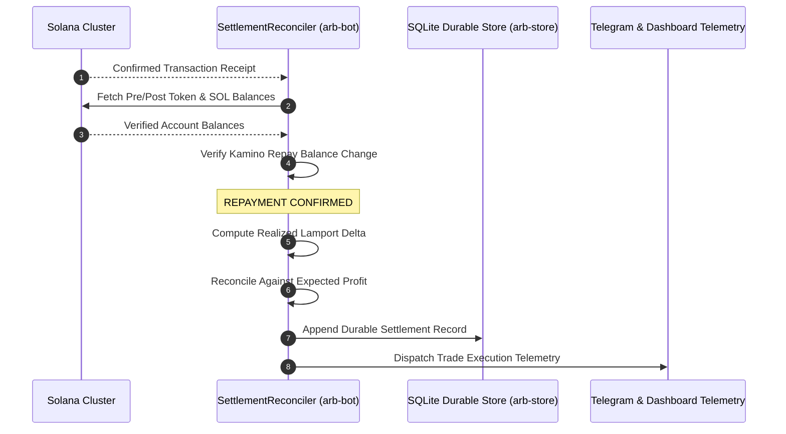

> [!NOTE]
> **ARCHIVED — HISTORICAL REFERENCE — NOT ACTIVE PROJECT INSTRUCTIONS**
> This document is preserved for historical auditing and forensic reference. It reflects past states and does NOT represent active project guidance or verified current status.
> For current, authoritative engineering instructions, architecture, and roadmaps, consult:
> - [docs/active/README.md](file:///c:/Users/azoozz/Downloads/my arbitrge/docs/active/README.md)
> - [docs/active/MASTER_ROADMAP.md](file:///c:/Users/azoozz/Downloads/my arbitrge/docs/active/MASTER_ROADMAP.md)
> - [docs/active/CURRENT_STATUS.md](file:///c:/Users/azoozz/Downloads/my arbitrge/docs/active/CURRENT_STATUS.md)

---

# OPERATIONS — SETTLEMENT & REALIZED PNL RECONCILIATION

**Author:** Quantitative Financial Auditor & Security Engineer  
**Date:** 2026-11-19  
**Status:** CANONICAL & VERIFIED  

---

## 1. Post-Execution Settlement Protocol

Following receipt of an on-chain confirmation receipt (`TransactionConfirmationStatus::Confirmed` or `Finalized`), the settlement reconciler executes a strict 5-step post-trade verification:



---

## 2. Settlement Verification Gates

1. **Repayment Verification:**
   - Evaluates that Kamino liquidity supply vault increased by at least $\text{BorrowedAmount} + \text{FlashFee}$.
   - If repayment failed, on-chain transaction atomicity guarantees the entire transaction was reverted; no partial repayment state can exist.

2. **Balance Delta Calculation:**
   $$\Delta \text{SOL}_{\text{wallet}} = \text{Balance}_{\text{post}} - \text{Balance}_{\text{pre}}$$
   - Any token balance changes are evaluated. If non-zero intermediate token inventory remains, a warning is raised (slippage or dust).

3. **Reconciliation Variance Check:**
   $$\text{Variance} = \text{RealizedProfit} - \text{ExpectedProfit}$$
   - Recorded in the durable settlement record for historical model calibration.

---

## 3. Durable Settlement Ledger Schema

Every trade produces a permanent record in `sentinel_state.db` under the `settlement_records` table:

```sql
CREATE TABLE IF NOT EXISTS settlements (
    signature TEXT PRIMARY KEY,
    slot INTEGER NOT NULL,
    route_description TEXT NOT NULL,
    borrow_mint TEXT NOT NULL,
    borrow_amount INTEGER NOT NULL,
    repay_amount INTEGER NOT NULL,
    flash_loan_fee INTEGER NOT NULL,
    priority_fee_paid INTEGER NOT NULL,
    jito_tip_paid INTEGER NOT NULL,
    gross_output_lamports INTEGER NOT NULL,
    expected_net_lamports INTEGER NOT NULL,
    realized_net_lamports INTEGER NOT NULL,
    settlement_status TEXT NOT NULL,
    created_at_utc TIMESTAMP DEFAULT CURRENT_TIMESTAMP
);
```

---

## 4. Fund Sweeping & Profit Retention Rules

- **Zero-Pre-Settlement Sweep:** The automated sweep worker is blocked from transferring profits if any in-flight transaction is unconfirmed or unresolved.
- **Safety Reserve:** The trading wallet maintains a permanent un-swept reserve of at least `0.50 SOL` to fund future priority fees and rent-exempt accounts.
- **No Unsettled Sweeps:** Sweeping operates strictly on confirmed net settled balance increases.
