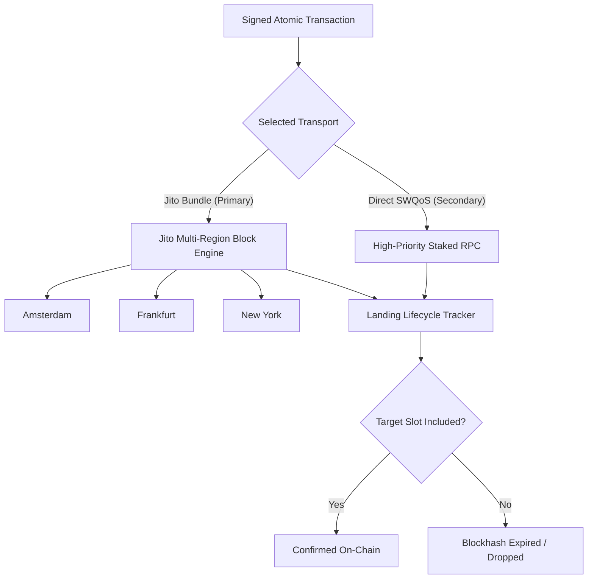

> [!NOTE]
> **ARCHIVED — HISTORICAL REFERENCE — NOT ACTIVE PROJECT INSTRUCTIONS**
> This document is preserved for historical auditing and forensic reference. It reflects past states and does NOT represent active project guidance or verified current status.
> For current, authoritative engineering instructions, architecture, and roadmaps, consult:
> - [docs/active/README.md](file:///c:/Users/azoozz/Downloads/my arbitrge/docs/active/README.md)
> - [docs/active/MASTER_ROADMAP.md](file:///c:/Users/azoozz/Downloads/my arbitrge/docs/active/MASTER_ROADMAP.md)
> - [docs/active/CURRENT_STATUS.md](file:///c:/Users/azoozz/Downloads/my arbitrge/docs/active/CURRENT_STATUS.md)

---

# OPERATIONS — TRANSACTION LANDING & IN-FLIGHT LIFECYCLE

**Author:** Senior Solana HFT Engineer  
**Date:** 2026-11-19  
**Status:** CANONICAL & VERIFIED  

---

## 1. Landing Strategy: Jito Bundles + SWQoS Direct

Arbitrage transactions are submitted using private Jito MEV bundles as the primary transport, with direct SWQoS / High-Priority RPC available as a secondary route:



---

## 2. In-Flight Lifecycle States

Every submitted intent transitions through strongly typed lifecycle states in `arb-land` / `arb-bot`:

```rust
pub enum InflightStatus {
    Submitted { signature: Signature, target_slot: u64, blockhash: Hash },
    InFlight { slots_waited: u32 },
    Landed { slot: u64, err: Option<TransactionError> },
    Expired { last_valid_block_height: u64 },
    Dropped,
}
```

### Invariant: Single-Submission Rule
- Under no circumstance is a dropped or ambiguous transaction re-signed and re-submitted blindly.
- If a transaction's inclusion is ambiguous, the system waits for blockhash expiration (`last_valid_block_height`) before marking the intent expired and unlocking intermediate state.

---

## 3. Blockhash Management & Expiration

1. **Freshness Window:** Blockhashes are cached for at most 150 slots (~60 seconds), with active refresh every 30 slots.
2. **Pre-flight Assertion:** Before signing, the transaction's blockhash must be younger than 40 slots old.
3. **Expiry Verification:** If an intent has not confirmed within 2 blocks past `last_valid_block_height`, the landing tracker queries `getSignatureStatuses`. If absent, the transaction is safely marked `Expired`.
