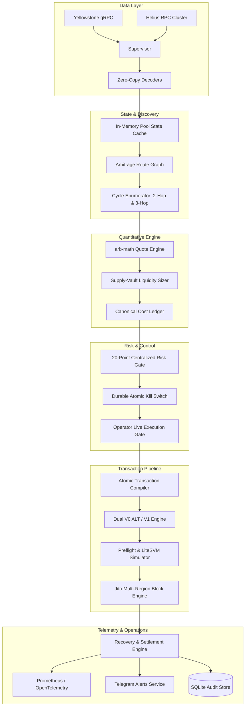

> [!NOTE]
> **ARCHIVED — HISTORICAL REFERENCE — NOT ACTIVE PROJECT INSTRUCTIONS**
> This document is preserved for historical auditing and forensic reference. It reflects past states and does NOT represent active project guidance or verified current status.
> For current, authoritative engineering instructions, architecture, and roadmaps, consult:
> - [docs/active/README.md](file:///c:/Users/azoozz/Downloads/my arbitrge/docs/active/README.md)
> - [docs/active/MASTER_ROADMAP.md](file:///c:/Users/azoozz/Downloads/my arbitrge/docs/active/MASTER_ROADMAP.md)
> - [docs/active/CURRENT_STATUS.md](file:///c:/Users/azoozz/Downloads/my arbitrge/docs/active/CURRENT_STATUS.md)

---

# Production Architecture Specification

## 1. System Overview
The Solana Arbitrage Engine is an ultra-low-latency, multi-pool arbitrage and flash loan trading system engineered in Rust for Solana mainnet-beta.

The engine detects price discrepancies across automated market makers (AMMs), specifically concentrating on Meteora DLMM, Raydium (CPMM/CLMM), and Orca Whirlpools. Capital is mobilized atomically via Kamino Lending flash loans and landed via Jito MEV bundles.

## 2. Core Architecture Topology

## 3. Strict Module Boundaries
- **Crate Isolation**: Leaf crates (`arb-types`, `arb-constants`) contain zero workspace dependencies.
- **Single Source of Truth**: All quote math and financial economics reside in `arb-math`.
- **Fail-Closed Execution**: Any error at any stage (stale state, dropped gRPC update, simulation error, circuit breaker trigger) causes immediate, fail-closed drop of the opportunity.
