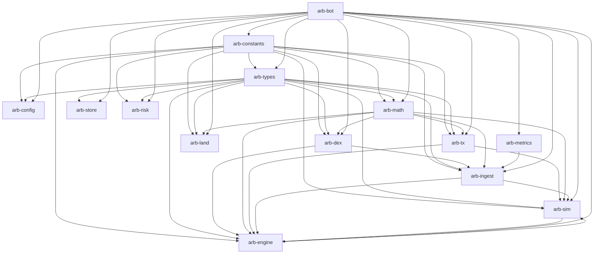

> [!NOTE]
> **ARCHIVED — HISTORICAL REFERENCE — NOT ACTIVE PROJECT INSTRUCTIONS**
> This document is preserved for historical auditing and forensic reference. It reflects past states and does NOT represent active project guidance or verified current status.
> For current, authoritative engineering instructions, architecture, and roadmaps, consult:
> - [docs/active/README.md](file:///c:/Users/azoozz/Downloads/my arbitrge/docs/active/README.md)
> - [docs/active/MASTER_ROADMAP.md](file:///c:/Users/azoozz/Downloads/my arbitrge/docs/active/MASTER_ROADMAP.md)
> - [docs/active/CURRENT_STATUS.md](file:///c:/Users/azoozz/Downloads/my arbitrge/docs/active/CURRENT_STATUS.md)

---

# ARCHITECTURE — COMPONENT MAP

## 1. Crate Dependency Graph

## 2. Component Responsibility Breakdown

### `arb-constants`
- **Location:** `crates/arb-constants`
- **Purpose:** Centralized, immutable single source of truth for:
  - Program IDs: Kamino Flashloan, Raydium (V4, CLMM, CPMM), Orca Whirlpool, Meteora (DLMM, DAMM), Pump.fun, PumpSwap, System, SPL Token, Token-2022, Associated Token Program.
  - Well-known token mints: WSOL, USDC, USDT.
  - Protocol fee numerators and denominators.
  - Compute budget defaults and transaction byte limits.

### `arb-types`
- **Location:** `crates/arb-types`
- **Purpose:** Core type domain definitions:
  - Strongly typed wrappers: `PoolId`, `TokenMint`, `Slot`, `SignedLamports`, `TypedAmount`.
  - In-memory representations: `PoolState`, `ReserveSnapshot`, `ProtocolType`.
  - Type-safe currency conversions preventing decimal and mint confusion.

### `arb-config`
- **Location:** `crates/arb-config`
- **Purpose:** Unified configuration management:
  - Environment variable resolution (`.env`) with fallbacks and validation.
  - `config.toml` deserialization and runtime configuration override support.
  - Validation rules for risk tolerances, borrow thresholds, and endpoint URLs.

### `arb-math`
- **Location:** `crates/arb-math`
- **Purpose:** Financial math and quantitative AMM formulas:
  - Constant-Product AMM (CPMM): Exact in, exact out, fee calculations.
  - Concentrated Liquidity (CLMM): Sqrt-price conversions, tick spacing, directional swaps.
  - Discrete Liquidity (DLMM): Bin array crossing, active bin liquidity, dynamic volatility fees.
  - Pump.fun / PumpSwap: Virtual reserves, bonding curve formulas, graduation mathematics.
  - Optimal Trade Sizing: Convex quadratic optimization to maximize net lamport profit.

### `arb-dex`
- **Location:** `crates/arb-dex`
- **Purpose:** Binary account decoders and protocol unpackers:
  - Zero-copy parsing of Raydium AMM pools, Orca Whirlpools, and Meteora LB pairs.
  - PDA verification and account layout validation.
  - Discriminator inspection ensuring untrusted accounts fail closed before reaching math.

### `arb-ingest`
- **Location:** `crates/arb-ingest`
- **Purpose:** Market-state ingestion and freshness verification:
  - WebSocket clients: Solami Blur, Solami Mirage (Protobuf), Helius JSON-RPC WebSocket.
  - RPC Pool: Multi-endpoint failover, round-robin, rate-limiting, and cooldown logic.
  - State integrity (`SlotIntegrity`): Slot watermark verification, gap detection, dead slot eviction.
  - Shared in-memory `AccountSnapshotStore` and `MarketStateCache`.

### `arb-risk`
- **Location:** `crates/arb-risk`
- **Purpose:** Pre-trade gatekeeper:
  - Enforces maximum borrow size (`max_borrow_lamports`).
  - Enforces minimum net profit hurdles (`min_net_profit_abs`).
  - Sanity checks on implied price impact and maximum slippage tolerance.

### `arb-tx`
- **Location:** `crates/arb-tx`
- **Purpose:** Atomic transaction compilation:
  - Kamino Flashloan instruction generation (borrow and repay).
  - Multi-hop swap instruction composition (Raydium, Orca, Meteora, Pump).
  - Versioned transaction construction: Legacy, V0 (with Address Lookup Tables), and V1 (SIMD-0385).
  - Prewarmed template byte-slicing for sub-millisecond serialization.

### `arb-sim`
- **Location:** `crates/arb-sim`
- **Purpose:** Pre-flight transaction simulation:
  - RPC simulation via `simulateTransaction` with sigVerify=false.
  - Local fork simulation and compute-unit consumption tracking.
  - Conservation of value verification: confirms token accounts end with expected profit.

### `arb-land`
- **Location:** `crates/arb-land`
- **Purpose:** MEV protection and landing:
  - Jito Block Engine bundle creation and regional dispatch (Frankfurt, NY, Amsterdam, Tokyo).
  - Dynamic Jito tip calculation using floor, percentiles, and profit-sharing caps.
  - Direct SWQoS / High-Priority RPC submission fallback.

### `arb-engine`
- **Location:** `crates/arb-engine`
- **Purpose:** Arbitrage discovery coordinator:
  - Route graph construction across registered pools (2-hop, 3-hop, 4-hop cycles).
  - Negative cycle detection using modified Bellman-Ford algorithms.
  - End-to-end opportunity generation, sizing, quoting, and dispatch packaging.

### `arb-bot`
- **Location:** `crates/arb-bot`
- **Purpose:** Process supervisor and operator interface:
  - Runtime event loop, worker coordination, and graceful shutdown handling.
  - Emergency Kill Switch and persistent state management.
  - REST & WebSocket API for web dashboard and telemetry monitoring.
  - Telegram alert notifications and interactive operator commands.
