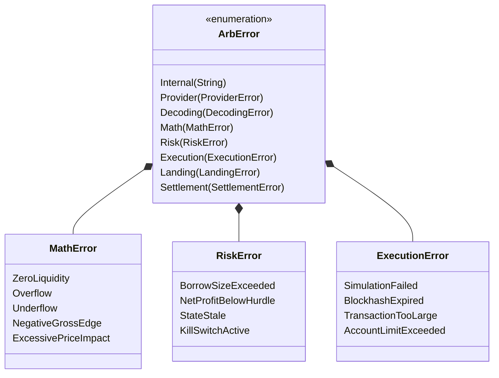

> [!NOTE]
> **ARCHIVED — HISTORICAL REFERENCE — NOT ACTIVE PROJECT INSTRUCTIONS**
> This document is preserved for historical auditing and forensic reference. It reflects past states and does NOT represent active project guidance or verified current status.
> For current, authoritative engineering instructions, architecture, and roadmaps, consult:
> - [docs/active/README.md](file:///c:/Users/azoozz/Downloads/my arbitrge/docs/active/README.md)
> - [docs/active/MASTER_ROADMAP.md](file:///c:/Users/azoozz/Downloads/my arbitrge/docs/active/MASTER_ROADMAP.md)
> - [docs/active/CURRENT_STATUS.md](file:///c:/Users/azoozz/Downloads/my arbitrge/docs/active/CURRENT_STATUS.md)

---

# ARCHITECTURE — ERROR HANDLING & INCIDENT MANAGEMENT

## 1. Design Philosophy: Fail-Closed Security

In flash-loan arbitrage, any unhandled error or optimistic fallback can lead to failed transactions, wasted priority fees, lost Jito tips, or corrupted state. The system adheres to strict fail-closed principles:

- When in doubt, **do not trade**.
- An unconfirmed opportunity is an **unexecuted opportunity**.
- Any simulation failure causes **immediate transaction abort**.
- A disconnected provider **halts quoting on its pools**.

## 2. Standardized Error Domains

## 3. Explicit Reason Codes

Every rejected opportunity and failed execution records an explicit reason code in the structured logs, telemetry ring, and web API:

| Reason Code | Category | Meaning | Recovery Action |
|---|---|---|---|
| `ERR_SLOT_STALE` | Integrity | Snapshot slot older than cluster high-water mark | Drop update; wait for fresh frame |
| `ERR_POOL_INCOMPLETE` | Integrity | Missing vault or bin array in multi-hop route | Discard candidate cycle |
| `ERR_NEGATIVE_GROSS_EDGE` | Math | Total output token amount less than borrowed amount | Continue scanning; normal market spread |
| `ERR_NET_PROFIT_BELOW_HURDLE` | Economic | Net profit after fees and tips is below minimum threshold | Discard candidate cycle |
| `ERR_EXCESSIVE_SLIPPAGE` | Risk | Quoted slippage exceeds configured safety percentage | Scale down trade size or abort |
| `ERR_SIMULATION_FAILED` | Execution | On-chain runtime simulation returned error status | Abort transaction; log error logs |
| `ERR_BLOCKHASH_EXPIRED` | Execution | Blockhash expired prior to confirmation | Invalidate blockhash cache |
| `ERR_BUNDLE_DROPPED` | Landing | Jito bundle was not included in target leader block | Log dropped bundle; do not re-submit blindly |
| `ERR_KILL_SWITCH_ACTIVE` | Operator | Emergency stop engaged via web dashboard or file | Bot paused; manual operator resume required |

## 4. Emergency Kill Switch

- **Persistence:** Controlled via `./data/kill_switch` marker and `/api/control/emergency_stop`.
- **Precedence:** Evaluated at the final pre-submission gate. If active, all outgoing transaction dispatches are blocked immediately.
- **Operator Authorization:** Can only be resumed by authenticated operator credentials via `/api/control/resume`.
