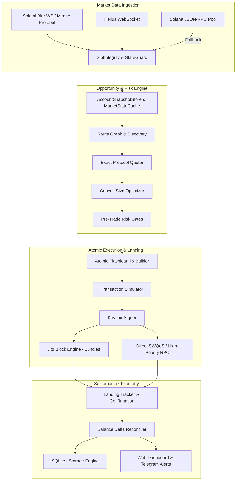

> [!NOTE]
> **ARCHIVED — HISTORICAL REFERENCE — NOT ACTIVE PROJECT INSTRUCTIONS**
> This document is preserved for historical auditing and forensic reference. It reflects past states and does NOT represent active project guidance or verified current status.
> For current, authoritative engineering instructions, architecture, and roadmaps, consult:
> - [docs/active/README.md](file:///c:/Users/azoozz/Downloads/my arbitrge/docs/active/README.md)
> - [docs/active/MASTER_ROADMAP.md](file:///c:/Users/azoozz/Downloads/my arbitrge/docs/active/MASTER_ROADMAP.md)
> - [docs/active/CURRENT_STATUS.md](file:///c:/Users/azoozz/Downloads/my arbitrge/docs/active/CURRENT_STATUS.md)

---

# ARCHITECTURE — SYSTEM OVERVIEW

## 1. System Mission & Scope

The Sentinel Solana Flashloan Arbitrage system is a high-frequency, non-custodial, atomic trading system built in Rust. It monitors liquidity across Solana decentralized exchanges (DEXs), detects cross-pool pricing discrepancies, computes mathematically optimal borrow and swap sizes, packages them into atomic flash-loan transactions (via Kamino), and submits them directly through private MEV channels (Jito Block Engine) or high-priority RPC channels.

## 2. Core Architectural Principles

1. **Atomic Execution (Zero Capital At Risk):**
   All arbitrage operations borrow capital via flash loans (Kamino), execute swap hops across multiple DEX venues, and repay the principal plus fees in a single atomic transaction. If net profit is not achieved or any hop slips, the entire transaction reverts on-chain. Capital is never left exposed across blocks.

2. **WebSocket-First Market Ingestion:**
   Market data arrives through low-latency WebSockets (Solami Blur/Mirage and Helius WebSockets), with HTTP JSON-RPC strictly reserved for transaction submission, simulation, blockhashes, and cold-start fallback account hydration. No paid Yellowstone gRPC or local Agave validator is required.

3. **In-Process State Integrity Guard:**
   Incoming account updates are validated against slot watermarks, bank identities, and stream generations before entering the market cache. Updates from dead slots, reordered frames, or stale connections fail closed and are immediately discarded.

4. **Checked Integer Quantitative Finance:**
   All token amounts, lamports, liquidity bins, ticks, and fee rates are calculated using checked integer arithmetic (`u64`, `u128`, `U256`, `U512`). Floating-point arithmetic is prohibited on the execution-critical path.

5. **Direct SDK & IDL Execution:**
   No generic third-party routing aggregators (such as Jupiter API) are used in production execution. All swap instructions, account layouts, PDA derivations, and discriminators use direct protocol SDKs and verified IDL specifications.

## 3. High-Level System Architecture Diagram

