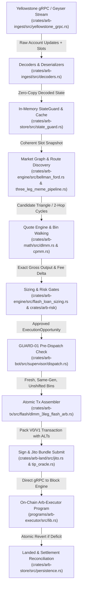

> [!NOTE]
> **ARCHIVED — HISTORICAL REFERENCE — NOT ACTIVE PROJECT INSTRUCTIONS**
> This document is preserved for historical auditing and forensic reference. It reflects past states and does NOT represent active project guidance or verified current status.
> For current, authoritative engineering instructions, architecture, and roadmaps, consult:
> - [docs/active/README.md](file:///c:/Users/azoozz/Downloads/my arbitrge/docs/active/README.md)
> - [docs/active/MASTER_ROADMAP.md](file:///c:/Users/azoozz/Downloads/my arbitrge/docs/active/MASTER_ROADMAP.md)
> - [docs/active/CURRENT_STATUS.md](file:///c:/Users/azoozz/Downloads/my arbitrge/docs/active/CURRENT_STATUS.md)

---

# Repository End-to-End Pipeline & Route Lifecycle
**Document Version:** 1.0.0 — Grounded in Production Rust Codebase  
**Target Repository:** `SOLANA_FLASHLOAN_ARBITUGE`  
**Auditor:** Lead Senior Architect & Supervisor  

---

## 1. Master Pipeline Architecture Flow



---

## 2. End-to-End Execution Sequence (Step-by-Step Code Tracing)

### Step 1: Ingestion Layer (`crates/arb-ingest`)
- **Transport:** Connects via Yellowstone gRPC client (`yellowstone_grpc.rs`). Subscribes specifically to DEX Program IDs (Raydium, Meteora DLMM, Orca, Pump.fun).
- **Slot Integrity:** Every account update is stamped with `slot` and `write_version`. If a slot is marked dead via `slot_integrity.rs`, any dependent state is immediately invalidated.
- **Fail-Closed Guard:** If the gRPC connection drops or reconnects, `stream_generation` increments by 1.

### Step 2: Storage & In-Memory State (`crates/arb-store`)
- **StateGuard:** Provides zero-lock contention snapshots. Immutable references allow the engine to evaluate routes without blocking incoming stream writes.
- **Tombstones:** Accounts with `lamports == 0` are recorded as tombstones and evicted from active pool caches immediately.

### Step 3: Route Discovery & Topology Validation (`crates/arb-engine`)
- **Graph Construction:** `MarketGraph` maintains directional trading pairs.
- **Triangle Cycles:** `three_leg_meme_pipeline.rs` generates candidate 3-leg cycles:
  $$\text{WSOL} \xrightarrow{\text{Leg 1}} \text{Meme A} \xrightarrow{\text{Leg 2}} \text{Meme B} \xrightarrow{\text{Leg 3}} \text{WSOL}$$
- **Role Invariant:** Evaluates `counterpart` tokens. Guarantees Leg 1 output mint matches Leg 2 input mint, Leg 2 output matches Leg 3 input, and Leg 3 returns strictly to WSOL.

### Step 4: Mathematical Quoting (`crates/arb-math`)
- **Pure Integer Quotes:** Zero lossy float casts (`Option<u64>`).
- **Meteora DLMM:** Bin-walking traversal across active price bins with dynamic fee accumulator updates.
- **Kamino Flash Fee:** Exact scaling via Kamino's U68F60 fixed-point factor ($(\text{amount} \times \text{fee\_sf}) \gg 60$).

### Step 5: Sizing & Cost-Basis Gate (`crates/arb-engine` & `crates/arb-risk`)
- **Kelly Sizing / Safety Factor:** Sizing is clamped by Kamino vault liquidity and maximum pool depth.
- **Cost Basis Ledger:** Every cost is accounted for before firing:
  $$\text{Net Profit} = \text{Gross WSOL Return} - \text{Principal Borrow} - \text{Kamino Flash Fee} - \text{Priority Fee} - \text{Base Signature Fee} - \text{Jito Tip}$$
- **EV Gate:** Transaction only proceeds if $\text{Net Profit} \ge \text{MIN\_NET\_PROFIT\_LAMPORTS}$.

### Step 6: GUARD-01 Pre-Flight Check (`crates/arb-bot/src/supervisor/dispatch.rs`)
Immediately before signing, the supervisor re-verifies:
1. `stream_generation == expected_stream_generation` (stream did not reconnect mid-quote).
2. `current_slot - pool.last_update_slot <= max_state_age_slots` (no stale pools).
3. `!ingest.slot_is_dead(slot)` (slot not dropped in fork).
4. `dlmm.active_bin_id == hop.active_bin_id` (pool price did not shift during calculation).

### Step 7: Atomic Transaction Assembly (`crates/arb-tx`)
The atomic transaction is built with the following exact instruction sequence:
```text
[Ix 0] ComputeBudget::SetComputeUnitLimit
[Ix 1] ComputeBudget::SetComputeUnitPrice
[Ix 2] ATA CreateIdempotent (WSOL settlement)
[Ix 3] ATA CreateIdempotent (Meme A intermediate)
[Ix 4] ATA CreateIdempotent (Meme B intermediate)
[Ix 5] klend::flash_borrow_reserve_liquidity (borrow_instruction_index = 5)
[Ix 6] arb_executor::execute_three_leg (CPI 1, 2, 3 with on-chain delta checks)
[Ix 7] klend::flash_repay_reserve_liquidity (repay_instruction_index = 5)
[Ix 8] SystemProgram::Transfer (Jito dynamic tip)
```
- **Packet Size:** Enforces wire size $\le 1232$ bytes (or V1 transport MTU 4096 bytes).

### Step 8: Jito Bundle Submission & Settlement (`crates/arb-land`)
- **Submission:** Sent directly via HTTP/2 gRPC to Jito Block Engine endpoints without touching public mempools.
- **Dynamic Tip:** Clamped to $50\% - 75\%$ of net margin, sent to a randomly selected Jito Tip Account.
- **Confirmation:** Reconciled on-chain; realized PnL is committed to SQLite/PostgreSQL store.
