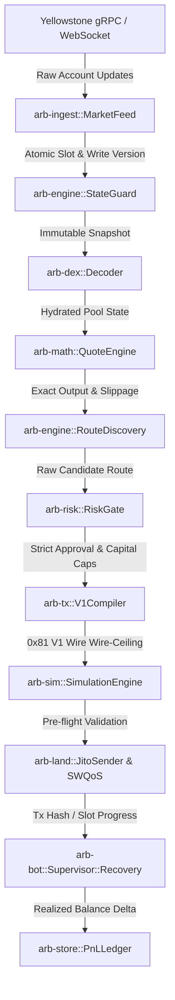

> [!NOTE]
> **ARCHIVED — HISTORICAL REFERENCE — NOT ACTIVE PROJECT INSTRUCTIONS**
> This document is preserved for historical auditing and forensic reference. It reflects past states and does NOT represent active project guidance or verified current status.
> For current, authoritative engineering instructions, architecture, and roadmaps, consult:
> - [docs/active/README.md](file:///c:/Users/azoozz/Downloads/my arbitrge/docs/active/README.md)
> - [docs/active/MASTER_ROADMAP.md](file:///c:/Users/azoozz/Downloads/my arbitrge/docs/active/MASTER_ROADMAP.md)
> - [docs/active/CURRENT_STATUS.md](file:///c:/Users/azoozz/Downloads/my arbitrge/docs/active/CURRENT_STATUS.md)

---

# Repository Architecture Map (خريطة التدفق المعماري والمسار البرمجي)

تاريخ التحديث: 17 نوفمبر 2026
المرجع: `audit/external-reference-audit`

## 1. التدفق التشغيلي الحقيقي للبيانات (End-to-End Pipeline)

## 2. المسار البرمجي المفصل لكل خطوة

| الخطوة | الـ Crate المسؤول | الملفات الرئيسية | الدوال والـ Structs المحورية | الضمانات والـ Invariants |
|---|---|---|---|---|
| **1. Ingestion** | `arb-ingest` | `src/grpc.rs`, `src/ws.rs` | `YellowstoneClient`, `WsStream` | رفض Stale data، عدم استخدام cache قديم عند انقطاع الاتصال (Fail closed). |
| **2. State Guard** | `arb-engine` | `src/state_guard.rs` | `StateGuard`, `PoolSnapshot` | التحقق من `slot` و `write_version` لمنع الرجوع بالزمن (Time-travel updates). |
| **3. Decoding** | `arb-dex` | `src/raydium.rs`, `src/meteora.rs`, `src/orca.rs` | `MeteoraDlmmPool::decode`, `CpmmPool::decode` | فك تشفير مباشر مطابق للـ IDL والـ Bin Arrays بدون تخمين. |
| **4. Exact Math** | `arb-math` | `src/dlmm.rs`, `src/cpmm.rs`, `src/economic.rs` | `quote_exact_in`, `calculate_net_profit`, `calculate_flash_fee` | حسابات صحيحة بالكامل (u64 / u128 / U256)، بدون Float نهائياً؛ رسوم كامينو الدقيقة `max(amount * sf, 2^60)`. |
| **5. Routing & Sizing**| `arb-engine` | `src/route.rs`, `src/sizing.rs` | `find_three_leg_cycles`, `optimize_borrow_size` | حجم الاقتراض محكوم بالسيولة الفعلية في `Supply Vault`، وليس مجرد سقف افتراضي. |
| **6. Risk Gate** | `arb-risk` | `src/gate.rs`, `src/kill_switch.rs` | `RiskGate::evaluate`, `KillSwitch` | سقف خسارة صارم، والوكيل يمكنه فقط تضييق الحدود (Tighten-only). |
| **7. Tx Compilation** | `arb-tx` | `src/compiler.rs`, `src/flash/kamino.rs` | `build_v1_transaction`, `build_kamino_flash_borrow/repay` | صيغة V1 Transaction بحجم أقل من 4096 bytes، 64 inline accounts، وذرية كاملة (Atomicity). |
| **8. Landing & Execution**| `arb-land` | `src/jito.rs`, `src/swqos.rs` | `send_bundle_with_tip`, `RpcTransport` | استخدام Tip ديناميكي مدروس مع Jito bundles و SWQoS. |
| **9. Recovery & PnL** | `arb-bot` | `src/supervisor/recovery.rs`, `crates/arb-store` | `reconcile_pending_tx`, `record_trade` | التحقق من Signature status قبل إعلان الفشل؛ توثيق الأرباح الحقيقية فقط. |
