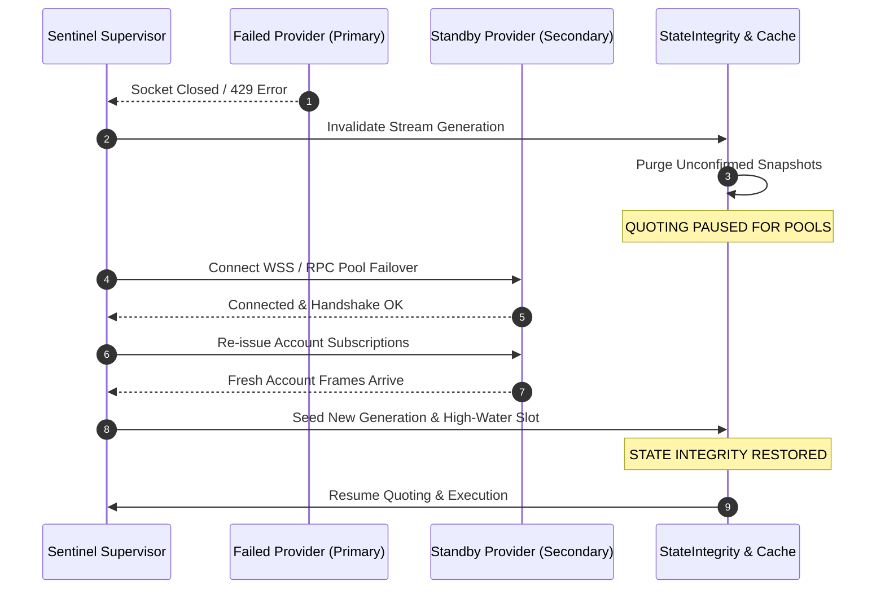

# OPERATIONS — PROVIDER FAILOVER & RECOVERY RUNBOOK

**Author:** QA / Security / DevOps Engineer  
**Date:** 2026-11-19  
**Status:** CANONICAL & VERIFIED  

---

## 1. Automated Failover Triggers

The `ProviderSupervisor` continuously audits provider health and initiates automatic failover under any of the following deterministic conditions:

1. **Heartbeat Loss:** 3 consecutive missing keep-alive responses.
2. **Rate Limit Storm (HTTP 429):** Receipt of JSON-RPC error `32005` or HTTP `429 Too Many Requests`. Cooldown is immediately initiated.
3. **Slot Lag Contention:** Provider falls behind cluster high-water slot by $> 8\text{ slots}$ (3.2 seconds).
4. **Transport Disconnect:** Abnormal TCP socket termination or TLS closure.

---

## 2. Failover Sequence

---

## 3. Cooldown & Storm Prevention

- When an endpoint emits an HTTP 429 or rate-limit error, it is placed in an explicit cooldown bucket (default 30 seconds).
- The `RpcPool` automatically skips cooling endpoints and directs traffic to healthy alternates.
- If all configured endpoints enter cooldown simultaneously, the system **fails closed**: no transactions are dispatched, and alerts are triggered via Telegram and Prometheus.
