# QUANTITATIVE AUDIT — PUMP.FUN GRADUATION & BOOST ARBITRAGE MODEL

**Authors:** Senior Solana HFT Engineer & Quantitative Financial Auditor  
**Date:** 2026-11-19  
**Status:** FORENSIC AUDIT & HARMONIZATION COMPLETE  

---

## 1. Executive Summary & Core Verdict

The historical research repository included a Pump.fun Graduation "BOOST" arbitrage strategy modeling a ~17.58 SOL protocol buyback following bonding curve graduation.

Our quantitative and on-chain audit reveals a **critical mathematical and architectural inconsistency**:
1. **The Python Research Script (`scripts/calculate_arbitrage_opportunities.py`):**
   Fabricated unbacked liquidity by adding $17.58 \times 0.70 = 12.306\text{ SOL}$ directly to the newly formed pool's opening quote reserves ($84.99 + 12.306 = 97.296\text{ SOL}$).
2. **The Rust Production Crate (`crates/arb-math/src/pump_boost_arb.rs`):**
   Did **not** add phantom quote liquidity to the pool. Instead, it evaluated the dump against the real 84.99 SOL opening reserves, and then applied an arbitrary 70% haircut to the base pool output.
3. **On-Chain Ground Truth:**
   The Pump.fun migration transaction seeds the new AMM pool (Raydium or PumpSwap) with **exactly** the migrated curve liquidity (~84.99 SOL) and 206.9M tokens. No protocol BOOST liquidity is deposited into the pool reserves during migration. Any buybacks conducted by the protocol occur as **asynchronous TWAP orders across subsequent slots/minutes**.

**Verdict:** An atomic flash-loan arbitrageur executing in the migration slot **cannot capture asynchronous future buybacks in the same transaction**. Modeling BOOST as extra pool liquidity is financially invalid. The strategy must be evaluated strictly against verified on-chain pool reserves.

---

## 2. Mathematical Forensic Analysis

### 2.1 The Python Model Inconsistency
In `scripts/calculate_arbitrage_opportunities.py` (lines 42–49):
```python
if include_boost_buyback:
    eff_quote = POOL_OPENING_QUOTE_LAMPORTS + int(PUMP_BOOST_ALLOCATION_LAMPORTS * (capture_efficiency_bps / 10000.0))
else:
    eff_quote = POOL_OPENING_QUOTE_LAMPORTS

denom = POOL_OPENING_BASE_TOKENS + acquired_tokens
raw_dump = (eff_quote * acquired_tokens) // denom if denom > 0 else 0
```
- For $85\text{ SOL}$ graduation with $S = 65\text{ SOL}$ curve completion:
  - Tokens acquired: $\approx 84.9\text{M tokens}$.
  - Under Python `eff_quote = 97.296 SOL`:
    $$\text{raw\_dump} = \frac{97.296 \times 84.9\text{M}}{206.9\text{M} + 84.9\text{M}} \approx 28.30\text{ SOL}$$
  - Cost to complete: $85 - 65 = 20\text{ SOL}$.
  - Net Profit calculated: $28.30 - 20 = +8.30\text{ SOL}$ (\$600+ profit).

### 2.2 The Rust Model Inconsistency
In `crates/arb-math/src/pump_boost_arb.rs` (lines 101–118):
```rust
let pool_quote = U256::from(POOL_OPENING_QUOTE_LAMPORTS); // 84.99 SOL ONLY
let pool_base = U256::from(POOL_OPENING_BASE_TOKENS);

let raw_dump = (pool_quote * tok) / (pool_base + tok);
// Applies 70% capture efficiency haircut to the UNBOOSTED dump:
let realized_gross = (raw_dump * capture_efficiency_bps) / 10_000;
```
- Under Rust:
  $$\text{raw\_dump} = \frac{84.99 \times 84.9\text{M}}{206.9\text{M} + 84.9\text{M}} \approx 24.72\text{ SOL}$$
  $$\text{realized\_gross} = 24.72 \times 0.70 \approx 17.30\text{ SOL}$$
  - Cost to complete: $20\text{ SOL}$.
  - Net Profit calculated: $17.30 - 20 = -2.70\text{ SOL}$ (A \$200 LOSS!).

### 2.3 The Root Cause
The two implementations were computing completely different payoff functions:
- Python assumed a **fictional 97.3 SOL pool**.
- Rust assumed a **discounted 59.5 SOL effective pool**.
Neither represented the true on-chain state.

---

## 3. On-Chain Graduation Lifecycle & Race Conditions

```mermaid
sequenceDiagram
    autonumber
    actor Sniper as Arbitrageur (Flash Loan)
    participant Curve as Pump.fun Bonding Curve
    participant Migrator as Pump.fun Migration Program
    participant AMM as PumpSwap / Raydium Pool
    participant Buyback as Protocol TWAP Bot (Async)

    Note over Curve: Real SOL reaches 85 SOL
    Curve->>Curve: Emit CompleteEvent (complete = true)
    Note over Curve: Trading Halted (Error 0x1775)
    
    Migrator->>AMM: Initialize Pool (84.99 SOL + 206.9M Tokens)
    Migrator->>Migrator: Emit CompleteAmmMigrationEvent
    
    rect rgb(20, 30, 45)
        Note over Sniper, AMM: ATOMIC FLASH LOAN EXECUTION WINDOW
        Sniper->>AMM: Sell acquired tokens against 84.99 SOL
        AMM-->>Sniper: Realized SOL (must cover loan + fee)
    end

    Note over Buyback: Minutes / Slots Later
    Buyback->>AMM: Separate TWAP Buy Orders (Cannot be captured atomically)
```



### Critical Race Conditions:
1. **Event Precedence:** Receipt of `CompleteEvent` does NOT mean the AMM pool exists. Attempting to trade before `CompleteAmmMigrationEvent` and pool account confirmation will cause transaction failure.
2. **Atomic Repayment Hazard:** Because the protocol buyback does not occur in the migration transaction, selling curve tokens into the newly initialized pool results in negative gross arbitrage if the purchase cost exceeded fair value.
3. **Sniper Competition:** Multiple bot searchers compete for the first trade on the new pool, driving Jito tips to $\ge 50-80\%$ of any marginal spread.

---

## 4. Harmonized Scenarios

To prevent false profitability claims, the quantitative model is harmonized into three explicit modes:

1. **Conservative / Atomic Floor (BOOST Disabled):**
   - Evaluates pure atomic execution against actual opening reserves (84.99 SOL).
   - Zero assumption of boost buybacks.
   - Trade is ONLY executable if the bonding curve price at graduation is lower than the opening pool price after accounting for swap fees and price impact.

2. **Verified Mechanism (Intra-Slot Observed Liquidity):**
   - Trades are quoted using verified on-chain account snapshots of the pool vault token balances.
   - If a buyback transaction is observed in the pending block, it is accounted for only if confirmed in the same slot.

3. **Theoretical Research Scenario:**
   - Clearly labeled as non-executable research simulations in standalone reporting.
