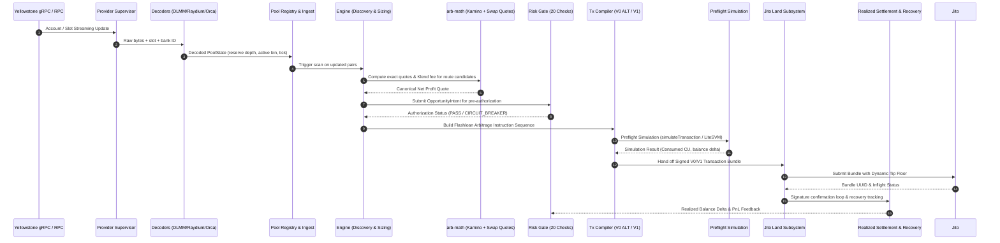

# End-to-End Execution Path Map

## Complete Execution Pipeline: Signal to Landed Arbitrage

## Detailed Path Invariants

### 1. Discovery Path
- **Entry**: `arb-bot/src/supervisor/strategy.rs` -> `arb-engine/src/pipeline.rs`.
- **Mint Continuity**: Hop 1 output == Hop 2 input; Hop 2 output == Hop 3 input; Hop 3 output == Hop 1 input.
- **Cycle Detection**: No duplicate pool instances in a single cycle.

### 2. Sizing & Economics Path
- **Entry**: `arb-engine/src/sizing.rs` & `arb-math/src/economic.rs`.
- **Constraint**: Borrow size strictly bounded by supply vault liquidity in live reserve account.
- **Kamino Repayment Formula**: `repayment = principal + fee`, where `fee_bits = max(amount * sf, 2^60)` pre-rounding.
- **Net Profit Model**: `Gross Output - Borrow Principal - Flash Fee - DEX Fees - Jito Tip - Priority Fee - Base Lamports - Token Transfer Fees`. Authoritative decisions strictly prohibit floating point arithmetic.

### 3. Risk Authorization Path
- **Entry**: `arb-risk/src/policy.rs` & `arb-risk/src/circuit_breaker.rs`.
- **20-Point Check**:
  1. Kill Switch status (durable).
  2. Global execution authorization (`ARB_LIVE=1` required, default 0).
  3. Circuit breaker state (consecutive loss ceiling).
  4. Hot wallet health (minimum operational balance reserved).
  5. Available capital & trade size ceiling.
  6. Route freshness (maximum allowable slot age).
  7. State coherence across hop banks.
  8. Price impact ceiling.
  9. Expected net profit floor (`MIN_NET_PROFIT_USD`).
  10. Maximum Jito tip budget (max 30% of profit, hard ceiling).
  11. Total execution cost limit.
  12. Daily loss limit.
  13. Hourly loss limit.
  14. Inflight bundle capacity.
  15. Provider health & slot lag.
  16. Minimum landing probability threshold.
  17. Transaction validity & wire size.
  18. Duplicate execution prevention.
  19. Account collision check.
  20. Final dispatch readiness gate.

### 4. Transaction Assembly Path
- **Entry**: `arb-tx/src/compiler.rs` & `arb-tx/src/flash/kamino.rs`.
- **Instruction Ordering**:
  1. Compute Budget (SetComputeUnitLimit + SetComputeUnitPrice) [V0 mode only; stripped in V1].
  2. Kamino Flash Borrow (`KlendInstruction::FlashBorrowReserveLiquidity`).
  3. Hop 1 Swap (Meteora DLMM / Raydium / Orca).
  4. Hop 2 Swap.
  5. [Optional] Hop 3 Swap.
  6. Kamino Flash Repay (`KlendInstruction::FlashRepayReserveLiquidity`, referencing borrow index).
  7. Jito Tip Transfer (to dynamic tip account selected by slot).
- **Atomicity Guard**: Zero bundle-splitting. All swaps and repayment enclosed in a single transaction.

### 5. Settlement & Recovery Path
- **Entry**: `arb-bot/src/supervisor/recovery.rs`.
- **Principle**: Ambiguous dispatch ≠ failure. On timeout, check signature status; only mark expired if current slot exceeds `last_valid_block_height + 160`. Never blindly re-sign.
